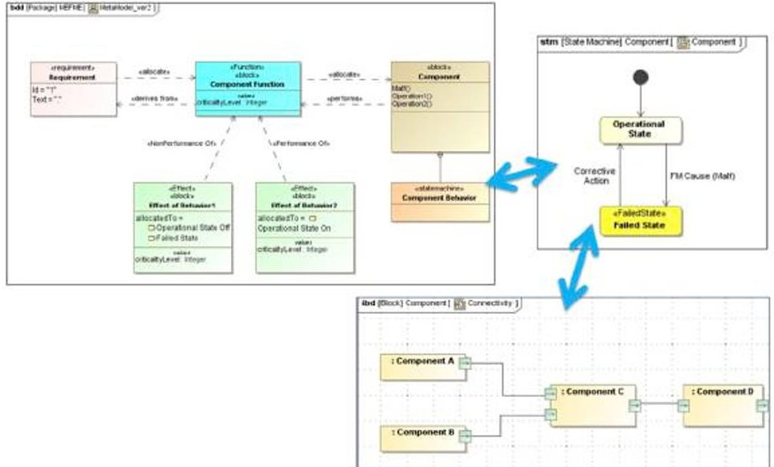
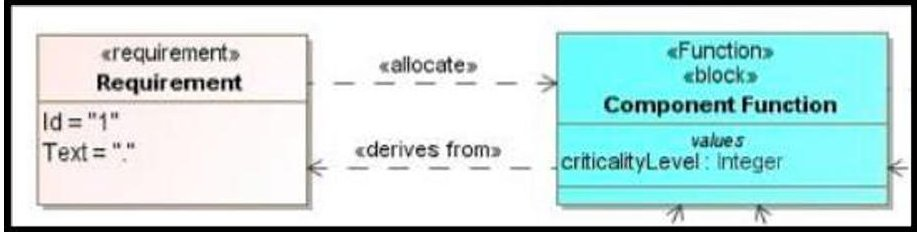
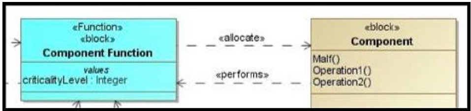
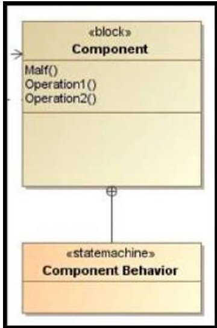
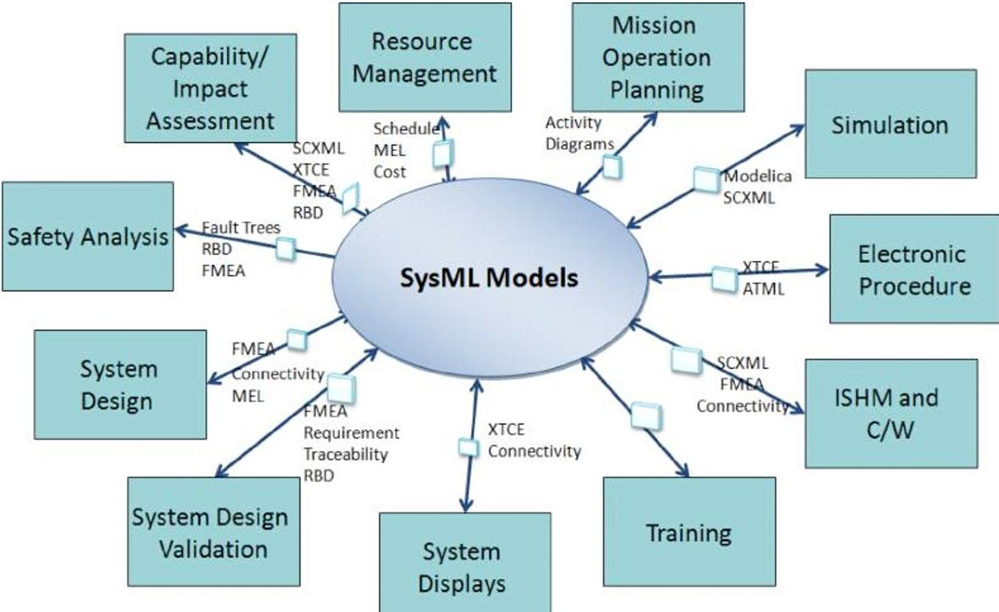
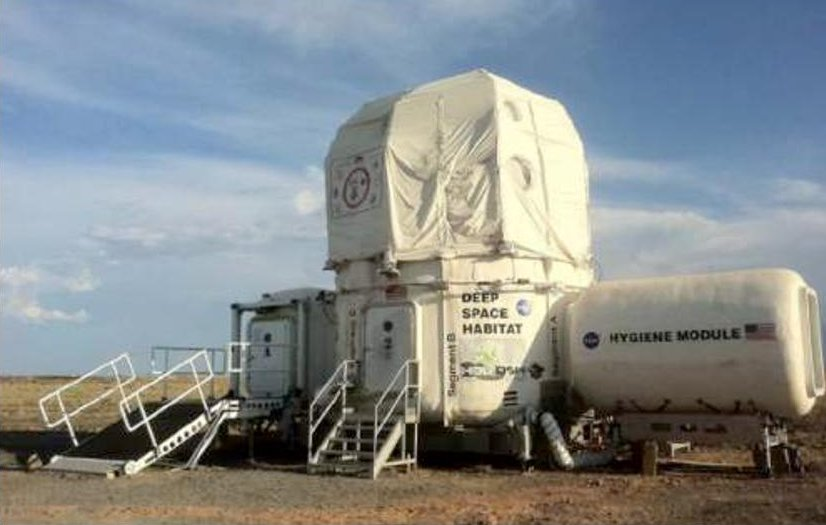
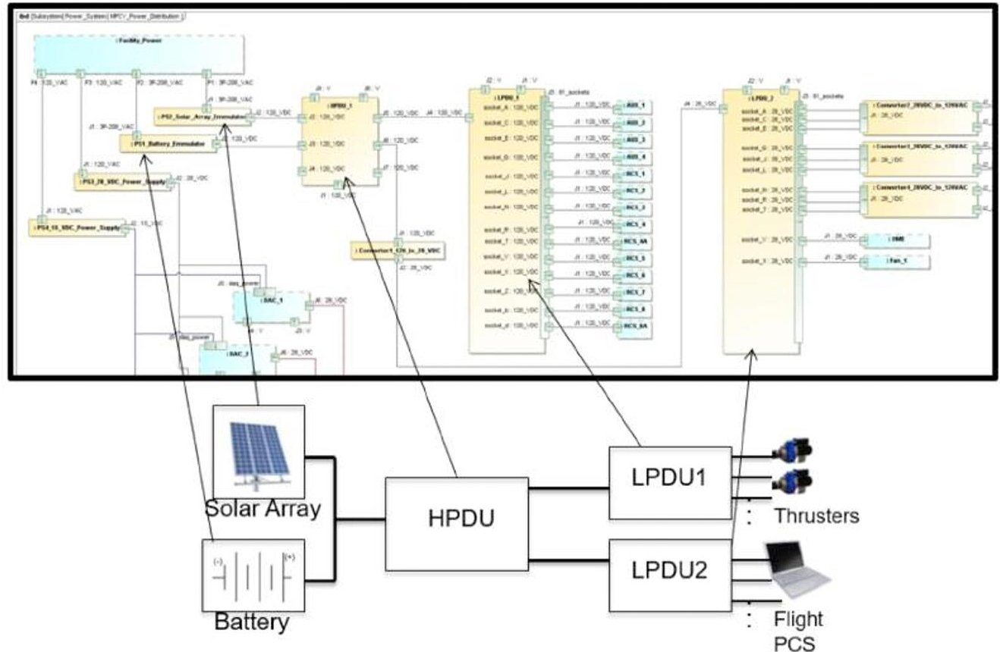
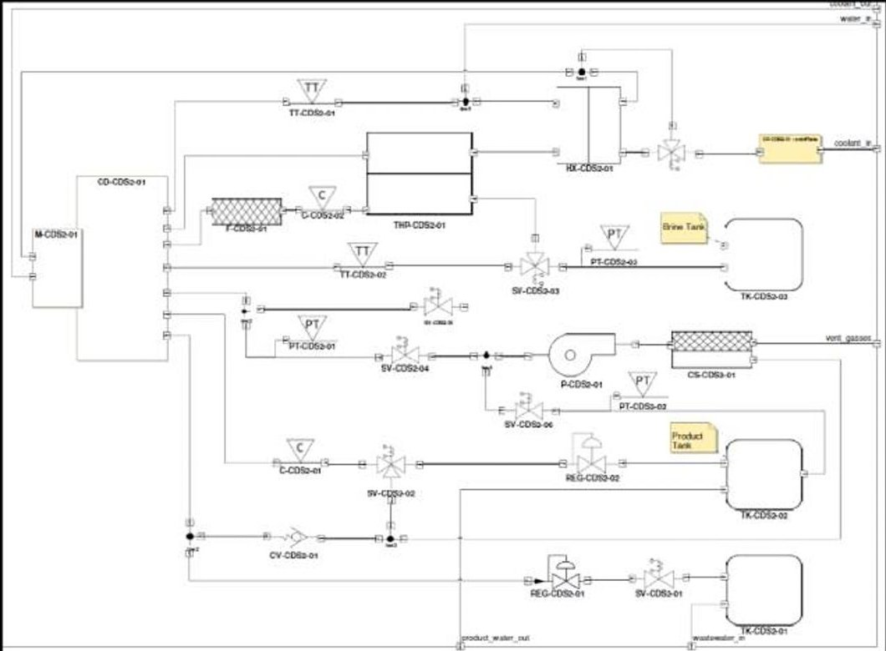

<!-- PDF_PAGE: 1 -->

# Effort to Accelerate MBSE Adoption and Usage at JSC

Lui Wang $ ^{1} $ NASA Johnson Space Center, Houston, TX 77058

and

Michel Izygon, Ph.D. $ ^{2} $ , Shira Okon $ ^{3} $ , Larry Garner $ ^{4} $ , and Howard Wagner, Ph.D. $ ^{5} $ Tietronix Software Inc., Houston, TX 77058

This paper describes the authors' experience in adopting Model Based System Engineering (MBSE) at the NASA/Johnson Space Center (JSC). Since 2009, NASA/JSC has been applying MBSE using the Systems Modeling Language (SysML) to a number of advanced projects. Models integrate views of the system from multiple perspectives, capturing the system design information for multiple stakeholders. This method has allowed engineers to better control changes, improve traceability from requirements to design and manage the numerous interactions between components. As the project progresses, the models become the official source of information and used by multiple stakeholders. Three major types of challenges that hamper the adoption of the MBSE technology are described. These challenges are addressed by a multipronged approach that includes educating the main stakeholders, implementing an organizational infrastructure that supports the adoption effort, defining a set of modeling guidelines to help engineers in their modeling effort, providing a toolset that support the generation of valuable products, and providing a library of reusable models. JSC project case studies are presented to illustrate how the proposed approach has been successfully applied.

## Nomenclature

CAD = Computer-Aided Design

CDS = Cascade Distillation System

DSH = Deep Space Habitat

EAM = Exploration Augmentation Module

FM = Fault Management

FSM = Finite State Machine

HDU = Habitat Demonstration Unit

IBD = Internal Block Diagram

iPAS = Integrated Power and Avionics System

ISS = International Space Station

JSC = Johnson Space Center

JSMT = JSC System Modeling Team

MBSE = Model Based Systems Engineering

OMG = Object Management Group

R&M = Reliability and Maintainability

SME = Subject Matter Expert

SysML = Systems Modeling Language

UML = Unified Modeling Language

<!-- PDF_PAGE: 2 -->

## I. Introduction

INCE 2009, NASA/Johnson Space Center (JSC) has been applying Model Based System Engineering (MBSE) using the Systems Modeling Language (SysML) to a number of advanced projects. These efforts were in response to common challenges experienced during project development. Spacecraft design and operation stakeholders create models of the same system using different processes, tools, and representations. These approaches create locally successful products but they also create a communication barrier among the various stakeholders. The same information is captured multiple times, in multiple places, with multiple representations, creating a maintenance challenge. These challenges were the catalyst to this effort in developing an approach to infuse MBSE into projects.

The objective of this paper is to document the authors' experience using MBSE on multiple projects. Included in this paper are the original issues addressed, the approach used, and lessons learned.

## A. Model Based System Engineering

Over the past decade, the model based approach has started to be used in multiple areas of space systems engineering. The objective of the MBSE approach is to reduce product cycle time, improve product quality and product maintainability through a formal understanding of the features and structure of a product. The latest advances in MBSE rely on SysML, an extension of UML 2.0 to support modeling for System Engineering. It is a general purpose graphical modeling language for analyzing, designing and verifying complex systems that may include hardware, software, information, personnel, procedures and facilities $ ^{1} $ . It is an Object Management Group (OMG) led industry standard which specifies a common modeling language that incorporates the community consensus on core modeling concepts. SysML was designed to incorporate current best practices in modeling techniques and systems engineering, and is designed to be implemented by computer assisted software engineering tools. SysML models include many different diagram types, capturing structural, behavioral and architectural information. It provides cross-functional design teams with a shared understanding through visual notation, methodology independence, well defined semantics, and expressiveness across various levels of abstraction. The SysML models integrate views of the system from multiple perspectives, capturing the system design information for multiple stakeholders. The SysML model can be used as the official source of information. The MBSE approach integrates hardware and software disciplines, it is scalable, adaptable to different domains, and is supported by multiple commercial tools $ ^{1,2} $ .

Based on the authors' experiences while participating in multiple projects, they have discovered hindrances to the adoption of MBSE at the Johnson Space Center. This article will first present the challenges identified, then the measures adopted to facilitate the insertion of MBSE in different NASA/JSC projects. Finally, a review of successful MBSE adopted projects will be presented.

## II. Challenges to MBSE Adoption

Similar to other new technologies, MBSE infusion has met a number of barriers. Over the past few years the authors have witnessed a number of these challenges faced by JSC organizations in the adoption of MBSE. This section documents some of the key challenges observed and explores some of their root causes in order to identify the different approaches needed to address these.

The first barrier to MBSE adoption is the force of inertia. Organizations operating in the high risk environment of space projects generally have a conservative engineering approach. Success in the past tends to be enshrined in the present by the over valuation of the approaches used to achieve that success. To adopt a new method requires effort and change. If an organization has been using an approach successfully, there needs to be a clear value proposition to move to a new approach. The project and team need to see and believe this value proposition, as the change is usually synonymous to higher risks and initial higher costs. The legacy document centric approach has a trained workforce, some reusable assets such as templates, and defined processes with associated tools. When adopting MBSE, a project manager would have to manage the changes in all these aspects. Additionally, many JSC projects have a short term funding which is extended year after year based on successful demonstration of project deliverables, hindering the decision to adopt MBSE. There is the perception that the potential long term benefits of adopting MBSE are outweighed by the added short term risks. In order for a project team to decide to adopt MBSE, they need to have a clear understanding of the technology, and examples of successful adoption. Stories, real or perceived, of undelivered promises of MBSE are often presented to contest the move.

<!-- PDF_PAGE: 3 -->

The second type of barrier to MBSE adoption is the additional associated cost and effort. Adopting this new technology requires additional costs, such as buying enough tool licenses for the team of modelers and sending the team to training so that everyone is familiar with the concepts. The MBSE adoption also requires additional effort to build the model. This refers to learning a tool that will house the model, the time to build the models, and how to make use of existing models. Even if the modeler knows what they want to use the model for, and the diagrams needed to achieve their deliverables, starting the model development can be daunting. It can be time consuming to build the models from scratch manually. A library of reusable system models that could minimize the costs of adopting MBSE is not readily available. Additionally, the extra costs associated with early adoption are difficult to accept for a small size, short duration project, which on the opposite should be the right environment for starting to use this new technology.

The third type of barrier to MBSE adoption is the difficulty in getting started. Once a project is interested in using MBSE techniques, there is no roadmap that can provide all the best practices required to successfully adopt the technology. Multiple issues need to be resolved at the start of the project:

- What training is needed for whom?

- What is the right mix of team skills needed?

- What modeling methodology to use?

- What tool to use?

- Are there some guidelines or a process to follow?

As there are no clear answers to most of these questions, the decision to use MBSE can be difficult to make. The available training is usually focused on the SysML language. Due to the richness and complexity of the SysML language semantics, it is often difficult to decide which modeling technique is appropriate for the project. This is especially difficult for a beginner modeler without an experienced mentor to guide the initial model development process. The SysML training is often taught at a high level, not providing the modeler with a step-by-step method to build a model. There are many ways to apply SysML to a project depending on the different needs and artifacts of interest and a beginner SysML modeler does not fully realize the implication of selecting a modeling methodology. There is no defined process to guide modelers in the development of SysML models representing the target system. Moreover, it is important to realize that MBSE is first and foremost Systems Engineering. The NASA Systems Engineering Handbook is very terse on the subject, and does not provide help with these issues $ ^{3} $

## III. Efforts to Facilitate MBSE Adoption

## A. Solutions to Challenges

In order to address each of the challenges identified, the engineering team at JSC has defined several approaches. With respect to the first challenge, multiple actions can help offset the force of inertia. To alleviate the perception of increased risks, targeted presentations are created and directed to new and potential users that explain the benefits of using MBSE, highlights the available models and tools, and presents successful project experiences. These presentations need to clearly emphasize the value proposition of MBSE and provide evidence on how the project can benefit by adopting MBSE. Inertia cannot be easily offset without a change agent or a technology champion. Early adoption groups, like the JSC SysML User's Group, can help champion the change. MBSE provides the most benefit to the system integrator role on a project by assisting with the integration of the various disciplines. For this reason, there should be efforts to educate the system integrator role about the technology benefits. Usually this is the System Engineer, who therefore should be the main target to promote the adoption of this technology. Understanding where to champion the efforts and at what level of the project, is important to successful adoption of MBSE. In contrast, the discipline specific Subject Matter Experts (SME) generally are not very interested in the MBSE approach since system integration is not their primary responsibility. The benefits to the individual discipline are often overshadowed by their direct responsibility. To win over the SMEs, there needs to be some concrete added value provided to them. By demonstrating some of the tools described below, the SMEs can be convinced to give MBSE a try. For instance, producing documents, and requirements compliance matrices from the information captured in the models, and showing the ability to produce the reports that project management and design engineers utilize during the design process can demonstrate how MBSE based approach can assist the SMEs in their daily activities. Demonstrating the capability to support the communication between all the project stakeholders is also important to obtain acceptance of the MBSE approach. Showing evidence of successful projects that have benefited over time can help the project justify the additional costs.

<!-- PDF_PAGE: 4 -->

The second challenge mentioned, the additional costs and efforts, requires an organizational proactive approach to put in place an overall infrastructure including training, toolset and MBSE support team. The costs mentioned in the challenge section have to be fully or partly supported by the overall organization rather than by the project itself. Training is already funded by the JSC Human Resource training department. Similarly, tool costs should be subsidized by the overall engineering organization in order to facilitate the insertion into a project and ensure standardization across projects. There is a need for a team of expert modelers that can be provided by the organization to any project. In the past it was identified as a critical core function to develop and maintain a cadre of users for applications such as CAD and Finite Element Analysis since an individual project could not afford the time to train project members on the proper use of these detailed modeling tools. MBSE should be treated in the same manner. The time to train a MBSE modeler and to become proficient at the tool is beyond the ability of any single project. Another problem is that the MBSE modeler on one project may not continue with MBSE after that particular project. The time invested to train that modeler is lost when the project is completed. By having a team of MBSE modelers matrixed into all projects, the skills can continue to improve on each new project. Having enough skilled resources to support the MBSE efforts is critical to its successful adoption. Mentors should be made available to partner with the Systems Engineers in order to support the adoption of modeling practices and tools. Effort and budget is required to provide project mentors who can participate as part of the project team and be involved in the system design and integration.

Most of JSC system modeling efforts to facilitate the infusion of the MBSE approach focused on addressing the third and more difficult challenge: how to get started. To assist project teams, the JSC Systems Modeling Team (JSMT) has developed a full set of methods, guidelines, artifacts, exemplary reference models and tools. The next sections will present these different elements and illustrate how these have been used on multiple projects at JSC.

## B. Modeling method

To facilitate MBSE infusion the initial steps are to define a modeling method to guide the systems engineers in the use of the selected modeling tool. As discussed earlier, the available SysML training does not specify a modeling method, as it focuses on teaching the language rich syntax. Learning about the different diagrams and the model elements they contain, is only the first step in learning MBSE. Which diagram to use for modeling, and how to represent specific components of a space system with SysML model elements are key issues to enable the modeling effort. "Model with a purpose" is an important concept when getting started with MBSE. By having the project team clearly identify their goals in adopting MBSE, one can better advise them on the method to follow. The method defines the concepts and rules to model the system. Using the method, the engineers can ensure that the models used to describe the structural and behavioral aspects of their systems are created accurately. The JSMT developed a meta-model, as a foundation to the modeling method, to capture the system architecture, hardware interfaces, and command and telemetry interfaces. An overview of the meta-model describing relationships between model elements is depicted in Fig. 1.

Figure 1. Simplified meta-model.

The developed meta-model defines all the mapping between the elements required to model a space system and specific SysML language constructs $ ^{5} $

<!-- PDF_PAGE: 5 -->

System design starts with a set of requirements levied from the authorizing program. Detailed requirements are then derived from the top level requirements, eventually describing the functions that the system must perform. Functional analysis is an iterative process; the development of requirements parallels the functional decomposition. Requirements are allocated to functions, and functions are derived from requirements, as depicted in the meta-model (Fig.2). Functions are represented as blocks with an applied $ <<Function>> $ stereotype. The functions are captured as names in the blocks, referencing the Aerospace Ontology $ ^{4} $

As a result of the functional analysis, a physical architecture is developed that contains the systems or components needed to perform the functions. The physical decomposition parallels the functional decomposition until each function is allocated to a unique component. In the meta-model, <<Function>> stereotyped blocks are allocated to component blocks (Fig. 3).

With the completion of the functional decomposition coupled with the physical decomposition, the detailed behavior of the system can be defined. In the meta-model, the behavior of the component is captured in state machine diagrams owned by the component (Fig. 4).

Figure 2. Relationship between requirements and functions. Requirements are allocated to functions, and functions are derived from requirements.

Figure 3. Relationship between function and architecture. A function is allocated to a unique component.

behavior. The behavior of the component is captured in state machine diagrams owned by the component.

## C. Toolset

In parallel to the modeling method two types of tools were developed to support the modeling process: Model extraction tools and model building tools.

The tools that extract data from the system models are used to generate multiple target products. This is aimed at providing added value to the project team. As discussed in the Challenge section, the project team members need to be convinced that the extra effort required to develop the models provides some direct benefits. Generating products such as a parts list, connectivity information, telemetry and command data, requirements and traceability from the model is a considerable help for the project team. SMEs and other stakeholders can also benefit from these products.

The model building tools allow the import of data from different sources; this accelerates the building of the model. One of the objectives is to leverage existing artifacts that stakeholders have built to accelerate the development of SysML models. Creating a tool, the SysML Builder, to generate elements and diagrams from an Excel spreadsheet was the beginning of the toolset development. Modelers utilized this tool to build models directly from existing spreadsheet artifacts they have collected. Also the SysML modeling team demonstrated the capability to generate SysML model from AutoCAD 2D drawings. Tools to validate the generated models and products were developed to check for adherence to the recommended modeling method. For example, before the SysML Builder plug-in builds the model, it checks the accuracy of the data for import.

For the tool development effort, the key was to identify what products are needed by the project and to expand the modeling method and tools accordingly. As more stakeholders were exposed to the modeling method and tools, they requested additional capabilities to extract an increasing number of system design artifacts. Expanding the tool suite and generated products makes MBSE useful to a broader audience and increases the stakeholder involvement.

<!-- PDF_PAGE: 6 -->

The vision is to build a system representation that allows multiple system stakeholders to extract their artifacts for their own intended use (Fig. 5).

Model Once and Use Many Times

Figure 5. SysML Models provide reusable, single source, system knowledge capture.

JSMT has been able to demonstrate this vision through the development of tools that derive multiple system design artifacts, including:

1. MEL plug-in - Generates a Master Equipment List (MEL) from the given project; mines attributes and relationships pertaining to a tagged block SysML element

2. Connectivity plug-in - Generates connectivity and conveyed information data (port to port)

3. XTCE plug-in - Generates Command and Telemetry data (via XML file) from the project

4. FSM plug-in - Generate finite state machines from the model for use by simulator engines

5. SysML Builder plug-in - Generates SysML elements and diagrams from an Excel template (currently used by SysML modelers, AutoCAD data extraction, and text parsing from specification extraction for import to SysML)

6. FMEA plug-in - Generates a Failure Mode and Effects Analysis (FMEA) spreadsheet from the current project with component functions, failure modes, effects, and causes along with component hierarchy information

7. FTA plug-in - Generates Fault Tree Analysis for a selected event

8. WSN configuration plug-in - Generates Wireless Sensor Network (WSN) configuration software files combining XTCE, connectivity, and block attribute and block port information

9. PRA plug-in: Traverses the behavior diagrams extracting the reliability values and compute the system reliability numbers for a probability risk assessment (PRA)

10. UUT plug-in: Generates ATML (Automated Test Mark-Up Language) for Unit Under Test (UUT)

11. Power Analysis plug-in: Traverses connectivity to calculate total current by a power subsystem

12. PSpice Netlist plug-in: Generates P-SPICE netlist from SysML models

13. GUNNS/Trick plug-ins: Generates data for the General-Use Nodal Network Solver (GUNNS) modeling software for use with NASA's Trick simulation environment

14. TEAMs plug-in: Generates Failure Mode and connectivity data for import to TEAMs tool

15. Parametric Analyzer Plug-in: Runs parametric analysis

<!-- PDF_PAGE: 7 -->

Over the past couple of years, the modeling effort has been extended to explore modeling off-nominal system behavior $ ^{6} $ . The team worked with the Fault Management (FM) community to understand the products needed to perform their analysis. The modeling method was expanded to support the FM concepts. The SysML modeling development is a continuous effort driven by research findings, the need to support minimal modeling efforts, and the need to support additional products. This effort continues to adapt to the changing needs of the community and technology.

## D. Reusable model elements

Another part of the MBSE infusion approach that has been successfully implemented at JSC is the creation of a library of reusable models. By providing exemplary reference models, a project can jump start the model development. During SysML model development, for various projects, models that has the potential for re-use were collected for future projects. JSMT designed a preliminary library structure for re-usability. As a result, some common representation and re-usable elements have been established that are shared with new projects to leverage at project initiation. A library of reusable SysML elements is essential to assisting beginners and expert modelers in adopting MBSE.

## E. Projects Case Studies

Over the past few years, multiple NASA/JSC projects have used the modeling method and tools described above. Some of these projects are:

- Deep Space Habitat (DSH)

- Exploration Augmentation Module (EAM)

- Integrated Power and Avionics System (iPAS)

- Cascade Distiller System (CDS) - Life Support System

- Advanced Exploration System - Modular Power Systems (AMPS)

- Orion

Work with MBSE started in 2009 with the Habitat Demonstration Unit (HDU) (Fig. 6). The HDU was a multicenter project led by NASA's Johnson Space Center to assess new technologies. The HDU Project provided testing and evaluating architectural configurations and mission operations concepts for possible destinations, as defined by NASA's Human Spaceflight Architecture Team $ ^{6} $

As one of the first projects to use this MBSE infusion approach, many of the elements described earlier were developed in parallel to the design effort. The team's role in support of the HDU project are developing the software architecture maintaining command and telemetry dictionaries, creating crew displays, and developing electronic procedures. The maintenance of the software for the HDU was continuous as the design and hardware architecture evolved to support the various tests. Changes were made at the local product level and communicated in mass e-mails.

The initial SysML representation of the HDU system was created to support generation of specific products needed for the hardware/software integration. These target artifacts were system connectivity representation to populate crew

Figure 6. Habitat Demonstration Unit in the Arizona Desert.

displays and generating XTCE that captures Telemetry and Commands required for various software applications.

A SysML model of the HDU was created to consolidate all the data from the various stakeholders. Detailed SysML models of all the subsystems including a full set of structural and behavioral models were built throughout the design phase. Using the integrated SysML model, the modeling team was able to provide stakeholders with their own updated data and additional information from other stakeholders (such as the interface between power and data providers and power and data users). The model provided synchronous communication among all the stakeholders. The SysML model became the authoritative source for diagrams and products. The modeling team was able to capture design changes in a timely manner and reflect them in the products needed to support the testing and evaluation efforts.

<!-- PDF_PAGE: 8 -->

The model and the SysML tools were used to support HDU surface operations and testing. During one of the planned mission tests, there was a weather related issue that could have impeded the testing. A wind sensor was needed to be added to the design and integrated into the software at the last minute. The model allowed us to capture the design changes quickly and to generate the needed artifacts/products to support the test.

Once tools were available to the modelers to export data, more projects were interested in adopting JSMT's modeling methods and tools.

The modeling method and tools were applied to the Integrated Power, Avionics and Software (iPAS) project. iPAS is a testing facility focusing on the integration of visiting vehicles to test new technologies. The SysML Builder tool, built from the previous HDU project, was used to import models for the Power, Avionics, Command & Data Handling, and Propulsion systems to capture system architecture, connectivity and command and telemetry attributes. Using the tools and established modeling method, the model development and data extraction was completed in a week. Extracting master equipment list, connectivity information for power, data, and control, and XML Telemetric Command Exchange (XTCE) from the model became a very simple task. This model became a platform for demonstrating modeling methods and tools to support testing activities and integration with third party tools.

Figure 7. iPAS Power Distribution Model.

A SysML model of the Deep Space Habitat (DSH) was developed to capture the requirements, functional breakdown, and hardware components of the manned habitat that will be employed to take humans to Mars. An effort was made to start with the top level NASA objectives for a mission to Mars. The requirements for the habitat were then derived from those objectives. This assisted in the functional decomposition and allocation to the various subsystems that would be needed to perform and satisfy those requirements. At each level of the model the requirements, functions and physical hardware were identified and allocations were made between the various elements to allow for traceability throughout the model. This SysML model can assist in the new NASA efforts to further develop the design of the DSH.

Additionally, the modeling techniques and toolset have been applied to the Cascade Distillation System (CDS) 2.0 system. The CDS is a NASA/JSC project aimed at developing the next generation water recovery system to support future human exploration missions beyond low earth orbit. The CDS employs a thin-film vacuum rotary distillation to recover water from wastewater.

<!-- PDF_PAGE: 9 -->

The CDS 2.0 system model was created using the modeling method and tools presented above. The design utilized the FM methodology to incorporate FM elements into the architecture. Figure 8 shows the CDS 2.0 fluid schematic Internal Block Diagram (IBD). The IBD depicts how the components in the design are connected. Each element in the IBD diagram represents a unique hardware component. The behavior of each component was captured in state machine models using the methodology. The FMECA and Fault Tree tools were then utilized to perform an R&M assessment $ ^{6,8} $

Figure 8. CDS 2.0 customized SysML model (IBD).

## IV. Conclusion and Forward Work

A set of measures have been identified and implemented in order to facilitate the adoption of MBSE at the NASA Johnson Space Center. These measures are aimed at lowering the barriers to adoption of the MBSE technology, specifically, the force of inertia, the added costs incurred by a project, and the lack of defined process, method and tools. The combination of education and outreach, institutional support for an adapted infrastructure and a set of modeling guidelines and associated tools, has been successfully applied to multiple projects at JSC. The cultural changes associated with the move from document centric to model based system engineering are not easily made by a large organization. Nonetheless, the initial successes demonstrated on small and medium sized projects are showing the path to the generalized adoption of MBSE, leveraging the known benefits of this technology and the added value provided by the tools developed over the past few years. This toolset is designed to process the systems knowledge embedded in models and produce system artifacts in a format useful to multiple stakeholders. JSMT has witnessed immediate benefits to multiple disciplines. These benefits include significant time and effort savings to generate the operational products, providing a single source of knowledge with the latest system configuration, and improving communication between multiple disciplines such as software, hardware, systems engineers, and CAD model developers.

Even though JSMT has successfully helped projects in the use of MBSE techniques, there are still some key challenges to MBSE adoption. Moving forward the plan is to address these challenges by leveraging work internal and external to NASA. Expanding support such as producing products from the models in a timely manner for the project stakeholders is one concrete activity that will enhance communication among the stakeholders, and also encourages stakeholders to provide inputs to the model. The JSC team will continue to enhance our import tools to import data into the model from local sources used by multiple stakeholders (Visio, Power Point, CAD). There is still a challenge within these platforms to be addressed - the stakeholders will still need to adhere to some guidelines in order to facilitate data exchange. Another important challenge is the use of various system representation modeling methods by different projects. This prevents some of the tools to function properly. Exploring the development of flexible tools by leveraging the latest technologies in Ontology development and reasoning engines to enable the tools to be independent of the selected modeling method is another area of research to accelerate the MBSE adoption.

## Acknowledgements

The research described in this paper was carried out at the NASA Johnson Space Center under multiple sponsorships from various NASA organizations and projects including the Small Business Innovative Research

<!-- PDF_PAGE: 10 -->

(SBIR) Programs, Advanced Exploration System/Autonomous Systems and Operations (AES/ASO), Advanced Exploration Systems/Avionics and Software (AES/A&S), Office of the NASA Engineering Safety Center (NESC) System Engineering SE Technical Discipline Team and Office of Safety and Mission Assurance (OSMA).

The authors acknowledge the team that has supported the work described in this paper: Bill Othon, instrumental to the adoption of MBSE at JSC. OSMA Program Manager, John Evans, for his vision and guidance to push the Model Based Mission Assurance (MBMA) methodology to mainstream space systems designs. NESC NASA Technical Fellow, Jon Holiday, leading the Agency toward Model Based System Engineering design by prototyping the NASA Pathfinder Project. Miriam Sargusingh for her interest in and feedback on the modeling methodology and tools for MBSE.

## References

$ ^{1} $ Object Management Group (OMG), "System Modeling Language (SysML), Version 1.3," Object Management Group (OMG), formal/2012-06-01, June 2012. http://www.omg.org/spec/SysML/1.3.

$ ^{2} $ Sanford Friedenthal, Alan Moore, and Rick Steiner, A Practical Guide to SysML, 3rd ed. Boston: Morgan Kaufmann, 2014.

$ ^{3} $ NASA Systems Engineering Handbook (NASA/SP-2007-6105 (REV.1), NASA Systems Engineering Handbook (December 2007).

4 Malin, J. T. and D. R. Throop. "Basic Concepts and Distinctions for an Aerospace Ontology of Functions, Entities and Problems," 2007 IEEE Aerospace Conference Proceedings, Big Sky, Montana, 2007 (CD).

"Phase I MBFME Modeling Methodology", Tietronix Software, Inc., December 19, 2014 (unpublished)

$ ^{6} $ Izygon, Michel, Wagner, Howard, Okon, Shira, Wang, Lui, Sargusingh Miriam and Evans, John" Facilitating R&M in spaceflight systems with MBSE," 2016 Annual Reliability and Maintainability Symposium, January 25-28, 2016, Tucson, Az.

Howe, A.S., Kennedy, K.J., and Gill, O.T., "NASA Habitat Demonstration Unit (HDU) Deep Space Habitat Analog" AIAA SPACE 2013 Conference and Exposition September 10-12, 2013, San Diego, CA.

$ ^{8} $ Sargusingh, M. J., Okon, S., and Callahan, Michael. R., "Cascade Distillation System Design for Safety and Mission Assurance", 45th International Conference on Environmental Systems, July 12-15, 2015, Bellevue, Washington.