<!-- PDF_PAGE: 1 -->

# Streamlining the Design Tradespace for Earth Imaging Constellations

Sreeja Nag $ ^{1} $

NASA Goddard Space Flight Center, Greenbelt, Maryland 20771 Bay Area Environmental Research Institute, Moffet Field, California 94040

Steven P. Hughes $ ^{2} $ and Jacqueline J. Le Moigne $ ^{3} $ NASA Goddard Space Flight Center, Greenbelt, Maryland 20771

Abstract: Distributed Spacecraft Missions (DSMs) are gaining momentum in their application to Earth Observation (EO) missions owing to their unique ability to increase observation sampling in spatial, spectral, angular and temporal dimensions simultaneously. DSM design includes a much larger number of variables than its monolithic counterpart, therefore, Model-Based Systems Engineering (MBSE) has been often used for preliminary mission concept designs, to understand the trade-offs and interdependencies among the variables. MBSE models are complex because the various objectives a DSM is expected to achieve are almost always conflicting, non-linear and rarely analytical. NASA Goddard Space Flight Center is developing a pre-Phase A tool called Tradespace Analysis Tool for Constellations (TAT-C) to initiate constellation mission design. The tool will allow users to explore the tradespace between various performance, cost and risk metrics (as a function of their science mission) and select Pareto optimal architectures that meet their requirements. This paper focuses on the tradespace search and how it can be streamlined by combining physical rules, as well as well-designed orbit and coverage computations, thus yielding significant speed-ups. Two use cases are shown as representative examples of the utility of TAT-C generated trades, and results are preliminarily validated against AGI's Systems Tool Kit.

## I. Introduction

DISTRIBUTED Spacecraft Missions (DSMs) are becoming popular in government (e.g. NASA's Earth Science Technology Office 2030 Science Vision envisions 'distributed observations' and formation flight), academia (e.g. Europe's QB50 mission) and industry (e.g. Planet Labs, Google Terra Bella) to address the need for repeated, global measurements for Earth observations, monitoring and quick response. NASA's decadal surveys or their midterm assessments have called for the consideration of DSMs in areas of Earth science, Astrophysics, Heliophysics and Planetary science.

Designing space systems is not only technically challenging but also involves making hundreds of decisions early in the design cycle for allocating limited resources across the system and optimizing performance and cost. EO performance can be simplistically represented by spatial resolution, spatial range (swath, coverage), spectral resolution (wavelength bandwidth), spectral range (spectrum covered), angular resolution (number of view and solar illumination angles for the same image), angular range (spread of those angles), temporal range (mission lifetime), temporal resolution (repeat or revisit time), radiometric range (number of bits) and radiometric resolution (bits, signal to noise ratio). Distributed systems have all the trades associated with monolithic systems and more associated with the network. Extra design variables include but are not restricted to the number of satellites and their individual masses, their orbits and inter-satellite spacing, existence and nature of inter-satellite communication and downlink schedules. These variables directly impact performance and cost. Performance variables, as defined, can be mutually conflicting across the spatial, spectral, temporal, angular and radiometric dimensions and within each dimension. For example, most earth observation satellites are placed in repeat ground track orbits so that the same

<!-- PDF_PAGE: 2 -->

point on the Earth is revisited regularly and frequently. Obviously, more frequent revisits imply that the rotation of the Earth and the orbit has to be adjusted in such a way that the satellite comes back to the same spot frequently, and as a result has less time to visit similar spots on other longitudes. Therefore, global spatial coverage or spatial range and temporal resolution are conflicting metrics. Both can be improved by increasing the swath of the satellite or the size of any instantaneous ground image. However, for a given number of pixels in an image, increasing its size or swath with increases the size of the pixels and coarsens resolution. Therefore, spatial range and temporal resolution are both conflicting metrics with respect to spatial resolution. Design variables need to be permuted to consider architectures that trade these metrics for an optimal design.

Previous work has demonstrated preliminary results using MATLAB and AGI's Satellite Tool Kit software, for computing angular, spatial and temporal metrics across hundreds or thousands of architectures spanning orbital and instrument design variables $ ^{1} $ . This paper describes how a combination of tradespace search rules and modeled orbits balance accuracy and performance and yield optimal results, while significantly reducing the computation time. Within Trade-space Analysis Tool for Constellations (TAT-C, [9]), designed at NASA Goddard Space Flight Center, this is achieved through a Tradespace Search Iterator, also called Executive Driver, in collaboration with the Orbit & Coverage and the Reduction & Metrics modules also included in TAT-C. TAT-C will provide a framework that facilitates DSM Pre-Phase A investigations and optimizes DSM designs with respect to a-priori Science goals. This paper focuses only on the imaging concept of operations that will be included in TAT-C.

## II. Overview of the Tradespace Search Iterator

Overall, TAT-C guides users who have a preliminary Earth imaging mission concept, occultation or bistatic radar missions and would like to understand how the performance of a constellation of such instruments/spacecraft would depend on their number, ways of arrangement, launch schedule and so on. Figure 1 shows how the Executive Driver interfaces with the other modules of the TAT-C tool.

Once the user has entered his inputs through the TAT-C GUI, the Executive Driver, henceforth called ED, picks up the key-value pairs of all the user inputs through a JSON file. The ED then uses physical equations as well as sizing numbers and mission parameters available from the Knowledge Base, henceforth called KB, to perform a sanity check on the user inputs and check interdependent reasonableness between mass, power, volume of the payload, launch vehicle and ground station preferences, satellite number bounds, etc. against points of interest required to be covered, spectral bands needed, etc. The ED also checks reasonableness of the inputs requested: Swath or Field of View (FOV), instantaneous FOV or ground sample distance (GSD), downlink horizon, amount of data expected to be collected, payload mass/volume/power against spatio-temporal metric bounds, using physical equations. If any combination of user inputs is deemed impossible, the ED notifies the user via the GUI and allows him or her to change the input values.

Once all the user inputs have been validated, the ED permutes different combination of design variable values to generate a full factorial set of architectures. Specifically, the design variables considered so far are Constellation types, number of satellites, field of view (along track and cross track) of the imaging sensor altitude and inclination spread within user bounds, spread of the initial right ascension of the ascending node (RAAN) and mean anomaly (MA) of every satellite as a function of the type of constellation, initial eccentricity and perigee spread per satellite, frequency of constellation maintenance, ground station options and combinations, communication bands used for data downlink and launch vehicle options and schedules. For any level of variable combination, the ED automatically streamlines the next level of acceptable bounds in the design tradespace. For example, based on the revisit requirements set by the user and a specific combination of FOV and altitude combination, the ED computes the maximum and minimum number of satellites required to avoid looping over all possible combinations. Once the architectures have been formulated, the ED requests the KB for any saved results corresponding to any of the architectures or individual satellite orbits so that they do not have to be re-run. For the architectures that are new, the ED requests the reduction and metrics module, henceforth called RM to evaluate them. The RM cycles through each architecture and requests the orbit and coverage module, henceforth called OC, to propagate the individual satellites per architecture step by step by giving OC the satellite's initial conditions, propagation time step, grid point size, lifetime, mass and volume and propagation fidelity. Further details will be explained in Section II.B. Unique satellite specifications and ephemeris across all architectures are stored as individual JSON files and the corresponding coverage statistics in memory. The RM then combines the coverage statistics over the satellites in

<!-- PDF_PAGE: 3 -->

every architecture, to compute the overall DSM performance metrics for that architecture. The ED also requests the Cost and Risk module, henceforth called CR, to calculate its metrics per architecture given architecture specifications such as maintenance frequency, total mass/volume/power, satellite initial conditions, launch vehicle options, ground station specifications, etc.

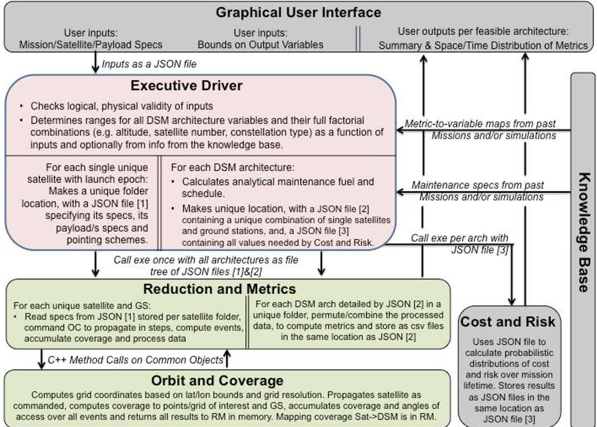

Figure 1: The role of the Executive Driver within the Tradespace Analysis Tool. The text in boxes highlights their high level functionality and the arrows show inter-module information flow. The modules in pink are programmed in Python, those in green in C++ and the ones in grey have not been discussed in this paper.

So far, all the architectures and metrics are generated based on only physical formulae and analytical computations. The ED may also use scaling tables so that multiple satellite architectures can be de-scoped based on the performance metrics calculated from single satellite architectures. Such scaling tables would database the numerical dependence of output metrics such as revisit time or percentage globe covered on satellite number, for a large number of combinations of variables such as satellite altitude, FOV or inclination. For example, to further downselect among architectures, the ED can request the OC and CR modules to run a full scenario of one satellite architectures across combinations of all other variables. It can then use the output values of these scenarios and the scaling tables to extrapolate the approximate bounds of constellation variables: constellation type, number of satellites and their arrangement, launch and ground station spread. Only the Executive Driver, Orbit and Coverage and Data Reduction and Metrics computation module will be presented in further detail in this paper in the context of Earth imaging missions.

## A. User Inputs and Outputs

The initial user input variables that have been identified can be grouped into five categories, which are arranged as attributes in Figure 2. The column called characteristics defines if the user is needed to input a range, an exact value,

<!-- PDF_PAGE: 4 -->

can select among available options and/or provide a text file path with specifications. These represent the types of input ingested by ED. All of these inputs will be described in more details in a future TAT-C overview publication.

Green highlighted rows correspond to variables needed only for pairs missions, including occultations with satellite pair option. Blue highlighted rows correspond to variables needed only for occultation missions. Yellow highlighted rows correspond to variables needed only for imaging missions.

<table border="1"><tr><td colspan="3">Mission Concept</td></tr><tr><td>Attribute</td><td>Characteristics</td><td>Description</td></tr><tr><td>Mission Owner</td><td>Select</td><td>Select from&#x27;Academic&#x27;,&#x27;Military&#x27;,&#x27;Commercial&#x27;,or&#x27;Government&#x27;</td></tr><tr><td>Start Epoch</td><td>UTC time</td><td>Date when the satellites will initialize. Default is current time.</td></tr><tr><td>Mission Duration</td><td>exact</td><td>Total time the mission is expected to last, starting from the first launch. Default is 30 days.</td></tr><tr><td>Performance Period</td><td>min,max</td><td>Ranges of times within mission duration, when outputs will be calculated. Default is the first 30 days.</td></tr><tr><td>Area of Interest</td><td>exact locations</td><td>Lat/Lon/Alt list or Lat/Lon bounds. Global is default.</td></tr><tr><td>Ground Stn options</td><td>Select and/or file</td><td>If the user has existing satellites to complement. Row=GS num,columns=GS lat,lon,alt,band. Default is NEN.</td></tr><tr><td>Launch preferences</td><td>Select and/or file</td><td>If the user has existing satellites to complement. Row=LV num,columns=LV specs. Default is all.</td></tr><tr><td>Propagation fidelity</td><td>low,med,high</td><td>Three levels of propagators to be selected against(time and description provided). Default is low.</td></tr><tr><td>Output options</td><td>Select</td><td>Which of the output variables is the user interested in. Default is all but angles.</td></tr><tr><td>Output bounds</td><td>min,max</td><td>Min and Max for any of the variables in the Output sheet. Default is in the output sheet.</td></tr></table>

Orbit Specifications

<table border="1"><tr><td>Attribute</td><td>Characteristics</td><td>Description</td></tr><tr><td>Existing Sat options</td><td>Select and/or file</td><td>User has a sat/constellation in mind. Default is none.</td></tr><tr><td>Number of new Sats</td><td>min, max</td><td>Number of new sats allowed in the DSM in addition to existing. One and ten is default respectively.</td></tr><tr><td>Altitude Range of Interest</td><td>Select or min, max</td><td>Ranges of altitudes the user is interested in, LEO (300-1000km) is default.</td></tr><tr><td>Inclination Range of Interest</td><td>min, max</td><td>Ranges of inclinations the user is interested in, 50-90 deg is default.</td></tr><tr><td>Special Orbits only</td><td>Select</td><td>Select between only SSO with LT option, frozen, critically inclined, ISS</td></tr><tr><td>Number of satellite types</td><td>exact</td><td>Enter 1 if const. is homogeneous or number, if heterogeneous. If hetero, all satellite specs per instance.</td></tr></table>

Satellite Specifications

<table border="1"><tr><td colspan="3">Satellite Specifications</td></tr><tr><td>Attribute</td><td>Characteristics</td><td>Description</td></tr><tr><td>Satellite Mass</td><td>Approximate</td><td>Default is 2200kg</td></tr><tr><td>Satellite Volume</td><td>Approximate</td><td>Default is 1550W</td></tr><tr><td>Satellite Power</td><td>Approximate</td><td>Default is 26.4773m3</td></tr><tr><td>Maximum Slew Angle</td><td>min, max</td><td>Maximum coning angle in the along and cross track for a scanning satellite. Default is0</td></tr><tr><td>Scan Rate</td><td>min, max</td><td>Scan rate of the satellite, between the maximum angles. Default is0</td></tr><tr><td>Number of payloads/sat</td><td>Exact</td><td>For multi-instrument sats. Default is one. If more than one, all payload specs tperinstance</td></tr><tr><td>Comm band</td><td>exact bands</td><td>For downlinking data to ground stations. Default is Ka-band</td></tr></table>

<table border="1"><tr><td colspan="3">Payload Specifications</td></tr><tr><td>Attribute</td><td>Characteristics</td><td>Description</td></tr><tr><td>Occulation or Imaging or Pairs</td><td>Select</td><td>Determines payload&#x27;s measurement conops. Imaging is default.</td></tr><tr><td>Payload Mass</td><td>Approximate</td><td>Default is 420kg. Payload mass will be checked within reasonableness of sat mass.</td></tr><tr><td>Payload Volume</td><td>Approximate</td><td>Default is 590W. Payload volume will be checked within reasonableness of sat volume.</td></tr><tr><td>Payload Power</td><td>Approximate</td><td>Default is 4m3. Payload power will be checked within reasonableness of sat power.</td></tr><tr><td>Payload TRL</td><td>exact</td><td>Where is the payload at in the development cycle?</td></tr><tr><td>Radiometric resolution</td><td>min</td><td>Number of bits per pixel. 12 bits is default.</td></tr><tr><td>Occultation or Pairs coupling</td><td>Exact or file</td><td>Mark observer or occulter/pair, for every occulting or pairs mission.</td></tr><tr><td>Nadir swath or FOV</td><td>min, max OR exact</td><td>Conical or rectangular dimensions of the full spot size. Default is 15 deg in Along and Cross track.</td></tr><tr><td>Nadir GSD or iFOV</td><td>min, max OR exact</td><td>Conical or rectangular dimensions of a single pixel. Default is 30m in Along and Cross track.</td></tr><tr><td>Object&#x27;s of interest</td><td>Select and/or file</td><td>Select between celestial body or&#x27;s satellite&#x27; if an occultation mission. Fill row 33 if latter. Default is Sun.</td></tr><tr><td>Occultation Altitude</td><td>max, min</td><td>Tangent altitudes between which occultation measurements will be made. Default is 10-50km.</td></tr><tr><td>Measurement time</td><td>min, max</td><td>Sum of exposure and integration time per image or measurement. Default is half-pixel travel time.</td></tr><tr><td>Solar conditions</td><td>Select</td><td>Determines if the sat is sunlit or eclipsed or agnostic when measuring. Default is agnostic.</td></tr><tr><td>Sun Glint preference</td><td>Select</td><td>Select if sun glint(&lt;5deg relative Azimuth) to be included, avoided or no preference. Default is no preference.</td></tr><tr><td>Spectral or other Channels</td><td>Exact wavelengths</td><td>Central wavelength for multi-spectral imaging. 300:100:1000nm is default.</td></tr><tr><td>Spectral resolution</td><td>exact binwidths</td><td>Band or bin width of each central wavelength in the spectral range. 50nm is default.</td></tr></table>

Figure 2: Inputs to the Executive Driver from the Users through the GUI

Figure 3 shows an example list of user inputs, as populated in the JSON file that is generated after the user initiates the search. The values are exact numbers or ranges (listed float values separated by a colon) or the name of a text file within the user directory. The JSON file sets the requirements of this TAT-C run to a constellation of one to eight satellites with a specific altitude (710 km) and inclination $ (98.2^{\circ}) $ , with no restrictions on outputs. The area of interest is a customized text file, however the user could have also entered a latitude range like '-90:90'. Only primary launch vehicles from TAT-C's library (editable file) are to be considered. If the user leaves any field within

<!-- PDF_PAGE: 5 -->

satellite or payload specifications blank in the GUI, default values corresponding to Landsat and its ETM+ payload, as a fixed non-scanning instrument with an imaging FOV, are assumed. The current computer system time is assumed to be the start epoch with a default mission lifetime of 30 days. The default area of interest is the entire globe, ground station network is NEN, mission director the government and there are no restrictions on any of the output values. Only imaging payloads will be discussed in this paper.

During execution, ED generates a file tree of results within the user directory, which can be then be plotted for interactive visualizations. Figure 4 shows an example of a file tree, as generated by the ED after a full TAT-C run. Some of the output metrics outputted by the ED and RM, as spatial, temporal and statistical distributions as seen in the 'OutputBounds' section of the JSON file in Figure 3. Users may also set bounds to the values of requested output metrics as lowerBound:upperBound', in which case the ED will search the tradespace accordingly. The full list of metrics in the result will be presented in a future publication.

## B. Executive Driver

The ED is programmed in Python and starts with reading the inputs in the

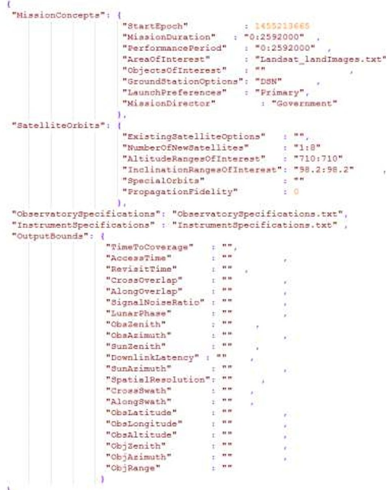

Figure 3: Example of a JSON file

(TradespaceSearchRequest.json) populated from user inputs in the GUI

JSON file and its associated text files and forming objects and structures. In the lack of user inputs, it uses the default values listed in the previous paragraph. It then generates DSM architectures for combinations of design variable values that satisfy the input requirements, in a loop over all the variables. It loops over all possible ground station (GS) combinations, and for each of those, loops over the satellite, orbit and payload options. For a given FOV range, it creates multiple, equally distributed FOV values. For each of those FOV values and a given altitude range, it creates multiple equally distributed values. If the user has requested for special orbits, the altitude is constrained accordingly. For each of those altitude values and given the FOV, it calculates the expected swath on the ground and then uses the swath to estimate the minimum and maximum number of satellites required to achieve the maximum and minimum revisit times, respectively, if specified. If there are no constraints on revisit or if the satellite range exceeds that specified by the user, the latter is used as override. If the user has specified constraints on spatial resolution, they are used to limit the maximum effective FOV, at the given altitude. All such streamlining is performed using rules specified in Section III. For the computed or given range of satellite numbers, the ED creates multiple equally distributed, satellite number values. For each value, it computes all possible Walker constellation configurations where the number of planes $ \times $ satellites per plane = total satellites. A configuration is defined by the initial RAAN and MA of the constituent satellites. For a given range of orbital inclination, the ED creates multiple equally distributed inclination values. If the user has requested for special orbits, the inclination-altitude combination is constrained accordingly. Given an orbital and GS architecture and LV options, ED's launch packaging algorithm identifies the possible ways in which the constellation can be launched. A unique constellation architecture is therefore a combination of GS, LVs, FOV, altitude, satellite number, inclination and RAAN-TA combination and the initial Keplerian elements and start epoch for its constituent satellites can be computed.

<!-- PDF_PAGE: 6 -->

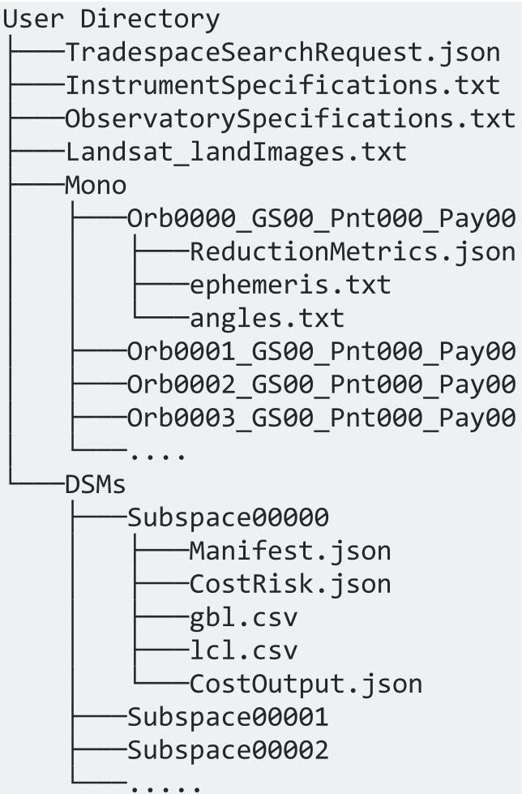

Figure 4: Example of the file tree generated by TAT-C in the user directory after a successful tradespace analysis run. All subdirectories in Mono/ and DSMs/ have files with the same names; they are collapsed in the interest of space.

The ED creates two folders when generating architectures Mono/ and DSMs/. It creates a sub folder under the Mono/ (implying Monolithic spacecraft) corresponding to every unique satellite in the DSM tradespace. The folders are named as a function of the indices of their orbit, GS, pointing scheme and payload. For example, 'Orb0000_GS01_Pnt000_Pay03' is the satellite with the 0th orbital option, 1st GS option, 0th type of pointing option and 3rd payload option. The specific values corresponding to each of those options is available within that folder's 'ReductionMetrics.json' file. For example, the orbital option is defined by the keys 'startDate', 'startKeplerianElems', 'startMass', etc. and the payload option is defined by the keys 'alongAngularScan', 'instrumentConOpsTypeCode', etc. The ED also calculates the appropriate grid size and propagation step size required per satellite so that the global points of interest (POI) are Nyquist sampled, and includes it in the JSON file. There is one 'ReductionMetrics.json' file inside each Mono/ subfolder. Two other files - 'ephemeris.txt' and 'angles.txt' are added by the RM module after the completion of its run. 'ephemeris.txt' contains the state information per time step and 'angles.txt' contains the view and solar illumination angles to every POI per time step, for every Mono/ spacecraft folder

The ED simultaneously creates a subfolder under the DSMs/ (implying Monolithic spacecraft) corresponding to every architecture in the DSM tradespace. The folders are numbered sequentially for simplicity. The ED initially creates two JSON files inside every folder or subspace, 'Manifest.json' and 'CostRisk.json'. 'Manifest.json' is a list of folder names inside Mono/ that correspond to the unique satellites,

which make up any specific DSM architecture. 'CostRisk.json' contains a long list of all the specifications that the CR module needs to cost any specific DSM. The specifications are either available readily from the architecture definition and user inputs (e.g. number of orbital planes, mission duration) or have to be computed by the ED (e.g. maintenance requirements - Section III.C, thermal requirements, diffraction limited aperture diameter).

Once the above file trees have been populated, the ED issues a command to the RM and OC combined executable with the user directory path as the argument, to evaluate the performance of all architectures. RM prints out the results per DSM, within its designated subspace folder, as two files: 'gbl.csv' and 'lcl.csv'. The advantage of separating out the DSM view from its constituent monolithic views is that orbits of unique satellites do need to be propagated and coverage computed more than once. Instead, the RM module can permute and combine coverage statistics from different monolithic views depending on any DSM architecture or manifest. The ED also issues a similar command to the CR module for costing all architectures. OC prints out the results per DSM, within its designated subspace folder, 'Cost0output.json'. The GUI eventually uses these three files per subspace to plot visualizations.

## C. Reduction and Metrics

The reduction and metrics or RM module is responsible for simulating every architecture generated by the executive driver and computing performance of those architectures over mission lifetime. Both the RM and OC modules are programmed in C++ for improved run time efficiency. Unlike the file-based communication between other module pairs, RM and OC communicate with each other in memory because OC can generate a very large amount of data and a file I/O format to the data reduction module would add run time to the very purpose of the data reduction module. For example, a constellation trade that looks at 1000 architectures for a modest size constellation of 10

<!-- PDF_PAGE: 7 -->

spacecraft, only 1000 points on the Earth grid, a 1 month simulation time and computing only a few spatial outputs would result in 485 GB of data.

The RM module traverses every satellite in the Mono/ folder and stores all the satellite specifications, including their required grid sizes, in memory. Unless the user can provide a specific set of grid points as points of interest, the RM and OC are responsible for generating a full set of grid points within the user-provided latitude and/or longitude bounds using the algorithm described in Section II.D and IV.A. RM tasks the OC module to generate the grid point list given the bounds and the required grid size for Nyquist sampling. Since the Mono/ folder contains all the unique single satellites, the RM identifies the unique orbits among them. For each unique orbit, the RM tasks the OC to propagate the satellite one time step at a time (for example, 60 seconds) till the end of the mission. For each step and for each payload and pointing per unique orbit, the RM tasks the OC to compute and accumulate coverage for the full set of grid points. RM saves coverage data accumulated per unique orbit, payload and pointing scheme in memory. Once all the orbits have been propagated and coverage per time step computed, the RM tasks the OC to compute the aggregated coverage events such that the start and end time for every coverage event is available (in memory) per grid point, per satellite, per payload and per pointing scheme. By separating the orbit propagation and aggregation steps, the RM avoids the need to propagate the same orbit multiple times if there are multiple payloads per satellite and saves runtime significantly. The coverage computation and aggregation are simultaneously performed for all ground station combinations, per unique orbit only, because communication does not depend on payload or pointing and is assumed to be established at more than $ 5^{\circ} $ elevation.

The RM module traverses every architecture/subspace in the DSMs/ folder and identifies the Mono/ spacecraft it is made up of. It then uses the coverage events (stored in memory) for each spacecraft to compute total coverage for all the grid points and for all ground stations, given a DSM architecture. Finally, it computes all the outputs listed in [a future publication] per architecture and stores the outputs per point of interest (POI), across all time periods in 'lcl.csv' and output values averaged, maxima and minima across all POIs, per time period in 'gbl.csv'.

## D. Orbits and Coverage

The orbits and coverage component, or OC, is responsible for modeling orbital motion and identifying the earth grid points in view at each propagation step. Orbital models were selected to balance performance and accuracy appropriate for early design phases. Coverage is computed based on grid points that can be optionally computed via standard grid spacing algorithms or provided by the user. In this section, we discuss the orbital and coverage modeling and capability starting with orbital modeling.

OC models orbits using semi-analytic propagation that includes the effects of J2 averaged over a single orbit. For an orbit under only the influence of an oblate-spheroid, the semi-major axis, eccentricity, and inclination do not exhibit secular growth and are held constant over a single propagation step in the OC. Mean secular changes in right ascension of the ascending node, argument of periapsis, and mean anomaly are modeled using well known equations documented in Vallado $ ^{2} $ :

$$
\begin{array}{l} \dot {n} = n - \frac {3}{4} J _ {2} n \left(\frac {R _ {e}}{p}\right) ^ {2} s q r t \left(1 - e ^ {2}\right) \left(3 \sin^ {2} i - 2\right) \\ \dot {\Omega} = - \frac {3}{2} J _ {2} n \left(\frac {R _ {e}}{p}\right) ^ {2} \cos (i) \\ \dot {\omega} = \frac {3}{4} J _ {2} n \left(\frac {R _ {e}}{p}\right) ^ {2} (4 - 5 \sin^ {2} i) \\ \end{array}
$$

Orbits are propagated using osculating Keplerian elements for performance reasons. Care is taken to handle the cases when orbital elements are undefined, such as for circular and equatorial orbits, by setting the undefined element to zero and effectively using a smaller set of states (less than 6) in those cases. The coverage utility in the OC employs a built-in algorithm to generate nearly equal point distributions for a requested number of points. The tool can also ingest a custom point definition. To improve performance, the coverage utility performs a feasibility test to determine if line-of-site coverage is possible before analyzing sensor coverage. Current functionality assumes nadir pointing conical sensors, however the design is general and development for more general sensor masks is already under way.

<!-- PDF_PAGE: 8 -->

## III. Preliminary Sizing for Streamlining the Tradespace

A full factorial representation of all combinations of values that the constellation design variables can take between the user-supplied ranges can sometimes generate thousands of architectures. As described in previous literature for formation flight $ ^{1} $ , it is valuable to attempt to streamline the tradespace by limiting the variable range bounds as a function of the previous level of variable values. For example, a satellite at a 1000 km orbit with a $ 130^{\circ} $ FOV is the same as the satellite with a $ 120^{\circ} $ FOV because the satellite is high enough that angular spread limb-to-limb is lower. Limiting the effective FOV before generating the architectures can reduce the number of architectures or make their design values more reasonable.

The most critical design variables for the given list of outputs will be described in a future TAT-C publication; based on those variables, we have framed approximate rules to map the dependence of the outputs on the variables, such that the variable ranges can be restricted. Such rules are used to down-select constellation architectures from a full factorial list, such that only those expected to meet user-defined constraints are sent to the full simulation with complex OC, RM and CR models. Streamlining rules for a few spatial and temporal metrics will be presented below. Our simulations also provide analytical rules for approximate maintenance requirements (fuel and schedule) to operate any constellation architecture for a given lifetime. This allows first-order estimation of maintenance costs without having to calculate exact maneuvers within the simulation and improves computational efficiency when calculating trade-offs for thousands of architectures.

## A. Spatial Metric Dependence on Constellation Design Variables

At any given altitude, one of the largest limits of maximum FOV is the maximum spatial resolution or ground sample distance (GSD) allowed. Even if the user-defined sensor has a wide angle FOV, only those pixels in the retrieved image that satisfy the maximum resolution will be useful. Thus, the effective FOV is limited by the GSD limits. The off-nadir GSD, at an off-nadir pointing angle of $ \theta $ , for a sensor FOV and altitude H is given by the following equations.

$$
[ x 1, y 1 ] = p i x E d g e (H, \theta - F O V / 2)
$$

$$
[ x 2, y 2 ] = p i x E d g e (H, \theta + F O V / 2)
$$

$$
G S D = \sqrt [ 2 ]{(x 1 - x 2) ^ {2} + (y 1 - y 2) ^ {2}}
$$

The x and y coordinates of the pixel edge can be computed from simple geometry and using the negative root (for positive values) of the resultant quadratic equation. In the equations below the pixel edge coordinates, x and y, are represented as a function of the altitude H and off-pointing angle $ \psi. $ $ \Psi $ is equal to $ \theta-FOV/2 $ and $ \theta+FOV/2 $ in Equation 2- first and second, respectively.

$$
x = - B - \sqrt [ 2 ]{B ^ {2} - 4 * A * C} / _ {2 * A}
$$

$$
y = x * \tan \Psi
$$

$$
A = \tan x ^ {2} \Psi + 1
$$

$$
B = - 2 * (R e + H)
$$

$$
C = (R e + H) ^ {2} + R e ^ {2}
$$

Equation 2 and Equation 3 can be used to calculate the GSD distortion of any off-nadir pixel and compared to the nadir pixel $ (\theta=0) $ . For example, the GSD at maximum off-nadir for 8 nadir-looking GSDs (30m to 100m) is shown in Figure 5, as various colors, and as a function of

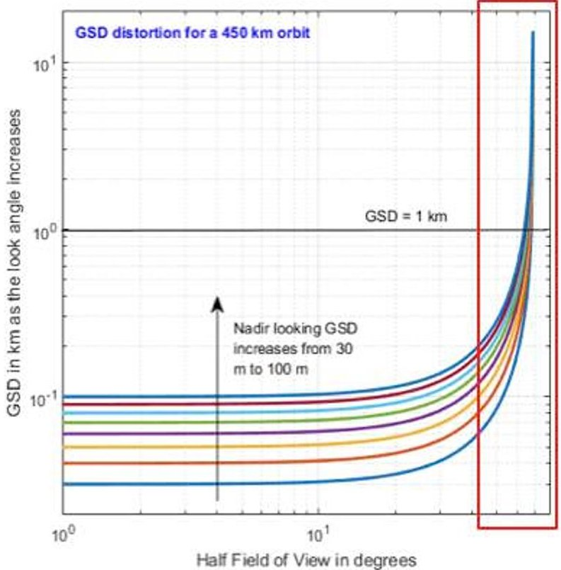

Figure 5: The distortion of ground sample distance (GSD) for the ground pixel at the longest slant distance within the sensor FOV, as a function of half FOV of the sensor (X-axis) the nadir-viewing GSD (colors). The red box indicates the section that is enlarged in Figure 6-left.

the half FOV of the sensor. While the GSD fall off is fairly flat for the first $ 1 0^{\circ}-2 0^{\circ} $ , it rises sharply for wider FOVs. A 100 m pixel (upper blue) expands to 200 m at the edge of a $ 4 0^{\circ} $ FOV image while a 30m pixel (lower blue)

<!-- PDF_PAGE: 9 -->

expands to 50+m at the edge of the same sensor. If the user prefers the GSD to be limited to say, 1 km (marked by a horizontal line in Figure 5, the effective FOV will be limited depending on the GSD at nadir (which is a function of the sensor instantaneous FOV or iFOV). Zooming into the red box of Figure 5 (Figure 6-left), where the 1 km line crosses the GSD-curves, shows lower iFOVs (or nadir GSDs) provide high spatial resolution and thus more effective FOV, when constrained by maximum GSD. The relationships are different for different altitudes, and ED automatically computes them in its streamlining stage.

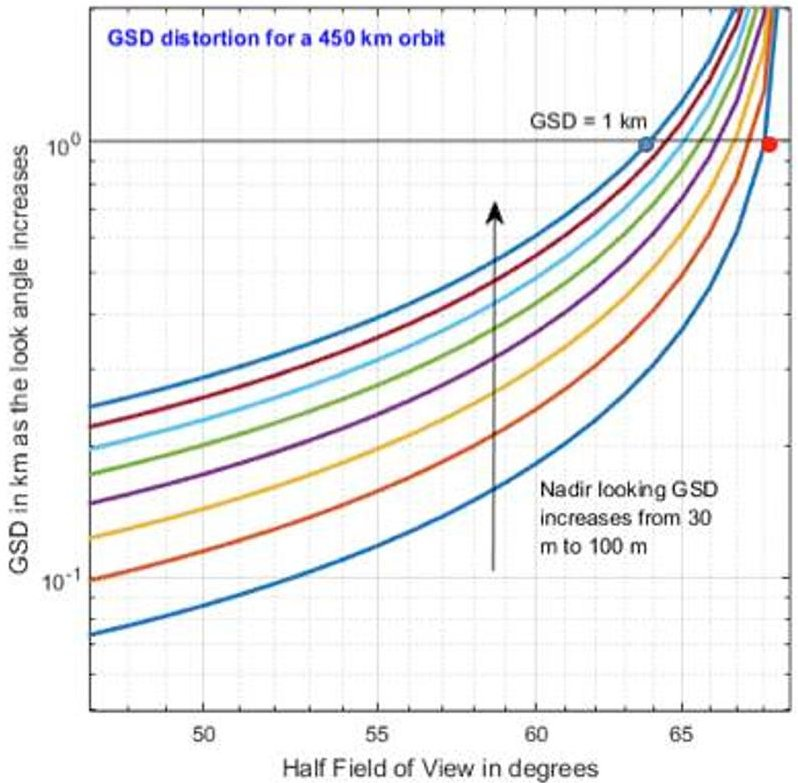

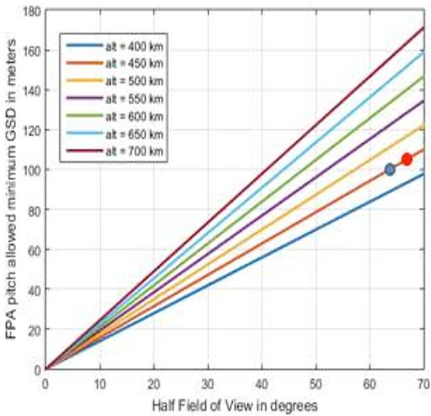

Figure 6: Trade-off between ground sample distance at the longest slant distance within the sensor FOV and sensor half-FOV, as a function of nadir-viewing GSD (left colors) and camera pixel limited nadir-viewing GSD (right Y axis), over a range of altitudes (right colors). The blue and red circles indicate common points on the design tradespace.

Figure 6-left shows that given a maximum GSD of 1 km, a 100 m nadir-looking pixel can support an FOV up to $ 6 4^{\circ} $ (blue circular marker) while a 30 m nadir-looking pixel can support an FOV up to $ 6 8^{\circ} $ (red circular marker). ED uses the above model to restrict the FOV as a function of the sensor iFOV and altitude. If the user does not provide the sensor iFOV, ED assumes the imager to be a non-moving one supported by a single focal plane array such as one commercially available on the Hasselblad H6D-100c, 100 MP camera with a pixel pitch of approximately 5 um. The imager's FPA and pixel size (50 mm for H6D-100c) restricts the minimum GSD possible for a given image size or the maximum image size possible for a given GSD, also known as pixel limited imaging. Figure 6-right shows the minimum GSD possible for pixel limited imaging as a function of the half FOV used to create the image and sensor altitude. The red and blue circular markers indicate the maximum half FOVs that a 30m and 100m nadir pixel can support respectively (as computed in Figure 6-left). However, Figure 6-right shows that the minimum GSD that can be supported by the red and blue designs are 105m and 100m respectively, due to pixel limitations. In other words, the 100 MP camera will only be able to image at a 105 m resolution at nadir, if it is required to image up to $ 6 8^{\circ} $ of the flank. Therefore the red design does not close, and will not be provided as a feasible architecture. The blue design does close at 100m of nadir GSD and 1km of $ 6 4^{\circ} $ of off-pointing GSD, and is a viable architecture. Based on the above models, the FOV for an imager at 450 km stands restricted to $ 6 4^{\circ} $ , unless the user provides an iFOV override. Such streamlining models can be applied to all altitudes or design levels.

Hasselblad's commercially available standard is also used to check the validity of the FOV to iFOV ratio provided by the user. If the ratio is more than 10000, ED checks for spacecraft scan rate (to ensure that the image is taken by a scanner like MODIS) and if not scanning, will warn the user that multiple FPAs will be needed to support an image of that size.

<!-- PDF_PAGE: 10 -->

## B. Temporal Metric Dependence on Constellation Design Variables

The maximum and minimum number of satellites can be,very approximately,computed from the swath or an orbital sensor, its altitude and the required revisit time. If the user has specified the range of satellite number desired, those values will override these computations, if they lie outside the computed bounds. Swath (S) can be calculated from the Earth centric angle $ \lambda $ ,which depends on altitude (H) using the equations below.Re is the radius of the Earth.

$$
\begin{array}{l} S = \lambda * \mathrm {R e} \\ \lambda = 9 0 - \eta - \varepsilon \\ \varepsilon = \cos^ {- 1} \frac {\sin (\eta)}{\sin (\rho)} \\ \end{array}
$$

$$
\rho = \sin^ {- 1} \frac {\mathrm {R e}}{\mathrm {R e} + \mathrm {H}}
$$

Equation 4

Number of satellites (N) can be computed as the rounded off ratio between the total orbital period (P) and the time it takes for the Earth to rotate one swath width, if it takes the required revisit time for the Earth to rotate entirely. The equations for this computation are:

$$
\begin{array}{l} P = 2 * \pi^ {2} \sqrt {(R e + H) ^ {3}} / _ {G M} \\ N = c e i l \left(P * 2 * \pi * R e / _ {r e v T * S}\right) \tag {Equation 5} \\ \end{array}
$$

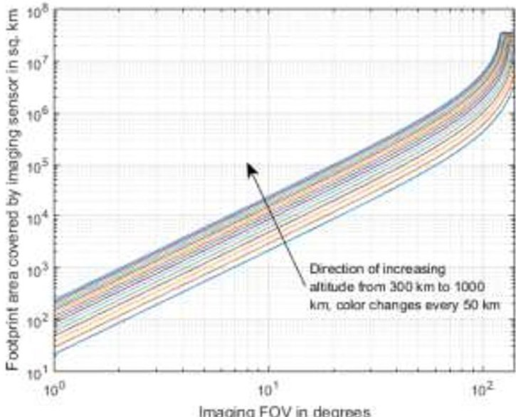

Figure 7: Dependence of the footprint area as a function altitude (color) and the FOV of a simple conical sensor. Similar dependencies are also available for swath $ ( S=\sqrt[2]{4 * A r e a / \pi}) $

Maximum revisit time allowed can be used to calculate

the minimum number of satellites and minimum revisit time for the maximum number using Equation 5. For example, the Landsat orbital period for a 710 km altitude is approximately 99 minutes and it is able to perform 14.55 revolutions per day. Each revolution gives two passes over the Equator - one at the ascending node, one at the descending. Since the orbit is polar circular, each nodal pass covers 101 km of distance along the Equator, and the equatorial coverage per revolution is 202 km. Assuming no swath overlap, at least 198 revolutions would be required to cover the equatorial circumference of 40074 km. In other words, the time required to cover the Equator or average revisit at the Equator is at least 13.6 days. For at least daily revisit, the minimum number of satellites needed will be 1/13.6~14 satellites.

While the dependencies explained above are currently calculated at run time, the common ones could be stored and used for streamlining when user variables fall within those values. One such common dependency is that that on the altitude and FOV variable. Figure 6-right and Figure 7 shows how pixel-limited minimum GSD and footprint area (or swath) depend on both respectively. Any given combination of design variable values - altitude and FOV - in the architecture tradespace, can be deemed feasible (or not) for any user GSD, swath or satellite requirement if they lie within (or out of) the bounds of the curves in the aforementioned figures, without the need of any further calculations. If infeasible, the design variable value bounds can be changed accordingly.

## C. Maintenance Predictions for Constellations

In Low Earth Orbit (LEO), the major disturbances to be accounted for are atmospheric drag and J2 effects due to a non-spherical Earth. If these disturbances act on the different satellite orbits differently, it may cause the orbits to drift apart and eventually break the formation. ED computes required constellation maintenance analytically as a function of corrections against atmospheric degradation and relative J2 effects. Atmospheric drag causes the orbit's semi major axis, eccentricity, velocity and period, to change. For a near-circular orbit, SMA and velocity change per orbit is:

$$
\begin{array}{l} \Delta a = - 2 \pi \left(C _ {\mathrm {D}} A / m\right) \rho a ^ {2} \\ \Delta V = \pi \left(C _ {\mathrm {D}} A / m\right) \rho a V \\ \end{array}
$$

<!-- PDF_PAGE: 11 -->

where $ ( C_{D} A / m) $ represents the ballistic coefficient of the spacecraft, $ \rho $ the atmospheric density of the atmosphere at any given altitude, and a and V the baseline semi-major axis and velocity of the satellite respectively. If satellites in the same formation have different ballistic coefficients or are at different altitudes, it will cause their orbits to decay in different ways. We simplistically calculate the drag area (A) of the satellite as its volume $ ^{2} / 3 $ and use a standard database for atmospheric density as a function of altitude. The database is stored as a text file and can be changed if the user wants to use a different version.

Relative orbital decay due to J2 is assume to be $ 0. 1^{\circ} $ of relative mean anomaly change between satellites in the same orbit and negligible between RAANs for different orbits, based on previous work $ ^{3} $ . We are not correcting for orbital drift due to inclination and altitude differences so far, due to the large amounts of fuel needed. Mean anomaly draft can be corrected within one to five days, depending on how much fuel the user is willing to spend. We assume one day of correction time to minimize loss of science performance for too long. The trade-off between correction time and $ \Delta V $ (or fuel) required is calculated as function of the number of phasing orbits required for the correction $ ^{3} $ . A small orbit raise will need more phasing orbits but lesser fuel to correct a relative MA drift.

## IV. Case Studies of Streamlined Tradespace Analysis

This section will describe results from two different use cases of Earth imaging. Only two temporal metrics revisit time and time to achieve full coverage have been discussed below as examples. All figures displayed in this section have been created on MATLAB (independently from the TAT-C tool), using RM's output files ('gb1.csv' and 'lcl.csv') per DSM architecture. In the use cases below, we compare only Uniform Walker Constellations, where all the satellites have the same altitude, inclination and equal satellites per plane, and Ad-Hoc Constellations (e.g. Planet Labs). For example, a uniform Walker constellation with 8 satellites in a specific altitude/inclination can be arranged in four ways (in 1,2,4 or 8 planes with equal satellites each). The ED may also be set to generate Non-Uniform Walker constellations (combinations of uniform Walker constellations over different altitude, inclination and possibly satellites per plane), Ad-Hoc Constellations where satellites are launched as per the next available launch option from launch database and Precessing constellations where satellites are dropped off by a single LV at differential altitude and inclination causing them to disperse over time for a large RAAN coverage.

## A. Example Trades across Constellation Architectures - Landsat Use Case

The Landsat user case simulates a constellation of satellites very similar to the current Landsat 8 - circular orbit with an altitude of 710 km and inclination of $ 98.2^{\circ} $ . Landsat has a pushbroom imager $ ^{4} $ that collects one sample from each 30-m resolution detector every 4.237 ms (236 times per second). The detectors integrate for 3.6 milliseconds of this sampling interval. While it takes 24 s to cover every $ \sim185 $ km image, the Landsat imaging team processes about 30s of data to account for buffering and scene-to-scene overlap. Simplifying this concept of operation into a simple fixed sensor, we can assume a conical sensor of FOV $ 15^{\circ} $ to provide the same imagery as Landsat-8. The number of satellites in the constellation was restricted between 1 and 8. The satellite and instrument specifications were obtained from the Landsat handbook - http://landsat.usgs.gov//l8handbook.php, and the area of interest was defined by a text file containing the lat-lon coordinates of the 16986 Landsat images located on land or coastal regions, as obtained from the United States Geological Survey (USGS).

The user inputs to ED for this validation case have been listed as the JSON file in Figure 3. Alternatively, if the user wanted to explore a larger range of altitudes, he/she could have set the altitude range to "LEO" and special orbits to "SSO", the system would then have generated a full range of multiple altitudes between 300km and 1000km and for each altitude, computed the inclination for the SSO constraint. ED took 7.7 hours of run-time on a Mac OS X version 10.10.5 with a 2.5 GHz processor and 16 GB of 1600 MHz memory, to run this scenario. It generated 28 constellation architectures for the above use case, 20 of which were uniform Walker constellations and 8 were AdHoc constellations. The latter had one architecture per satellite number, because ED picked N Planet Labs slots randomly for N satellites. More architectures could have been possible however the temporal statistics were found to be very similar for the full factorial version, thus only one architecture per satellite number has been plotted as a representative example. RM and OC propagated 60 unique orbits for the 28 architectures.

<!-- PDF_PAGE: 12 -->

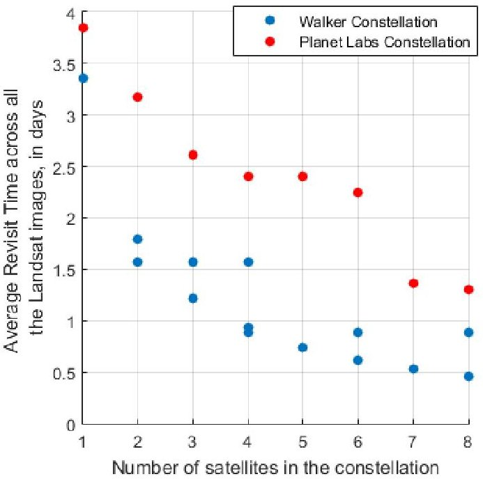

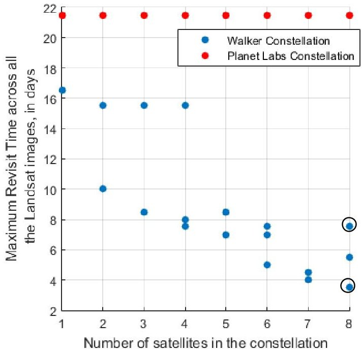

Figure 8: Average (left) and maximum (right) Revisit Time over all the Landsat images as a function of constellation type and number of satellites, all in the Landsat orbital altitude and inclination

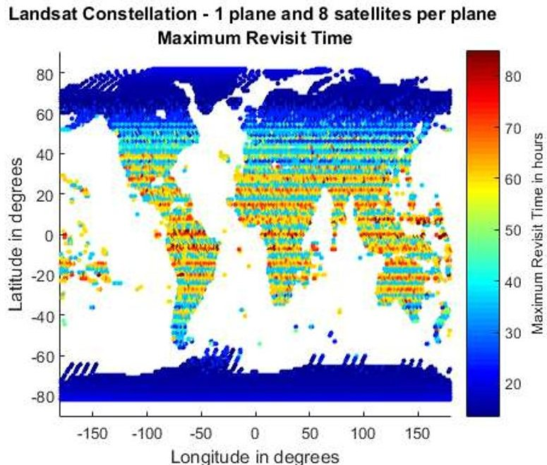

Landsat Constellation - 4 planes and 2 satellites per plane Maximum Revisit Time

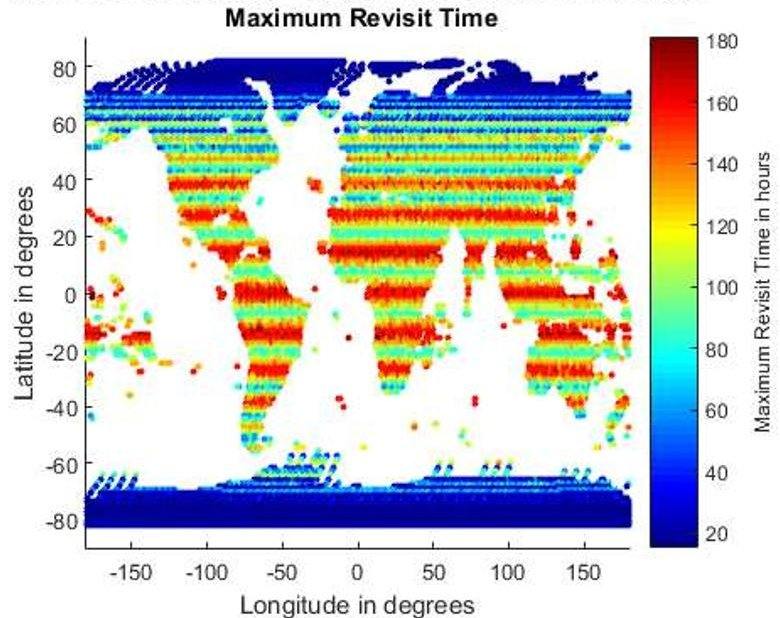

Figure 9: Spatial distribution of maximum revisit time over all the Landsat images for 8 satellite constellations arranged in the best (left) and worst (right) case scenarios in Figure 8, with 2 and 1 planes respectively. Note the difference in the color scales, to show the full breadth of the variation.

Outputs from the RM module will allow the user to see trades between pairs or triplets of design variables, performance metrics and costs. Figure 8-left shows a triplet of design variables and how they relate to each other where revisit is plotted against satellites, with type in different colors. Average revisit time is the average time it takes for the constellation's conical sensors to revisit any and all of the 16988 Landsat image coordinates. Polar images are revisited more frequently than equatorial images and this metric calculates a simple mean across all of them. Walker constellations revisit more frequently than Ad-Hoc constellations because of their uniform arrangement, but are costlier to launch and maintain (in terms of fuel), as will be seen in performance-cost trade-offs. Users will be allowed to easily change the metrics being plotted. Figure 8-right shows the trade between

<!-- PDF_PAGE: 13 -->

number of satellites, maximum revisit time (across all images) and constellation type, also plotted from the 'gb1.csv' files. As before, the maximum time drops with increasing number of satellites for Walker constellations and also changes when the same number of satellites are arranged differently. The maximum revisit time for AdHoc constellations stays approximately constant from 1 through 8 satellites because of their non-uniform distribution around the globe (unlike Walker). For example, for this use case, the ad-hoc constellations had 5 satellites in the ISS orbit and 3 in polar orbit, randomly distributed in RAAN and MA depending on when secondary launches were available and without any maintenance. These results are in keeping with the Planet Labs theory that if there are a large number of satellites in orbit, revisit statistics are not significantly impacted by orbital spread within the same plane. Therefore, they try to launch as frequently as possible with any secondary launched available.

For any of the architectures plotted in the pair-wise or triplet-wise design trades such as Figure 8, the output 'lcl.csv' files allow users to select one or many of them, and see the spatial (globally) or temporal (time series through performance period/s) distribution of the selected metric. is the spatial distribution of maximum revisit time for the 8-satellite architectures that produced the minimum (best) and the maximum (worst) of that metric, as plotted from the 'lcl.csv' files of those architecture folders within DSMs/. The architectures have also been circled in Figure 8-right. The best results are provided by 2 constellations, thus there are overlapping markers, and only one is chosen for the spatial plot. Equatorial regions are revisited less often than the poles and are the ones that suffer the most when a constellation is not spread out.

Landsat Constellation - 1 plane and 8 satellites per plane Average Revisit Time

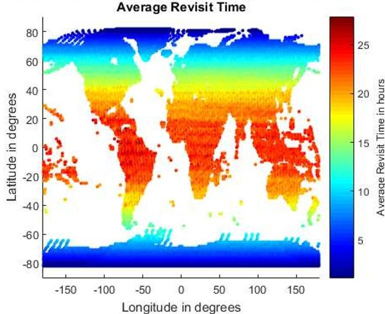

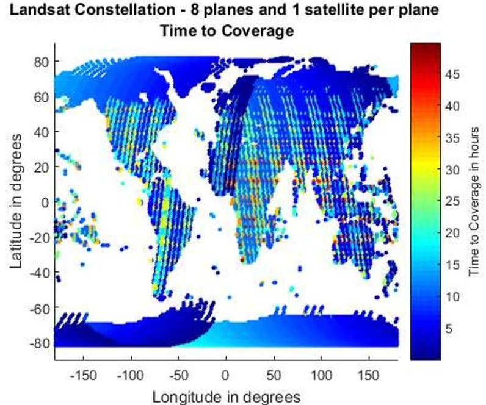

Figure 10: Spatial distribution of average revisit time (left) and time required to cover each image (right) over all the Landsat images for 8 satellite constellations arranged in a single plane, in the Landsat altitude and inclination. Note the difference in the color scales, to show the full extent of the variation.

Similar spatial distribution plots can be made for any of our metrics, as computed and saved in 'lcl.csv' by the RM module. For example, Figure 10-left shows the spatial distribution of average revisit time across all Landsat images for the most frequently revisiting Landsat constellation in the evaluated tradespace (containing 8 satellites in a single plane). The average revisit time of the 2 plane constellation was found to be approximately equal to the maximum revisit time of the 1 plane one. The best constellation for one type of metric may not be the best for the others. Figure 10-right shows the time to access all Landsat images for the first time by a constellation of 8 satellites arranged in 8 planes, which does better than the single plane constellation in terms of this metric. Eight planes spatially distributed the satellites much more than a single plane, therefore making the system more responsive. However, response revisit is better in the single plane case. Figure 10-right also shows clearly the orbital path of the 8 planes, as they cover the required image coordinates.

<!-- PDF_PAGE: 14 -->

## B. Example Trades across Constellation Architectures - Wide-Angle Radiometer Use Case

B. Example Trades across Constellation Architectures - Wide-Angle Radiometer Use Case While the Landsat use case had a narrow FOV sensor at a specific orbit and directed toward specific geographic locations of the Earth, the wide angle radiometer use case simulates a constellation of wide FOV sensors within a specific altitude range (JSON: "AltitudeRangesOfInterest": "500:700") across varying inclinations (no constraint in JSON, implying orbits between 0-90 $ ^{\circ} $ ) where the points of interests are the tropical latitudes (JSON: "AreaOfInterest": "-40:40" implying a latitude constraint). As mentioned in Section II.A.3, setting bounds for an area of interest will cause the RM module to request the OC module to populate an evenly spaced grid between the requested bounds, with a requested grid size. The satellite numbers are restricted between 8 and 12 because radiometers are typically used for weather monitoring $ ^{5} $ , which requires frequent revisit times, and the total simulated time to one week. The sensor field of view is set to $ 130^{\circ} $ .

ED took 40 minutes to run this simulation scenario and produced 233 DSM architectures in the results, of which 228 architectures correspond to uniform Walker constellations. RM and OC propagated 1353 unique orbits. 2000 grid points were generated between the required latitudes. The results from this use case demonstrate the utility of the four-way trading functionality, as plotted using the information outputted in the 'gb1.csv' files across all architectures. Figure 11 shows the tradespace between the maximum revisit time (performance metric) and number of satellites (design variable), separated by percentage POI covered (performance metric) and constellation type (design variable) - Figure 11 left or orbital inclination (design variable) - Figure 11 right. Revisit time and satellites have been plotted on the axes, POI covered as a partition and type or inclination in color. While these plots are examples only, they demonstrate the utility of exploring the tradespace of constellations for a particular mission. Figure 11-left clearly shows that, unlike the Landsat use case, the type of constellation is not the most important negative influence on maximum revisit time. In fact, the ad-hoc constellations are able to provide to provide the least revisit time among all architectures that guarantee 100% coverage of the area of interest within the 7-day performance period. As a further example of trades using 'gb1.csv' information, Figure 11-right shows that maximum revisit time is most significantly affected by orbital inclination. Equatorial orbits provide the fastest revisit, but at the cost of coverage. By toggling the performance metric and design variable in the plots, using the static information in 'gb1.csv', it can be seen that the equatorial orbits cover between 55.9% to 67.6% of the area of interest between the 40 $ ^{\circ} $ parallels. Mid-inclination to polar orbits provide decreasing benefits to maximum revisit time, as seen in Figure 11-right.

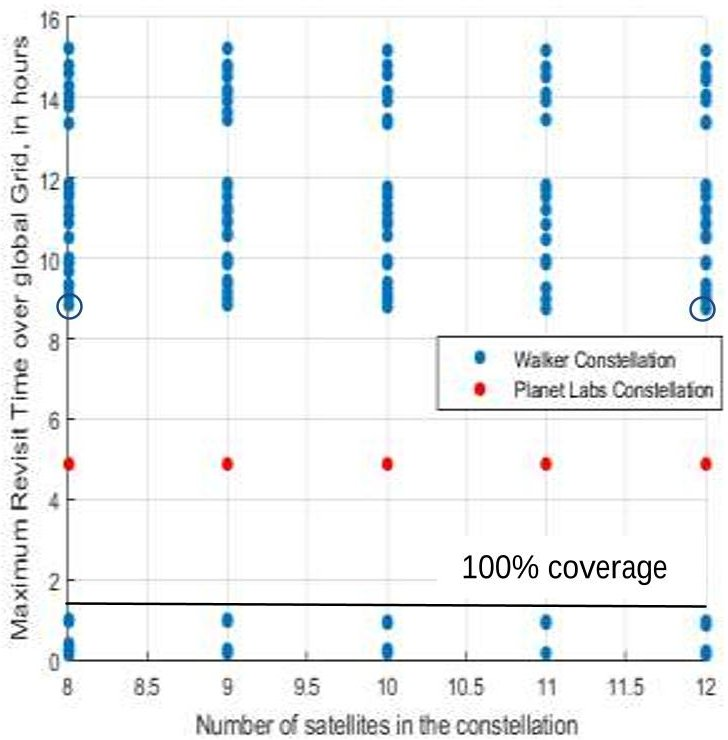

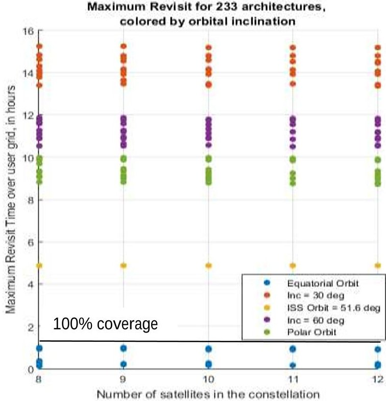

Figure 11: Maximum revisit time over all 2000 grid points as a function of number of satellites, when arranged by constellation type (left) and by inclination of the orbits (right)

Results from the RM when plotted in Figure 11 also shows that there is no significant advantage to revisit statistics, in increasing the number of satellites beyond 8. The quickest maximum revisit, while maintaining 100% coverage of

<!-- PDF_PAGE: 15 -->

area of interest, is 8.83 hours, using 8 satellites in Walker format, and is 8.73 hours, using 12 satellites. If a user wants to check for the knee in the curve or the point at which maximum revisit time begins to saturate with respect to satellite number, he/she may simulate a larger range of satellite numbers and re-plot the same graphics. When a re-run with 1-7 satellites was simulated, we found a knee for maximum revisit to occur at 4-5 satellites.

## V. Initial Results Validation

Results from the ED, OC and RM modules have been validated against the results obtained from a previously developed MATLAB-driven Systems Tool Kit system, using the same set of user inputs. The MATLAB-STK system uses MATLAB to loop over all possible architectures, given user inputs and then STK's J2 propagator to propagate the orbits and compute coverage across all grid points $ ^{1} $ .The access information over all satellites per DSM, are stored as .cvaa files with filenames defining the architecture variables. The system uses MATLAB to post-process all the .cvaa files and compute the metrics defined in [a future publication]. The temporal metrics 'revisit time' and 'time for global coverage' over several architectures corresponding to the Landsat satellite and orbits, as generated by ED, RM and OC will be compared to the same metrics generated by the MATLAB-STK system as a validation scenario. As before and only for validation purposes, all figures displayed in this section have been created on MATLAB, using RM's output files ('gbl.csv' and 'lcl.csv') per DSM architecture.

## A. Validation of Grid of Points

The grid point utility supports both internally computed points and user defined points thus allowing nearly equal point spacing on the grid and points for custom science targets. The algorithm to place near-equally spaced points was termed the "Helical" algorithm by Schiff and Mailhe[7] as the points look much like what is obtained by peeling an orange in one piece. Preliminary grid point validation was performed by visual inspection of points on the sphere, and by verifying that the nearest neighbors of all points are approximately the same angular separation from each other.

Results from RM/OC for grid point generation given a grid size and latitude/longitude bounds matches results from STK's grid point generation very well. When provided a grid size of 10 $ ^{\circ} $ , 5 $ ^{\circ} $ and 1 $ ^{\circ} $ for a full Earth grid, RM generated 412, 1650 and 41252 points respectively. In comparison, STK generated 410, 1652 and 43424 points respectively ED thereby demonstrated less than 1% of grid spacing error globally. Figure 12 compares the global grid generated by both software for a 5 $ ^{\circ} $ grid size.

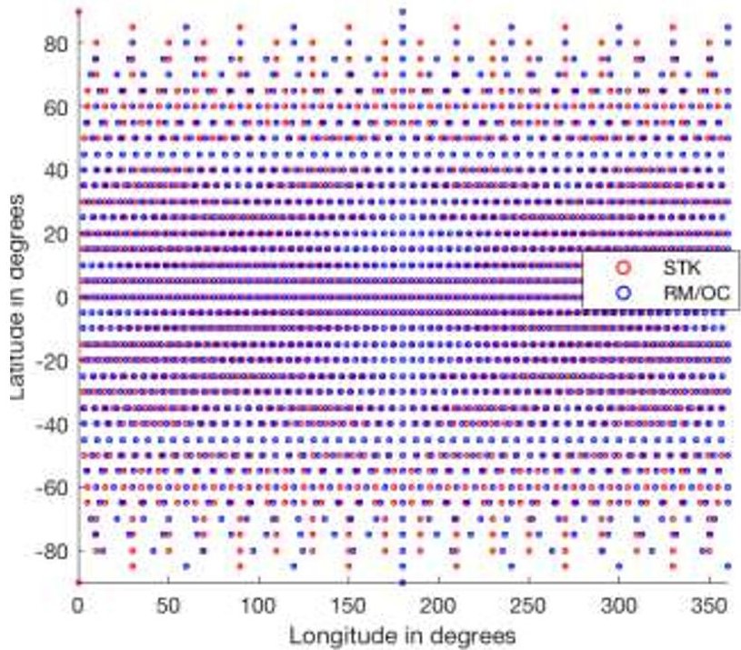

Figure 12: Comparison of the grid spread generated by RM/OC and STK for a $ 5^{\circ} $ grid size at the Equator

## B. Validation of Orbit Propagation

Orbit propagation validation was performed by comparing final states for representative orbits propagated in STK and the current OC module. Several orbits including polar, and equatorial orbits and circular and elliptic orbits were propagated in both tools. Final states from orbital propagation agreed on the order of meters.

## C. Validation of Temporal Metrics across Constellation Architectures - Landsat Use Case

The Landsat use case in Section IV.A has been selected as the validation use case. Tradespace analysis of multiple Landsats has been performed and published using the MATLAB-STK system $ ^{1} $ , therefore serves as a reliable benchmark for validation. Moreover, since the Landsat use case contains the exact coordinates of the grid points within the area of interest, instead of RM/OC creating the grid, the comparison below eliminates any differences between STK and RM due to disparity in grid points.

<!-- PDF_PAGE: 16 -->

As mentioned before, the orbital altitude and inclination of all constellation satellites were restricted to the current Landsat values. Figure 13 shows the comparison of revisit metrics obtained using RM and MATLAB-STK using the

J2 propagator. STK's results are assumed to be a golden standard because of its high standing in the orbital mechanics community, utilization in several mission designs and decades of commercial success. The curves in the figure indicate average revisit time, and the vertical bars indicate the distance between minimum and maximum revisit time. While our initial validation effort shows some difference between results from the two tools, the difference is mainly in the maximum revisit times of a few architectures. In contract, the average revisit curves from both tools are very close. Also, the relative ranks of the 20 architectures with respect to revisit time is approximately the same for both the tools and the relative difference between revisit times across the architectures (note the shape of the maximum and average curves in blue vs. red) is also very similar. The difference in the curves can be due to the lower fidelity models of OC in computing coverage for conical sensors, as compared to STK.

As a secondary check, the circled 8-satellite and 12-satellite cases in Figure 11-left were run using the MATLAB-STK tool and the same grid size. The maximum revisit times for both cases was found to be 10.4883 hours, almost 2 hours

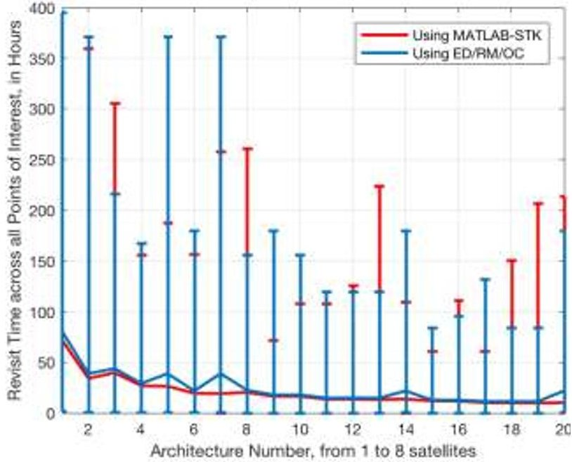

Figure 13: Revisit Time over all the Landsat images as a function of number of satellites in the Walker constellation, computed using the ED/RM/OC (blue) system vs. our MATLAB-STK system (red). The curves show the average values while the error bars show the minimum and maximum values.

different from the 8.83 hours and 8.73 hours obtained from ED, RM and OC respectively. However, when the single satellite revisit numbers were tallied and the maximum revisit times matched up exactly. Future work entails improving the fidelity and performance of the RM and OC modules so that the coverage numbers match the MATLAB-STK tool as closely as possible, for all selected use cases, or that the differences are predictably accounted for.

## D. Comparison of Processing Time

When making these trades, speed is our utmost concern, without compromising on the architecture differentiating accuracy of the results. While our lower fidelity models have caused some differences between our results and commercial software results, we have been able to demonstrate significantly faster run time. While we recognize that STK is not a tradespace analysis tool, it has been used in this paper as a validation comparison. The Landsat use case took STK more than 10 days to propagate all the unique orbits required for the 20 Walker constellation architectures and MATLAB 4.5 to process the STK access reports to generate results in the same format as that provided by our algorithm. In comparison, our algorithm took less than 15 hours to run the same tradespace analysis scenario, therefore showing 16 times difference in speed. We expect some increase in run time as we increase the fidelity of our coverage models to match STK and MATLAB's result accuracy, however the difference in run time is expected to remain at an order of magnitude difference. We attribute the difference in speed to the fact that STK is a very visualization heavy tool therefore takes a lot of time loading and unloading graphics. The time taken ED, RM and OC to run tradespace analysis is dependent on the size of the inputs. If 2000 grid points instead of ~17000 were used and a $ 130^{\circ} $ FOV instead of $ 15^{\circ} $ , such as the radiometer use case in Section IV.B, the analysis takes only 40 minutes in spite of the hundreds of architectures. Further, if the satellite number were restricted to only five, the analysis finishes in less than 10 minutes. Our system is therefore more suitable for rapid tradespace generation and evaluation, such as those common in concept maturation and Pre-Phase A of mission design.

<!-- PDF_PAGE: 17 -->

## VI. Discussion and Future Work

This paper introduces the Executive Driver (ED), Orbit and Coverage (OC), Data Reduction and Metric Computation (RM) modules for the future Trade-space Analysis Tool for Constellations (TAT-C, [9]). TAT-C will facilitate DSM Pre-Phase A investigations and by allowing the users to optimize DSM designs with respect to a priori science goals. We have presented the overall structure of these 3 modules, their functionality and information flow between them, as well as how they will support end-to-end simulation of TAT-C. We have also shown the value of easily modifiable user inputs and results, in the context of two use cases - a constellation of Landsat-like sensors and a wide angle radiometer constellation. Finally, a few results from a combination of those 3 modules are very preliminarily validated against a previously published MATLAB-STK tool. We intend to continue improving the fidelity of the RM and OC modules such that their results match those from STK more closely, while maintaining the order of magnitude difference in the speed of tradespace analysis. Other future work includes adding heterogeneous constellations and precession type constellations into the architecture types, including the use of scaling tables within the ED where partial outputs can be processed to inform further tradespace and completing the instrument concept of operations for non-imaging missions (e.g. occultation).

## Acknowledgments

The authors acknowledge funding from the NASA Earth Science Technology Office (ESTO) Advanced Information Systems Technology (AIST) Program. We thank the rest of the AIST team in this project for very useful discussions on this topic - Matt Holland, Olivier de Weck, Philip Dabney and Veronica Foreman.

## References

1. Nag, S., LeMoigne, J., D. W. Miller & De Weck, O. L. A Framework for Orbital Performance Evaluation in Distributed Space Missions for Earth Observation. in IEEE Xplore, Aerospace Conference 2015 (2015).

2. Vallado, D. A. Fundamentals of astrodynamics and applications. 12, (Springer Science & Business Media, 2001).

3. Nag, S., Gatebe, C., Miller, D. W. & De Weck, O. L. Effect of Satellite Formation Architectures and Imaging Modes on Global Albedo Estimation. Acta Astronaut. (2016). doi:10.1016/j.actaastro.2016.04.004

4. Irons, J. R. & Masek, J. G. Requirements for a Landsat data continuity mission. Photogramm. Eng. Remote Sens. 72, 1102 (2006).

5. Norton, C. D. & Pasciuto, M. P. NASA ESTO's strategic investments in space-based radiometer technology and flight validation. in SPIE Defense+ Security 908329-908329 (International Society for Optics and Photonics, 2014).

6. Systems Tool Kit. Analytical Graphics Inc. Available at: http://www.agi.com/products/stk/modules/default.aspx/id/stkfree. (Accessed: 4th March 2013)

7. Schiff, C., and Mailhe, L., "INDRA/COV: A New Tool for Optimization of Constellations Coverage Statistics," Proceedings of 16th International Symposium on Space Flight Dynamics, NASA, 3-7 Dec. 2001.