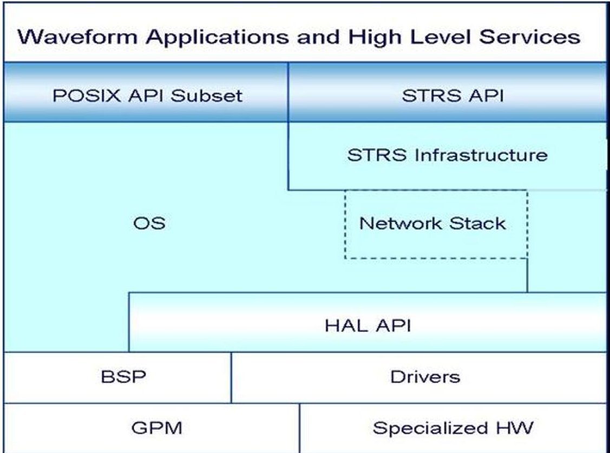
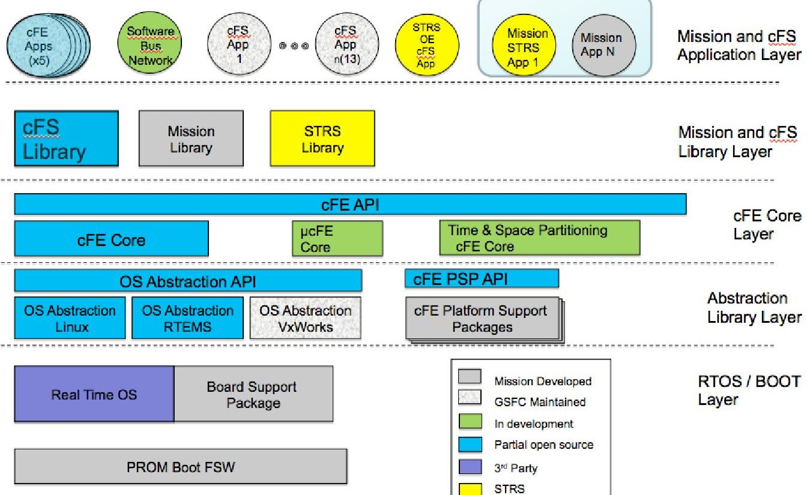
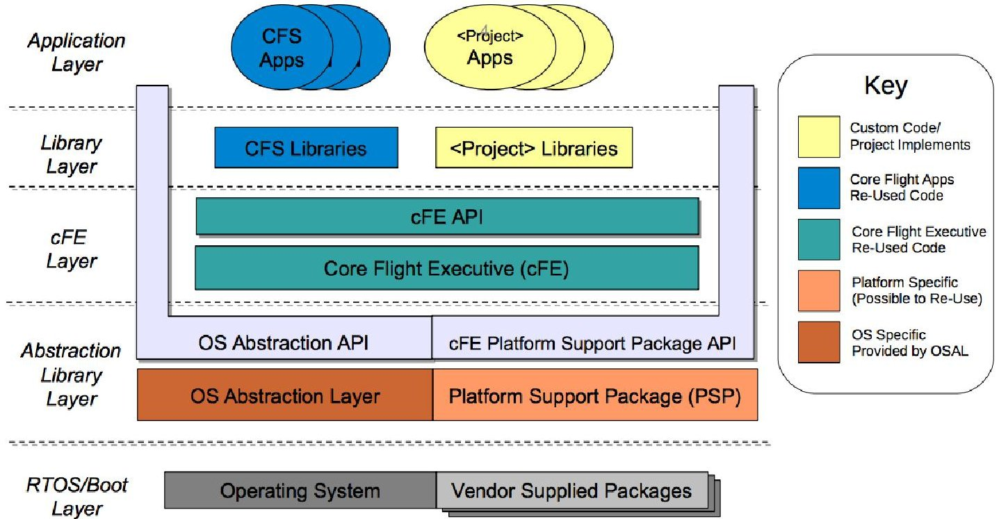
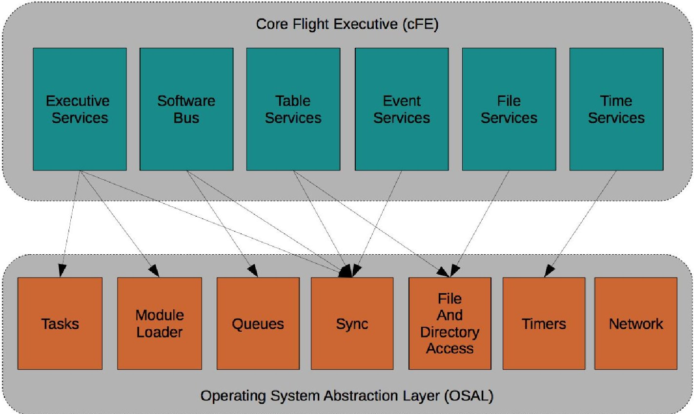
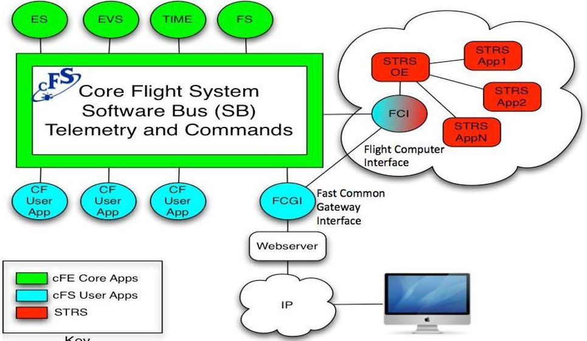
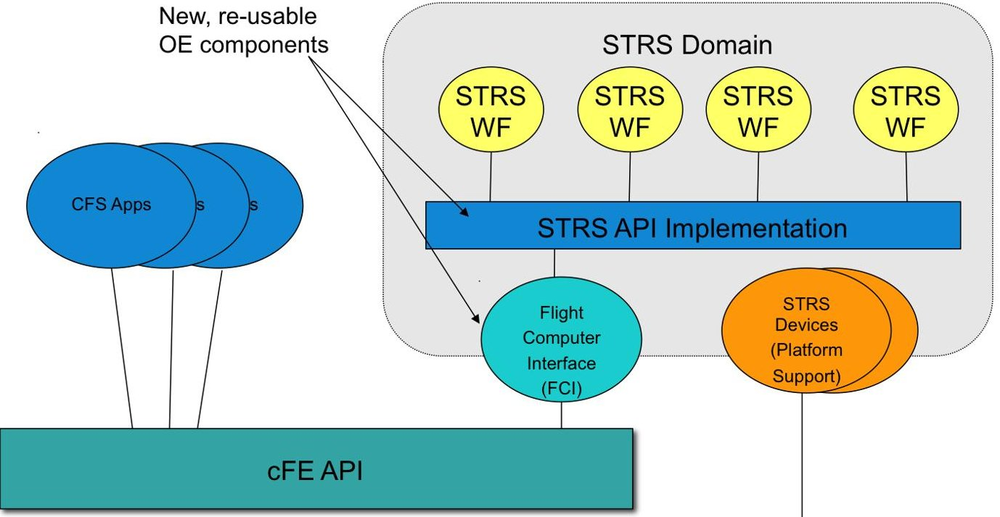
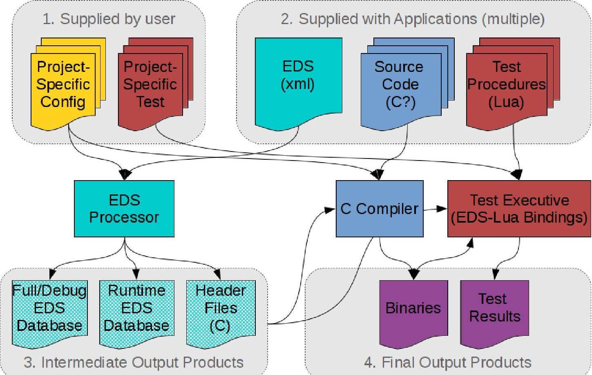
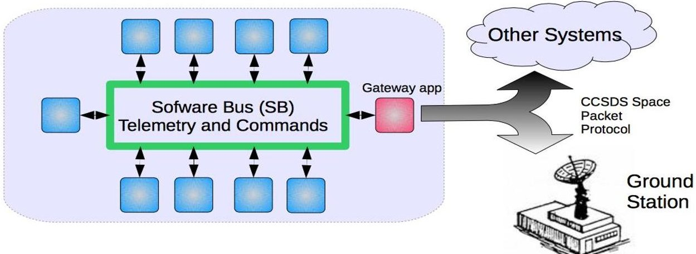
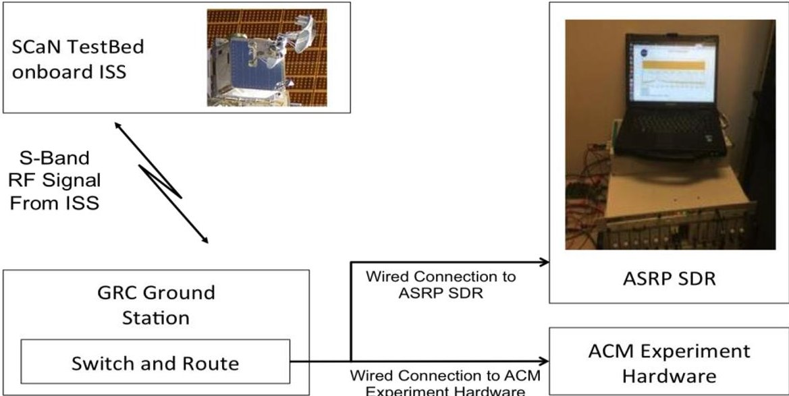
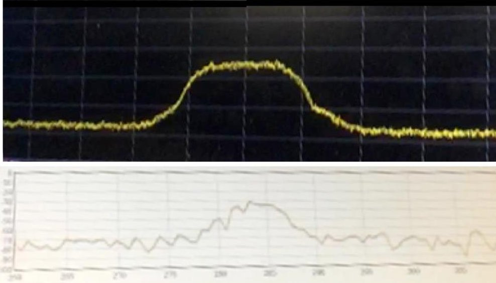

<!-- PDF_PAGE: 1 -->

# Future Standardization of Space Telecommunications Radio System with Core Flight System

Janette C. Briones $ ^{*} $ NASA Glenn Research Center, Cleveland, OH, 44135

Joseph P. Hickey $ ^{\dagger} $ ZIN Technologies, Inc., Middleburg Heights, OH

and

Rigoberto Roche $ ^{\ddagger} $ , Louis M. Handler $ ^{\S} $ , and Charles S. Hall $ ^{**} $ NASA Glenn Research Center, Cleveland, OH, 44135

NASA Glenn Research Center (GRC) is integrating the NASA Space Telecommunications Radio System (STRS) Standard with the Core Flight System (cFS), an avionics software operating environment. The STRS standard provides a common consistent framework to develop, qualify, operate and maintain complex, reconfigurable and reprogrammable radio systems. The cFS is a flexible, open architecture that features a plug-and-play software executive called the Core Flight Executive (cFE), a reusable library of software components for flight and space missions and an integrated tool suite. Together, STRS and cFS create a development environment that allows for STRS compliant applications to reference the STRS application programmer interfaces (APIs) that use the cFS infrastructure. These APIs are used to standardize the communication protocols on NASAs space SDRs. The cFS-STRS Operating Environment (OE) is a portable cFS library, which adds the ability to run STRS applications on existing cFS platforms. The purpose of this paper is to discuss the cFS-STRS OE prototype, preliminary experimental results performed using the Advanced Space Radio Platform (ASRP), the GRC S-band Ground Station and the SCaN (Space Communication and Navigation) Testbed currently flying onboard the International Space Station (ISS). Additionally, this paper presents a demonstration of the Consultative Committee for Space Data Systems (CCSDS) Spacecraft Onboard Interface Services (SOIS) using electronic data sheets (EDS) inside cFE. This configuration allows for the data sheets to specify binary formats for data exchange between STRS applications. The integration of STRS with cFS leverages mission-proven platform functions and mitigates barriers to integration with future missions. This reduces flight software development time and the costs of software-defined radio (SDR) platforms. Furthermore, the combined benefits of STRS standardization with the flexibility of cFS provide an effective, reliable and modular framework to minimize software development efforts for spaceflight missions.

## I. Introduction

NASA's Space Telecommunications Radio System (STRS) is the project to meet future space communications and navigation system needs by defining an open architecture for NASA space and ground software-defined radios (SDRs) providing a common, consistent framework to abstract the application software from the radio

<!-- PDF_PAGE: 2 -->

platform hardware to reduce cost and risk of using complex reconfigurable and reprogrammable radio systems across NASA missions. The Standard defines an open architecture to enable the reuse of applications, waveforms, and services implemented on various SDR platforms. The Standard provides a detailed description and set of requirements to implement the architecture. The Standard encourages the development of applications that are modular, portable, reconfigurable, and reusable. STRS applications use the STRS infrastructure-provided application program interface (API) and services to load, verify, execute, change parameters or unload an application. Some of STRS benefits include increasing the reliability, decreasing the development time, and decreasing the cost of SDR technology. By encapsulating functionality into modular entities, a deployed SDR can accommodate advances in radio technology simply by upgrading the various STRS software modules in use.

A layer cake model of the STRS architecture is shown in fig 1. The waveform applications and high level services use an STRS-specific API to call the STRS infrastructure as well as a POSIX application environment profile to call functions within the operating system (OS). Similarly, the STRS infrastructure uses an STRS-specific API to call the waveform applications and services. The hardware abstraction layer (HAL), and any board support package (BSP) and drivers are needed to use the specialized hardware or the general-purpose processing module (GPM).

Figure 1. STRS Architecture Layer Cake Model.

The Core Flight System (cFS) is a software suite that takes advantages of a heritage of Goddard Space Flight Center (GSFC) flight software efforts and has evolved from many flight projects, which had considerable overlap in their basic needs [1]. By using a proven foundation, the cFS architecture reduces time to deploy high-quality flight software, reduces project schedule and cost, provides common standards, and provides a platform for advanced concepts and prototyping which in turn encourages future software reuse. The cFS uses a layered architecture as shown in fig 2, where internals of a layer can be changed without affecting other layers' internals and components. Integrating both systems will enable technology infusion and evolution for future missions with lower development time and risk.

<!-- PDF_PAGE: 3 -->

Figure 2. cFS Software Layer.

This paper describes the new cFS-STRS SDR prototype and preliminary experimental results obtained using the Advanced Space Radio Platform (ASRP), the GRC S-band Ground Station and the Space Communication and Navigation (SCaN) Testbed [2]. It also presents a demonstration of the Consultative Committee for Space Data Systems (CCSDS) Spacecraft Onboard Interface Services (SOIS) electronic data sheet (EDS) technology inside cFS.

## II. Background

As mentioned above, cFS uses a layered architecture as shown fig 3. The Real Time Operating System (RTOS) layer contains the vendor support packages and the operating system, which provides message queues, semaphores, file system and shell among other services. Using the Operating System Abstraction Layer (OSAL), flight software such as the cFE can run on multiple operating systems without modification. The OSAL is a small software library that isolates the flight software from the RTOS. OSAL provides a subset of common RTOS functions that is accessible to the upper layers through a consistent API. It includes abstraction for module loading (e.g. dlopen() in POSIX) to dynamically load or unload executable code, tasks, semaphores, mutexes, or file/directory access.

The platform support package (PSP) contains the software needed to adapt cFS to a particular hardware platform and low-level access to device(s) available on the platform. Using a common interface to devices allows the hardware implementation to be changed without changing application code.

The Core Flight Executive (cFE) operates on top of the PSP and OSAL layers. This is a set of "core applications" which provide mission independent, re-usable flight software services and a standardized API for flight software. The executive services provide the capability to load additional software modules for mission-specific functionality. There are two types of modules: applications and libraries. Libraries provide additional API implementations that other applications may use. These modules extend the basic API provided by cFE and may utilize OSAL, cFE, or PSP functionality, or even other libraries. Applications modules are similar to libraries except that they also create at least one dedicated execution context (task) where libraries do not. Applications usually communicate with other applications through the cFE-provided Software Bus (SB) but may also use any available API to send/receive data from other entities in the system.

<!-- PDF_PAGE: 4 -->

Figure 3. cFS Software Layers.

The cFS applications provide a set of commonly needed software modules that operate within cFE, such as Limit Checking (LC), Scheduling (SCH), Housekeeping (HK), Command Ingest (CI) and Telemetry Output (TO), among others. Combining generic cFS libraries and applications with mission-specific applications can rapidly build complex software systems.

All cFS source code is implemented using ANSI C99; cross-platform portability is achieved by avoiding use of any direct OS or platform-specific library calls. All external function references should be limited to OSAL, cFE, and PSP APIs, and basic C library calls.

Figure 4 shows the relationship between the core cFE services and underlying OSAL services. The Executive Services (ES) manages startup, loads dynamic modules into memory when necessary, spawns tasks, and manages running applications. The Software Bus (SB) provides a datagram message transfer service between applications. It uses a "publish/subscribe" design where applications publish messages at any time, and any other application can subscribe to the message stream. The Table Services (TBL) provides the capability to dynamically load objects that determine runtime behavior. This is typically used for configuration data that is set and tested on the ground before being transferred to the flight system. It allows this configuration data to change independently of the application code, it also has the ability to dynamically load and atomically replace table objects without necessarily restarting the application(s) or system software. The Event Services (EVS) publishes asynchronous system events as a telemetry stream. The File Services (FS) extends OSAL file system API for cFS applications, providing a common file header and identification routines for all cFS-related files. The Time Services (TIME) extends the OSAL timer services, providing a monotonic "Mission Elapsed Time" (MET) value and correlating this value with other times such as UTC using synchronization messages.

All cFS applications primarily communicate using datagrams passed via the Software Bus (SB) service. This service may be bridged to other entities through gateway applications such as fast common gateway interface (FCGI), command ingest/telemetry output (CI/TO), the software bus network (SBN), and others. Commands and telemetry can be exchanged with other systems/processors, which may or may not be based on cFS. Internally, the software bus utilizes CCSDS standard 133.0-B-1 space packet protocol [3], so data exchange with other space data systems is possible with minimal translation.

<!-- PDF_PAGE: 5 -->

Figure 4. cFS Services.

## III. cFS-STRS Prototype Architecture

Figure 5 depicts how STRS and cFS coexist within the same flight computer or operating environment. The STRS architecture does not define any specific threads or execution contexts, so the STRS API implementation best fits as a cFS library as opposed to an application. The STRS-defined API (STRS_Initialize, STRS_ReleaseObject, STRS_Start, STRS_Stop, etc.), per NASA-STD-4009 [4], are implemented in a modular library called "STRS_OE". Per STRS requirements, portable STRS waveforms must only use the STRS infrastructure-provided API with a prefix of "STRS_ and implement STRS application-provided API with a prefix of "APP_"; they must not have any other dependencies aside from this and a minimal set of POSIX calls. Therefore, STRS waveforms/applications are agnostic to the surrounding cFS environment; they are only aware of other entities within the STRS "cloud" shown below. Communication with all flight computer (cFS) resources is provided through an STRS flight computer interface application (FCI) as shown below. Both the STRS API implementation (STRS OE) and the Flight Computer Interface (FCI) are designed to be portable, reusable cFS software components, shown in fig 6.

Figure 5. cFS and STRS Prototype Architecture.

American Institute of Aeronautics and Astronautics

<!-- PDF_PAGE: 6 -->

"FCI" app can receive commands, telemetry from CFS apps, or send telemetry all via CFE Software Bus

Figure 6. Putting It Together.

A. cFS Component #1: STRS OE Library

All STRS header files and API calls as specified by NASA-STD-4009 are implemented within this single cFS library. The library also provides additional internal OE-specific header files that other cFS applications can use (extensions). These additional API calls allow specialized OE-specific devices and applications to be developed as necessary. For instance, the FCI application utilizes this extended API, but its use is not limited to FCI. If necessary, it allows any cFS application to register its own dedicated STRS handle ID, allowing direct data passing between itself and other STRS application(s).

The following is implemented within the STRS OE library:

- Global STRS handle ID table and associated management functions.

o The OE library manages a single lookup table for all STRS handle IDs.

- Internal table contains an STRS API validity mask to control which STRS API calls are allowed on any given handle ID. For instance, it can restrict calling STRS_QueueDelete() on a non-queue handle, or STRS_FileClose() on a non-file handle, etc.

- Basic "dispatcher" functions for STRS API calls.

Uses a branch table to service STRS API calls

Each defined application-side (APP) API call has an entry in the branch table that the STRS OE can invoke, depending on the STRS call.

- Implementations for basic STRS "File" and "Queue" operations using OSAL.

- STRS C++ bindings as optional adapter layer

o The core STRS OE library is implemented in ANSI C99, like other cFS libraries (no C++)

For all special STRS handles, such as files, queues, and clocks, the special functionality is embedded behind the existing "APP" functions via wrapper objects that are structured exactly like any other STRS object. This eliminates the need for any special handling or "type checks" elsewhere in the OE. For instance:

- "APP Instance" can create a wrapper object,

- "APP_Initialize" can obtain the underlying OS resources (e.g. a file or queue handle, etc.),

- "APP_ReleaseObject" can release the OS resource,

- "APP_Read" and "APP_Write" can map to the OS read/write for files or queues, or implement the get/set operation for clocks.

<!-- PDF_PAGE: 7 -->

The STRS_FileOpen() creates an STRS handle using the File API. Likewise, the STRS_QueueOpen() creates an STRS handle using either the SimpleQueue or Pub/Sub API depending on type. The "Validity Mask" implemented in the OE ensures that a user cannot directly call other STRS APIs on these types of handles, such as STRS_Initialize(), even though it internally may implement the APP_Initialize() call.

Although the core functionality of this STRS OE library is implemented in C to be compatible with all platforms that support cFS, the STRS architecture specifies that applications may also be implemented in C++. To achieve this, the implementation includes an optional bridge layer to allow dispatching to waveforms that are implemented in C++. All C++ code in the STRS OE library is conditionally compiled through makefile options that are configurable at compile-time. When included, the OE library transparently supports dispatching to STRS waveforms implemented in C++ as described in NASA-STD-4009. When not included, the library has no dependencies on a C++ runtime environment or C++ compiler whatsoever.

To achieve this, an internal C++ wrapper class provides compatible (extern "C") implementations of the STRS C-language APP API, which in turn calls the C++ member function within the target STRS application. The core dispatcher (branch table) is identical, as this is just simply a pointer to an alternate function implementation, and no special handling or type checks are required. Using a wrapper fully portable and standards-compliant; no compiler or platform-specific implementation is required, and all required C++ calling conventions are correctly adhered to.

It is important to note that no actual STRS objects or handles are instantiated directly by the OE library. This library only provides the API implementation: all instantiation of entities described as "built-in" in the STRS architecture standard is performed externally from the STRS OE library. A "bootstrap" function is exposed in the API header files. The STRS handles are created by the external bootstrap software entities. The handles for the cFS applications can provide all OE-level functionality specified by the STRS architecture. Because of this generic design, although the STRS OE is currently being demonstrated as cFS library, the library, has no actual dependencies on cFS itself. The same library code can theoretically be used in any system to provide the basic STRS API, even one that does not use cFS, as a foundation to building an STRS-compliant OE.

## B. cFS Component #2: Flight Computer Interface (FCI)

The FCI application is unique in that it is aware of both cFS and STRS operating environments, and serves as a gateway between the cFS and STRS domains. On the cFS side, the FCI application binds to the software bus (SB) like any other cFS application, so other cFS applications do not need to have any specific knowledge of the STRS OE to send telemetry data into STRS applications. FCI can be configured to subscribe to the desired telemetry stream and forward the incoming data to the appropriate STRS application. Likewise, on the STRS side, the FCI communicates via an STRS handle ID and the STRS-defined API, just like any other STRS application. Therefore, STRS applications can also send data to cFS applications simply by configuring the FCI to publish data onto the software bus received via STRS APP_Write() calls for example. This satisfies the requirement that portable STRS waveforms only use the STRS API, while allowing them to transparently send and receive data from the external cFS domain.

The FCI application also implements a "remote procedure call" allowing STRS calls to be triggered via cFS commands, identical to the way other cFS applications handle commands. This allows a standard cFS ground system to transparently make STRS calls with no modifications, as these become ordinary cFS command messages.

In addition to the gateway functions, the FCI application also implements the portions of the STRS operating environment that are based on cFS-provided services. This includes instantiation of all required OE-level STRS handle IDs to implement time functions and the standard set of STRS queues: STRS_ERROR_QUEUE, STRS_FATAL_QUEUE, STRS_WARNING_QUEUE, and STRS_TELEMETRY_QUEUE.

The queue handles all utilize an "EventLogger" API implemented within FCI that forwards the message to the cFE Event Services core application. Only STRS_Log() is allowed to use these handles; direct STRS_Write() calls are restricted. The internal implementation of APP_Write() forwards the event message and contextual data to the event service (EVS) subsystem. Each STRS handle maps to a different cFE Event ID so each type of message can be identified in the resulting telemetry stream.

For time access, the FCI instantiates an STRS clock handle which is based on the cFE "Mission Elapsed Time" (MET). MET is a monotonic clock provided by the cFE TIME subsystem. This clock may be correlated with other clocks, such as UTC/earth time, using a "spacecraft time correlation factor" (STCF). The cFE TIME core application implements several messages to allow ground systems to manipulate the STCF, but MET will always be incrementing monotonically and never "jump". The STRS_GetTime() is implemented as APP_Read(), and STRS_SetTime() is implemented as APP_Write(). Like log queues, direct calls to STRS_Read() and STRS_Write() on this handle are restricted; only STRS Time API calls may be used. Currently, the various "clock kinds" are time offsets that remain local to the STRS implementation. Therefore, STRS_SetTime() only affects STRS applications.

<!-- PDF_PAGE: 8 -->

However, it is possible to propagate this to the STCF value such that other cFE applications will also see a time change made using the STRS_SetTime() call.

Finally, FCI also implements bindings to the FCGI application, which provides a gateway to a webserver for a lightweight "ground system" interface useful for debugging. Basic STRS calls can be invoked using special URLs, and data messages can be passed in or returned to the user interface as Javascript Object Notation (JSON) strings.

## IV. Electronic Data Sheets

There is a general problem related to component portability that exists in both the cFS and STRS domains. Although the respective architecture dictates the API syntax to use for input/output and control, it does not explicitly dictate the exact semantics of these interfaces, leaving the specific behavior to be defined by the module implementation. This flexibility is absolutely necessary to support a wide range of potential applications; for instance, a generic architecture cannot fully specify the exact behavior of a "configure" or "read" API call, since this depends entirely on what is being configured or read, respectively.

In the cFS domain, messages are exchanged using the software bus defined API. This API specifies a function call syntax used to send or receive a message, but it does not specify what those messages actually contain; the message payload is entirely up to the application implementation.

Likewise, in the STRS domain, many STRS API calls specify a generic "STRS_Message" parameter accompanied by a message size. At the architecture level, this is an abstract pointer that has no specific definition associated with it, relying entirely on the application implementation to specify the format and contents of these messages.

Standardizing the syntax of API calls only achieves part of the overall component portability/re-usability goal. Basically, it allows pieces of source code that have been independently implemented to compile and run in any other environment that shares the same API syntax. Although this is a critical first step to re-usability, it is not sufficient by itself. In order to communicate and effectively achieve their intended purpose, all components that are intended to interoperate must also agree on the various implementation details which are not specified at the architecture level. This includes, but is not limited to:

- Specific commands or configuration options supported, and the associated meanings/effects

- Specific format for any inputs, such as an input data stream, commands or configuration parameters

- Specific format of any outputs, such as query results or telemetry data that is produced by the application Unfortunately, there is no easy solution to this. Each problem domain has specific requirements that must be met, which generally mean that there can never be "one data format for all". Traditionally, the resolution of such problems has been done at the systems engineering level, where each component would specify its specific inputs and outputs in a separate interface control document (ICD) and whatever necessary mappings between the components could be implemented.

Electronic Data Sheets offer a method to automate at least part of this otherwise manual task. This concept implements the same role traditionally served by a hand-written ICD, but in a language that is machine-readable. This allows software tools to be much more "aware" of the details associated with any given interface, such as the specific data formats, protocols, or timing requirements. As a result, some tasks can be automated which would otherwise need to be hand-written, such as conversion between different data formats or encodings.

The international Consultative Committee for Space Data Systems (CCSDS) Spacecraft Onboard Information Services (SOIS) working group has proposed a draft schema for electronic data sheet documents, based on XML and specified in CCSDS book 876.0 [5]. NASA Glenn Research Center has developed and is demonstrating an implementation of SOIS electronic data sheets as part of the Core Flight System.

Basically, rather than requiring all applications to implement an exact, fully-specified interface, application developers can use the EDS schema language to describe the way a particular interface is implemented in their specific component. The schema includes enough detail to enable external tools and components to reliably access and decipher data coming from the component, send commands to a component, or manipulate configuration data of a component.

The system components described can be physical hardware devices, where the device manufacturer would author the EDS, or software components where EDS can serve as a common interface description between the sender and receiver.

Figure 7 depicts the logical flow of information through the complete EDS-enabled tool chain. Initially, the EDS files are used to generate static compile-time data definitions and run-time databases. These databases contain the necessary metadata to allow identification of data objects as well as conversions between object types depending on interface requirements. The compile time data definitions are used in conjunction with the application source code

<!-- PDF_PAGE: 9 -->

to build the executable binaries, which may in turn link with the run-time database components to perform automated object identification and conversion. Finally, system requirements can be verified through test procedures utilizing the interfaces (commands and responses) identified in the EDS. The cFS EDS tool chain currently implements bindings to the Lua scripting language, which allow generation and manipulation of EDS-specified commands and data structures within Lua script files. It is also possible to implement bindings to other high level scripting languages, such as Python, in the future.

Figure 7. EDS Artifact Flow Example.

The cFS-STRS OE leverages the EDS technology implemented in cFS to specifically describe the STRS "sink" and "source" interfaces as well as any tests or configurable properties of STRS applications. The electronic data sheet can serve as documentation of the specific interfaces implemented in the application (satisfying an STRS requirement), but also can be directly used by any tool or external system that implements the same EDS schema, making these external components also aware of the interfaces and data formats in use without being "hard coded". Logically, any future update to the data format, such as the addition or removal of fields, can be propagated to other entities via the EDS file, without necessarily requiring specific source code changes on these various systems.

<!-- PDF_PAGE: 10 -->

Figure 8. cFS and CCSDS.

## V. Experimental Results

## A. Test Scenario

The initial deployment of cFS-STRS was implemented on the Advance Space Radio Platform (ASRP) as illustrated in fig 9. The ASRP is an SDR platform that uses a micro Telecommunications Computing Architecture (microTCA) processing board (Vadatech AMC516). This board is an embedded solution containing a general purpose module (GPM) and a signal processing module (SPM) as a field-programmable gate array (FPGA) hardware in a single board. The hardware allows for several processing boards to be mounted in a microTCA chassis to provide a flexible solution for developing new waveforms (e.g. cognitive radio and networking) with scalable processing power in a flight-like operating environment through cFS-STRS.

The initial instance of the cFS platform support package provides a software interface to the hardware present on the ASRP platform. The cFS build implemented on the hardware is able to access and control the SPM through a local bus after the execution of several, platform specific, initialization and clocking scripts. These are needed to set up the hardware interfaces and are included in base-builds of cFS-ASRP. The low level interface devices were implemented as cFS "PSP drivers" which are statically linked into the PSP library and accessible through the cFS PSP driver interface. For each device driver, there is also an associated STRS device that allows access to the device from the STRS domain through STRS Device calls (e.g. STRS_DeviceOpen(), STRS_DeviceLoad(), STRS_DeviceWrite(), STRS_DeviceRead()). The STRS_DeviceRead() and STRS_DeviceWrite() are API extensions that were required to support reading/writing from a specific device address. This is not supported using the basic STRS Read/Write calls, as these do not include a location or address to write to.

Figure 9. Experimental Setup.

<!-- PDF_PAGE: 11 -->

For this particular experiment, a direct-to-Earth communications link from the SCaN Testbed aboard the International Space Station (ISS) to the GRC Ground Station (GS) was used. The ground station has a steerable antenna which tracks the SCaN Testbed using open-loop pointing [6]. It is equipped with various power meters and spectrum analyzers to monitor the link, as well as, easy integration of local ground modems and test equipment via an intra-building RF-over-fiber system. In this case, the ASRP radio was connected as a parallel signal output from the space down-link to another experiment denoted "Adaptive Coding and Modulation (ACM) experiment". The purpose of the set up was to use the signal and test whether the event could be observed in the ASRP SDR running the cFS-STRS build.

The cFS web interface provided data via a sample capture waveform on the ASRP which was used to compute and display a live spectrum plot and for OE control. The on-board JPL SDR, configured with a commercial Digital Video Broadcasting (DVB)-S2 waveform, transmitted over S-band to the ground station and the signal was received with a DVB-S2 receiver. The SCaN Testbed flight computer controls and monitors the experiment via a separate ISS communications path. The comparison between the observed signal by the GS analyzer (top signal) and the ASRP SDR using cFS-STRS build with a received waveform (bottom signal) is illustrated in fig 10.

Figure 10. Observed Signal Comparison.

From this experiment it was concluded that the current cFS-STRS build was a successful deployment and a viable development methodology for integrating the technology onto ground and space SDRs.

## VI. Benefits and Savings

Adapting STRS to the cFS concept took a minimal amount of work, as the two operating environments can maintain a fair amount of independence while still communicating with each other when necessary. This allows source components from either ecosystem to be used together, thereby improving our ability to reuse code and to lower development costs. The cFS based STRS OE leverages over 38 person-years of cFS code development. STRS Reference OE took more than a person-year to develop, but the demo cFS based OE was developed in 6 person-weeks.

Since cFS is already intended as a cross-platform environment with appropriately layered platform and operating system abstractions, cFS already includes most platform-specific calls which makes porting cFS-STRS to new platforms significantly easier, as it can run on any platform that supports cFS; usually no additional porting efforts are required for STRS. As new operating system, new avionics or new applications become available, the layered CFE can be adapted and the cFS components can be reused without any software changes.

All source code will be available for reuse via the STRS Application Repository. The STRS Application Repository holds documentation, code, and other artifacts that may be used to port or reuse applications on another platform [7]. This enables missions to leverage earlier efforts by reusing software components compliant with the architecture that have been developed in other NASA programs. This will reduce the cost and risk of deploying SDRs for future NASA missions. It is expected that the STRS Application Repository will expand with each NASA mission.

<!-- PDF_PAGE: 12 -->

## VII. Conclusions

This paper demonstrated the significant saving of integrating STRS with the cFS. The test results demonstrated functionality of the successful integration of cFS with STRS on the ASRP communicating using an SDR aboard the ISS. Further STRS integration with cFS environment will leverage mission-proven platform functions and will reduce barriers to integration with future missions. The STRS Application Repository will provide value to future missions with flight-proven software and verification experiences reducing future missions' cost and risk.

## Acknowledgments

The authors would like to thank James Downey, the ACM experiment team, SCaN Testbed Operations, and Ground Station team for supporting the testing.

## References

[1] Core Flight System, URL: https://cfs.gsfc.nasa.gov

[2] Space Flight System-SCaN Testbed, URL: https://spaceflightsystems.grc.nasa.gov/sopo/scsmo/scan-testbed/.

[3] CCSDS Space Packet Protocol, CCSDS 133.0-B-1, Blue Book, Issue 1, September 2003.

[4] Various Authors, "Space Telecommunications Radio System (STRS) Architecture Standard," NASA-STD-4009 Baseline, URL: https://standards.nasa.gov/standard/nasa/nasa-std-4009, 2014.

[5] CCSDS Spacecraft Onboard Interface Services - XML Specification for Electronic Data Sheets, CCSDS 876.0-R-2, Draft Red Book, Issue 2, June 2016.

[6] Glenn Research Center Ground Station Description, Performance, and Interface Document, GRC-CONN-DOC-1073, April 2015.

[7] Space Telecommunications Radio System (STRS) Application Repository, URL: https://strs.grc.nasa.gov/repository/.