<!-- PDF_PAGE: 1 -->

# A SysML Model Template for NASA Concurrent Engineering Studies

Samantha I. Infeld $ ^{*} $ , David Goggin $ ^{\dagger} $ Analytical Mechanics Associates, Hampton, VA, 23666, USA

Kevin Vipavetz $ ^{\ddagger} $ , and Trevor Grondin $ ^{\S} $ Langley Research Center, NASA, Hampton, VA, 23681, USA

Systems Engineers at NASA Langley's Engineering Design Studio (EDS) have been developing a SysML $ ^{**} $ template that models both the EDS concurrent engineering study process and the system of interest for the study. Specifically, the model template is used to develop end-to-end space-based mission concepts. The model template evolved through targeted use and technical feedback during several EDS studies in 2016-17. This year, a model template version was completed that is being tested for use throughout EDS studies. It features ease of navigation through the documented study process to create the logistical articles (e.g. session agenda) and technical articles (e.g. system requirements) connected in the study SysML model, resulting in demonstrable and trackable relationships between the system design and the study goals and objectives. The model template allows easy release of the system of interest portion at the end of the EDS study. The customers may use this as a starter model as their project moves forward. The model template design details and the motivation for them will be explained in this paper. This will be followed by the results of the first trials of the model template in an EDS study, and discussion of the integration of this template into the NASA MBSE Community of Practice.

## I. Introduction to Concurrent Engineering and the NASA LaRC EDS

THE Concurrent Engineering Centers are places where a team spends a week or so co-located to conduct a conceptual design study. This allows many aspects of the design to be developed concurrently, speeding up an engineering process that may have otherwise taken months. For example, the goal may be to come up with a conceptual design to put into a proposal, or to trade two or three design choices, or to look for ways to decrease the estimated cost of a project. When engineers, scientists, and other specialists design different aspects or subsystems of a system, each of which affect all the others, communication and negotiation between all the specialists is necessary to meet a design goal. The systems engineer is the central point in this communication. In a concurrent engineering center session, the systems engineer creates a model of the system of focus to see all the interfaces clearly enough to manage them. This can be done many ways, but a tool that creates a single model of the system concept and how each aspect affects others that can be edited by all participants simplifies the communication and visualization aspects of concurrent engineering. A single model lets the systems engineer and entire team visualize the concurrent activity and catch inconsistencies in assumptions or interfaces through model interaction rather than error-and-gap-prone human review. This immediate feedback and visualization at the system level decreases the time needed to converge on solutions and increasing the quality of the output from the sessions. Performing systems engineering using such a system model is the definition of model-based systems engineering (MBSE); therefore, concurrent engineering centers using the model-based systems engineering approach will be most successful in reducing time and cost needed to meet study goals[1].

<!-- PDF_PAGE: 2 -->

The Engineering Design Studio Center is the concurrent engineering facility at NASA Langley Research Center (LaRC), providing a collaborative engineering environment and team for projects in all phases of design, from concept to flight. Skilled engineers and scientists utilize the EDS's collaborative process and tools to produce space mission concepts, remote sensing instrument designs, and technology application strategies. The studio allows members of a design team to come together for real-time design development in an integrated environment, where we are continually improving tools for connecting analyses and design into the system model.

## II. Sources and motivation for the SysML EDS model template

The short-term nature of EDS studies calls for a structured environment, repeatable process, and common products. This has led naturally to the use of templates in all our tools. The EDS SysML template began through experiments with MBSE in EDS studies starting with an existing simple LaRC SysML project template, and an existing LaRC SysML profile with stereotypes for requirements and other element types needed to meet NASA procedure requirements. The electronics group was already sometimes working in MagicDraw for their designs in the EDS, so there was additional material to connect to, and team members with SysML fluency as another source.

These sources were used for session preparation to show an architecture or interface, or for teamwork during a session to agree on system operations, external interfaces, or system component names. Through these experiments, we developed a few partial models and some diagrams at different levels of design. Next, we worked on some smart tables, such as those showing the links from requirements to architecture elements meeting those requirements, motivated by the need in a study to communicate gaps between requirements and design. The design areas used in the Model Overview (Fig. 4) and the EDS study process steps used in the EDS Concept Development (Fig. 6) were based on the systems engineering approach developed in the EDS to provide superior communication for the study team[2]. All of these became sources to expand the structure and incorporate examples in the EDS template.

A common type of study in the EDS is the early space based system conceptual design. For a project at this stage, we are starting from science or technology papers and some rough calculations, and the goal is to end with something that can move along directly or eventually into Phase A design work as a flight project $ ^{\dagger\dagger} $ . Because of the interest in continuing to integrate MBSE into flight projects, it is valuable for the MBSE work we do during the EDS study to be usable following the study by the project systems engineers. This is the motivation for formulating the template into the general structure of a flight project organization, with space-based example diagrams and tables linked from each starter artifact(but living in a separate example package for ease of disconnection), and a separate EDS package for navigation and tracking of the study process. During the study, the model template aids in walking through the process, going directly to a starter, or skeleton, of each artifact. Each artifact is then either developed, linked, or justified as out-of-scope. This navigation using the study process means that the team moves smoothly between the packages that will later be separated. For example, during a planning meeting, the Concept of Operations in the project package and the Study Objectives in the EDS package will both be accessed from one of the EDS process diagrams (either the EDS Concept Development, Fig. 4, or the Model Overview, Fig. 6).

After separating the EDS package at the completion of a study, the customer can then use the model template to cut the project development time drastically for project plan development and preparation for Mission Concept and System Requirement reviews due to the superior communication provided by the systems engineering process captured in the model structure and examples. This reduces risk, improves consistency and understanding, and makes for a successful project. The model template is an excellent end-to-end reference source that can be used throughout a project life-cycle.

## III. Design and use of the EDS model template

## A. Profile use

In the EDS model, we make use of three SysML profiles developed by MagicDraw users at Langley. These are named "Measurements", System Elements", and "NPR 7123.1".

<!-- PDF_PAGE: 3 -->

The NPR 7123 Profile was developed in an attempt to incorporate NASA 7123.1a Systems Engineering culture (terminology and processes) into SysML model development, as part of a Systems Engineering Working Group initiative in 2010. It extends SysML to include NPR 7123 concepts through stereotypes and methodology constructs, avoiding SysML nomenclature that conflicts with NPR 7123, and facilitating model reuse. It includes requirement elements (goals, objectives, constraints), mission elements (mission objective, operational objective, concept of operations, Design Reference Mission [drm]), and project artifacts (architecture description, deliverable, entrance criteria, Measures of Effectiveness [MOE], Measures of Performance [MOP]). The NASArequirement stereotype specializes the extendedRequirement in SysML to add Rationale, Owner, VerificationLevel, VerificationLead, reviewStatus tags for approvalDate, sponsor, and status, and a UID (unique identification to enable syncing with an external requirements database). Fig. 1 below shows some of how these extensions were made in a partial view of the metamodel.

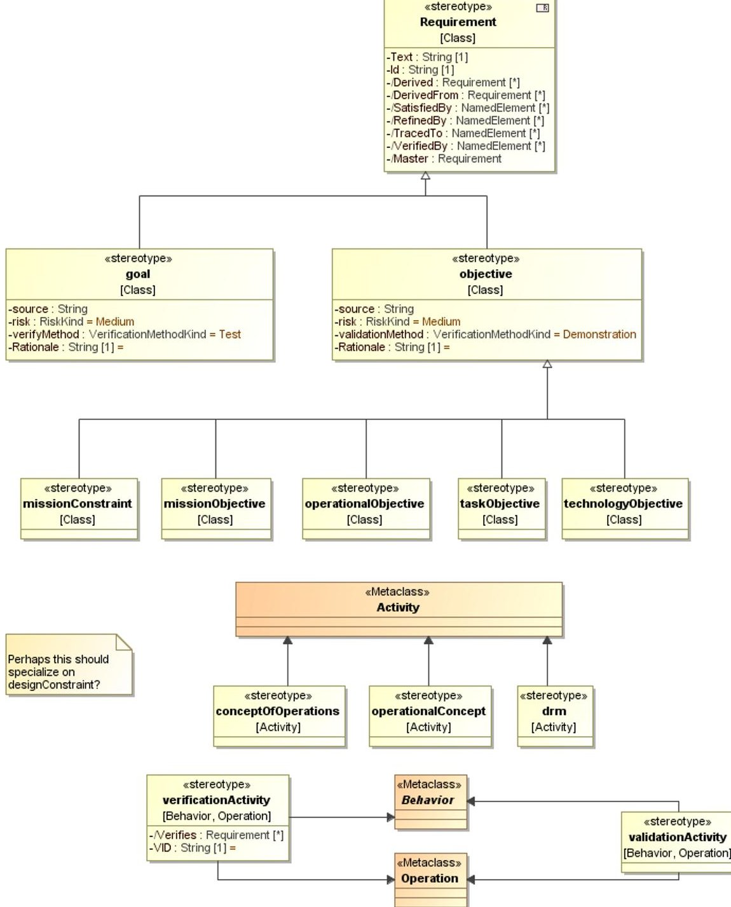

## Fig. 1 Portion of the metamodel for the NPR 7123 Profile

This profile is used to take advantage of these added values, identify elements meeting the guidance in NPR 7123 as such, for consistency across projects, and audit for these different element types during future project development. For example, a skeleton requirements flow uses missionNeed, missionGoal, and missionObjective, that flow down to Level 1 science requirements using NASArequirements; see Systems Engineering package described on page 11.

<!-- PDF_PAGE: 4 -->

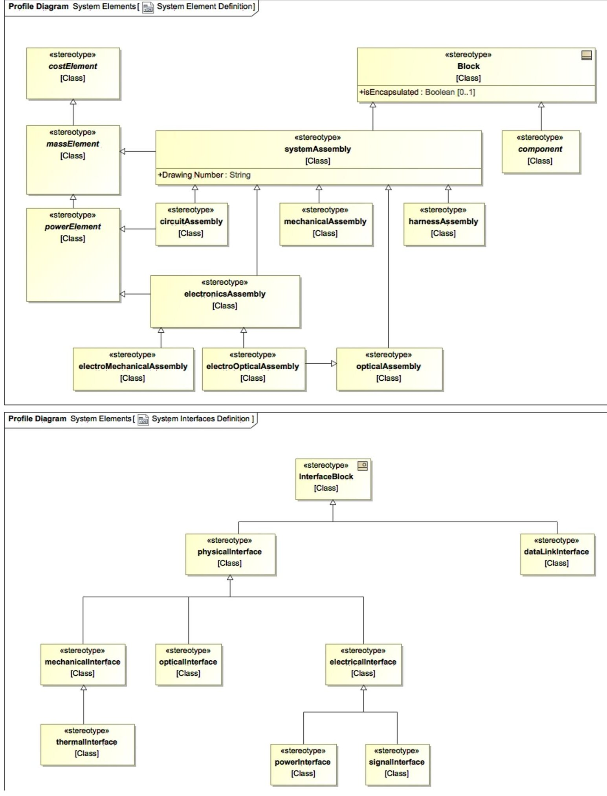

Fig. 2 Profile diagrams for the System Elements Profile

<!-- PDF_PAGE: 5 -->

The System Elements profile defines classes for subsystem assembly types, interface types, and flow types. The assemblies have mass, cost, and power values where appropriate, generalized from parent Class stereotypes. A few of the starter diagrams use these, and the profile diagrams, Fig. 2, are present to inform any team moving on with the model to more detailed design work. They may be used as a starting point to develop the project's own profiles. Other projects at Langley have since used some other ways to define system elements.Again, use of a profile like this is helpful toward consistency across projects and auditing.

The Measurements profile, partially illustrated in Fig. 3, introduces a Measurement Objective with space for extra text, and a Measurement stereotype. Use of this profile is an experiment to replace multiple "measurement requirements" specifying the different performance requirements of an instrument that may really be coupled, and that then must be "satisfied" by model elements representing the physical parts of an instrument, with a single Measurement model element to capture the scientist(s) intention. The Measurement stereotype includes the sensors and subsystems used to make the measurement, and the point of contact for defining and refining the information. The profile also includes Sensor stereotypes to connect to the Measurement, but this model template does not make use of these; they could be used by any project moving forward into more detailed design if the system engineer wants to continue this method forward.

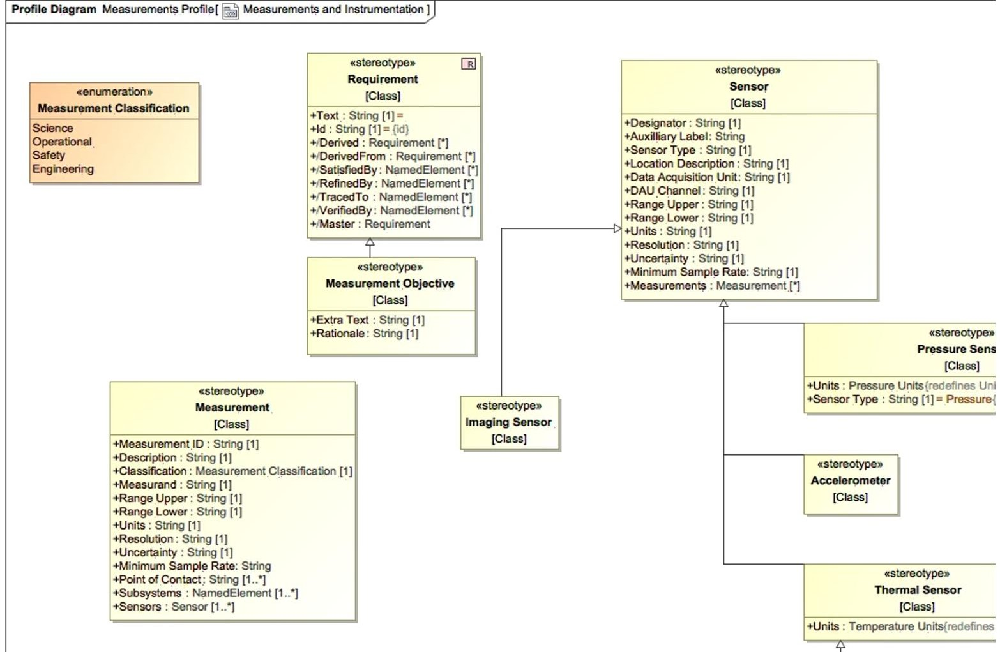

Fig. 3 Measurement Profile diagram (partial)

<!-- PDF_PAGE: 6 -->

## B. Model Overview and Structure

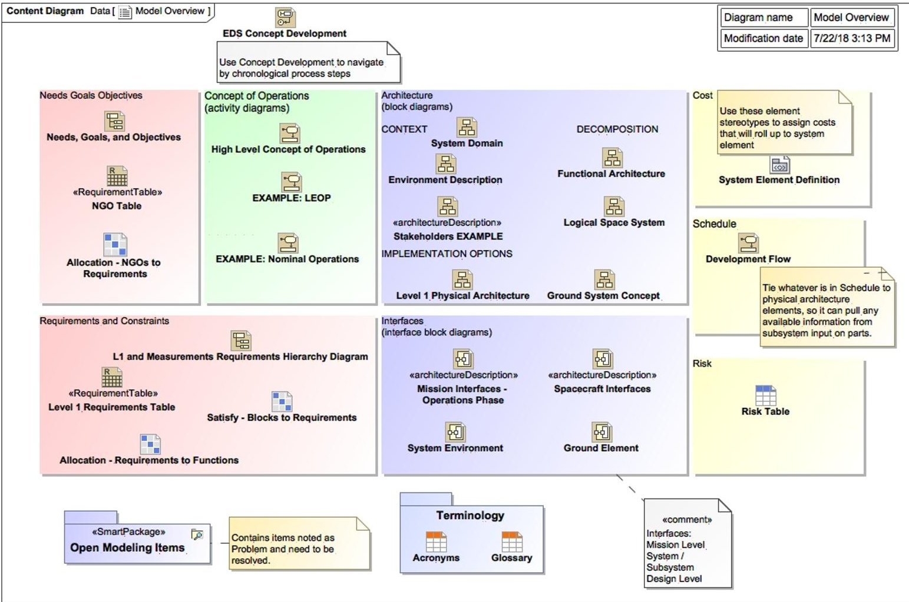

Fig. 4 Content diagram for navigation while adding content to the model template for a particular study

<!-- PDF_PAGE: 7 -->

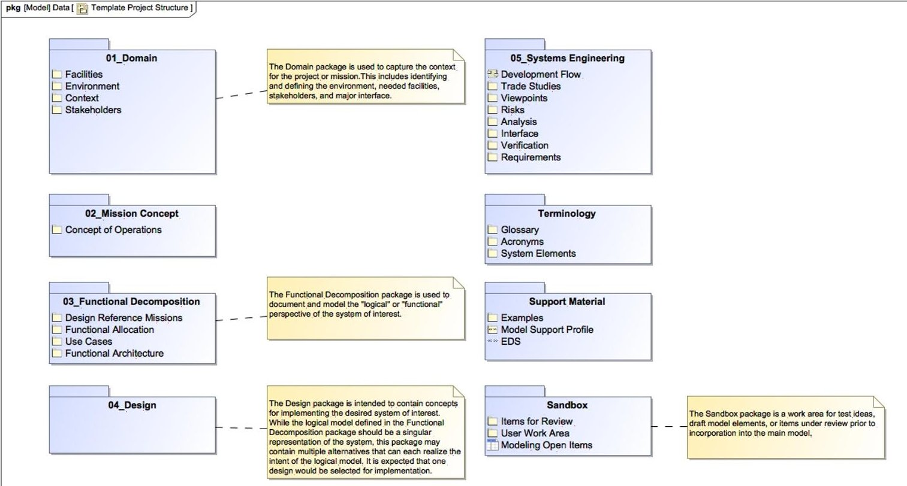

## Fig. 5 Model Structure "Package" Diagram for Overview of Permanent Contents

Fig. 4 Fig. 5 above are at the top level of the model along with the profiles and top-level packages. The first, Model Overview, is intended to review and navigate the system by the major areas of concept development to ensure appropriate work is completed in each. As the model is tailored to the particular project, this diagram may need to be updated to link to the actual key diagrams and tables for each area if new or additional diagrams/tables are added beyond editing the starter ones already linked here. The second, Template Project Structure, is an aid to understand the containment structure of the model. The EDS package is not included in this diagram because it will not be included once the model is exported for use outside the EDS. The profiles, described in part A, are also not shown in this diagram. The numbered packages are within the Project package, which is at the top level. The other packages shown here as blue folders are also at the top level.

## C. EDS Package

The EDS package contains the items to plan and track the study for the Engineering Design Studio. The intention is that this package can be deleted at the close of the study to create the model version for the project or proposal team to own going forward. Here we have the Concept Development flowchart (as a State Machine) to guide the study Facilitator through the steps with the customer. The content here assumes a study for concept development, especially in the early systems engineering work defined during planning and prework phases. In other types of studies, the text can be changed to mutually agreeable steps during the Study Initiation. Starting from here at each meeting keeps the expectations of progress aligned both in content and in time. Most elements have hyperlinks to the diagrams in the model, or sections in the EDS OneNote notebook, to the home of that content. The team can check in on the expected timeline to move into the "state" of Prework Phase or the Session Start and can regard the numbered substates as entrance criteria to the next state.

<!-- PDF_PAGE: 8 -->

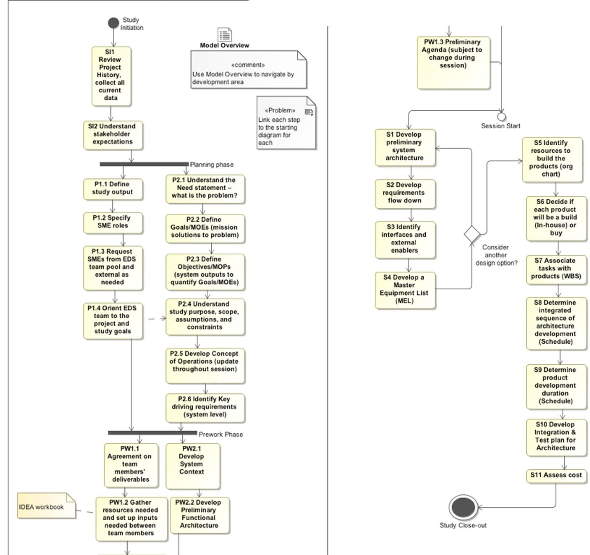

Fig. 6 EDS Concept Development "State Machine" Diagram for Chronological Navigation of Study Process

Additionally, the EDS package contains the one other diagram that is solely about the study itself, the EDS Session Overview. This diagram is intended to aid the development and visualization of the context, goals, and objectives of the study.

<!-- PDF_PAGE: 9 -->

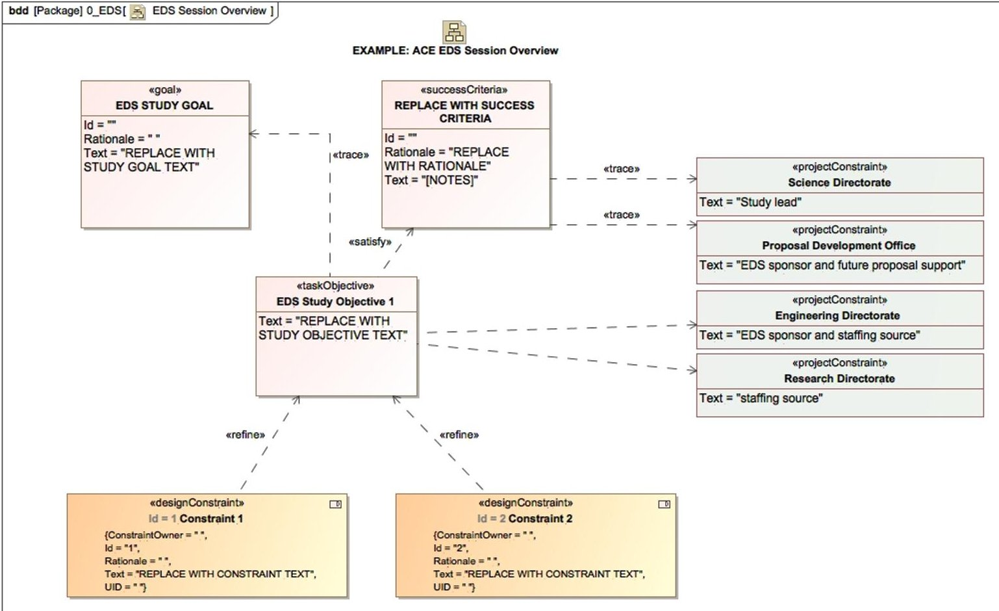

Fig. 7 EDS Session Overview starter diagram

## D. Project Package

## 1. Domain

The Domain package is where the context of the project is defined. During an early EDS planning meeting with the customer team, we define the assembly, launch, and operating Facilities; operating Environment; and Stakeholders that produce constraints and requirements on the project in corresponding packages. In the Context package, other needed elements and context diagrams are produced during the discussion as useful to illustrate the concept to the design team and prepare for requirements traceability.

<!-- PDF_PAGE: 10 -->

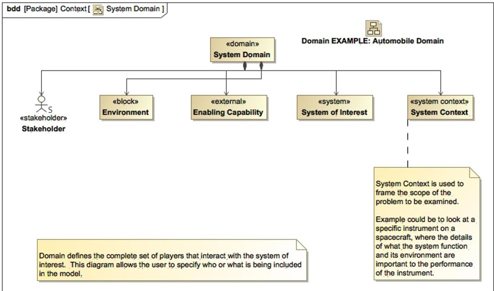

Fig. 8 System Domain - starter diagram in the Domain package

## 2. Mission Concept

The Concept of Operations is created here. A top-level activity diagram with generic names is the starting place for a mission lifetime ConOps. When the customer or their stakeholders have strong ideas about what will happen during a certain mission phase, we work to capture their ideas and questions in additional linked diagrams in this package.

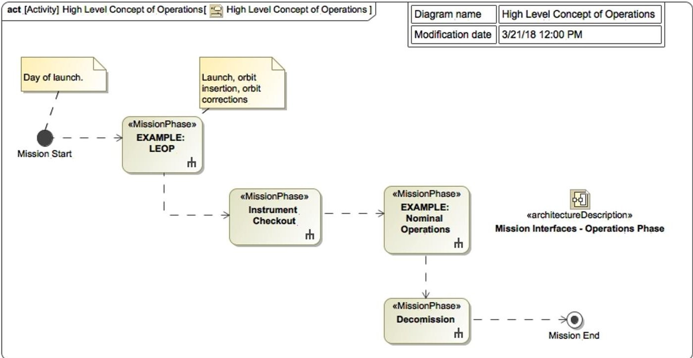

Fig. 9 ConOps starter diagram with further starters or examples linked to each phase. An interface example is also linked here for an alternative way to develop or visualize the system operations.

## 3. Functional Decomposition

This is where the systems engineer records system of interest functions during "pre-work" before the EDS session, preparing to allocate those functions to the subsystems. If there are design reference missions or use cases discussed during pre-work for the design team to work from, these are created in this package because they are illustrations of sample system parts performing the system functions. A logical or functional architecture may be created here before

<!-- PDF_PAGE: 11 -->

or during an EDS session. Following NASA guidelines, these functional decomposition activities are used to derive the right level of requirements to begin the design's physical architecture.

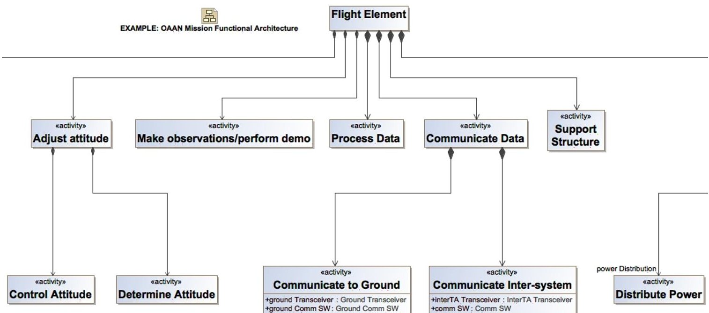

## Fig. 10 Functional architecture starter (partial)

## 4. Design

The physical design elements are created in this package. Here, a high-level preliminary physical architecture will be created as a block definition diagram during EDS session pre-work, to be shown and expanded during the session. This, together with the CAD drawing also displayed (and linked to the model), allows the team to stay in sync about how their part fits with the rest and the terms agreed upon for each subsystem and physical element.

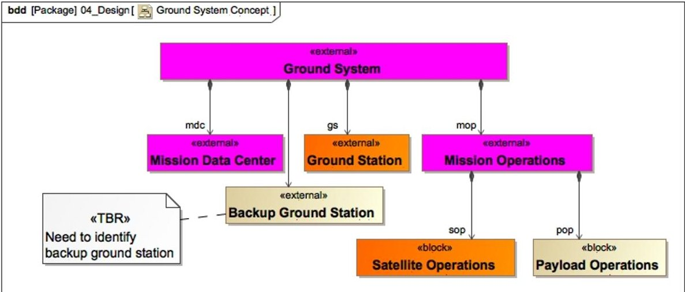

## Fig.11 Ground system architecture starter

## 5. Systems Engineering

In this package, the Systems Engineering artifacts are created that analyze the design and the design process. This includes Requirements packages and traceability diagrams (starter diagrams using elements from two packages illustrated in Fig. 12 below), and several pre-defined smart tables to view relationships and find gaps between functions, requirements, and architecture elements.

<!-- PDF_PAGE: 12 -->

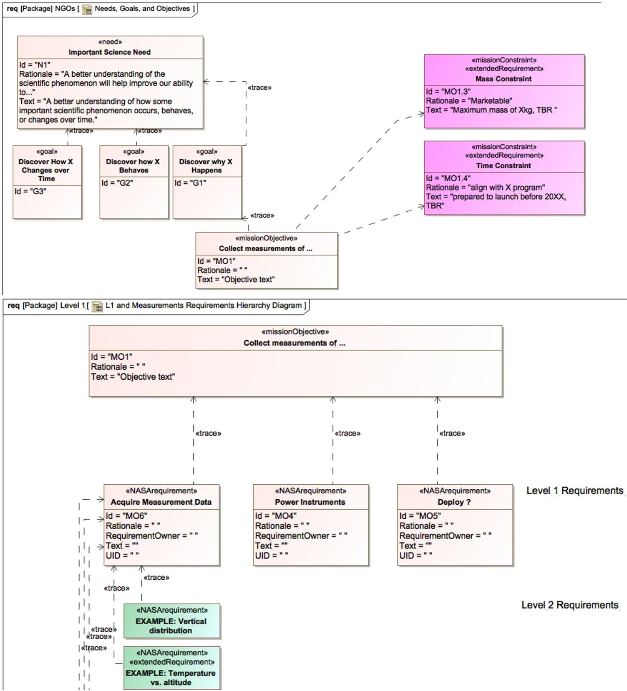

Fig. 12 Requirements flowdown starter in two Requirements Hierarchy Diagrams

## 6. Sandbox

Here, the systems engineers (or other team members when SysML accessibility improves) can create new model elements that should be reviewed by the team or leadership for approval. The comments assigned to a particular stereotype are shown in the Modeling Open Items table to track work to closure.

## E. Support Materials Package

Examples, model construction and smart table instructions, and terminologies are kept here.

<!-- PDF_PAGE: 13 -->

# IV. Results of trials in full EDS studies

## A. Benefits

The EDS MBSE Template, in MagicDraw, has two distinct purposes. First, it is a visual guide to plan a study and facilitate the session. It makes it simpler and more consistent to follow the EDS process and document progress. Second, it is a "jump start" to the engineering process that occurs in preparation and during an EDS session. There are template or sample diagrams and tables for each development area (as seen in the Model Overview), and NASA project examples of each.

At this initial stage, the model is operated directly by EDS system engineers only, in coordination with the study systems engineer. This approach will evolve to hand off the model to study systems engineers as the template content and instructions are refined through further trials. The interface to the rest of the study team is through study notes and reports-out (OneNote or Google, linked to model) and parameter database (IDEA/Excel) to pull current numbers from the team's work.

The benefits

- Consistency between studies

- "Project" package saved separately as the system model for future use at the end of session ("EDS" process package and "Examples" package are removed)

- Documentation of system - export information to reports and presentations

- Architecture diagrams, Requirements traceability, ConOps activity diagrams, Interfaces, system descriptions in picture form

- As interface capabilities mature and expand to other engineering tools, the EDS MBSE model will become the single source for system-level and study-level data

- A visual road map for the session plan, and

- Repeatable, linked SE data products.

## B. Challenges

There have been two partial trial uses of the template. These demonstrated the benefits of both purposes. One study tested only the first EDS process purpose, and the other tested only the engineering process support. The trials also revealed more about the challenges.

For the first study, a model was started before the planning meeting, so the modeler was able to refer to assumed study context and goals from the Session Overview model elements, and then refine and add to these in real time during the meeting. The study goals, objective, and constraints were cleaned up between meetings, and brought to the next meeting. The model was not used as the center of the discussion for the planning meeting, but this experience pointed to that being feasible, making use of the Session Overview starter. Before the next meeting, existing requirements were loaded into the model. This was a bit time consuming, but there are multiple ways to read in information faster after an input structure is chosen that can be mapped once to the model. So, we expect this challenge to be mostly overcome in our next development step. There is certainly still a need for easier means to pull information into a model in whatever form it takes, without as much infrastructure work or enforced format consistency. This does remain a general challenge to modelers. At the next meeting, however, the team decided to change directions for the study, affecting all the requirements somewhat with the perspective change. We found we could not make changes to all the requirement elements fast enough to be useful in visualizing this change. Another method would be better to understand this change, perhaps through the Study Overview, or simply on a whiteboard. The requirements rewrite could follow post-meeting. The study evolved into a cost exercise outside the EDS, so we had to stop modeling. The model is ready to continue when the project is ready to look at conceptual development again.

The second study was to look at updating an existing design for an instrument on the International Space Station. This was not an early concept design for which many of the starter model elements could be populated from scratch as a necessary entrance criteria to the EDS session. Here, the content existed in different formats, and it would be all additional time to sync all the parts of the model template with the current status of the project. This study had a "fast turnaround" and was overlapping with other work, so we did not have a chance to prepare even the parts of the model we anticipated being worked during the session until the day before the session. Therefore, we did not use the model for the EDS process, but it was used to support the study systems engineer to mirror and complete the most useful artifacts from the Model Overview menu. The lack of preparation time illustrated the common challenge both to modeling and the EDS, which is that a time investment to define the structure and background material is necessary to be productive when working with a larger team. We were able to copy the content of a logical architecture drawing to create a diagram that made sense in the context of the template, and additionally to create a physical architecture

<!-- PDF_PAGE: 14 -->

diagram. We did not have time to create content from other areas of the Model Overview and did not use the architecture during the session to communicate design ideas. To the challenge of producing more diagrams useful to the session, the increase in starter diagrams since that trial has already addressed much of this challenge. Additional practice at modeling with the template and being able to import directly from team members work or project documents should also improve performance relative to this challenge.

To the challenge of actually using the model to communicate and collaborate, there are two primary issues. The first comes down also to practice: practice by the facilitators and systems engineers to use the model as a basis of collaboration and practice by team members using the model navigation and common table and diagram types within to follow and contribute to the status of the evolving system design. A periodically published web view of the model will help. The second issue is a great deal of information needed for design discussions were not in the model and could not be added quickly. For example, it was faster to ask an ISS expert to solve an interface issue than to wait to model the interface and use that for a (potentially clearer and more integrated) discussion. We would need to have pre-loaded an ISS interface module with port definition and constraints and requirements. The existence of libraries to pull in these types of re-used elements seems entirely possible, but is something that should be done at the agency or program level to avoid redundancy.

## V. Conclusion and Future Steps

The paper describes an MBSE Template developed for use during collaborative engineering design sessions that captures the study process and the system engineering data products from the study. This template can contribute towards the need for templates and "starter models" in the NASA community. Using the template allows you to apply the process more consistently across studies, extend the model to support a variety of study types, add functionality as the capability of the EDS grows.

This template also addresses the needs of the concurrent engineering centers to connect modeling to the fast, collaborative design engineering process. Using the template allows the process to be applied more consistently. A template can be extended to support a variety of study types, and add other functionality as the capability of the EDS grows. Application of the template is in the early phases and it is anticipated will continue to evolve with use. We hope by sharing our approach and thoughts about it that we will inspire other groups to make similar templates for their particular uses, and to share with the NASA MBSE Community of Practice $ ^{+ +} $ .

The EDS package may be expanded to assign values to the states of the EDS process, in order to track and document the progress of the study with the model. The states might have a status tag and a relationship to the relevant model element(s) completed during that study step.

Addressing one of the challenges in the last section, we are planning to set up mapping to load names of subsystem parts, and later values (mass, power, etc.) and other information from the team, from an Excel workbook with worksheets for each technical discipline and a systems roll-up worksheet. The team members will keep certain named parameters needed by other team members in this workbook as part of the session. Subsequently, we envision creating tools and processes to pull inputs directly from discipline engineering tools like CREO.

Also addressing one of the challenges in the second trail, we have identified and tailored the Web 2.0 report to create a useful view of the model, by publishing a smart package only that includes the Model Overview for navigation and any diagrams or tables on the Overview that have been worked for that study. We are considering using the SysML report for other more limited views of the model, and possibly using for the next version of Cameo Collaborator, if it is available with the NASA MagicDraw Teamwork server, as another option for the broader team to view and lightly edit the model.

## Acknowledgments

The authors acknowledge those people supporting the development of the Engineering Design Studio in the Proposal Development Office and Engineering Directorate of NASA Langley Research Center (LaRC), for encouraging the experimentation with new technologies and approaches. We acknowledge the basis of this template on work done by the LaRC Model-Based Engineering community over the last decade, and especially Kevin Somervill for helping us access and use those resources well.

<!-- PDF_PAGE: 15 -->

## References

[1] Iwata, C., Infeld, S., et al, "Model-Based Systems Engineering in Concurrent Engineering Centers", AIAA paper 2015-4437, September 2015.

[2] Vipavetz, K., "Engineering Design Studio Basic Process", Systems Engineering Technical Excellence Community, NASA Langley, Hampton, VA, December 2016 (unpublished).