<!-- PDF_PAGE: 1 -->

# System Architecture Design Space Exploration: An Approach to Modeling and Optimization

J.H. Bussemaker $ ^{*} $ , P.D. Ciampa $ ^{\dagger} $ , B. Nagel $ ^{\ddagger} $

DLR (German Aerospace Center), Institute of System Architectures in Aeronautics, Hamburg, Germany

Systematic modeling of architecture design spaces is needed when architecting complex systems, to support experts in making less biased decisions, and to formulate the optimization problem needed to explore the large combinatorial design space. Existing methods do not offer enough compatibility with the Model-Based Systems Engineering (MBSE) approaches, cannot model all needed design scenarios, or are not flexible enough when it comes to architecture evaluation. A new method is presented that provides a semantic representation of the architecture design space, modeled as the Architecture Design Space Graph (ADSG). The ADSG represents three types of architectural decisions: function-component mapping, component characterization, and component connection. The ADSG is constructed from a design space definition, and discrete architectural decisions are automatically inserted according to specified rules. Once decisions and metrics have been defined, the hierarchical, mixed-integer, multi-objective optimization problem can be formulated: decisions are mapped to design variables, and performance metrics are mapped to objectives or constraints. An application of the method to the Apollo mission architecting problem is presented.

## Nomenclature

ADO = Architecture Design and Optimization

ADSG = Architecture Design Space Graph

DLR = German Aerospace Center

EOR = Earth Orbit Rendezvous

LEO = Low Earth Orbit

LOR = Lunar Orbit Rendezvous

MBSE = Model-Based Systems Engineering

MDAO = Multidisciplinary Design Analysis and Optimization

RFLP = Requirements-Functional-Logical-Physical

XDSM = Extended Design Structure Matrix

## I. Introduction

In the early stages of the design of complex systems, the system architecture is defined. Decisions taken during this stage have a higher impact on the performance of the final design compared to decisions taken at a later stage, for example during preliminary or detailed design [1]. Due to the importance of these decisions, it is needed to have a good estimate of the impact different decisions have to make sure the best possible architecture is identified and selected. However, for complex products, the architecture design space can be too large to explore exhaustively due to the combinatorial explosion of alternatives [2]. In the past, this problem has been solved by integrating expert judgment and/or using historical results of similar projects to predict the impact of different decisions [3]. These methods, however, can suffer from expert bias, subjectivity, conservatism or overconfidence. To mitigate this, a move towards physics-based quantitative evaluation in the system architecting stage is needed. Systematic design space exploration techniques, like optimization, can then be employed to find the best candidate architectures from the many different possibilities.

In the systems engineering discipline, the move towards model-based approaches (MBSE) offer a way towards

<!-- PDF_PAGE: 2 -->

enabling semantic modeling of systems. This semantic reasoning is necessary for enabling systematic design space exploration, however it generally does not offer the formalization required for generating, evaluating, and exploring system architectures automatically, as needed for systematic design space exploration. More formalized approaches include methods based on the morphological matrix [4,5], the Architecture Decision Graph [6], and function-form mapping [7,8]. Important features for enabling systematic exploration is the explicit identification and tracking of architecting decisions, and enabling automated quantitative analysis of architecture candidates. Judt et al. [9] and Frank et al. [10] have applied evolutionary optimization algorithms to explore architecture design spaces. Recent developments are moving towards also taking connections between architecture components into account in the design space exploration [11,12].

This paper presents and demonstrates a new method for modeling the system architecture design space in a way that yields a semantic representation, and in addition to mapping form to function takes component structure decisions into account. Compared to conventional MBSE architecting methods, this method offers the formalization required for translation into an optimization problem. One specific challenge in formulating an optimization problem for system architecting includes taking care of decision hierarchy: architectural decisions can be active or not based on the results of other decisions. An architecture generation step is inserted between the design space exploration (optimization) algorithm and the analysis model to deal with decision hierarchy and make sure that the analysis of the architecture candidates is only performed for internally consistent architectures.

## II. System Architecting as Part of Systems Engineering

System architecting can be seen as one of the steps in the systems engineering process [13]. In systems engineering, the product to be developed is treated as a system: a set of interconnected components, which together perform functions that they cannot provide by simply joining the capabilities of the individual components (i.e. the system is more than the sum of its components) [14,15]. When designing the system, care is taken that what the system does (its functions) is defined before how the system does it (its form):

Form is the thing that will be implemented in the physical system; form exists. Elements of form are also referred to as the components of the system.

Function is what the system does, and ultimately the reason the system exists since the functions of the system serve to meet the stakeholder needs. Function is performed by form.

In the context of aircraft design, Mavris et al. [16] mention that next to function-based decomposition, more ways of decomposing designs are possible: for example physical, disciplinary, or hybrid like the ATA chapters. However, they conclude that functional decomposition is advantageous because it provides a breakdown generic to any architecture alternative, it does not suggest an architecture concept (i.e. is free of solution bias), and functions suggest types of physical solutions rather than specific technologies. Functional decomposition thus offers a good way of decomposing the design problem for:

- Explicitly specifying how requirements are fulfilled.

- Enabling compatibility with systems engineering methods in general.

- Providing a framework for defining new architectures free of solution-bias.

One way of structuring this is by using the RFLP approach: Requirements engineering, Function design, Logical design, Physical design [17]: after the stakeholder requirements have been defined, the functions that the system should perform to fulfill the requirements are defined. Then, components (or elements of form) are assigned to functions, yielding the logical architecture, which is finally extended to the physical architecture by defining the interconnection of the elements.

The logical architecture defines how functions are fulfilled by assigning components to functions, based on available knowledge about which components are capable of fulfilling which functions. Components themselves can induce additional functions to be fulfilled in order to perform their main function [16]. The definition of the logical architecture therefore is an iterative procedure, which is only completed once all functions, both primary and induced, are fulfilled by some component. The physical architecture elaborates on the logical architecture by providing more information about how the architecture can be implemented in the final system. The finalized system architecture then is the combination of the allocation of function to form and the relationships among the elements of form [13,18]: a function-form-structure mapping.

<!-- PDF_PAGE: 3 -->

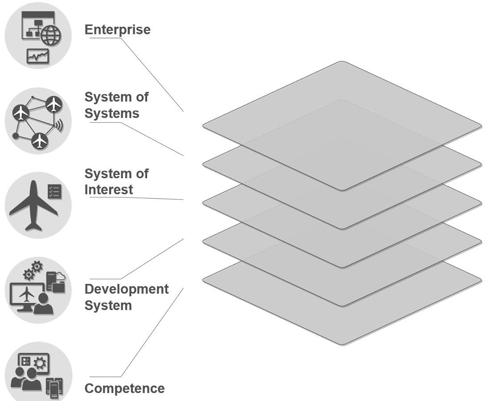

Figure 1 Model based conceptual framework: multi-layered structure [19].

## A. Towards Modeling of Complex Systems Development

The development of modern complex systems needs to account for an ever increasing number of capabilities to be delivered, as well as for organizational boundaries, integration and communication challenges, and constraints stemming from all the stages of the product's life-cycle. Ideally every decision taken at each stage of the development should be evaluated along the entire life-cycle. The management of such development complexity requires a shift to a novel system development paradigm.

In this context, the DLR "Institute of Systems Architecture in Aeronautics" is developing a novel "model based conceptual framework" for architecting, designing and optimizing complex aeronautical systems. The expected impact is a drastic reduction in time and costs associated with the development, via an increased transparency, efficiency, and traceability of the design and decision making processes. The conceptual framework, introduced in in [19] extends the scope of design and optimization methods to all the phases of the development life cycle of complex systems.

Therefore, on one side accelerating the upstream architecting phases, including the trade-off of goals, the definition of scenarios and requirements accounting for all the stakeholders involved, the design and optimization of the architecture of the system of interest (e.g. an aircraft), or System of System, under development. On another side, accelerating the downstream product design phases, including the selection of the capabilities needed for every design stage (e.g. conceptual, preliminary, detailed), the integration into a design processes, and the deployment of design systems (e.g. computational environments), for the exploration of the design space and the selection of the optimum solution. The architecture of the conceptual framework has a layered structure, as shown in Fig. 1. The identified five layers and major activities within each layer are:

1) Enterprise layer: modeling and optimization of goals and capabilities via value-driven decision making approaches, enabling trade-off between policies by the enterprise.

2) System of Systems layer: architecting and designing complex SoS scenarios for a given set of capabilities to be delivered, enabling trade-off between concept of operations.

3) Complex System layer: architecture design & optimization (ADO) of a complex system of interest for a given set of requirements and concept of operations, enabling trade-off between architectures.

4) Development System layer: deployment and operation of a development system and processes (e.g. MDAO process) for the design and optimization of the system of interest, for given architecture, design for X strategy

<!-- PDF_PAGE: 4 -->

(e.g. minimum costs), and dimensionality of the design space.

5) Competence layer: providing heterogeneous capabilities (e.g. disciplinary analysis) and services available, or to be developed, enabling the system design and optimization.

The implementation of the concept is supported by the development of novel design methods and approaches, leveraging digital design engineering and modeling technologies. The work presented in this paper focuses on the formalization and modeling of the architecture for a system of interest, and is part of the European Commission funded project AGILE 4.0 (2019-2022) [20].

## III. Modeling the Architecture Design Space

This section describes how the architecture design space is modeled by the proposed method. The following steps are defined for modeling the architecture design space:

1) Defining the architecture design space: the design space defines the possible components and their connections, as explained in section III.B. How an engineer would define this design space is not the focus of this work, but it will be an important topic of future work. Such an approach should make sure that the engineer can have an overview on what the different architecting decisions are, and what architecture instances are contained by the design space.

2) Interpreting the design space and constructing the so-called Architecture Design Space Graph (ADSG): the design space elements are integrated into the ADSG, as explained in section III.C.

3) Deriving design decisions: architecting design decisions are automatically inserted into the ADSG according to rules defined by the methodology, as explained in section III.D.

Once these steps have been completed, the ADSG can be used to generate architecture instances and to formulate optimization problems.

## A. Assumptions

The following assumptions are made for developing the new architecture design space modeling method:

A1 Stakeholders and their needs have been identified, and from that, the requirements have been defined: it will be assumed that the requirements definition process happens before the architecting process [13]: by the time the system architecting process is started, a well-defined base exists for starting to define the system's main functions. It is recognized that there can be iterative interactions between the requirement definition and architecting phases, but there will at least be some starting point to base the architecture design space on.

A2 Design choices in system architecting are sufficiently represented by decisions related to function fulfillment, component characterization, and component connections: literature shows that these three categories of decisions cover all of the general design choices of system architecture design problems [13, 21].

A3 Each function is fulfilled (performed) by one component: if there are different ways of fulfilling one function, a design choice of which all options are mutually exclusive has to be taken. Some system architecting approaches allow multiple components to fulfill one function (e.g. [18,22]). However, Simmons [6] mentions that it is possible to explicitly define options that are not mutually exclusive as an additional mutually exclusive option.

A4 Components can derive (induce) additional functions: this leads to a zigzag process [23], and the architecting process can only continue once all functions have been fulfilled.

A5 Connecting components is done after mapping components to functions: a need for a connection between components can therefore not be used to includes these components in the architecture, only the need for fulfilling functions can.

A6 It is possible to quantitatively evaluate the performance of architectures: this allows the use of systematic design space exploration techniques like a Design of Experiments or optimization for finding the best architecture to solve the problem at hand.

<!-- PDF_PAGE: 5 -->

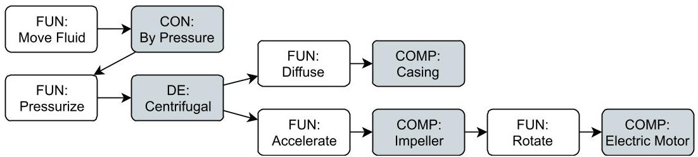

Figure 2 Mapping components to functions: concepts (CON), function decomposition (DE), and component (COMP) nodes that fulfill (incoming connections) and derive (outgoing connections) functions (FUN). Shown is part of a centrifugal pump architecture, adapted from [13].

## B. Design Space Elements

The design space definition contains the information needed for constructing the Architecture Design Space Graph. It defines which functions and components are part of the design space, and how they are connected to each other. It is assumed that the decisions involved in deciding on a system architecture can be assigned to three categories: deciding which components fulfill which functions, characterizing the components, and connecting the components (Assumption A2). A description of the elements of the design space follows.

## 1. Functions

Functions specify what the system should do. They can either be defined as solution-neutral or solution-specific. A function can be said to be solution-neutral when it does not induce any bias towards some solution (i.e. form) for fulfilling the function [13].

The functions that deliver the value of the system to the system context, all that with which the system interacts but is not part of the system itself, are defined as boundary functions [16]. The designer chooses the boundary functions when defining the design space, based on the identified stakeholder needs and requirements (Assumption A1). These functions will always be there: the architecting choices in the end define how these functions are fulfilled. Often, boundary functions are also solution-neutral functions.

## 2. Mapping Components to Functions

Components fulfill functions, and are only included in an architecture if they are needed for fulfilling a function. Each component described in the design space defines the functions it fulfills and the functions it needs (i.e. induces [16]) in order to fulfill its functions (Assumption A4). Figure 2 shows an example architecture with components (COMP) fulfilling and deriving functions (FUN) for a centrifugal pump architecture: the casing is used to diffuse water, the impeller to accelerate water, and the electric motor to rotate the impeller.

In a system architecture, only one component can fulfill a function (Assumption A3). This means that if there are multiple components specifying that they can fulfill a function, there is a design choice to be made. Mapping components to functions is the first step in the architecting process, and these decisions are therefore also the first decisions to be taken (Assumption A5).

Concepts According to Crawley et al. [13], a concept is a notional mapping between solution-neutral function to solution-specific form and function. Figure 2 shows a concept (CON) mapping a solution-neutral function to a solution-specific function: in the context of a centrifugal pump, its solution-neutral function is to move water, and its associated solution-specific function is to do so by pressurizing the water.

Function Decomposition It is possible to define function decompositions, which simply map one function to one or more other functions. Figure 2 shows a function decomposition (DE) mapping one function to multiple functions: pressurizing water is decomposed into accelerating and diffusing. Function decompositions can be convenient for managing complexity. A decomposition mapping one function to multiple other functions, in effect means that the originating function performs the same as the combination of the target functions: the originating function emerges from the target functions [13]. Moving from the originating function to the target functions can be seen as function zooming, since the emerged function is represented by more detailed functions.

<!-- PDF_PAGE: 6 -->

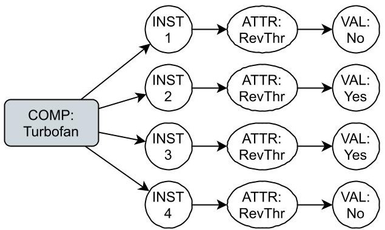

Figure 3 Component (COM) characterization: by number of instances (INST), and by attributes. Attributes are represented by attribute nodes (ATTR) pointing to attribute value nodes (VAL). Shown is a turbofan with four instances, where two have reverse thrust (RevThr) capabilities, and two have not (e.g. Airbus A380).

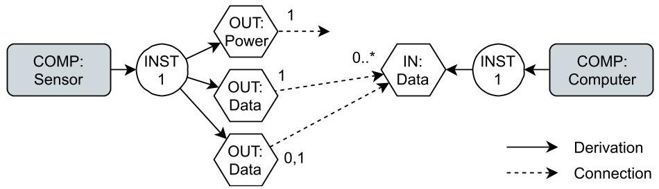

Figure 4 Component connection: components (COM) and their instances (CI) are connected through ports, from output ports (OUT) to input ports (IN). Ports can only connect to ports with the same identifier, and their connection degrees are specified near to the connection arrows: "1" for exactly one, "0,1" for zero or one connections, "0..*" for any number, "1..*" for one or more, etc.

Components, concepts, and function decompositions are all treated as function mapping elements. If multiple elements of these types specify that they fulfill a function, no one type has priority over another.

## 3. Component Characterization

Once components (and concepts and function decompositions) have been mapped to functions, the next step in the architecting process is the characterization of the components. Components can be characterized in two ways, see also Fig. 3:

1) Characterization by number of instances: components have component instances, multiple instances of components can exist, and the amount of instances can be a design decision. This can for example be used to model component distribution or redundancy.

2) Characterization by attributes: components or component instances can have attributes, and the selection of values for the attributes is a design decision.

The selection of attribute values is modeled using the same mechanism as for ports (see section III.B.4), such that more complicated decision patterns than just mutually exclusive options are possible.

## 4. Component Connection

Connections between components, or formal relationships [13], are modeled using ports. Formal relationships can represent anything from spatial relationships, to mass/energy/information flows, and intangible relationships like membership and sequence. No restriction will be made on the type of connection; this will be entirely up to the interpretation of the component connections when evaluating the performance of the generated architectures. Connections are made from a source to a target, and for ports these are output and input ports, respectively. See Fig. 4 for an example of components with ports and their connections. Ports represent interfaces of component instances, and are characterized by:

- Identifier: connections are only possible between ports with the same identifier.

<!-- PDF_PAGE: 7 -->

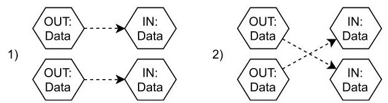

(a) Connection sequence relevant: there are two possible connection schemes.

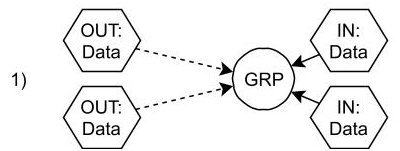

(b) Connection sequence irrelevant: there is one possible connection scheme.

Figure 5 Input ports (IN) receiving incoming connections from output ports (OUT): demonstrating the difference between relevant and irrelevant connection sequence. Ports are grouped by grouping nodes (GRP) to model irrelevant connection sequences.

Table 1 Logic table relating conditional existence to existence in architecture instances for elements linked by an incompatibility constraint.

<table border="1"><tr><td colspan="2">Conditional existence</td><td colspan="2">Existence in architecture instances</td></tr><tr><td>ElementA</td><td>ElementB</td><td>ElementA</td><td>ElementB</td></tr><tr><td>Yes</td><td>Yes</td><td>Possible if B does not exist</td><td>Possible if A does not exist</td></tr><tr><td>Yes</td><td>No</td><td>Never</td><td>Always</td></tr><tr><td>No</td><td>Yes</td><td>Always</td><td>Never</td></tr><tr><td>No</td><td>No</td><td colspan="2">Infeasible incompatibility</td></tr></table>

- Number of instances: the number of port instances per component instance, which can be a design decision.

- Allowing self-connections: whether connections between ports of the same component is allowed or not.

- Allowing repeated connections: whether repeated connections between two port instances are allowed or not.

- Connection degree specification: specifies the number of connections per port instance, can be specified as an exact number, a range, or a lower bound.

- Relevance of connection sequence: if it is relevant, the connection problem turns into a permutation problem, otherwise a selection problem. Irrelevant connection sequence is modeled by combining multiple port nodes using a grouping node, where the grouping node then takes on the connection properties of the grouped port nodes. See Fig. 5 for a visual explanation of the concept.

These types of characterizations make it possible to specify complex connection problems, with many possible connection sequences possible. These kind of connection problems are a major contribution to the explosion of alternatives, as often seen in architecture design problems [2].

If for a given port connection problem, it is not possible to make the connections (for example if there are two ports outputting one connection each, but there is only one input port to connect to), this means that the architecture is not feasible.

## 5. Incompatibility Constraints

The existence of architecture elements in architecture instances is based on the choices taken on which elements of form to use for fulfilling the functions. Through the mechanism of fulfilling functions and deriving additional functions, component compatibility can be implicitly established. Additionally, port connections can naturally be used to model required connections between components and thereby force the existence of one component if the other also exists. These options allow the systems engineer to model complicated (in)compatibility logic.

However, to avoid having to use ports to implicitly model (in)compatibility constraints, an additional, more explicit option is made available to the systems engineer: the incompatibility constraint. Such a constraint can be specified between any function, component, concept, or decomposition, and is bi-directional: if any of the connected elements exists in an architecture instance, the other element cannot. Incompatibility constraints are non-transitive: if there exists an incompatibility constraint between elements A and B, and between elements B and C, element A and C can still exist together in one architecture instance. Finally, elements can exist conditionally (i.e. not in all architecture instances), which leads to some special behavior related to incompatibility constraints, as shown in Table 1. Refer to section III.D.1

<!-- PDF_PAGE: 8 -->

for more details on conditional existence of architecture elements.

## 6. Performance Metrics

Performance metrics record quantifiable performances of the architecture as a whole or individual architecture elements, and specify how different architecture instances can be compared to each other. They can be interpreted as objectives or constraints in the context of an optimization problem, as further explained in section IV.B. Performance metrics can be associated with functions, components, or component instances.

## 7. Additional Design Variables

Additional design variables can be defined for functions, components, or component instances. For continuous design variables the upper and lower bounds, and for discrete variables a list of mutually exclusive options must be specified.

Table 2 Available node types in the Architecture Design Space Graph (ADSG) and their sources.

<table border="1"><tr><td>Symbol</td><td>Type</td><td>Fundamental type</td><td>Source</td></tr><tr><td>FUN</td><td>Function</td><td></td><td>Design space definition</td></tr><tr><td>CON</td><td>Concept</td><td>Function mapper</td><td>Design space definition</td></tr><tr><td>DE</td><td>Function decomposition</td><td>Function mapper</td><td>Design space definition</td></tr><tr><td>COMP</td><td>Component</td><td>Function mapper</td><td>Design space definition</td></tr><tr><td>INST</td><td>Component instance</td><td></td><td>Component definition</td></tr><tr><td>ATTR</td><td>Attribute</td><td>Source</td><td>Component definition</td></tr><tr><td>VAL</td><td>Attribute value</td><td>Target</td><td>Component definition</td></tr><tr><td>OUT</td><td>Output port</td><td>Source</td><td>Component definition</td></tr><tr><td>IN</td><td>Input port</td><td>Target</td><td>Component definition</td></tr><tr><td>OPT</td><td>Option-decision</td><td></td><td>Rule-based insertion</td></tr><tr><td>PERM</td><td>Permutation-decision</td><td></td><td>Rule-based insertion</td></tr><tr><td>NOP</td><td>No-operation</td><td></td><td>Component definition</td></tr><tr><td>GRP</td><td>Grouping</td><td></td><td>Component definition</td></tr><tr><td>BND</td><td>Boundary incoming</td><td></td><td>Always present</td></tr><tr><td>MET</td><td>Performance metric</td><td></td><td>Design space definition</td></tr><tr><td>DV</td><td>Design variable</td><td></td><td>Design space definition</td></tr></table>

## C. The Architecture Design Space Graph

The architecture design space is represented using the Architecture Design Space Graph (ADSG). The ADSG is a directed graph, where nodes represent some element of the architecture, like functions (FUN), components (COMP), and ports (IN/OUT). An overview of all different node types is shown in Table 2. Edges can denote a derivation or a connection relationship. An example ADSG is shown in Fig. 6: the boundary node (BND) derives a neutral function (FUN), which is mapped to a specific function by a concept (CON). This function is further decomposed by a function decomposition (DE) and several components (COMP). Components have instances (INST), and instances can have attributes (ATTR) and ports (IN/OUT). The ADSG also contains decision nodes that represent the design decisions to be taken. Decisions come in three forms:

1) Option-decisions: Decisions with mutually-exclusive options. For example, thrust is provided by either a turbofan or a turboprop. In Fig. 6 these are shown as opt nodes: the out edges point towards to different options.

2) Permutation-decisions: Decisions regarding the connection of multiple sources to multiple targets. For example, specifying the connections between energy sources and users. In Fig. 6 these are shown as PERM nodes: the source nodes are connected through the decision node to the target nodes.

<!-- PDF_PAGE: 9 -->

3) Additional design variables: Additionally explicitly-defined design variables, that are relevant to the design problem, but not to the system architecture. For example, the bypass ratio of a turbofan. Shown in Fig. 6 as DV node.

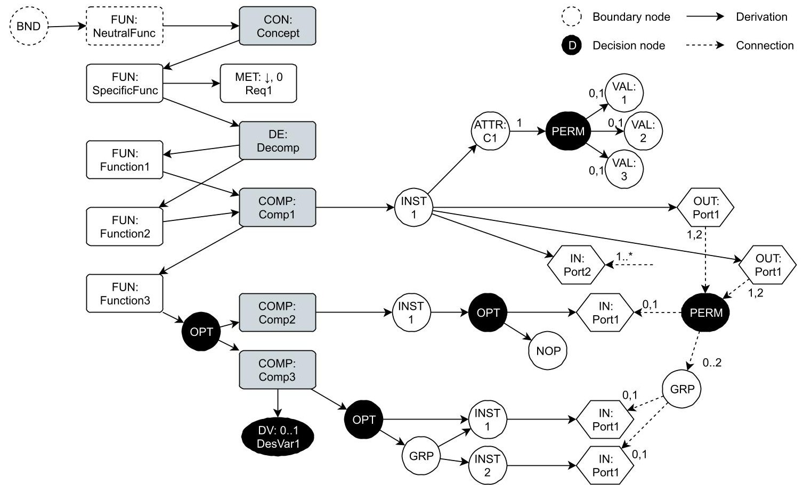

Figure 6 An example Architecture Design Space Graph (ADSG), showing a boundary (BND) solution-neutral function (FUN) being fulfilled using concepts (CON), function decompositions (DE), and components (COMP). Nodes external to the system are shown with dashed borders. A solid arrow denotes a node derivation, a dashed arrow a node connection. Decision nodes, option-decisions (OPT) and permutation-decisions (PERM), are shown in black, along with design variable (DV) nodes. A performance metric (MET) is associated to one of the functions (FUN). Components are characterized by component instances (INST), attributes (ATTR), and associated attribute values (VAL). Connections between ports are made from output ports (OUT) to input ports (IN), and their connection degree is specified. Grouping (GRP) and no-operation (NOP) nodes are used for modifying the behavior of decisions. Refer to Table 2 for an overview of all available node types.

<!-- PDF_PAGE: 10 -->

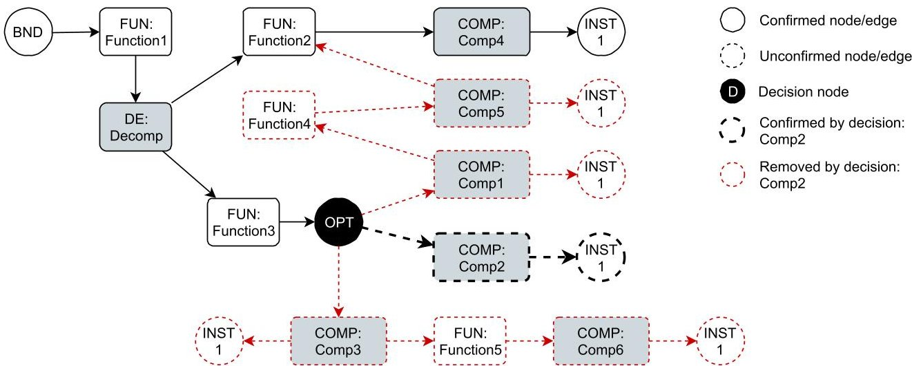

Figure 7 Option-decision (DOPT) behavior: edges and nodes are confirmed or removed based on which option is chosen for fulfilling function (FUN) "Function3". Confirmed edges and nodes are shown with solid borders, unconfirmed with dashed borders. Edge confirming and removing is shown for choosing component (COM) "Comp2" to fulfill the function: its derived edges are confirmed (thick, black dashes), edges derived from other options are removed (red dashes).

## D. Deriving and Taking Design Decisions

An architecture instance is created from the architecture design space, by taking the architectural decisions. First the option-decisions are taken, then the permutation-decisions. Option-decisions are taken first, because these determine which nodes are present in the graph. Once all option-decisions have been selected, the permutation-decisions are taken, creating connections between their corresponding source and target nodes.

It is worth noting that in context of the ADSG, "taking decisions" should not be confused with taking decisions in a decision-making process. Here, it merely refers to transforming an ADSG representing the whole architecture design space into one that represents a specific architecture instance. This is done by going over the decisions and for every one of them choosing which option to take. The reasoning, however, regarding which option to take comes from external sources like a design space exploration or optimization algorithm.

## 1. Option-decisions and Decision Hierarchy

Option-decisions are decisions with multiple mutually exclusive options [21]. Once one of the options is selected, the decision node is removed from the graph, the originating node is connected to the option node, and the remaining options and their derived nodes are removed from the graph. Figure 7 shows an example of a graph with an option-decision node. Any nodes that derive directly (i.e. not through a decision node) from the boundary functions are considered to exist unconditionally. All other nodes exist conditionally, and can either become confirmed after being selected in an option-decision, or removed from the graph.

Option-decisions are not defined explicitly in the design space definition. Rather, an option-decision is automatically inserted for different graph patterns, as shown in Table 3: function fulfillment, component instantiation, and port instantiation. Figure 8 shows examples of inserting option-decisions based on these graph patterns: a function (FUN node) that is connected to more than one component (COMP) is identified and an option-decision node is inserted to represent a function fulfillment decision.

Decision nodes can exist conditionally, meaning they can be removed based on some other decision. This hierarchical dependence between decisions is taken into account in the order in which decisions are taken: only decisions coming from confirmed decision nodes are taken. Figure 8 also shows an example of hierarchical decisions: if for the first decisions "Comp2" is chosen to fulfill "Function1", the other two decisions are removed from the graph.

<!-- PDF_PAGE: 11 -->

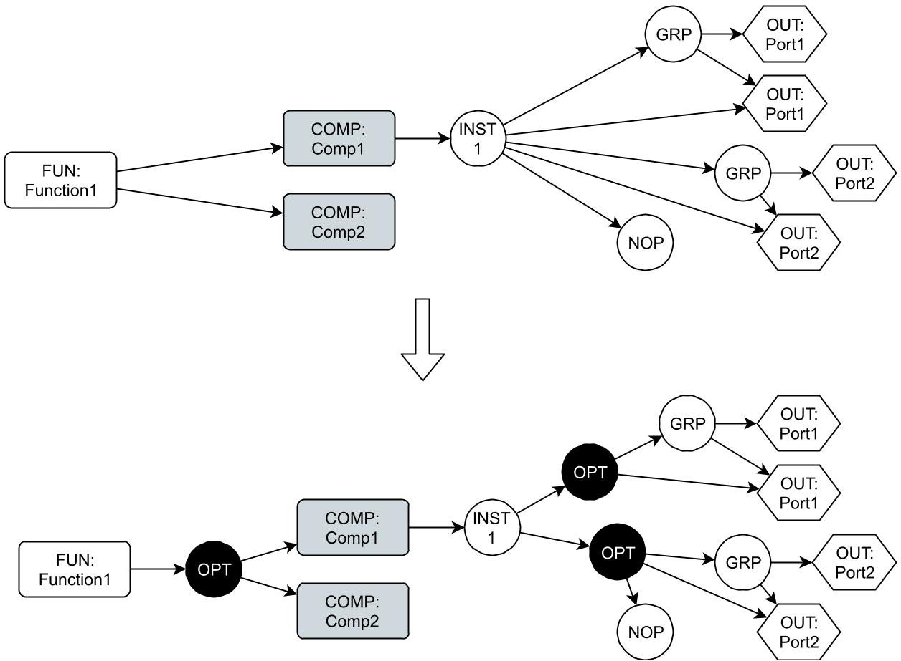

Figure 8 Automatically inserting option-decisions based on graph patterns. It is possible to have multiple option-decisions per origin node, as can be seen for the decisions regarding the amount of output port (OUT) instances. Grouping (GRP) and no-operation (NOP) nodes are used to model downselection choices: for "Port2" it is possible to either have 0,1, or 2 instances. The existence of the two decisions on the right is dependent on the one on the left: if "Comp2" is chosen, they are removed from the graph and therefore not active.

Table 3 Different graph patterns where option-decision nodes are inserted if there are more than one option nodes.

<table border="1"><tr><td>Source node type</td><td>Target node types</td><td>Decision description</td></tr><tr><td>Function</td><td>Component, concept, or decomposition</td><td>Function fulfillment</td></tr><tr><td>Component</td><td>Component instance</td><td>Component instantiation</td></tr><tr><td>Component instance</td><td>Output port, input port</td><td>Port instantiation</td></tr></table>

<!-- PDF_PAGE: 12 -->

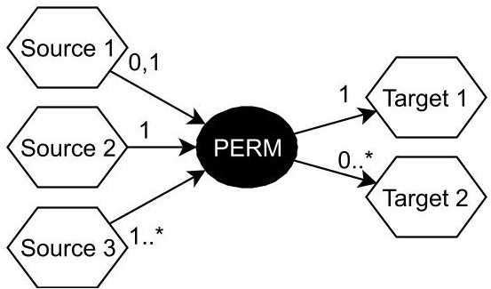

Figure 9 Permutation-decision: connections from sources to targets, where each slot specifies the number of outgoing or incoming connections it accepts. Connection degree specification can be done as a list of numbers, a range, or as a lower bound with an open upper bound (denoted by the $ ^{*} $ ). Iteration is done for each configuration of source nodes, then for each configuration of target nodes with the same number as the chosen amount of source nodes, and then for each permutation of the two chosen sets. Care is taken to avoid infinite loops for cases where both the sources and targets accept unbounded connections.

Table 4 Different graph patterns where permutation-decision nodes are applied.

<table border="1"><tr><td>Source node type</td><td>Target node type</td><td>Decision description</td></tr><tr><td>Output port</td><td>Input port</td><td>Port connection</td></tr><tr><td>Attribute</td><td>Attribute value</td><td>Attribute value assignment</td></tr></table>

## 2. Permutation-decisions

Permutation-decisions determine the connections between a set of source nodes and a set of target nodes. The architecting problem roughly translates to an assigning problem as defined by Selva et al. [21], however additional behavioral rules are present. Each source and target, called connection slot, is characterized by whether repeated connections are allowed and the number of connections coming from or going to the slot. The number of connections can either be a list of allowed connections (e.g. one number or a range), or a minimum number of connections (i.e. with unbounded maximum). All possible connection sets are then determined by the sets of source and target nodes, and an optional list of excluded connections. Figure 9 shows an example of a permutation-decision, with source and target nodes, and specifications of the accepted connection degrees. Table 4 shows the types of decisions that permutation-decision nodes are applied to: port connections and attribute value assignments.

## IV. Formulating the Architecture Optimization Problem

The only way to find the best architecture in a design space plagued by a combinatorial explosion of alternatives [2], is to use systematic design space exploration techniques. To enable this, the design space has to be well-defined in terms of a set of design variables. A design space exploration algorithm, like an optimizer or design of experiments, can then be used to generate points in the design space and asking an analysis model to evaluate the performance of these design points. The results of the evaluations are expressed quantitatively in terms of objectives and constraints, and are used by the exploration algorithm to generate new design points for the next iteration, until some stopping criterion has been met. This process is shown in Fig. 10.

The Architecture Design Space Graph (ADSG) can be interpreted as an optimization problem, with well-defined

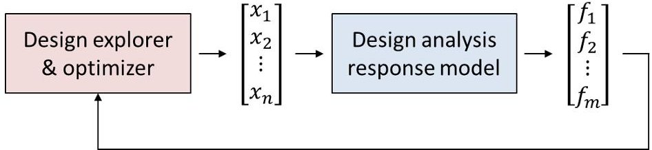

Figure 10 Generic systematic design space exploration process, from [24].

<!-- PDF_PAGE: 13 -->

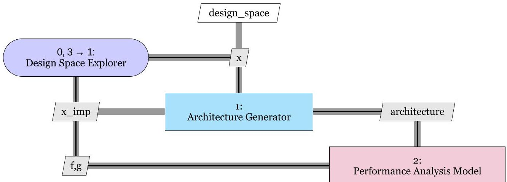

Figure 11 XDSM [25] view of the coupling between the design space explorer and the analysis response model for an architecture optimization problem. The architecture generator step uses the design space to interpret the design vector $ x $ into an architecture instance, which is then used by the analysis model to estimate the architecture performance. Due to design variable hierarchy and the possibility of infeasible architectures, the design vector can be modified at this stage, which needs to be communicated back to the design space exploration algorithm.

design variables, objectives, and constraints. It is assumed that a design analysis model exists, and that therefore systematic design space exploration techniques can be used to find the best architecture (Assumption A6). Figure 11 shows how a system architecture optimization problem might be structured, with an extra architecture generation step between the exploration algorithm and the analysis model. In addition to the hierarchical nature of design variables, as discussed in the next section, the architecture generation step is also needed to convert the design vector to a function-form-structure representation of an architecture instance, which might be more user-friendly and ease the development of an analysis model.

## A. Architecture Generator In-the-loop

Design variables are derived from the architecting decisions and additional design variables in the ADSG. Decisions are encoded as discrete design variables, with different indices mapping to the different options. Permutation-decisions are also encoded as simple discrete design variables in order to maintain compatibility with optimization frameworks that can only handle continuous and integer design variables. Decisions are ordered based on their type and hierarchy, ensuring that option-decisions come before permutation-decisions, and conditionally existing decisions come after their confirming decisions. Additional design variables as defined in the design space appear at the end of the design vector. This ensures that from the beginning to the end, the potential impact of the design variables on the architectures decreases.

One special behavior of architecture optimization problems, is that design variables can be conditionally active based on other design variables: they are of hierarchical nature. Zaefferer et al. [26] mention three ways to deal with this: ignore the effects, imputation, or explicit consideration. Ignoring the effects can confuse the optimization algorithm, because it can be possible that multiple different design vectors might map to the same architecture instances. Explicitly considering the hierarchy effects needs modification of the optimization algorithm. Therefore, as the default way to handle the hierarchy effect, imputation is chosen. With imputation, inactive design variables are set to a predefined value: 0 for discrete design variables and domain center for continuous design variables for example. Due to this effect, there is a difference between the apparent design space and the feasible design space. The apparent design space spans all combinations of all design variables, whereas the feasible design space takes out combinations of design variables leading either to infeasible architectures, or including inactive design variables not on their imputation values.

During a design space exploration loop, design vectors that specify a design point outside the feasible design space are automatically moved to the nearest design point in the feasible design space. This logic is implemented in the architecture generator step, and therefore a feedback mechanism is needed for notifying the optimization algorithm of the modified design vector. Figure 11 shows the coupling of the architecture generation step with the design space exploration algorithm and analysis model, and shows the feedback of the updated (imputed) design vector to the exploration algorithm.

<!-- PDF_PAGE: 14 -->

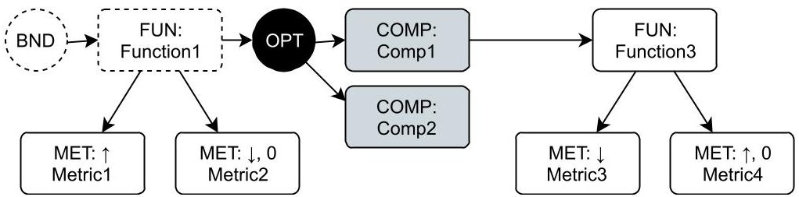

Figure 12 Possible uses of performance metrics (MET). Metrics 1 and 2 exist unconditionally (i.e. exist in all architecture instances), and can therefore be used as objectives. Metrics 2 and 4 have a reference value (0), and can therefore be used as constraints. Metric 3 can neither be used as an objective nor as a constraint. The upper ( $ \uparrow $ ) or lower ( $ \downarrow $ ) pointing arrows denote the direction of the performance metric: whether a higher or lower value is considered "better".

## B. Performance Metrics as Objectives and Constraints

Performance metrics are interpreted as objectives (minimize or maximize this value) or constraints (the value should at least or maximally be some target value) in the optimization problem. A performance metric is defined by two properties: a direction, and optionally a reference value. The direction specifies what is preferred: a lower or a higher value, with directions $ \downarrow $ and $ \uparrow $ , respectively. How a metric can be interpreted depends on some factors:

- A performance metric can be used as an objective if it exists unconditionally, because an objective serves as a way to compare different architectures in terms of which one is better, so it should exist in all possible architectures.

- A performance metric can be used as a constraint if it has a reference value, which is needed to determine whether the constraint is violated or not. Only inequality constraints are currently supported.

It is possible that a metric can be interpreted in both ways. If this is the case, a preferred interpretation must be specified. Note that it is possible to define more than one objective, as generally there are conflicting trade-offs to be made when dealing with multiple stakeholders in the design of complex systems. Figure 12 shows the four possible options for possible usage of performance metrics: metrics without a reference value can only be used as objective if they exist unconditionally, and metrics with a reference value can always be used as constraints.

## C. Properties of the Optimization Problem

Problems with conditional design variables are hierarchical optimization problems [26], it is possible to define more than one objective and no a-priori objective weighting [27] is explicitly considered, and variables can both be discrete and continuous: in general the architecture optimization problem is a hierarchical, mixed-integer, multi-objective optimization problem. The optimization problem can be expressed as

$$
\begin{array}{l} \mathrm {m i n i m i z e} f _ {m} (\boldsymbol {x}, \boldsymbol {y}), m = 1, 2, \dots , \mathcal {M} \\ w h e r e x _ {i} \in \mathbb {R} i = 1, 2, \dots , n \\ y _ {j} \in \mathbb {Z} j = 1, 2, \dots , \mathcal {J} \\ w. r. t. g _ {k} (\boldsymbol {x}, \boldsymbol {y}) \leq 0, k = 1, 2, \dots , \mathcal {K} \\ x _ {i} ^ {(L)} \leq x _ {i} \leq x _ {i} ^ {(U)} \\ \end{array}
$$

where x and y are the vectors of continuous and discrete design variables, and f and g are the objective and constraint functions. The optimization problem has M objectives, n continuous design variables, J discrete design variables, and K constraints. The continuous variables have bounds, described by $ x^{(L)} $ and $ x^{(U)} $ for the lower and upper bounds, respectively.

The main implication of the nature of the optimization problem is that it is not possible to use gradient-based methods for solving the problem, and the optimization algorithms should be able to solve multi-objective optimization problems. Additionally, the optimization algorithms should be able to deal with the implications of hierarchical design variables, or accept the architecture generation engine to modify the design vector based on this hierarchy, as also discussed in section IV.A. Candidate algorithms that can handle such problems are Multi-Objective Evolutionary Algorithms (MOEA's), such as NSGA-II [28] or SPEA2 [29].

<!-- PDF_PAGE: 15 -->

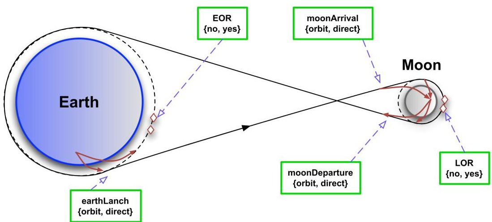

Figure 13 Mission related decisions in the Apollo mission architecting problem, from [6]. The decisions relate to the launch from earth, the arrival at the moon, and the departure from the moon. The launch from earth can either be direct or first to a low earth orbit (LEO). LEO is needed if there is to be an earth orbit rendezvous (EOR): two separate spacecraft that rendezvous in orbit before continuing to the moon. At the moon, the arrival and departures can be either direct or via lunar orbit, except if a lunar orbit rendezvous (LOR) is needed, in which case arrival and departure orbits are required. LOR is needed if a spacecraft (lunar module) separate from the main spacecraft (command module) makes the actual moon landing.

## V. Demonstration: The Design of the Apollo Mission

In this section, the proposed method is demonstrated using the Apollo mission architecting problem. The problem has been interpreted from original NASA literature by Simmons et al. [6]. Decision variables include several mission-phase related decisions (shown in Fig. 13), crew assignment decisions, and fuel type selections. Two performance metrics are used: initial mass to low earth orbit (as a proxy for cost, to be minimized), and probability of mission success (to be maximized).

Simmons et al. present the problem using a morphological matrix (Table 4-1) and logical constraints (Table 4-3, 4-4) ruling out infeasible combinations of choices. According to Simmons et al., the apparent design space consists of 1536 architectures, of which 138 are feasible. From the decision variables, we can confirm the apparent design space size, however taking the constraints into account gives 108 feasible combinations.

Figure 14 shows the Architecture Design Space Graph (ADSG) modeling the architecture of the Apollo mission design problem, up to the mission phase functions. The decisions related to the mission phases and crew assignments are shown in Figures 15 to 18. The main mission phases are represented by four functions to be fulfilled: launch (from earth), land on moon, arrive (at moon), and return (from moon). From these four, the "fly to moon" function emerges (coupled by a function decomposition node), to which the two performance metrics are assigned: mass, to be minimized, and success probability, to be maximized. The choices of launch mode (Fig. 15), whether there is a lunar module or not, and the type of moon arrival and departure (Fig. 16) are modeled by function fulfillment. The constraints related to the lunar orbit rendezvous (LOR) are modeled using incompatibility edges (Fig. 16). The choices for the amount of crew members and their assignment to the lunar module if applicable are modeled by component instances and port connections (Fig. 17); the fuel type choices by component attributes (Fig. 18). This problem serves as a clear example that component nodes do not necessarily have to represent physical components (in this problem they for example can represent maneuvers), and that port connections do not have to represent actual ports (in this problem used to represent crew assignments).

<!-- PDF_PAGE: 16 -->

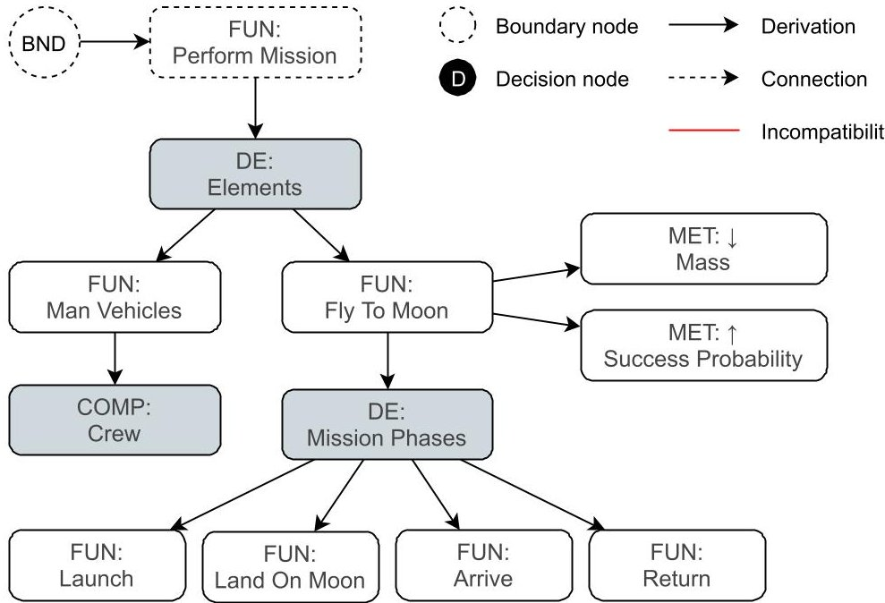

Figure 14 ADSG showing the main elements of the Apollo mission design problem. The boundary function is "Perform Mission", which is decomposed into manning the vehicles and flying to the moon. The former is done by the crew, the latter is decomposed into four further functions related to the mission phases: launch, landing on moon, arrive (at moon), and return (from moon). The two performance metrics are associated to the "fly to moon" function: the mass (to be minimized) and the probability of success (to be maximized). Figures 15 to 18 show more details of the ADSG. Refer to Table 2 for an overview of the different node types and their symbols.

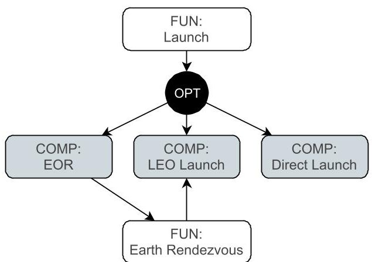

Figure 15 ADSG detail showing the elements related to the launch function. Launch can be performed by three components (representing launch methods): earth orbit rendezvous (EOR), launch into low earth orbit (LEO), and direct launch (no earth orbit). EOR requires a launch into LEO, which is taken care of by the "earth rendezvous" function derived by the EOR component. Refer to Fig. 14 for the legend.

<!-- PDF_PAGE: 17 -->

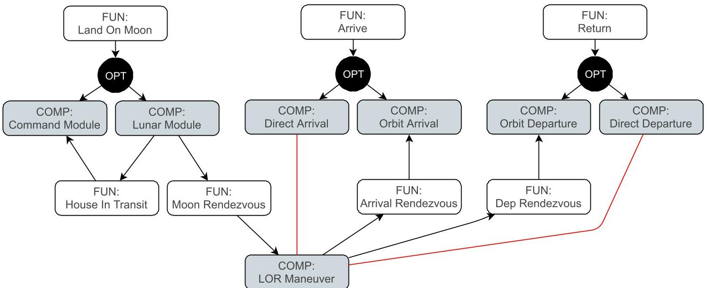

Figure 16 ADSG detail showing the elements related to the moon landing, arrival, and return functions. Landing on moon is performed by either the command module or the lunar module. If the lunar module is chosen, a lunar orbit rendezvous (LOR) is needed. The command module will always be included in any architecture, either through a direct choice from "land on moon" or by the induced "house in transit" function. The LOR maneuver requires an orbit when arriving and departing from the moon, which is modeled by incompatibility constraints between the LOR and the direct arrival and departure components, and derived functions to the orbit arrival and departure components. Refer to Fig. 14 for the legend.

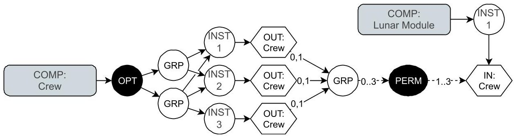

Figure 17 ADSG detail showing how the crew size and assignment selection is modeled. The number of crew members is represented by the number of instances of the crew component, which by the grouping nodes is restricted to two or three. Each crew member (component instance) has an output "crew" port, each of which need to be connected either zero or one times. The connections of these three ports are grouped, because the sequence of the connections is not important, resulting in a "total" connection degree of between zero and three (automatically adjusted to two if there are only two crew members). The lunar module has an input "crew" port, which accepts between one and three connections. This permutation decision results in two main possibilities: if the lunar module component exists, there will be one, two, or three (if possible) crew members assigned to the lunar module; if the lunar module does not exist, there will be no crew members assigned to the lunar module. Refer to Fig. 14 for the legend.

<!-- PDF_PAGE: 18 -->

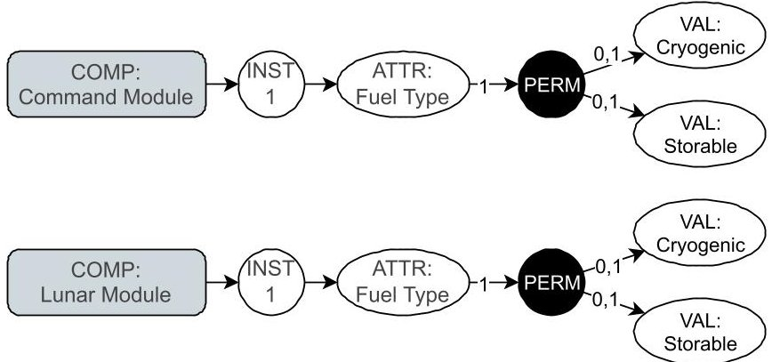

Figure 18 ADSG detail showing the selection of the fuel types for the service and lunar modules. Since the command module will always be there, the service module fuel type is modeled as an attribute of the command module. Note that if the lunar module does not exist, the fuel type will not have to be selected. Refer to Fig. 14 for the legend.

Table 5 The architectural decisions of the Apollo mission design problem encoded as discrete design variables. The apparent and feasible design space sizes (i.e. number of possible architecture) are shown. The apparent design space contains 576 design points, compared to 1536 in the original morphological matrix notation: a reduction of 63%.

<table border="1"><tr><td>#</td><td>Decision Type</td><td>Subject</td><td>Options</td><td>Nr of Options</td></tr><tr><td>1</td><td>Function fulfillment</td><td>Arrive</td><td>Direct Arrival, Orbit Arrival</td><td>2</td></tr><tr><td>2</td><td>Function fulfillment</td><td>Land On Moon</td><td>Command Module, Lunar Module</td><td>2</td></tr><tr><td>3</td><td>Function fulfillment</td><td>Launch</td><td>Direct Launch, EOR, LEO Launch</td><td>3</td></tr><tr><td>4</td><td>Function fulfillment</td><td>Return</td><td>Direct Departure, Orbit Departure</td><td>2</td></tr><tr><td>5</td><td>Component instantiation</td><td>Crew</td><td>Two or three times</td><td>2</td></tr><tr><td>6</td><td>Attribute value assignment</td><td>Fuel Type (Command)</td><td>Storable, Cryogenic</td><td>2</td></tr><tr><td>7</td><td>Attribute value assignment</td><td>Fuel Type (Lunar)</td><td>Storable (or N/A), Cryogenic</td><td>2</td></tr><tr><td>8</td><td>Port connection</td><td>Lunar Crew</td><td>Between one and three times</td><td>3</td></tr><tr><td rowspan="2" colspan="2"></td><td colspan="2">Apparent (combinatorial) architecture design space size:</td><td>576</td></tr><tr><td colspan="2">Feasible architecture design space size:</td><td>108 (19%)</td></tr></table>

<!-- PDF_PAGE: 19 -->

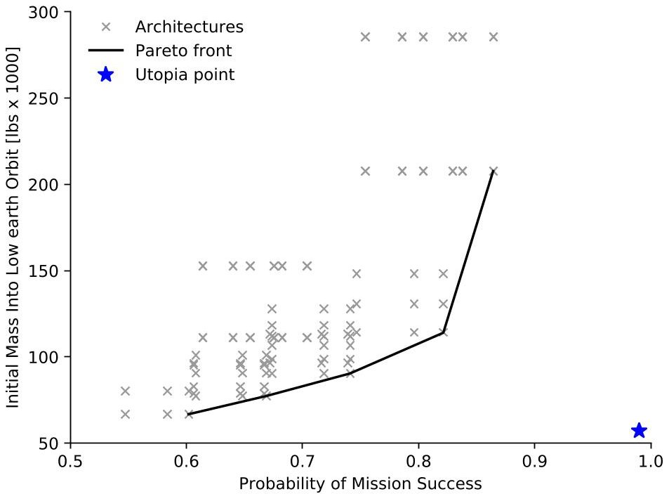

Figure 19 The design space of the Apollo mission design problem, showing all possible architectures and the Pareto front. The utopia point shows the direction of "better" architectures. Compare to Figure 4-8 in [6].

Table 5 shows how the architectural decisions are encoded as design variables in an optimization problem. There are 576 possible combinations in the apparent design space, of which 108 (19%) yield feasible architectures. The 63% decrease in apparent design space size compared to the morphological matrix notation (1536 combinations) is mainly due to the following differences:

1) The choice for earth orbit rendezvous (EOR) is included in the launch mode choice (LEO or direct), rather than being a choice by itself.

2) The choice for lunar orbit rendezvous (LOR) is eliminated completely; the LOR is included implicitly based on the choice of whether there is a lunar module or not.

Finally, Fig. 19 shows the design space generated by enumerating all feasible architectures. The probability of mission success and launch mass calculations are reproduced from calculation methods and data published in [6]. The design space has the same characteristics as the original design space produced by Simmons et al, showing that the proposed system architecture modeling method can be used to represent realistic architecting problems, and can be integrated with a design space exploration algorithm.

## VI. Conclusions and Outlook

A method for modeling system architecture design spaces is presented. This method helps enabling the possibility for systematic exploration of architecture design spaces, which requires a formalized definition of architectural decisions not possible with current model-based systems engineering techniques. Systematic design space exploration is needed to reduce expert bias, and to find the best possible architectures in large combinatorial design spaces. An approach based on function decomposition is used to enable traceability to the system requirements, enabling compatibility with systems engineering methods in general, and preventing solution-bias.

The Architecture Design Space Graph (ADSG) is used to model system architecture design spaces. Here, nodes represent functions, components, function decompositions, concepts, component instances, attributes, and ports. Directed edges between nodes indicate that the source node derives the existence of the target node. Edges between functions and components can additionally be interpreted as a mapping: this component fulfills that function, and derives (induces) additional functions. Incompatibility edges can be used to model situations where two elements cannot exist in an architecture together. Two types of decision nodes are automatically inserted based on the graph structure: mutually exclusive option-decisions (e.g. function fulfillment) and permutation decisions (e.g. port connections).

This method allows the automated derivation of architectural decisions, taking hierarchical relations between decisions into account, and represents system architectures in a semantic way. The ADSG can be used to formulate

<!-- PDF_PAGE: 20 -->

hierarchical, mixed-integer, multi-objective optimization problems, where design variables are mapped to architectural decisions, and objectives and constraints are constructed from performance metrics. Because of the nature of the architecture optimization problems, it is not possible to use gradient-based optimization algorithms, and the optimization algorithms should be able to solve multi-objective problems, and deal with the implications of hierarchical design variables.

It is shown that the method can be applied to the Apollo mission design problem, originally formulated by Simmons et al. [6] using a morphological matrix. The architecture design space model offers detailed insight into the interdependent behavior of the architectural decisions. From the design space model, the same feasible mission architectures can be represented as originally found by Simmons et al., and the same Pareto front is found in the design response space. Compared to the morphological matrix, the design variable encoding schema presented in this work results in a reduced apparent (combinatorial) design space. It is demonstrated that the architecture generation step can be successfully integrated between the design space exploration algorithm and the architecture analysis model.

In the future, the method should be applied to a wider variety of system architecting problems, to validate its potential as a generally applicable systems architecting method. Examples include hybrid-electric propulsion system design, manufacturing supply chain, and system-of-systems scenarios. Generic architecting patterns as presented by Selva et al. [21] should be supported. One area of interest is the encoding of permutation decisions into design variables. The challenge lies in keeping the apparent design space small while only using simple integer design variables to enable the future use of surrogate modeling techniques to speed up optimization convergence.

Furthermore, there is a need to connect the presented system architecting method to the (model-based) systems engineering process. It should be investigated what would be the best data exchange format to achieve this, given that the ADSG is not directly compatible with any existing language, like SysML. A practical integration with the systems engineering process also requires the availability of an intuitive graphical user interface for creating, inspecting, and modifying the ADSG, as well as generating and running design space explorations. The integration into the MBSE process will be developed and studied in the AGILE 4.0 project: multiple use cases, ranging from certification to maintenance and manufacturing considerations, will include system architecting models and decisions.

## Acknowledgments

The research presented in this paper has been performed in the framework of the AGILE 4.0 project (Towards Cyber-physical Collaborative Aircraft Development) and has received funding from the European Union Horizon 2020 Programme under grant agreement n° 815122.

## References

[1] Maier, M., and Rechtin, E., The Art of Systems Architecting, $ 3^{\mathrm{rd}} $ ed., CRC Press, Boca Raton, FL, 2009.

[2] Iacobucci, J. V., "Rapid Architecture Alternative Modeling (Raam): a Framework for Capability-Based Analysis of System of Systems Architectures," Ph.D. thesis, Georgia Institute of Technology, 2012.

[3] Roelofs, M., and Vos, R., "Correction: Uncertainty-Based Design Optimization and Technology Evaluation: A Review," 2018 AIAA Aerospace Sciences Meeting, American Institute of Aeronautics and Astronautics, Reston, Virginia, 2018, pp. 1-21. doi:10.2514/6.2018-2029.c1.

[4] Chakrabarti, A., Shea, K., Stone, R., Cagan, J., Campbell, M., Hernandez, N. V., and Wood, K. L., "Computer-Based Design Synthesis Research: An Overview," Journal of Computing and Information Science in Engineering, Vol. 11, No. 2, 2011. doi:10.1115/1.3593409.

[5] Ölvander, J., Lunden, B., and Gavel, H., "A computerized optimization framework for the morphological matrix applied to aircraft conceptual design," Computer-Aided Design, Vol. 41, No. 3, 2009, pp. 187-196. doi:10.1016/j.cad.2008.06.005.

[6] Simmons, W., and Crawley, E., "A Framework for Decision Support in Systems Architecting," Ph.D. thesis, Massachusetts Institute of Technology, 2008.

[7] Judt, D., and Lawson, C., "Methodology for Automated Aircraft Systems Architecture Enumeration and Analysis," 12th AIAA Aviation Technology, Integration, and Operations (ATIO) Conference and 14th AIAA/ISSMO Multidisciplinary Analysis and Optimization Conference, American Institute of Aeronautics and Astronautics, Reston, Virigina, 2012, pp. 1-17. doi:10.2514/6.2012-5648.

<!-- PDF_PAGE: 21 -->

[8] Frank, C., "A Design Space Exploration Methodology to Support Decisions under Evolving Requirements Uncertainty and its Application to Suborbital Vehicles," Ph.D. thesis, Georgia Institute of Technology, 2016. doi:10.2514/6.2015-1010.

[9] Judt, D., and Lawson, C., "Application of an automated aircraft architecture generation and analysis tool to unmanned aerial vehicle subsystem design," Proceedings of the Institution of Mechanical Engineers, Part G: Journal of Aerospace Engineering, Vol. 229, No. 9, 2015, pp. 1690-1708. doi:10.1177/0954410014558691.

[10] Frank, C., Marlier, R., Pinon-Fischer, O., and Mavris, D., "An Evolutionary Multi-Architecture Multi-Objective Optimization Algorithm for Design Space Exploration," 57th AIAA/ASCE/AHS/ASC Structures, Structural Dynamics, and Materials Conference, American Institute of Aeronautics and Astronautics, Reston, Virginia, 2016, pp. 1-19. doi:10.2514/6.2016-0414.

[11] Guenov, M., Molina-cristóbal, A., Riaz, A., Sharma, S., Murton, A., and Crockford, J., "Aircraft Systems Architecting Logical-Computational Domains Interface," 31st Congress of the International Council of the Aeronautical Sciences, 2018, pp. 1-12.

[12] Roelofs, M. N., and Vos, R., "Formalizing Technology Descriptions for Selection During Conceptual Design," AIAA Scitech 2019 Forum, American Institute of Aeronautics and Astronautics, Reston, Virginia, 2019, pp. 1-14. doi:10.2514/6.2019-0816.

[13] Crawley, E., Cameron, B., and Selva, D., System architecture: strategy and product development for complex systems, Pearson Education, 2015. doi:10.1007/978-1-4020-4399-4.

[14] NASA, "NASA Systems Engineering Handbook," Tech. Rep. Rev 2, NASA, 2016.

[15] Long, D., and Scott, Z., A Primer for Model-Based Systems Engineering, $ 2^{\mathrm{nd}} $ ed., Vitech, 2011.

[16] Mavris, D., de Tenorio, C., and Armstrong, M., "Methodology for Aircraft System Architecture Definition," 46th AIAA Aerospace Sciences Meeting and Exhibit, American Institute of Aeronautics and Astronautics, Reston, Virigina, 2008, pp. 1-14. doi:10.2514/6.2008-149.

[17] Kleiner, S., and Kramer, C., "Model Based Design with Systems Engineering Based on RFLP Using V6," Smart Product Engineering, Springer Berlin Heidelberg, 2013, pp. 93-102. doi:10.1007/978-3-642-30817-8_10.

[18] Ulrich, K., "The role of product architecture in the manufacturing firm," Research Policy, Vol. 24, No. 3, 1995, pp. 419-440. doi:10.1016/0048-7333(94)00775-3.

[19] Ciampa, P., La Rocca, G., and Nagel, B., "An MBSE approach to MDAO systems for the development of complex products," AIAA Aviation Forum, Reno, Nevada, 2020.

[20] AGILE4.0, "AGILE4.0 Portal," Available: www.agile4.eu, 2019. Accessed 2019.

[21] Selva, D., Cameron, B., and Crawley, E., "Patterns in System Architecture Decisions," Systems Engineering, Vol. 19, No. 6, 2016, pp. 477-497. doi:10.1002/sys.21370.

[22] Guenov, M., Nunez, M., Molina-Cristóbal, A., Datta, V., and Riaz, A., "AirCADia - An Interactive Tool for the Composition and Exploration of Aircraft Computational Studies at Early Design Stage," 29th Congress of the International Council of the Aeronautical Sciences, St. Petersburg, Russia, 2014.

[23] Guenov, M., Molina-Cristobal, A., Voloshin, V., Riaz, A., van Heerden, A., Sharma, S., Cuiller, C., and Giese, T., "Aircraft Systems Architecting - a Functional-Logical Domain Perspective," 16th AIAA Aviation Technology, Integration, and Operations Conference, Washington, DC, USA, 2016, pp. 1-18. doi:10.2514/6.2016-3143.

[24] Vandenbrande, J., Grandine, T., and Hogan, T., "The search for the perfect body: Shape Control for multidisciplinary design optimization," 44th AIAA Aerospace Sciences Meeting and Exhibit, American Institute of Aeronautics and Astronautics, 2006. doi:10.2514/6.2006-928.

[25] Lambe, A. B., and Martins, J. R., "Extensions to the design structure matrix for the description of multidisciplinary design, analysis, and optimization processes," Structural and Multidisciplinary Optimization, Vol. 46, No. 2, 2012, pp. 273-284. doi:10.1007/s00158-012-0763-y.

[26] Zaefferer, M., and Horn, D., "A First Analysis of Kernels for Kriging-Based Optimization in Hierarchical Search Spaces," Parallel Problem Solving from Nature, PPSN XI, Vol. 1, edited by R. Schaefer, C. Cotta, J. Kołodziej, and G. Rudolph, Springer Berlin Heidelberg, Berlin, Heidelberg, 2018, pp. 399-410. doi:10.1007/978-3-319-99259-4_32.

[27] Buonanno, M. A., "A method for aircraft concept exploration using multicriteria interactive genetic algorithms," ProQuest Dissertations and Theses, , No. December, 2005, p. 256.

<!-- PDF_PAGE: 22 -->

[28] Deb, K., Pratap, A., Agarwal, S., and Meyarivan, T., "A fast and elitist multiobjective genetic algorithm: NSGA-II," IEEE Transactions on Evolutionary Computation, Vol. 6, No. 2, 2002, pp. 182-197. doi:10.1109/4235.996017.

[29] Zitzler, E., Laumanns, M., and Thiele, L., "SPEA2: Improving the Strength Pareto Evolutionary Algorithm," Tech. rep., ETH Zurich, Zurich, CH, 2001. doi:10.3929/ethz-a-004284029.