<!-- PDF_PAGE: 1 -->

# Modeling Architectures and Parameterization for Spacecraft

Melanie L. Grande, $ ^{1} $ Ashish S. Patel $ ^{1} $ , Liam D. Durbin $ ^{2} $ , and Daniel DeLaurentis $ ^{3} $ School of Aeronautics and Astronautics, Purdue University, West Lafayette, IN 47907, USA

The Modeling Architectures and Parameterization for Spacecraft (MAPS) environment was created to realize the model-based systems engineering (MBSE) philosophy for spacecraft applications. MAPS combines the Systems Modeling Language (SysML) for initial templates and requirements, system parametric sizing, and optimization in order to model space architectures. Further, it employs system-of-systems engineering practices for architectural analysis (e.g. complexity and flexibility metrics) and also integrates orbital trajectory analysis for mission simulations. The environment has potential to improve efficiency and completeness in studies of spacecraft constellations; on-orbit servicing, assembly, and manufacturing; or other emerging concepts. In addition to detailing the above features, this paper demonstrates the use of MAPS with low-Earth orbit satellite constellation study.

## I. Nomenclature

AD = Activity Diagram

AMCM = Advanced Mission Cost Model

ABM = Agent-Based Modeling

BDD = Block Definition Diagram

DAF = Discrete Agent Framework

DDT&E = Design, Development, Testing, & Engineering

GMAT = General Mission Analysis Tool

IBD = Internal Block Diagram

LEO = Low-Earth Orbit

MAPS = Modeling Architectures and Parameterization of Spacecraft

MBSE = Model-Based Systems Engineering

SE = Systems Engineering

SMAD = Space Mission Analysis and Design

SoS = System-of-Systems

SysML = Systems Modeling Language

OSAM = On-orbit Servicing, Assembly, and Maintenance

OTA = Orbital Trajectory Analysis

## II. Introduction

Engineering design practice has evolved rapidly over the past couple decades with the development of systems engineering tools, model-based systems engineering, value-centric design methodology, multi-attribute utility theory, system-of-systems modeling and analysis, and other fields of research. These developments have drawn attention to the importance of a wide range of attributes and interactions present in today's complex systems. Current research continues to improve on these methodologies and find new means of applying them to both old and new problems in commercial and federal aerospace realms. The space exploration community specifically has a continued need for such methods to provide capabilities including spacecraft and mission design, risk and resiliency analyses, cost evaluations, and more. In practice, many tools have been created to serve these purposes, and therefore, development of tools or capabilities has been a distributed effort. However, the Model-Based Systems Engineering (MBSE) philosophy encourages the use of integrated and cohesive modeling tools. Increased automation naturally follows

<!-- PDF_PAGE: 2 -->

from successful MBSE, and the system design/development community has significant potential to benefit if automation can be increased.

To realize the MBSE philosophy for space applications, this paper explores a concept development process that integrates systems engineering and modeling approaches. At a high level, the process has three phases: problem definition, architecture design generation, and design evaluation. The basic phases to the systems engineering trade-off process have been suggested before by various sources in literature, such as [1], [2], or [3], but the key addition presented here includes the integration with modeling approaches. Problem definition begins the process by taking stakeholder inputs on mission requirements and preferences. Block diagram generation and requirements modeling are performed in Systems Modeling Language (SysML), following MBSE methods, to create the initial descriptions of the mission and payloads to be flown. For this phase, the case study in this report can serve as a template and starting point for future applications. The SysML products can then be imported into the coding environment for execution of architecture generation and analysis. The integrated coding environment named Modeling Architectures and Parameterization for Space (MAPS) has been created for the last two phases. The MAPS environment is especially designed for value-centric design evaluation, and it is also capable of simulations and orbit modeling. Aiming to build a "one-stop-shop" for space systems design, the environment is built with a comprehensive toolset as well as modularity for any tool additions in the future. There are modules for architecture generation, space systems design, and architecture assessment of cost, performance, and other metrics. There is also an orbit trajectory analysis (OTA) module via the integration of the open-source General Mission Analysis Tool (GMAT) developed by NASA. Finally, use of object-oriented programming complements the software modularity to enable agile development.

The MAPS environment at its core is made for trade-off analysis and rapid architecture assessment, similar to numerous other tools in academia and industry, such as MATECON from Massachusetts Institute of Technology [3], GT-FAST from Georgia Institute of Technology [4], EXAMINE from NASA Langley Research Center [5], or NASA JPL's TSST [6]. This paper will present the value of integrating MBSE and value-centric design methodology via the MAPS environment. It will also describe the methods that MAPS uses for assessing architecture attributes, based on previous research from [7], [8], [9], [10]. A simple case study will demonstrate MAPS' analysis capabilities on a low-Earth orbit satellite constellation, and the value of MAPS will be discussed for industry, government, or academic users to respond to complex space problems.

## III. MAPS Phase I - Problem Definition through Model-Based Systems Engineering

## A. Background of MBSE

A critical aspect of system architecting and engineering design is the representation of constituent systems in a model-based environment. In the past, system engineering (SE) tasks—such as designing system interfaces or carrying out trade-off studies—were carried out with primarily document-centric approaches. There are several issues associated with document-centric SE methodologies, namely that complexity management and communication of design intent are much more difficult to implement. To improve on these SE pain points, the MBSE design paradigm has been introduced and adopted for use in academic and industrial applications. Maheshwari [11] has provided a thorough review of industrial use-cases of MBSE and summarizes the practical application of MBSE theory through tools such as SySML-based diagramming in MagicDraw.

To further integrate MBSE into spacecraft architecture design and evaluation, Maheshwari et al. [12] propose a novel translation framework that links high-level and abstract system architecture models to more detailed MBSE block diagram representations of the architecture in question. These SySML diagrams can then be linked to an executable simulation of the architecture that is created using ABM approaches. Benefits of creating an MBSE-ABM linkage include the ability to easily trace architectural changes as well as potential reductions in architecture development time and cost due to early-stage simulation of SoS parameters in an ABM environment. Previous research [13] has developed an agent-based simulation framework in MATLAB called the Discrete Agent Framework (DAF), and this framework is leveraged in the MBSE-MAPS linkage.

## B. Problem Definition for MAPS

The problem definition phase describes the important first steps in the concept development process. Going into this phase, inputs may include mission requirements and preferences expressed by stakeholders and decision makers. These inputs are used to create initial descriptions of the mission architecture, which may be mostly high-level or qualitative maps of what systems or interfaces should exist to serve the mission objectives. Many space systems architectures could be described as system-of-systems (SoS), involving multiple spacecraft, launch vehicle(s), and support systems. In this case, it is also important during this phase to define the scope of the systems that the model should include and to consider the variety of stakeholders that are involved [2]. Scenarios might also be described

<!-- PDF_PAGE: 3 -->

during this phase to address operations modeled later for simulations or to address stakeholder preferences modeled later in the value-centric design evaluation. Scenarios for flexibility are one example; however, they will be discussed later in this paper.

MBSE is well-suited to serve the problem definition phase of the concept development process and also the initial model building. A representation of an initial architecture for further evaluation in MAPS is created in the MagicDraw 16.0 SysML modeling tool. This representation serves as a means to create an initial visual map of a potential spacecraft architecture via different types of block diagrams, including the physical structure of all major systems, and subsystems, as well as interfaces between each of these architectural components. Furthermore, the properties of the key payloads to be flown can also be defined in the diagrams, later becoming a key input into the MAPS environment for architectural evaluation.

The SysML diagrams include block definition diagrams (BDDs) that depict the high-level connections between major spacecraft subsystems, as well as each subsystem's constituent components. The BDDs allow the user to decompose the various subsystems and components within each spacecraft in the architecture. These diagrams also allow for easy changes of components within each spacecraft subsystem, as well as key component properties. By providing users with a simplified, visual method for architectural modification, subsequent analysis of architectural flexibility can be carried out. Additionally, the number and type of flown payloads can be rapidly modified in the mission architecture using the SysML representation. This not only allows the user to have a wide range of choices in the baseline architecture, but it also simplifies the process for architecture evaluation and iteration in the MAPS environment.

Internal block diagrams (IBDs) that represent the internal functionality and decomposition of each subsystem are also included in the SysML representation. These diagrams are a visual representation of interactions between each of the satellites' subsystems during various mission phases. IBDs also serve as succinct visualizations of subsystem connectivity and highlight the critical parameters passed (physical, communication, etc.) between subsystem components throughout the proposed mission. Much like the BDDs, IBDs can be rapidly modified for each baseline architecture and therefore contribute to the flexible nature of the MBSE architectural representation. Agent-agent or agent-environment interaction logic are represented by activity diagrams (ADs). These diagrams encompass the various mission segments carried out by spacecraft in the baseline architecture, which can be further analyzed and optimized in MAPS' OTA tool. A summary of the SysML diagram types in the context of a single spacecraft in a baseline architecture is shown in Fig. 1. A detailed explanation of the MAPS taxonomy is provided in the Architecture Evaluation section.

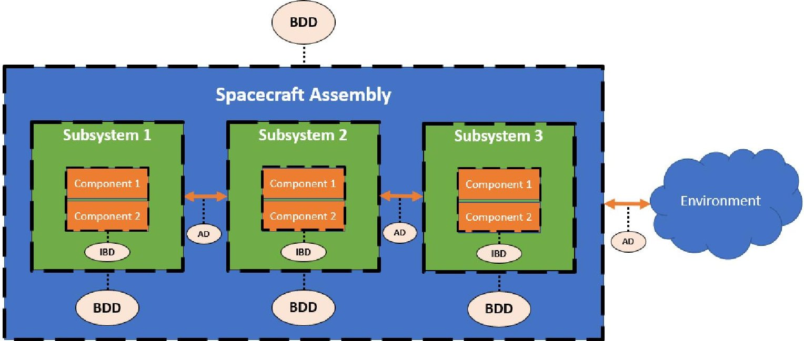

Fig. 1 Summary of SysML Diagrams in the Context of MAPS Architectures

A satellite constellation SoS architecture (as explained in the MAPS Demonstration Case section) is represented with SysML diagrams for the first portion of the proof-of-concept for MAPS. The MBSE architectural model can then be linked to the DAF environment in order to simulate the functionality of the architecture as well as estimate key performance parameters that characterize the specific architecture variant that is being developed and tested in MAPS.

<!-- PDF_PAGE: 4 -->

These performance parameters can be further integrated with architecture attributes evaluation and optimization routines built into MAPS.

## IV. MAPS Phase 2 and 3 - Architecture Evaluation through Value-Centric Design Methodology

## A. Background

Moving on from the problem definition phase, the second phase of the process requires a design generator to explore the tradespace, and the third phase requires methods to evaluate the designs. For phase three, Value-centric design methodology (VCDM) was chosen, which emphasizes the importance of evaluating systems architectures using value metrics formulated to represent stakeholder preferences [9]. MAPS was designed for implementation of VCDM, where an analysis toolsuite based on previous research can provide quantified results and direction to decision-makers. Among options for value-metrics also known as architecture attributes architecture cost and system-level performance have long been the driving focus of stakeholders and systems engineers. Architecture attributes such as complexity, flexibility, and resiliency so-called "ilities" have remained qualitatively rather than quantitatively considered. This remains the case despite significant research over the past decade to develop methods and frameworks for diversified value-driven design. Starting with El-Haik and Yang [14] and continuing with Carson and Doyle [15], Hornby [16], Murray, et al. [17], and others not only introduce ways to quantify complexity but also comments on managing complexity in design. The works of Hölltä-Otto and de Weck [18] and Tamaskar, Neema, and DeLaurentis [7] continue by linking complexity measurement to the characterization of modularity in aerospace systems. Neema, et al. [8] add measurement of flexibility based on potential for design reconfiguration, and they balance both complexity and flexibility against performance in Pareto fronts and polar plots. Both Mathieu and Weigel [10] and Brown and Eremenko [9] have explored other definitions of flexibility which include operational scenarios and cost analysis. All these authors have shown that design engineers can effectively employ metrics that reflect the diverse values of stakeholders, and that stakeholders can then make decisions based on values explicitly.

For still further analysis, simulation is possible for systems and systems and systems-of-systems (SoS). Agentbased modeling (ABM) is especially popular in SoS engineering practice and is valuable for representing diverse systems with distributed control and distributed geographic location. ABM can further reveal evolutionary and emergent behavior of systems through time-based simulations. Many of the features present in MAPS—including parametric sizing, system selection through optimization, and the object-oriented approach—can lead naturally into development of such simulation capability. Though MAPS has only attributes analysis tools at present, inclusion of simulation capability is planned for future development.

## B. Attributes Analysis in MAPS

Previous research has developed means to measure complexity and flexibility and to trade or optimize these attributes against cost or performance [7], [8]. These methods have been integrated into MAPS for phase three, design evaluation, and are adapted where appropriate for spacecraft and space SoS. The adaptations are based on an adopted taxonomy that caters specifically to space systems, described below.

- A Component is the lowest level, which may be commercial-off-the-shelf parts representing zero development effort to the designer. Examples include a solar cell or a reaction wheel.

- A Subsystem is a class defined by a collection of components representing the most common function allocation for space systems. There are seven common functional subsystems, and the required ones for each spacecraft are avionics, power, and communications.

- A Module is a class defined by a free-flying collection of structurally- and electrically-linked subsystems. Modules are usually assembled on the ground, usually with the intention that the links are permanent (except in the case of on-orbit servicing or assembly).

- An Assembly is a class defined by the temporary link of multiple modules. At any given time or location during the simulation, an assembly might form or change through docking, berthing, grappling, etc.

- An Architecture is the highest level, which collectively refers to all the modules, assemblies, launch vehicles, and other agents required for a mission.

- A Stakeholder is defined as a human agent which has some implicit or explicit control of the system design or operation. Stakeholders may represent decision makers at many levels, including government actors, the firm, the customer, the engineer, or the user [3].

For space SoS, the impact of various stakeholders and the inclusion of other agents such as launch vehicles, ground stations, or operations crews has been discussed in previous work [19],[20]. MAPS is capable of incorporating such

<!-- PDF_PAGE: 5 -->

agents into mission planning, cost models, and simulations as needed. However, the following discussion of "ilities" analysis focuses only on the spacecraft system hardware.

## 1. Flexibility Model

The first value-metric to be considered is flexibility. In a world that is uncertain and imperfect, flexibility gives a stakeholder options to alter the systems in some way in the event of changes in requirements, technologies, or environment [9], [7], [10]. In literature, "flexibility" is sometimes considered a category to encompass attributes such as adaptability, scalability, evolvability, and maintainability. The current research focuses on two of these attributes defined by [9]:

- Adaptability: the ability to reconfigure a system to meet new needs or circumstances

- Scalability: the ability to add components, capability, or performance to a system throughout its lifetime Two scenarios are defined for the two attributes, adapted from [10], which guide us in understanding the context of the measurement method. In the adaptability scenario, the architecture is required to meet a new performance/cost threshold. The Neema et al. method for calculating flexibility is used to evaluate the possible architecture reconfiguration options that meet the new threshold [8], and the change in life cycle cost is also evaluated. In the scalability scenario, the stakeholder wishes to add a new payload that adds a capability to the architecture. The Neema et al. method is used again to enumerate architecture options with the new payload, and the life cycle cost of adding the payload is also evaluated. It is assumed in both scenarios that the architecture has not yet been launched; however, it's possible for the scalability scenario to be adapted for the opposite case.

The measure of flexibility is adapted from Neema et al. [8], which utilizes network theory. Network theory requires the creation of a structural graph for each module. It is important that this graph is at the component level, where components are represented as nodes and their interactions (including the flow of information, electrical power, or fluids, or in certain cases specific structural links) are represented as directed and weighted links. (An example of a subsystem-level structural graph for a spacecraft is presented in Fig. 2, and a component-level example will be presented with the demonstration case in Fig. 12.) The flexibility measure then is based off the premise that a system is "flexible" if new nodes can easily be added and connected to the other nodes, without sacrificing performance. It

should be noted that the method was developed for fractionated spacecraft architectures, wherein spacecraft functions are be distributed between some number of free-flying modules that collectively work together to achieve mission objectives. However, the process can equally be applied to any architecture consisting of multiple payloads or satellites.

In the first step, MAPS uses an architecture generator algorithm to enumerate all options. This is accomplished using a list of payloads and/or fractionatable subsystems to define the finite trade space. A user must therefore determine in this step the level of fractionation desired, if any. The variable TD equals the number of total possible designs and will be used later. Next, the MAPS space systems design module is employed for each architecture, using parametric equations and component selectivity rules to design the spacecraft modules and define the adjacency matrices.

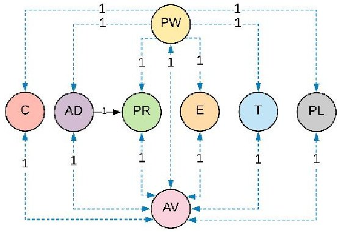

For some users, a baseline architecture may already be defined. In

Fig. 2 Notional structural graph of a spacecraft with weighted, directional links (subsystem-level).

this case, perhaps the user will only wish to evaluate flexibility for the baseline. Otherwise, or without a baseline being selected yet, each architecture option should be considered as the "reference" in turn. The following steps are repeated for each reference architecture to count the number of "feasible and acceptable" design options.

"Acceptable" designs have less than a user-defined maximum number of design changes. Therefore, the next step is to count how many design changes are required to move from the reference architecture to each other option. The number of design changes include the addition or removal of any nodes or links.

$$
D C _ {i} = \left(n u m b e r o f a d d e d n o d e s\right) + \left(n u m b e r o f r e m o v e d n o d e s\right) + \left(n u m b e r o f a d d e d l i n k s\right) + \left(n u m b e r o f r e m o v e d l i n k s\right) \tag {1}
$$

A comparison of the set of adjacency matrices for each architecture is used for this. With the number of design changes $ ( D C_{i} ) $ stored for each architecture option i, the architectures which are not "acceptable" can be removed.

"Feasible" designs have a normalized performance between $ 0^{\circ} $ and $ 180^{\circ} $ . The ability to calculate performance and then normalized performance change is key to this flexibility method, and space system design engineers commonly choose initial mass in orbit (IMLEO, for systems in LEO) as a performance metric. Total architecture mass can easily

<!-- PDF_PAGE: 6 -->

be referenced in MAPS, already determined in the space system design module. A user can next choose to define a performance threshold $ ( P_{ref} ) $ . For example, the total mass of the architecture may need to be below the maximum payload capacity of a selected launch vehicle. Alternatively, the current reference architecture's total mass may be used as the threshold.

However, it is less mass that would be considered higher performing, which can be confusing when discussing performance. Two options to address this include multiplying the change in performance $ \left( \Delta P_{i}\right) $ by $ -1 $ to switch the sign, or subtracting the mass from a constant:

$$
P _ {i} = \mathrm {C o n s t a n t} - \mathrm {M a s s}
$$

In this way, results for mass lower than the reference are considered a positive performance change, and results for mass higher than the reference are a negative performance change. The change in performance of each design option is calculated with respect to the threshold:

$$
\Delta P _ {i} = P _ {i} - P _ {r e f}
$$

Next, normalized performance is calculated:

$$
N P _ {i} = \frac {1 8 0 \Delta P _ {i}}{\max | \Delta P | _ {i = 1} ^ {T D} + 1}
$$

where $ N P_{i}\in[-\mathrm{180^{\circ}},\mathrm{180^{\circ}}]. $ The design options are further downselected by removing the designs with negative normalized performance results, which are not "feasible". Finally, the flexibility of the reference architecture is defined as the ratio of the number feasible and acceptable design options (FD) to the total design options (TD):

$$
F = F D / T D
$$

As mentioned, the flexibility should be calculated for each design option, considering each as the "reference" in turn. Additionally, in MAPS, the authors propose that this method is used in specific ways for the different scenarios under the flexibility category. For the adaptability scenario, this method is employed by defining the new performance threshold. For the scalability scenario, this method is employed by adding the new payload to the list before architecture enumeration.

The flexibility measure presented by Neema et al. [8] is effective at demonstrating the scale of design reconfiguration and the impact to architecture-level performance. However, there are concerns that the measure is not able to tell the user what those design changes mean from a cost or complexity perspective. To address these concerns, the cost and complexity models should also be employed when trading the architecture design options. To completely assess both adaptability and scalability, the change in cost and complexity should be displayed. Currently, these values are output directly from the respective software modules (described in the following sections); however, it 's possible in future work that the normalized performance used in the Neema flexibility measure could be replaced with normalized cost or normalized complexity.

## 2. Complexity Model

Space systems in particular are often described as being highly complex, and it is deemed valuable to be able to trade this attribute [18], [8], [3]. For MAPS, the measurement of complexity is founded on the work of Tamaskar, et al. [7], who performed an extensive literature review of complexity and its management through design for aerospace systems. Specifically, it is design and development complexity as experienced by the user that is evaluated. They proposed that the most important aspects of complexity include coupling, directionality, and feedback loops. The component-level structural graphs and adjacency matrices created during the flexibility measure are used again here to determine the complexity of each feasible architecture that was enumerated.

The first step in the complexity measure involves redefining the directed links to account for indirect coupling. Since there is not enough information for space systems to make more than a subjective assertion about link weights, all weights were initially set equal to one. Now, all possible paths are listed, and each link weight is multiplied by the frequency that it appears on the list. Next, the coupling complexity of a module can be calculated:

$$
C _ {C C} = \sum_ {f = 1} ^ {F} \left(l _ {f} \sum_ {i = 1} ^ {l _ {f}} W _ {i f}\right) + \sum_ {k = 1} ^ {m} W _ {k}
$$

where F denotes the number of feedback loops existing in the graph, $ l_{s} $ denotes the number of links in loop s, $ W_{if} $ denotes the weight of link i, m denotes the number of links which are not part of a loop, and $ W_{k} $ denotes the weight of link k that is not part of a loop. The coupling complexity of each subsystem n is also calculated $ (C_{CC_{n}}) $ .

<!-- PDF_PAGE: 7 -->

The method next introduces a modularity modification and integration complexity. Tamaskar proposed that design and development complexity is reduced through the hierarchical organization of the subsystems, so the coefficient of integration $ \alpha_{I} $ is designed to reduce the complexity measure. The integration complexity and subsequent modified integration complexity are defined:

$$
C _ {I} = C _ {C C} - \sum_ {n = 1} ^ {N} C _ {C C _ {n}}
$$

$$
\alpha_ {I} = \frac {c _ {I}}{\sum_ {n = 1} ^ {N} c _ {C C _ {n}}}
$$

$$
C _ {I m} = \alpha_ {I} C _ {I}
$$

The final module complexity is therefore:

$$
C _ {M C} = \sum_ {n = 1} ^ {N} C _ {C C _ {n}} + C _ {I m}
$$

for a module decomposed into N subsystems. In the final step, the complexity for a complete architecture is computed as a simple sum,

$$
C _ {A} = \sum_ {m = 1} ^ {M} C _ {M C _ {m}}
$$

where M denotes the number of modules in an architecture. Currently, there is no additional modification for module integration, which might be considered if modules are integrated in an assembly. This is noted for future study.

## 3. Life Cycle Cost Model

Additionally, MAPS has integrated cost estimation using the Advanced Mission Cost Model (AMCM) suggested by the Space Mission Analysis and Design text [21] and others in literature [22]. The AMCM has incorporated quantity for production (Q), system mass (M, in pounds), expected operability year (IOC), the design generation (B), as well as a technical difficulty rating (D) into a single function:

$$
C _ {D P} = 5. 6 5 * 1 0 ^ {- 4} Q ^ {0. 5 9} M ^ {0. 6 6} 8 0. 6 ^ {S} \left(3. 8 1 * 1 0 ^ {- 5 5}\right) ^ {\frac {1}{I O C} - 1 9 0 0} B ^ {- 0. 3 6} 1. 5 7 ^ {D}
$$

which computes the combined Design, Development, Testing, and Engineering (DDT&E) and production cost for systems. A cost matrix of these variables was created for each subsystem using best-guess estimates informed by literature and industry knowledge.

For space system architectures, the total life cycle cost also includes the launch vehicle(s) price, annual operations, and any other stakeholder-defined procurement cost. The mission planning module in MAPS is used to define mission segments, such as launch. In this module, the number of required launch vehicles is determined, and modules are assigned to launch vehicles. It is valuable to have a variety of commercial launch vehicles in a system library, as well as crew capsules for human missions; currently, MAPS includes models for SpaceX's Falcon 9 and Crew Dragon capsule. A wide spectrum of ground operations costs undoubtedly exists for various mission types. Literature suggests that it is appropriate to project annual operations cost at 10% of the DPA costs for a human mission [22]. The total operations $ C_{ops} $ is simply the annual cost times the number of years of operation. Any other procurement-related costs may be defined in the cost model based on the stakeholder agents in a simulation, for example, licensing or operations fees set by the local government. The sum of all relevant costs for an architecture represents the life cycle cost.

## 4. Representation of Architecture Attribute Tradeoffs

Finally, with evaluation of various value metrics, an engineer may choose to trade the metrics against each other in different architecture designs. A user may also decide to create a multi-objective optimization module that includes some of these attributes in an objective function. Stakeholder preferences can guide the weighting of each attribute intended to be maximized/minimized. A common way of representing the tradeoff activity is using a Pareto frontier to display the comparative optimality results for a range of design options. There is significant potential for future development in MAPS for various optimization schemas, and one study with Genetic Algorithm has already been performed using an early version of the tool for on-orbit space tourism hotels [20].

## V. MAPS Demonstration Case: Communications Constellation in LEO

In the MAPS environment, a user is guided to implement MBSE methods and employ an architecture attributes toolsuite to perform rapid assessment of space system architectures. A variety of aerospace problems can be assessed relevant to current research and industry interests. The authors in this study especially see potential for addressing

<!-- PDF_PAGE: 8 -->

emerging markets in aerospace—such as servicing, manufacturing, and assembly of satellites in Earth orbit—and for human exploration concepts—such as the complex, multi-stakeholder assembly of a cislunar Gateway. Towards proving MAPS' ability to assess such concepts, the first demonstration case that will be explored relates to another emerging strategy: satellite constellations. Satellite constellations such as OneWeb [23], SpaceX Starlink [24], and Iridium NEXT [25] are being developed today by a number of companies looking to provide communications and internet services worldwide. Here, constellations present the perfect case for involving multiple spacecraft with the potential for hosted payloads and in-orbit interactions.

The demonstration case is designed to instantiate the MBSE methods that start off the rapid assessment of architecture designs in MAPS. It is also designed to prove the ability of MAPS to perform that architecture assessment and to prove the OTA capability integrated with GMAT. In the demonstration case presented here, a communications constellation will be generated in MAPS. The baseline architecture consists of five communications satellites and one servicing spacecraft in low-Earth orbit (LEO), as displayed notionally in Fig. 3. The Walker terminology is effective at describing basic constellations with circular orbit geometries and is used with the notation:

$$
i: t / p / f
$$

where i describes the orbit inclination, t describes the total number of spacecraft, p describes the number of planes (equally spaced), and f describes the spacing between spacecraft in neighboring planes [26]. Our demonstration case, then, is a Walker $ 5 3^{\circ} $: 6/1/1 constellation. Additionally, the spacecraft are all at equal altitudes. A parking orbit is defined, however, for any necessary orbit maneuvers and/or phasing where a satellite must be in a separate orbit from the rest of the constellation to avoid collision. A summary of the orbital parameters is given in Table 1. The following sections will describe the MBSE processes, the application of the MAPS space systems design module, the application of the OTA module, and the application of the architecture attributes toolsuite for the demonstration case.

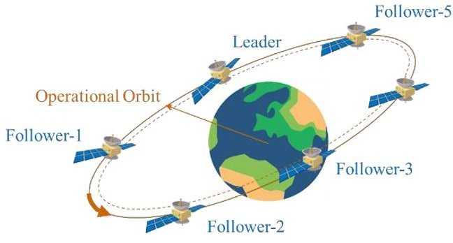

Fig. 3 Notional diagram depicting the baseline constellation for the demonstration case.

Table 1 Orbital parameters for the demonstration case.

<table border="1"><tr><td>Parameter</td><td>Value</td></tr><tr><td>Number of Satellites,Ns</td><td>6</td></tr><tr><td>Operational Orbit Altitude,h0</td><td>550km</td></tr><tr><td>Parking Orbit Altitude,h1</td><td>530km</td></tr><tr><td>Eccentricity,e</td><td>0</td></tr><tr><td>Orbit Inclination,i</td><td>53deg</td></tr><tr><td>Number of planes,p</td><td>1</td></tr><tr><td>Right Ascension of first plane, $ \Omega_{0} $</td><td>0deg</td></tr><tr><td>Mean Anomaly of first(leader) satellite,M0</td><td>0deg</td></tr><tr><td>Phasing,f</td><td>1(Equal spacing in plane)</td></tr></table>

## A. Phase 1: Problem Definition

To represent the demonstration case, BDDs and IBDs were created for each satellite in the architecture. A satellite assembly-level BDD was first created to highlight each satellite's constituent subsystems, and this diagram is shown in Fig. 4. BDDs were further created in order to provide a physical decomposition of the components within each subsystem. Examples of BDDs for the attitude determination and control and propulsion subsystems are shown in Fig. 5 and Fig. 6, respectively. IBDs were also created to show the major connections between components within each subsystem. An example IBD of the propulsion subsystem is shown in Fig. 7. Note that for this demonstration case, we are considering the satellites already being in their operational orbit, so there is no need to model or simulate other mission segments.

<!-- PDF_PAGE: 9 -->

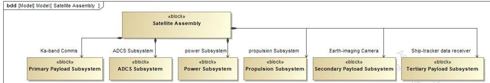

Fig. 4 Satellite Assembly-Level BDD

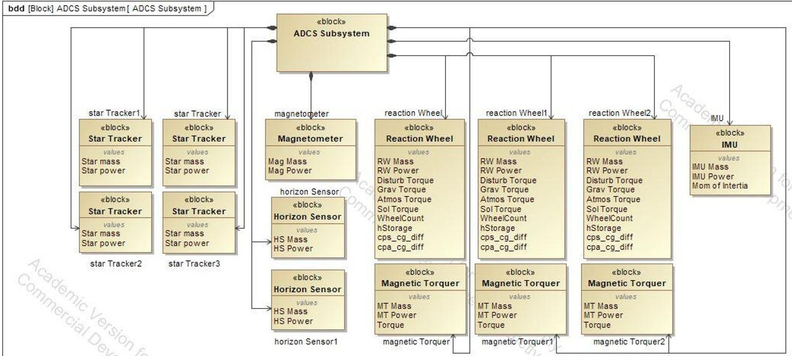

Fig. 5 Attitude Determination and Control Subsystem BDD

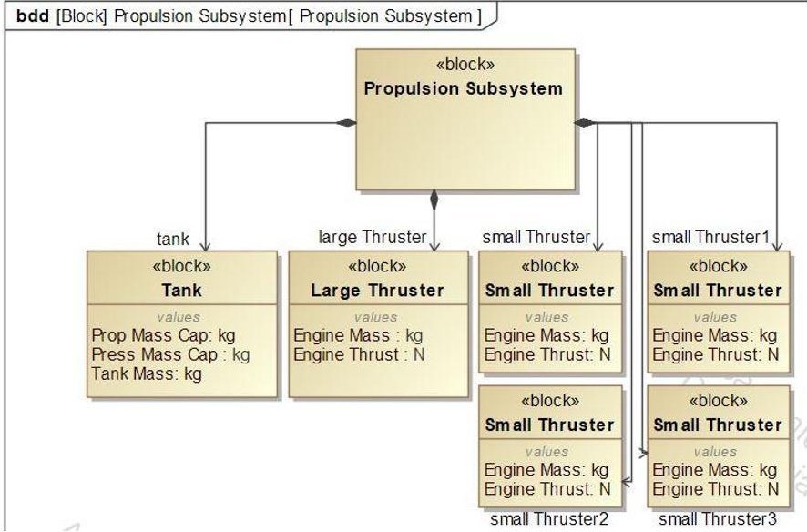

Fig. 6 Propulsion Subsystem BDD

<!-- PDF_PAGE: 10 -->

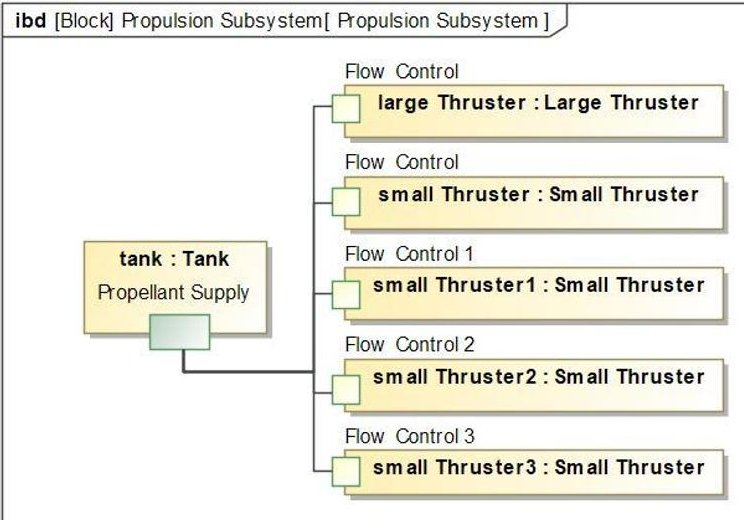

Fig. 7 Propulsion Subsystem IBD

## B. Phase 2A: Orbital Trajectory Analysis

With the initial models created for the architecture, the user can move on to any relevant orbital analysis. The OTA tool of MAPS integrates with the General Mission Analysis Tool software to simulate orbital interactions between agents defined during the MAPS architecture generation process. The results from GMAT (such as time of flight and velocity change, $ \Delta v $ ) impact the space systems design and the evaluation of architecture complexity, flexibility, and robustness. In special simulation cases, GMAT is used to model the architecture's operational response to a failed node or multiple failed nodes. GMAT tracks the position of an architecture's systems with respect to time and simulates orbital maneuvers required by MAPS to finish sizing [27].

The OTA tool of MAPS creates the necessary run conditions for the simulation and calls the GMAT software to perform the propagation. The necessary results generated by GMAT are fed back into MAPS (in MATLAB), where they are used within the core loop to further refine the architecture. The outputs may be used for spacecraft sizing, as part of simulations, or in performance-based metrics. NASA Goddard Space Flight Center's orbital analysis suite GMAT was selected for integration into MAPS due

Table 2 GMAT inputs for the demonstration case.

<table border="1"><tr><td>Parameter</td><td>Symbol</td><td>Value</td><td>Units</td></tr><tr><td>Operational Orbit Altitude</td><td>$h_{0}$</td><td>550</td><td>[km]</td></tr><tr><td>Parking Orbit Altitude</td><td>$h_{1}$</td><td>varies</td><td>[km]</td></tr><tr><td>Number of Spacecraft</td><td>$N_{s}$</td><td>6</td><td>[-]</td></tr><tr><td>Spacecraft Phase Angle</td><td>$\phi_{sc}$</td><td>60</td><td>[°]</td></tr></table>

to its open-source nature and close integration with MATLAB.

The inputs for the demonstration case defined in Fig. 8 are shown in Table 2, including Operational Orbit altitude, Parking Orbit altitude, number of spacecraft, and phase angle between each spacecraft along the orbit. These values reflect the Walker constellation definition presented above (see Eq. 8). Although Table 2 describes the nominal values for each parameter, several different parking orbits were tested to provide a better picture of how changes in the architecture are represented through GMAT. Fig. 8 shows the initial geometry of the demonstration case.

The GMAT simulation was run for follower1 and follower3 in Fig. 8. That is, the first and third satellites clockwise from the red "leader" satellite. For each satellite, an initial burn is performed to enter a Hohmann transfer to the parking orbit. At the desired parking orbit altitude, a second burn is used to achieve an eccentricity of zero. An exaggerated comparison of the operational and parking orbits is shown in Fig. 9.

The follower spacecraft is then left to propagate for a number of revolutions, until the relative positions between leader and follower is sufficient for rendezvous. A second Hohmann transfer is executed to re-enter the operational orbit and rendezvous with the leader as shown in Fig. 10.

After completing docking procedures, the follower spacecraft again executes a Hohmann transfer to the parking orbit, where it is left to propagate around the rest of the orbit until it reaches its original phase angle. This results in eight total burns to achieve a single rendezvous and return (R&R) maneuver.

<!-- PDF_PAGE: 11 -->

Three different parking orbits were tested with the given architecture to replicate how changes to the GMAT inputs would result in outputs that would affect the rest of MAPS. The values recorded in Table 3 and Table 4 are the total times of flight and $ \Delta v $ required for a single R&R maneuver. Each single $ \Delta v $ burn was found to be one eighth of the total $ \Delta v $ . The to-rendezvous and to-return times of flight was found to be a percentage of the total TOF such that:

$$
T O F _ {i \rightarrow r e n} = \frac {\phi_ {s c}}{3 6 0 ^ {\circ}}, T O F _ {r e n \rightarrow f} = \frac {3 6 0 ^ {\circ} - \phi_ {s c}}{3 6 0 ^ {\circ}}
$$

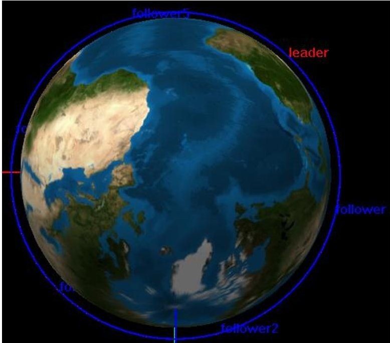

Fig. 8 Demonstration case initial GMAT geometry.

Note that although these values are for follower1, testing follower3 reveals that the total maneuver time and required $ \Delta v $ is the same for any $ \phi_{sc} $ initial conditions. The ratio between $ TOF_{i\rightarrow ren} $ and $ TOF_{ren\rightarrow f} $ changes depending on $ \phi_{sc} $ , but the total time and required $ \Delta v $ remains the same. Therefore, these two values are dependent only on the distance between the operational orbit and the parking orbit. This is only verified for this demonstration case, and other architectures will have different uses for GMAT propagation.

It is understood that there is a notable relationship between parking altitude, required TOF, and required $ \Delta v $ . Depending on the requirements of the architecture, MAPS is able to employ the OTA tool to optimize the spacecraft's operations in orbit to meet the needs of the mission (for example, a lower TOF per maneuver, or a lower $ \Delta v $ requirement per maneuver). For this demonstration case, the user can be said to prefer minimized $ \Delta v $ requirements (and therefore

minimized propulsion requirements), with no constraints on TOF to perform the R&R maneuvers. Therefore, the parking orbit option at 530 km altitude is selected.

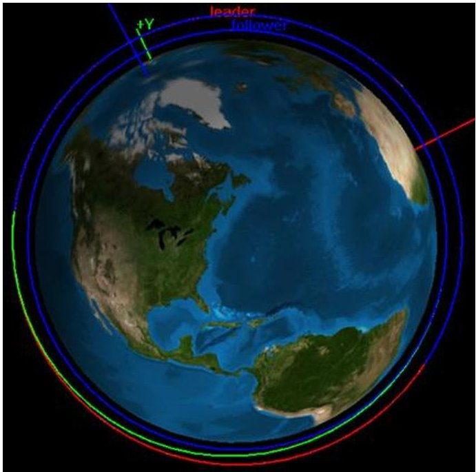

Fig. 9 Exaggerated distance between Operational and Parking orbits. The follower spacecraft is currently at parking altitude.

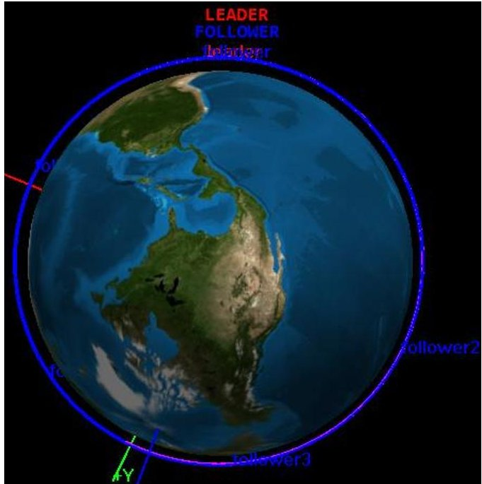

Fig. 10 Final Leader/Follower rendezvous geometry.

<!-- PDF_PAGE: 12 -->

Table 3 Total Time of Flight for R&R maneuver at varying parking orbits.

<table border="1"><tr><td>Parameter</td><td>Symbol</td><td>Value</td><td>Units</td></tr><tr><td>Time to complete rendezvous and return with parking altitude of 530km.</td><td>$TOF_{530}$</td><td>15.53525054</td><td>[days]</td></tr><tr><td>Time to complete rendezvous and return with parking altitude of 510km.</td><td>$TOF_{510}$</td><td>7.863701046</td><td>[days]</td></tr><tr><td>Time to complete rendezvous and return with parking altitude of 500km.</td><td>$TOF_{500}$</td><td>6.334235843</td><td>[days]</td></tr></table>

Table 4 Total $ \Delta v $ for R&R maneuver at varying parking orbits.

<table border="1"><tr><td>Parameter</td><td>Symbol</td><td>Value</td><td>Units</td></tr><tr><td>Total Δv required to complete rendezvous and return with parking altitude of 530km.</td><td>Δv530</td><td>0.04388458</td><td>[km/s]</td></tr><tr><td>Total Δv required to complete rendezvous and return with parking altitude of 510km.</td><td>Δv510</td><td>0.087878902</td><td>[km/s]</td></tr><tr><td>Total Δv required to complete rendezvous and return with parking altitude of 500km.</td><td>Δv500</td><td>0.10984472</td><td>[km/s]</td></tr></table>

## C. Phase 2B: Architecture Design Generation

With the MBSE diagrams created and with the inputs from OTA, the next step of the process is architecture generation in MAPS. In summary, the user begins building a list of fractionatable components, which are often payloads, then the user has the option to define a specific baseline design. Next, the architecture generator enumerates all design options. The space systems design module is employed to build the systems of the architecture around the design. Finally, the design options can each be evaluated for their architecture attributes. The following steps (adapted from [8]) are followed by the user to generate architecture design options in MAPS.

## Step 1: Fractionatable Subsystems/Payload Definitions

This step presents the chance to explore fractionation of the spacecraft, with any number of subsystems (or none at all) able to be fractionated across a fractionation spectrum, as presented for a space architecture example in [10]. Fractionation is not necessary, however, and most users will only be looking at a list of payloads they wish to fly. These optional payloads may include hosted payloads, which are an option when a stakeholder may wish to form partnerships to decrease the cost or otherwise improve the value of their architecture. Each payload is treated the same as a fractionatable subsystem in MAPS, since each payload simply represents a subsystem that may be shuffled amongst some number of free-flying modules to achieve the best architecture design.

The inputs required in this step include the mass, power requirement, and pointing accuracy requirement for each optional payload/fractionatable subsystem. It is also suggested that the user provides an adjacency matrix for each payload, though a simple default adjacency matrix can be used if not available, based on the subsystem type. The user should have defined these key inputs during Phase 1. As mentioned, the goal is for MBSE products to be integrated automatically into the MATLAB-based toolsuite. While automatic integration is still being developed, the user instead should provide each property in the main "runner" script in MAPS (or in the future, in a GUI). The demonstration case presented here includes five notional payloads $ ^{4} $ , presented in Table 5.

In MAPS, the user has the flexibility to define some special cases related to the payloads. The user can optionally define payloads that are required in each module and/or payloads that may be added only for certain scenarios, such as in a scalability scenario. For example, for the demonstration case presented here, one Ka-band Communications payload is required in every module, since the architecture is designed to be a communications constellation. The Inter-Satellite Communications payload is for the moment left out of the design space so that it can be added in later for the scalability scenario.

<!-- PDF_PAGE: 13 -->

Table 5 Fractionatable and Required Subsystems provided as inputs to MAPS.

<table border="1"><tr><td>Subsystem Index</td><td>Fractionatable Subsystem</td><td>Type</td><td>Mass(kg)</td><td>Power Requirement(W)</td><td>Pointing Accuracy Requirement(deg)</td></tr><tr><td>1</td><td>Earth-Imaging Camera(EIC)</td><td>Payload</td><td>50</td><td>10</td><td>0.1</td></tr><tr><td>2</td><td>Ship Tracker Data Receiver(STR)</td><td>Payload</td><td>1.8</td><td>4</td><td>5</td></tr><tr><td>3</td><td>Rendezvous and Proximity Operations Package(RPO)</td><td>Payload</td><td>16.7</td><td>45.5</td><td>0.15</td></tr><tr><td>4</td><td>Inter-Satellite Communications(ISC)</td><td>Payload</td><td>1</td><td>13</td><td>0.5</td></tr><tr><td>Subsystem Index</td><td>Required Subsystem</td><td>Type</td><td>Mass(kg)</td><td>Power Requirement(W)</td><td>Pointing Accuracy Requirement(deg)</td></tr><tr><td>5</td><td>Ka-Band Communications(KAC)</td><td>Payload</td><td>1</td><td>13</td><td>0.5</td></tr></table>

Finally, the user may choose at this stage to define a specific baseline architecture that they're interested in. It may be the case that a stakeholder is already familiar with their baseline architecture, and they wish to use MAPS for value-centric analysis or to explore other options. For example, a baseline is presented in Table 2, where there are three distinct free-flying modules in the constellation $ ^{5} $ . Another way of depicting the baseline is shown in Fig. 11. This baseline is passed into the next steps in MAPS and is evaluated alongside other enumerated options.

Table 6 Example baseline architecture design with three modules and distributed payloads.

<table border="1"><tr><td>Fractionatable Subsystem</td><td>Module1</td><td>Module2</td><td>Module3</td></tr><tr><td>Earth-Imaging Camera(EIC)</td><td>1</td><td>0</td><td>0</td></tr><tr><td>Ship Tracker Data Receiver(STR)</td><td>0</td><td>1</td><td>0</td></tr><tr><td>Rendezvous and Proximity Operations Package(RPO)</td><td>0</td><td>0</td><td>1</td></tr><tr><td>Inter-Satellite Communications(ISC)</td><td>0</td><td>0</td><td>0</td></tr><tr><td>Ka-Band Communications(KAC)</td><td>1</td><td>1</td><td>1</td></tr></table>

Step 2: Enumerate design options

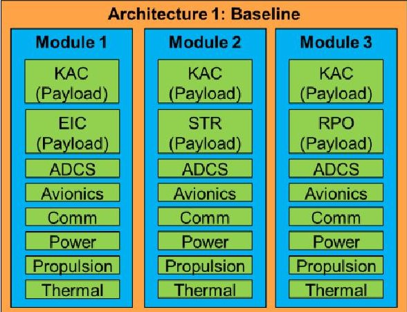

Fig.11 Example baseline architecture design with 3 modules and selected subsystems.

A MAPS tool is used to enumerate the possible design options

based on the list of fractionatable subsystems passed into it. The problem is solved by simply determining how many ways there are to distribute n "objects" in as many as 1 to n "boxes". The output is a list of module designs which are passed into the architecture builder module. In this demonstration case, five design options were identified from the three optional payloads. When the fourth payload option is added for the scalability scenario, requiring the architectures options to be enumerated once again, the design count is raised to 16.

<!-- PDF_PAGE: 14 -->

Step 3: Build architecture based on module designs

In this step, the space systems design tool is utilized to build each architecture based on the module designs from Step 2. The result is a set of adjacency matrices as well as mass and power budgets for the modules, which will be used in the attributes analysis. Remembering the taxonomy described above, this software tool builds each spacecraft module by instantiating the appropriate collection of subsystems, then builds each subsystem in turn as a collection of components. As suggested in [8], the design process follows a set of heuristic rules. The subsystems selected for a module follow Subsystem Selectivity Rules. The MAPS environment is set up to follow the Subsystem Selectivity Rules by default; however, it is noted that a designer may choose to modify the rules to include/exclude certain subsystems based on an architecture strategy.

Subsystem Selectivity Rules include:

1) There are seven "common subsystems": Attitude Determination and Control Subsystem (ADCS, often seen as Attitude Control and/or Guidance, Navigation, and Control), Avionics, Communications, Environmental Control and Life Support Systems (ECLSS), Power, Propulsion, and Thermal.

2) Three subsystems are required in all modules: Power, Avionics, Communications. (The default Communications subsystem includes a simple S-band antenna and transceiver for uplink of commands from the ground and telemetry downlink.)

3) Optional subsystems include: ADCS, ECLSS, Propulsion, Thermal, and Payload.

4) Additionally, fractionatable subsystems or payloads of any type may be added to a module or replace a default subsystem.

Next, Component Selectivity and Connectivity Rules are used to size the subsystems and to create the adjacency matrices. From here, parametric sizing, historical relationships, and research on current state of the art of space technologies leads to the creation of mass and power budgets for components and by extension for the modules. Additionally, OTA should be utilized either before this step or concurrently as part of the module (particularly the propulsion subsystem) design, as will be discussed in the following section.

Certain design decisions were made specifically for this case study. It was chosen to create a LEO constellation consisting of communications satellites in the MiniSat class, commonly named for 100-500 kg spacecraft. This is important because it impacts some of the component selections during the design process, since lower-mass commercial-off-the-shelf (COTS) options can be found for small spacecraft. Additionally, from the optional subsystems, ADCS, propulsion, and thermal subsystems were selected for inclusion on all modules (as well as payload subsystems when indicated by the enumerated module designs). For visualization, an example module from the baseline architecture (Module 1) can be represented as a structural graph, shown in Fig. 12. (Note that this componentlevel graph is an expanded version of the notional subsystem-level graph shown in Fig. 2.)

## Step 4: Perform attributes analysis for architectures

Finally, each of the architectures can be evaluated using the available tools in MAPS. Results for performance, flexibility, complexity, and life cycle cost are saved and used for design evaluation. In this demonstration case, various assessment selections were made to produce interesting results:

- Two performance metrics were evaluated: IMLEO and the constant minus IMLEO (Eq. 2).

- For all flexibility assessments, only IMLEO was used for the normalized performance calculation.

- In the adaptability scenario, the new performance threshold used was a 30 kg reduction from the baseline. This seemed appropriate when observing the average module mass in the baseline architecture was approximately 146 kg, thereby requesting a fairly aggressive 20% mass reduction.

- In the scalability scenario, the performance threshold is set 150 kg above the baseline total mass, since a new payload is being added and we wish to see all the results.

## D. Phase 3: Design Evaluation

- No limits were placed on the number of design changes.

The baseline architecture presented in Table 6 is evaluated first, with the results displayed in Table 7 for selected architectures. Additionally, the results for all the generated architecture options for both the adaptability and scalability scenarios are presented in Fig. 13 - Fig. 15. From the graphs, it is seen that complexity increases with performance (total mass) and with cost. These relationships were expected, since it was expected that in general, higher mass spacecraft have more components and therefore more interconnections. Also, one parameter in the AMCM is mass, so it is accepted that cost will increase with total mass as well. However, it is notable that at a given architectural performance level, different architectural complexity results are seen. This indicates that the complexity of any given module is not directly related to its mass but instead to its makeup of interconnections amongst its specific components.

<!-- PDF_PAGE: 15 -->

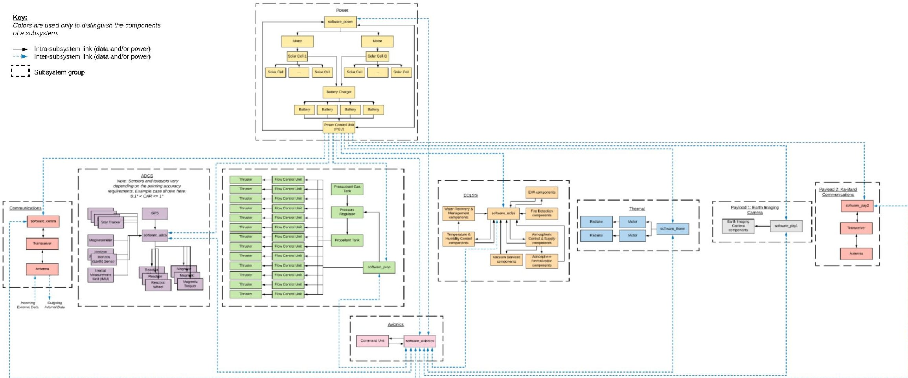

Fig.12 Structural graph representing Module 1 from the baseline architecture of the case study.

Table 7 Design evaluation results for selected architectures. (B) represents baseline design, (A) represents designs from adaptability scenario, and (S) represents designs from scalability scenario.

<table border="1"><tr><td rowspan="2">Design No.</td><td rowspan="2">Module Design，{[Module1][Module2]...[Modulen]}</td><td colspan="3">Performance</td><td colspan="2">Adaptability Scenario</td><td colspan="2">Scalability Scenario</td><td rowspan="2">Complexity</td><td rowspan="2">Life Cycle Cost($Millions)</td></tr><tr><td>Module Mass(kg)</td><td>Total Mass(kg)</td><td>C-IMLEO</td><td>Flexibility(Neema model)</td><td>Change in Costfrom Baseline(%)</td><td>Flexibility(Neema model)</td><td>Change in Costfrom Baseline(%)</td></tr><tr><td>1(B)</td><td>{[15][25][35]}</td><td>{[178.79][119.24][140.55]}</td><td>438.59</td><td>1561.41</td><td>0.667</td><td>-</td><td>1.00</td><td>-</td><td>903,096.0</td><td>157.66</td></tr><tr><td>3(A)</td><td>{[125][35]}</td><td>{[181.29][140.55]}</td><td>321.84</td><td>1678.16</td><td>0.667</td><td>-32.9%</td><td>-</td><td>-</td><td>643,535.56</td><td>105.85</td></tr><tr><td>4(A)</td><td>{[135][25]}</td><td>{[202.60][119.24]}</td><td>321.84</td><td>1678.16</td><td>0.667</td><td>-33.0%</td><td>-</td><td>-</td><td>603,393.46</td><td>105.69</td></tr><tr><td>4(S)</td><td>{[1245][35]}</td><td>{[183.55][140.55]}</td><td>324.09</td><td>1675.91</td><td>-</td><td>-</td><td>1</td><td>-32.8%</td><td>690,027.37</td><td>105.88</td></tr><tr><td>5(S)</td><td>{[125][345]}</td><td>{[181.29][142.81]}</td><td>324.09</td><td>1675.91</td><td>-</td><td>-</td><td>1</td><td>-32.8%</td><td>643,547.48</td><td>105.89</td></tr></table>

<!-- PDF_PAGE: 16 -->

The relationship between mass and complexity is also reflected in the selected designs in Table 7. The flexibility results do not show variation amongst the architectures, which may be due to the selection of performance threshold allowing most architectures to be "feasible" and the lack of a limit to the number of design changes allowing all architectures to be "acceptable". In the future, a different performance threshold or design changes limit might be selected to more finely distinguish the feasible scenarios, if desired.

Finally, the results provide a look inside the adaptability and scalability scenarios. Designs number 3 and 4 from the adaptability scenario show that a user could achieve a significantly lower complexity and approximately 33% cost reduction by pivoting the architecture from a three-module baseline to only two modules. Further, by pairing the payloads in Design 4 compared to Design 3, there is a significant complexity reduction, even though the total architecture mass and total cost happen to work out very nearly the same. Similar effects are seen in the scalability scenario, where an additional hosted payload is added. However, though the results show that the complexity and cost have not increased greatly, further work might spend more effort defining specific adjacency matrices for the payloads and also considering how hosted payload partnerships might impact the mission cost. These results can inform decision-making to trade between cost, performance, adaptability, and flexibility.

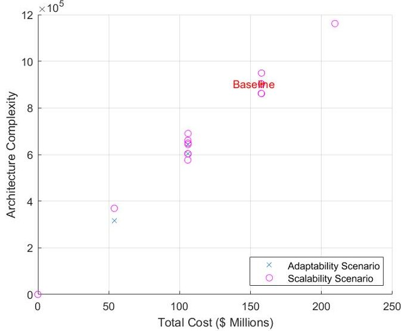

Fig. 13 Architecture complexity versus total cost for all architecture design options.

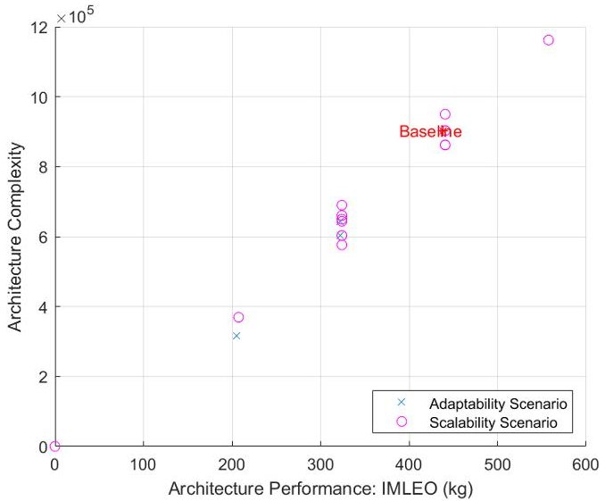

Fig. 14 Architecture complexity versus performance (total mass) for all architecture design options.

<!-- PDF_PAGE: 17 -->

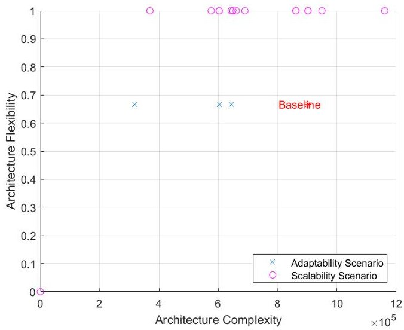

Fig. 15 Architecture flexibility versus architecture complexity for all architecture design options.

## VI. Conclusion

The MAPS environment provides an integrated platform in which a space systems architecture can be evaluated through multiple methodologies: model-based systems engineering, value-centric design methodology, and orbital simulations. MBSE provides a powerful method for representing architectures in a format that can be linked to a simulation environment, while SoS engineering with VCDM can be used to manage stakeholder value preferences, quantify architecture attributes, and simulate operational scenarios. Lastly, the OTA module provides important simulation data on the architecture as well as provides a visual representation of the interacting systems. Together, the process continues to evolve and improve the status quo for architecture design and trade-off analysis.

The MAPS environment has been designed to be capable of handling diverse problems involving space systems. While it is a simple demonstration case, the LEO constellation application presented here demonstrates the process for a user to move from an initial model through the design space exploration and eventually inform decision-making based on the multiple architecture attributes. With the goal of unifying separated phases of architecture analysis and simulation, the MAPS environment has the potential of being an end-to-end modeling and analysis tool for a wide variety of use-cases emanating from both industrial and academic sources.

Creating SysML representations of spacecraft architectures prior to evaluation and iteration in the MAPS environment is helpful for improving the flexibility of the assessed architectures. Visual representations at the assembly, subsystem, and component levels allow users to make rapid changes to their baseline architectures while also enabling a rich insight into the physical linkages between subsystems and components. In the future, an inclusion of activity diagrams could enable the assessment of multiple mission segments. Additionally, the MBSE-DAF linkage framework can be leveraged in order to connect the architectural elements described in the SysML diagrams with the required input format to run the MAPS and OTA toolsets. The space system design model could continuously be improved. New options and higher fidelity sizing methods could be added in any of the subsystems, such as adding new propellant options to the propulsion subsystem.

GMAT's orbital capabilities are applied to MAPS architectures to estimate $ \Delta v $ and TOF requirements, which are fed back into the core design loop. The demonstration case presented is sufficient as a proof of concept, but future development in the interface between MAPS and GMAT would improve sizing capabilities further, allowing MAPS to populate more complicated GMAT scenarios such as plane-change maneuvers, interplanetary travel, and more.

As mentioned above, there are some additional ways that MAPS could be utilized for interesting studies. In future work, it would be especially valuable to demonstrate the ability to not just model agents but also run simulations in MAPS. New performance metrics might be explored in future work, such as ones that require simulation, and also the flexibility measure should be explored further with change in complexity and change in cost, instead of normalized performance change to compare architecture design options.

<!-- PDF_PAGE: 18 -->

[1] G. Parnell and e. al., "Ch. 9: An Integrated Model for Trade-off Analysis," in Trade-off Analytics: Creating and Exlporing the System Tradespace, Hoboken, John Wiley & Sons, Inc., 2017, pp. 297-336.

[2] D. DeLaurentis, "Understanding Transportation as System-of-Systems Design Problem," in 43rd AIAA Aerospace Sciences Meeting and Exhibition, Reno, 2005.

[3] A. Ross, D. Hastings, J. Warmkessel and N. Diller, "Multi-Attribute Tradespace Exploration as Front End for Effective Space System Design," Journal of Spacecraft and Rockets, vol. 41, no. 1, pp. 20-28, 2004.

[4] J. Lafleur and J. Saleh, "GT-FAST: A Point Design Tool for Rapid Fractionated Spacecraft Sizing and Synthesis," in AIAA SPACE 2009 Conference and Exposition, Pasadena, 2009.

[5] D. R. Komar, J. Hoffman, A. Olds and M. Seal, "Framework for the Parametric System Modeling of Space Exploration Architectures," in AIAA SPACE 2008 Conference & Exposition, San Diego, 2008.

[6] Y.-F. Wang, M. Schrock, C. S. Borden and R. C. Moeller, "Trade Space Specification Tool (TSST) for Rapid Mission Architecture (Version 1.2)," Jet Propulsion Laboratory, Pasadena, CA, 2013.

[7] S. Tamaskar, K. Neema and D. DeLaurentis, "Framework for measuring complexity of aerospace systems," Res Eng Design, 2013.

[8] K. Neema, S. Tamaskar, C. Guariniello and D. DeLaurentis, "Complexity and Flexibility enabled Model Based Design Framework for Space System Design," in AIAA SPACE and Astronautics Forum and Exposition, Orlando, 2018.

[9] O. Brown and P. Eremenko, "Application of Value-Centric Design to Space Architectures: The Case of Fractionated Spacecraft," in AIAA Space and Astronautics Forum and Exposition, San Diego, 2008.

[10] C. Mathieu and A. L. Weigel, "Assessing the Flexibility Provided by Fractionated Spacecraft," in AIAA Space and Astronautics Forum and Exposition, Long Beach, 2005.

[11] A. Maheshwari, "Industrial Adoption of Model-Based Systems Engineering: Challenges and Strategies," 2015.

[12] A. Maheshwari, A. K. Raz, D. A. DeLaurentis, A. Murphy and O. Kolawole, "Integrating SysML and Agent-Based Modeling for Rapid Architecture Evaluation," Insight, pp. 47-51, 2018.

[13] A. Mour, C. R. Kenley, N. Davendralingam and D. DeLaurentis, "Agent-based modeling for systems of systems," in 23rd Annual International Symposium of the International Council of Systems Engineering, Philadelphia, PA, 2013.

[14] B. El Haik and K. Tang, "The components of complexity in engineering design," IIE Trans, vol. 31, no. 10, pp. 925-934, 1999.

[15] J. Carson and J. Doyle, "Complexity and robustness," Proceedings of the National Academies of Science USA, vol. 99, no. Suppl 1, p. 2538, 2002.

[16] G. Hornby, "Modularity, reuse, and hierarchy: measuring complexity by measuring structure and organization," Complexity, vol. 13, no. 2, pp. 50-61, 2007.

[17] B. T. Murray, A. Pinto, R. Skelding, O. de Weck, H. Zhu, S. Nair, N. Shougarian, K. Sinha, S. Bopardikar and L. Zeidner, "META II complex systems design and analysis (CODA)," United Technologies Research Center, 2011. [Online]. Available: https://apps.dtic.mil/docs/citations/ADA552676. [Accessed 10 June 2019].

[18] K. Holtta-Otto and O. de Weck, "Degree of Modularity in Engineering Systems and Products with Technical and Business Constraints," Concurrent Engineering: Research and Applications, vol. 15, no. 2, pp. 113-126, 2007.

[19] Z. Fang and D. DeLaurentis, "Multi-Stakeholder Dynamic Planning of System of Systems Development and Evolution," in 2015 Conference on Systems Engineering Research, 2015.

[20] M. Grande and D. DeLaurentis, "SoS Characterization and Optimization Approaches for an In-Space Hotel," in IEEE 14th International Conference on System of Systems Engineering (SoSE), Anchorage, 2019.

[21] W. Larson and J. Wertz, Space Mission Analysis and Design, El Segundo: Microcosm Press, 1999.

[22] H. Jones, "The Impact of Lower Launch Cost on Space Life Support," in AIAA SPACE and Astronautics Forum and Exposition, Orlando, 2018.

<!-- PDF_PAGE: 19 -->

[23] OneWeb, "Our Company," 2019. [Online]. Available: https://oneweb.world/our-company. [Accessed 25 November 2019].

[24] S. Clark, "SpaceX releases new details on Starlink satellite design," Spaceflight 101, 15 May 2019. [Online]. Available: https://spaceflightnow.com/2019/05/15/spacex-releases-new-details-on-starlink-satellite-design/ [Accessed 25 November 2019].

[25] P. de Selding, "First batch of Iridium Next satellites good to go for July SpaceX launch," Space News, 29 April 2016. [Online]. Available: https://spacenews.com/iridium-says-2nd-generation-constellation-ready-to-launch-with-spacex-starting-in-july/. [Accessed 25 November 2019].

[26] J. G. Walker, "Satellite constellations," Journal of the British Interplanetary Society, vol. 37, pp. 559-571, 1984.

[27] NASA Goddard, "General Mission Analysis Tool (GMAT) - User Guide," NASA Goddard, 2018. [Online]. Available: http://gmat.sourceforge.net/doc/R2018a/help-letter.pdf. [Accessed 11 June 2019].

[28] M. Grande and D. DeLaurentis, "SoS and Optimization Techniques for an In-Space Hotel," in System of Systems Engineering Conference 2019, Anchorage, 2019.

[29] P. Williams, J. Dempsey, D. Hamill, E. Rodgers, C. Mullins, E. Gresham and S. Downs, "Space Science & Technology Partnership Forum: Value Proposition, Strategic Framework, and Capability Needs for In-Space Assembly," in AIAA SPACE and Astronautics Forum and Exposition, Orlando, 2018.

[30] Aquila Space, "Ka-band Transmitter (AS-10075)," 2016. [Online]. Available: https://web.archive.org/web/20160819050434/http://www.aquilaspace.com/wp content/uploads/2015/04/Ka_band_AS10075.pdf. [Accessed 19 August 2016].

[31] National Aeronautics and Space Administration, "Sate of the Art of Small Spacecraft Technology: 09. Communications," 12 March 2019. [Online]. Available: https://sst-soa.arc.nasa.gov/09-communications. [Accessed 25 November 2019].

[32] Spaceflight101.com, "KOMPSAT-3A," 2019. [Online]. Available: http://spaceflight101.com/spacecraft/kompsat-3a/. [Accessed 25 November 2019].

[33] NASA Ames Research Center, "Optical Communications and Sensor Demonstration: Technologies for Proximity Operations and Data Transmission," 30 July 2018. [Online]. Available: https://www.nasa.gov/sites/default/files/atoms/files/factsheet_ocsd_30july2018-508.pdf. [Accessed 25 November 2019].

[34] Automation Direct, "FAL4-BP-0A," 2019. [Online]. Available: https://www.automationdirect.com/adc/shopping/catalog/sensors_-z- encoders/photoelectric_sensors/18mm_round_-_nonmetal/diffuse_(ms_-z-_ss_-z-_fa_-z-_fb_series)/fal4- bp- 0a?gclid=Cj0KCQiAiNnuBRD3ARIsAM8KmluqeLIyO_gGJC0Lh1gdz7Mg3kmZHiJk2MVFpOQXIg6T7S RikpwcDv. [Accessed 25 November 2019].

[35] Nikon, "Nikon Forestry Pro - Waterproof Laser Rangefinder," Amazon.com, 2019. [Online]. Available: https://www.amazon.com/Nikon-Forestry-Pro-Waterproof-Rangefinder/dp/B005OLOWKO. [Accessed 25 November 2019].