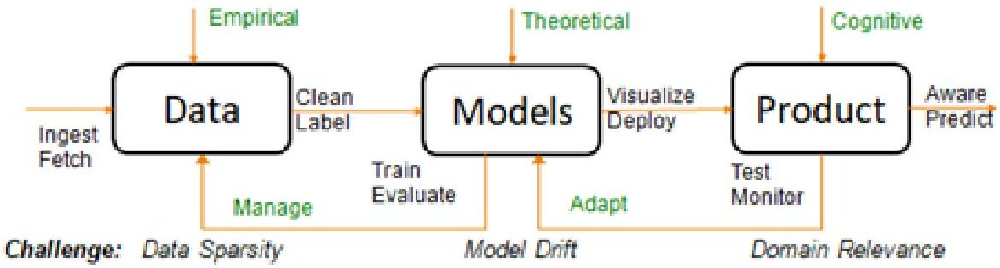
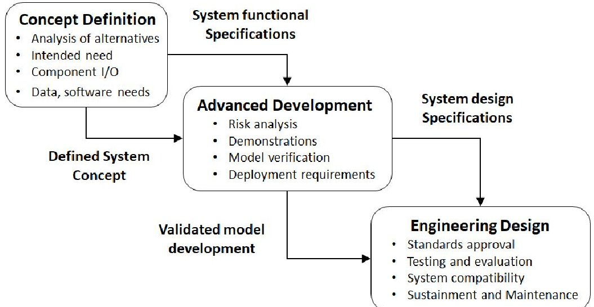
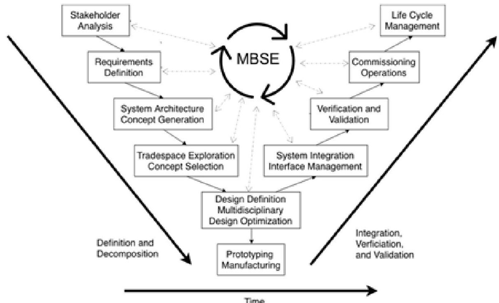
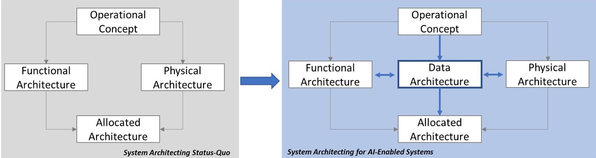
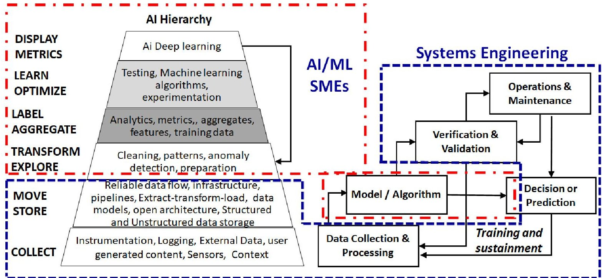

<!-- PDF_PAGE: 1 -->

# An Overview of Systems Engineering Challenges for AI-Enabled Aerospace Systems

Ali K. Raz $ ^{1} $ George Mason University, Fairfax, VA, 22030, USA

Cesare Guariniello $ ^{2} $ Purdue University, West Lafayette, IN, 47907, USA

Erik Blasch $ ^{3} $ Air Force Office of Scientific Research, Arlington, VA, 22203, USA

Zohaib Mian $ ^{4} $ Loon LLC (Alphabet), Mountain View, CA, 94043, USA

Abstract: Future operational concepts of aerospace missions in both civil and defense domains increasingly demand integration and interoperability of multiple intelligent systems driven by artificial intelligence (AI) technologies such as machine learning and deep learning. AI technologies have become an integral element of the aerospace systems that needs to be coupled with systems engineering practices starting from system concept definition and extending throughout the system life cycle. Although systems engineering has been at the forefront of aerospace system development in the past, the unique challenges of machine learning and deep learning require evolution of systems engineering methodologies for future AI-enabled aerospace systems. The paper proposes the need for systems engineering for acquisition and operationalization of AI and postulates the role of SE as data curator for AI. Additionally, challenges are examined for major SE activities such as Concept and Architecture Development, Model-based Systems Engineering, and Verification and Validation of AI-enabled aerospace systems.

## I. Introduction

Future operational concepts of aerospace missions in both civil and defense domains increasingly demand integration and interoperability of multiple intelligent systems with minimal human intervention. A number of initiatives are attempting to develop frameworks to develop Concept of Operations (CONOPS) for enabling operations involving intelligent systems within a defined domain. For instance, Unmanned Aircraft System Traffic Management (UTM) [1] seeks to develop technology to enable autonomous or semi-autonomous operation of multiple aerial systems (e.g., passenger and cargo delivery) in a tightly integrated civil airspace. Similarly, NASA's Cislunar and Artemis initiatives for space exploration are focusing on the operation and survivability of autonomous systems in uncertain environments such as outer space [2]. In the defense domain, numerous use cases of intelligent Unmanned Aerial Systems (UAS) can aid in tactical situations and strategic planning. The underlying theme is the integration and collaborative operation of intelligent and autonomous aerospace systems in constraining environments. In these CONOPS, the desire to minimize human intervention has led to utilization of Artificial Intelligence (AI) enabled technologies to allow autonomous operation and intelligent decision making. The need to

<!-- PDF_PAGE: 2 -->

operate in a collaborative environment results in tight coupling of AI at the system conceptual design level and extends throughout the system life cycle.

Systems Engineering (SE) is a multi-disciplinary domain that aims to optimize integration of a wide spectrum of technologies towards the development of coherent and useful systems to fulfill mission requirements [3]. SE remains ubiquitous in aerospace domains and will be central in enabling design of systems capable of executing the next generation of air and space missions. However, the changing landscape of technology along with rapid growth of practical AI in pursuit of autonomous systems necessitates modernizing of SE methodologies, including verification and validation (V&V) approaches. The modernization is due to the fact that the incipient foundations of SE and its methods were not conceived to engineer systems equipped with the latest advancement in AI (i.e., machine learning (ML) and deep learning (DL)) federated diverse autonomous systems, or multi-domain operations. SE challenges are further confounded by the sheer number of architectures of aerospace systems varying from palm sized drones to tennis court size High Altitude and Long Endurance (HALE) platforms.

The objective of this paper is to methodologically categorize and define major challenges for aerospace systems that seek to incorporate any number of AI-driven technologies, particularly ML and DL. In this paper, first we briefly describe the characteristics of AI-driven technologies and establish the need for SE. Second, the paper proposes the role of SE as data curator for AI-enabled aerospace systems and examines three major categories of SE activities: i) Concept Definition and System Architecture (CDSA), ii) Model-Based Systems Engineering (MBSE), and iii) Verification and Validation (V&V). For each of these topics, the paper highlights the relevant challenges imposed by introduction of AI technologies, and develops a brief proposal consisting of feasibility evaluation and recommendation on adaptation of methods to address these challenges. This paper aims to provide foundational philosophy and motivation towards building more detailed SE frameworks for AI-enabled systems.

## II. Characteristics of AI-Driven Technologies and the Need for Systems Engineering

AI technologies provide an automated means of decision making based on sensed and inferred information in both pre-programmed logic or previously unobserved environments. The Defense Advanced Research Project Agency (DARPA) has classified three waves of AI as Describe, Categorize, and Explain [4]. Describe pertains to hand-crafted knowledge that is embedded for decision making under rule-based constructs in technological systems, such as expert systems [5]. Most modern aerospace systems are well equipped with the rule-based decision making (e.g., autopilot) and the systems engineering discipline remains at the forefront of their implementation. The second wave of AI (Categorize) builds on statistical learning as opposed to rule-based formulation and the decisions/outcomes are obtained from statistical models trained on big data sets. The methods and models provide prediction and classification abilities in well-defined domains with limited to no reasoning outside of the observed data. There is an increasing adoption of these methods in aerospace systems, such as predictive maintenance. Finally, the third wave of AI (Explain) enables decision-making with contextual reasoning abilities in real world environments where an AI system (or agent) learns the environment and reasons over the appropriate course of action [6]. This third wave of AI provides unprecedented opportunities for autonomous operations of future aerospace systems in UTM and space exploration, to name a few.

Advances in ML and Deep Learning (DL) are purported as the enablers of the second and third wave of AI which are classified in three categories: supervised, unsupervised, reinforcement learning [7]. Numerous research publications in the past few years have explored applications of ML/DL and supervised, unsupervised, and reinforcement learning in aerospace problems and systems. Although a comprehensive review of this literature is beyond the scope of this paper, the profusion of ML/DL research and aerospace systems application can be easily recognized by glancing over the technical program of many aerospace conferences in recent years. Despite the advances in ML/DL technologies and their exploration for aerospace applications, a fundamental challenge remains for real-world implementation and operationalizing of such technologies which will need to be addressed by SE. Similar to the case of the first wave of AI, where SE has predominantly taken a leading role in producing cost-effective, reliable, and safe aerospace systems, SE will need to be evolved and applied throughout the life-cycle of AI-enabled aerospace systems. In fact, the impediments of operationalizing AI due to lack of SE for second and third wave of AI (namely ML/DL) are widely being recognized. Higginbotham identifies that there is a lack of process models for AI development [8] and a recent study by MIT and Boston Consulting Group attributes lack of system-wide integration a major obstacle for realizing full operational potential of AI-related technologies [9].

<!-- PDF_PAGE: 3 -->

Moreover, the need for early inclusion of SE for developing operational AI technologies is recognized by the AI community as evident by the recent joint sessions between Association of Advancement of AI (AI) and the International Council of Systems Engineering (INCOSE) [10].

## A. Systems Engineering of AI-Enabled Aerospace Systems

Developing and implementing AI to fulfill needs of future aerospace operational concepts requires SE viewpoint from early stages of development as AI is not expected to replace an aerospace system in its entirety but only become one of its functional elements. As an example of an AI development pipeline [11] (Figure 1), the incoming empirical data is used to train and develop an AI model. The data-based model should be coordinated with the theoretical knowledge (e.g., physics) to discern the contextual results. Finally, if a use is monitoring the approach, the model development must relate to the mission and stakeholders needs. The approach to coordinate such models towards a product should leverage best practices in system-level modeling languages and integration approaches, so as to continually understand the model instantiations [12]. The prevalence of such system-level models is imperative when the AI-model is a subset of the entire aerospace system (e.g., fully autonomous guidance and navigation of an aerospace system) as opposed to the system itself (e.g, ground based surveillance cameras). Here in the AI development pipeline, the theoretical foundation of AI model building and execution pertains to the AI subject matter expertise (SME); the data analysis and management and AI model's product implication including meeting mission needs remain with the SE discipline, nevertheless.

Fig.1 AI Development Pipeline [11]

The design, development, implementation, verification, and validation of an AI-model is akin to the engineering design of an element that is conceived to be integrated with the rest of the system. Figure 2 provides an illustration of a partial stages system development life-cycle model. AI, as an independent technology, is currently perceived to be in the "Advanced Development" stage (i.e., design of a component) and application of SE practices, tools, and methodologies are then needed in both "Concept Definition" and "Engineering Design" for integration and operationalization of AI.

Fig.2 Process Model for Engineering Design

<!-- PDF_PAGE: 4 -->

The following bullet points highlight some of the important characteristics (not all inclusive) of the AI-enabled aerospace systems that emphasize the need for a larger role of SE.

- Prerequisites for Design--AI and Data: Dynamic data remains at the core of any AI algorithm [13]. To facilitate an aerospace system of the future, it will be required to utilize all relevant available data, including models and policies [14]. From the business-sequestered data to that of the public, there are challenges associated with access and curation, labeling for supervised learning, collection of non-structured data for unsupervised learning, intended use for semi-supervised learning, and simulation development for reinforcement learning.

- Verification and Validation (V&V)--AI, Explainability and Certification: The importance of AI as a data analytics tool has benefits and limitations. For many data science approaches, statistical reasoning is well known, but the growing use of deep learning lacks explainability, interpretability, and sustainability [15]. Subsequently, AI algorithms are commonly viewed as a black-box functional operator which renders most certification methods ineffective. Therefore, the push for AI in aerospace systems has to be pragmatically considered for safe and secure operations and demands SE to develop approaches for verification, validation, and certification of these systems.

- Systems Operational Effectiveness--AI and Acquisition: A typical life-cycle of an aerospace system, particularly large scale and complex aerospace systems such as military and commercial aircraft, weapon systems, and space systems, extends well into multiple decades. Integration and incorporation of AI into functional elements of such systems will demand life-cycle consideration during acquisition of AI with expectations to provide continued systems operational effectiveness. For example, the affordable System Operational Effectiveness (SOE) model [16] proposes guidelines for acquisition of systems to provide cost-effective sustained capability over their life-cycle. These guidelines include design considerations such as openness, modularity, scalability, adaptability, among others. It is important to recognize any semantics differences in these terms when used in SE context as opposed to AI. Here, openness implies interoperability and interface with a range of different connectivity types and protocols; modularity means design in discrete functional modules to facilitate remove and replace; scalability stands for changes in size and performance without the need to redesign; adaptability refers to upgrades to incorporate new technologies, standards, and protocols. As AI finds its way into elements of aerospace systems and faces large scale acquisition, the questions regarding SOE will need to be addressed.

## B. Examples of Systems Engineering and AI Applications in Aerospace Systems

A unique challenge for the AI and SE community is how to integrate AI technology into known aerospace products and also in SE process models. Multi-layer frameworks for heterogeneous system-of-systems have been recently proposed for specific class of systems [17] From a SE standpoint, the AI becomes another element in the system, however, where the element resides in the system's functional hierarchy and physical decomposition will have ramifications for both AI and SE. However, AI can also be leveraged for SE process models and aid in SE activities such as tradespace exploration and systems performance evaluation [18,19]. Here we describe three examples that include the insertion of AI into the SE design process to include before, during, and after the product design. Examples of before the design of a product include the huge amount of data analytics that support the user and system requirements. The data analytics from past performance and historical analysis can be used to select and design the requirements as expectations of future systems by users. One example of AI success is in the predictive maintenance and automatic pilot performance of current aerospace systems. While these approaches are well known, future AI insertion into aerospace systems would enhance controls, logistics, and traffic flow [20].

The second area of AI support is during the design analysis through system integration testing. A key technique here is the digital twin [21]. The digital twin utilizes a digital model of the physical phenomena. With the digital representation, many modeling and simulation methods can be applied to assess the performance of a system in response to external, internal, and environmental disturbances. Examples of aerospace digital twins include turbine engines, structures and edge (e.g., cyber-physical) devices. The aerospace industry is embracing the digital twin technology with examples of physics-informed neural networks (PINN) and generative adversarial networks (GANs). A GAN uses a generative model (based on the digital twin) to augment data for unique situations such as

<!-- PDF_PAGE: 5 -->

an aircraft engine responding to a bird strike. The discriminative model checks whether the generative model data is real or fake such as a bird strike or cannon-ball strike, differing not in size, but the density of the object impacting the engine.

The last case is system and acceptance testing. When AI is inserted into aerospace systems, there could be the case of data analytics, controls, or communications where AI supports developments. Typically, the case is for assurance, compliance, and security. If AI is inserted into aerospace operations, then the minimum viable product of AI could be a reusable software technique, or a new capability. An easy example is when the AI methods replace a current technique such as fly-by-wire controls technology. If the flight software is upgraded with AI systems, then the performance, assurance, and compliance is needed. The performance relates to the accuracy and timeliness. The assurance relates to the cyber vulnerability mitigation and confidentiality, integrity, and availability of information. Finally, compliance is related to the new requirements such as data volume, connectivity to other systems, and response such as navigation, traffic flow, and trajectory planning.

## III. Systems Engineering Challenges for AI-Enabled Aerospace Systems

SE develops systems principles and concepts that guide realization of systems from their inception to retirement using scientific, mathematical, and management methods and tools [3]. The focus of SE always remains on the overall system and facilitates how and when the system transitions from one phase of the life cycle to another. Although SE has been successfully applied over the past decades to aerospace systems in particular and more generally to complex systems, these systems principles and concepts face new challenges when considering application of the second and third wave of AI as discussed in the previous section. Figure 3 provides an adapted illustration of a commonly used SE life-cycle process model, called the Vee-model [22], that is designed to guide the development, integration, verification, and validation of complex systems including aerospace systems. The left side of the Vee-model includes activities related to the definition of systems, its requirements, and architecture while the right side of the Vee-model emphasizes verification and validation with iteration and recursion being an inherent element of any SE activity. This adapted illustration shows Model-based Systems Engineering (MBSE) [23] at the center of Vee-models that connects the design and architecting artifacts with integration, test, and validation artifacts.

Fig. 3 Systems Engineering Vee-Model (adapted from [22])

<!-- PDF_PAGE: 6 -->

On the one hand, enabling AI in aerospace systems requires SE models, such as the Vee-model, to address the particular AI characteristics discussed in the previous section and make AI ready for operational systems as the SE models have done previously for other innovative technologies. Aerospace industries, National Aeronautics and Space Administration (NASA), Federal Aviation Administration (FAA), and the Department of Defense (DoD) have used SE process models and MBSE for successful realization of numerous complex aerospace systems. On the other hand, it will be naive to consider that the SE tools and methods in practice today can be readily applied to AI problems (for example a reader may note lack of attention to 'data' in the Vee-model). The current practice of SE will need to evolve for incorporation of AI-enabled elements. In the following paragraphs we attempt to highlight some of these challenges. Our objective here is to motivate thinking on the evolution of SE and the new role it will need to take when faced with the life-cycle design, development, and deployment of AI-enabled systems.

## A. Systems Engineering as Data Curator for AI:

It was mentioned in Section II that data remains at the core of AI development and AI in various domains has faced setbacks due to improper examination and analysis of training and validation data (e.g., evidence of discriminatory bias in AI produced outcomes [24]). The importance of data for AI aerospace systems cannot be over emphasized. Here we address some the challenges that SE will inevitably need to address to operationalize AI:

## Availability of data:

AI algorithms require dynamic data, sometimes in large amounts. Availability is often a challenge for different reason:

- Restricted access. Especially when stakeholders with commercial interests are involved, data may not be readily available, which in turn might cause AI algorithms to produce suboptimal results.

- Insufficient amount. While certain fields of aerospace are characterized by a large quantity and a wide variety of data accumulated over the years and often publicly available (e.g., air transportation), other fields are smaller and younger and therefore pose challenges related to availability of diverse information (e.g., large space missions).

## Type of data:

A second category of challenges related to AI and data is due to the fact that data for AI need some curation, for example labeling for supervised learning. The relative novelty of application of AI to aerospace design implies that most available data does not present a structure which is directly usable in AI algorithms. Therefore, the use of AI requires some amount of work upfront, before a whole literature of aerospace data for AI becomes widespread. Of course, this category of challenges is also heavily affected by restrictions on the availability of data.

## Role of SE:

The last category of challenges in this area is related to the current state-of-the-art in SE and AI, and its relation to aerospace design. As mentioned in the type of data, even available data in aerospace systems design is often not suitable to be used in AI without a phase of curation. This is a direct consequence of the current processes used in aerospace systems engineering and of the scarce use of AI in this field. These challenges imply that SE needs not only to be concerned with system requirements and concept definition, but also to become the data curator and manager for system development, operations, and test and evaluation, with AI added as a separate phase. A viable solution to this challenge will be an integrated approach, where data are generated and managed with potential AI applications in mind.

## B. Concept Definition and Architecture for Systems with AI

System definition begins with understanding the stakeholder needs and the mission operational concept to propose a high-level system architecture which brings together the system function and form [25]. Concept definition and system architecture development today focus on the functional and physical decomposition of a system (left side of the Vee-model) with limited to no regard to the role of data in the system architecture. The functional flow block diagrams (FFBDs) and data flow block diagrams (DFDB), which are typically used in SE process primarily focus on the input/output relationship between functions, while the AI requirement of SE as the data curators and manager is largely overlooked. Figure 4 highlights the evolution needed in the systems architecting processes to address the AI data needs. The challenge for SE is to introduce the concept of data architecture that will lay the foundations for

<!-- PDF_PAGE: 7 -->

training and validation of supervised, unsupervised, and reinforcement learning while ensuring these components are developed for end system integration.

Fig. 4 Systems Architecting for AI-Enabled System

## C. Model-Based Systems Engineering

Model-based Systems Engineering (MBSE) [23] is an emerging and popular diagram-driven approach to systems engineering. It incorporates a markup language to enable descriptive and standardized representations of a system and is actively being utilized for engineering aerospace systems. System Modeling Language (SysML) [26] is the commonly used standard for developing MBSE representations of a system that includes comprehensive SE artifacts such as use cases, state transitions, functional activities and sequence etc. However, a discussion on how MBSE will handle AI-enabled systems is largely missing in literature and is still a challenging aspect for the application of AI to aerospace systems engineering. The unique characteristics associated with ML/DL technology and their implications for rest of system design are not fully addressed in current MBSE practices. Recent research activities have included specific applications in aerospace to make use of AI with MBSE as a source of data for AI [27], but this is far from a generalized application of MBSE to AI. The challenge in this area is twofold:

- Data extraction: can a sufficient amount of information be extracted from existing MBSE diagrams and is this information suitable to be used in AI algorithms? The latter part of the question has already been mentioned as a general challenge in dynamic data and SE for aerospace earlier in this section. The first part of the question is specifically related to MBSE diagrams. The dynamic information necessary for AI algorithms might not be readily extracted from MBSE diagrams. Sometimes, even curation of data might not be enough, and the whole process of creation of MBSE diagrams might require taking into account the goal of extracting and using data for AI-enable design of aerospace systems. This may require the addition of new diagrams to existing aerospace systems representations or the enhancement of existing data with further information, specific to the AI algorithms of intended use. These considerations are strongly related to the second type of challenge in this area.

- Data representation: state-of-the-art MBSE is based not only on system models and representations (built with system modeling tools), but also a whole family of other tools, including environments to make the models executable and perform test, verification, optimization, and so on. All these tools require the definition of interfaces and of parameters for appropriate representation of the necessary data which may have different characteristics based on the type of ML/DL (i.e., supervised, unsupervised, and reinforcement learning). Similarly, the integration of AI techniques with MBSE poses the challenge of creating a literature of potential representation and interfaces that can be utilized to integrate MBSE and AI. This is similar to the work that is being carried out for the interface of system modeling tools with System-of-Systems tools and business/enterprise architectures [28]. Once again, addressing this challenge will require combined effort from the AI community and from the SE community.

## D. Verification, Validation, and Certification of AI-enabled Aerospace Systems

Verification and Validation (V&V) is one of the fundamental components of both SE and crucial for deployment of any given system. V&V defines the mandatory framework for testing and certification. Verification ensures that systems are designed to requirements, while validation assesses that the system achieves its intended goals. The standard V&V methodologies in aerospace operate on the premise that one can, at least theoretically, evaluate and

<!-- PDF_PAGE: 8 -->

test most, if not all, possible behaviors of a given system . Traditionally, aerospace software explicitly contained all system behaviors in source code. As such, code reviews, fault tree analysis, coverage testing dictated by various standards, such as DO-178, would be sufficient to conduct V&V. This would also enable certification due to sufficient understanding of all possible behaviors of a given system [29]. The challenge is that AI V&V has not been comprehensively addressed at the system-level [11]. Modern AI methods such Deep Neural Nets (DNN) have been shown to lack generalization during certain instances [30]. Given their black-box nature, it is not possible to predict or define the occurrences of generalization breakdowns for any given system. The common practice in AI algorithm development to separate the data into training and validation sets does resolve the aforementioned problem, as generalization is not guaranteed. A standardized system-level validation of AI based on its integration with other components remains largely missing in literature. This lack of methodical V&V of system-level AI is particularly challenging for aerospace systems that are typically subject to strict certification requirements such as DO-178.

Consider for instance the generic AI model building steps shown earlier in the AI development pipeline Figure 1. From the AI model construction standpoint, the end goal is to utilize the model to decide or predict. However, from a system V&V standpoint, the decision or prediction has to be carefully examined for its impact on the system outcome including developing an understanding of how the decision/prediction would differ based on variations in steps downstream of model construction [31]. For example, if the AI is employed for situational analysis, the V&V can establish a relative performance [32]. However, as the situation changes the decision/prediction might change especially in dynamic scenarios-but new data collection may be required for V&V [33]. Figure 5 provides a conceptual illustration of hierarchical activities needed for building an AI model along with the nested activities needed to operationalize AI in systems including V&V.

Fig. 5 SE and AI Activities for V&V (adapted from [11,34])

Numerous methods have been proposed and used with varying degrees of success for V&V [35]. These solutions largely fall in one of the following categories:

- Process and Test Case [36] Development Methods: class of methods that rely on defining test cases and guidelines for attaining training data.

- Probabilistic Methods [37] : class of methods based on statistical analyses such as Bayesian analysis.

- Formal Methods [38]: class of system design methods that use rigorous mathematical models through use of formal verification schemes to proof specifications. As opposed to test based methodologies, the goal is to establish a mathematical proof for the underlying theorem. In case of the former, tests can only demonstrate cases where a system won't fail.

<!-- PDF_PAGE: 9 -->

- Control Theory [39]: methods based on automatic and adaptive controls systems to verify learned behavior.

A comprehensive literature review of the aforementioned methods is beyond the scope of this paper. The intention here was to highlight the primary challenges, outline classes of possible V&V approaches, and provoke further thought through illustrating hierarchical buildings of an AI system. While the AI SMEs build the model/algorithms to produce decisions and predictions, the impending challenge for SE is to take a leading role for all other highlighted activities.

## IV. Summary and Path Forward

AI technologies fueled by the recent advances in ML based techniques, such DNN, can provide a number of advantages including new operational concepts and capabilities for future aerospace systems. Despite the rapid technological advancement, the application of AI in real world operational and physical systems remains onerous due to a massive paradigm shift and lack of SE approaches. The aforementioned paradigm shift has fundamentally changed development of system behavior from being pre-defined to primarily being data driven. On the one hand, the AI community needs to adopt and leverage proven SE process models for operationalizing AI in practical systems. On the other hand, the SE discipline needs to evolve its systems principles and concepts to address the unique challenges posed by the AI technologies. Although AI may be viewed as yet another technological element of an aerospace system, it's system-level integration poses new challenges for the SE discipline. Insertion of AI technology, with its unique demands for training and operational data along with verification, validation, and certification considerations require new and evolving roles for SE. In this paper, we have reviewed both the unique challenges faced by AI-enabled aerospace systems for operational considerations such as acquisition and certification, and the new role SE needs to take as data curators for AI along with evolution of MBSE to address AI needs.

Based on our research and review of the state-of-the art in AI and SE, we found that the most valuable path to address the challenges towards AI-enabled aerospace systems design will require synergistic research and development of AI and SE for aerospace systems applications. As new system concepts emerge and AI technology is sought for insertion into aerospace systems, it will be vital for SE to provide process models and frameworks for design, development, implementation, verification, validation, and certification of these new systems. However, as pointed out in this paper, much future work and research is needed to address the challenges posed by AI technologies.

## References:

[1] Unmanned Aircraft System Traffic Management (UTM).

https://www.faa.gov/uas/research_development/traffic_management/. Accessed Jun. 20, 2020.

[2] NASA: Artemis. NASA. https://www.nasa.gov/specials/artemis/index.html. Accessed Jun. 20, 2020.

[3] INCOSE. INCOSE Systems Engineering Handbook: A Guide for System Life Cycle Processes and Activities. Wiley, Hoboken, New Jersey, 2015.

[4] Launchbury, J. A DARPA Prespective on Artificial Intelligence. .

[5] Jackson, P. Introduction to Expert Systems. Addison-Wesley Longman Publishing Co., Inc., USA, 1998.

[6] Snidaro, L., Herrero, J. G., Llinas, J., and Blasch, E. "Recent Trends in Context Exploitation for Information Fusion and AI." AI Magazine, Vol. 40, No. 3, 2019, pp. 14-27. https://doi.org/10.1609/aimag.v40i3.2864.

[7] Majumder, U. K., Blasch, E. P., and Garren, D. A. Deep Learning for Radar and Communications Automatic Target Recognition. Artech House, 2020.

[8] Higginbotham, S. Hey, Data Scientists: Show Your Machine-Learning Work. IEEE Spectrum.

[9] Ransbotham, S., Khodabandeh, S., Kiron, D., Candelon, F., Chu, M., and LaFountain, B. Expanding AI's Impact With Organizational Learning. MIT Sloan Management Review and Boston Consulting Group, 2020.

[10] AAAI 2021 Spring Symposia. https://aaai.org/Symposia/Spring/sss21symposia.php. Accessed Dec. 8, 2020.

[11] Blasch, E., and Pokines, B. Analytical Science for Autonomy Evaluation. 2019.

[12] Blasch, E., Ravela, S., and Aved, A., Eds. Handbook of Dynamic Data Driven Applications Systems. Springer International Publishing, 2018.

[13] Washington, R., and Hayes-Roth, B. Input Data Management in Real-Time AI Systems. 1989.

[14] Blasch, E., Bosse, E., and Lambert, D. High-Level Information Fusion Management and System Design.

<!-- PDF_PAGE: 10 -->

Artech House, 2012.

[15] Gunning, D. "Explainable Artificial Intelligence (Xai): Technical Report Defense Advanced Research Projects Agency Darpa-Baa-16-53." DARPA, Arlington, USA, 2016.

[16] Verma, D., and Gallois, B. System Design and Operational Effectiveness (SDOE): Interface Between System Developers and Users. Presented at the International Conference on Engineering Design, Glasgow, U.K., 2001.

[17] Peters, J. R., Jahangir, E., Surana, A., and Mian, Z. Multi-Layer Framework for Synthesis and Evaluation of Heterogeneous System-of-Systems Composed of Manned and Unmanned Vehicles. Publication 2018-01-1964. SAE International, Warrendale, PA, 2018.

[18] Raz, A. K., Wood, P., Mockus, L., DeLaurentis, D. A., and Llinas, J. Identifying Interactions for Information Fusion System Design Using Machine Learning Techniques. Presented at the 2018 21st International Conference on Information Fusion (FUSION), 2018.

[19] Raz, A. K., Wood, P. C., Mockus, L., and DeLaurentis, D. A. "System of Systems Uncertainty Quantification Using Machine Learning Techniques with Smart Grid Application." Systems Engineering, Vol. 23, No. 6, 2020, pp. 770-782. https://doi.org/10.1002/sys.21561.

[20] Raz, A. K., Blasch, E., Cruise, R., and Natarajan, S. Enabling Autonomy in Command and Control via Game-Theoretic Models and Machine Learning with a Systems Perspective. In AIAA Scitech 2019 Forum, American Institute of Aeronautics and Astronautics.

21] SEBoK. Digital Engineering. Systems Engineering Body of Knowledge.

[21] SLBOK. Digital Engineering. Systems Engineering Body of Knowledge. https://www.sebokwiki.org/w/index.php?title=Special:CiteThisPage&page=Digital_Engineering&id=59514. Accessed Dec. 8, 2020.

[22] de Weck, O. L. Vee-Model. MIT OCW.

https://ocw.mit.edu/courses/aeronautics-and-astronautics/16-842-fundamentals-of-systems-engineering-fall 2015/lecture-notes/MIT16 842F15 Ses1SE Ovr vw.pdf.

[23] Madni, A. M., and Sievers, M. "Model-Based Systems Engineering: Motivation, Current Status, and Research Opportunities." Systems Engineering, Vol. 21, No. 3, 2018, pp. 172-190. https://doi.org/10.1002/sys.21438.

[24] Fuchs, D. "The Dangers of Human-Like Bias in Machine-Learning Algorithms." Missouri S&T's Peer to Peer, Vol. 2, No. 1, 2018.

[25] Raz, A. K., Kenley, C. R., and DeLaurentis, D. A. "System Architecting and Design Space Characterization." Systems Engineering, Vol. 21, No. 3, 2018, pp. 227-242. https://doi.org/10.1002/sys.21439.

[26] Delligatti, L. SysML Distilled: A Brief Guide to the Systems Modeling Language. Addison-Wesley Professional, Upper Saddle River, NJ, 2013.

[27] Guariniello, C., Mockus, L., Raz, A. K., and DeLaurentis, D. A. Towards Intelligent Architecting of Aerospace System-of-Systems. Presented at the 2019 IEEE Aerospace Conference, 2019.

[28] Guariniello, C., Fang, Z., Davendralingam, N., Marais, K., and DeLaurentis, D. Tool Suite to Support Model Based Systems Engineering-Enabled System-of-Systems Analysis. Presented at the 2018 IEEE Aerospace Conference, 2018.

[29] NASA. Product Verification. In Systems Engineering Handbook.

[30] Spanfelner, B., Richter, D., Ebel, S., Wilhelm, U., and Patz, C. Challenges in Applying the ISO 26262 for Driver Assistance Systems. Presented at the Tagung Fahrerassistenz, Munich, Germany, 2012.

[31] Blasch, E. P., Majumder, U., Rovito, T., and Raz, A. K. Artificial Intelligence in Use by Multimodal Fusion Presented at the 2019 22th International Conference on Information Fusion (FUSION), 2019.

[32] Blasch, E., Sung, J., Nguyen, T., Daniel, C. P., and Mason, A. P. "Artificial Intelligence Strategies for National Security and Safety Standards." arXiv:1911.05727 [cs, eess], 2019.

[33] Jacklin, S., Schumann, J., Gupta, P., Richard, M., Guenther, K., and Soares, F. Development of Advanced Verification and Validation Procedures and Tools for the Certification of Learning Systems in Aerospace Applications. In Infotech@Aerospace, American Institute of Aeronautics and Astronautics.

[34] Department of Homeland Security. National Security Standards for Artificial Intelligence - Phase II. Department of Homeland Security, 2019.

[35] Broggi, A., Buzzoni, M., Debattisti, S., Grisleri, P., Laghi, M. C., Medici, P., and Versari, P. "Extensive Tests of Autonomous Driving Technologies." IEEE Transactions on Intelligent Transportation Systems, 2013. https://doi.org/10.1109/TITS.2013.2262331.

[36] Alexander, R., Hawkins, H., and Rae, A. "Situation Coverage-a Coverage Criterion for Testing Autonomous Robots." 2015.

<!-- PDF_PAGE: 11 -->

[37] Zou, X., Alexander, R., and McDermid, J. On the Validation of a UAV Collision Avoidance System Developed by Model-Based Optimization: Challenges and a Tentative Partial Solution. Presented at the 2016 46th Annual IEEE/IFIP International Conference on Dependable Systems and Networks Workshop (DSN-W), 2016.

[38] Bowen, J., and Stavridou, V. "Safety-Critical Systems, Formal Methods and Standards." Software Engineering Journal, Vol. 8, No. 4, 1993, pp. 189-209. https://doi.org/10.1049/sej.1993.0025.

[39] Mozaffari, A., Vajedi, M., and Azad, N. L. "A Robust Safety-Oriented Autonomous Cruise Control Scheme for Electric Vehicles Based on Model Predictive Control and Online Sequential Extreme Learning Machine with a Hyper-Level Fault Tolerance-Based Supervisor." Neurocomputing, Vol. 151, 2015, pp. 845-856. https://doi.org/10.1016/j.neucom.2014.10.011.