<!-- PDF_PAGE: 1 -->

# A Model-Based approach utilizing the Systems Engineering Life Cycle Method to characterize the development of a Low Earth Orbit Satellite

Hadi H. Malik $ ^{*} $ , Michael J. Topolski $ ^{\dagger} $ , and Justin Nguyen $ ^{\ddagger} $ Georgia Tech Research Institute, 2001 Dixie Avenue Smyrna, GA 30080 United States

The objective of this paper is to integrate the system engineering process, known as the system engineering life cycle (SELC)[1], with a model-based approach utilizing the systems modeling language (SysML). This integration is performed in holistic detail to advance the method as organizations transition from traditional system engineering tools to model-based systems engineering (MBSE). The paper focuses on a Low Earth Orbit (LEO) satellite to help the audience understand how each step in the process will form and flow concurrently. A black box approach has been taken, with sample-stage's external processes mapped for fidelity. This paper is domain specific; therefore, abstraction of steps to fit other system applications have been omitted. The objective of this paper is to highlight MBSE methods and show that they are merely system engineering methods in a different framework. This framework, like any other system engineering method, should be tailored to the needs and organizational processes of the stakeholders.

## I. Nomenclature

ADCS = Attitude Determination and Control Subsystem

BDD = Block Definition Diagram

CMD = Command

CONOPS = Concept of Operations

CSM = Cameo Systems Modeler

DoD = Department of Defense

DoD 5000.2 = Department of Defense Acquisition Management Model

FireSat = Fire Satellite

GHMAS = Global Heat Monitoring Alert Subsystem

IBD = Internal Block Diagram

IEC = International Electrotechnical Commission

INCOSE = International Council on Systems Engineering

ISO = International Organization for Standardization

LEO = Low Earth Orbit

MBSE = Model-Based Systems Engineering

RFP = Request for Proposal

SE = Systems Engineering

SELC = Systems Engineering Life Cycle

SMART = Simple Multi-attribute Rating Technique

SysML = Systems Modeling Language

TRL = Technology Readiness Level

UML = Unified Modeling Language

<!-- PDF_PAGE: 2 -->

## II. Introduction

Developing complex systems can be a tricky balancing act of standardization while maintaining a modular architecture. Many disciplines have altered ISO processes to tailor domain-specific applications and provide fidelity. In the process of tailoring standards, this has created various system engineering processes. Space systems are no different, and they need to adjust standards to underpin better technical procedures due to the critical nature of cost and time constraints unique to these missions. Although there are a number of different system engineering processes available for use, a new method, introduced in the Principles and Practice of Systems Engineering by Kossiakoff et al. [1], will be the central focus of this paper. The primary reason to utilize the Kossiakoff et al. [1] method is that it blends together three major sources from industry. Kossiakoff et al. [1],combines the DoD Acquisition Management Model (DoD 5000.2), the ISO/IEC 15288 processes, and the INCOSE systems engineering model.

Each of these industry sources has unique value to the space system engineering domain. For example, DoD 5000.2 is a key source for the development of government space systems. The DoD 5000.2 outlines procedures for the acquisition of urgent capacity, the middle level of acquisition, the acquisition of major capacity, the acquisition of software, defense business systems, and the acquisition of services [2]. In Office of the Under Secretary of Defense for Acquisition and Sustainment [3], the major capability acquisition model is broken down into its most recognizable form. Most programs fall under this model in the Department of Defense. Although in previous years the DoD major capability model was not widely used by the space systems community, with the advent of the United States Space Force in December 2019 the model has increased in popularity [4]. The largest critique of the DoD 5000.2 falls under the specificity of its approach. It assumes that the organization is reporting to a government agency, which creates issues in the commercial space system domain. The ISO/IEC 15288 is contrarily used in a wide variety of domains. The issue with ISO/IEC 15288 is the non-alignment of phases [5]. ISO/IEC 15288 is often leveraged across a variety of models, including the DoD 5000.2. The INCOSE SE model aligns the phases of ISO/IEC 15288 [6]. However, the model recommends that further consideration for domain-specific applications should be considered and a realignment may be necessary [6]. Kossiakoff et al. [1] provides a blend that utilizes the strength of each of these methods. However, all of these methods lack traceability in stages. It should be argued that this limitation is not found in these methods; rather, this is a limitation in traditional system engineering tools. Traditional system engineering tools often require complex configuration management and lack a single source of truth. Additionally, concurrence and iteration are conceptualized in these traditional methods, but without interwoven system architecture this can hardly be realized. This can lead to grave errors in mission-critical areas. In this paper, the objective will be to integrate the Kossiakoff et al. [1] method with a model-based approach that uses the fundamentals of the Systems Modeling Language (SysML) to bridge this gap.

## III. Sample Mission

To better define each stage of the SELC, a sample mission was derived. This section covers the sample mission in its entirety before introducing the SELC. A common industry sample mission used for spacecraft design and analysis is FireSat introduced in the 1990s [7]. This sample mission was further refined into FireSat II in 2011[8]. Since this sample mission is widely known and has been introduced to the astronautical community, this paper will use FireSat II as the sample mission with slight addenda.

The sample mission will consist of the deployment of six small coplanar satellites focused on global remote sensing. The mission objective is for real-time detection and alerting for vegetation at risk of fire. Satellites will need a payload that enables wide-area, high-resolution, multi-spectral surveillance of vegetation health using visible, near-infrared, and short-wave infrared bands. The mission will have a primary mission duration of 1-3 years and a secondary mission of at least one month. The sample mission will utilize the Minotaur IV built by Northrop Grumman [9]. To better illustrate the sample mission, a CONOPS has been created in Figure 1. It can be assumed that the organization issuing the RFP is the United States Government and that the CONOPS was issued alongside the RFP.

## IV. System's Engineering Life Cycle Method

A high-level overview of the SELC is required to introduce its core principles before application. The SELC is composed of three stages with eight cyclical phases embedded within those stages. The three stages are the Concept Development Stage, the Engineering Development Stage, and the Post-Development Stage. Inside of the Concept Development Stage there exist three phases: Needs Analysis, Concept Exploration, and Concept Definition. Likewise, Engineering Development also includes three phases: Advanced Development, Engineering Design, and Integration and Evaluation. Lastly, the Post-Development Stage includes only two phases: Production, and Operations and Support.

<!-- PDF_PAGE: 3 -->

These stages and phases are illustrated in Figure 2. These phases flow into the next, and the stages act as major milestones before moving on. This does not mean that the phases do not act concurrently; however, it is merely represented in this manner as a means of simplifying the conceptual aspects. As with many systems engineering processes, there is iteration and concurrency moving through the process.

## V. Traditional Concept Development

The first major stage in the SELC is Concept Development. In a traditional systems engineering ecosystem, this would start with a Needs Analysis phase, as seen in Figure 3. The inputs to this phase would come in the form of operational deficiencies and technological opportunities. These inputs would form the government RFP or an initial capabilities document. In the case of the sample mission, it can be assumed that these operational deficiencies and technological opportunities were delivered in the form of an RFP. From this RFP, the organization responsible for answering the proposal would internally conduct system studies, technology assessments, and operational analyses to see if answering the RFP is viable. The data from these activities would be captured in the form of documents or presentations. This data would be used to answer the RFP and feed into the next stage. With these outputs, system operational effectiveness and system capabilities, concept exploration would begin. In this stage, activities such as requirement analysis, concept synthesis, and feasibility experiments would be performed. These activities would form a system performance specification and candidate system concepts that would aid in refining design. In the traditional systems engineering ecosystem, these outputs would be in document and presentation form. This is the first area where traceability would be lost. Traceability is foundational in space systems engineering due to the nature of the complexity of maturing design. The system capabilities that were captured at the end of Needs Analysis would drive Concept Exploration, but due to the nature of the deliverables, it is likely that the system performance specifications would not capture this traceability. Worse yet, the system capabilities would not be allocated to the candidate system concepts. Even if this traceability was captured, it would be loosely enforced and hard to trace through documents and artifacts. Finally, in Concept Definition, an analysis of alternatives is performed allowing for a functional architecture to be created. This would lead to a structural architecture. From this stage, the defined system concepts and system functional specifications would be drafted. Throughout this process, there is a real possibility of lost traceability across all these different artifacts.

## VI. Model-Based Concept Development

To describe a model-based conceptual development, it is best to consider the necessary improvements one would provide. This section outlines the framework before detailing its implementation. The first major improvement would start before Needs Analysis. It would consist of providing a digital environment in which operational deficiencies and technological opportunities could be stored and tracked. This environment could then be leveraged across different programs inside the organization, providing the framework for reusability. In Figure 4, these elements are leveraged in this digital environment which feeds a model-based needs analysis. These inputs in the CSM SysML implementation would come in the form of data from a project usage. After this start, at the black box level Needs Analysis would occur. In the previous traditional approach, as seen in Figure 3, the need analysis would conclude with the operational effectiveness of the system and the system capabilities documents. Instead, in the model-based approach, this would be replaced with traceable model elements contained in the SysML project. To clarify in the example of the FireSat II, this modeling work would take place inside of the FireSat II model. Using SysML relationships, this would create traceability back to operational deficiencies and technological opportunities. From here concept exploration would occur, with a similar framework of modeling in the FireSat II model and building out traceability to the previous phases. This reusable framework facilitates the approval of decision gates, ensuring meaningful progress in engineering development of the conceptualized system. It is suggested that this framework be used until the end of the concept development stage. A major criticism of a model-based approach is that stakeholders without SysML expertise cannot interact with the model elements. This argument does not lie with the model or the framework proposed, but rather with the barrier that a new system's engineering approach brings. However, when conceptualizing this framework, a unique opportunity is provided here. At the end of the decision gates, a document is typically procured from the stakeholder to solicit feedback. Furthermore, there has been clear discourse in the system engineering domain that documents are an essential part of model-based systems engineering [10]. Although initially this may seem counterintuitive, in this case the document is not a single source of truth. Rather, it serves a distinct purpose by portraying a snapshot, as documents should. The purpose of utilizing a model-based systems engineering approach is to create a repository that contains the

<!-- PDF_PAGE: 4 -->

single source of truth. Additionally, with automated document generation techniques now readily available for use with reusable scripting, the labor time spent is minimized [11]. To address this concern, this framework suggests that at the end of each decision gate the systems engineering practitioner considers automated document generation. In this example, assuming that the stakeholder that opened the RFP was not familiar with SysML, a document for the FireSat II could be generated at the end of the concept development stage.

## A. Needs Analysis

To begin the need analysis, this section will apply the aforementioned framework to the FireSat II example. In a model-based approach, the deficiency elements should represent the system analysis done on previous missions. This analysis could be done using a wide variety of tools, but in previous traditionally systems engineering artifacts would be documented in presentation format. In SysML it would instead be summarized using a combination of the Block element, and the InstanceSpecification element. The Block element is defined in SysML as a "collection of features to describe a system" [12]. Whereas, an InstanceSpecification is an inherited element from UML that defines a Block at a particular time. By defining a Block for logging deficiency elements in SysML, instances can be utilized to log similar systems. In this case, the Block has been abstracted to the systems of the system level, and the instance represents a particular satellite system. In the case of the FireSat I, a system analysis on the different missions capable of fire sensing operations would be necessary. These lessons could be documented using this approach. For FireSat I, deficiencies such as scalability, redundancy, cost, and payload could be documented. These properties can be typed by UML primitives [13], such as Boolean seen in Figure 5. Using these types can conform data to ensure uniformity in data entry. From Wertz and Larson [14], FireSat I has documented issues of infrared sensor limitations, single-wavelength sensor limitations, high cost, lack of redundant design, and scalability issues. This data comes from an investigation of the design issues with FireSat I. Examples of other missions capable of fire detection operations such as Terra and Sentinel-3 have been included to show how this could be applied to a range of different LEO systems[15][16]. This approach allows for flexibility, as the properties defined in the system block can be modified or additional properties can be defined. The classifier, in this case the Block, should be modeled in a reusable library that is leveraged across different programs within an organization.

This differs slightly from the approach used for technological opportunities. In the model-based approach, there needs to be more flexibility to capture data that are not uniform to each technological driver. Due to this, instances should be avoided. Similarly, the use of a《Block》from a reusable library would be necessary, but a generalization relationship paired with another system block would be better in the FireSat II model. Specifically, in the case of the FireSat II consider two technologies, hyperspectral imaging and machine learning algorithms, as technological opportunities. Although there is a technological driver《Block》和 generalization relationship defined in Figure 6 hyperspectral imaging technology still needs to define the bandwidth. The bandwidth property is not applicable to machine learning algorithms, which reinforces this approach. Once again, primitive data types from UML can be used to restrict the values that type properties, such as the case for TRL. From these inputs, the Needs Analysis phase would be conducted.

Due to scope, this paper will detail the model-based framework, primarily using a black box approach within the phases. It can be assumed that the Needs Analysis phase would be conducted as detailed in Kossiakoff et al. [1], the only difference being the documentation in the model as opposed to other artifacts. At the end of Needs Analysis two outputs are required to clear the decision gate. These outputs in the traditional systems engineering approach are system operational effectiveness and system capabilities in the form of documents [1]. In a model-based approach, the operational effectiveness of the system can be replaced by a Trade Study Activity Diagram, as seen in Figure 4. The model-based artifact should be a Trade Study Activity Diagram, because system operational effectiveness should specify an estimate of what results a new system should achieve to meet an identified need. In the context of the FireSat II example, consider that the payload has an identified need of momentum control that provides slewing capabilities. Additionally, consider that an identified need not to exceed a magnetic dipole of greater than.5 $ A\mathrm{m}^{2} $ . In this context a system trade study for the type of attitude determination subsystem is necessary to determine the operational effectiveness. The first consideration for this type of trade study is the framework. The framework selected for this paper is a modified version of SMART that uses the analytical hierarchy process [17][18]. This method is outlined in Figure 7. Analysis can be done in other low-level engineering tools, but documentation is the model artifact that must be captured. To implement this method in SysML a «Block» must be created that defines the criteria as properties. Additionally, a «Block» for criteria weights must be created to define these values from the analysis. It is recommended that these «Block»'s be created in a reusable library for future use. Then a specific «Block» can be created with a generalization relationship to inherit and redefine the criteria as seen in Figure 8. In the example of the FireSat II, these criterion would

<!-- PDF_PAGE: 5 -->

be: mass, power, reaction time, control precision, torque capacity, orbit dependence, and reliability. The weighting of the criteria should be the result of a pairwise analysis. These values are then defined as part of the ADCS Criteria Weights《Block》. After this step,《Block》's to represent the alternatives evaluated should be created and inherit from the generic Trade Study Architecture block in a similar manner. The data collected from each alternative should then be stored in the lower level《Block》's. For FireSat II, this can be seen in Figure 9. Where, the data for each alternative are sourced from Sidi [19]. Using these data and data from the subsequent trade study stages, all of the model elements can be summarized from a single viewpoint. This final activity viewpoint is illustrated in Figure 10. As discussed previously, traceability is a key factor in a model-based approach. The trade study artifact representing the operational effectiveness of the system should also trace the identified need described in the deficiency elements. This can be done using the trace relationship from the objective statement of Step 1 to the deficiency element that specified that an analysis was needed.

The last output from Needs Analysis is a model-based version of the capabilities of the system. To represent a model-based version of the system capabilities, it is recommended to use a functional hierarchy diagram. The functional hierarchy diagram will be composed of the SysML《Activity》element. For FireSat II, consider the capabilities of the payload that specifically detects fires. In this context, modeling should show the composition of activities. An example of SysML of this is shown in Figure 11. Each of these activities can be broken down into further fidelity as the system engineering method continues. Traceability should be included in this artifact with allocation relationships back to the RFP data. Using these outputs, a model-based Needs Analysis can reach a conclusion with appropriate approvals.

## B. Concept Exploration

A model-based concept exploration begins with the output of the Needs Analysis phase. These outputs are used to explore the concept that drives the process forward. In this black box exploration, it can be assumed that the first version of requirements is issued from the customer. Once the activities inside concept exploration are complete, the first model-based artifact to exit is mission-level requirements. Requirements modeling in SysML is straightforward, and requirements can be modeled using the «extendedRequirement» stereotype. This requirement type is used because it has no constraints on satisfy relationship used in the model. For FireSat II, an example view can be seen in Figure 12. During the initial requirement analysis within concept exploration, risk and verification methods will be assigned. It is recommended that considerations about the ID field and possible comments or rationales are added depending on the mission needs. As the design matures, the requirements for the subsystems will be derived from these mission-level requirements.

The second output of concept exploration in a model-based approach is candidate system architectures in the form of functional internal block diagrams. There will likely be multiple functional architectures, and it is important to model these architectures at an abstracted level to not restrict design decisions. Before modeling the functional architecture, the domain of the system must be established. For FireSat II an example domain is provided in Figure 13. An example of a functional architecture that can then be created for FireSat II can be seen in Figure 14. In this example, the internal block diagram is internal with respect to the FireSat II domain, which contains all the relevant elements. This differs from a structural internal block diagram due to the abstract nature of the SysML types. When the system design matures, this candidate architecture can be typed instead by a specific on-board computer, for example. This would represent one of many different candidate functional architectures that all have a functional internal block diagram. These outputs would conclude the model-based concept exploration phase and would be used to feed the concept definition phase.

## C. Concept Definition

The concept definition phase begins with the selection of multiple system architectures and narrows down to a single architecture. In the model-based approach, this remains the same. Once decisions are made about potential system architectures that are no longer candidates, these architectures will be archived in the model. Once this process is completed, the focus will shift to the maturation of a single design. This process will conclude with a similar artifact to the previous stage, an internal block diagram. The difference being that this internal block diagram will be modeled as a structural internal block diagram. This structural internal block diagram would show to the port level of abstraction at the system level. This level of abstraction would include the cable types and connectors for physical connections. Due to the complexity, a model-based visual example will not be provided. However, for the FireSat II a small textual example will be provided. Consider the interface of the attitude determination and control subsystem with the propulsion subsystem. Assuming that a monopropellant architecture was selected from the previous trade study described in Needs Analysis, the interface would need a structural internal block diagram. The cold gas, monopropellant, attitude thrusters for the FireSat II would need a connection to the propellant tanks contained on-board the spacecraft. This connection could be

<!-- PDF_PAGE: 6 -->

modeled by a SysML «ProxyPort» which is typed by an «interfaceBlock». The «ProxyPort» in this case would contain the propellant as a signal flowing from the propulsion tanks to the attitude thrusters. Additionally, a carbon-reinforced tube legend item can be applied to the connector between the «ProxyPort»'s. At this stage in the design, high-level intermediary interfaces such as valves or pumps should be identified and modeled as well. At this point, traceability must be realized. In the context of the previous example, this would mean utilizing the trace relationship back to the previous trade study conducted to ensure valid justification for design rationale.

The last output from concept definition is a functional specification table. In the model-based approach, this would take the form of requirements once again. In this context, the SysML stereotype for the requirement would change. In the previous phase, «extendedRequirement» was used. This choice is based on the fact that at this point in the design no constraint should be applied to satisfying requirements. Since the design at this point has matured, the use of the «functionalRequirement» stereotype is better suited. The «functionalRequirement» stereotype must be satisfied by a behavior or operation element [12]. For the FireSat II example, consider the previous functional hierarchy outlined in Figure 11. Figure 15 shows the related requirements that are satisfied by the activities in 11. These functional requirements should be at the system level; in this example, the payload subsystem was used to show traceability. It is important to note that at this point in the design subsystems are evolving and requirements levied on them would change rapidly. However, this provides another example of building a comprehensive digital threat with interwoven traceability throughout the system architecture, providing the justification for the example shown. Using the combined model-based outputs of a functional specification table and structural internal block diagram concept definition would conclude feeding into engineering development.

## VII. Traditional Engineering Development

The second major stage in the SELC is the Engineering Development Stage. This stage is focused on implementing the conceptual system from the previous stage into a physical, functioning system. The first phase of this stage is the Advanced Development phase. This phase focuses on the uncertainties that a system will resolve using analysis, simulation, development, and prototyping. The input of this phase is the functional specifications of the system and the conceptually defined system. This phase is especially important for new systems that are not iterations of an existing system, as it identifies immature components and reassesses the validity of the system functional specifications. The output of this phase is a validated development model and system design specifications. Artifacts in this phase typically include digitized documentation or software for requirements management.

The next phase is the Engineering Design phase, in this phase all components are analyzed and designed to meet the operating requirements of the system. With the validated development model and system design specifications, this phase aims to produce an engineered prototype and a test and evaluation plan. In a traditional SE environment, the engineering prototype is documentation of the physical prototype of a specific component. For this mission, the engineered prototype data consist of satellite subsystems or components essential to the mission and tested as per the System Test Plan. This process is crucial for the system's success, but test and validation oversights are possible. This becomes especially true for large and complex systems, such as the example satellites in the sample mission described.

The Engineering Development stage ends with the Integration and Evaluation phase, where system components are assembled into a functioning whole to demonstrate operational requirements. The engineering design phase targets individual component development and testing, while integration and evaluation focus on the system's overall functionality. Although this process is somewhat intertwined, these two phases typically occur on an overlapping timeline. The conclusion of this integration and evaluation phase is the system production specifications and the production system.

## VIII. Model-Based Engineering Development

## A. Advanced Development

The first output of the Advanced Development phase is the system design specifications, which in the model-based approach are represented by subsystem level requirements. The resulting artifact from a model-based approach would be a requirement list packaged at the subsystem level. The use of requirement elements would be significant in every domain that is affected by requirements, as traceability, verification, and validation could easily be referenced for each requirement.

In SysML, the use of the «extendedRequirements» stereotype is once again utilized to model requirements. This

<!-- PDF_PAGE: 7 -->

allows a table to track and verify the requirements free of constraints. Using mission-level requirements, a set of requirements can be generated at the subsystem level. These subsystem requirements can be then tied back to the mission-level requirements with a «deriveReqt» relationship. This derive relationship would provide another layer of traceability.

For FireSat II, a set of requirements was generated for a subsystem. During the Advanced Development phase, these requirements are derived from the mission-level requirements seen in the Conceptual Development stage. This is reflected in the table shown in Figure 18. The requirements also give verification methods, which will be utilized in later phases of the engineering development stage.

The second output of this phase is the validated development model. In SysML, this can be represented using a parametric diagram. Parametric diagrams are a specialization of an internal block diagram and can present mathematical relationships or constraints. These constraints can then be applied to a «Block» element representing a system, which will define it with value properties. The parametric relationships can then be used to verify the requirements. An example parametric diagram can be seen in Figure 19. In this example, a simple mathematical representation of the Power Subsystem is presented. The constraint in the diagram, named PowerStoredEqn, determines how much power is stored by the power subsystem. This makes the basic assumption that the only stored power source is the power generated by the Power Subsystem for the FireSat II. The constraint then defines an equation in which the inputs are used. In this case, it is the sum of all the power drawn and generated. This will result in an output ptotal, which is then a value stored in the power subsystem under the name PowerStored. The result can then be compared with previously defined power requirements and the subsystems can be filled with values as an analysis is done to determine what is needed to meet a requirement.

## B. Engineering Design

While the two outputs of this phase for the traditional SE approach are an engineered prototype and a test and evaluation plan, their MBSE counterparts are a system instance table and test cases, respectively.

A prototype is a representation of an as-designed system and is necessary for the later phase of engineering development to ensure that all components and subsystems meet the specifications described in the requirements. From a model-based perspective, this would be represented as a «Block» which represents a component or subsystem. This can be seen in Figure 20, which provides an example of a subsystem component and instances representing a prototype system.

A test case can be developed for a requirement or a set of requirements in order to describe the implementation process of the verification method described in the requirement. For this, the SysML «testCase» stereotype can be used to describe such a process. The test cases are integral to the next phase of the engineering development phase and ensure that all requirements are met on a subsystem level. A relationship can then be applied between a specific test case and requirements which are verified in the described process, which adds a level of traceability not typically seen outside of a model-based system engineering context. Depending on the software used, the export of such data can provide equivalent documentation to the same degree as the traditional systems engineering typically observes. In this case, the test cases are generated in CSM and using the report generation wizard, a system test plan can be generated [11].

In the case of FireSat II, a set of test cases was created to verify some of the requirements of the previous sections. The test cases have a purpose statement that explains what they are verifying and which requirements are verified. Other important factors, such as test equipment, are also highlighted. These can be seen in Figure 21 in the table created in Cameo Systems Modeler.

## C. Integration and Evaluation

The outputs of the integration and evaluation phase were identified as a production system and the production specifications of the system. From a model-based perspective, it is proposed that an equivalent output of this phase would be a fully defined system. This would be a composition of all subsystems integrated into one larger system with each component having defined dimensions, performance, and functionality. In the model, a system can be defined using value properties and part properties. A value property can be applied to a block to dictate a certain performance parameter. In a fully integrated system, this would be tied to a requirement and validated using all available data in the model. However, for this example, the assumption is that all validation was done in the black-boxed portion of this phase, and thus does not have to be represented in the output artifact. Applying this to FireSat II, a general overview of the system is presented utilizing a Block Definition Diagram in Figure 22. Here, each subsystem is defined using an off-the-shelf component that meets desired specifications and/or is described with value properties specifying said

<!-- PDF_PAGE: 8 -->

characteristics. The second output of this phase is the system production specifications. The model-based equivalent artifact would be a list of performance requirements. As mentioned earlier, performance requirements are satisfied by the value properties of the production system (in this case, FireSat II). Figure 23 presents such a table of performance requirements related to the FireSat II system overview.

## IX. Traditional Post Development

The final stage of the SELC is the post-development stage in which the system transitions into operations and maintenance and disposal. The major artifacts the are produced when shifting from production into operations include operational and maintenance documentation as well as the actual produced system. This may be comprised of various paper or digitized documentation, which details the process or associated tools and data used to operate and maintain the system. In the case of a FireSat II, software documentation may constitute a large portion of this output due to the physically inaccessible nature of the deployed system.

The installed operational system are the actual satellite units developed that are expected to perform in the operational environment. Additional information which documents the key system parameters is present in supporting documentation. These measures are the actual data taken to ensure that the requirements of the final system are met. Within the traditional process, there should be efforts to ensure that all established requirements are met. The difficulty is in the lack of inherent traceability between the requirements database and the artifacts intended to verify them. The lack of connectivity introduces the risk that the produced artifacts constitute an incomplete set of data to meet the program needs. These risks can be reduced by implementing a model-based approach in which all of the lifecycle artifacts can be documented in a common environment and related to one another.

## X. Model-based Post Development

## A. Production and Deployment

Outputs from the SELC production and deployment phases in a model-based context are proposed as SysML behavioral elements and diagrams for operational and maintenance documentation and a set of populated instance specifications documenting the key parameters of interest for the operational system. These proposed outputs are illustrated in Figure 25. These artifacts consist of an operations and maintenance activity diagram and a system instance table exiting the Production and Deployment Stage. In addition, they outline a disposal activity diagram, appropriate system disposal metadata, and archiving the model in the Operation and Support Stage.

SysML behavioral diagrams can be used to prescribe and describe the intended behavior of the system, but can also be used to depict business processes and behaviors at an organizational level. Operational and maintenance documentation can be enhanced or replaced by modeling activities that depict actions, decision points, and data flows between processes and participants. Traceability and completeness are established by relating these activities back to the Use Cases defined for the system during the concept development stage. An example of the UseCase's for the FireSat II is illustrated in Figure 26. Completeness is the notion that all defined use cases have been refined and decomposed into specific behaviors allocated to system components. Use cases represent points of interaction between various stakeholders and the system of interest and should include both types of activities. A complete set of activities for the modeled Use Cases provides greater assurance that the documentation is complete as opposed to the standalone documentation in the traditional approach. This may also be an iterative process in which modeled activities may expose incomplete or missing Use Cases. These behavioral elements and diagrams should be developed strategically with various stakeholders in mind such that they may be generally understood by personnel not directly involved with the implementation and also by personnel that may perform the actions. Nesting of actions and decomposition into more technically complex behaviors allows this decomposition. A high-level view of an "Upload Commands" process is included to show how a decision tree could be produced in SysML in Figure 27. Specific actions may be documented in as much technical detail as possible to depict specific message flows, populated data fields, and required timing constraints. A sequence diagram has been developed to show an example series of message transfers for the "Send CMD Message" action in Figure 27.

The second output from the Production and Deployment phase is the installed operational system. In the model-based context, the delivered system is the same as in the traditional systems engineering context. The difference lies in the format of the associated data that is produced during this phase in order to verify that the various system and production requirements are met. As in previous examples of documenting specific data of a realized system or component, specific

<!-- PDF_PAGE: 9 -->

metrics and data of the to-be deployed system should be recorded as slot values owned by an instance specification representing the produced system. The defining «Block» that types the instance specification represents the As-Designed system while the instance represents the As-Built System. This automatically establishes the traceability between the design and the produced systems. Optionally, it may be beneficial for the program to develop semantic standards beyond what is described solely in the SysML specification. An example may be to use default values on the defining «Block» as a prescriptive statement about what a metric should be. This may be understood as a requirement in an alternate format from a traditional text-based requirement but the details of this shift are beyond the scope of this paper.

## B. Operation and Support

The outputs from the Operation and Support phase of the product lifecycle include a disposal plan, the act of disposing the system, and the disposed system. In the case of FireSat II, the disposed system is destroyed during the decommission process and does not require further interaction following re-entry into the atmosphere. In a model-based context, it is proposed that the actual disposal data be documented as a slot value on the instance specification which represents one of the six FireSat II units deployed. Each instance will have a slot value which is populated with the actual date that the specific satellite is disposed. While the specifics of what date is selected is left up to an implementing program, it is stressed that consistency be enforced to reduce ambiguity and confusion. This ambiguity and confusion would conflate as to what a specific date or time represents. Figure 28 shows the defined properties on the as-designed system Block element as well as the corresponding slot values which represent one of the actual LEO-3146 Satellite units.

The Disposal Plan in the model-based context most closely aligns with SysML behavioral modeling like the other operations and maintenance process documentation developed in the Post-Development phase. No major changes are proposed in this modeling effort from the former. Appropriate levels of decomposition to address the various stakeholders is recommended. A high-level decommission plan is presented below as a SysML Activity Diagram developed using Cameo Systems Modeler.

The activity shown in Figure 29 is a process definition which illustrates how a process can or should be performed. As with structural modeling, it is possible to instantiate a behavior in an instance to document an actual process being performed. Key metrics for the behavior may be defined as typed properties which are populated with real data as slot values when the behavior instance is defined. Interactions and sequence diagrams are able to depict a particular path through an activity diagram which can also be instantiated. This method has the benefit of allowing model users to "see" a series of actions without it being abstracted to only a set of intermediate or final values. An example of the translation from a decision-based activity to a single path sequence diagram is depicted in Figure 30. For brevity, the complete activity is not translated into an interaction but is shown in part to demonstrate how this may be accomplished.

## XI. Conclusion

Although developing complex systems can be a tedious task, modern technology offers opportunities to protect against risk. One of these technologies, SysML, allows for improvements upon traditional system engineering artifacts. SysML provides the opportunity for a complete SE database with traceability across artifacts. This traceability allows MBSE's to better plan and evaluate development throughout the system lifecycle, catching crucial errors before they become mistakes. As is often the case, new technology does not replace exiting methods, but creates opportunities for refinement. As more organizations transition from traditional systems engineering methods, it becomes important that these frameworks are adapted to model-based approaches. Model-Based approaches do not replace systems engineering; rather, they are a supplementary tool that facilitate complex system development. It is important to recognize that model-based system engineering frameworks are not universal solutions. Similarly to traditional system engineering frameworks, they are domain-specific and must be tailored to achieve holistic technical processes.

This paper outlined a comprehensive framework for a model-based approach applying an existing system engineering methodology. The existing method, SELC, is one of various system engineering methodologies. All of these methodologies have unique strengths and encourage the development of complex systems for a variety of domains. This paper aims to encourage other domains to tailor SE methodologies into frameworks to advance MBSE. In a world of complex engineering problems, complex technical processes are not always ideal. Rather complex engineering development takes years of careful planning and consists of countless simple solutions along the way. Embracing the philosophy of these straightforward solutions, the solution to mastering model-based systems engineering may very well lie in the refinement and optimization of existing SE methodologies.

<!-- PDF_PAGE: 10 -->

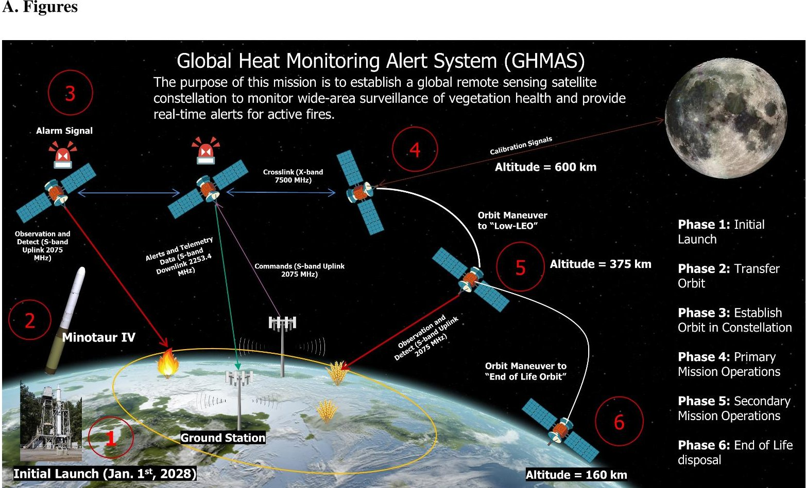

Fig.1 Mission CONOPS

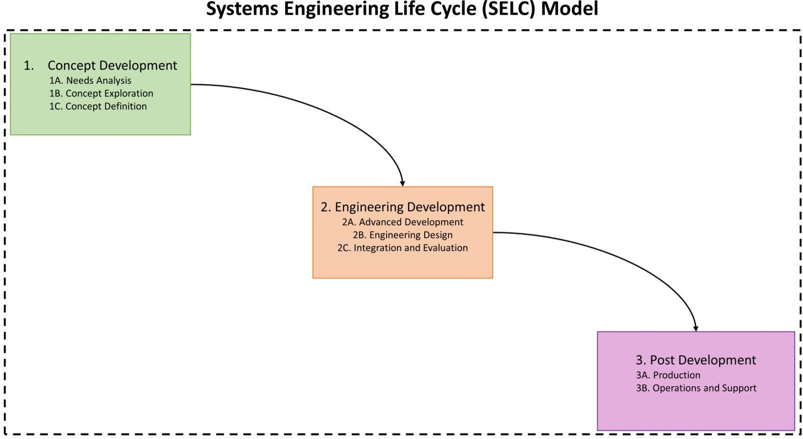

Fig. 2 System's Engineering Life Cycle Method: Image was created using data from Kossiakoff et al. [1]

<!-- PDF_PAGE: 11 -->

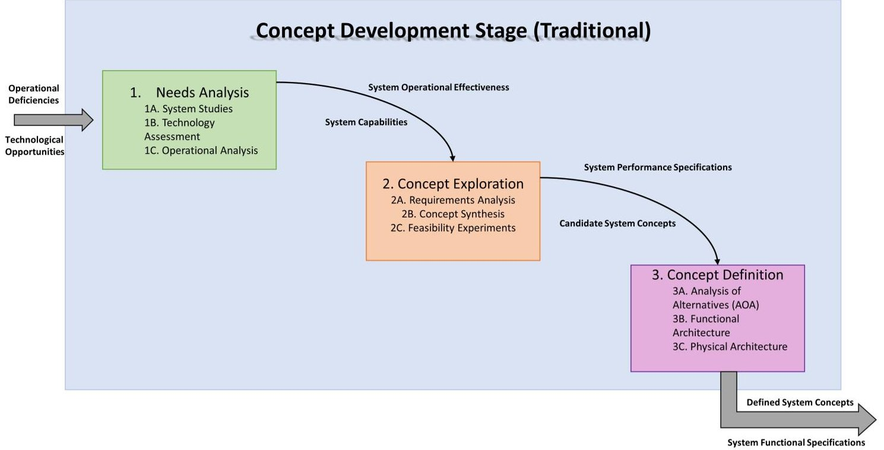

Fig. 3 Traditional Conceptual Development: Image was created using data from Kossiakoff et al. [1]

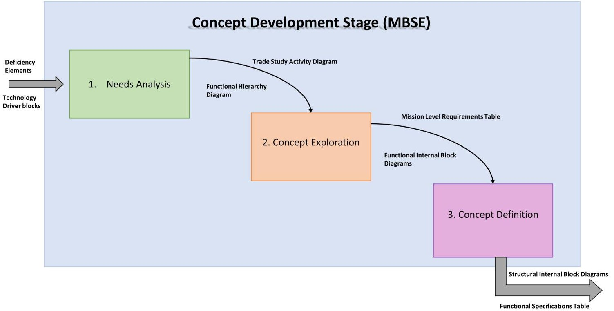

Fig. 4 MBSE Conceptual Development

<!-- PDF_PAGE: 12 -->

<table border="1"><tr><td>#</td><td>Name</td><td>Scalability:Boolean</td><td>Redundancy</td><td>Cost in Millions:Integer</td><td>Payload</td></tr><tr><td>1</td><td>FireSatI</td><td>false</td><td>Single point of failure design.</td><td>704</td><td>Infrared Sensor limitations,and single-wavelength sensor limitations.</td></tr><tr><td>2</td><td>Terra</td><td>false</td><td>Redundant Design</td><td>1300</td><td>Aging thermal bands.</td></tr><tr><td>3</td><td>Sentinel-3</td><td>true</td><td>Redundant design</td><td>576</td><td>Only operates during the day.</td></tr></table>

Fig. 5 Deficiency Table Example

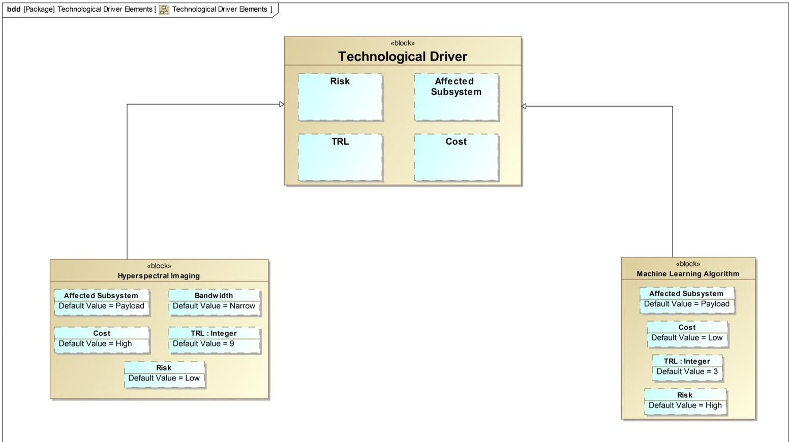

Fig. 6 Technological Driver Example

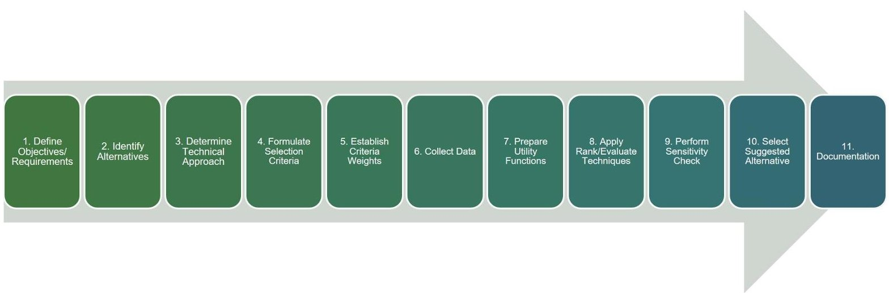

Fig.7 Trade Study Framework

<!-- PDF_PAGE: 13 -->

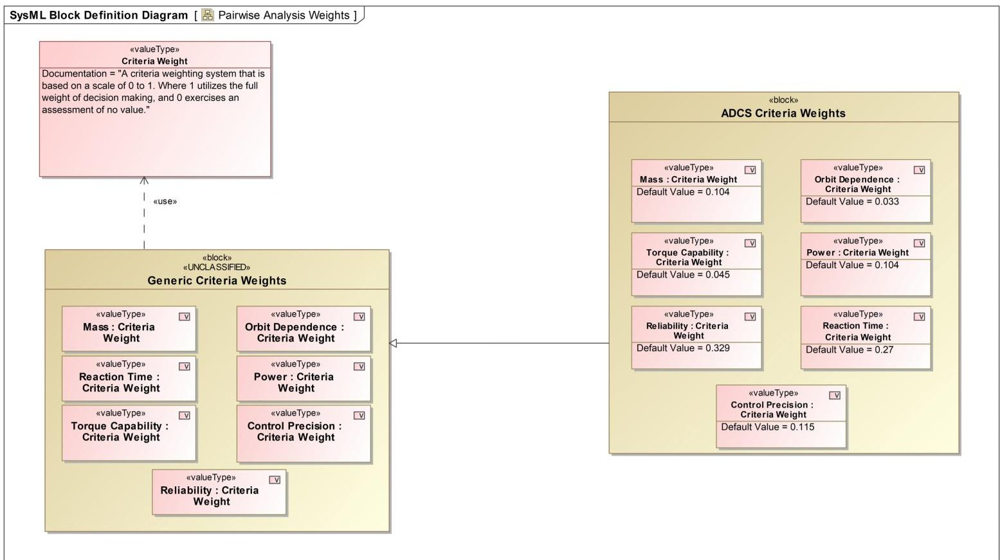

Fig.8 Criteria Weight

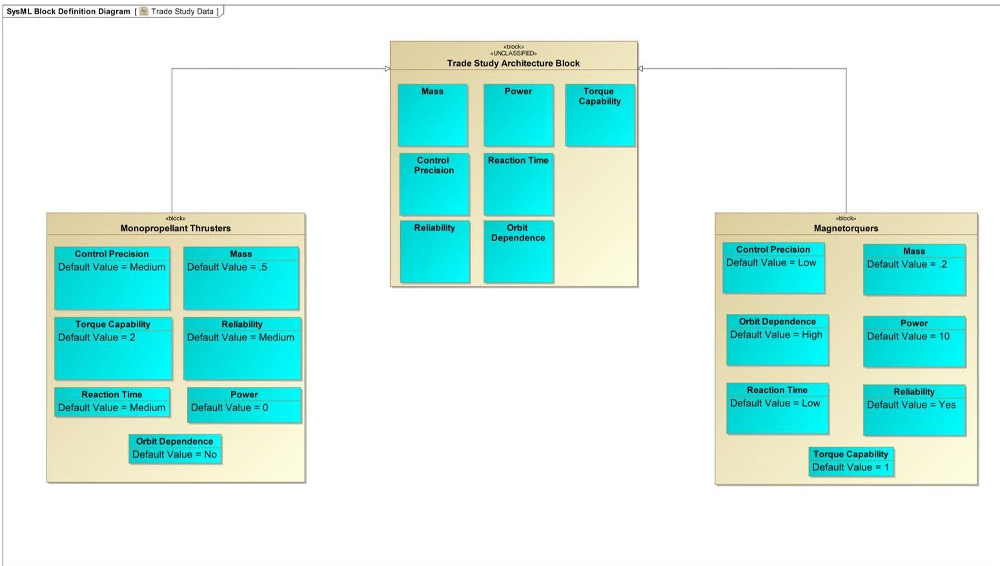

Fig.9 Trade Study Alternatives

<!-- PDF_PAGE: 14 -->

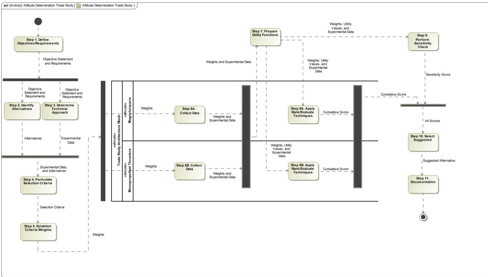

Fig.10 Trade Study Example

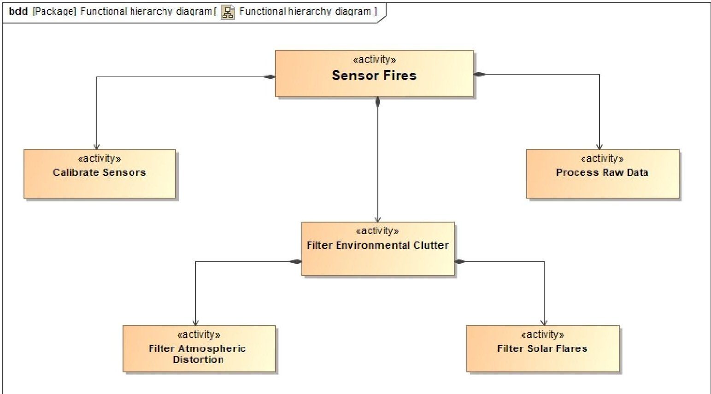

Fig. 11 Functional Hierarchy Example

<!-- PDF_PAGE: 15 -->

<table border="1"><tr><td>#</td><td>Applied Stereotype</td><td>Id</td><td>Text</td><td>Verify Method</td><td>Risk</td></tr><tr><td>1</td><td>extendedRequirement[Class]</td><td>Mission-01</td><td>The mission shall have a launch date of 1/1/2028.</td><td>Demonstration</td><td>Low</td></tr><tr><td>2</td><td>extendedRequirement[Class]</td><td>Mission-02</td><td>The mission shall have a primary duration of 1-3 years.</td><td>Analysis</td><td>Low</td></tr><tr><td>3</td><td>extendedRequirement[Class]</td><td>Mission-03</td><td>The mission shall have a secondary duration of at least 1 month.</td><td>Analysis</td><td>Medium</td></tr><tr><td>4</td><td>extendedRequirement[Class]</td><td>Mission-04</td><td>The mission shall provide twice-daily observations of all member countries of NATO.</td><td>Analysis</td><td>High</td></tr><tr><td>5</td><td>extendedRequirement[Class]</td><td>Mission-05</td><td>The mission shall have an orbit between 550km and 650km.</td><td>Analysis</td><td>Low</td></tr><tr><td>6</td><td>extendedRequirement[Class]</td><td>Mission-06</td><td>The mission shall incorporate Government Furnished Equipment(GFE) payloads.</td><td>Test</td><td>Low</td></tr><tr><td>7</td><td>extendedRequirement[Class]</td><td>Mission-07</td><td>The mission shall use the SSC&#x27;s Global Ground Station network to downlink at 2075MHz and uplink at 2253.4MHz.</td><td>Analysis</td><td>High</td></tr><tr><td>8</td><td>extendedRequirement[Class]</td><td>Mission-08</td><td>The mission shall perform nighttime observations to detect live fires and other IR phenomena.</td><td>Test</td><td>Low</td></tr><tr><td>9</td><td>extendedRequirement[Class]</td><td>Mission-09</td><td>The mission shall provide detection capabilities while over any land mass.</td><td>Analysis</td><td>Low</td></tr><tr><td>10</td><td>extendedRequirement[Class]</td><td>Mission-10</td><td>The mission shall provide the operational capability for bi-directional communication between spacecrafts that operate at 7500MHz.</td><td>Test</td><td>Low</td></tr><tr><td>11</td><td>extendedRequirement[Class]</td><td>Mission-11</td><td>The mission shall operate during both day and night.</td><td>Test</td><td>Medium</td></tr><tr><td>12</td><td>extendedRequirement[Class]</td><td>Mission-12</td><td>The mission shall have the Payload&#x27;s ground sample distance be 15 meters.</td><td>Analysis</td><td>Low</td></tr><tr><td>13</td><td>extendedRequirement[Class]</td><td>Mission-13</td><td>The mission shall provide automated alerting to necessitate the processing of raw imagery onboard.</td><td>Test</td><td>Low</td></tr><tr><td>14</td><td>extendedRequirement[Class]</td><td>Mission-14</td><td>The mission shall be capable of performing daily calibration to maintain data measurement consistence.</td><td>Analysis</td><td>Low</td></tr><tr><td>15</td><td>extendedRequirement[Class]</td><td>Mission-15</td><td>The mission shall conclude with a carefully managed, disposal process 5 years after launch.</td><td>Demonstration</td><td>Low</td></tr><tr><td>16</td><td>extendedRequirement[Class]</td><td>Mission-16</td><td>The mission shall utilize the Minotaur IV for its launch vehicle.</td><td>Analysis</td><td>Low</td></tr><tr><td>17</td><td>extendedRequirement[Class]</td><td>Mission-17</td><td>The mission shall incorporate an onboard alert &amp; relay system to provide real-time alerts for active fires, with a maximum latency time of 10 minutes.</td><td>Test</td><td>High</td></tr><tr><td>18</td><td>extendedRequirement[Class]</td><td>Mission-18</td><td>This mission shall have a storage size sufficient to capture data over a 24 hour period.</td><td>Test</td><td>Medium</td></tr></table>

Fig.12 Mission Level Requirements Example

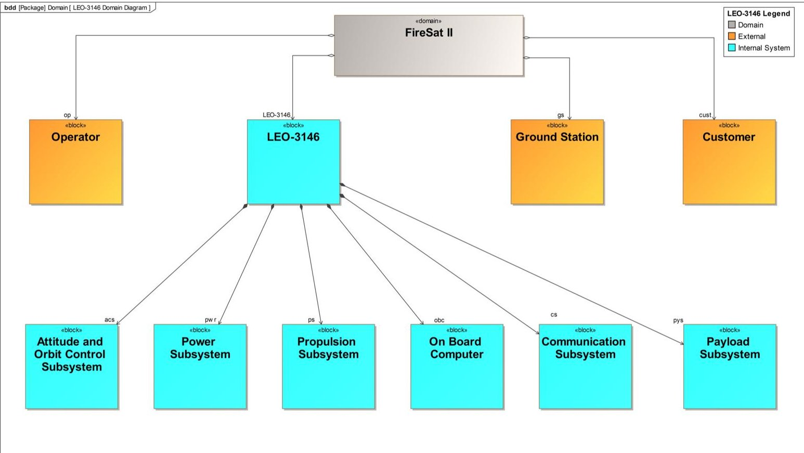

Fig. 13 FireSat II Domain Example

<!-- PDF_PAGE: 16 -->

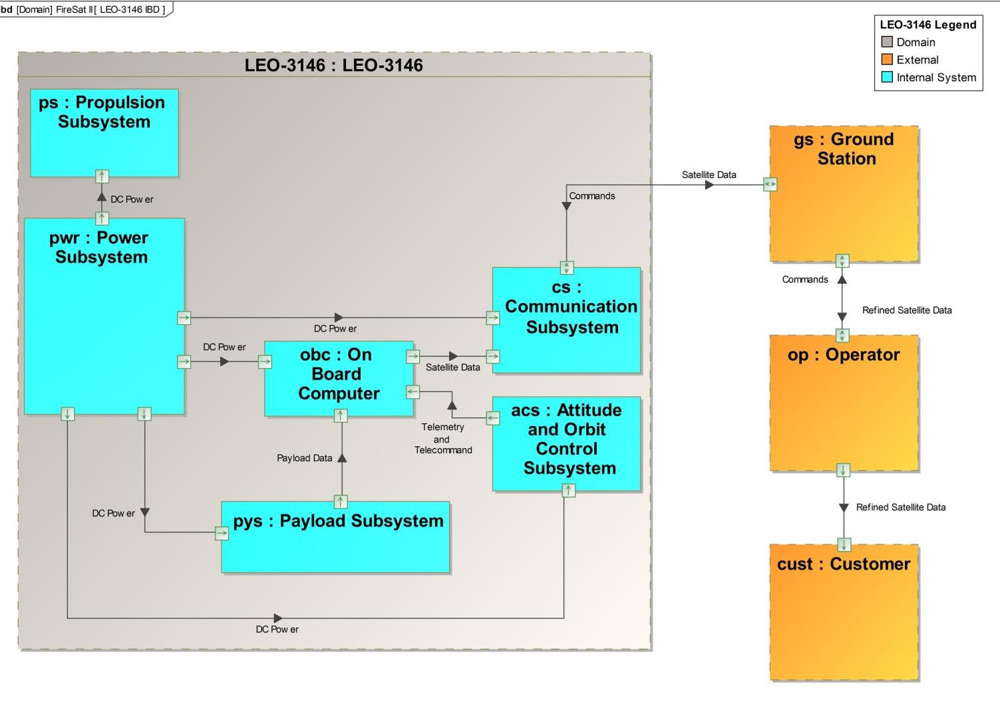

Fig.14 FireSat II Internal Block Diagram Example

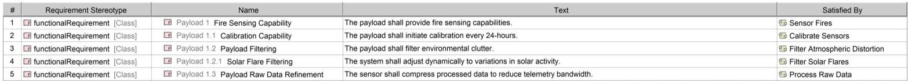

Fig.15 Functional Requirements Example

<!-- PDF_PAGE: 17 -->

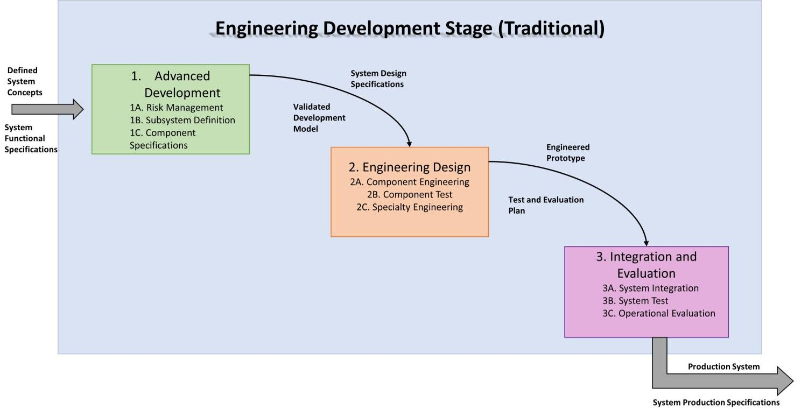

Fig. 16 Traditional Engineering Development: Image was created using data from Kossiakoff et al. [1]

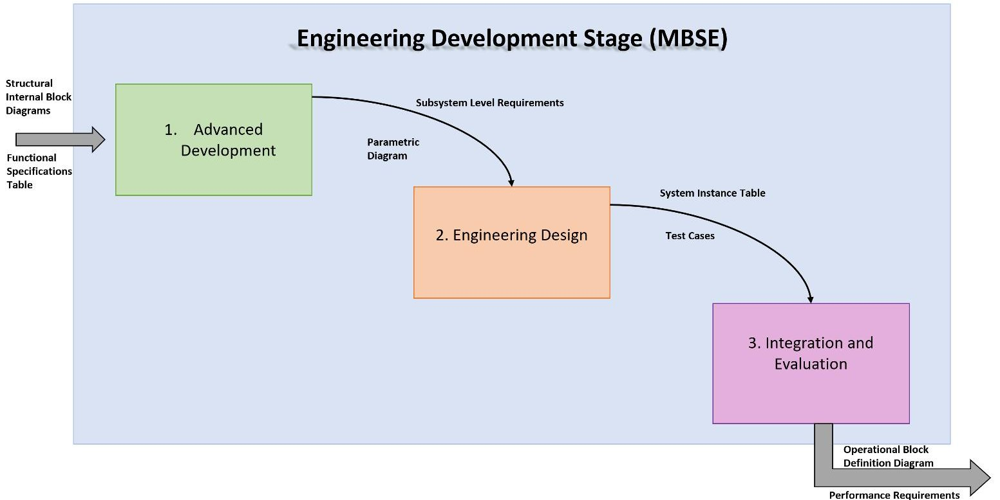

Fig. 17 MBSE Engineering Development Kossiakoff et al. [1]

<!-- PDF_PAGE: 18 -->

<table border="1"><tr><td>#</td><td>Applied Stereotype</td><td>Id</td><td>Text</td><td>Verify Method</td><td>Derived From</td></tr><tr><td>1</td><td>extendedRequirement[Class]</td><td>SUB-1</td><td>The propulsion subsystem shall have the ability to recircularize the spacecraft between 550km and 650km for no less than 1 year of operational time.</td><td>Test</td><td>Mission-02</td></tr><tr><td>2</td><td>extendedRequirement[Class]</td><td>SUB-2</td><td>The propulsion subsystem shall interface with the on board computer to ensure that the spacecraft is within correct orbital parameters for data measurement consistency on a daily basis</td><td>Inspection</td><td>Mission-14</td></tr><tr><td>3</td><td>extendedRequirement[Class]</td><td>SUB-3</td><td>The propulsion subsystem shall produce enough thrust to insert itself into orbit after staging from its launch vehicle.</td><td>Demonstration</td><td>Mission-16</td></tr><tr><td>4</td><td>extendedRequirement[Class]</td><td>SUB-4</td><td>The propulsion subsystem shall have at least 500m/s of delta V available for use at the end of the mission time.</td><td>Analysis</td><td>Mission-15</td></tr><tr><td>5</td><td>extendedRequirement[Class]</td><td>SUB-5</td><td>The propulsion subsystem shall have enough delta V to attain a circularized orbit between 550km and 650km at launch</td><td>Analysis</td><td>Mission-05</td></tr></table>

Fig.18 Advanced Development Phase Subsystem Requirements Table Example

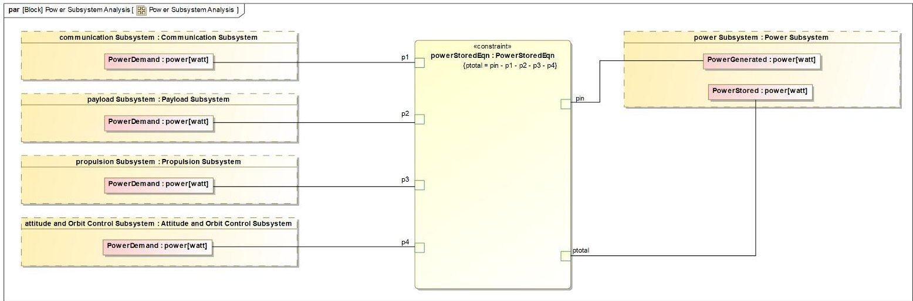

Fig.19 Advanced Development Phase Parametric Diagram for Power Subsystem

<table border="1"><tr><td>#</td><td>Name</td><td>Thrust:force[newton]</td><td>Mass:mass[kilogram]</td><td>DeltaV:velocity[metre per second]</td><td>Specific Impulse:time[second]</td><td>PowerRequirement:power[kilowatt]</td><td>Cost:String</td></tr><tr><td>1</td><td>COTS Bipropellant System</td><td>1300</td><td>350</td><td>4000</td><td>130</td><td>1</td><td>$1,000,000</td></tr><tr><td>2</td><td>COTS Monopropellant System</td><td>100</td><td>150</td><td>3600</td><td>250</td><td>0.5</td><td>$100,000</td></tr><tr><td>3</td><td>Custom Bipropellant System</td><td>1500</td><td>300</td><td>4500</td><td>190</td><td>0.9</td><td>1,250,000</td></tr><tr><td>4</td><td>Custom Monopropellant System 1</td><td>160</td><td>100</td><td>4000</td><td>350</td><td>0.4</td><td>$150,000</td></tr><tr><td>5</td><td>Custom Monopropellant System 2</td><td>140</td><td>125</td><td>3800</td><td>300</td><td>0.5</td><td>$125,000</td></tr></table>

Fig. 20 Engineering Design Phase Subsystem Instance Table for Propulsion Subsystem Prototypes

<table border="1"><tr><td>#</td><td>Name</td><td>Documentation</td><td>Verifies</td><td>Verification Method</td><td>Test Equipment</td></tr><tr><td>1</td><td>Attitude Control Test</td><td>The purpose of this test case is to verify that the attitude control system can perform the necessary maneuvers and calculations to adjust the spacecraft as needed.</td><td>ACS-33ACS-34ACS-35</td><td>Demonstration</td><td></td></tr><tr><td>2</td><td>Communications Test Case</td><td>The purpose of this test case is to verify that the communication system can perform its primary duties, including latency response, bandwidth size and successful communication with other entities.</td><td>COM-36</td><td>Test</td><td>RF Antenna</td></tr><tr><td>3</td><td>Power Management Test</td><td>The purpose of this test case is to verify that the spacecraft can properly distribute power as needed, and can allocate resources as necessary for mission success.</td><td>PWR-56</td><td>Inspection</td><td>Multimeter</td></tr><tr><td>4</td><td>Power Up Phase</td><td>The purpose of this test case is to verify that the spacecraft can successfully power up post launch. This test case will verify that the spacecraft also follows the correct start up sequence.</td><td>PWR-48PWR-96</td><td>Demonstration</td><td>Multimeter</td></tr><tr><td>5</td><td>Thrust Test</td><td>The purpose of this test case is to verify that the propulsion system can produce enough thrust as specified by subsystem requirements. The test case also verifies that the propulsion system can operate over the minimum operational time frame.</td><td>PRP-12PRP-11</td><td>Demonstration</td><td>StopwatchHigh-Speed Camera</td></tr></table>

Fig. 21 Engineering Design Phase Test Cases Summary Table for FireSat II

<!-- PDF_PAGE: 19 -->

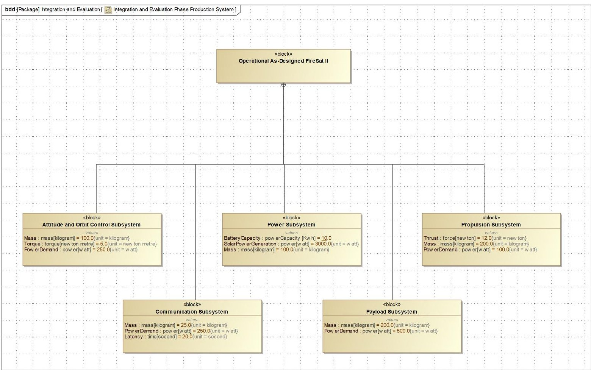

Fig. 22 Integration and Evaluation Phase Production System Block Definition Diagram

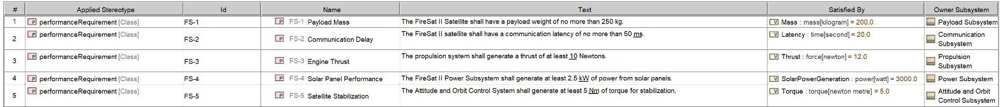

Fig. 23 Integration and Evaluation Phase Performance Requirements

<!-- PDF_PAGE: 20 -->

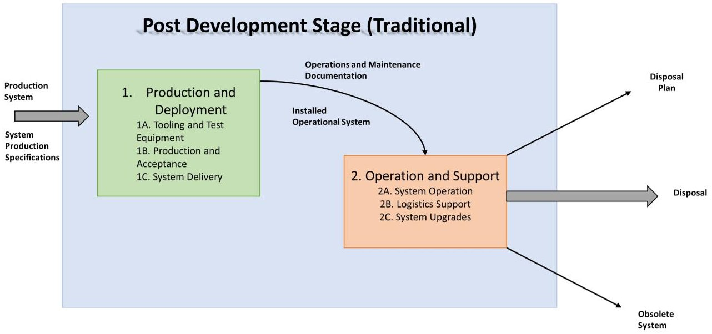

Fig. 24 Traditional Post Development: Image was created using data from Kossiakoff et al. [1]

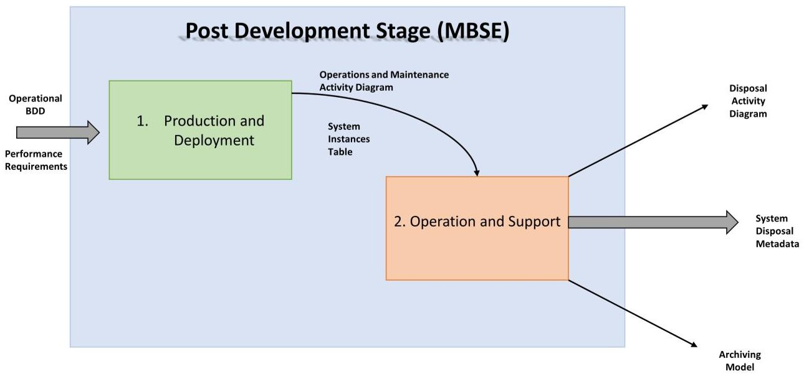

Fig.25 MBSE Post Development

<!-- PDF_PAGE: 21 -->

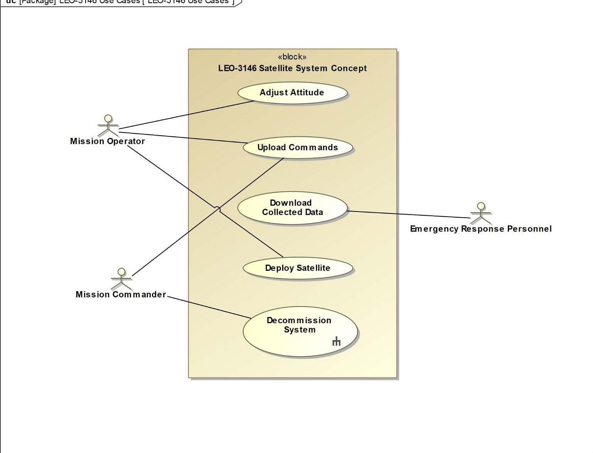

Fig.26 Use Case Example

<!-- PDF_PAGE: 22 -->

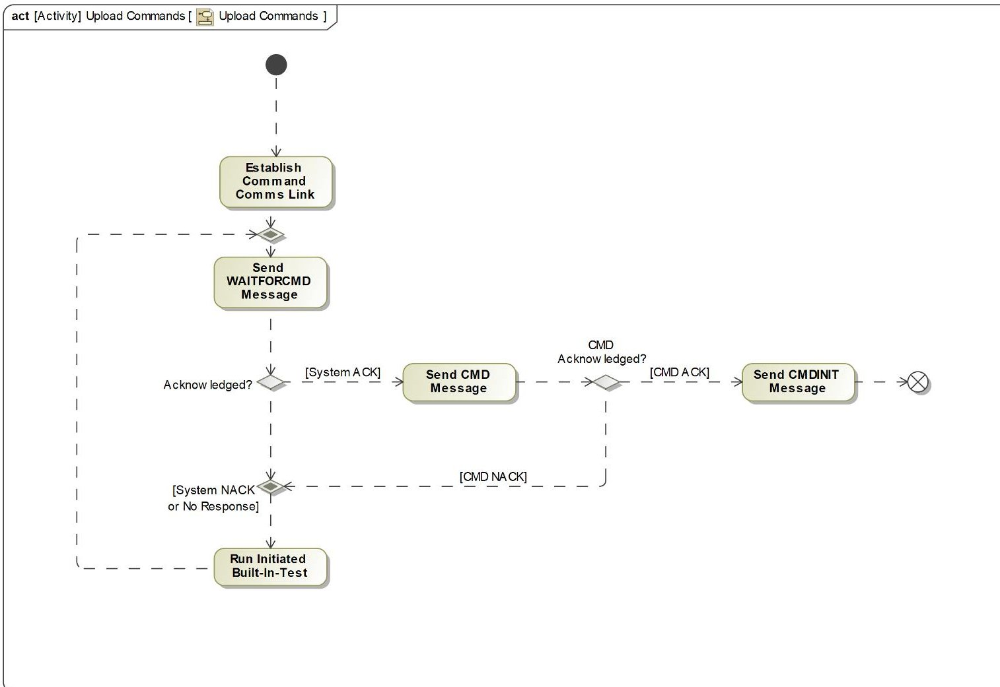

Fig.27 Upload CMD Example

<table border="1"><tr><td>#</td><td>Name</td><td>Documentation</td><td>Type</td><td>As-Built Value</td></tr><tr><td>1</td><td>As-Designed LEO-3146</td><td></td><td></td><td></td></tr><tr><td>2</td><td>uid</td><td>Unique identifier for a LEO-3146 Satellite.</td><td>String</td><td>uid=“LEOSAT3146-01”</td></tr><tr><td>3</td><td>cgPosition</td><td>X,Y,Z coordinate of the center of gravity in mm from the geometric center of the Satellite as defined in the CubeSat specification document</td><td>CG Position [mm]</td><td>cgPosition=As-Built LEO-3146.cgPosition</td></tr><tr><td>4</td><td>assembledMass</td><td>Total mass of the assembled LEO-3146 Satellite</td><td>mass[kilogram]</td><td>assembledMass=11.68</td></tr><tr><td>5</td><td>missionStartDate</td><td>Mission start date of the FireSat II component given as the launch date and time for target instance.</td><td>UTCDateTime[YYYYMMDDHHMMSS]</td><td>missionStartDate=2.0280101182615E13</td></tr><tr><td>6</td><td>missionEndDate</td><td>Mission end date of the FireSat II component given as the date and time for the halting of mission data collection of target instance.</td><td>UTCDateTime[YYYYMMDDHHMMSS]</td><td>missionEndDate=2.0310131061525E13</td></tr><tr><td>7</td><td>disposalDate</td><td>Disposal date and time of the FireSat II component given as the date and time on the final telemetry message received by the downlink station.</td><td>UTCDateTime[YYYYMMDDHHMMSS]</td><td>disposalDate=2.0310631061525E13</td></tr></table>

Fig. 28 As Designed to as Built Example

<!-- PDF_PAGE: 23 -->

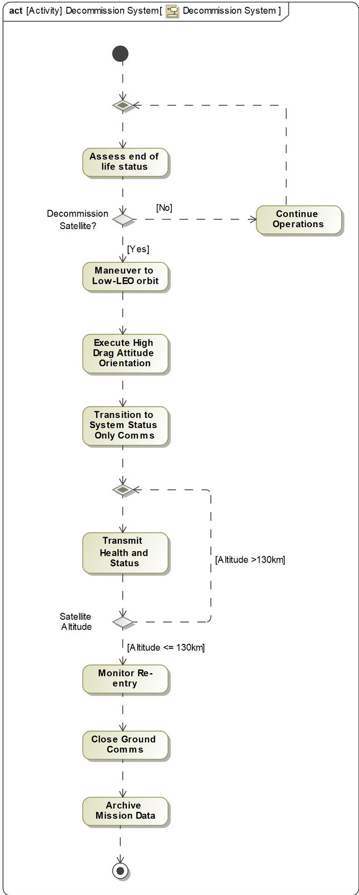

Fig. 29 Decommission System Example

<!-- PDF_PAGE: 24 -->

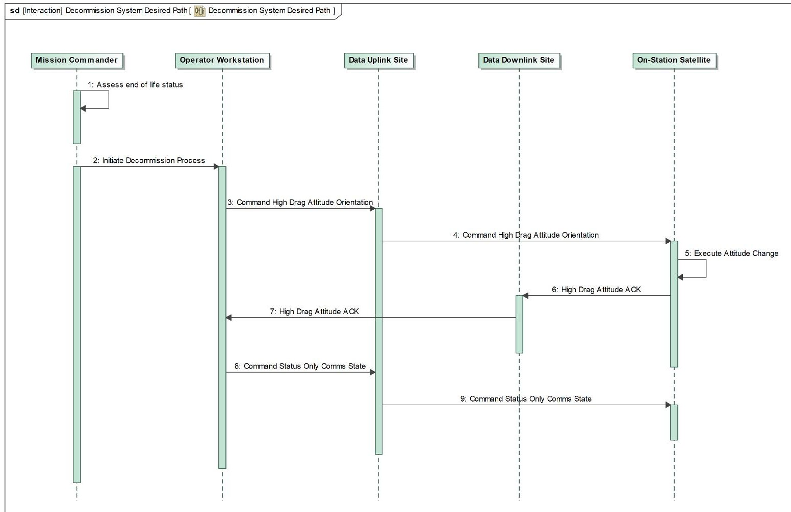

Fig. 30 Decommission System Sequence Example

<!-- PDF_PAGE: 25 -->

## References

[1] Kossiakoff, A., Seymour, S. J., Flanigan, D. A., and Biemer, S. M., Systems Engineering Principles and Practice, $ 3^{\mathrm{rd}} $ ed., Wiley, 2020.

[2] Office of the Under Secretary of Defense for Acquisition and Sustainment, "DOD INSTRUCTION 5000.02: Operation of the Adaptive Acquisition Framework," Department of Defense Directive, January 2020. URL https://www.esd.whs.mil/DD/ change 1 Effective: June 8, 2022. Approved by Ellen M. Lord and William A. LaPlante. Cleared for public release. Available at: https://www.esd.whs.mil/DD/.

[3] Office of the Under Secretary of Defense for Acquisition and Sustainment, "DOD INSTRUCTION 5000.85: Major Capability Acquisition," Department of Defense Directive, August 2020. URL https://www.esd.whs.mil/DD/, cleared for public release. Approved by Ellen M. Lord. Incorporates and cancels sections of DoDI 5000.02T. Available at: https://www.esd whs.mil/DD/.

[4] Jones, P. D., "United States Space Force: Some Origins of the Idea "Whose Time Has Come"," Air Force History and Museums Program, 2020.

[5] International Organization for Standardization, ISO/IEC/IEEE 15288:2023 Systems and software engineering — System life cycle processes, $ 2^{\mathrm{nd}} $ ed., 2023. Published 2023.

[6] International Council on Systems Engineering, INCOSE Systems Engineering Handbook, $ 5^{\mathrm{th}} $ ed., Wiley, Hoboken, NJ, 2024.

[7] Larson, W. J., and Wertz, J. R., "Space Mission Analysis and Design," 1992. URL https://www.osti.gov/biblio/7369177.

[8] Wertz, J. R., Everett, D. F., and Puschell, J. J., Space Mission Engineering: The New SMAD, Microcosm Press, 2011.

[9] Northrop Grumman, Minotaur IV User Guide, Release 2.4, sep 2020. Available from Northrop Grumman Innovation Systems.

[10] Logan, P., Harvey, D., and Spencer, D., "Documents are an essential part of model based systems engineering," INCOSE International Symposium, Vol. 22, 2012, pp. 1899-1913. https://doi.org/10.1002/j.2334-5837.2012.tb01445.x.

[11] Malik, H., Shen, D., and Topolski, M., "Model-Based Document Generation," Proceedings of the INCOSE Western States Regional Conference, Albuquerque, NM, 2024.

[12] Object Management Group (OMG), OMG Systems Modeling Language (OMG SysML), Version 1.3, 2012. Available online: https://www.omg.org/spec/SysML/1.3/.

[13] Object Management Group (OMG), Unified Modeling Language (UML) Specification, Version 2.0, 2005. Available online: https://www.omg.org/spec/UML/2.0.

[14] Wertz, J. R., and Larson, W. J., Space Mission Analysis and Design (SMAD), $ 3^{\mathrm{rd}} $ ed., Microcosm Press and Springer, El Segundo, CA and Dordrecht, Netherlands, 2005.

[15] European Space Agency, "Sentinel High-Level Operations Plan (HLOP)," Tech. Rep. COPE-S1OP-EOPG-PL-15-0020, Issue 3, Rev. 1, European Space Agency (ESA), 2021. Available online: https://sentinel.esa.int/documents.

[16] Cao, Z., "Chapter 9 - Assessment methods for air pollution exposure," Spatiotemporal Analysis of Air Pollution and Its Application in Public Health, edited by L. Li, X. Zhou, and W. Tong, Elsevier, 2020, pp. 197-206. https://doi.org/https://doi org/10.1016/B978-0-12-815822-7.00009-1, URL https://www.sciencedirect.com/science/article/pii/B9780128158227000091.

[17] Whitaker, R., "The Analytic Hierarchy Process - What It Is and How It Is Used," Mathematical Modelling, Vol. 9, 1987, pp. 161-176. https://doi.org/10.1016/0270-0255(87)90473-8.

[18] Goodwin, P., Wright, G., and Phillips, L., "Decision Analysis for Management Judgment (2nd Edn)," Journal of the Operational Research Society, Vol. 44, 1993. https://doi.org/10.2307/2584371.

[19] Sidi, M. J., Spacecraft Dynamics and Control: A Practical Engineering Approach, Cambridge University Press, 2006.