<!-- PDF_PAGE: 1 -->

Summer 2018

<div align="center">

# A Framework for Executable Systems Modeling

</div>

Matthew Amissah

Old Dominion University, kwesiamissah@gmail.com

Follow this and additional works at: https://digitalcommons.odu.edu/emse_etds

Part of the Industrial Engineering Commons, Systems Architecture Commons, and the Systems Engineering Commons

<!-- PDF_PAGE: 2 -->

<div align="center">

# A FRAMEWORK FOR EXECUTABLE SYSTEMS MODELING

</div>

by

Matthew Amissah B.Sc. June 2009, Kwame Nkrumah University of Science and Technology M.E. August 2013, Old Dominion University

<div align="center">

# A Dissertation Submitted to the Faculty of Old Dominion University in Partial Fulfillment of the Requirements for the Degree of DOCTOR OF PHILOSOPHY

</div>

<div align="center">

# ENGINEERING MANAGEMENT AND SYSTEMS ENGINEERING

OLD DOMINION UNIVERSITY

August 2018

</div>

Approved by:

Holly Handley (Director)

Mamadou Seck (Member)

C. Ariel Pinto (Member)

D. Heimerdinger (Member)

<!-- PDF_PAGE: 3 -->

<div align="center">

# ABSTRACT A FRAMEWORK FOR EXECUTABLE SYSTEMS MODELING

</div>

Matthew Amissah Old Dominion University, 2018 Director: Dr. Holly Handley

Systems Modeling Language (SysML), like its parent language, the Unified Modeling Language (UML), consists of a number of independently derived model languages (i.e. state charts, activity models etc.) which have been co-opted into a single modeling framework. This, together with the lack of an overarching meta-model that supports uniform semantics across the various diagram types, has resulted in a large unwieldy and informal language schema. Additionally, SysML does not offer a built in framework for managing time and the scheduling of time based events in a simulation.

In response to these challenges, a number of auxiliary standards have been offered by the Object Management Group (OMG); most pertinent here are the foundational UML subset (fUML), Action language for fUML (Alf), and the UML profile for Modeling and Analysis of Real Time and Embedded Systems (MARTE). However, there remains a lack of a similar treatment of SysML tailored towards precise and formal modeling in the systems engineering domain. This work addresses this gap by offering refined semantics for SysML akin to fUML and MARTE standards, aimed at primarily supporting the development of time based simulation models typically applied for model verification and validation in systems engineering.

The result of this work offers an Executable Systems Modeling Language (ESysML) and a prototype modeling tool that serves as an implementation test bed for the ESysML language.

<!-- PDF_PAGE: 4 -->

Additionally a model development process is offered to guide user appropriation of the provided framework for model building.

<!-- PDF_PAGE: 5 -->

Copyright, 2018, by Matthew Amissah, All Rights Reserved.

<!-- PDF_PAGE: 6 -->

Dedicated to Mathew and Emma, I cannot thank you enough.

<!-- PDF_PAGE: 7 -->

## ACKNOWLEDGMENTS

I owe so much to so many for their love and kindness towards me these past five years. While I cannot recount all the names here, I am deeply grateful for the support I have received from my family, friends, colleagues, and professors. This work would not be possible, but for the grace of God and the kindness of the people in my life.

I will be remiss to not acknowledge the contribution of my doctoral advisor Dr Holly Handley, to this work and altogether my development as an Academic. I still remember your notes on my first ever draft for a peer reviewed publication. You will agree my writing is much better these days. Thank you so much for taking the time to teach and advise me.

To Dr Heimerdinger, Dr Vance, and Exostrategies at large; I literally owe you for making my dreams come true, also for introducing me to the world of enterprise modeling. I am forever in your debt. I am grateful to Dr Mamadou Seck for sound technical and philosophical advice. How else would I have known the world of difference that merely switching from Java to Python could bring? Or the many problems that resolve themselves once you assume a different perspective. I am grateful to Dr Pinto for helping me scope and clearly organize my expectations and goals for this work.

I am very grateful to Dr. Kim Sibson for her kindness and time taken to review this manuscript. I would like to thank my colleagues and the entire EMSE department, especially our head of department Dr Andres Sousa-Poza. You made the hard work of the PhD exhilarating and worthwhile. Thank you all for the love, support, good conversations, and certainly for all the free coffee and food.

<!-- PDF_PAGE: 8 -->

Finally, Briana-Allyn I am grateful for the laughter, peace, and new found meaning you have brought to my life; "Nyametsease ampa".

<!-- PDF_PAGE: 9 -->

<div align="center">

# NOMENCLATURE

</div>

ESysML Executable Systems Modeling Language

SysML Systems Modeling Language

MBSE Model Based Systems Engineering

UML Unified Modeling Language

CPN Colored Petri Nets

fUML Foundational UML

DEVS Discrete Event Simulation

TFM Time Flow Mechanism

MDA Model Driven Architecture

SE Systems Engineering

OMG Object Management Group

Alf Action Language for fUML

PSCM Precise Semantics for Composite Structures

DSR Design Science Research

MARTE UML Profile for Modeling and Analysis of Real Time Embedded Systems

DSL Domain Specific Language

API Application Program Interface

<!-- PDF_PAGE: 10 -->

## TABLE OF CONTENTS

LIST OF TABLES...xi

LIST OF FIGURES...xii

Chapter

1. INTRODUCTION...1

1.1. Motivation...1

1.2. Terminology...3

1.3. Research Goal...5

1.4. Research Strategy...5

1.5. Methodology and Thesis Outline...8

2. BACKGROUND & LITERATURE REVIEW...10

2.1. Model Based Systems Engineering (MBSE):...10

2.2. SysML Model Execution...17

2.3. Simulation Languages...21

2.4. Summary...29

3. AN EXECUTABLE SYSTEMS MODELING LANGUAGE...31

3.1. Ontological Foundations...31

3.2. Language Concepts...33

3.3. Overview of Textual Syntax...37

3.4. Model Specification...39

3.5. Model Diagrams...45

3.6. Summary...49

4. TOOLS & IMPLEMENTATION...50

4.1. Prototype Tool: ESysML Modeler...50

4.2. Model Parsing and Implementation...53

4.3. Model Execution and Observation...54

4.4. Model Library...58

4.5. Summary...59

5. DEVELOPMENT PROCESS & SAMPLE MODEL...61

5.1. Modeling & Simulation – Systems Development Framework (MS-SDF)...61

5.2. Sample Implementation...65

5.3. Summary...73

6. SYSTEMS MODELING FORMALISMS...74

6.1. High Level Petri-Nets...75

<!-- PDF_PAGE: 11 -->

6.2. Overview of DEVS ... 78

6.3. Object Process Methodology ... 81

6.4. Summary ... 84

7. CONCLUSION ... 85

7.1. Challenges & Limitations ... 86

7.2. Research Contributions ... 87

7.3. Future Research ... 90

REFERENCES ... 92

APPENDICES ... 97

A: ESYSML PARSING EXPRESSION GRAMMAR (PEG) SPECIFICATION ... 97

B: DESCRIPTION OF TEXTUAL LANGUAGE CONSTRUCTS ... 98

C: ESYSML MODELER PARSING & MODEL IMPLEMENTATION CODE ... 101

D: BUILT-INS & MODEL LIBRARY ... 109

E: SAMPLE MODEL ... 112

VITA ... 114

<!-- PDF_PAGE: 12 -->

## LIST OF TABLES

Table ...Page

Table 1: An Application of Hevner’s Guiding Criteria for DSR...7

Table 2: Approaches for SysML Model Execution via Model Transformation...20

Table 3: Capabilities & Features of Simulation Tools (Adapted from (Pidd, 2006)) ...29

Table 4: Concepts of the BWW Ontology (Evermann & Wand, 2005) ...33

Table 5: ESysML and Corresponding Python Constructs ...54

Table 6: User Types and Inter-Arrival Times for Service Requests...66

Table 7: Processing times for MVS-System Sub-Components...67

Table 8: Comparison of CPN with ESysML Concepts ...78

Table 9: Comparison of DEVS with ESysML Concepts...80

Table 10: OPM Primary Constructs and Graphical Notation ...82

Table 11: Comparison of ESysML vs OPM Concepts ...83

<!-- PDF_PAGE: 13 -->

## LIST OF FIGURES

Figure ...Page

Figure 1: Terminology ...5

Figure 2: Thesis Outline...9

Figure 3: QVT Operational Context (Jouault et al., 2008) ...19

Figure 4: Sequence of Execution Event Scheduling Worldview ...25

Figure 5: Sequence of Execution in Activity Scanning Worldview ...26

Figure 6: Sequence of Execution in Three-phase Worldview ...27

Figure 7: Primary Components of Simulation Software ...28

Figure 8: Graphical Notation for Primary Constructs ...34

Figure 9: Hierarchy of Model Element Classes ...35

Figure 10: Hierarchy of Property Classes ...37

Figure 11: Sample Model ...38

Figure 12: Data & Value Type Definition and Instantiation ...41

Figure 13: Example Block Definition ...42

Figure 14: Example Action Definition ...43

Figure 15: Example Action Definition with Opaque Expression ...43

Figure 16: Example Action Invocation with Event ...44

Figure 17: Example Graphical and Textual Model Structure Specification ...46

Figure 18: Example Graphical and Behavioral Model Specification ...47

Figure 19: Sample Textual Action Definition and Corresponding Instance Model Diagram ...48

Figure 20: ESysML Modeling Tool Architecture ...51

Figure 21: Prototype Tool (ESysML Modeler) ...52

<!-- PDF_PAGE: 14 -->

Figure 23: Model Execution Architecture ... 55

Figure 24: Model Execution Sequence ... 57

Figure 26: Structure of Client and Server Blocks ... 59

Figure 27: MS-SDF (Tolk et al. 2013) ... 62

Figure 28: Architecture Views ... 64

Figure 29: Development Process ... 65

Figure 30: Block Diagram of Batch Computer with Textual Specification ... 68

Figure 31: Instance Model of MVS To-be Architecture ... 69

Figure 33: Instance Model of Executable Model Test Case Initialization Actions ... 71

Figure 34: Plot of Utilization for JES, CPU1, CPU2 and Prt1 ... 72

Figure 35: CPN Model of an M/M/1 Queue ... 77

Figure 36: Executable Architecture Generation via Model Transformation ... 89

Figure 37: ESysML Approach for Executable Architecture Development ... 90

<!-- PDF_PAGE: 15 -->

## 1. INTRODUCTION

## 1.1. Motivation

Systems engineering (SE) is primarily concerned with the design, development, and management of complex man-made systems. Typically, the engineering of such systems requires collaboration among stakeholders from multiple disciplines over extended time periods. The initial role of SE in such contexts is essentially one of architecting focused on the specification of a high level design of the expected system. This sets the baseline for allocating resources and validating design artifacts from collaborating engineers and the eventual integrated system design.

Formerly the dominant approach for systems architecting entailed the creation of artifacts in the form of a disjointed set of text documents, spreadsheets, and diagrams, etc., all of which had to be managed and evolved to keep abreast with changes in the system. Model Based Systems Engineering (MBSE) proposes a replacement of this approach with the creation of a single system model that integrates all the information formerly captured in separate artifacts (Friendenthal, Steiner, & Moore, 2009). This is enabled by the use of graphical modeling languages with a meta-schema that supports model specification using diagrams as well as a structured repository of model data.

Currently, Systems Modeling Language (SysML)(OMG, 2015a), is the de-facto standard for MBSE. SysML is an adaptation of the Unified Modeling Language, (UML)(OMG, 2015c) aimed at offering a UML profile for modeling engineered systems in general. A SysML model is a purposeful abstraction of some system. It offers an overview of components, their

<!-- PDF_PAGE: 16 -->

interconnections, interfaces, constraints, and how they interact to serve some expected functionality. The requirement for computational models that enable the verification and validation of the architecture prescribed in SysML models has been explored and advocated for in the research literature (Levis & Wagenhals, 2000; Peak et al., 2007; Wang & Dagli, 2008). However, there are significant challenges to the direct use of SysML for specifying such executable models, due to the language's mostly informal semantics.

SysML like its parent language i.e., UML, consists of a number of independently derived modeling formalism languages (i.e., use cases, state charts, activity models, etc.) which have been co-opted into a single modeling framework. This, together with the lack of an overarching meta-model that specifies the relationship and rules of use governing the various modeling constructs, precludes a uniform application of language constructs across diagram types. This has resulted in a large, unwieldy and at best semi-formal language specification, with adverse implications for uniformity of language implementation and execution across modeling tools. Additionally, SysML does not offer a native concept of time or an approach for managing time advance and the scheduling of time ordered events/activities, which is necessary for simulating time-based dynamic systems.

With regards to the aforementioned challenges, a number of auxiliary standards have been offered by the OMG, most pertinent here are a formal UML subset (i.e. Foundational UML (fUML) and its Action language (Alf) (OMG, 2013a, 2016) and the UML profile for Modeling and Analysis of Real Time and Embedded Systems (MARTE) (OMG, 2007). These standards, however do not address the underlying inconsistencies of the broader language schema, as such it remains unclear how they can be applied uniformly to legacy models and profile languages such as SysML.

<!-- PDF_PAGE: 17 -->

In response to these challenges, this work proposes essentially an overhaul of the SysML language, aimed at offering a core of language constructs with refined and executable semantics that support specification of time based computational models. This is akin to the fUML and Alf approach of refining UML to offer an interchangeable graphical and textual modeling standard.

Given the recent proliferation of internet of things and data driven intelligent systems, there is a need for model driven engineering languages and methods that support formal architecture description and analysis for such highly interconnected real time systems. This works leverages the relatively popular and accessible graphical syntax of SysML to support a formal model driven engineering process. The aim here is to support a consistent systematic approach for realizing conceptual models and corresponding executable models useful for architecture analysis and decision making.

Subsequent sections of this chapter are organized as follows; Section 1.2 discusses concepts from the disciplines of Systems Architecture (SA) and Modeling & Simulation (M&S) used pervasively within this work. Section 1.3 summarizes the goal and objectives of this research. Section 1.4 discusses the underlying research philosophy. Finally, Section 1.5 offers an outline of this dissertation and the corresponding research methodology employed.

## 1.2. Terminology

A system is a set of interrelated components working together toward some common purpose (Blanchard & Fabrycky, 2006). A model is an abstraction or simplification of some real or imaginary referent to enable understanding and reasoning about the referent. A conceptual model is a non-software specific description of a computer simulation model, that describes objectives, inputs, outputs, content, assumptions, and simplifications of the model (Robinson, 2008).

<!-- PDF_PAGE: 18 -->

A simulation model is a computer implementation of an executable conceptual model, aimed at exploring the behavior of the system in real time. Within the context of this work, the term executable model and simulation are used interchangeably in reference to a computer implementation of discrete and/or continuous time models. Architecture is defined as fundamental concepts or properties of a system in its environment embodied in its elements, relationships, and in the principles of its design and evolution. Architecture descriptions in this context are essentially a compendium of models useful for documentation, communication, and analysis of a system's architecture.

Systems analysis mostly takes place within some domain(s) of inquiry, wherein there is some degree of commonality with regards to concepts and applicable theories. A model library is a set of reusable model components offered to enhance productivity and to avoid repetitions and reinvention of the wheel with regards to common problems and solution patterns. A framework prescribes a shared approach for model development within a community or domain. They typically embody some abstract design pattern informed by an underlying philosophy or core principles. Additionally they entail some amount of pre-built facilities (i.e., a library) to support the design patterns prescribed. As a framework matures, there's an accrual of concrete reusable components in addition to its core abstract extensible and modular facilities i.e. increasing depth and width.

Figure 1 below illustrates the main concepts introduced in this section and describes relationships between them. Additionally, the IS0/IEC/IEE 42010 standard for systems and software architecture descriptions can be applied as an additional reference with regards to terminology used in this work.

<!-- PDF_PAGE: 19 -->


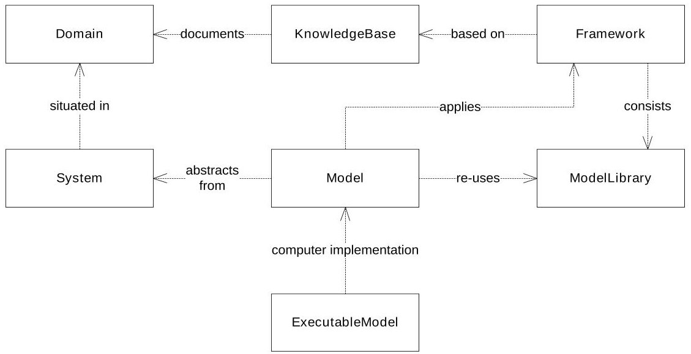


<div align="center">

Figure 1: Terminology

</div>

## 1.3. Research Goal

The goal of this work is to provide a framework that enables the specification of executable models of real time systems based on SysML. To achieve this goal the following objectives have been adopted:

1. Refine SysML to support an executable specification of time based dynamic systems

2. Implement software tools and development guidelines to facilitate an implementation of Objective 1

3. Offer a sample application of the framework

4. Demonstrate theoretical grounding of the framework with regards to existing systems modeling formalisms.

## 1.4. Research Strategy

According to March and Smith (1995), Design Research addresses problems faced by practitioners by offering conceptualizations of problems, corresponding techniques for their

<!-- PDF_PAGE: 20 -->

solution and a criteria for evaluating solutions based on these techniques. This is the underlying premise of the Design Science Research (DSR) paradigm. DSR offers an approach to knowledge creation through the building of innovative artifacts. Juhani and Venable (2009) define DSR as a research activity that invents or builds new, innovative artifacts for solving problems or achieving improvements.

Hevner (2007) identifies two research paradigms in Information Systems (IS) research, namely behavioral science and design science. Behavior science research consists essentially of theorizing and justification of theories. Design science, on the other hand, entails building and evaluating artifacts. These two strains of research, however, are complementary as design is predicated on existing theories acquired through behavioral science, the exercise of which leads to implications for validating, refining existing theories and/or formation of new ones.

In contrast with classical research in the natural sciences, which is descriptive and explanatory in intent, DSR is mostly prescriptive and creates artifacts that embody those prescriptions (March & Smith, 1995). As such DSR artifacts are primarily assessed against criteria of value or utility and not necessarily the truth value of research propositions. Based on this emphasis on utility and relevance to the domain of practice, DSR has been characterized as embodying a pragmatic philosophy (Hevner, 2007; March & Smith, 1995). Pragmatism is a philosophical tradition that emphasizes the practical consequences of accepting or rejecting a proposition as essential in determining its truth value (Rorty, 1982).

As previously mentioned, the goal of this work is to provide a framework that enables the specification of executable models of real time systems in SysML. This is aligned with the DSR goal extending the boundaries of knowledge through the creation of novel artifacts. In this

<!-- PDF_PAGE: 21 -->

regard, the DSR paradigm is adopted as the overarching strategy for meeting the objectives of this work.

Hevner (2007) proposes a synergy of relevance and rigor as the primary characteristic of good DSR work. Relevance refers to the impact of the work in its application domain (Systems Architecting in this context) whiles rigor refers to soundness and grounding in established theory. In line with these primary criteria, Hevner proposes seven guidelines for DSR. Table 1 outlines these guidelines and how they are addressed within this work.

<div align="center">

Table 1: An Application of Hevner's Guiding Criteria for DSR

</div>

<table border="1"><tr><td>Guideline</td><td>Implementation</td></tr><tr><td>1. Design as an artifact</td><td>This work shall develop a framework, consisting of a modeling language, tools for its implementation and process to support the executable modeling of time based systems in SysML</td></tr><tr><td>2. Problem relevance</td><td>The potential for a unified semantic framework for specifying conceptual models and executable models has been a subject of research from the early days of UML. This affords the capacity for early verification and validation of designs. While ongoing refinements in UML (i.e. MARTE, fUML, ALF, PSCS and PSSM standards) have improved the depth of the language for specifying formal and executable models, there is a lack with regards to such a treatment of SysML that provide the underlying infrastructure and libraries to enable a standard implementation of SysML for executable modeling within the MBSE and Systems Architecting community.</td></tr><tr><td>3. Design evaluation</td><td>Proof of concept implementation of the framework shall be offered within the scope of this work.</td></tr><tr><td>4. Research contributions</td><td>This work offers a modeling language that refines SysML in support of executable modeling/architectures within the MBSE domain.</td></tr><tr><td>5. Research rigor</td><td>Comparison of existing modeling formalisms (i.e. CPN, DEVS and OPM) and the proposed framework shall be offered to demonstrate its grounding in these preceding formalisms</td></tr><tr><td>6. Design as a search process</td><td>This work shall search and report on relevant alternatives in the research literature to ensure novelty and rigor of the proposed framework.</td></tr></table>

<!-- PDF_PAGE: 22 -->

<table border="1"><tr><td>7. Communication of research</td><td>The contributions of this work shall be communicated through peer reviewed publications and conferences in the SE community.</td></tr></table>

## 1.5. Methodology and Thesis Outline

Based on Hevner's (2007) framework for DSR, an iterative and incremental approach has been adopted to build and evaluate solutions that address the goal and objectives of this work. Subsequent sections of this document are organized as follows: Chapter 2 reports on the current state of the art with regards to executable modeling using UML/SysML. An overview of simulation concepts and tools are offered. This is to inform on model concepts required to refine SysML, to enable a native specification of executable discrete time models. Additionally it informs on the supporting software infrastructure/libraries that can be provided to enable model execution.

Chapter 3 addresses the first research objective of refining SysML to support executable modeling of real time systems. Chapter 4 addresses the objective of providing software tools that enable implementation and evaluation of an executable systems modeling language. Chapter 5 discusses a high level model development process for executable systems, as well as a sample model aimed at offering a proof of concept implementation of the proposed executable modeling framework (i.e. modeling language, model development tool and process).

Chapter 6 discusses the proposed framework in regards to two executable modeling formalisms i.e. the Discrete Event System Specification (DEVS) formalism (Concepcion & Zeigler, 1988) and High Level Place Transition nets (Jensen, 2013). Finally, Chapter 7 outlines how this work

<!-- PDF_PAGE: 23 -->

fulfills the stated research goal. Additionally it offers an outline of strengths, limitations, and implications of the proposed framework to the body of knowledge and practice of systems modeling and architecture. Figure 2 shows the tasks of the research methodology aligned with corresponding chapters of this document.


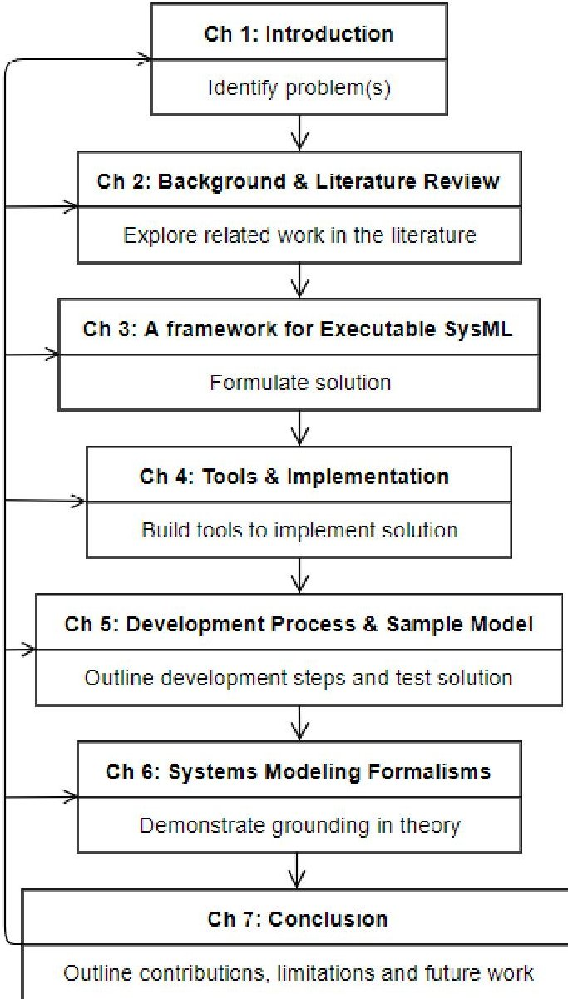


<div align="center">

Figure 2: Thesis Outline

</div>

<!-- PDF_PAGE: 24 -->

## 2. BACKGROUND & LITERATURE REVIEW

This chapter offers a discussion of the state of the art with regards to UML/SysML based simulation models. The chapter has three sections: Section 1 offers an overview of Model Based Systems Engineering (MBSE), the Unified Modeling Language (UML), and related modeling standards relevant to MBSE practice. Section 2 discusses the challenges of UML/SysML executable modeling and approaches in the research literature offered to address them. Finally, Section 3 contrasts the former with a discussion on simulation languages and the software infrastructure required for their execution. This is aimed at exploring commonalities in SysML and simulation languages in order to inform on features that can be introduced in SysML and supporting modeling tools in order to facilitate specification of executable dynamic models.

## 2.1. Model Based Systems Engineering (MBSE):

Models are a consistent feature of most engineering projects. Such projects typically entail multiple collaborating teams, relatively long development life cycles, etc. To facilitate communication, analysis, and documentation of design intent in such contexts, the traditional engineering disciplines (i.e. civil, chemical, mechanical and electrical engineering) have developed various standard modeling frameworks that offer an abstraction of their respective problem domains.

The emergence of systems engineering post World War II represented a shift in paradigm from individual technical disciplines towards a more holistic engineering approach, commensurate with the increasing complexity of technology (Ferris, 2007). The system engineer's models were aimed at bringing into focus system level performance issues such as reliability, safety, resilience etc. that may be inaccessible from a component/subsystem level design perspective.

<!-- PDF_PAGE: 25 -->

The International Council of Systems Engineering (INCOSE) MBSE initiative (Estefan, 2007) is essentially a renaissance of earlier systems modeling frameworks such as the US Air Force's Integrated Computer Aided Manufacturing (ICAM) program in the 1970's (Shumaker, 1979). MBSE however emphasizes a data management approach for systems engineering models based on a meta-schema of modeling concepts (i.e. modeling language) which enforces consistency of model elements across different diagrams types and viewpoints.

Currently, the Systems Modeling Language (SysML) is the de-facto standard for MBSE, sanctioned by the Object Management Group (OMG) and INCOSE. SysML is a derivative language of Unified Modeling Language (UML), which is a unification of modeling methodologies for software engineering. An overview of UML, SysML and other pertinent UML based modeling standards is offered in the following subsections.

## 2.1.1. UML

Following the success and mainstream adoption of Object Oriented (OO) programming in the 1980s, a host of methodologies emerged in the late 1980s and 1990s, to support design and analysis of OO software. According to Cook and Jacobson (2010) by the early 90s there were 26 published methods on object-orientation, most with their own graphical modeling notation. UML was born out of an effort to meld these approaches into a unified standard. Version 1.1 of the language was published in 1997 as an OMG standard, subsequent to an initial submission (i.e. Version 1.0). This was a merger of Grady Booch, James Rumbaugh, and Ivar Jacobson's initial design with submissions from major modeling tool vendors and users.

Over the years, UML has evolved from its original purpose as a graphical notation for software design into a widely adopted standard for conceptual modeling across many domains. It currently offers facilities for defining Domain Specific Languages (DSL), model transformation, and

<!-- PDF_PAGE: 26 -->

executable modeling. The language specification consists of a meta-model and 14 standard diagram types that specify the syntax and semantics of model elements as well as rules for diagram construction respectively.

Additionally, UML offers the capability for custom profiles; this enables language extension in order to support domain specific modeling. A number of standard modeling languages have been defined this way, perhaps the most pertinent to SE being SysML and the Unified Profile for DoDAF and MODAF (UPDM) (OMG, 2013b). In addition to language extension to create domain specific languages, profiling can be used to attach additional information to models which may be needed for ancillary purposes such as model analyses or code generation. An example of such an application is the profile for Modeling and Analysis of Real Time and Embedded systems (MARTE) (Selic & Gérard, 2013).

Notwithstanding its relative maturity and adoption, UML has its flaws and has accordingly received criticism in the research literature. Much of the challenge with UML has to do with the complexity of its language architecture. The circumstances surrounding its initial formulation resulted in a rather inclusive language due to political expediency, not necessarily design intent (Cook, 2012). Despite attempts over a number of revisions aimed at streamlining and simplification, it remains a large specification with a number of imprecisely defined and overlapping concepts (Kobryn, 2004). This underlies the related implementation challenges of precise semantics, enforcing tool compliance, and interoperability.

With regards to the particular challenge of precise semantics for supporting UML executable models, a number of language editions since Version 1.5 (this included action semantics for UML) has culminated into a derivative specification called the Semantics of a Foundational

<!-- PDF_PAGE: 27 -->

Subset for Executable UML Models (fUML) first published in 2011. fUML streamlines UML by offering precise semantics for a useful core of language constructs.

## 2.1.2. fUML & Alf

The fUML specification (OMG, 2016) identifies an essential core of UML constructs and offers a precise and formal specification of their behavioral semantics. It refines the UML concept of class as the primary construct for structural modeling. The behavior of a class is specified based on a refinement of UML activity modeling concepts. Additionally, fUML specifies a foundational Model Library, which entails primitive data types and behaviors for operations on them.

fUML defines run time behavior mostly for primitive UML actions; this excludes for the most part behavioral constructs that can be derived from the composing primitive actions. Thus constructs such as time events, change event, triggers, etc. are not included. The primary purpose of the standard is to serve as an intermediary between UML and computational platform languages i.e. translation from the UML to fUML and subsequently to target language. This therefore justifies the absence of such high level behavioral constructs which are typically provided by platform languages and their supporting libraries.

The fUML specification defines a basic virtual machine capable of executing conformant models, this serves to check compliance of tool vendor implementations of the standard. A reference implementation of the fUML virtual machine is implemented by Model Driven Solutions ("http://www.modeldriven.com/," 2016) and is publicly available to provide a reference that can assist in evaluating the conformance of implementations with the fUML standard. Currently the eclipse based open source modeling tool, Papyrus ("Papyrus Modeling Environment," 2016) and Magic Draw's Cameo Simulation toolkit ("Cameo Simulation

<!-- PDF_PAGE: 28 -->

Toolkit," 2016) offer implementations of fUML. A more extensive listing of supporting tools is offered by the Modeling languages blog (Cabot, 2011).

With regards to a concrete syntax for expressing fUML models, the default approach is to use existing UML notations for model elements contained in the fUML subset, essentially the same notations for class and activity diagrams. This tends to be tedious and error prone for large detailed models. In such scenarios, the Alf standard offers a more compact alternative. Alf is the standard textual language that serves as a surface representation for UML models. Semantically, Alf maps to the fUML subset (Seidewitz, 2014). This presents modelers with the option of three possible representations or views for fUML models, i.e. a graphical view, a textual view solely in Alf, and a hybrid approach that embeds Alf in graphical models.

Alf prescribes three possible approaches for model execution namely interpretive, compilative, and translational execution. In interpretive execution, Alf code is directly interpreted and executed in using programs in suitable executable language. In compilative execution, Alf code is translated into a UML model conforming to the fUML and executed as such, thus fUML serves as a compiler for Alf. Finally, in translational execution Alf code and its context (i.e. for applications where Alf is embedded in a graphical model) is translated into some target executable language where it is executed.

In addition to fUML and Alf, the relatively new OMG standard for the Precise Semantics of UML Composite Structures (PSCS) (OMG, 2015b) and ongoing work on a precise semantics for UML state machines (PSSM) (Seidewitz, 2014) offer the opportunity to create formal and executable models while retaining the benefit of UML's relatively wide acceptance and ready availability of tools. However, while UML is yet to be overhauled to only feature these finer

<!-- PDF_PAGE: 29 -->

additions, the language as a whole has become even more complicated. It remains unclear how these formal editions are compatible with the rest of the language.

## 2.1.3. SysML

SysML is a strict profile of UML, designed to support the specification, analysis, design, verification, and validation of systems that include hardware and software components. It was developed as a joint effort between INCOSE and the OMG. SysML specifies eight diagram types derived from UML diagrams with the exception of the Requirement and Parametric diagrams. These novel diagram types were introduced to support visualization of requirements as well as mathematical constraint relationships between model elements.

SysML introduces the notion of requirement, which is not explicitly present in UML, although use cases may be applied to model functional requirements. Requirement blocks, together with extensions of the UML dependence relationship i.e. trace, refine, and verify stereotypes, etc., are combined in requirement diagrams to present a model of requirements and their taxonomic relations.

Additionally, the capacity for defining mathematical constraints between model elements is introduced with the parametric diagram. The language's binding relation construct enforces an identity property between value properties; this allows related elements to be derived from the other. This supports the definition of mathematical relations between physical elements of a system. In addition to these new constructs, SysML retains UML notions of behavior, i.e. states, and activities as well as interactions in their respective diagrams.

UML activity diagrams however, have been extended in SysML to support the concept of continuous flow. This is applied with annotations that specify flows as discrete, streaming, or

<!-- PDF_PAGE: 30 -->

control. Again, these features are not present in UML, as they are not relevant for modeling software which lends itself more to a discrete conception. SysML retains the token flow and node activation semantics of UML activities, also used in Petri-nets (Murata, 1989).

SysML offers a relatively more agile alternative to UML. It has far less language constructs and relatively cleaner semantics with regards to overlaps and ambiguities in language elements. Also SysML is more directly applicable to a broader range of domains and applications scenarios compared to UML, which has many software centric features.

## 2.1.4. MARTE

MARTE is a UML profile designed for model-based design and analysis of real-time and embedded software of cyber-physical systems (Selic & Gérard, 2013). Compared to SysML, MARTE is an annotation profile; this allows the overlaying of additional information onto a UML model. MARTE introduces concepts that support specification of non-functional properties, timing requirements, etc. in UML, thus bridging the gap between UML models and simulation tools applied for scheduling and performance analysis.

MARTE and SysML both leverage foundational UML constructs to support a broader purview, beyond software engineering concerns. Therefore they share a number of overlapping concepts, i.e. class composition, non-functional properties, etc. The prospect of using SysML and MARTE as complementary profiles have been explored in (Espinoza, Cancila, Selic, & Gérard, 2009; Mura, Murillo, & Prevostini, 2008). However such an application of multiple UML profiles poses significant challenges with regards to the consistency of language constructs across profiles. More importantly the resulting language specification becomes large and unwieldy with implications for accidental complexity.

<!-- PDF_PAGE: 31 -->

## 2.2. SysML Model Execution

Next to a relatively accessible syntax, the main strengths of UML/SysML are its capacity for extension (i.e., language profiles) and use as a hybrid language (i.e., opaque expressions). The former enables the extension of the language to suit a wider range of domain specific modeling contexts while the latter allows the use of a variety of programming languages to append the necessary detail required for such an appropriation.

Executable simulation models have been typically derived from SysML models through a hybrid approach. This entails appending SysML models with details specified in a programming language, since most models rely on libraries implemented in other programming languages for statistical sampling, model observation, parametric equation solvers, etc. Execution strategies for such models may be categorized into co-simulation or transformational approaches.

Co-simulation facilitates an operational execution by coupling the execution engine of an embedded scripting language with the SysML modeling tool. A hybrid model of graphical SysML constructs and textual code can be executed by a model execution tool, which invokes functions on the virtual machine of the embedded scripting language and advances the state of the simulation based on corresponding returned outputs.

Alternatively, the transformational approach entails a transformation of SysML models into a program in the language of the target execution platform. This is implemented by specifying correspondence rules between SysML and the target language based on which model transformations are enforced. The OMG's Model Driven Architecture (MDA) initiative which advocates this approach entails facilities to enable transformation of models specified in UML based languages.

<!-- PDF_PAGE: 32 -->

## 2.2.1. Model Driven Architecture

MDA advocates a software development strategy based on model transformation of higher level conceptual models to executable programs, so called platform independent and platform specific models respectively (Soley, 2000). MDA entails a number of standards for:

1. Meta-modeling i.e. the Meta Objects Facility (MOF)

2. Conceptual Modeling i.e. UML, SysML etc.

3. Model data exchange i.e. XML Meta-data Interchange (XMI)

4. Model Transformation i.e. Query/View/Transformation (QVT).

At the heart of MDA is the QVT standard, which supports query, organization of model data into views, and transformation rule specification. Queries are expressions evaluated over a model; they take a model as input and return a selection of model elements. A view is a model which is completely derived from another model. Within the context of the QVT, views are generated from queries on a baseline model. Transformations are implemented with a view as input to generate an equivalent model in a target language based on a specified mapping between the source and target languages.

Besides QVT, the ATLAS Transformation Language (ATL) (Jouault, Allilaire, Bézivin, & Kurtev, 2008) and Extensible Stylesheet Language Transformation (XSLT) (Peltier, Bézivin, & Guillaume, 2001) have been applied as model transformation frameworks in the literature. In situations where there is a lack of correspondence between the two languages, transformation profiles offer a way to bolster SysML with the required constructs in the target language.

Figure 3, below, illustrates QVT's operational context: A language which essentially facilitates specification and execution of transformations (i.e. tabs) between any two models, Ma and Mb expressed in MOF conformant modeling languages i.e. MMa and MMb.

<!-- PDF_PAGE: 33 -->


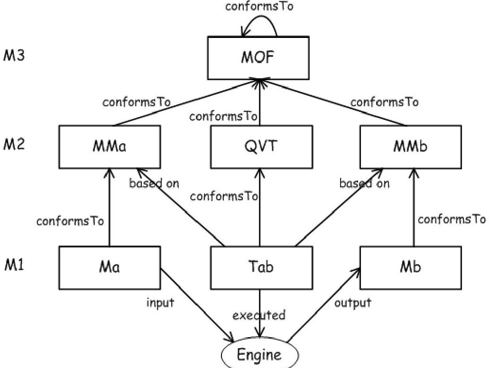


<div align="center">

Figure 3: QVT Operational Context (Jouault et al., 2008)

</div>

## 2.2.2. Overview of Approaches for Executable SysML

Building on these features, a number of approaches for SysML executable modeling have been offered by modeling tool vendors and the research communities. As mentioned in the previous section, these approaches typically employ the techniques of co-simulation and model transformation to enable model execution.

Some commercial modeling tools such as Magic Draw, Enterprise Architect, and IBM Rhapsody etc. provide out of the box support for co-simulation using scripting languages such as Matlab (MathWorks, 1996) and Python (van Rossum, 2007). These have been leveraged in the research literature to offer an implementation test bed for model based embedded systems design. Such approaches support the specification and evaluation of a system's dynamic constraints using

<!-- PDF_PAGE: 34 -->

mostly SysML block and parametric modeling (Bank, Blumrich, Kress, & Stöferle, 2016; Bombino, Hause, & Scandurra, 2010; Krammer, Fritz, & Karner, 2015).

With regards to model transformation, SysML based profiles and transformations have been proposed for automatically generating corresponding executable models for Arena (McGinnis & Ustun, 2009), Colored Petri nets (Wang & Dagli, 2008), and DEVS simulators (Nikolaidou, Dalakas, Mitsi, Kapos, & Anagnostopoulos, 2008). Table 2 offers an overview of approaches in the literature for SysML model transformations.

<div align="center">

Table 2: Approaches for SysML Model Execution via Model Transformation

</div>

<table border="1"><tr><td>Title</td><td>Authors</td><td>Target language</td></tr><tr><td>An executable system architecture approach to discrete events system modeling using SysML in conjunction with colored Petri Net</td><td>(Wang &amp; Dagli, 2008)</td><td>CPN</td></tr><tr><td>An Overview of the SysML-Modelica Transformation Specification</td><td>(Paredis et al., 2010)</td><td>Modelica</td></tr><tr><td>Integrating models and simulations of continuous dynamic system behavior into SysML</td><td>(Johnson, 2008)</td><td>Modelica</td></tr><tr><td>Model-based system engineering using SysML: Deriving executable simulation models with QVT</td><td>(Kapos, Dalakas, Tsadimas, Nikolaidou, &amp; Anagnostopoulos, 2014)</td><td>DEVS</td></tr><tr><td>System-level model integration of design and simulation for mechatronic systems based on SysML</td><td>(Cao, Liu, &amp; Paredis, 2011)</td><td>Matlab</td></tr><tr><td>Multi-view Modeling to Support Embedded Systems Engineering in SysML</td><td>(Shah, Kerzhner, Schaefer, &amp; Paredis, 2010)</td><td>EPLAN Fluid &amp; Modelica</td></tr><tr><td>Integrating SysML with Simulink using Open-source Model Transformations.</td><td>(Sindico, Di Natale, &amp; Panci, 2011)</td><td>Matlab</td></tr><tr><td>System-Level Modeling and Design Using SysML and SystemC</td><td>(Raslan &amp; Sameh, 2007)</td><td>SystemC</td></tr><tr><td>Toward Executable Architectures to Support Evaluation</td><td>(Wagenhals, Liles, &amp; Levis, 2009)</td><td>Colored Petri Nets (CPN)</td></tr></table>

<!-- PDF_PAGE: 35 -->

## 2.2.3. Challenges with UML/SysML Model Execution

The primary challenge with UML models in general is one of language formality and standardization. While there are myriad approaches and tools offered both by the research community and commercial tool vendors, there remains the challenge of a uniform implementation of the language. This is in part due to the complexity of the language infrastructure and its arcane specification.

UML entails essentially several independently derived modeling methodologies (i.e. state charts, activity diagrams etc.) which have been co-opted into a single modeling framework. The circumstances surrounding its initial formulation resulted in a rather inclusive language due to political expediency, not necessarily design intent (Cook, 2012). Thus, despite attempts over a number of revisions aimed at streamlining and simplification, it remains a large specification with a number of imprecisely defined and overlapping concepts (Kobryn, 2004).

Furthermore, language profiles aimed at supporting domain specific modeling risk further complicating the language schema with adverse implications for tool interoperability and model execution. Additionally, most profile specifications do not specify the formal semantics or reference implementations of the novel concepts they introduce. While techniques have been proposed in the literature aimed at addressing this challenge using fUML (Mayerhofer, Langer, Wimmer, & Kappel, 2013; Tatibouet, Cuccuru, Gérard, & Terrier, 2014), there remain inconsistencies between fUML and legacy UML that essentially preclude a uniform implementation of this.

## 2.3. Simulation Languages

The Modeling and Simulation (M&S) domain encompasses concepts, tools, and techniques aimed at simulating the behavior of real or notional systems on digital computers (Zeigler, 1984).

<!-- PDF_PAGE: 36 -->

Systems engineering relies heavily on M&S theory to support architecture modeling and analysis. SysML thus has significantly similar constructs with the typical simulation language, the latter however mostly has a textual syntax and more refined executable semantics. Simulation languages are juxtaposed here with SysML in order to offer insights on language constructs and supporting software infrastructure needed to support specification of executable dynamic models in SysML.

Kiviat (1969) characterizes simulation languages as problem oriented languages (POL) distinct from general purpose programming languages. POLs, more recently referred to as domains specific languages (DSL's), are aimed at offering constructs appropriate for formulating executable solutions to typical problems in the domain of inquiry. A DSL is able to express executable solutions to domain specific problems while abstracting away the details of platform specific execution instructions.

Simulation programming languages are DSLs designed to offer execution logic usually required in computer simulations at a higher level of specification amenable to domain experts. Several of these, including GPSS, SIMSCRIPT, SIMULA, etc. emerged in the 1960s and 70s following the development of the first general purpose programming languages (i.e. FORTRAN, ALGOL, LISP, COBOL) in the 1950s.

## 2.3.1. Primary Concepts

Tocher (1965) categorizes simulation software into two parts: the simulation language and the simulation programming system. The simulation language enables user specification of rules guiding the evolution of a dynamic process involving interacting entities, such that a program can be constructed by a computer which will give a realization of that process. The programming system offers a substrate for user specification and execution of models in the simulation

<!-- PDF_PAGE: 37 -->

language. It entails facilities for managing program run as well as collection and visualization of results.

In this vein, a simulation model is characterized here as entailing two categories of model elements, namely infrastructure and superstructure constructs. Superstructure constructs are mostly applied in user models and pertain to parallel concepts in a model's referent domain. Examples of these are objects/entities, events, activities, states, resources, queues, delays, etc. Infrastructural constructs typically do not have parallel concepts in the referent domain, but are necessary to enable model execution. Examples of these include simulation clock, model observation, and algorithms for advancing time in simulation model.

Superstructure constructs are usually language constructs available for user extension, while the infrastructure is for the most part hidden from the user. This convention of separation of language superstructure and infrastructure is typically applied in M&S literature and tools. In these contexts, and subsequently throughout this document, the term simulation language is used in reference to a language's superstructure, whereas the infrastructure component of the language is referred to as the simulation executive or simulator (Pidd, 2004).

Simulation languages offer structural and behavioral constructs for modeling entities in the reference domain and how the properties of entities evolve over time due to their interaction. Typical examples of structural constructs include; entities, resources, queue, delays, etc. Behavioral constructs include; state, activities/processes, events, etc. The state of an object in most simulation languages is an enumeration of the values of its attributes at a particular instant of time. An activity/process consists of a sequence of executions that transforms the state of an object in an instance of time. Activities are initiated/terminated by the occurrence of events (Kiviat, 1969).

<!-- PDF_PAGE: 38 -->

A simulation executive/simulator primarily manages the progression of time and synchronization of time among a simulation's entities. This is typically modeled by the concept of a global simulation clock, which is updated by a given Time Flow Mechanisms (TFM), i.e. fixed or variable increment TFM. In fixed increment TFM, the simulation clock is advanced by fixed time increments in every cycle of the simulation loop. In a variable increment TFM, also called next-event simulation, the simulation clock is advanced to the time of the next imminent event in the model for each cycle of the simulation loop (Kiviat, 1969).

## 2.3.2. Simulation Worldviews

A simulation worldview or conceptual framework is a structure of concepts and perspectives that underlie the general structure of a simulation program. Balci (1988) identifies four main worldviews underlying discrete event simulation programs namely: process interaction, event scheduling, activity scanning, and three-phase worldviews.

In the process interaction worldview, the model specification follows the lifecycle of objects in a system. A model can follow either an Active Server approach or a Transaction Flow approach. The former focuses on the behavior of the resources in the system while the latter emphasizes the behavior of entities, referred to as transactions, as they travel through the system (Miller, Silver, & Lacy, 2006). Entities typically arrive, undergo some processes, where they seize and release scarce resources, and then exit. A process is a time sequence of events, activities and delays which model demand for resources and queuing to wait for resources etc.

The simulation strategy here is to advance the simulation clock to the earliest time at which some active process is scheduled to reactivate. Processes due at this time are advanced to the next suspension after which model conditions are evaluated to determine if any idle processes should

<!-- PDF_PAGE: 39 -->

be reactivated. Once there are no more active processes, the simulation clock is advanced to the next time, and the cycle repeats until some terminating condition is met.

In the event scheduling world view, events are the primary drivers of the simulation. For each event, the model specifies associated state changes and future events that must be scheduled. The simulation proceeds by updating the simulation clock to the time due for the next event and implementing the activities and future events associated with it.


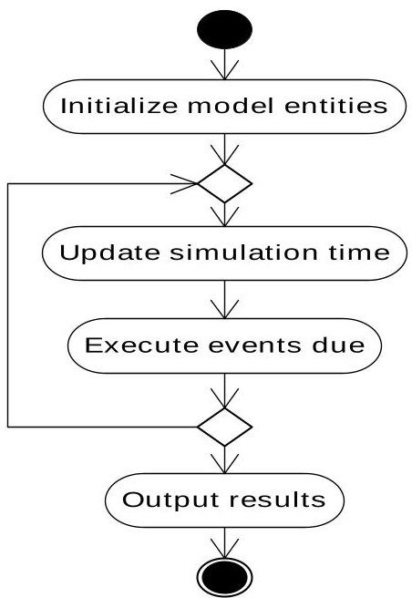


<div align="center">

Figure 4: Sequence of Execution Event Scheduling Worldview

</div>

In the activity scanning world view, also known as the two-phase approach, activities are the primary drivers of the simulation. Activities are specified in two parts; condition and action. The simulation proceeds by a fixed increment TFM, where all activities are scanned for each time advance, actions with satisfied conditions are executed. Activity executions result in state changes.

<!-- PDF_PAGE: 40 -->


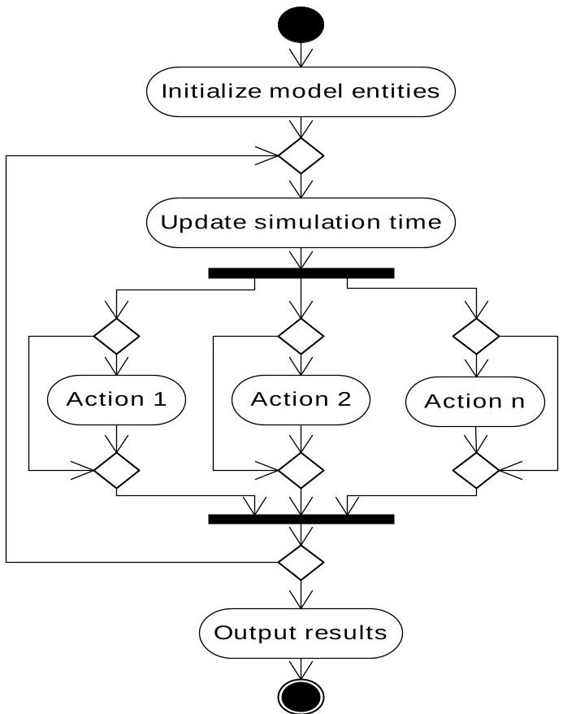


<div align="center">

Figure 5: Sequence of Execution in Activity Scanning Worldview

</div>

The three-phase worldview combines the activity scanning and event scheduling worldviews. Activities are triggered by timed events as in event scheduling, additionally, activities with conditions scanned implemented as in the Activity Scanning world view. To achieve this, activities are characterized as either Conditional (Cs) or Bound (B'). Bs are scheduled as in an event scheduling approach. They model the effect of unconditional state changes on the current state and the future by scheduling new B activities into the future. Cs are triggered at event times if their condition evaluates to true.

Figure 6 illustrates the operation of a typical three phase simulation executive. Pidd (2004) categorizes the main steps of 3-phase execution sequence under A, B, and C phases, respectively. In the A phase, the simulation clock is moved to the next event time by checking all the Bs that are currently scheduled. Those Bs that are now due are executed in some defined sequence so as

<!-- PDF_PAGE: 41 -->

to release resources, this is the B phase. Within a simulation run these steps are repeated until some termination criteria is met.


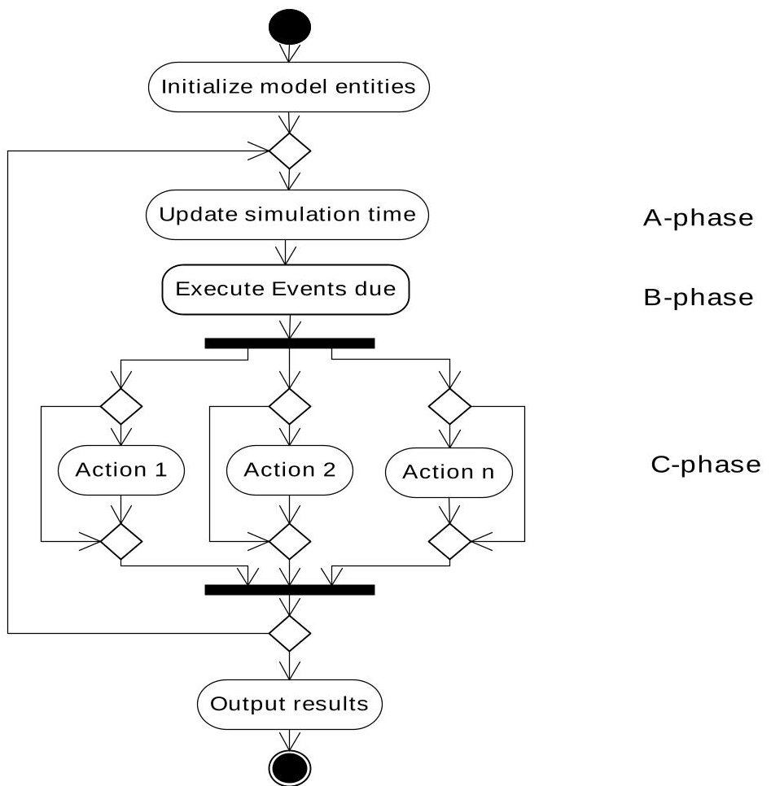


<div align="center">

Figure 6: Sequence of Execution in Three-phase Worldview

</div>

## 2.3.3. Simulation Tool Architecture

In practice simulations may be built using either one or a combination of Visual Interactive Modeling Systems (VIMS), simulation languages and/or general purpose programming languages. VIMS offer a drag and drop graphical interface, where users can assemble simulation models by selecting from a palette of predefined model components and relations to create diagrams. Model details, such as sampling distributions, constraint relations, etc. can be added through dialog boxes and property sheets that are linked to model elements in the diagram.

<!-- PDF_PAGE: 42 -->

Examples include Arena (Kelton, 2002) and IMPRINT (Mitchell, 2003) for human performance modeling.

Another option is developing simulations from scratch using a high level programming language. As common operations underlie most simulations, re-usable software libraries have been developed in a number of high level programming languages to facilitate simulation development. Examples of such libraries include; SimPy (Matloff, 2008) and SimJava (Howell & McNab, 1998) based on Python and Java programming languages respectively.

The simulation executive fundamentally serves as a scheduler for time-event triggered activity executions in the model. After each execution cycle it advances the simulation time based on a TFM and selects the next activity routines in the application for execution. Figure 7 illustrates the bare-bones abstraction of a simulation program; consisting of method calls between a simulation executive and application.


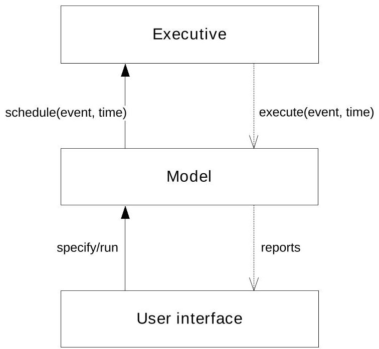


<div align="center">

Figure 7: Primary Components of Simulation Software

</div>

<!-- PDF_PAGE: 43 -->

Most VIMS incorporate additional features besides this core functionality that support user interaction with simulation results as well as interfacing with other platforms such as database systems. Table 3 outlines some essential capabilities and features of simulation software.

<div align="center">

Table 3: Capabilities & Features of Simulation Tools (Adapted from (Pidd, 2006))

</div>

<table border="1"><tr><td>Capability</td><td>Features</td></tr><tr><td>1. Conceptual Modeling</td><td>Graphical modeling environmentBuilt in simulation meta-model and objectsVarious input formats for setting model properties, run parameters etc.Statistical distributions and functions</td></tr><tr><td>2. Simulation</td><td>Simulation executive to run modelVisualizations and/or virtual reality representations to allow a user to view the model state as the simulation proceedsSimulation run control(i.e. run, pause, speed etc.)to enable the user to interact with the simulation as it runs</td></tr><tr><td>3. Experimentation</td><td>Model observation/experimental frames that define run parameters and outputsTools for visualization of model resultsOptimization tools</td></tr><tr><td>4. Interoperability</td><td>Links to other tools such as spreadsheets, databases, servers, API&#x27;s for custom extensions etc.</td></tr></table>

## 2.4. Summary

This chapter offered a juxtaposition of SysML and simulation languages and supporting technologies. This was aimed at highlighting deficiencies in SysML and modeling tools in their use for specifying executable models of dynamic systems. The primary challenges with SysML in this regard are its imprecise syntax and semantics as well as a lack of a native strategy for modeling and execution of time based events. This is especially critical as state changes and

<!-- PDF_PAGE: 44 -->

associated changes in property values are time ordered in most dynamic models. The following points summarize the identified limitations and challenges of SysML modeling:

1. Ontological foundation: There's a lack of a clearly defined schema of language constructs independent of their use in diagrams, leading to overlaps and inconsistencies in their use across diagram types

2. Execute-ability: Extending from 1, there's a lack of execution semantics i.e. a reference implementation or formal model of language core constructs

3. Support for Time: A lack of clearly defined approach for specifying and managing time advance in a model

4. Governance: Extending from 1 and 2, there’s a lack of mechanisms for checking the correctness of model syntax and semantics

5. Extensibility: A lack of clearly defined approaches for checking the consistency of language extensions (i.e. profiles).

The challenge with language semantics adversely impacts language extension through profiles (i.e. breadth) as well as embedding of opaque expressions in models (i.e. to provide depth). The latter of which is critical to supporting a pragmatic use of SysML as a simulation language. Essentially, an overhaul of the language with emphasis on simplification and formalization will enable consistent language extension and interfacing with other languages and execution platforms via opaque expressions. This is necessary in order to leverage SysML as a language for uniform and consistent specification of executable models within the systems modeling and architecture community.

<!-- PDF_PAGE: 45 -->

## 3. AN EXECUTABLE SYSTEMS MODELING LANGUAGE

In response to challenges regarding SysML modeling discussed in the preceding chapter, this chapter proposes an Executable Systems Modeling Language (ESysML). Similar to the fUML and ALF standards, ESysML retains and refines existing SysML block and activity modeling semantics and their graphical syntax. Additionally, an equivalent textual syntax is proposed that enables a more compact alternative to graphical models. This would facilitate well-structured and easily verifiable user models, which is necessary to support the development of executable architectures.

ESysML essentially re-imagines SysML as a simulation language. It prescribes an approach for time advance and action invocation based on time. The objective here is to repurpose SysML as an executable language specification with a reference implementation that can be uniformly implemented in tandem with any executable/platform specific language such as Matlab, Java, and Python etc. as a base language captured as Opaque expressions.

Subsequent sections of the chapter are organized as follows: Section 3.1 discusses the ontological foundations of the ESysML. Section 3.2 discusses language constructs and the corresponding textual syntax. Section 3.3 discusses structural modeling with ESysML in relation to SysML. Section 3.4 similarly discusses behavioral modeling as well as constructs for specifying time based action executions. The final section offers a summary of the chapter and reflects on implications with regards to the overall objectives of this research.

## 3.1. Ontological Foundations

Mealy (1967) identifies three realms of interest in data processing and information systems in general: the real world itself, ideas about it existing in the minds of men, and symbols on paper

<!-- PDF_PAGE: 46 -->

or some other storage medium. An ontology is a fundamental philosophical position akin to a set of beliefs about the existence of certain entities in external reality (Evermann & Wand, 2005).

In the context of information systems management, domain ontologies offer a baseline description of the nature of things that exist in a problem domain. This enables a commonality of concepts and shared understanding among stakeholders. Modeling languages that are applicable to a domain must in turn offer symbols and concepts based on the domain's ontology in order to support an adequate expression of problems situated in the domain.

This work applies constructs from the Bunge-Wand-Weber (BWW) ontological model as a semantic foundation for the proposed ESysML. Wand and Weber (1990) proposed an application of Mario Bunge's ontology (Bunge, 1977) for modeling information systems. This has subsequently been applied severally in the literature for conceptual modeling (Dussart, Aubert, & Patry, 2004; Soffer, Golany, Dori, & Wand, 2001) and evaluating the expressiveness of modeling languages (Becker, Bergener, Breuker, & Rackers, 2010; Fettke & Loos, 2003; Opdahl & Henderson-Sellers, 2002).

Based on the BWW the real world is primarily composed of things; a thing is a substantial individual which exists in space and time. Additionally, they may be composed to form things with mutual properties. Properties serve as the descriptors of a thing; they are assumed to be scrutable with observer-independent characteristics. Properties are represented by attribute functions (attributes) that map sets of things to values. Attributes, in this vein, are conceptual and do not exist in reality, they only serve as a means for representing the properties of a thing.

The state of a thing represents the values of its properties at a point in time. An event is the change in state of a thing. Laws specify the possible state space for a thing. A class is a set of

<!-- PDF_PAGE: 47 -->

things that possess one common property. A kind is a set of things that possess two or more common properties (Bunge, 1977). Table 4 outlines the primary concepts of the BWW ontology.

<div align="center">

Table 4: Concepts of the BWW Ontology (Evermann & Wand, 2005)

</div>

<table border="1"><tr><td>Concept</td><td>Explanation</td></tr><tr><td>Thing</td><td>Fundamental concept,the world consists of things and only things</td></tr><tr><td>Property</td><td>Things have properties</td></tr><tr><td>Intrinsic Property</td><td>Property of one thing</td></tr><tr><td>Mutual Property</td><td>Property of two or more things</td></tr><tr><td>Composition</td><td>Things can be composed to form composite things</td></tr><tr><td>Emergent Property</td><td>Property of a composite thing not possessed by its parts</td></tr><tr><td>State function</td><td>Function describing a property of a thing</td></tr><tr><td>Functional Schema(Model)</td><td>Set of state functions describing things</td></tr><tr><td>State</td><td>Value vector assigned to state functions of a schema</td></tr><tr><td>Natural kind</td><td>set of things adhering to a set of laws</td></tr><tr><td>Law</td><td>A restriction on a thing&#x27;s properties,or relation between properties</td></tr></table>

## 3.2. Language Concepts

An ESysML model essentially comprises model elements. A model element, here, is a parallel to the concept of thing in the BWW. A model element may own zero or more properties, which specify its relation to other model elements. Properties are implemented here as unidirectional with a single source and zero or more target model elements. Figure 8 illustrates the concept of model element and property using UML notation.

<!-- PDF_PAGE: 48 -->


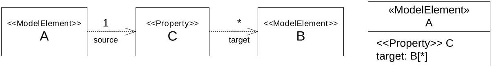


<div align="center">

Figure 8: Graphical Notation for Primary Constructs

</div>

Model elements are further categorized under the five main types of; instance, action, type, action definition, and package. Instances reference real or notional things present in the world. Actions specify the rules by which Instances are created, destroyed, or transformed. Constraints and events are considered special kinds of action in ESysML. Constraints specify restrictions on the values the properties of model elements may assume. Events refer to time based changes in value properties based on a truth condition. They are useful for invocation of actions based on time or other conditions in a model.

Type and action definition are definitional elements, used to specify a template for creating instances and performing action executions. A distinction is made between real instances with spatio-temporal extent, which are typed by block and notional/conceptual ones typed by data type. Data instances primarily serve as attributes of block instances. Attributes, based on the BWW, are observer imputed properties useful for exposing the nature of real things. Block (i.e. physical) and data (i.e. conceptual) instances are differentiated from each other solely by the time attribute. This is a default attribute of all blocks in a model, which is useful for specifying how the properties of a physical thing evolve over time. Additionally blocks may be physically composed of other blocks in keeping with the BWW law of composition.

The construct of package is useful for organization of model elements. An ESysML model is a package or container of user defined types, action definitions and nested packages, as well as a

<!-- PDF_PAGE: 49 -->

specification of an Activity. Activities entail one or more actions with a specified order of execution. Essentially an ESysML entails a progression of actions termed Activity, and the definitional elements they are based on i.e. types and action definitions. Figure 9 illustrates the hierarchy of model elements in ESysML.


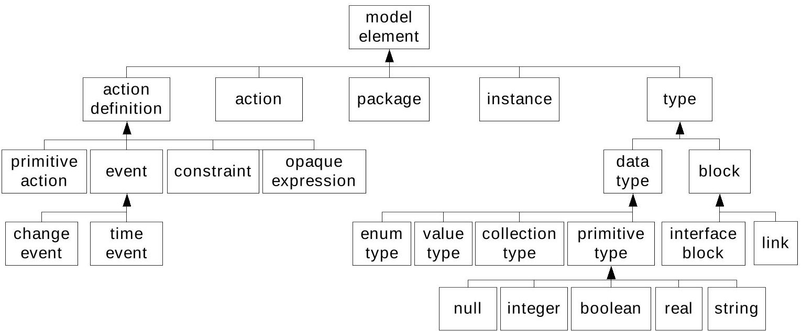


<div align="center">

Figure 9: Hierarchy of Model Element Classes

</div>

Properties specify relations between model elements. These are broadly categorized into dependency and characterization relationships. Characterization is a property relating an instance and one or more instances or actions, termed as features. Characterization properties are further specialized into attribution, operationalization, and participation.

Attribution is a relation solely between instances where the element at the target end of the relation serves as a descriptor to the source element. Operationalization is a relation between an instance and one or more actions, which prescribe how the properties of the instance may change

<!-- PDF_PAGE: 50 -->

in a model. Participation is a relation between block instances. It specifies a whole-part relationship between block instances. This serves to implement the BWW law of composition.

The Dependency property is used broadly to specify logical dependence relations between model elements. This is specialized into inheritance, instantiation, containment, importation, parameterization, invocation, and progression properties. Instantiation is a relation between an instance and its type. Inheritance is a relation between types that implies the element at the target end may exhibit all of the properties of the element at the source.

Containment properties specify a relation between a package and other model elements contained within it. The Importation property specifies a relation between packages which implies that named elements in the target package can be referenced directly in the source package.

Invocation, progression, and parameterization properties specify relations between actions. Invocation properties have an event as the source element and an action as the target. This signifies a dependence on the event for the initiation of the action at the target. A progression property denotes an ordering constraint between actions; which specifies precedence or parity of action execution sequence.

The parameterization property specify relations between an action and model elements required for its execution (i.e. inputs) or model elements produced as a result of its execution (i.e. output). As earlier mentioned, actions are composed of a progression actions, termed Activity. Figure 10 outlines the hierarchy of property types in ESysML.

<!-- PDF_PAGE: 51 -->


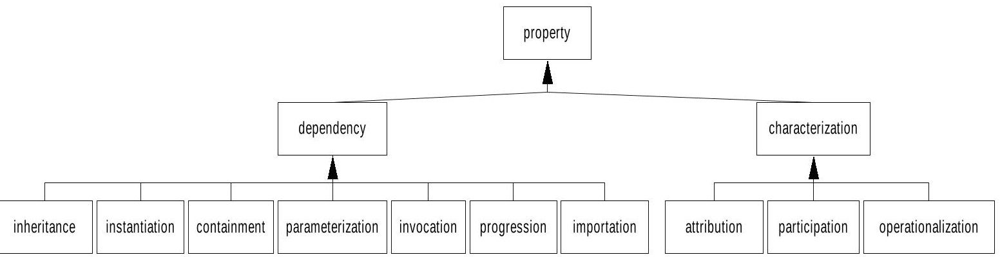


<div align="center">

Figure 10: Hierarchy of Property Classes

</div>

## 3.3. Overview of Textual Syntax

A textual syntax that retains the C style syntax of Alf is proposed. Following this convention, language statements and statement blocks are delimited with semi-colons and curly braces respectively. Additionally, C style "if" (conditional) and "while" (loop) formats are retained for specifying conditional and loop statements. An ESysML textual model entails four main components, a model property declaration blocks, an activity block, type definition blocks, and nested packages.

The model property definition blocks specify imported packages and model defaults such as executable language for opaque expressions and a default home directory for imports. The activity block specifies a progression of one or more actions that must be performed once the model is activated. Type definition blocks define named elements that may be invoked together with imported names in the Activity block. Figure 11 illustrates a sample model an activity specification and a nested package.

<!-- PDF_PAGE: 52 -->

```javascript

{

    x = 0;

    par { y = 3;

        TestPackage.pyrandint(x,y)->(x);

    }

}

package TestPackage{

    imports {

        Units: Weight

    }

    opaque pyrandint(x: integer, y:integer)->(z: integer){

        "import random \n"

        "z = random.randint(int(x),(int(y)))"

    }

    block Human{

        attributes{

            name: string = 'TBA';

            children: Human[*,U];

            weight: Weight = [65, 'kilogram'];

            static headCount: integer = 0

        }

    }

}

```

<div align="center">

Figure 11: Sample Model

</div>

A notable peculiarity in ESysML syntax is the explicit specification of action output names. In keeping with SysML, this helps to expose name, value pairs available in an activity's namespace in the course of an execution. Additionally, for opaque expressions this allows output variable from an execution to be cast into predefined ESysML types with assigned names. This feature is further discussed under the behavioral modeling in section 3.4. The Parsing Expression Grammar (PEG) (Ford, 2004) is used to offer a formal definition of the language syntax. A more detailed description of the textual syntax, along with the PEG specification is offered in Appendices B and A respectively.

<!-- PDF_PAGE: 53 -->

## 3.4. Model Specification

ESysML supports model specification based on structural and behavioral perspectives. As in UML/SysML the structural modeling generally entails the definition object/instance types, packages and the dependencies between them. Behavioral modeling focuses on solely action execution. Subsequent sections describe the various modeling concepts under structural and behavioral modeling perspectives with illustrative examples.

## 3.4.1. Structural Modeling

ESysML supports a structural modeling perspective which entails definition of types and properties as well as their organization using packages. Model element definitions entail specification of a type keyword, name, and zero or more property definitions. Property definitions must specify a type, name, default values as well as multiplicity values of the property.

Multiplicities are denoted by an ordered pair of comma separated whole numbers that specify the minimum and minimum number of entities allowed in the relation. The labels 'O', 'U', and 'L' may be appended to multiplicity to specify whether a collection of entities specified in the relation are ordered, unique, or labeled respectively. Additionally, in place of using digits to specify the limits of a multiplicity the symbols, '+' and '*' may be used to signify one-or-more and zero-or-more limits respectively.

Property names may additionally be prefaced by a "qualifier" keyword. Currently there are two qualifier keywords; static and constant. An example of this is the static keyword which indicates that a property is applicable only to the Type and not instances based on it. That constant

<!-- PDF_PAGE: 54 -->

keyword indicates that a name may be assigned once to an instance and remain unchangeable in the course of an execution.

ESysML packages are essentially containers for organization of model elements. A Model which is an extension of the Package construct is the top level element of an ESysML model. A model additionally serves as a global namespace for its contents. A model's namespace entails names of user defined model elements as well as predefined model elements that can be accessed globally within the model. Examples of such globally accessible components include a global Time variable and the Observe function, which enables logging of model results. Models support a specification of default properties; such as a default import directory and language for opaque expressions in the model.

Regarding data types, SysML primitive types (i.e. integer, real, string, Boolean) are retained. Enumerated type, Value type, and Collection types are extensions of the data type construct. An enumerated type specifies a user defined set of strings, one of which may be applied as a data instance. There are three main collection types in line with the options for multiplicity definition namely; Ordered collection, Unique collection, Labeled collection. This may considered analogous to python collection types lists, sets, and dictionaries respectively.

Value types are specialized data types aimed at supporting physical quantity specification in the model. They may be defined by specifying a required data type for values. An instantiated value type specifies an ordered pair, a string value and data instance based on the type specified at definition. As an example a value type named 'Weight', which specifies the data type 'real' at definition, may be instantiated as [65.0, 'kilogram'] . Additional to this, users may define custom data types that may be instantiated with a constructor operation. Appendix B offers a library of

<!-- PDF_PAGE: 55 -->

sample models for further reference on data type definitions and data instances. Figure 12 illustrates an example data type and value type definition along with their instantiation.

```javascript

value_type Weight {

    attributes {

        value: real }

    }

data_type Point{

    attributes {

        coordinates: real[1,3,0] }

}

block Human{

    attributes {

        weight: Weight = [65, 'kilogram'];

        location: Point = Point(0,0,0) }

}

```

<div align="center">

Figure 12: Data & Value Type Definition and Instantiation

</div>

The SysML construct of block is retained as the primary structural feature for defining classes of things in a model's referent domain. The whole-part relation between blocks and physical connection of blocks is implemented through the participation property and link and interface blocks respectively.

The interface block and link model elements are block specializations aimed at supporting the modeling of physical couplings and item exchange between blocks. Interface blocks serve as definition elements for specifying properties of ports. Ports are in essence parts that serve as boundary objects, useful for exposing the whole to specified interactions in its environment. Similarly links serve as definition elements for connectors between ports. Port couplings via connectors serve as the primary mechanism for modeling matter, energy and/or information flow

<!-- PDF_PAGE: 56 -->

across a system's boundary to/from its environment. Figure 13 illustrates an example block definition.

```python

defaults{

    opq_lang = 'Python';

    import_dir = 'C:\software\Py\Thesis'

}

imports {

    Units: Weight

}

block Human{

    attributes {

        name: string = 'TBA';

        children: Human[*,U];

        weight: Weight = [0, 'kg'];

        static headCount: integer = 0 }

    parts {

        heart: Organ}

    ports {

        eye: LightInterface[0,2,0] ;

        ear: SoundInterface[0,2,0] }

    operations {

        action Human()->(){}

        action see()->(){}

        action hear()->(){}

        constraint lineOfSight(){}

    }

}

```

<div align="center">

Figure 13: Example Block Definition

</div>

## 3.4.2. Behavioral Modeling

The primary behavioral modeling construct in ESysML is the action. This enables the specification of behavior for types and instances via operationalization properties. Actions definitions specify the rules by which a model's properties may evolve i.e. through creating, destroying, or transforming model elements. Specializations of action include primitive actions, opaque expressions, events, and constraints. Similar to primitive types, primitive actions are

<!-- PDF_PAGE: 57 -->

predefined model elements with user specified slots. Currently ESysML entails the following primitive actions; final, instance creation, value assignment, element reference, condition, loop. Action methods are composed of action calls or invocations. The order of action execution is determined by either precedence or parity relations between action calls, which may be specified using the control and object flow notation of SysML activity diagrams. Action methods do not have the typical return statement of a programming language. Action outputs specify zero or more names that are assigned in the action method (i.e. activity) and available to the caller of the action once the action completes.

As an example the gen_request action definition in figure 14, specifies a name request that must be assigned a value of type FlowItem. The first statement in the action's body assigns the request name to the returned instance generated by the constructor action for FlowItem. Opaque expressions may be similarly defined as actions, this is shown in figure 15.

action gen_request()->(request: FlowItem){

    FlowItem()->(request);

    increment(numRequests)->(numRequests); }

<div align="center">

Figure 14: Example Action Definition

</div>

```python

opaque pyrandint(x: integer, y:integer)->(z: integer){

    "import random \n"

    "z = random.randint(int(x),(int(y))"

}

```

<div align="center">

Figure 15: Example Action Definition with Opaque Expression

</div>

<!-- PDF_PAGE: 58 -->

Time-events and change-events enable the invocation of actions after a time delay or a specified change in a model's properties respectively. Time-events specifies a trigger which is a number or an expression that evaluates to a number while change-events must specify a Boolean valued trigger. Figure 15 illustrates the syntax for action invocation with events.

```javascript

action send_request()->(){

    output.send();

    time_event(genRateExpo)-> gen_request;}

```

<div align="center">

Figure 16: Example Action Invocation with Event

</div>

For the purposes of model execution, the semantics of time and change events here are in alignment with the concepts of bound and conditional events (Tocher & Laski, 1966) used in the three-phase simulation world view. Events are invoked by an executive which additionally manages the model's time variable. A block's owned actions are in turn invoked by associated time events to ensure their occurrence in correct simulation time.

SysML's constraint block element has been redefined in ESysML as an action, as this better aligns with the definition of action in ESysML. Constraints specify rules for the values instances properties may assume. From a structural perspective, constraints may be considered as derived or dependent properties of an instance. A change in value of one or more dependent/input properties of a constraint triggers an execution of its method which recalculates the value of the constraint.

<!-- PDF_PAGE: 59 -->

Constraint definition follows a similar format as actions, with the exception of the keyword constraint preceding the statement. Also constraints do specify an output parameter as the output value is automatically assigned to the constraint name. The input parameters of a constraint must be attributes of its owner element. A constraint's assigned name may be considered its output parameter as this presents the results of its method execution. Appendix A offers a more detailed description of the language syntax with descriptions and examples.

## 3.5. Model Diagrams

SysML notations for block, package, and activity diagrams can be applied as a graphical alternative for the specification of models. Following SysML diagramming conventions a diagram may be used to show the model elements in the namespace of its context or owner element. Diagram headers indicate the diagram type, model element type, model element name, and diagram name respectively. Block and package diagram notations may be used in a block definition diagram for specifying the content of a structural feature.

The option of specifying models textually in addition to the graphical syntax offers a complementary approach to model definition that support precision and detail without sacrificing a model's accessibility. Figure 17 shows corresponding graphical and textual specifications of a model.

<!-- PDF_PAGE: 60 -->


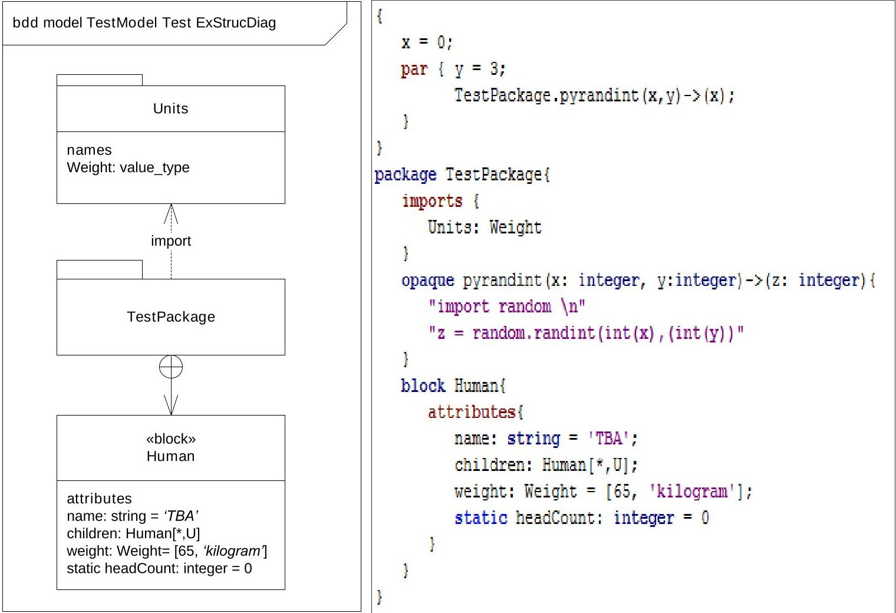


<div align="center">

Figure 17: Example Graphical and Textual Model Structure Specification

</div>

Activity diagrams may be used for specifying activities associated with a model or action definition. Activities diagrams for activities associated with action definitions may show input and output parameters as attachments to the diagram frame. Additionally, primitive composite actions such as conditional and loop expressions may be visualized using fragments.

SysML diagrams, however, do not support the visualization of dynamic information which is especially relevant in the context of executable models. To address this activity diagrams may be appended with a list of names and value pairs present in the context namespace. This allows simulation tools to not only highlight action activation during execution but also changes in named values in the course of an execution. Additionally, this will offer a visualization of the

<!-- PDF_PAGE: 61 -->

model's state during activity execution. Figure 18 shows alternative textual and graphical specifications for an action definition.


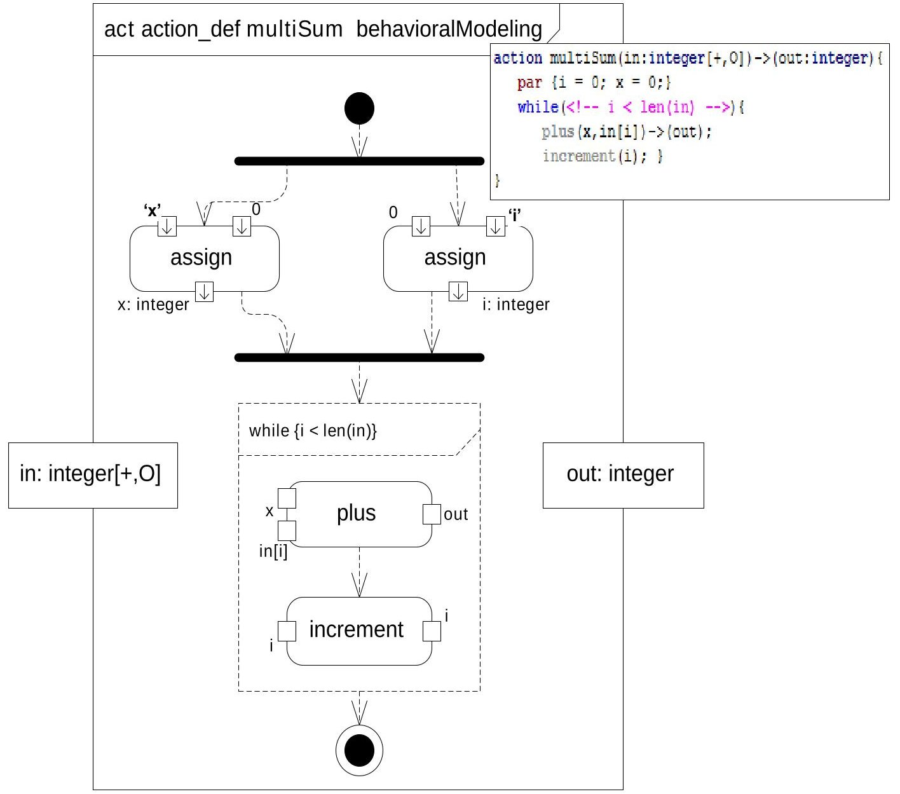


<div align="center">

Figure 18: Example Graphical and Behavioral Model Specification

</div>

Finally SysML does not explicitly offer an instance model, such as the Object diagram in UML. An instance model will be useful in visualizing an executable model's initial state. Since instance

<!-- PDF_PAGE: 62 -->

construction is typically handled using activities instance diagrams must be owned by an action definition or model as with activity diagrams.

```javascript

action MVS()->(x: MVS){

    //assign created links names to labeled collection property of x

    SimpleLink(input.out, jes.input.inp)->(x.links.la);

    SimpleLink(jes.output.out, cpus.cpu1.input.inp)->(x.links.lb);

    SimpleLink(jes.output.out, cpus.cpu2.input.inp)->(x.links.lc);

    SimpleLink(cpu1.output.out, prts.prt1.input.inp)->(x.links.ld);

    SimpleLink(cpu1.output.out, out.inp)->(x.links.le);

    SimpleLink(cpu2.output.out, prts.prt1.input.inp)->(x.links.lf);

    SimpleLink(cpu2.output.out, out.inp)->(x.links.lg);

}

```


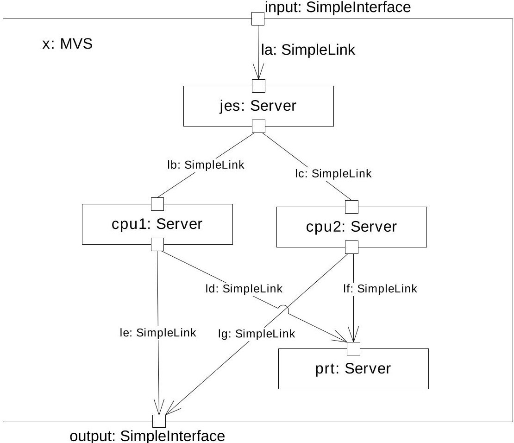


<div align="center">

Figure 19: Sample Textual Action Definition and Corresponding Instance Model Diagram

</div>

<!-- PDF_PAGE: 63 -->

## 3.6. Summary

This chapter introduced the ESysML, an executable language with equivalent textual and graphical syntax based on SysML. The proposed language offers a relatively simple and extensible language schema that supports modeling of time based dynamic systems. This offers a necessary semantic foundation for the development of formal and executable architecture models in systems engineering. Regarding the overarching goals of this work, this chapter addresses the first objective of refining SysML to support the specification of executable models for system architecting.

While this approach may initially trade off language expressivity for execute-ability, it lays a necessary foundation of constructs that may be extended to cater to a more expressive application. Modeling concepts such as use cases, state machines, requirements, etc., have been omitted as a design choice so as to achieve a more compact and precise language specification. Further language extension from the provided constructs is proposed for future research in order to afford an increasingly expressive modeling framework.

Executable models for simulation analysis, such as those generated during the system architecting process, entail details not typically required in a conceptual model but are necessary to enable execution. Thus in order to support a pragmatic and scalable approach to executable modeling, software tools that implement the language as well as libraries of pre-developed model elements must be offered. This is further discussed in the subsequent chapter.

<!-- PDF_PAGE: 64 -->

## 4. TOOLS & IMPLEMENTATION

This chapter discusses the architecture and a prototype modeling tool that implements the ESysML, proposed in the previous chapter. This is aimed at offering an implementation test bed of a proposed modeling framework based on the ESysML. Additionally, the modeling tool offers built in model elements and libraries that implement recurrent patterns and constructs in discrete time models.

Subsequent sections of the chapter are organized as follows: Section 4.1 discusses the architecture of the modeling development environment. This section further details the adopted model exchange format and execution strategies. Finally the section offers a discussion on proposed model library elements. Section 4.2 discusses the proposed model development process. In Section 4.3 a sample implementation of that illustrates an implementation of the language and development process is offered. The final section offers a summary of the chapter and reflects on implications with regards to the overall objectives of this research.

## 4.1. Prototype Tool: ESysML Modeler

MBSE tools facilitate a specification of a model database using a modeling language (i.e. UML/SysML) as a meta-schema for model data. They offer diagramming tools and input dialogs for user input, as well as tools for visualizing relations between model elements and generating system/architecture description documents.

MBSE tools that support the MDA initiative additionally offer features that enable transformation of models into computer programs or vice versa (i.e. reverse engineering). As discussed in Chapter 2, some tools may interface with execution platforms to support executable model specifications (i.e. co-simulation). Based on these features, a modeling tool architecture is

<!-- PDF_PAGE: 65 -->

required that will enable the creation, referencing, computation, and visualization of model data based on ESysML.

Figure 20 illustrates a candidate of the architecture of an ESysML modeling tool. This entails a text editor that supports specification of models in textual code i.e. Code Editor. The Model Builder module supports parsing and creation of a user model conformant to the language schema. The Model Explorer supports both an input and output interface by offering context menu commands for model specification and a tree diagram to display the model structure. The drawing tool must support the specification of models diagrams as well as automatic generation of code from model diagrams. The Console is a text browser interface that displays error messages as well as the results of a model run. Finally the VizCanvas (i.e. visualization canvas) offers an interface for creating and visualizing charts of output data from model runs.


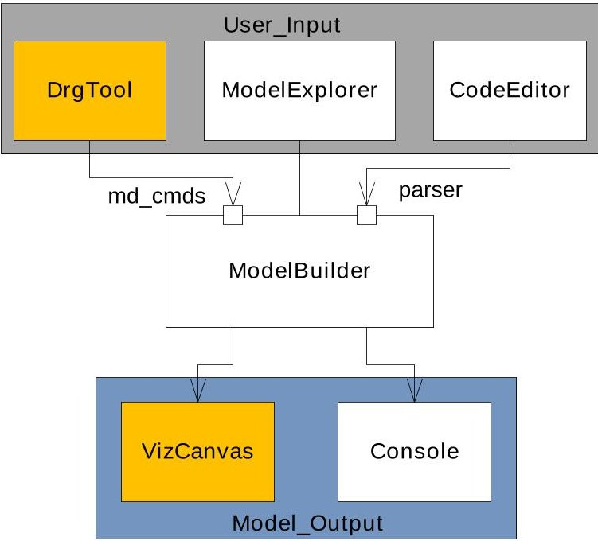


<div align="center">

Figure 20: ESysML Modeling Tool Architecture

</div>

<!-- PDF_PAGE: 66 -->

As part of this research, a prototype modeling environment based on the architecture shown in Figure 21, named ESysML Modeler, was developed. Its purpose is to demonstrate a proof of concept as well as a reference implementation for the ESysML language. The tool currently implements all of the modules of the proposed architecture except the drawing tool and a fully integrated visualization canvas (i.e. features highlighted in yellow in figure 20). A screen shot of the tool's user interface is shown in figure 21.


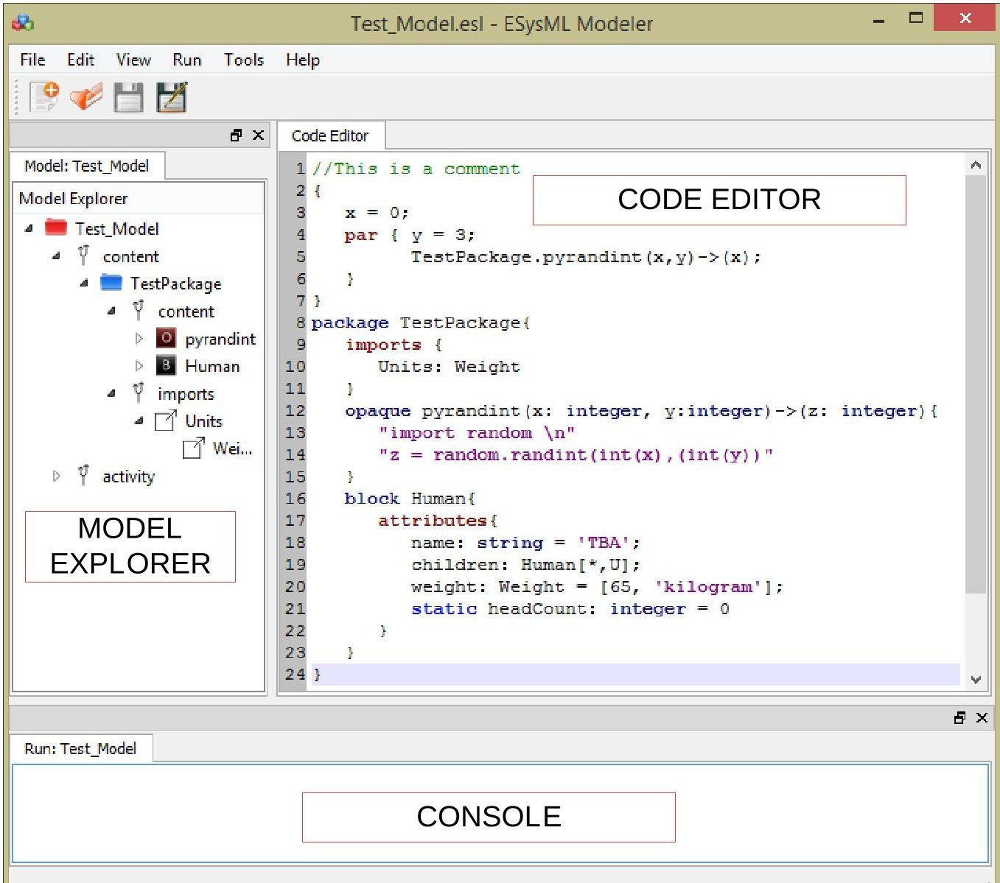


<div align="center">

Figure 21: Prototype Tool (ESysML Modeler)

</div>

<!-- PDF_PAGE: 67 -->

## 4.2. Model Parsing and Implementation

The model builder module supports creation of a user model from ESysML code specified in the Code editor. The code editor offers syntax checking and a highlighting of language keywords. Model parsing is implemented using Arpeggio (Dejanović, Milosavljević, & Vaderna, 2016) which is a Parsing Expression Grammar (PEG) (Ford, 2004) parsing library in Python. The parser generates an Abstract Syntax Tree (AST), which is interpreted into a user model by the model builder module. Appendix C entails Python code for model parsing and implementation in the ESysML Builder software.

As discussed in the previous chapter, the type and package constructs serve as namespaces for user defined model elements. Thus, the dot notation may be used for referencing an elements full name based on its location within a model. Additionally, the keyword 'this' may be used to reference an element's context namespace. This is applicable in activity definition scenarios where specified parameter names may shadow existing names in the context namespace.

Names of elements defined at the model level may be globally accessed throughout a model. In addition to user specified imports, a model's namespace contains references to built in elements which offer constructs such as arithmetic and logical operations, random number generating functions and global variables, such as time and the default import directory name. A detailed list of built in global variables are offered in Appendix D.

The Model Builder module additionally supports storage of models classes as .esl file types. Also model elements may be exported in JavaScript Object Notation (JSON) file format and stored to a document database (ex. MongoDB, CouchDB). JSON is adopted here due to its relative

<!-- PDF_PAGE: 68 -->

intuitiveness for storing objects. Objects are structured similar to python dictionaries, consisting of key value pairs representing attribute names and values.

## 4.3. Model Execution and Observation

Model execution entails the two phases of compilation and execution. Model compilation entails the creation of the user model schema as python classes. The resulting model schema after compilation may be visualized in the Model Explorer window. The Compile function available on the modeling tool's run menu enables users to initially compile and visualize the resulting model structure prior to execution, which is useful for debugging models. Table 5 offers a list of ESysML constructs and their python correspondent applied in the compilation phase.

<div align="center">

Table 5: ESysML and Corresponding Python Constructs

</div>

<table border="1"><tr><td>SysML</td><td>Python</td></tr><tr><td>type(block,data_type)</td><td>class object</td></tr><tr><td>property</td><td>attribute</td></tr><tr><td>instance</td><td>instance object</td></tr><tr><td>integer</td><td>int</td></tr><tr><td>real</td><td>float</td></tr><tr><td>string</td><td>str</td></tr><tr><td>boolean</td><td>bool</td></tr><tr><td>null</td><td>none</td></tr><tr><td>action definition</td><td>callable class object</td></tr><tr><td>action</td><td>function invocation</td></tr><tr><td>package</td><td>class object</td></tr><tr><td>model</td><td>package</td></tr></table>

<!-- PDF_PAGE: 69 -->

Model Execution entails execution of activities previously compiled into python. This is handled by a simulation executive class, which is offered as part of the model builder module. The implementation of simulation executive is based on the three-phase worldview. The executive maintains a global model variable, time and updates it to the timestamp of the model element with the next imminent event in order to advance time in a simulation event loop. Change events of model elements are scanned after executing time events due at the current simulation time.

Block instances in the model by default maintain record of the current model time and a list of change_events and constraints for execution. Additionally, the built in observe action enables modelers to specify model element properties to be stored for analysis. This enables the executive and observer of the simulation builder classes to implement action invocations as well as record changes in observed properties over time. The model execution architecture is illustrated in figure 23.


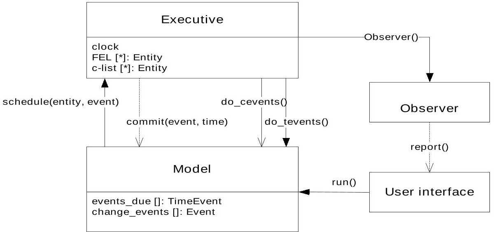


<div align="center">

Figure 22: Model Execution Architecture

</div>

<!-- PDF_PAGE: 70 -->

The Model block is able to schedule time_event executions invoked by the Executive. It maintains a due_now list that is populated by the return call (i.e. commit(); see Fig 24) from scheduling a time event on the executive. A Model’s due_now list maintains a record of the next events to be called on the Entity by the Executive. Similarly the change_events list maintains a record of an entities change events, all of which are scanned and executed based on the truth value of their conditions. The commit() operation, which is invoked from the executive, assigns a time and next time events due on an entity.

The executive block records the simulation time, and advances it to the time of the next imminent event with each iteration of the simulation loop. Time and change events to be executed are managed by maintaining two separate lists of events i.e. the conditionals list (c_list) and Future events list (FEL). The c-list is initialized at the start of a simulation based on change events and constraints of blocks in the model. The FEL is populated by scheduling of actions through time events.

The Observer class accessed through the built in observe action, offers facilities for recording model parameters relevant to a modeler. It has interfaces with the model and executive to report on the value of specified model elements during the course of a simulation run. Additionally, it offers methods for writing simulation results to persistent storage after model execution.

A simulation run is initialized by factory functions that instantiate model entities, with given initial attributes events and actions. Additionally, an initial event schedule, which triggers the commit method, is required as part of initialization to populate the FEL with an event prior to the simulation loop. After each iteration of the loop, an update method offered by model entities as an interface to the observer, reports a snapshot of an entities state at the current simulation time

<!-- PDF_PAGE: 71 -->

to the observer. An overloaded version of this method updates a plot of an entities state at each time lapse. Figure 24 illustrates the model execution sequence.


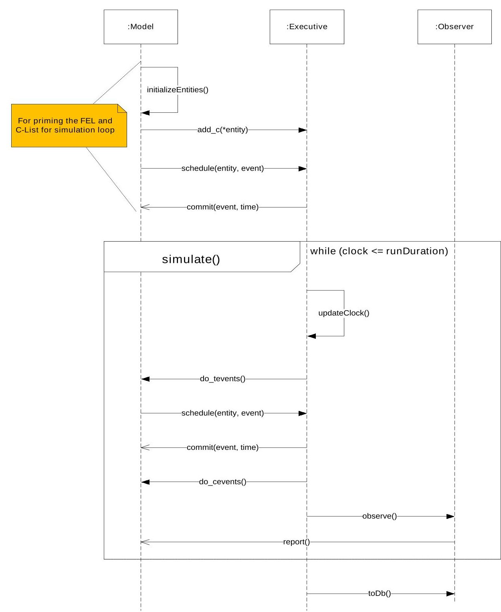


<div align="center">

Figure 23: Model Execution Sequence

</div>

<!-- PDF_PAGE: 72 -->

## 4.4. Model Library

As indicated in the introductory chapter, a significant advantage of adopting an executable modeling standard is the potential for the reuse of prebuilt model components. Model libraries in this vein offer a foundation of pre-built models that facilitate collaboration and application of established patterns pertaining to a domain of inquiry.

In line with the goal of this work, which is the development of a SysML based framework for executable architecture descriptions of real time systems, an additional library of model elements is provided. This is aimed at offering re-usable elements in the simulation model of real time systems such as resource pools, service queues, servers, clients etc. This work applies concepts from Queuing theory to validate the long-term behavior of service queues.

Queuing theory offers a mathematical analysis of systems characterized by waiting lines and resource sharing problems. It is useful for estimating system performance measures such as delays, congestion, and resource utilization, etc. Queuing systems are typically described by the probabilistic properties of the incoming flow of requests, service times, and service disciplines. The service discipline determines the rules based on which arriving requests are prioritized for service; examples include First in First out (FIFO) and Last in First out (LIFO) service disciplines. The service times and inter-arrival times are typically assumed to be independent random variables (Sztrik, 2012).

Figure 26 illustrates the Client and Server block which are offered as part of the queueing theory library named QLibrary. The Client block implements a creation pattern for generating resource consuming entities, which is typically implemented in simulation applications. It prescribes a model entity that periodically generates service request entities based on a random statistical

<!-- PDF_PAGE: 73 -->

distribution or a user defined time function. Similarly, the Server block models a typical service providing entity with a limited resource pool and randomly generated service times. Appendix D offers a more detailed textual specification of components offered as part of this model library.


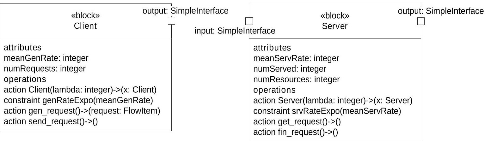


<div align="center">

Figure 24: Structure of Client and Server Blocks

</div>

## 4.5. Summary

This chapter introduced a prototype model development environment i.e. ESysML Modeler. A discussion of the tool's software architecture as well as strategies for model parsing, implementation, execution, and simulation observation was discussed. The provided software is by no means complete, as it only offers a prototype environment for demonstrating proof of concept use cases of the ESysML, but is sufficient for the purposes of this research.

Among the features proposed for a typical MBSE CASE tool, the ESysML modeler supports model specification via textual code, error reporting, and visualization of model structure and simulation results. The software does not yet support generation of model diagrams and animated

<!-- PDF_PAGE: 74 -->

simulation. These features while necessary for eventual dissemination and adoption of the proposed framework are beyond the scope of this work, and proposed for future research.

In regards to the goals of this research, this chapter addresses the objective of providing software tools to facilitate an implementation of the ESysML.

Based on the ESysML and its prototype implementation tool, the research objective of demonstrating a sample application of the framework can be achieved. The following chapter discusses a model development approach and a sample model implementation of in ESysML. This offer addresses research objective 3, while additionally offering guidance model development using the ESysML framework.

<!-- PDF_PAGE: 75 -->

## 5. DEVELOPMENT PROCESS & SAMPLE MODEL

This chapter introduces a model development process aimed at supporting the specification of progressively detailed models in ESysML ranging from high level domain models to executable models. Additionally, a discussion of a sample model implementation is provided as a proof of concept implementation of the ESysML language and model development process.

The proposed model development process is an extension of the Modeling & Simulation Systems Development Framework (MS-SDF) (Tolk, Diallo, Padilla, & Herencia-Zapana, 2013). This essentially adapts the classical systems engineering development approach to Modeling and Simulation. Some revisions are introduced to the MS-SDF so as to accommodate the use of model artifacts beyond analysis and problem solving in the systems engineering context to the documentation and communication of design required in the system architecting stage.

Subsequent sections of the chapter are organized as follows: Section 5.1 offers an overview of the MS-SDF. Additionally, it discusses the proposed model development process and expected artifacts based on it. In Section 5.2 a sample implementation of that illustrates an implementation of the language and development process is offered. The final section offers a summary of the chapter and reflects on implications with regards to the overall objectives of this research.

## 5.1. Modeling & Simulation - Systems Development Framework (MS-SDF)

Tolk et al. (2013) proposed the MS-SDF; a framework for building simulation models that applies the systems engineering processes of requirements engineering, conceptual modeling, and verification and validation (V&V). The MS-SDF entails three primary modeling components: reference model, conceptual model, and simulation model. Figure 27 illustrates the MS-SDF development process.

<!-- PDF_PAGE: 76 -->


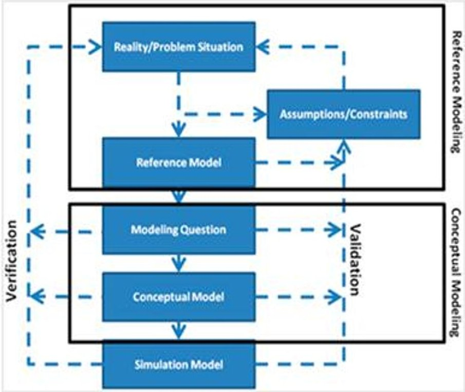


<div align="center">

Figure 25: MS-SDF (Tolk et al. 2013)

</div>

Analogous to requirements for engineering, the reference model serves to capture the knowledge about the problem domain and stakeholders' expectations for a candidate solution. It entails constructs such as requirements, design rationale, domain knowledge, assumptions, etc. Conceptual models in this context offer a subset of constructs from the reference model useful for addressing specified stakeholder questions, i.e. the basis for the architecting process. They serve as inputs for simulation models which are essentially computer executable versions of a conceptual model. The MS-SDF thus offers a systematic approach that ties documentation of domain information to simulation models which are useful for evaluating questions/problems from the domain.

<!-- PDF_PAGE: 77 -->

## 5.1.1. Using the MS-SDF for Executable Systems Modeling

The MS-SDF is in consonance with the typical MBSE methodology (Estefan, 2007), which follows a similar pattern of requirements elicitation, model specification, and simulation based testing. In this research, the MS-SDF is aligned with concepts in systems modeling and architecture that were earlier introduced.

A viewpoint and corresponding views, in architecture modeling, are useful for scoping and defining a subset of model elements (i.e. views) tailored to a given stakeholder audience or purpose. Thus the concept of architecture view is used here in reference to the MS-SDF model components of reference model, conceptual model, and simulation model, as these are essentially complementary views of a single reference. An architecture model in this framework thus consists of reference, concept, and executable views.

The reference view is aimed at offering a model of constructs and entity categories in the problem domain. This view specifies the universe of possible objects, their behavior, and rules of interaction and represents the extent of stakeholders' knowledge of the problem domain. The concept view is an implementation of the reference view. It serves to represent a system existing or intended to exist in time and space. The role of this view is to offer a specification of alternative configurations of a to-be system, based on definitions laid out in the reference view.

Finally, the executable view is aimed at simulating the concept view under a specified observation window in time and space. It therefore includes additional concepts regarding execution start point and terminating conditions, as well as objects and attribute data to be captured for analysis. This can be run given an appropriate execution infrastructure that manages time and event driven action routines.

<!-- PDF_PAGE: 78 -->

The data retrieved from running executable models are useful for refining the reference and conceptual views in subsequent iterations of this modeling process. Figure 28 illustrates the proposed architecture views.


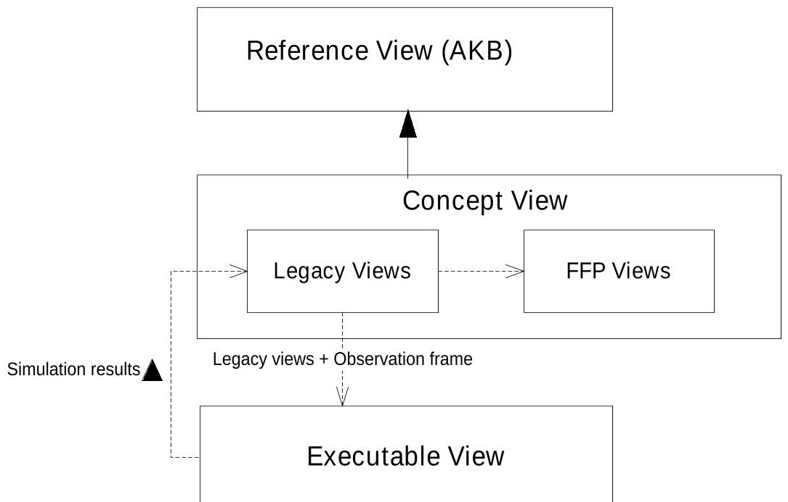


<div align="center">

Figure 26: Architecture Views

</div>

## 5.1.2. Development Process

In alignment with the architecture views, a model development strategy entailing four phases of modeling activities is proposed namely: reference modeling, conceptual modeling, executable modeling, and model execution. These can be further extended to suit the particular development context.

The model execution phase entails model run and data analysis activities. Resulting data from this phase offers information feedback to refine model artifacts from subsequent iterations of the development cycle. Additionally, Fit-For-Purpose (FPP) visualizations can be developed from

<!-- PDF_PAGE: 79 -->

integrating analysis results and legacy views to offer additional artifacts in response to stakeholders' information needs. Figure 29, below, illustrates the model development process and with corresponding artifacts.


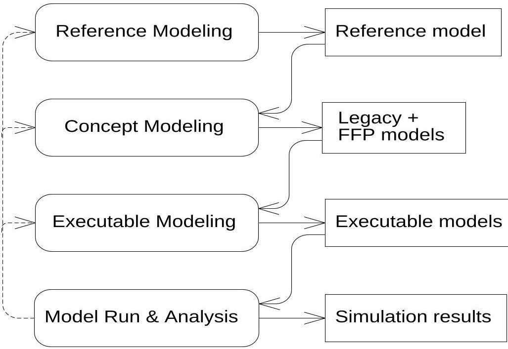


<div align="center">

Figure 27: Development Process

</div>

## 5.2. Sample Implementation

To further illustrate the proposed development process and meta-model, this section describes an implementation of a sample use case based on a discrete event simulation model presented in (Balci, 1988). This problem was chosen as it offers a non trivial simulation case with known results which is useful in verifying the software implementation provided here. Subsequent sections offer the problem statement and outline the various activities of the model development strategy proposed in the previous chapter applied specifically to this case.

<!-- PDF_PAGE: 80 -->

## 5.2.1. Problem Statement - The MVS System

The problem consists of modeling and simulating a Multiple Virtual Storage (MVS) batch computer system with two Central Processing Units denoted by CPU1 and CPU2. Users submit programs to the system for processing on different network types. Inter-arrival times of programs to the MVS system are assumed to follow an exponential distribution. Table 6 specifies the various types of system users and the mean inter-arrival times for service requests to the MVS- System.

<div align="center">

Table 6: User Types and Inter-Arrival Times for Service Requests

</div>

<table border="1"><tr><td>Type of User</td><td>Interarrival Times</td><td>Mean</td></tr><tr><td>Modem 300 User</td><td>Exponential</td><td>3200 Seconds</td></tr><tr><td>Modem 1200 User</td><td>Exponential</td><td>640 Seconds</td></tr><tr><td>Modem 2400 User</td><td>Exponential</td><td>1600 Seconds</td></tr><tr><td>LAN 9600 User</td><td>Exponential</td><td>266.67 Seconds</td></tr></table>

The MVS system is composed of a Job Entry Subsystem (JES). The JES scheduler assigns programs to CPU1 with a probability of 0.6 or to CPU2 with a probability of 0.4. At the completion of program execution on a CPU, the program's output is returned back to the user with a probability of 0.2 or to the printer (PRT) with a probability of 0.8.

Additionally, all queues in the MVS computer system follow a first in first out discipline and each facility (i.e., JESS, CPU1, CPU2, or PRT) processes programs one at a time. The probability distribution and the average processing times for each facility are given in Table 7.

<!-- PDF_PAGE: 81 -->

<div align="center">

Table 7: Processing times for MVS-System Sub-Components

</div>

<table border="1"><tr><td>Facility</td><td>Processing Times</td><td>Mean</td></tr><tr><td>JES Scheduler</td><td>Exponential</td><td>112 Seconds</td></tr><tr><td>Processor 1(CPU1)</td><td>Exponential</td><td>226.67 Seconds</td></tr><tr><td>Processor 2(CPU2)</td><td>Exponential</td><td>300 Seconds</td></tr><tr><td>Printer(PRT)</td><td>Exponential</td><td>160 Seconds</td></tr></table>

The results of the following system performance measures are provided for a simulation of the MVS system processing at least 15,000 programs (Balci, 1988).

a. Utilization of the JESS ( $ \rho $ JESS) = 0.70

b. Utilization of CPU 1 ( $ \rho $ CPU1) = 0.85

c. Utilization of CPU 2 ( $ \rho $ CPU2) = 0.75

d. Utilization of the Printer ( $ \rho $ PRT) = 0.80

e. Average time spent by a batch program in the MVS computer system (W) = 2400 seconds

f. Average number of batch programs in the MVS computer system (L) = 15

## 5.2.2. Reference Modeling

Reference modeling is aimed at capturing general knowledge from the problem domain. This phase additionally enhances collaboration between subject matter experts and modeler's and ultimately stakeholder buy in and validation. With regards to ESysML, the constructs of type and action definitions are primarily utilized here to specify the main types of entities and processes in the reference domain.

<!-- PDF_PAGE: 82 -->

Figure 30 is a block diagram that illustrates the structure of a notional batch computer derived from the problem statement. A batch computer is defined here as being composed of a scheduler, one or more CPUs and printers, as well as input and output ports. Additionally, connectors between the batch computers components are modeled as a fourth component type i.e. links. It is noteworthy that the Server, SimpleLink, and SimpleInterface blocks are imported from the QLibrary model discussed in the previous chapter.


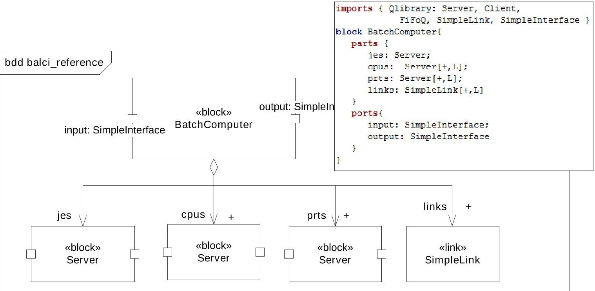


<div align="center">

Figure 28: Block Diagram of Batch Computer with Textual Specification

</div>

<!-- PDF_PAGE: 83 -->

## 5.2.3. Conceptual Modeling

Conceptual modeling activities specify an architecture concept which is an instantiation of concepts/model elements predefined in a reference model. It further refines the reference model by specifying physical and timing constraints on action execution. Essentially, this is aimed at specifying a model of a To-be architecture concept. Figure 31 illustrates an instance model that specifies the given configuration of the MVS system. This is implemented as an extension of the batch computer model specified in the reference model.


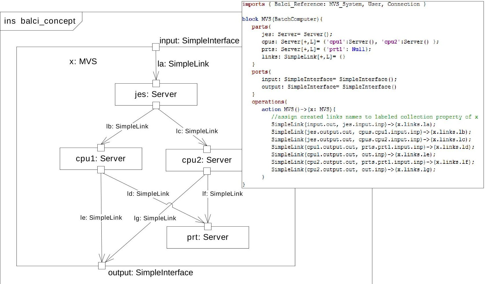


<div align="center">

Figure 29: Instance Model of MVS To-be Architecture

</div>

<!-- PDF_PAGE: 84 -->

## 5.2.4. Executable Modeling

Executable modeling introduces the concepts of execution termination points and model observation to a conceptual model. Additionally, this specifies a test case or scenario useful for evaluating the requirements and validating architecture decisions regarding the system. Model observation is implemented using an observer action. This supports specifying relevant model properties to be logged during the course of a simulation. The resulting simulation data log can serve as an input for model based analysis.

Specifically for the MVS case, the executable view must instantiate users modeled with the Client block, as well as the specific availabilities of the MVS internal connections as given in the problem statement. From the problem statement, the simulation reaches steady state after approximately 15,000 programs are generated, therefore the executable model must specify a termination point that ensures that the number of generated requests exceeds the steady state point of 15,000. In this case, the termination point is specified with a change event that sets the termination point at 15,000 requests on the output port of MVS system. Appendix E entails the complete reference, conceptual, and executable views of the sample model.

Figure 33 illustrates the initialization section of an executable view that models scenario given in problem statement using an instance diagram. The complete executable model may specify initializing actions as well as a simulation termination point.

<!-- PDF_PAGE: 85 -->


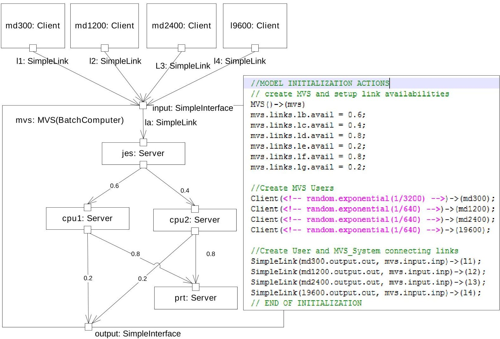


<div align="center">

Figure 30: Instance Model of Executable Model Test Case Initialization Actions

</div>

## 5.2.5. Model Run and Data Analysis

The final phase entails model data analysis and visualization efforts. Currently, ESysML modeler prototype offered as part of this work enables storage of simulation logs as .csv files. The ultimate goal with regards to architecture modeling as presented in this work is the integration of simulation results into legacy model diagram types such as block and activity diagrams, as Fit- For-Purpose presentations useful for decision support.

<!-- PDF_PAGE: 86 -->

While the prototype tool is yet to provide this feature, existing data analysis and visualization software may be used to support the data analysis phase of the model development methodology. With regards to the MVS case study figure 34 below offers a plot of utilization over time for thejes scheduler, cpu1, cpu2, and printer. As shown, the simulated results are validated by the analytical results given in the problem statement.


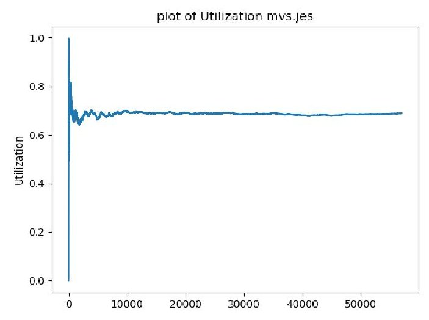


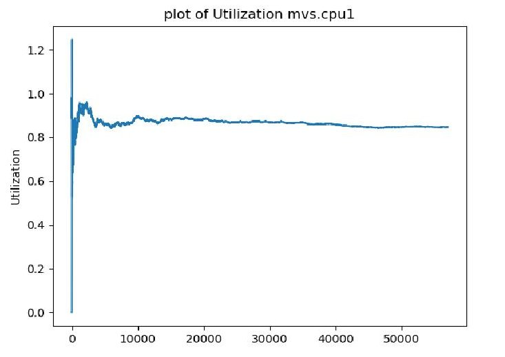


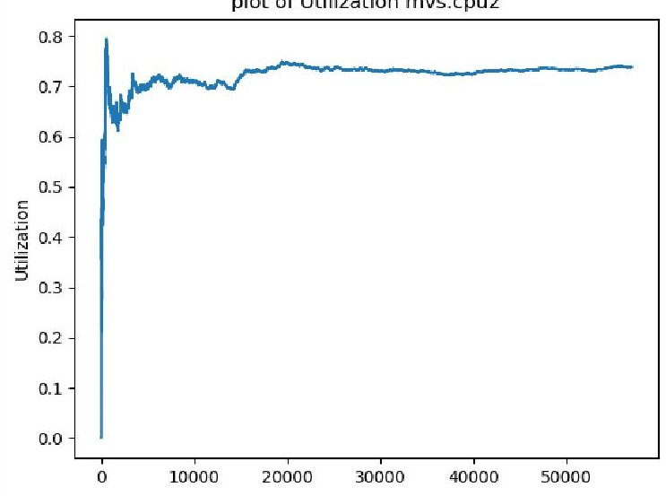


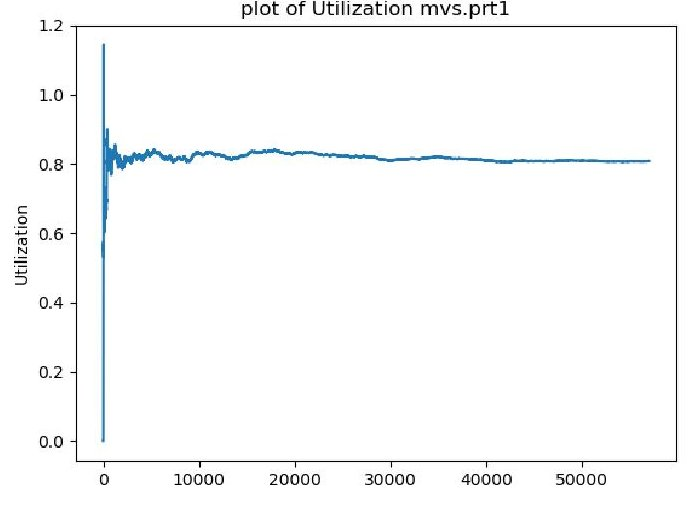


<div align="center">

Figure 31: Plot of Utilization for JES, CPU1, CPU2 and Prt1

</div>

<!-- PDF_PAGE: 87 -->

## 5.3. Summary

This chapter concludes the discussion on the ESysML started in Chapter 3. A model development process based on the MS-SDF was offered. Additionally, a sample model was offered as a proof of concept implementation of the language and proposed modeling process. The full textual specification for the sample implementation is provided in Appendix E.

As mentioned in Chapter 4, the model development environment does not yet implement support for model specification via the graphical syntax or model diagrams. Thus the sample model provided may only serve as a proof of concept for the execute-ability of the textual syntax. An implementation of both graphical and textual syntaxes is necessary to verify equivalence. Again, this is beyond the scope of this work and as such proposed for future work.

<!-- PDF_PAGE: 88 -->

## 6. SYSTEMS MODELING FORMALISMS

This chapter discusses the ESysML in relation to existing modeling formalisms, highlighting the underlying commonalities as well as unique contributions of this work to the current state of the art in systems modeling. The term "modeling formalism" is used here in reference to a combination of set theoretic formulations, executable languages, and/or graphical notations proposed in the literature for systems modeling and architecture description.

The modeling formalisms reviewed here are; High Level Petri-nets, Discrete Event System Specification (DEVS) formalism, and the Object Process Methodology (OPM). While this is not an exhaustive list, it sufficiently represents the primary alternatives to UML or UML derived languages available for developing executable conceptual models. There's a significant body of work regarding High Level Petri-nets and the DEVS formalisms which offer graphical notations as well as software for model specification and execution based on them. Similarly OPM offers a graphical notation with ontologically grounded semantics as well as supporting software for model specification and execution. This chapter essentially juxtaposes the ESysML against the aforementioned formalisms and argues for its place as a refined and executable variant of the SysML.

Subsequent sections of the chapter are organized as follows: Section 6.1 offers an overview on the underlying theory and tools for Petri-net modeling. Additionally, there is a discussion on the common underlying language concepts of the formalism as well as the comparative strengths of the ESysML. Section 6.2 and 6.3 offer a similar discussion of DEVS and OPM respectively, in comparison to ESysML. Finally Section 6.5 offers a chapter summary and concluding remarks.

<!-- PDF_PAGE: 89 -->

## 6.1. High Level Petri-Nets

A Petri net is a directed, weighted, and bipartite graph. It consists of two kinds of nodes, places, and transitions, which are connected by arcs from a place to a transition or from a transition to a place. In graphical representation, places are drawn as circles, transitions as rectangles. Arcs are labeled with their weights (positive integers), where a k-weighted arc can be interpreted as the set of k parallel arcs. A marking assigns to each place, a non-negative integer. The marking of a place is also referred to as the number of tokens on the place (Murata, 1989). Formally a Petri net is a 5-tuple denoted by;

$$
P N = < P, T, F, W, M _ {0} >
$$

where:

- P is a finite set of places

- T is a finite set of transitions

- $ F \subseteq ( P \times T ) ( T \times P ) $ is a set of arcs (flow relation),

- W: F $ \rightarrow $[1,2,3,..] is a weight function,

- $ \mathrm{M}_{0} $ : $ \mathrm{P} \rightarrow[0,1,2,3,\dots] $ is the initial marking

- $ P \cap T=\varnothing \wedge P \cup T=\varnothing $

A Petri net structure N = <P, T, F, W>, without any specific initial marking, is denoted by N. A Petri net, with the given initial marking, is denoted by <N, MO> (Murata, 1989).

To simulate state changes in a dynamic system, a Petri net's marking can be changed based on the following rules.

<!-- PDF_PAGE: 90 -->

- A transition t is said to be enabled if each input place p of t is marked with at least w(p, t) tokens; where w(p, t) is the weight of the arc from p to t.

- An enabled transition may or may not fire, i.e. it only implies conditions required for a transition firing (i.e. an event) are met.

- A firing of an enabled transition t removes w(p, t) tokens from each input place p of t, and adds w(t, p) tokens to each output place p of t, where w(t, p) is the weight of the arc from t to p (Murata, 1989).

There are limitations to the scale and expressivity of Petri nets, since they do not support modularity and complex data types. To address this, a number of derivative works have offered extensions, collectively known as High level Petri-nets, to address these limitations. Examples of these are Predicate Transition nets and Colored Petri nets (Genrich & Lautenbach, 1981; Jensen, 2013).

Coloured Petri nets (CPN) are particularly interesting in relation to the current research as they enhance classical Petri nets with features to support complex data types (i.e. color sets) and hierarchical nets (nested transitions). Additionally, nets can be inscribed with a functional programming language (i.e. Standard ML) to support model initialization, data manipulation, etc. (Jensen, 2013).

With regards to supporting software, the CPN Tools, (Ratzer et al., 2003) offers an open source development environment for CPN models. This enables model specification as well as animated simulation of models, which is useful for exploring dynamic behavior and model debugging. Figure 35 is a simple queue model implementation in CPN tools. This illustrates CPN's functional model, i.e. transitions (functions) consuming or creating tokens on places (i.e. data structures), denoted rectangles and ovals respectively.

<!-- PDF_PAGE: 91 -->


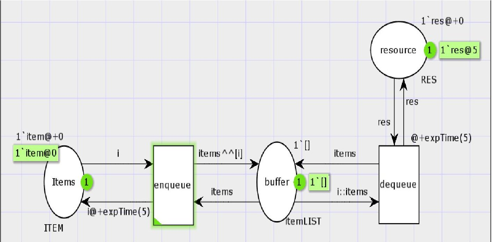


<div align="center">

Figure 32: CPN Model of an M/M/1 Queue

</div>

## 6.1.1. Comparing CPN with ESysML

CPN is primarily aimed at supporting dynamic simulation. As such, it lays emphasis on the behavioral aspects of a system and may not be ideally suited for visualizing the structure of a system. Additionally, CPN offers an inherently functional approach, in contrast to ESysML which is based on an object oriented worldview. The object oriented offered in ESysML enables a separation of concerns between a system structure and behavioral properties and is preferable in a typical systems engineering context where documentation and communication of system structure is a primary objective.

CPN's primary modeling constructs of places, transitions, and arcs are analogous to ESysML activity modeling constructs of blocks/data, actions, and dependency relations between actions. The action execution semantics of ESysML is the same as in CPN, i.e. transitions are fired when

<!-- PDF_PAGE: 92 -->

there are inputs on all incoming arcs. Additionally, both languages employ the use of a scripting language, i.e. opaque expressions in ESysML to support detailed execution specifications. Table 8 offers a summary of CPN constructs and corresponding concepts in ESysML.

<div align="center">

Table 8: Comparison of CPN with ESysML Concepts

</div>

<table border="1"><tr><td>CPN</td><td>ESysML</td></tr><tr><td>Transition</td><td>Action</td></tr><tr><td>Place</td><td>Instance</td></tr><tr><td>Arc</td><td>Dependency(i.e.invocation and progression)</td></tr><tr><td>Marking</td><td>Opaque expression/Instance</td></tr></table>

## 6.2. Overview of DEVS

The DEVS (Zeigler, 1984) formalism prescribes a set theoretic approach for formally specifying time based computer simulations. The basic modeling unit in DEVS is the Atomic model, which is formally defined as follows:

$$
\mathrm {M} = < \mathrm {X}, \mathrm {Y}, \mathrm {S}, \delta_ {\mathrm {i n t}}, \delta_ {\mathrm {e x t}}, \delta_ {\mathrm {o u t}}, \lambda , \mathrm {t a} >
$$

where:

- X is the set of input event values, i.e. the set of all the values that an input event can take;

- Y is the set of output event values;

<!-- PDF_PAGE: 93 -->

- S is the set of state values;

- $ \delta $int, $ \delta $ext, $ \lambda $ are input, external, and output transition functions respectively;

- ta is the time advance, a non-negative real number.

DEVS atomic models can be coupled and/or composed into hierarchical modular models through input and output ports. A DEVS coupled model is formally defined as:

$$
\mathrm {C M} = < X, Y, D, \left[ M _ {i} \right], \left[ I _ {i} \right], \left[ Z _ {i, j} \right] >
$$

where:

- X is the set of input events

- Y is the set of output events

- D is indexes of the components of the coupled model.

- $ M_{i} $ is a basic DEVS model (i.e. atomic/coupled) for all i in D

- $ I_{i} $ is the set of influences of a model

- $ Z_{i,j} $ is the i to j translation function for j in $ I_{i} $

Coupled models define a set of interconnected basic components. The influences set of a model specifies the target of model outputs. It essentially defines a mapping between output and input ports. The translation function supports conversion of a model's outputs to inputs for target models.

## 6.2.1. Comparing ESysML with DEVS

DEVS essentially supports the specification of a systems structure and state based behavior. Behavior is captured at the atomic level with the specification of the execution logic for internal

<!-- PDF_PAGE: 94 -->

external and output transition functions. The coupled model enables a specification of system structure, i.e. how components are connected through item exchanges on their ports.

SysML on the other hand supports specification of multiple modeling formalisms, including DEVS. The table below illustrates DEVS modeling constructs and corresponding constructs in SysML.

<div align="center">

Table 9: Comparison of DEVS with ESysML Concepts

</div>

<table border="1"><tr><td>DEVS</td><td>ESysML</td></tr><tr><td>Atomic Model</td><td>Block</td></tr><tr><td>Input port</td><td>Interface</td></tr><tr><td>Output port</td><td>Interface</td></tr><tr><td>State Variables</td><td>Value/Part properties</td></tr><tr><td>Functions(i.e. transitions and time advance)</td><td>Actions</td></tr><tr><td>Events</td><td>Events(Time/Change)</td></tr></table>

In DEVS, ports are primarily useful for transmitting across coupled atomic models. While the concept of coupled model is analogous to ESysML port-connector scheme for modeling physically coupled blocks, the ESysML model explicitly models item flow across blocks based on the behavior definition (i.e. actions and events) of their port and connectors.

However, event exchanges across ports can be implemented in ESysML by specifying events as input and output values of port actions. Additionally, the DEVS concepts of sigma and phase variables, which determine an atomic model's next transition time and target state, can be

<!-- PDF_PAGE: 95 -->

implemented in ESysML using time events and action invocation respectively. Based on this approach, the ESysML framework can potentially be leveraged as graphical language implementation of DEVS models. This will enable executable views in ESysML to be uniformly executed via model transformation on DEVS conformant simulators.

## 6.3. Object Process Methodology

Unlike DEVS and High Level Petri nets that proceed from an underlying set theoretic formulation, OPM offers an ontological foundation of constructs based on which an executable modeling methodology is built. In this regard, OPM proposes an underlying universal ontology, which is a domain independent set of concepts for describing the universe, both natural and artificial (Dori, 2011).

Similar to the Bunge-Wand-Weber Ontology discussed in Chapter 3, OPM proposes the concept of thing and relations between things as the sole descriptor or model of the universe. The primary building blocks of the OPM ontology are object, with state and process. An object is a thing that exists. Processes are things that represent a pattern of object transformation. Transformation here represents object creation, consumption and/or a change in its state. State in OPM represents a situation where an object can exist at certain points during its lifetime or a value it can assume (Dori, 2011).

An OPM model may be specified either with a textual or graphical syntax i.e. Object Process Language (OPL) and Object Process Diagrams respectively. The Object-Process Case Tool (OPCAT) shown in Table 10 illustrates OPM primary constructs, corresponding graphical notation and description.

<!-- PDF_PAGE: 96 -->

<div align="center">

Table 10: OPM Primary Constructs and Graphical Notation

</div>

<table border="1"><tr><td>Thing/Attribute</td><td>Symbol</td><td>Description/OPL sentence</td></tr><tr><td rowspan="2">Object</td><td rowspan="2">Object Name</td><td>A thing(entity)that has the potential of stable, unconditional physical or mental existence.</td></tr><tr><td>Object Name is an object.</td></tr><tr><td rowspan="2">Process</td><td rowspan="2">Processing</td><td>A thing representing a pattern of transformation that objects undergo.</td></tr><tr><td>Processing is a process.</td></tr><tr><td rowspan="2">Essence</td><td rowspan="2">Object Processing</td><td>An attribute that determines whether the thing(object or process)is physical(shaded)or informational.</td></tr><tr><td>Processing is physical.</td></tr><tr><td rowspan="2">Affiliation</td><td rowspan="2">Object Processing</td><td>An attribute that determines whether the thing is environmental(external to the system,dashed contour)or systemic.</td></tr><tr><td>Processing is environmental.</td></tr></table>

<div align="center">

Note. Reprinted from Modeling Complex Systems with Object-Process Methodology, by Dov Dori, retrieved from: https://www.iltam.org/check_download_nopass.php?forcedownload=1&file=files/84dov%20dori.pdf&no_encrypt=true&dlpassword=84967

</div>

## 6.3.1. Comparing OPM with ESysML

Similar to OPM, ESysML offers a systems modeling approach based on the notion of a fundamental ontology that clearly defines the semantics of primary modeling constructs and rules for their use in models. The main difference, however, is that ESysML explicitly sought to retain SysML/UML terminology and graphical syntax as much as possible without violating an overarching schema based on the BWW ontology.

Based on this insistence on an ontological basis for modeling languages, ESysML and OPM share a number of similar features; an example of this is OPM's concept of essence which specifies whether an object may be considered physical or informatical. This is essentially

<!-- PDF_PAGE: 97 -->

analogous to the concepts of block and data-type in ESysML which serve as categories for distinguishing between physical and informational types that are useful for exposing the nature of physical objects. ESysML blocks are further differentiated from data instances by the time attribute. In time based simulations the time attribute primarily serves as an index for tracking property changes of a block.

Additionally OPM and ESysML both proffer similar high level modeling constructs, i.e. objects processes versus instances actions respectively. ESysML, however, entails the additional high level constructs, i.e. types, action-definitions, and packages. These constructs, although not necessarily represented in a model's referent, are useful artifacts for specifying templates for instance creation, the mechanics of action execution, and model organization respectively. Table 11 offers a summary of primary OPM concepts and corresponding constructs in ESysML.

<div align="center">

Table 11: Comparison of ESysML vs OPM Concepts

</div>

<table border="1"><tr><td>OPM</td><td>ESysML</td></tr><tr><td>Thing/Attribute</td><td>Model element/Property</td></tr><tr><td>Object</td><td>Instance</td></tr><tr><td>Process</td><td>Action</td></tr><tr><td>Essence</td><td>Block/data type</td></tr><tr><td>Value</td><td>Value type</td></tr><tr><td>Aggregation-Participation</td><td>Participation</td></tr><tr><td>Exhibition-Characterization</td><td>Characterization</td></tr><tr><td>Generalization-Specialization</td><td>Inheritance</td></tr><tr><td>Classification-Instantiation</td><td>Instantiation</td></tr><tr><td>Procedural Links</td><td>Dependency(i.e.invocation and progression)</td></tr><tr><td>State/Stateful Objects</td><td>No explicit construct of state</td></tr></table>

<!-- PDF_PAGE: 98 -->

## 6.4. Summary

This chapter offered a review of the DEVS and high level Petri-nets in relation to ESysML. Petri net and DEVS are formalisms that are primarily suited for simulation modeling and may not be ideal in the systems engineering context where modeling artifacts are additionally used for documentation and communication of design concepts. The OPM standard is more suited to this context due to its support for both a graphical and textual syntax. OPM however does not offer an explicit model of time or support for time based simulation models as in DEVS and high level Petri-nets such as CPN.

ESysML leverages SysML's widely adopted graphical syntax by offering overarching language ontology or schema as well as a corresponding textual syntax. Similar to OPM, this enables a formal specification of executable conceptual models. Additional to this, ESysML's native support for specifying time dependent events supports the use of conceptual models to verify the behavior of real time systems.

Finally, there is the potential for further work to exploit the similar underlying concepts in the formalisms, in order to enable transformation of models between formalisms. Particularly for DEVS, this approach offers an opportunity for a graphical implementation based on SysML. As discussed in Section 6.2.1, DEVS transition and time advance functions can be implemented within in ESysML as Actions invoked by time events respectively. Similarly, DEVS coupled models may be implemented via ESysML ports and connectors.

<!-- PDF_PAGE: 99 -->

## 7. CONCLUSION

This work offered a framework for developing executable models of time based dynamic systems to support the development of executable system architectures. This entails a modeling language, a prototype software tool for language implementation, and a model development process. These achieve the following overarching research objectives specified in the introductory chapter:

1. Refine SysML to support an executable specification of time based dynamic systems

2. Implement software tools and development guidelines to facilitate an implementation of Objective 1

3. Offer a sample application of the framework

4. Demonstrate theoretical grounding of the framework with regards to existing systems modeling formalisms.

Regarding the broader picture of Model Based Systems Engineering and Systems Architecting, this chapter offers a discussion on the contributions of this work, what challenges remain open, and proposed directions for future research.

Subsequent sections of this chapter are organized as follows: Section 7.1 discusses the challenges and limitations of the proposed modeling framework. Section 7.2 discusses the contributions of this work to the existing body of knowledge pertaining to systems modeling. Section 7.3 describes, in detail, the application to system architecting and executable architectures. Section 7.4 concludes this document with a discussion of proposals for future research based on this work.

<!-- PDF_PAGE: 100 -->

## 7.1. Challenges & Limitations

The relative merits of conceptual modeling languages, such as SysML over formal languages, largely remain in their utility as communication artifacts due to their graphical nature and "semiformality". In the systems engineering domain, this affords engineers a design specification language accessible to a broader stakeholder audience. However, the value of such informal model specifications decline with time, particularly in the later stages of the system development life cycle, where detailed analytical and computational models are required. Informal modeling artifacts developed earlier on essentially end up as shelf material with little to no value for engineering analysis and decision support. Since the benefits of adopting a formal conceptual modeling approach may not be apparent in the earlier stages of development, this serves as a disincentive for wide application of such approaches.

To foster wider adoption, it is especially necessary for formal approaches such as ESsyML, to offer software libraries and user interfaces that make them more accessible. An example in this regard will be incorporating support for model specification/visualization using the familiar graphical syntax of UML/SysML. While this work has demonstrated the compatibility of ESysML with SysML activity, block and package diagrams; the prototype tool provided is yet to implement such a graphical interface for model specification using these diagrams. This is proposed as future work.

Finally, the maturity of formal modeling standards such as fUML, Alf etc., particularly with regards to modeling tool vendor adoption (i.e. development environments, compilers/interpreters etc) will promote a surge in standard model libraries that enable reuse of components for building executable models in support of architecture analysis and validation. Custom

<!-- PDF_PAGE: 101 -->

approaches provided by the research community, such as offered in this work, is however required to influence and hopefully accelerate this maturity.

## 7.2. Research Contributions

This work offered a framework for executable modeling based on SysML. It identified limitations in the language due to its informal semantics for specifying executable models, which are particularly necessary for analysis and verification of models of timed systems. Based on this, an executable modeling language was offered that simplifies SysML to an essential core of formal language constructs as well as introduces constructs for specifying time change in dynamic models.

Additionally, a model development strategy was proposed to guide model specification based on three complementary viewpoints of an executable model i.e. reference, conceptual, and executable views. A modeling tool that supports model specification, execution, storage and exchange was offered.

The goal was to leverage a widely accepted standard in SyML to support formal model specification in MBSE practice. The graphical syntax of SysML can be leveraged for ESysML model specification; this potentially allows for both high level but precise models which can be readily refined into computer simulations. This provides a uniform semantic framework that bridges the gap between models for architecture description and the finer grain executable models used for their verification.

While a number of MBSE tools offer support for executing opaque expressions in programming languages such as Python and Matlab, they do not yet offer semantics and out of the box implement event driven action executions and a synchronized time advance as offered in

<!-- PDF_PAGE: 102 -->

ESysML. This potentially improves the quality of architecture description by enabling transparency and continuity between high level architecture models and the executable models used for their verification and validation.

The proliferation of internet of things and data driven intelligent systems, places an increasing demand for model driven engineering approaches and languages that support formal architecture description and analytical methods for such highly interconnected real time systems. This work lays an essential foundation for further work in this direction, by offering a relatively compact and extensible modeling schema that can be leveraged in support of various analytical techniques.

## 7.2.1. Contribution to Systems Architecting and MBSE Practice

As previously discussed in Chapter 2, the state of the art with regards to derivation of executable models from static architecture views is the two approaches of Model Transformation and Co-simulation. A significant challenge with these approaches has been the fundamental mismatch between the precise language schema of an executable language and the mostly informal schema of modeling languages such as SysML.

ESysML offers essentially a programming language with interchangeable graphical and textual syntaxes akin to the fUML/Alf standards approach for executable UML. This enables a seamless transition from high level structural models to more detailed executable models without the intermediary step of retrofitting models with extra constructs using mechanisms such as Transformation Profiles.

ESysML reduces the potential for accidental complexity by removing the extra steps required to develop transformation programs (i.e. tabs) used for generating executable models from static

<!-- PDF_PAGE: 103 -->

architecture views. Additionally, capabilities such as syntax-checking and model debugging integrated into modeling tools due to execute-ability enable a more rigorous specification of architecture descriptions.

Figures 36 and 37 illustrate the status-quo for executable model generation and the proposed approach using ESysML respectively. The highlighted area in Figure 34 outlines artifacts for executable model generation that are not required with the adoption of an executable language for modeling as advocated in this work. A system architecting approach using ESysML allows the parallel development of both static and executable models from the same underlying architectural data, resulting in better communication with stakeholders and improved analyses to support decision making.


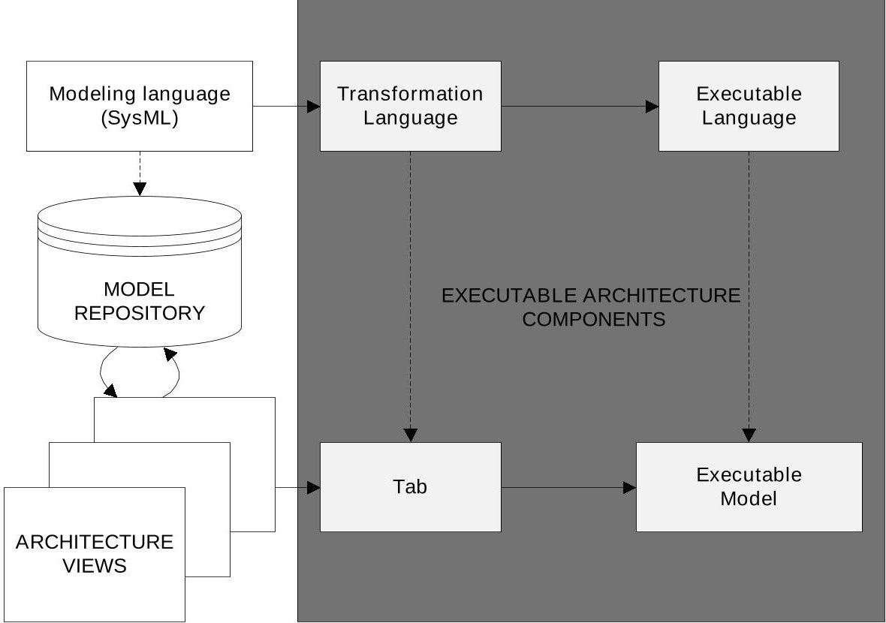


<div align="center">

Figure 33: Executable Architecture Generation via Model Transformation

</div>

<!-- PDF_PAGE: 104 -->


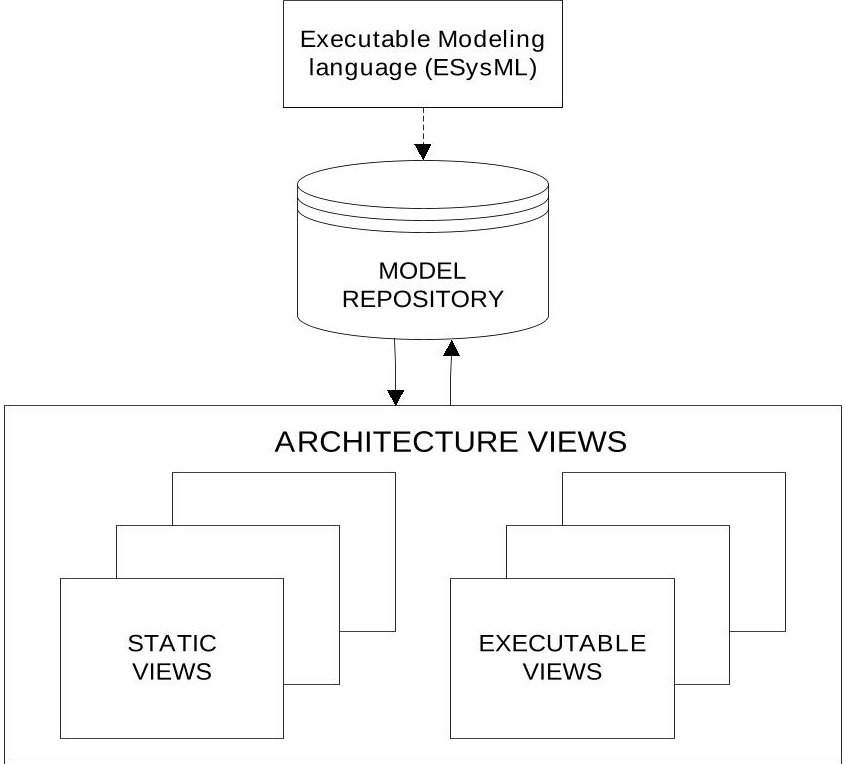


<div align="center">

Figure 34: ESysML Approach for Executable Architecture Development

</div>

## 7.3. Future Research

Future research on the proposed framework can be considered under the two categories of breadth and depth research efforts. Breadth characterizes research efforts aimed at extending ESysML constructs and the ESysML builder to support implementation of novel and domain specific concepts. In this vein, an extension of the framework to support formal specification of system requirements and traceability relations to other modeling constructs such as constraints is proposed. Such an extension of the language will provide a more rigorous model based approach to requirements engineering and architecture definition. This will add to existing systems engineering methods for design space and tradeoff analysis.

The time advance and model execution strategy offered is primarily applicable to modeling resource allocation in discrete time systems, an extension of this to support simulation of continuous time and hybrid systems is proposed for future work. This will enable the

<!-- PDF_PAGE: 105 -->

development of a broader range of models, particularly with respect to computational methods applied in most engineering physics models. Additionally, this will facilitate an integration of conceptual models which are mostly functional in perspective and physical Computer Aided Design (CAD) models.

Finally, on the notion of framework breadth, further research efforts to enhance software libraries and tools that will support transformation and automated generation of other executable languages is proposed. This additionally entails transformations for standard graph visualization formats etc., such as the Graph Description Language (Gansner & North, 2000) that support displaying system's structural hierarchies network topologies.

Research efforts aimed at depth shall be focused on offering software tools and model libraries that enhance user application of the framework. In this vein, extension of the existing modeling tool to support model specification via diagrams is proposed. Additionally, a web-based repository of sample models of various architecture patterns is proposed, this is aimed at contributing to model reuse and collaboration in the systems modeling community.

A formalization of requirements specification as well as increasingly available repositories of well-structured architecture model data will facilitate the development intelligent computer aided systems engineering tools. Tools can be bolstered with learning algorithms in order to recognize architecture patterns and offer functionalities such as identifying design flaws and proposing candidate designs to user requirements.

<!-- PDF_PAGE: 106 -->

## REFERENCES

Balci, O. (1988). The implementation of four conceptual frameworks for simulation modeling in high-level languages. Paper presented at the Proceedings of the 20th conference on Winter simulation.

Bank, D., Blumrich, F., Kress, P., & Stöferle, C. (2016, 18-21 April 2016). A systems engineering approach for a dynamic co-simulation of a SysML tool and Matlab. Paper presented at the 2016 Annual IEEE Systems Conference (SysCon).

Becker, J., Bergener, P., Breuker, D., & Rackers, M. (2010). Evaluating the expressiveness of domain specific modeling languages using the bunge-wand-weber ontology. Paper presented at the System Sciences (HICSS), 2010 43rd Hawaii International Conference on.

Blanchard, B. S., & Fabrycky, W. J. (2006). Systems Engineering and Analysis, International Series in Industrial and Systems Engineering: Prentice-Hall, Upper Saddle River, NJ.

Bombino, M., Hause, M., & Scandurra, P. (2010). Heterogeneous systems co-simulation: a model-driven approach based on SysML State Machines and Simulink. Paper presented at the First Workshop on Hands-on Platforms and tools for model-based engineering of Embedded Systems, HOPES.

Bunge, M. (1977). Treatise on basic philosophy, Vol. 3: Ontology I: The furniture of the world. Dortrecht: D: Reidel Publishing Company.

Cabot, J. (2011). List of Executable UML Tools. Retrieved March 21, 2017, from https://modeling-languages.com/list-of-executable-uml-tools/

Cao, Y., Liu, Y., & Paredis, C. J. (2011). System-level model integration of design and simulation for mechatronic systems based on SysML. Mechatronics, 21(6), 1063-1075.

Concepcion, A. I., & Zeigler, B. (1988). DEVS formalism: A framework for hierarchical model development. IEEE Transactions on Software Engineering, 14(2), 228.

Cook, S. (2012). Looking back at UML. Software & Systems Modeling, 11(4), 471-480.

Dejanović, I., Milosavljević, G., & Vaderna, R. (2016). Arpeggio: A flexible PEG parser for python. Knowledge-Based Systems, 95, 71-74.

Dori, D. (2011). Object-process methodology: A holistic systems paradigm: Springer Science & Business Media.

Dussart, A., Aubert, B. A., & Patry, M. (2004). An evaluation of inter-organizational workflow modelling formalisms. Journal of Database Management (JDM), 15(2), 74-104.

Espinoza, H., Cancila, D., Selic, B., & Gérard, S. (2009). Challenges in combining SysML and MARTE for model-based design of embedded systems. Paper presented at the European Conference on Model Driven Architecture-Foundations and Applications.

Estefan, J. A. (2007). Survey of model-based systems engineering (MBSE) methodologies. Incose MBSE Focus Group, 25(8).

<!-- PDF_PAGE: 107 -->

Evermann, J., & Wand, Y. (2005). Ontology based object-oriented domain modelling: fundamental concepts. Requirements engineering, 10(2), 146-160.

Ferris, T. L. (2007). 7.4. 3 Some Early History of Systems Engineering-1950's in IRE Publications (Part 1): The Problem. Paper presented at the INCOSE International Symposium.

Fettke, P., & Loos, P. (2003). Ontological evaluation of reference models using the Bunge-Wand-Weber model. AMCIS 2003 Proceedings, 384.

Ford, B. (2004). Parsing expression grammars: a recognition-based syntactic foundation. Paper presented at the ACM SIGPLAN Notices.

Friendenthal, S., Steiner, R., & Moore, A. (2009). A practical guide to SysML.

Gamma, E. (1995). Design patterns: elements of reusable object-oriented software: Pearson Education India.

Gansner, E. R., & North, S. C. (2000). An open graph visualization system and its applications to software engineering. Software Practice and Experience, 30(11), 1203-1233.

Hevner, A. R. (2007). A three cycle view of design science research. Scandinavian journal of information systems, 19(2), 4.

Howell, F., & McNab, R. (1998). SimJava: A discrete event simulation library for java. Simulation Series, 30, 51-56.

livari, J., & Venable, J. (2009). Action research and design science research-seemingly similar but decisively dissimilar. Paper presented at the 17th European Conference on Information Systems.

ISO, I. (2011). IEEE: ISO/IEC/IEEE 42010: 2011-Systems and software engineering Architecture description. Proceedings of Technical Report. Ivar Jacobson, & Cook, S. (2010). The Road Ahead for UML. Retrieved from Dr Dobbs website:

Jensen, K. (2013). Coloured Petri nets: basic concepts, analysis methods and practical use (Vol. 1): Springer Science & Business Media.

Johnson, T. A. (2008). Integrating models and simulations of continuous dynamic system behavior into SysML.

Jouault, F., Allilaire, F., Bézivin, J., & Kurtev, I. (2008). ATL: A model transformation tool. Science of computer programming, 72(1), 31-39.

Kapos, G.-D., Dalakas, V., Tsadimas, A., Nikolaidou, M., & Anagnostopoulos, D. (2014). Model-based system engineering using SysML: Deriving executable simulation models with QVT. Paper presented at the Systems Conference (SysCon), 2014 8th Annual IEEE.

Kelton, W. D. (2002). Simulation with ARENA.

Kiviat, P. J. (1969). Digital computer simulation: computer programming languages: DTIC Document.

Kobryn, C. (2004). UML 3.0 and the future of modeling. Software & Systems Modeling, 3(1), 4-8.

<!-- PDF_PAGE: 108 -->

Krammer, M., Fritz, J., & Karner, M. (2015). Model-based configuration of automotive cosimulation scenarios. Paper presented at the Proceedings of the 48th Annual Simulation Symposium, Alexandria, Virginia.

Levis, A. H., & Wagenhals, L. W. (2000). C4ISR architectures: I. Developing a process for C4ISR architecture design. Systems Engineering, 3(4), 225-247.

March, S. T., & Smith, G. F. (1995). Design and natural science research on information technology. Decision support systems, 15(4), 251-266.

MathWorks, I. (1996). MATLAB : the language of technical computing : computation visualization, programming : installation guide for UNIX version 5: Natwick : Math Works Inc., 1996.

Matloff, N. (2008). Introduction to discrete-event simulation and the simpy language. Davis, CA. Dept of Computer Science. University of California at Davis. Retrieved on August, 2, 2009.

Mayerhofer, T., Langer, P., Wimmer, M., & Kappel, G. (2013). xMOF: Executable DSMLs based on fUML. Paper presented at the International Conference on Software Language Engineering.

McGinnis, L., & Ustun, V. (2009). A simple example of SysML-driven simulation. Paper presented at the Winter Simulation Conference.

Mealy, G. H. (1967). Another look at data. Paper presented at the Proceedings of the November 14-16, 1967, fall joint computer conference.

Miller, J., Silver, G., & Lacy, L. (2006). Ontology based representations of simulation models following the process interaction world view. Paper presented at the Proceedings of the 2006 Winter Simulation Conference.

Mura, M., Murillo, L. G., & Prevostini, M. (2008). Model-based design space exploration for RTES with SysML and MARTE. Paper presented at the Specification, Verification and Design Languages, 2008. FDL 2008. Forum on.

Murata, T. (1989). Petri nets: Properties, analysis and applications. Proceedings of the IEEE, 77(4), 541-580.

Nikolaidou, M., Dalakas, V., Mitsi, L., Kapos, G.-D., & Anagnostopoulos, D. (2008). A sysml profile for classical devs simulators. Paper presented at the Software Engineering Advances, 2008. ICSEA'08. The Third International Conference on.

OMG. (2007). Profile for modeling and analysis of real-time and embedded systems (MARTE). Object Management Group.

OMG. (2013a). Concrete Syntax For A UML Action Language: Action Language For Foundational UML: Object Management Group.

OMG. (2013b). Unified Profile For The Department Of Defense Architecture Framework (DoDAF) And The Ministry Of Defence Architecture Framework (MODAF): Object Management Group.

OMG. (2015a). OMG Systems Modeling Language version 1.4: Object Management Group.

<!-- PDF_PAGE: 109 -->

OMG. (2015b). Precise Semantics Of UML Composite Structures (Vol. 1): Object Management Group.

OMG. (2015c). UnifiedModeling Language version 2.5: Object Management Group.

OMG. (2016). Semantics Of A Foundational Subset For Executable UML Models, version 1.2.1: Object Management Group.

Opdahl, A. L., & Henderson-Sellers, B. (2002). Ontological Evaluation of the UML Using the Bunge-Wand-Weber Model. Software and Systems Modeling, 1(1), 43-67. doi: 10.1007/s10270-002-0003-9

Paredis, C. J., Bernard, Y., Burkhart, R. M., Koning, H. P., Friedenthal, S., Fritzson, P., Schamai, W. (2010). 5.5.1 An Overview of the SysML-Modelica Transformation Specification. Paper presented at the INCOSE International Symposium.

Peak, R. S., Burkhart, R. M., Friedenthal, S. A., Wilson, M. W., Bajaj, M., & Kim, I. (2007). 9.3. 3 Simulation-Based Design Using SysML Part 2: Celebrating Diversity by Example. Paper presented at the INCOSE International Symposium.

Peltier, M., Bezivin, J., & Guillaume, G. (2001). MTRANS: A general framework, based on XSLT, for model transformations. Paper presented at the Workshop on Transformations in UML (WTUML), Genova, Italy.

Pidd, M. (2004). Simulation worldviews: so what? Paper presented at the Proceedings of the 36th conference on Winter simulation.

Raslan, W., & Sameh, A. (2007). System-level modeling and design using SysML and SystemC. Paper presented at the 2007 International Symposium on Integrated Circuits.

Ratzer, A. V., Wells, L., Lassen, H. M., Laursen, M., Qvortrup, J. F., Stissing, M. S., Jensen, K. (2003). CPN tools for editing, simulating, and analysing coloured Petri nets. Paper presented at the International Conference on Application and Theory of Petri Nets.

Robinson, S. (2008). Conceptual modelling for simulation Part I: definition and requirements. Journal of the operational research society, 59(3), 278-290.

Rorty, R. (1982). Consequences of pragmatism: Essays, 1972-1980: University of Minnesota Press.

Seidewitz, E. (2014). UML with meaning: executable modeling in foundational UML and the Alf action language. Paper presented at the ACM SIGAda Ada Letters.

Selic, B., & Gérard, S. (2013). Modeling and Analysis of Real-Time and Embedded Systems with UML and MARTE: Developing Cyber-Physical Systems: Elsevier.

Shah, A. A., Kerzhner, A. A., Schaefer, D., & Paredis, C. J. (2010). Multi-view modeling to support embedded systems engineering in SysML Graph transformations and model-driven engineering (pp. 580-601): Springer

Shumaker, G. C. (1979). Overview of the U.S.A.F. Integrated Computer Aided Manufacturing (ICAM Program). IFAC Proceedings Volumes, 12(10), 1-6. doi: https://doi.org/10.1016/S1474-6670(17)65340-0

<!-- PDF_PAGE: 110 -->

Sindico, A., Di Natale, M., & Panci, G. (2011). Integrating SysML with Simulink using Opensource Model Transformations. Paper presented at the SIMULTECH.

Soffer, P., Golany, B., Dori, D., & Wand, Y. (2001). Modelling off-the-shelf information systems requirements: an ontological approach. Requirements Engineering, 6(3), 183-199.

Soley, R. (2000). Model driven architecture. OMG white paper, 308(308), 5.

Tatibouët, J., Cuccuru, A., Gérard, S., & Terrier, F. (2014). Formalizing Execution Semantics of UML Profiles with fUML Models. In J. Dingel, W. Schulte, I. Ramos, S.

Abrahão & E. Insfran (Eds.), Model-Driven Engineering Languages and Systems: 17th International Conference, MODELS 2014, Valencia, Spain, September 28 - October 3, 2014. Proceedings (pp. 133-148). Cham: Springer International Publishing

Tocher, K. (1965). Review of simulation languages. OR, 189-217.

Tolk, A., Diallo, S. Y., Padilla, J. J., & Herencia-Zapana, H. (2013). Reference modelling in support of M&S—foundations and applications. Journal of Simulation, 7(2), 69-82. van Rossum, G. (2007). Python language website.

Wagenhals, L. W., Liles, S. W., & Levis, A. H. (2009). Toward executable architectures to support evaluation. Paper presented at the CTS.

Wand, Y., & Weber, R. (1990). Mario Bunge's Ontology as a formal foundation for information systems concepts. Studies on Mario Bunge's Treatise, Rodopi, Atlanta, 123-149.

Wang, R., & Dagli, C. H. (2008). An executable system architecture approach to discrete events system modeling using SysML in conjunction with colored Petri Net. Paper presented at the Systems Conference, 2008 2nd Annual IEEE.

Zeigler, B. P. (1984). Multifacetted modelling and discrete event simulation. New York: Academic Press.

<!-- PDF_PAGE: 111 -->

## APPENDICES

## A: ESYSML PARSING EXPRESSION GRAMMAR (PEG) SPECIFICATION

```python

comment -> '/'.

integer -> "[-+]?\d+(?:[eE][-+]?\d+)?"

real -> '[-+]?\d*\.d*(?:[eE][-+]?\d+)?'

null -> 'Null'

boolean -> 'True' / 'False'

name -> '[a-zA-Z_]\w*'

str1 -> "\\'[^'\\]*(\\.[^'\\]*)*\\'"

str2 -> '\\"[^"\\]*(\\.[^"\\]*)*\\'"

string -> str1 / str2

element_ref -> name '\.' name*

coll_ref -> element_ref ['integer']

ref -> element_ref / coll_ref

act_call -> ref '(' termine? (',' termine)* ')' ('->' '(' name (',' name)* ')'?

ord_coll -> '[(' termine (',' termine)*)? ']'

unq_coll -> '(' termine (',' termine)* '}') / ('('['['']')')

lab_coll -> '{(' termine ':' termine (',' termine ':' termine)*)? '}'

coll -> ord_coll / unq_coll / lab_coll

inline_opq -> '<!-- .* -->'

termine -> integer / real / string / boolean / null / coll / ref / inline_opq

multiplicity -> '[(' ('\*,/' / '\+,/' / '\d+,\d+,/' / ) ('O' / 'L' / 'U') ']'

bin_types -> 'integer' / 'boolean' / 'real' / 'string'

simprop_kwd -> 'attributes' / 'parts' / 'ports' / 'connectors'

simprop_decl -> 'static'? name ':' element_ref multiplicity? ('='(act_call/termine) )?

prop_blk -> simprop_kwd '{(' simprop_decl (';' simprop_decl)*)? '}'

assn_stmt -> ref '=' (act_call / termine ) ';'

invok_stmt -> act_call ';'

fin_stmt -> 'final' ';'

simple_st -> fin_stmt / assn_stmt / invok_stmt

par_st -> 'par' '{' simple_st ( simple_st / par_st )+ '}'

st_blk -> '{', ( simple_st / par_st / if_stmt / while_stmt / event_st )* '}'

if_stmt -> 'if' '{' act_call / termine '}' ( simple_st / par_st / st_blk )('else' ':'

(simple_st / par_st / st_blk)?

while_stmt -> 'while' '{' (act_call / termine ) '}' (simple_st / par_st / st_blk)

param -> name ':' element_ref multiplicity? ('='(act_call / termine )?

act_par -> '{' (param (',', param)*)? '}'

act_def -> 'action' name act_par '->' act_par st_blk

const_def -> 'constraint' name '{' ref (',' ref)* '}' st_blk

event_st -> ('time_event' / 'change_event') ('every' / name) '{' (act_call / termine)

')' '->' ref ';'

opq_exp -> 'opaque' name act_par '->' act_par '{' string* '}'

oper -> act_def/ const_def / opq_exp

oper_def -> 'operations' '{' oper* '}'

type_kwd -> 'block' / 'interface' / 'link' / 'data_type' / 'value_type' / 'enum_type'

super -> '{' element_ref (',' element_ref)* '}'

type_def -> type_kwd name super? '{' ( prop_blk / oper_def )* '}'

name_imp -> element_ref (':' element_ref (',' element_ref)* )?

imp_blk -> 'imports' '{' name_imp (';', name_imp)* '}'

pack_def -> 'package' name '{' ( imp_blk / st_blk / oper / type_def / pack_def )* '}'

dflt_prop -> ('opq_lang' / 'import_dir') '=' string

dflt_blk -> 'defaults' '{' dflt_prop ( ';' dflt_prop)* '}'

esysml -> (dflt_blk / imp_blk / st_blk / oper / type_def / pack_def )* EOF

```

<!-- PDF_PAGE: 112 -->

<div align="center">

B: DESCRIPTION OF TEXTUAL LANGUAGE CONSTRUCTS

</div>

<table border="1"><tr><td>Construct</td><td>Description</td></tr><tr><td>Primitive types</td><td>Literal values may be a number (real/integer),boolean(True or False),Null,or single and double quoted string expressions</td></tr><tr><td>Names and reference</td><td>A valid must start with a letter or underscore followed by one or more alphanumeric characters.Names and dot separated names may be used to reference elements in a local namespace,global namespace(i.e.model'namespace).The'this'keyword may be used in action_definitions to prevent parameter variables from shadowing variables in the context namespace.</td></tr><tr><td>Built in references</td><td>Model elements,available by default in a model&#x27;s global namespace.This includes arithmetic and logical operations on primitive types,the time variable and variables for model import and simulation logging.(plus,minus,multiply,divide,sum,increment,decrement,gt,lt,eq,not_eq,gt_or_eq,lt_or_eq,and,or,time,observe,opq_lang,import_dir)</td></tr><tr><td>Inline opaque expression</td><td>Expressions in a platform specific language.Useful for operations on primitives such as arithmetic and logical operations.Specifically for Python evaluated with the exec function.Before passing to exec,opaque expressions are scanned for names which are replaced with their values.Example in&lt;!--2+5-x-->xwill be replaced with its value,say0and evaluated in python as exec(&#x27;2+5-0&#x27;)</td></tr><tr><td>Multiplicity</td><td>Specifies the limits to elements allowed in a relationship.This is a language quirk inherited from SysML for specifying collection types.Example x:Human[*,L]defines a variable xwhich is a labeled collection(i.e.analogous to python dictionaries)members of xmust be typed by Human.*implies a lower limit of0and upper limit of infinity on the collection</td></tr><tr><td>Simple statement</td><td>This specifies a single unit of execution.Analogous to the concept of action.Primitive actions include assignment,final,conditional and loop statements.Simple statements are delimited with a semi colon.Exx=5;</td></tr><tr><td>Action invocation statement</td><td>A simple statement that invokes the execution of a user defined action.Specifies the name,inputs and outputs.Outputs are names to be assigned values by the action execution.Example decrement(3)->(x);This reduces the value of3by1and assigns the resulting value to the variablex.</td></tr></table>

<!-- PDF_PAGE: 113 -->

<table border="1"><tr><td>Action invocation via event</td><td>Events are a specialized form of action invocation. These are specified with either change_event or time_event keyword followed by a trigger expression and name of actions to be invoked. Time_event&#x27;s tigger expression must evaluate to a number whereas change event triggers must evaluate to a Boolean. Upon activation the event trigger is evaluated if true all invocations are activated: Ex: time_event generate(5) -&gt; generate_request. This executes the generate request function after 5 units of time has elapsed</td></tr><tr><td>Parallel statements</td><td>&#x27;par&#x27; followed by two or more statements. Parallel statements may be nested. Ex: par{x=0; y=2;}</td></tr><tr><td>Statement block</td><td>Analogous to the concept of &#x27;Activity&#x27; i.e. one or more actions with a specified progression or execution order. Delimited by curly braces Ex{x=0; y=0;}</td></tr><tr><td>While statement</td><td>&#x27;while&#x27; followed by a check and a statement block or a simple statement. Example: while(&lt;!--x&lt;2--&gt;)increment(x)->(x); while(&lt;!--x&lt;2--&gt;){decrement(y)->(y); increment(x)->(x);}</td></tr><tr><td>If statement</td><td>&#x27;if&#x27; followed by a check, statement block or statement and optional else statement. Ex if(&lt;!--x==Null--&gt;)x=5; else{if(true){x=5;y=0;}}</td></tr><tr><td>Property block</td><td>Specifies a property definition keyword followed by zero or more property declaration statements in curly braces: Ex attributes{age:integer=20}, parts{drive_train:Engine=Engine}</td></tr><tr><td>Inheritance property</td><td>This entails an element&#x27;s name, followed by one or references elements references to a parent type. Ex: block Car(Vehicle), Man(Human,Mammal)</td></tr><tr><td>Type definition</td><td>This entails an element definition keyword followed by name, parents and properties, OR one of the forms of action definition Ex: block Car(Vehicle){attributes{make:'Ford';}}</td></tr><tr><td>Action definition</td><td>Action definition format entails name of action followed by parenthesis with list of input and outputs separated by -&gt; sign Ex: addNum(Num1,Num2)-&gt;(Num){[1] Num=4+5;} Action name with name addNum, input names Num1, Num2 with no restrictions on type of input and output. Preceding number in method specifies execution order, repeated numbers specify parallel executions. Output values are returned upon assignment</td></tr><tr><td>Constraint definition</td><td>Constraints are a specialized form of action definition, the format follows action definition, however preceding with the &#x27;constraint&#x27; keyword as well as input definitions replaced with element references</td></tr><tr><td>Package definition</td><td>Assigns a name to a value. May be single, or a chain of assignments with equal number of comma delimited name and value pairs</td></tr></table>

<!-- PDF_PAGE: 114 -->

<table border="1"><tr><td>Import statements</td><td>Specifies the import keyboard followed by zero or more name or package imports. Ex: imports {Units; QLibrary} specifies imports the packages Units and QLibrary. Imports {Units: Weight, Distance} is a name import, this imports the names Weight and Distance from the package Units</td></tr><tr><td>Model definition</td><td>Model definition entails name specification, followed by a list of optional model properties (Ex imports and defaults), and element definitions</td></tr></table>

<!-- PDF_PAGE: 115 -->

<div align="center">

# C: ESYSML MODELER PARSING & MODEL IMPLEMENTATION CODE

</div>

```python

# EBSYML textual model parser

from arpeggio import Optional, ZeroOrMore, OneOrMore, EOF, ParserPython,

PTNodeVisitor, visit_parse_tree, Terminal, NonTerminal

from arpeggio import RegExMatch as _

def comment(): return _("//.*")

def integer(): return _(r'[-+]?\d+(?:[eE][-+]?\d+)?')

def real(): return _(r'[-+]?\d*\.d*(?:[eE][-+]?\d+)?')

def null(): return 'Null'

def boolean(): return ['True', 'False']

def name(): return _(r'[a-zA-Z_]\w*')

def str1(): return _(r'''[^'\]*(\\.[^'\]*)*''')

def str2(): return _(r'''[^"\]*(\\.[^"\]*)*""')

def string(): return [str1, str2]

def element_ref(): return name, ZeroOrMore(_(r'\.'), name)

def coll_ref(): return element_ref, '[', termine, ']'

def ref(): return [element_ref, coll_ref]

def act_call(): return ref, '(', Optional(termine, ZeroOrMore(',', termine)), ')',

Optional('->', '(', name, ZeroOrMore(',', name), ')')

def ord_coll(): return '[', Optional(termine, ZeroOrMore(',', termine)), ']'

def unq_coll(): return [('(', termine, ZeroOrMore(',', termine), '}'), ('{', '[',

']', ')')]

def lab_coll(): return '{', Optional(termine, ':', termine, ZeroOrMore(',', termine,

':', termine)), '}'

def coll(): return [ord_coll, unq_coll, lab_coll]

def inline_opq(): return _('<!-- .* -->')

def termine(): return [integer, real, string, boolean, null, coll, ref, inline_opq]

def multiplicity(): return '[', [_(r'\*',)_(r'\+',)_(r'\d+,\d+',)], ['O', 'L',

'U'], ']'

def bin_types(): return ['integer', 'boolean', 'real', 'string']

def simprop_kwd(): return [ 'attributes', 'parts', 'ports', 'connectors'] # todo

'units', 'value', 'enums'

def simprop_decl(): return Optional('static'), name, ':', element_ref,

Optional(multiplicity), Optional('=', [act_call, termine ])

def prop_blk(): return simprop_kwd, '{', Optional(simprop_decl, ZeroOrMore(';',

simprop_decl)), '}'

```

<!-- PDF_PAGE: 116 -->

```python

def assn_stmt(): return ref, '=', [ act_call, termine ], ';'

def invok_stmt(): return act_call, ';'

def fin_stmt(): return 'final', ';'

def simple_st(): return [fin_stmt, assn_stmt, invok_stmt]

def par_st(): return 'par', '{', simple_st, OneOrMore( [simple_st, par_st]), '}'

def st_blk(): return '{', ZeroOrMore([simple_st, par_st, if_stmt, while_stmt,

event_st]), '}'

def if_stmt(): return 'if', '(', [act_call, termine], ')', [simple_st, par_st,

st_blk], Optional('else',':', [simple_st, par_st, st_blk])

def while_stmt(): return 'while', '(', [act_call, termine], ')', [simple_st, par_st,

st_blk]

def param(): return name, ':', element_ref, Optional(multiplicity), Optional('=',

[act_call, termine])

def act_par(): return '(', Optional(param, ZeroOrMore(',', param)), ')'

def act_def(): return 'action', name, act_par, '->', act_par, st_blk

def const_def(): return 'constraint', name, '(', ref, ZeroOrMore(',',ref), ')', st_blk

def event_st(): return ['time_event', 'change_event'], ['after', 'every', name], '(', 

[act_call, termine], ')', '->', ref, ';'

def opq_exp(): return 'opaque', name, act_par, '->', act_par, '{', ZeroOrMore(string),

'}'

def oper(): return [act_def, const_def, opq_exp]

def oper_def(): return 'operations', '{', ZeroOrMore(oper), '}'

def type_kwd(): return ['block', 'interface', 'link', 'data_type', 'value_type',

'enum_type']

def super(): return '(', element_ref, ZeroOrMore(',',element_ref), ')'

def type_def(): return type_kwd, name, Optional(super), '{', ZeroOrMore([prop_blk,

oper_def]), '}'

def name_imp(): return element_ref, Optional(':', element_ref, ZeroOrMore(',',

element_ref))

def imp_blk(): return 'imports', '{', name_imp, ZeroOrMore(';', name_imp), '}'

def pack_def(): return 'package', name, '{', ZeroOrMore([imp_blk, st_blk, oper,

type_def, pack_def]), '}'

def dflt_prop(): return ['opq_lang', 'import_dir'],='', string

def dflt_blk(): return 'defaults', '{', dflt_prop, ZeroOrMore( ';', dflt_prop), '}'

def esysml(): return ZeroOrMore([dflt_blk, imp_blk, st_blk, oper, type_def,

pack_def]), EOF

```

<!-- PDF_PAGE: 117 -->

# Model Builder module. Handles model compilation and execution

# Sim and Model libraries dependency changed library.py todo revert back to sim_lib

after debug

from arpeggio import ParserPython, PTNodeVisitor, NoMatch, visit_parse_tree

from src.psr import esysml, comment, multiplicity

from src.library import (ModelElement, Characterization, Band, Reference, Instance,

Action, NullType, Boolean,

Integer, Real, String, Model, Collection, Assign, While, If,

Final, ActionDef, OpaqueExp,

Constraint, TimeEvent, ChangeEvent, Multiplicity, Dependency,

Block, Interface, Link, DataType,

ValueType, EnumType, Package, OpaqueInline)

```cpp

class Interpreter(PTNodeVisitor):

```

```python

def visit_integer(self, node, children):

    return Instance(value=node.value, etype=Integer())

def visit_real(self, node, children):

    return Instance(value=node.value, etype=Real())

def visit_null(self, node, children):

    return Instance(value=node.value, etype=NullType())

def visit_boolean(self, node, children):

    return Instance(value=node.value, etype=Boolean())

def visit_name(self, node, children):

    return node.value

def visit_str1(self, node, children):

    return node.value

def visit_str2(self, node, children):

    return node.value

def visit_string(self, node, children):

    return Instance(value=children[0], etype=String())

def visit_element_ref(self, node, children):

    return ''.join(children)

def visit_coll_ref(self, node, children):

    return ''.join(children)

def visit_ref(self, node, children):

    return Reference(children[0])

def visit_act_call(self, node, children):

    x = Action(children[0])

    inp = []

    out = []

    i = 1

    while i < len(children):

        if isinstance(children[i], str):

            out.append(Reference(children[i]))

        else: inp.append(children[i])

        i += 1

    x.output = out

    x.input = inp

    return x

```

<!-- PDF_PAGE: 118 -->

```python

def visit_ord_coll(self, node, children):

    x = Instance(etype=Collection(ctype='Ordered'))

    y = []

    if len(children):

        for c in children:

            y.append(c)

    x.value = y

    return x

def visit_unq_coll(self, node, children):

    x = Instance(etype=Collection(ctype='Unique'))

    y = set([])

    if len(children):

        for c in children:

            y.append(c)

    x.value = y

    return x

def visit_lab_coll(self, node, children):

    x = Instance(etype=Collection(ctype='Labeled'))

    y = {}

    i = 0

    while i < len(children):

        label = children[i]

        data = children[i+1]

        y[label] = data

        i += 2

    x.value = y

    return x

def visit_coll(self, node, children):

    return children[0]

def visit_inline_opq(self, node, children):

    return OpaqueInline(code=node.value)

def visit_termine(self, node, children):

    return children[0]

def visit_multiplicity(self, node, children):

    x = ''.join(children)

    x = x.split(',')

    if len(x) == 3:

        return Multiplicity(min=x[0], max=x[1], type=x[2])

    if len(x) == 2:

        if x[0] == '*':

            return Multiplicity(min=0, max='inf', type=x[1])

        return Multiplicity(min=1, max='inf', type=x[1])

    return Multiplicity()

def visit_bin_types(self, node, children):

    return children[0]

def visit_simprop_kwd(self, node, children):

    return children[0]

def visit_simprop_decl(self, node, children):

    if len(children) == 5:

        y = Reference(name=children[1], etype=children[2], mult=children[3])

        return Characterization(static=True, ref=y, dflt=children[4])

    if len(children) == 4:

```

<!-- PDF_PAGE: 119 -->

```python

if children[0] != 'static':

    y = Reference(name=children[0], etype=children[1], mult=0)

    return Characterization(ref=y, dflt=children[3])

else:

    y = Reference(name=children[1], etype=children[2])

    if '=' in node: y.default = children[3]

    else: y.multiplicity = children[3]

    return Characterization(static=True, ref=y)

if len(children) == 3:

    if children[0] == 'static':

        y = Reference(name=children[1], etype=children[2])

        return Characterization(static=True, ref=y)

    else:

        y = Reference(name=children[0], etype=children[1])

        if '=' in node: y.default = children[2]

        else: y.multiplicity = children[2]

        return Characterization(ref=y)

if len(children) == 2:

    y = Reference(name=children[0], etype=children[1])

    return Characterization(ref=y)

def visit_prop_blk(self, node, children):

    x = Band(name=children[0])

    if x.name == 'attributes':

        type = 'Attribution'

    else:

        type = 'Participation'

    i = 1

    while i < len(children) :

        children[i]._type = type

        children[i].parent = x

        i += 1

    return x

def visit_assn_stmt(self, node, children):

    x = Assign(rh=children[0], lh=children[1])

    y = Dependency(ref=x)

    y._type = 'Progression'

    return y

def visit_invok_stmt(self, node, children):

    y = Dependency(ref=children[0])

    y._type = 'Progression'

    return y

def visit_fin_stmt(self, node, children):

    y = Dependency(ref=Final())

    y._type = 'Progression'

    return y

def visit_simple_st(self, node, children):

    return children[0]

def visit_par_st(self, node, children):

    x = Band('Par')

    i = 0

    while i < len(children):

        children[i].parent = x

        i += 1

    return x

```

<!-- PDF_PAGE: 120 -->

```python

def visit_st_blk(self, node, children):

    x = Band('activity')

    i = 0

    if len(children):

        while i < len(children):

            if type(children[i]) == Band:

                for c in children[i].children:

                    c.order = i

                children[i].parent = x

            else:

                children[i].parent = x

                children[i].order = i

            i += 1

    return x

def visit_if_stmt(self, node, children):

    x = If()

    x.check = children[0]

    x.stmt = children[1]

    if len(children) == 3:

        x.elstmt = children[2]

    y = Dependency(ref=x)

    y._type = 'Progression'

    return y

def visit_while_stmt(self, node, children):

    x = While()

    x.check = children[0]

    x.stmt = children[1]

    y = Dependency(ref=x)

    y._type = 'Progression'

    return y

def visit_param(self, node, children):  # Todo doing

    x = Reference(name=children[0], etype=children[1])

    x._type = 'Parameterization'

    if len(children) == 3:

        if isinstance(children[2], Multiplicity):

            x.multiplicity = children[2]

        else:

            x.dflt = children[2]

    if len(children) == 4:

        x.multiplicity = children[2]

        x.dflt = children[3]

    return x

def visit_act_par(self, node, children):

    if not children:

        return []

    if len(children) > 1:

        x = Band('tba')

        for c in children:

            c.parent = x

        return x

    if len(children) == 1:

        return children[0]

def visit_act_def(self, node, children):

    return ActionDef(name=children[0], inp=children[1], out=children[2],

eth=children[3])

def visit_const_def(self, node, children):

    return Constraint(name=children[0], inp=children[1], meth=children[2])

```

<!-- PDF_PAGE: 121 -->

```python

def visit_event_st(self, node, children):

    if children[0] == 'time_event':

        return TimeEvent(name=children[1], trig=children[2], inv=children[3])

    return ChangeEvent(name=children[1], trig=children[2], inv=children[3])

def visit_opq_exp(self, node, children):

    return OpaqueExp(name=children[0],inp=children[1], out=children[2],

meth=children[3])

def visit_oper(self, node, children):

    return children[0]

def visit_oper_def(self, node, children):

    x = Band('operations')

    if len(children) > 0:

        for c in children:

            c.parent = x

    return x

def visit_type_kwd(self, node, children):

    return children[0]

def visit_super(self, node, children):

    x = Band('base_types')

    for c in children:

        Dependency(ref=Reference(c), _type='Inheritance').parent = x

    return x

def visit_type_def(self, node, children):

    d = {'block': Block, 'interface': Interface, 'link': Link, 'data_type': DataType, 'value_type': ValueType,

        'enum_type': EnumType}

    x = d[children[0]](name=children[1])

    i = 2

    while (i < len(children)):

        x.add_prop(children[i])

        i += 1

    return x

def visit_name_imp(self, node, children):

    if len(children) == 1:

        return Dependency(ref=Reference(children[0]))

    y = Dependency(ref = Reference(children[0]))

    i = 1

    while (i < len(children)):

        Reference(children[i]).parent = y

        i += 1

    return y

def visit_imp_blk(self, node, children):

    x = Band('imports')

    for c in children:

        c.parent = x

    return x

def visit_pack_def(self, node, children):

    x = Package(children[0])

    i = 1

    y = Band('content')

    y.parent = x

    while (i < len(children)):

        if children[i].name not in ['activity', 'imports', 'defaults']:

```

<!-- PDF_PAGE: 122 -->

```python

        children[i].parent = y

    else:

        x.add_prop(children[i])

    i += 1

    return x

def visit_dflt_prop(self, node, children):

    return Dependency(ref=Reference(name=children[1], etype=children[0]))

def visit_dflt_blk(self, node, children):

    x = Band('defaults')

    if len(children) > 0:

        for c in children:

            c.parent = x

    return x

def visit_esysml(self, node, children):

    x = Model('TBA')

    y = Band('content')

    y.parent = x

    for p in children:

        if p.name not in ['activity', 'imports', 'defaults']:

            p.parent = y

    else:

        x.add_prop(p)

    return x

ef parse_run(stringus):

    try:

        parser = ParserPython(esysml, comment, debug=False)

        pt = parser.parse(stringus)

        result = visit_parse_tree(pt, Interpreter(debug=False))

        return(result)

    except NoMatch as e:

        return "Syntax error at line: {} \n {} \n".format(e.line, str(e))

```

<!-- PDF_PAGE: 123 -->

## D: MODEL LIBRARY

```javascript

//Qlibrary model saved as Qlibrary.es1

block Server{

    attributes {

        meanServRate: integer;

        numServed: integer= 0;

        numResources: integer=1

        upTime: real = 0.0

    }

    parts {

        current_req: instance = Null

    }

    ports {

        input: Interface = SimpleInterface();

        output: Interface = SimpleInterface()

    }

    operations {

        action Server(lambda: integer)->(x: Server){

            x.meanServRate = lambda;

            change_event startSrv(gt(x.input.items, 0)) -> get_request; }

        constraint srvRateExpo(meanServRate){

            exponential(meanServRate)->(srv_time); }

        constraint qlength()

            return input.length

        constraint utilization(upTime){

            if(eq(time,0)

                utilization = 0;

            else: utilization = upTime/Time

        action get_request()->(){

            input.items.deQ()->(current_req);

            decrement(numResources)->(numResources);

            time_event after(srvRateExpo)-> fin_request; }

        action fin_request()->(){

            plus(upTime,srvRateExpo);

            increment(numServed)->(numServed);

            increment(numResources)->(numResources);

            output.enQ(current_req);

            current_req = Null;}

    }

}

block Client{

    attributes {

        meanGenRate: integer = 0;

        numRequests: integer = 0

    }

    ports{

        output: SimpleInterface= SimpleInterface()

    }

    operations{

        action Client(lambda: integer)->(x: Client){

            x.meanGenRate = lambda;

            change_event startSrv(gt(x.output.items, 0)) -> send_request; }

        constraint genRateExpo(meanGenRate){

            exponential(meanGenRate)->(genRateExpo); }

        action gen_request()->(request: FlowItem){

            FlowItem()->(request);

            output.receive(request);

            increment(numRequests)->(numRequests); }

        action send_request()->(){

            output.send();

```

<!-- PDF_PAGE: 124 -->

```javascript

        time_event regenerate(genRateExpo)-> gen_request;}

    }

}

data_type FlowItem{

    attributes{

        static count: integer = 0;

        id: integer = 0

    }

    operations{

        action FlowItem()->(x: FlowItem){

            increment(count)->(count);

            x.id = count;}

    }

}

block FiFoQ{

    attributes{

        capacity: integer = infinity;

        length: integer = 0

    }

    parts{

        items: instance[*,0] // items is an ordered list of zero or more bloc

    }

    operations{

        constraint capLimit(capacity,length){

            gt(length, capacity)->(capLimit);}

        action FiFoQ(cap: integer=infinity)->(x: FiFoQ){

            x.capacity = cap;}

        action enQ(sth: instance)->(){

            plus([sth], items);

            increment(length)->(length); }

        action deQ()->(x: instance){

            last_out(item)->(x);

            decrement(length)->(length); }

    }

}

data_type Resource{

    attributes {

        name: string ='TBA';

        total: integer = 1;

        numAvail: integer = 1

    }

    operations {

        action Resource(name: string, num:integer)->(x: Resource){

            if(num) x.total = num;

            if(name) x.name = name; }

        action seize(num: integer)->(){

            numAvail = minus(numAvail, num); }

        constraint avLimit(numAvail,total){

            lt_or_eq(numAvail,total)->(avLimit);}

        action release(num: integer)->(){

            plus(numAvail, num); }

    }

}

link SimpleLink{

    attributes {

        name: string = "TBA";

        avail: real = 1.0

    }

    ports {

        sourcePort: interface = Null;

        targetPort: interface = Null

    }

}

```

<!-- PDF_PAGE: 125 -->

```javascript

operations {

    action SimpleLink(sourceP:interface, targetP:interface)->(x: SimpleLink){

        x.sourcePort = sourceP;

        x.sourcePort.outputCs.append(sourceP);

        x.targetPort = targetP;

        x.targetPort.inputCs.append(targetP); }

    constraint availability(avail){

        x = <!-- random.random()-->;

        if(gt(x,avail))

            availability = False;

        else: availability = True; }

    action transmit(item: block)->(){

        if (availability)targetPort.items.enqueue(item); }

}

}

interface SimpleInterface {

    parts {

        name: string ='TBA';

        items: FiFOQ = FiFOQ()

    }

    connectors {

        inputCs: link[*,0] = Null;

        outputCs: link[*,0] = Null

    }

    operations {

        action send()->(){

            i = 0;

            while( lt(i,length(outputCs)){

                outputCs[i].transmit(items.dequeue())

                increment(i)->(i);}

            }

            constraint length(items){

                length = items.length}

        }

    }

}

```

<!-- PDF_PAGE: 126 -->

## E: SAMPLE MODEL

```javascript

//Reference Model saved as Balci_Reference.esl

imports { Qlibrary: Server, Client,

            FiFoQ, SimpleLink, SimpleInterface }

block BatchComputer{

    parts {

        jes: Server;

        cpus:  Server[+,L];

        prts: Server[+,L];

        links: SimpleLink[+,L]

    }

    ports{

        input: SimpleInterface;

        output: SimpleInterface

    }

}

//Conceptual Model saved as Balci_Concept.esl

imports { Balci_Reference: MVS_System, User, Connection }

block MVS(BatchComputer){

    parts{

        jes: Server= Server(<!--random.exponential(112)-->);

        cpus: Server[+,L]= {'cpu1':Server(<!--random.exponential(226.67)-->),

                            'cpu2':Server(<!--random.exponential(300)-->) };

        prts: Server[+,L]= {'prt1': Server(<!--random.exponential(160)-->)};

        links: SimpleLink[+,L]= {}

    }

    ports{

        input: SimpleInterface= SimpleInterface();

        output: SimpleInterface= SimpleInterface()

    }

    operations{

        action MVS()->(x: MVS){

            //assign created links names to labeled collection property of x

            SimpleLink(input.out, jes.input.inp)->(x.links.la);

            SimpleLink(jes.output.out, cpus.cpu1.input.inp)->(x.links.lb);

            SimpleLink(jes.output.out, cpus.cpu2.input.inp)->(x.links.lc);

            SimpleLink(cpu1.output.out, prts.prt1.input.inp)->(x.links.ld);

            SimpleLink(cpu1.output.out, out.inp)->(x.links.le);

            SimpleLink(cpu2.output.out, prts.prt1.input.inp)->(x.links.lf);

            SimpleLink(cpu2.output.out, out.inp)->(x.links.lg);

        }

        action init_links()->(){  //create and connect links to ports of components

            SimpleLink(input.out, jes.input.inp)->(links.la);

            SimpleLink(jes.output.out, cpus.cpu1.input.inp)->(links.lb);

            SimpleLink(jes.output.out, cpus.cpu2.input.inp)->(links.lc);

            SimpleLink(cpu1.output.out, prts.prt1.input.inp)->(links.ld);

            SimpleLink(cpu1.output.out, out.inp)->(links.le);

            SimpleLink(cpu2.output.out, prts.prt1.input.inp)->(links.lf);

            SimpleLink(cpu2.output.out, out.inp)->(links.lg);

            //assign created links names to labeled collection

        }

    }

}

```

<!-- PDF_PAGE: 127 -->

```javascript

//Executable Model saved as Balci_Executable.esl

imports {

    Balci_Concept: MVS;

    QLibrary: Client, SimpleLink

}

{

    // create MVS and setup link availabilities

    MVS()->(mvs)

    mvs.links.lb.avail = 0.6;

    mvs.links.lc.avail = 0.4;

    mvs.links.ld.avail = 0.8;

    mvs.links.le.avail = 0.2;

    mvs.links.lf.avail = 0.8;

    mvs.links.lg.avail = 0.2;

    //Create MVS Users

    Client(<!-- random.exponential(3200) -->)->(md300);

    Client(<!-- random.exponential(640) -->)->(md1200);

    Client(<!-- random.exponential(640) -->)->(md2400);

    Client(<!-- random.exponential(640) -->)->(19600);

    //Create User and MVS_System connecting links

    SimpleLink(md300.output.out, mvs.input.inp)->(11);

    SimpleLink(md1200.output.out, mvs.input.inp)->(12);

    SimpleLink(md2400.output.out, mvs.input.inp)->(13);

    SimpleLink(19600.output.out, mvs.input.inp)->(14);

    // activate initial actions

    md300.gen_request()

    md1200.gen_request()

    md2400.gen_request()

    19600.gen_request()

    // specify observer parameters

    observe.(mvs.jes.utilization, mvs.cpus.cpu1.utilization,

            mvs.cpus.cpu2.utilization, mvs.prts.prt1.utilization);

    //specify termination point

    change_event termination(qt(mvs.output.length,15000)) -> final;

}

```

<!-- PDF_PAGE: 128 -->

Matthew Amissah Engineering Management and Systems Engineering Department, Old Dominion University, 5115 Hampton Blvd, Norfolk VA, 23151

## EDUCATION

Aug 2018 Ph.D. Engineering Management, Old Dominion University, Norfolk, VA Dissertation Title: A Framework for Executable Systems Modeling Advisor: Holly A.H Handley

Aug 2013 M.E. Systems Engineering, Old Dominion University, Norfolk, VA

Sep 2004 B.Sc. Mechanical Engineering Kwame Nkrumah University of Science & Technology, Ghana

## RESEARCH INTERESTS

Model Based Systems Engineering Complexity Science Model Driven Development Data Science & Analytics

## TEACHING INTERESTS

Modeling & Simulation Engineering Economics

Statistics Statistical Process Control

## EMPLOYMENT SUMMARY

Sep 2017 - Adjunct Professor

Present Department of Engineering Management & Systems Engineering Old Dominion University, Norfolk, VA.

Sep 2013 - Graduate Research & Teaching Assistant

Aug 2017 Department of Engineering Management & Systems Engineering Old Dominion University, Norfolk, VA.

## SELECTED PUBLICATIONS

M. Amissah A. L. Toba, H. A. Handley, and M. Seck, "Towards a framework for executable systems modeling: An Executable Systems Modeling Language (ESysML)" 2018 Spring Simulation Conference (SSC), Baltimore, MD, 2018

A. L. Toba, M. Seck, M. Amissah and S. Bouazzaoui, "An approach for DEVS based modeling of electrical power systems," 2017 Winter Simulation Conference (WSC), Las Vegas, NV, 2017, pp. 977-988.

Amissah, M & Handley, H.H., A Process for DoDAF Based Systems Architecting., In Proceedings of IEEE Systems Conference (SysCon), April 2016

Handley, H. A., Amissah, M., Heimerdinger, D., & Vance, E. Non Legacy viewpoint for Department of Defense Architecture Framework architectures. The Journal of Defense Modeling and Simulation, 13(4), 415-429. (2016)