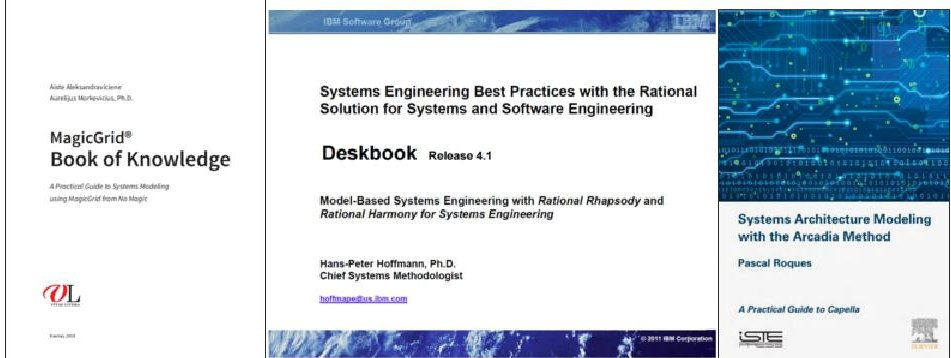
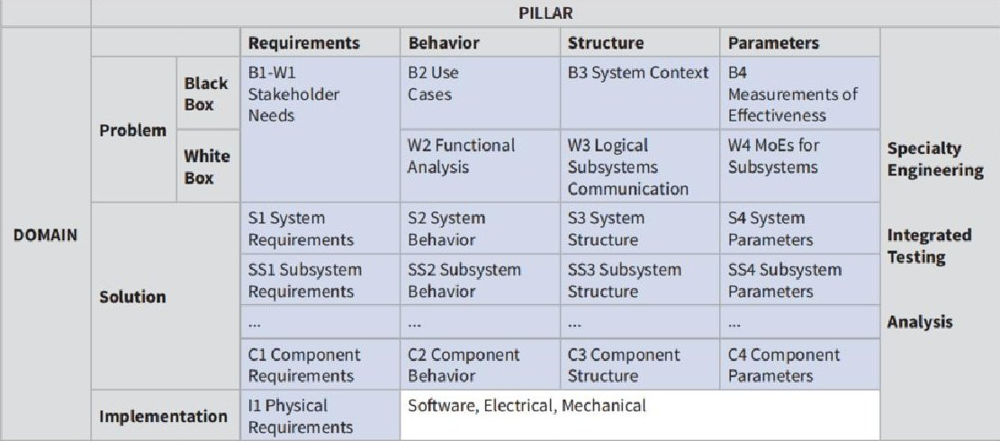
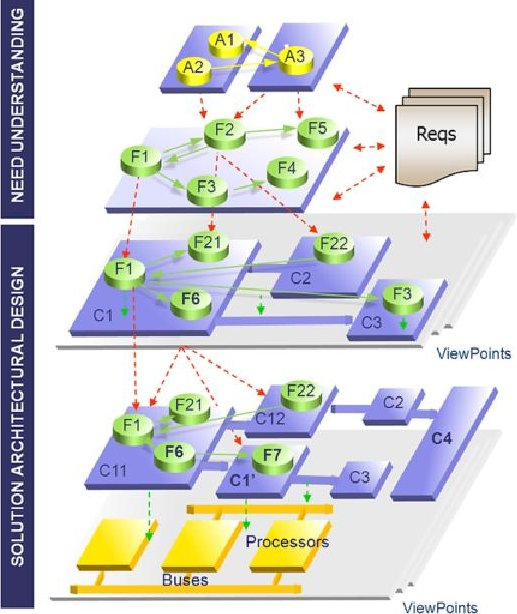
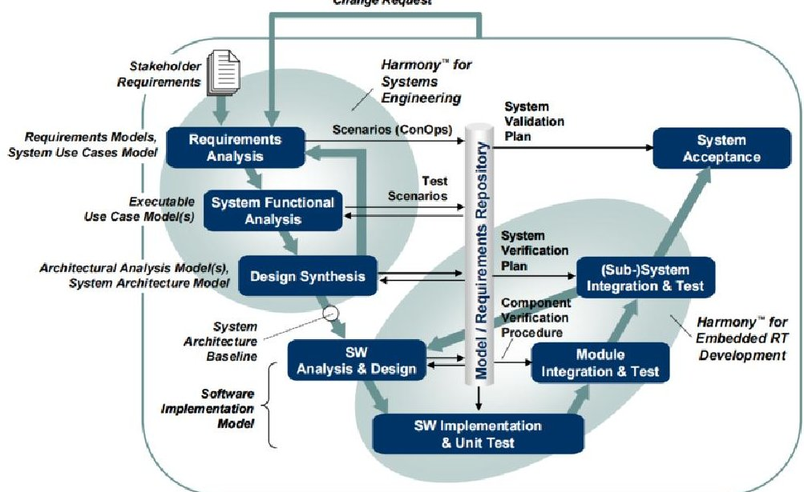
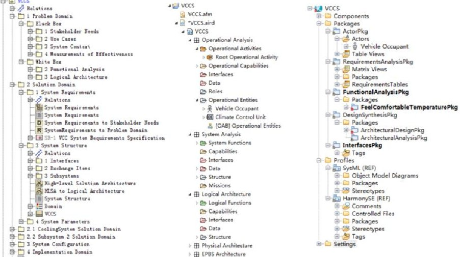
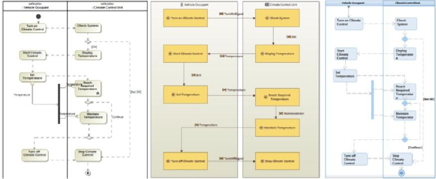

<!-- PDF_PAGE: 1 -->

This article is published online with Open Access by IOS Press and distributed under the terms of the Creative Commons Attribution Non-Commercial License 4.0 (CC BY-NC 4.0). doi:10.3233/FAIA220529

# Analysis of the Mainstream MBSE Methodologies from the Modeling Practice View

Yuqiang GUO, Hui ZHAO, Keke QI and Junxian GUO $ ^{1} $ China Helicopter Research and Development Institute, Tianjin 300308, China

Abstract. Model-based System Engineering (MBSE) is proved an effective way to develop complex systems, and lots of MBSE methods/tools have been developed in recent years. Lack of deep analysis of mainstream MBSE methods/tools and guidance in performing MBSE under the general SE process leads to a rough patch for design staff to transform from document-based system engineering to modelbased system engineering. In this paper, step-by-step modelling practice following the official tutorials is performed to analyze MagicGrid (MagicDraw), ARCADIA (Capella), and HarmonySE (Rhapsody). This is the first time to analyse the mainstream MBSE methodolgies from the uniform INCOSE SE practice view and compare the method and modeling tool differences. These will provide a detailed guide for the engineers to transform from document-based system engineering to model-based system engineering.

Keywords. MBSE, methodology, modeling tool, system engineering process

## 1. Introduction

Model-based system engineering (MBSE) is the formalized application of modelling to support system engineering processes and is believed to be an efficient way to handle complex system development. After years of development, several mainstream MBSE methodologies have been formed internationally, including MagicGrid, ARCADIA, HarmonySE, etc. Each method has its characteristics. Jeff provided a cursory description of some of the leading Model-Based Systems Engineering (MBSE) methodologies used in industry today[1].

To determine which MBSE method and tool to use in the product design, it is essential to deeply analyses the MBSE methods. For this, we collected the official tutorials for MagicGrid (MagicDraw), ARCADIA (Capella) and HarmonySE (Rhapsody) and performed step-by-step modelling practice following the tutorials, as shown in Figure 1.

<!-- PDF_PAGE: 2 -->

Figure.1. Official tutorials for MagicGrid (MagicDraw), ARCADIA (Capella) and HarmonySE (Rhapsody)

In the second part of this article, a general description of MagicGrid (MagicDraw), ARCADIA (Capella) and HarmonySE (Rhapsody) is given first. Analysis of methodology activities under the general SE processes is performed. Then a detailed analysis of the method and tools is provided. A case study of a Vehicle Climate Control System modelling is done to show the modelling difference directly.

## 2. Analysis of the Mainstream MBSE Methodologies and Tools

## 2.1. General description of the Mainstream MBSE Methodologies and Tools

The MagicGrid modelling method, first developed by NoMagic and later acquired by Dassault and integrated into the Dassault 3DE platform, is a methodology that has increased recently. MagicGrid approach is based on the framework, which can be represented as a Zachman style matrix, and is designed to guide the engineers through the modelling process and answer their questions, like "How to organize the model?", "What is the modelling workflow?", "What model artefacts should be produced in each step of that workflow?", "How are these artefacts linked together?" [2]. Its main processes are illustrated in Figure 2.

Figure. 2. MagicGrid processes framework

Thales designed the Arcadia modelling method for its own needs. Since 2011 it has been applied to many projects over various domains (avionic, rail systems, defence systems in all environments, satellite systems, ground stations, communication systems,

<!-- PDF_PAGE: 3 -->

etc.) and in many different countries. Arcadia is a structured engineering method aimed at defining and validating the architecture of complex systems [3], as shown in Figure 3.

Figure. 3. Arcadia processes framework

IBM proposed the HarmonySE methodology, using IBM's Rhapsody system modeling software, to help ground the method in real-world engineering. The methodology was designed to be a relative tool- and vendor-neutral process, specifying the SysML system modelling language. HarmonySE fits strictly into the system V-modeling process [4], as shown in Figure 4.

Figure. 4. HarmonySE processes framework

<!-- PDF_PAGE: 4 -->

## 2.2. Analysis of Methodology Activities under the General SE Processes

System engineering integrates all the disciplines and speciality groups into a team effort forming a structured development process. General system engineering processes, including technical processes, technical management processes, agreement processes and organizational project-enabling processes, are described in the INCOSE Systems Engineering Handbook (SEH) [5].

Whether an MBSE or a traditional Document-based SE method is to be used, the general SE processes should be kept. It is essential to determine what activities should be done under each process to transform from DBSE to MBSE. From Table 1, we can conclude that these three methods mainly cover the technical processes of the INCOSE SE Handbook.

Table 1. Analysis of methodology activities under the general SE Processes

<table border="1"><tr><td>SE Process</td><td>MagicGrid activities</td><td>ARCADIA activities</td><td>HarmonySE activities</td></tr><tr><td>4 Technical Processes
4.1 Business or Mission Analysis
4.2 Stakeholder Needs and Requirements Definition Process</td><td>Stakeholder Needs Analysis
System Context Analysis
Use Cases Analysis
Measurements of Effectiveness(MoEs)
Analysis</td><td>Operational Analysis</td><td>Requirements Analysis</td></tr><tr><td>4.3 System Requirements Definition Process</td><td>Functional Analysis
MoEs for Subsystems
System Requirements</td><td>System Analysis</td><td>Requirements Analysis
System Functional Analysis</td></tr><tr><td>4.4 Architecture Definition Process</td><td>Logical Subsystems Communication</td><td>Logical Architecture</td><td>Architecture Analysis
Architecture Design</td></tr><tr><td>4.5 Design Definition Process</td><td>System Structure
System Behavior
System Parameters
Subsystem Requirements
Subsystem Structure
Subsystem Behavior
Subsystem Parameters</td><td>Physical Architecture</td><td>Hand-off to Subsystem development</td></tr></table>

<!-- PDF_PAGE: 5 -->

<table border="1"><tr><td></td><td>Component Requirements
Component Structure
Component Behavior
Component Parameters</td><td></td><td></td></tr><tr><td>4.6 System Analysis Process</td><td>Specialty Engineering
Analysis</td><td>Integrating Specialty Viewpoints</td><td></td></tr><tr><td>4.7 Implementation Process</td><td>Physical Requirements</td><td>EPBS</td><td></td></tr></table>

## 2.3. More Detailed Analysis of MBSE Methodologies

MagicGrid is a precise and clear MBSE method that tells people what to do and how to do it in each process. ARCADIA is unique in the modelling language and style, which is friendly for the system engineers. HarmonySE is the light but oldest MBSE method mainly used in the embedded software domain. Detailed analysis can be shown in Table 2.

Table 2. Analysis of mainstream MBSE methodologies

<table border="1"><tr><td>Analysis Item</td><td>MagicGrid</td><td>ARCADIA</td><td>HarmonySE</td></tr><tr><td>Method framework</td><td>MagicGrid is based on the well-known Zachman framework, which includes processes from problem domain to solution domain. Each activity includes what to do, how to do it, whom to do it, and relationships between upstream and downstream.</td><td>ARCADIA is a structured engineering method that exposes users to the different engineering phases used to model their architecture.</td><td>HarmonySE complies with the classic “V” model. The left leg describes the top-down design flow, while the right-hand side shows the bottom-up integration phases.</td></tr><tr><td>Modeling pillar coverage(requirement, behavior, structure and parameter)</td><td>MagicGrid covers system requirements, behaviour, structure, and parameter.MOE in the parameter diagram is placed in a critical position, which lays the foundation for the analysis of performance requirements and the integration with other performance simulation software, greatly expanding the capability space of MBSE.</td><td>ARCADIA mainly covers system behaviour and structure. But it mentioned that requirements could be imported from DOORS.</td><td>HarmonySE covers system requirements, behaviour, and structure.</td></tr><tr><td>Modelling sequence and</td><td>In MagicGrid, the system engineer starts from the problem domain and goes all the way to the top-level</td><td>Each level of orientation: operational analysis, which analyzes only organizational activities</td><td>Harmony SE starts from "requirements analysis," which refers to stakeholder</td></tr></table>

<!-- PDF_PAGE: 6 -->

<table border="1"><tr><td>emphasis</td><td>architecture and interfaces of the solution domain (there can be multiple solutions). And it subsequently leaves the subsystems to the domain engineers to complete, using‘derive’ relationships between the subsystem solutions and the top-level architecture. Here the model is started to be split and packaged. Each subsystem is taken over (using generalised relations), developed separately, and finally integrated and tested to achieve parallel development. In the solution domain, system and subsystem design starts with architecture design, which is different from the problem domain. The thinking of engineers in the physical domain is to build the architecture, and then the first established behaviour diagram is the state machine. From the engineer&#x27;s perspective, the state machine is the scope of system design, while in the problem domain, more activity diagrams are used to do functional analysis and decomposition.</td><td>and does not involve system behaviour or functionality; system analysis, which analyzes the black-box functionality of the system; and logical analysis, which analyzes the white-box. In ARCADIA, after the model is transferred to the next layer of the system, no more operational analysis is carried out. Operational research is unnecessary for system analysis, logical architecture, and physical architecture. In ARCADIA and Capella, the concept of operation from the operational analysis can be transmitted to system analysis, logical architecture, and physical architecture. Lower-level modeling and research work can be consistently carried out in the same context of application scenarios, which maintains the unity of operational logic in the system model development life cycle. ARCADIA focuses on the information between the functions and the material interaction links. In ARCADIA, by showing the leaf nodes of the system model, the functional decomposition and assignment are more precise and friendly understanding than HarmonySE and MagicGrid. In ARCADIA, the functional interfaces and physical interfaces are managed separately. And interface integration and display are more direct and easy to use.</td><td>requirements described in terms of what users need to be able to accomplish and then converted into system requirements directly, that is, what functions the system needs to have. And HarmonySE emphasizes identifying system functions and patterns or states, defining the architecture and assigning functions and patterns to subsystems, and defining and managing interfaces simultaneously. In the functional analysis of HarmonySE, the state machine covers all the information of the sequence diagram and activity diagram. It shows the overall system behaviour and can be passed to the safety/reliability team in the form of a model for analyse. It can be confirmed by model simulation execution. HarmonySE function flow focuses on the logical sequence of functions or activities in time. Interface modelling is based on the SysML syntax.</td></tr><tr><td>System behaviour modelling</td><td>MagicGrid started by analyzing activity steps. It first builds activity diagrams containing only control flows, then refines them, gradually adding branches and object flow, building swim lanes, assigning activities, and finally getting complete scenarios.</td><td></td><td></td></tr><tr><td>System Interface modelling</td><td>Interface modelling is based on the SysML syntax.</td><td></td><td></td></tr></table>

<!-- PDF_PAGE: 7 -->

## 2.4. Analysis of Corresponding MBSE Tools

From Table 3, we can see that the three modelling tools are mainly different in the model languages; MagicDraw and Rhapsody use the SysML, while Capella uses a unique domain model language. And the three tools have different simulation abilities [6]. MagicDraw is an expert in simulation, Capella has no power to simulate, and Rhapsody has a different simulation model, converting the model to C++ code. Nevertheless, Capella is open-source and free, so it is an excellent choice for students and small companies.

Table 3. Analysis of mainstream MBSE tools

<table border="1"><tr><td>Analysis Item</td><td>MagicDraw</td><td>Capella</td><td>Rhapsody</td></tr><tr><td>Modelling language supported</td><td>SysML and MagicDraw support SysML better than Rhapsody, such as the expression of the IBD diagram.</td><td>A unique domain model language(DSML)</td><td>SysML</td></tr><tr><td>User friendly</td><td>While modelling with Magicdraw, clicking on the model element in the diagrams presents many shortcuts which add user friendship. Manipulator Toolbar is very powerful; dragging and dropping model elements is very convenient, which improves modelling efficiency. While inserting the model element&#x27;s name, MagicDraw can prompt the existing model elements automatically, significantly improving the entire model&#x27;s consistency. This ability is better than Rhapsody and Capella.</td><td>Capella supports the automatic inheritance of model information from higher system model levels, reducing the workload and ensuring model consistency. Real-time validating is a highlight for Capella to ensure the integrity and normality of different level system models.</td><td>In Rhapsody, activity diagram and sequence diagram representations are the same, just different viewpoints, and can be checked for consistency with one click by the HarmoySE toolkit.</td></tr><tr><td>Simulation capability</td><td>MagicDraw is influential in simulation and uses a refactored simulation engine, including fUML for activity diagram simulation and SCXML for state machine simulation.</td><td>Unlike MagicDraw or Rhapsody, Capella cannot do the operational or functional simulation.</td><td>Rhapsody uses state machines to generate C++ code directly for simulation.</td></tr></table>

<!-- PDF_PAGE: 8 -->

## 3. Case Study

The specification and design of a Vehicle Climate Control System (VCCS) are illustrated in the MagicGrid official guidance manual [2]. To show the similarities and differences of the mainstream MBSE methods more clearly, we use them as the case study. In part, we perform system modelling using the same case but different methods and tools to show the differences, mainly in the model organization, use case diagrams, and the scenarios.

In Figure 5, from left to right, it is MagicDraw, Capella, and Rhapsody model organization. They are different in that the model elements are organized according to their methodology. In MagicDraw, the model contains the main nested packages, including 'Problem Domain,' 'Solution Domain,' 'System Structure,' and 'System Parameters.' In Capella, the model is decomposed as 'Operational Analysis,' 'System Analysis,' 'Logical Architecture,' and 'Physical Architecture'. And in Rhapsody, it has 'RequirementsAnalysisPkg', 'FunctionalAnalysisPka' and 'DesignSynthesisPkg'.

Figure 5 The model organization in the three tools

As described in Figure 6, the use case diagram is the same in the three modelling tools. MagicDraw and Rhapsody use SysML as the modelling language; the use case diagram is the same; nevertheless, there are no use cases in the Capella; it uses operational capabilities blank (OCB) instead [7].

Figure 6. The use case diagrams in the three tools

There are some differences in the use case scenarios of the three methods. MagicDraw and Rhapsody are the same. In MagicDraw, we can use an activity pin to model activity input and output and use different symbols to model the control and object flow. It can be concluded that MagicDraw is better than Rhapsody in supporting the SysML specification. Capella is entirely different in the scenario model. It has no control flows, only object flows, and no decision node in the diagram, and the activities are allocated to the entity blocks rather than using swim lanes [8,9], as shown in Figure 7.

<!-- PDF_PAGE: 9 -->

Figure 7. The use case scenarios in the three tools

## 4. Conclusion

This paper analyzed the three mainstream MBSE methods and corresponding modelling tools from the perspective of modelling practice. This provides the engineers with guidance on which MBSE method and tool to choose. And the analysis of methodology activities under the general SE Processes helps to determine what activities should be done under each process to transform from DBSE to MBSE. The case study illustrated the three different method and tools in the system function modeling, however there are other system modelling views, like requirements modeling, structure modelling and parameter modelling that are not mentioned in the paper. In the future, more system modelling aspects shall be studied.

## References

[1]. Jeff A. Estefan. Survey of Model-Based Systems Engineering (MBSE) Methodologies.Jet Propulsion Laboratory, California Institute of Technology, (2008).

[2]. Aurelijus Morkevicius. MagicGrid Book of Knowledge: A Practical Guide to Systems Modeling Using MagicGrid from No Magic. Kaunas: Vitae Litera, (2018).

[3]. Pascal Roques. Systems Architecture Modeling with the Arcadia Method: A Practical Guide to Capella. Oxford: Elsevier, (2018).

[4]. Hans-Peter Hoffmann. Systems Engineering Best Practices with the Rational Solution for Systems and Software Engineering. New York: IBM Corporation, (2013).

[5]. International Council on System Engineering. Systems Engineering Handbook: A guide for system life cycle processes and activities,v4.0.San Diego: Wiley, (2015).

[6]. Aditya Akundi and Viviana Lopez. A Review on Application of Model-Based Systems Engineering to Manufacturing and Production Engineering Systems. Procedia Computer Science,185:101-108, (2021).

[7]. Nigischer, C. et al. Multi-domain simulation utilizing SysML: state of the art and future perspectives. Procedia CIRP 100.4:319-324, (2021).

[8]. Lenny Delligatti. SysML Distilled: A Brief Guide to the Systems Modeling Language. Upper Saddle River, NJ: Addison-Wesley, (2013).

[9]. Schummer, F. , M. Hyba . An Approach for System Analysis with MBSE and Graph Data Engineering, (2022).