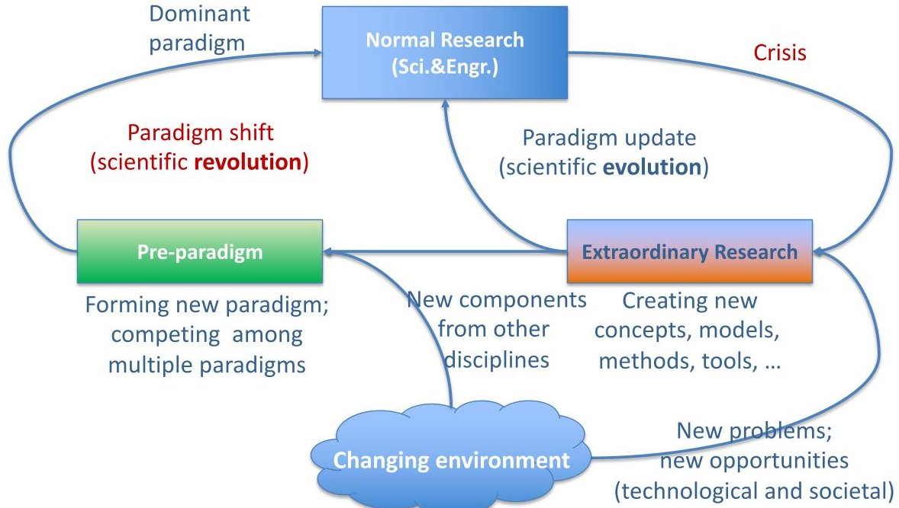

<!-- PDF_PAGE: 1 -->

EDITORIAL

# Trustworthy AI for Digital Engineering Transformation

Jingwei Huang $ ^{a^{*}}, $ Peter Beling $ ^{b}, $ Laura Freeman $ ^{c}, $ and Yong Zeng $ ^{d} $

$ ^{a} $ Department of Engineering Management and Systems Engineering, Old Dominion University, Norfolk, VA 23529, USA

$ ^{b} $ Department of Industrial and Systems Engineering, Virginia Tech, USA

$ ^{c} $ Intelligent Systems Lab, Hume Center, Virginia Tech, USA

$ ^{d} $ Concordia Institute of Information Systems Engineering, Concordia University, Canada

We are in the dawn of the Fourth Industrial Revolution (Schwab, 2017). This new wave of industrial revolution is marked by the pervasive digital transformation, driven by the convergence and fast growth of a set of disruptive digital technologies, including Artificial Intelligence (AI) and Machine Learning (ML), Big Data, the Internet of Things (IoT), Cloud Computing, Blockchain, Digital Twin, 3D printing, and others. The digital transformation has profound impacts on almost every aspect of human society and has been changing how we live, how we work, how we communicate, what products and services to be produced and delivered, and how business is to be conducted. In engineering, the transformation is shifting the landscape of engineering processes, from concept definition, design, manufacturing, operations, and sustainment through retirement and recycling. Digital Engineering, the digital transformation of engineering, is emerging globally with different names and focuses. The US Department of Defense (DoD) launched their Digital Engineering Strategy (US DoD, 2018; Zimmerman, Gilbert, & Salvatore, 2019) in 2018. The strategy has five goals: (1) formalize the development, integration and use of models, leading to a continuous end-to-end digital representation of the system of interest; (2) provide enduring, authoritative source of truth, to share and exchange digital models, data, and other digital artifacts across boundaries of organizations and the engineering lifecycle; (3) incorporate technological innovation to improve the engineering practice; (4) establish a supporting infrastructure and environments; (5) transform culture and workforce to adopt and support digital engineering. From the perspective of engineering practice, "DoD defines digital engineering as an integrated digital approach that uses the authoritative source of system data and models as a continuum across disciplines to support lifecycle activities from concept through disposal." No doubt, the implementation of DoD Digital Engineering Strategy will significantly change how engineering practice is conducted in DoD enterprise, the US defence industry, and beyond.

AI (including many branches, such as Machine Learning, Knowledge Representation & Reasoning, and Semantic Technology) is a fundamental enabling technology for Digital Engineering (Huang et al., 2020; McDermott, DeLaurentis, Beling, Blackburn, & Bone, 2020; SERC, 2019). In Digital Engineering

<!-- PDF_PAGE: 2 -->

transformation, an essential move is to "digitalize" a vast number of engineering artifacts and processes. AI can provide solutions for digitalizing engineering artifacts, including digital representation of the system of interest. AI can support automatic processing, understanding, and reasoning about digital artifacts. AI can support digital systems formal verification. ML can be leveraged in every process in the engineering lifecycle for knowledge discovery from the Big Data of digital engineering systems and their digitally connected environment.

The remarkable achievements, disruptive impacts, and fast growth of applications of AI systems (particularly ML) in recent years also raise broad concerns about the trustworthiness of AI systems (EU AI HLEG, 2019; Horvitz, et al., 2009; Liu et al., 2021; Stone et al., 2016). Generally, an AI system is expected to be reliable, safe, secure, fair (or bias-free), privacy-preserving, explainable, traceable, transparent, and accountable, among other qualities. The concerns about AI arise in two primary areas: ethics and technical performance. The ethics of AI concerns the long-term impacts of AI on humans and human society. The central principle is to use AI for good or for purposes beneficial to humans. Technical performance has a more straightforward definition. An AI system needs to be accurate, robust, and capable of generalization beyond the training data set. Additionally, the computing and reasoning with the AI system need to be explainable, the system needs to be safe, secure, and privacy-preserving. To ensure an AI system to have the expected properties for being trustworthy, AI assurance is in development (Batarseh, Freeman, & Huang, 2021; Freeman, Rahman, & Batarseh, 2021).

This special issue of JIDPS presents five research papers. Each of them reflects some interesting aspects in the direction of applying AI to advance digital engineering transformation.

One of the remarkable advances of AI is the invention of Generative Adversarial Networks (GANs) (Goodfellow et al., 2014, 2020). On the one hand, GANs attract significant attention because they pose challenging security threats to AI systems, such as adding some small invisible noise to an input image to mislead the AI system making a wrong classification; creating real-like fake images; thus opening the door of deepfake. Think about the following scenarios: in some sensitive context, a fake picture potentially causes social turbulence; a traffic sign can be tampered with or just naturally dusted, thus causing autonomous vehicles to misrecognize the sign. On the other hand, surely, GANs can be used for good purposes and have applications beneficial to human society. For example, it is possible to use GANs to generate images from text descriptions and/or a sketch for design, artwork creation, criminal investigation, and others. Directly related to machine learning, GANS can be used to produce real-like samples to overcome the issues of imbalanced data or lack of a sufficient number of samples for machine learning for image classification and beyond. In our first paper, "Towards Accuracy Enhancement of Age Group Classification Using Generative Adversarial Networks," by Khaled ELKarazle, Valliappan Raman, and Patrick Then, the authors present their research using super-resolution GAN to produce higher quality images from low quality samples collected in unrestrained conditions. ELKarazle, Raman, and Then's research feds the GAN produced higher quality images for age group classification and achieved higher accuracy. This interesting research demonstrates a methodology for using GANs to improve the accuracy of image classification with unbalanced lower quality of samples, which are the challenge faced by many real-world AI systems.

In digital engineering transformation, the text represents a vast information source but mostly appears as unstructured data. In conventional engineering practice, text documentation, as an essential type of engineering artifact, is a major form of information flow across engineering lifecycle stages. Text documentation is typically assumed to be consumed by human users. As such, information flows through humans as media from one engineering lifecycle stage to the other. In digital engineering, engineering artifacts and processes will be digitalized to enable machine processing (Huang et al., 2020), thus realizing a higher level of automation. In the transformation from conventional to digital engineering, it is necessary to develop AI-enabled tools to identify and extract information of interest from the legacy engineering documents and the ocean of relevant text information at large. In our next paper, "Performing Information Extraction and Ontology Development for Mission Engineering Applications," by Samuel R. Koski, James D. Moreland, the authors present their research of using ontology-based information extraction from text to identify and extract relevant information from a pool of gathered documents in the context of mission

<!-- PDF_PAGE: 3 -->

engineering. Koski and Moreland use Stanford CoreNLP (including OpenIE) to extract information from text and export information in the form RDF triples. This work shows an interesting research approach different from the pure machine learning approach for natural language processing.

Towards digital engineering, it is essential to build trustworthy information infrastructures to facilitate the digital form of engineering practice dealing with a vast number of digital artifacts and processes. How to ensure the dependability of digital systems operating in a time-critical environment is a great challenge. To tackle this challenging issue, our third paper "Integrating AI Microservices into Hard-Real-Time SoS to Ensure Trustworthiness of Digital Enterprise Using Mission Engineering", by Alvin C. Murphy and James D. Moreland, presents their framework of using microservices to provide dynamically containerized and orchestrated service capabilities that can meet hard-real-time requirements for mission engineering. Microservices is a new paradigm for programming applications in software architecture to manage the growing complexity and achieve maintainability and scalability, by means of decomposing larger systems into a set of completely independently implemented and deployed small services, so called "microservices" (Dragoni et al., 2017; Lewis & Fowler, 2014).

Security is of paramount importance to all AI-enabled systems, including various smart cyber-physical systems operating in the connected digital environment. In the direction of digital transformation of transportation systems, AI has been enabling to transform the conventional vehicle into autonomous vehicles, which are one of the remarkable achievements of AI systems; on the other hand, autonomous vehicles together with smart roads and smart roadside devices, are turning whole road networks into digitalized intelligent transportation systems. Vehicles on roads are becoming senescing nodes and information nodes of the Internet of Everything. In this context, it is essential to ensure security in Vehicle-to-Vehicle communication and Vehicle-to-Infrastructure communication. Our fourth aper "A Provably Secure Identity Based Authenticated Key Agreement Protocol with Multiple PKG Compatibility for Inter-Vehicular Ad hoc Networks," by Renu Mary Daniel and Anitha Thomas, proposes a new and efficient authentication protocol for VANETs (Vehicular Ad hoc Networks). Their protocol uses the extended Canetti-Krawczyk (eCK) security model to construct a multiple Private Key Generator (mPKG) Identity-based Authenticated Key Agreement (ID-AKA) protocol. The authors also present the comparison of the proposed protocol to other protocols with respect to certain security properties and computing time cost. The performance analysis shows the effectiveness and efficiency of the proposed model.

Privacy is becoming more sensitive and more complex in the coming digital world. Increased digitalization results in increased privacy concerns as digital mediums are more vulnerable to being invaded. On the other hand, the concept of privacy itself is evolving with the changing socio-technical environment. Certainly, societal mechanisms of privacy protection in the connected digitalized environment will be needed. From the perspective of digital systems, privacy-preserving is one of the expected properties for trustworthy AI systems. Naturally, it is important to develop privacy-preserving AI technologies. Well, on the user side, it is important for users of digital systems to engage in privacy protection. In our final paper, "Influence of Privacy Fatigue of Social Media Users on Their Privacy Protection Disengagement Behaviour - A PSM based Analysis," by Xiaojuan Zhang, Xinluan Tian, and Yuxin Han, present their research on examining the relationship between privacy fatigue and privacy protection disengagement behaviour of social media users by using Propensity Score Matching (PSM) methodology. In this final paper Zhang, Tian and Han's analysis reveals that privacy fatigue does cause privacy protection disengagement behaviour. This result reminds us of the importance of systems design taking into account human-machine interaction with respect to privacy protection.

This special issue included five interesting works in five different aspects. Digital transformation and digital engineering are the transformations of paradigms, thus being of paramount importance and having a broad range of issues to research. JIDPS will continue to accept papers in the direction of digital transformation, digital engineering, and their enabling technologies, such as trustworthy AI. The topics of interest include but are not limited to the following.

- Reliable, robust, safe, secure, fair or bias-free, privacy-preserving, explainable, traceable, transparent, accountable AI/ML in Digital Engineering

<!-- PDF_PAGE: 4 -->

- AI systems assurance

- Security in Digital Engineering

- Trust in Digital Engineering

- Big Data in Digital Engineering

- Digitalization of engineering artifacts

- Data semantics and standardization

- Data & models sharing, integration, and interoperability

- Domain taxonomies, ontologies, and tools for Digital Engineering

- Search mechanisms for shared digital artifacts in Digital Engineering

- Digital business process integration in Digital Engineering

- Digital Enterprise Integration

- Digital augmentation of engineering artifacts

- Digital twins and other high-fidelity models for Digital Engineering

- Reasoning with multi-modal digital artifacts

- Life-cycle support and management of artifacts in a connected digitalized environment

- Digital engineering processes (such as design, manufacturing, maintenance, reuse and recycling)

- Transformation of traditional engineering to Digital Engineering

- Test, evaluation, verification, and validation in Digital Engineering

- Principles, theories, tools, models, methodologies, and paradigms for Digital Engineering

- Best practice, use cases, case studies of digital engineering transformation

Digital Engineering is still in its infant stage or stages one and two (Shneider, 2009). Based on Kuhn's structure of scientific revolutions (Kuhn, 1962), Digital Engineering transformation is an engineering "paradigm shift" including periods of "extraordinary research" and "pre-paradigm", as illustrated in Figure 1. A science discipline builds theories or generally systematic knowledge, typically in the form of models, to explain observed facts and predict the future movement in a field. A discipline in engineering uses scientific principles to design and build engineering systems to solve real-world problems or meet humans' needs in a field. In the period of "normal research" or "normal science," as addressed by Kuhn, a scientific community uses a dominant paradigm to conduct research and produce the main body of knowledge in that field during a life cycle. Then, the dominant paradigm may have crises for its deficiencies or limitations facing the new observations and/or new problems coming from the changing environment. A new need for an engineering system may come from the deficiencies of current systems, technological opportunities, and socio-economic opportunities (Kossiakoff, Sweet, Seymour, & Biemer, 2011). Similarly, the need for a new scientific paradigm can emerge. To battle the crises and meet the new need(s), the disciple enters into a period of "extraordinary research" (as named by Kuhn). In this period, new concepts, models, tools, methods, among others, will be created. If the new disciplinary components are incremental and can be integrated into the current paradigm, the paradigm will be updated, thus being a scientific evolution. Otherwise, the new components developed in "extraordinary research", together with the one from other disciplines, will contribute to the development of a new paradigm in a period of "pre-paradigm" (again, named by Kohn). In the "pre-paradigm" period, one or multiple paradigms will be formed and compete. Finally, the most accepted paradigm(s) will become the discipline's new dominant paradigm(s). This "paradigm shift" (Kohn) is a scientific revolution. After the transformation, the discipline enters "normal research" period again and starts a new life cycle. Back to Digital Engineering, this paradigm shift is mainly driven by the disruptive digital technologies and the associated higher social-economic needs as well as the new challenging problems, such as the trust issues of AI systems. In the emerging digital and connected environment, the development of Digital Engineering needs new concepts, models, tools, methods, theories, methodologies, technologies, and standards. Digital Engineering is also a manifestation of the convergence of many disruptive digital technologies; thus being a transdisciplinary campaign. JIDPS, as a transdisciplinary academic journal, welcomes new ideas, visions, research, tools, use cases, and case studies in this exciting field.

<!-- PDF_PAGE: 5 -->

Figure 1. A View of Paradigm Shift through the Periods of "Extraordinary Research" And "Pre-Paradigm" in a Scientific Discipline Life Cycle, Based on Kuhn's the Structure of Scientific Revolutions (Kuhn, 1962).

Digital engineering transformation is a deep societal scale process, which transforms engineering practice paradigms, engineering standards, engineering processes (from design to disposal), engineering knowledge, engineering workforce, and engineering environment, including culture. Digital Engineering will operate in a digital and connected environment with shared or standardized digital artifacts, including models and data. The ultimate result of digital transformation is that every process in the engineering lifecycle will operate significantly differently from the conventional one. In particular, engineering systems design will face an unprecedented richness of information from various sources in the shared digital connected environment. The changing conditions and technologies will also change the way we design engineering systems.

## Acknowledgments

The guest editors sincerely appreciate everyone who contributed to this Special Issue. First, thanks to all the authors who contribute by sharing their research and visions, no matter their articles are included or not. We very much appreciate the anonymous reviewers for their critical and constructive comments that significantly help to improve the quality of the articles. Last but not least, we thank JIDPS colleagues for their support and help with this Special Issue.

## References

Batarseh, F. A., Freeman, L., & Huang, C.-H. (2021). A survey on artificial intelligence assurance. Journal of Big Data, 8(1), 1-30.

Dragoni, N., Giallorenzo, S., Lafuente, A. L., Mazzara, M., Montesi, F., Mustafin, R., & Safina, L. (2017). Microservices: yesterday, today, and tomorrow. Present and Ulterior Software Engineering, 195- 216.

EU AI HLEG. (2019). Ethics guidelines for trustworthy AI. Retrieved from https://op.europa.eu/en/publication-detail/-/publication/d3988569-0434-11ea-8c1f-01aa75ed71a1

Freeman, L., Rahman, A., & Batarseh, F. A. (2021). Enabling Artificial Intelligence Adoption through Assurance. Social Sciences, 10(9), 322.

<!-- PDF_PAGE: 6 -->

Goodfellow, I., Pouget-Abadie, J., Mirza, M., Xu, B., Warde-Farley, D., Ozair, S., ... Bengio, Y. (2014). Generative adversarial nets. Advances in Neural Information Processing Systems, 27.

Goodfellow, I., Pouget-Abadie, J., Mirza, M., Xu, B., Warde-Farley, D., Ozair, S., ... Bengio, Y. (2020). Generative adversarial networks. Communications of the ACM, 63(11), 139-144.

Horvitz, E., Selman, B., & AAAI Presidential Panel. (2009). Asilomar Study on Long-Term AI Features. Retrieved from https://www.aaai.org/Organization/asilomar-study.pdf

Huang, J., Gheorghe, A., Handley, H., Pazos, P., Pinto, A., Kovacic, S., ... Daniels, C. (2020). Towards digital engineering: the advent of digital systems engineering. Int. J. System of Systems Engineering, 10(3), 234-261. https://doi.org/10.1504/IJSSE.2020.109737

Kossiakoff, A., Sweet, W. N., Seymour, S. J., & Biemer, S. M. (2011). Systems engineering principles and practice (Vol. 83). John Wiley \& Sons.

Kuhn, T. (1962). The structure of scientific revolutions (2nd Editio). The University of Chicago Press.

Lewis, J., & Fowler, M. (2014). Microservices: a definition of this new architectural term (2014). URL: Http://Martinfowler. Com/Articles/Microservices. Html (Cit. on p. 26).

Liu, H., Wang, Y., Fan, W., Liu, X., Li, Y., Jain, S., ... Tang, J. (2021). Trustworthy ai: A computational perspective. ArXiv Preprint ArXiv:2107.06641. Retrieved from https://arxiv.org/pdf/2107.06641

McDermott, T., DeLaurentis, D., Beling, P., Blackburn, M., & Bone, M. (2020). AI4SE and SE4AI: a research roadmap. Insight, 23(1), 8-14.

Schwab, K. (2017). The fourth industrial revolution. Retrieved from https://www.google.com/books/edition/The_Fourth_Industrial_Revolution/ST_FDAAAQBAJ?gbpv =1

SERC. (2019). Research Roadmaps 2019-2020.

Shneider, A. M. (2009). Four stages of a scientific discipline; four types of scientist. Trends in Biochemical Sciences, 34(5), 217-223.

Stone, P., Brooks, R., Brynjolfsson, E., Calo, R., Etzioni, O., Hager, G., ... others. (2016). Artificial intelligence and life in 2030: the one hundred year study on artificial intelligence. Retrieved from https://ai100.stanford.edu/2016-report

US DoD. (2018, June). Digital Engineering Strategy. Retrieved from https://fas.org/man/eprint/digeng- 2018.pdf

Zimmerman, P., Gilbert, T., & Salvatore, F. (2019). Digital engineering transformation across the Department of Defense. The Journal of Defense Modeling and Simulation, 16(4), 325-338.

## Author Biographies

Dr. Jingwei Huang is an Associate Professor in the Department of Engineering Management and Systems Engineering at Old Dominion University, Norfolk, Virginia, US. His research interests are in the areas of trustworthy AI systems and digital systems engineering. He and his colleagues proposed and developed Knowledge Provenance, a logical theory of trust, formal semantics-based trust calculus, trust models for Public Key Infrastructures (PKI), fine-grained formal model integrating attribute-based and rolebased access control, deep learning for Human Activity Recognition & Identification, digital transformation of hurricane emergency response system. He is an Associate Editor of SDPS Transactions - Journal of Integrated Design and Process Science. He received his PhD in Information Engineering from University of Toronto in 2008. He is a senior member of IEEE. Contact him at j2huang@odu.edu.

Dr. Peter A. Beling is a professor in the Grado Department of Industrial and Systems Engineering at Virginia Tech and the Virginia Tech National Security Institute. His research interests lie at the intersection of systems engineering and artificial intelligence (AI) and include AI adoption, reinforcement learning, transfer learning, and digital engineering. He has contributed extensively to the development of methodologies and tools in support of cyber resilience in military systems. He serves on the Research Council of the Systems Engineering Research Center (SERC), a University Affiliated Research Center for the Department of Defense. Prior to joining Virginia Tech in 2021, he was a professor of systems engineering at the University of Virginia (UVA) and directed the UVA site of the Center for Visual and

<!-- PDF_PAGE: 7 -->

Decision Informatics, a National Science Foundation Industry/University Cooperative Research Center, and the Adaptive Decision Systems Laboratory. Dr. Beling received his Ph.D.in operations research from the University of California at Berkeley. Contact him at beling@vt.edu.

Dr. Laura Freeman is the director of the Hume Center for National Security and Technology's Intelligent Systems Lab director. Additionally, she is a research associate professor in the Department of Statistics and a faculty member of the Commonwealth Cyber Initiative. Her research interests include experimental design considerations in machine learning and artificial intelligence, cybersecurity analytics, reliability analysis, and statistical engineering. Freeman holds memberships with the National Defense Industrial Association, the American Statistical Association, and the International Test and Evaluation Association (ITEA) as the Editor-In-Chief of the ITEA Journal of Test and Evaluation. Freeman received her Ph.D. in statistics, an M.S. in statistics, and a B.S. in aerospace engineering, all from Virginia Tech. Contact here at laura.freeman@vt.edu.

Dr. Yong Zeng is a professor in Information Systems Engineering at Concordia University, Montreal. He is the President of Society for Design and Process Science. He was NSERC Chair in aerospace design engineering (2015-2019) and Canada Research Chair in design science (2004-2014). Zeng researches into creative design by developing and employing mathematical and neurocognitive approaches. He has proposed Environment-Based Design (EBD) addressing the recursive nature of design and the role of mental stress in designer creativity. He applies the EBD to aerospace industry, medical devices, human resource management, municipality, teaching and learning, and health. Contact him at yong.zeng@concordia.ca.