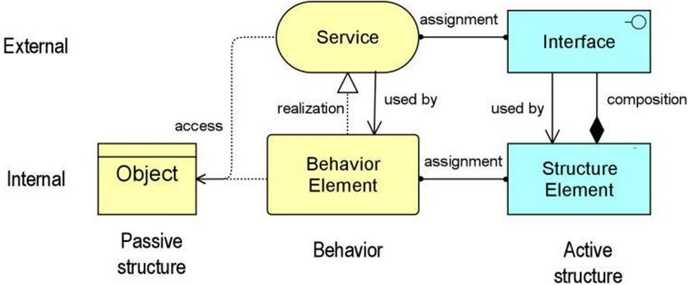
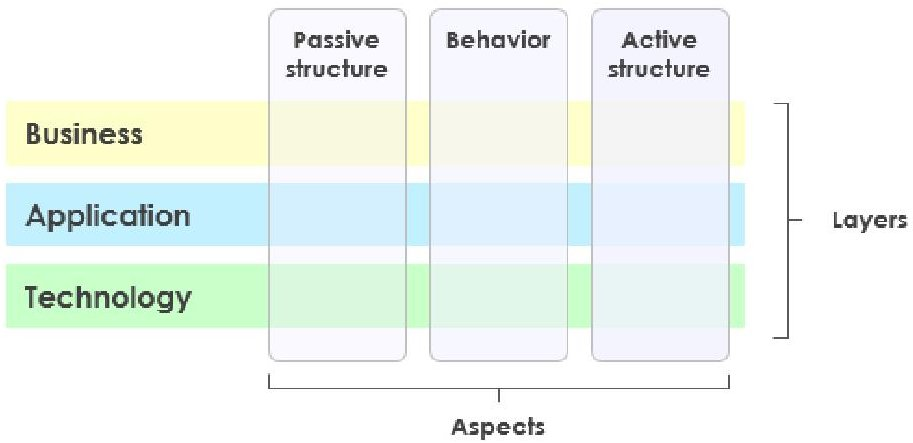
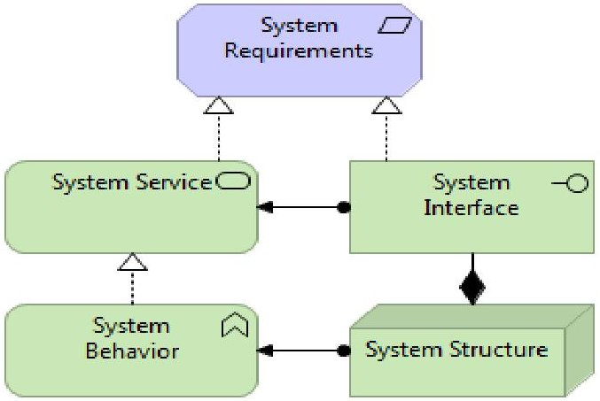
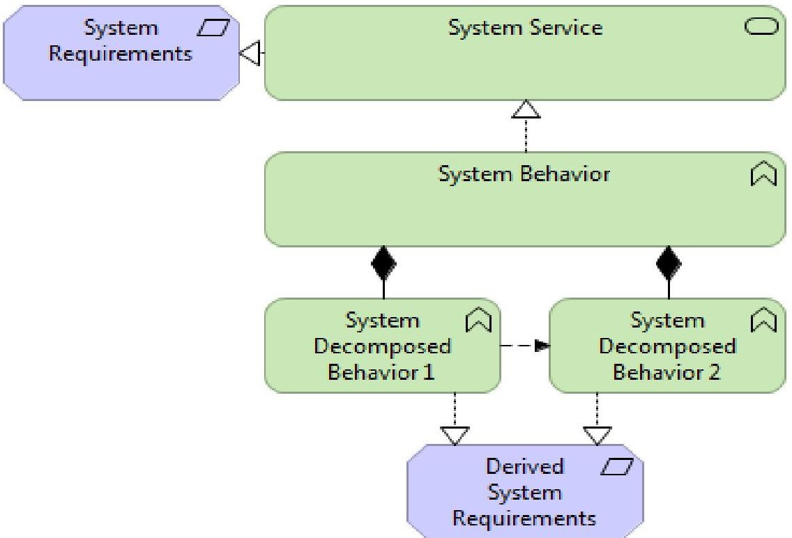
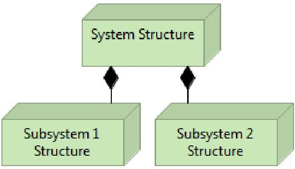
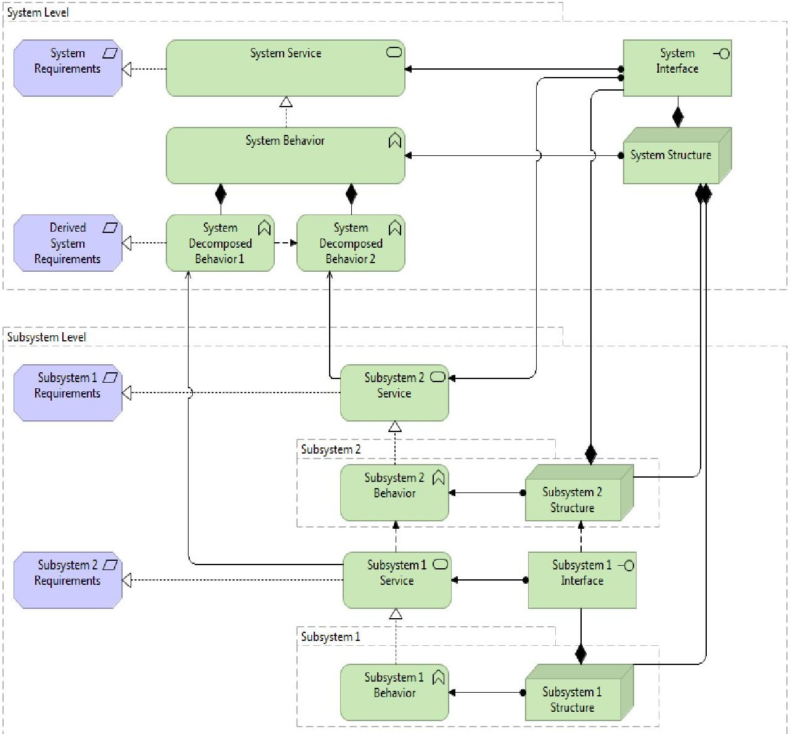
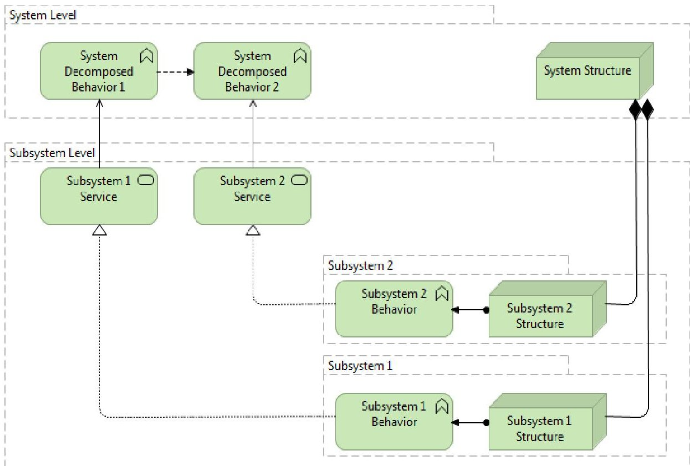

<!-- PDF_PAGE: 1 -->

# Archimate-Based Approach to Requirements Engineering

K. Gaydamaka Information Systems Laboratory Moscow Technological University (MIREA) Moscow, 119454, Russia E-mail: k.gaydamaka@gmail.com

(Received November 27, 2018; Accepted May 19, 2019)

## Abstract

Requirements engineering represents the most crucial stage in the complex systems development process. Contemporary methods of requirements engineering assume a wide application of models (described, for example, with such languages as SysML or OPM), which allows to ensure the consistency and completeness of the system descriptions. The article assesses the applicability of the Archimate language to support the process of requirements engineering when creating complex technical systems. Requirements engineering method for complex technical systems, suitable for models described by the Archimate language is proposed. Detailed example demonstrating the proposed method when developing system requirements is given. The limitations of the Archimate language applicability for the engineering of systems of various classes are described.

Keywords- Systems engineering, Requirements engineering, Archimate, Functional architecture, Requirements flow down.

## 1. Introduction

Modern technical systems are becoming more complex, causing various problems associated with their development. Requirements engineering is the most crucial stage in the complex systems development. Contemporary methods of requirements engineering assume a wide application of models (described, for example, with such languages as SysML, OPM or i $ ^{*} $ ), which allows to ensure the consistency and completeness of the system descriptions. When it comes to model-oriented requirements engineering, one of two options is usually meant (Chistyakova et al., 2017; Klochkov et al., 2017).

Requirements engineering process supported by the modeling of system and its environment, for example, the operational concept, preliminary architectural descriptions, etc.

Requirements models showing the way, the requirements are interrelated. Such models are most common in the approaches of goal-oriented requirements engineering (GORE), such as i $ ^{*} $ or KAOS. These approaches are complementary and it is important to use models of both types for the construction of a full-fledged method of requirements engineering. Within the framework of this article, issues related to the first approach were considered (Ilin et al., 2017).

Systems modeling and requirements engineering are closely intertwined (Hull et al., 2011). SysML Error! Reference source not found. and OPM are the most common systems modeling languages. Being an extension of UML, SysML has become more widespread, but it has a number of shortcomings (Davydov et al., 2018). For example, it is a not fact-oriented language, and it makes more difficult the analysis and control of the model integrity. OPM, in turn, has very limited expressive capabilities (Gravit et al., 2015; Gravit, et al., 2018)

<!-- PDF_PAGE: 2 -->

The Archimate language has been developed to support Enterprise Architecture processes. It implements a number of original solutions, which made it simple and expressive at the same time. However, it is not intended to support processes of requirements engineering and systems modeling (Leventsov et al., 2017).

The hypothesis underlying this work is that the Archimate language can be used to support the process of requirements engineering for complex technical systems, rather than to solve only EA problems (Perlova et al., 2016) The applicability of the Archimate language to solve traditional system engineering problems is poorly investigated (Grobshtein et al., 2007). The goal of the work is to assess the applicability of Archimate in the development of systems of various classes. This particular paper is devoted to the use of the language core only. The applicability of the Motivation Extension, aimed to modeling of goals and stakeholder requirements, to support the process of system requirements engineering, requires a separate study (Dubarenko et al., 2019).

## 2. Research Method

To assess the applicability of Archimate and to support requirements engineering in the traditional systems engineering context, the following approach was chosen.

Functional Architecture by use case Realizations (FAR), the published method of requirements engineering, was adopted. This method was chosen for a number of reasons. First, it has detailed description. Second, detailed example of the application of this method (development of requirements for an ATM and transition to requirements for ATM subsystems) was found (Pohl, 2010; Iliashenko et al., 2017).

The stages described in the FAR method were repeated using the Archimate language to model different systems: ATM, Distiller, Fuel system of the aircraft. In this case, both the use context and the system context were modeled, as well as allocation of requirements to system elements.

Workarounds were proposed in case of reveal of restrictions of the Archimate language for systems modelling in the process of systems engineering (Zimmermann et al., 2015; Ilin et al., 2017).

Further, this approach was applied in the AWOS (Automated airport weather station) industrial development project, using the pilot implementation mode (Bijan et al., 2013).

Simple Abstract Example was developed to demonstrate the applicability of Archimate for systems modeling during Requirements engineering process.

## 3. Archimate Framework

This framework decomposes an enterprise along two dimensions: layers, which represent successive abstraction levels at which an enterprise is modeled (business layer, application layer, technology layer), and aspects, which represent different concerns of the enterprise that need to be modeled.

The Archimate language was depicts modeling framework underlies by Figure 1

<!-- PDF_PAGE: 3 -->

Figure 1. Archimate model building block

The aspect dimension distinguishes the following modeling aspects:

Structure aspect, which represents the actors (systems, components, people, departments, etc.) involved and how they are related.

Behavior aspect, which represents the behavior (e.g., processes and services) that is performed by the actors, and the way the actors interact.

Information aspect, which represents the problem domain knowledge that is used by and communicated between the actors through their behaviors (ISO/PAS 19450:2015 - Automation systems and integration).

The general structure of models within the different layers is similar (Figure 2). The same types of concepts and relations are used, although their exact nature and granularity differ.

Figure 2. Archimate framework

First, the structural or static aspect and the behavioral or dynamic aspect are distinguished. Behavioral concepts are assigned to structural concepts, to show who or what displays the behavior. Second, there is a distinction between an external view (black-box) and an internal view (white-box)

<!-- PDF_PAGE: 4 -->

on systems in Archimate. When looking at the behavioral aspect, these views reflect the principles of service orientation. The service concept represents a unit of essential functionality that a system exposes to its environment. For the external users or systems, only this external functionality is relevant. Services are accessible through interfaces, which constitute the external view on the structural aspect (Krasnov, et al., 2018).

Although for the external users only the external view is relevant, the design of organizations or systems and their internal operations and management also requires knowledge about the internal realisation of the services and interfaces.

In addition to active structural elements (the business actors, application components and devices that display actual behavior, i.e., the 'subjects' of activity), passive structural elements, i.e., the objects on which behavior is performed are recognized.

## 4. Using Archimate for Systems Modelling

Systems modeling with Archimate makes it possible to describe the system as a black-box in the form of a set of services and interfaces, without specifying the exact way these services are implemented. Further the white-box details of the services implementation and the details of the composition of the system itself can be described.

This differentiation is particularly convenient for requirements engineering: good requirements are black-box descriptions and should not describe the implementation details. Then, when developing the architecture, it will be necessary to choose the way the elements of the system interact to implement the desired behavior at the system boundary (Eriksson et al., 2008).

The systems engineering process is recursive and is repeated in similar way at each level of the system's decomposition. It is sufficient to consider the successive levels of the system hierarchy one time only, to demonstrate the applicability of Archimate for modeling the system in requirements engineering process.

Consider a simple example (Figure 3), a system which provides only one service (external function).

Figure 3. Simple system under design

<!-- PDF_PAGE: 5 -->

To make it simple, consider only the technology layer. Since the requirements describe the system as a black box, they are tied to elements which describe external view of the system, namely, to the service and the interface.

Our goal is to determine the composition of the subsystems of our system and to establish the requirements for them. To do this, it is necessary to determine the way the required behavior at the system boundary (service) can be obtained. To do this, it is necessary to perform a functional decomposition of the system's behavior. There are a number of methods for performing such decomposition (TRIZ, FFBD, DFD, SADT). They are not the subject of this paper.

In our simple example it is supposed that the behavior required from the system can be obtained by performing of two internally interrelated system behaviors (System Decomposed Behavior 1 and System Decomposed Behavior 2) (Figure 4).

Figure 4. System behavior decomposition

It is assumed that the way of implementation of each of these behaviors is known. At this stage derived requirements may arise, they relate to the functioning of the system, but no longer describe it as a black box.

Along with the functional partitioning of the system, it is expected to define its constructive partitioning, which allows to implement the specified system decomposed behaviors.

In our simple example it is supposed that two subsystems are sufficient for implementing the system decomposed behaviors: Subsystem 1 and Subsystem 2. This can be expressed as shown in Figure 5

<!-- PDF_PAGE: 6 -->

Figure 5. System structure decomposition

Now it is required to allocate system decomposed behaviors to subsystems. Since subsystems are considered as black boxes, only the services required from the subsystems are of the interest. Figure 6 depicts the way the transition goes from the system level to the subsystem level.

Figure 6. Whole model of the example system

<!-- PDF_PAGE: 7 -->

This corresponds to an allocation matrix of size 2 to 2. For more complex systems, the size of the matrix will be larger and it does not need to be square. The number of services must be greater than or equal to the number of subsystems. If this rule is not met, then it is impossible to allocate all services to subsystems, which means that further functional decomposition is required at the system level as a whole.

Having such a functional allocation carried out, performance requirements allocation from the system level to the subsystems can be made, thereby obtaining requirements for the subsystems. In addition to the functional and performance requirements, the interface requirements will also come up to the level of the subsystems.

Thus, description of subsystems is obtained in a form similar to initial system description, which guarantees the possibility of recursive application of such an approach at any successive levels of the system hierarchy.

The whole model for this simple system is shown in Figure 7.

Figure 7. System decomposed behavior allocation

## 5. Results

The proposed methodology makes it possible to move from requirements to the system as a whole to the requirements for subsystems and to support this process by modeling to ensure completeness and consistency of requirements. This indicates the possibility of using the Archimate language to support the requirements engineering processes in complex systems engineering projects.

It is possible to model the Using system in the same way as System of Interest, which allows to

<!-- PDF_PAGE: 8 -->

support the development of the Operational concept and the Concept of Operations. Uniform modeling of the system at various levels makes it possible to simplify the analysis of the model.

At the same time, the Archimate's application for systems modeling has a number of limitations and disadvantages:

A language-specific layering (Business, Application and Infrastructure) requires to specify immediately the type of services and structure elements when moving to the next system level. Often this is not possible until decisions are made in a way to implement a particular structure element.

The typology of Structure elements is suitable for Enterprise Architecture tasks. When creating complex technical systems, this typology is not always convenient and quite incomplete. For example, there is no type of cyber-physical system. The set of relations specified by the language often causes confusion, for example, that the interface is part of the structure element. The subject- object paradigm underlying the language does not allow us to express relations with Enabling systems. In particular, this is referred to the situation associated with the creation of executable artifacts (for example, software).

## 6. Discussion

This article attempts to evaluate the applicability of the Archimate language to support the process of requirements engineering when creating complex technical systems. The advantages of the language and its limitations were described. Despite the fact that version 3 of the Archimate language is adapted to solve problems related to the creation of devices and networks of Internet of things, no research dedicated to application of the Archimate language in system engineering processes are known to the author.

The study presented in this article does not consider the possibility of using the Archimate language when creating complex software-intensive systems and is limited only to the tasks associated with purely hardware systems development. Its applicability to the creation of other classes of systems requires an additional discussion.

Archimate offers tools for goal-oriented requirements engineering, which makes it possible to work with the requirements of stakeholders and their goals in enterprise architecture context. The applicability of this tools for goal-oriented requirements engineering in systems engineering context also requires additional research.

## 7. Conclusion

The work assesses the feasibility of using the Archimate language to support requirements engineering for system engineering projects. It has a number of advantages over other languages of system modeling.

The Archimate language can be used in the process of system engineering of complex systems. However, there are a number of limitations which reduce its usability and expressiveness. Some solutions, which are integrated in the architecture of the language, can be used to create future systems modeling languages.

The work dedicated to assessment of the applicability of Archimate to the systems development is not exhausted by the conclusions of this article and requires further research and discussion.

<!-- PDF_PAGE: 9 -->

## Conflict of Interest

The authors confirm that there is no conflict of interest to declare for this publication.

## Acknowledgement

The research carried out with the support of Moscow Technological University (MIREA).

## References

Bijan, Y., Yu, J., Stracener, J., & Woods, T. (2013). Systems requirements engineering-State of the methodology. Systems Engineering, 16(3), 267-276.

Chistyakova, T.B., & Polosin, A.N. (2017, October). Computer modeling system of industrial extruders with adjustable configuration for polymeric film quality control. In 2017 IEEE II International Conference on Control in Technical Systems (CTS) (pp. 47-50). IEEE.

Davydov, R.V., Antonov, V.I., & Molodtsov, D.V. (2018, December). Computer implementation of the mathematical model for water flow management by a hydro complex. In Journal of Physics: Conference Series, 1135(1), p. 012088). IOP Publishing.

Dubarenko, V.V., Kornuyshin, A.M., & Kurbanov, V.G. (2019). Automatic control panel module SEMS. Studies in Systems, Decision and Control, 174, 229-249, doi:10.1007/978-3-319-99759-9_19.

Eriksson, M., Borg, K., & Börstler, J. (2008). Use cases for Systems Engineering - an approach and empirical evaluation. Systems. Engineering. 11(1), 39-60.

Gravit, M., Gumenyuk, V., Sychov, M., & Nedryshkin, O. (2015). Estimation of the pores dimensions of intumescent coatings for increase the fire resistance of building structures. In Procedia Engineering, 117(1), 119-125. doi:10.1016/j.proeng.2015.08.132.

Gravit, M.V., Terekh, M.D., Lyulikov, V.A., & Svintsov, S.A. (2018, December). Software packages for calculation of fire resistance of building construction, including fire protection. In IOP Conference Series: Materials Science and Engineering, 456(1), p. 012016). IOP Publishing.

Grobshtein, Y., Perelman, V., Safra, E., & Dori, D. (2007, March). Systems modeling languages: OPM versus SysML. In 2007 International Conference on Systems Engineering and Modeling (pp. 102-109). IEEE, Haifa, Israel

Hull E., Jackson K., & Dick J. (2011). Requirements engineering. Springer International Publishing.

Iliashenko, O.Y., Levina, A.I., & Dubgorn, A. (2017, January). Using business intelligence technologies for evaluation of road network organization. In 30th International Business Information Management Association Conference, IBIMA 2017 - Vision 2020: Sustainable Economic Development, Innovation Management, and Global Growth, IBIMA.

Ilin, I., Levina, A., Abran, A., & Iliashenko, O. (2017, April). Measurement of enterprise architecture (EA) from an IT perspective: Research gaps and measurement avenues. In ACM International Conference Proceeding Series, Part F131936 232-243. doi:10.1145/3143434.3143457.

Ilin, I.V., Levina, A.I., & Lepekhin, A.A. (2017, January). The complexity of requirements engineering approach as a potential critical-success factor of software project. In 30th International Business Information Management Association Conference, IBIMA 2017 - Vision 2020: Sustainable Economic Development, Innovation Management, and Global Growth, IBIMA.

<!-- PDF_PAGE: 10 -->

International Journal of Mathematical, Engineering and Management Sciences Vol. 4, No. 4, 841-850, 2019 https://dx.doi.org/10.33889/IJMEMS.2019.4.4-066

Klochkov, Y., Gazizulina, A., Golovin, N., Glushkova, A., & Zh, S. (2017, December). Information model-based forecasting of technological process state. In International Conference on Infocom Technologies and Unmanned Systems: Trends and Future Directions, ICTUS 2017, 709-712. doi:10.1109/ICTUS.2017.8286099

Krasnov, S. V., Sergeev, S. M., Mukhanova, N. V., & Grushkin, A. N. (2018, September). Methodical forming business competencies for private label. In 6th International Conference on Reliability, Infocom Technologies and Optimization: Trends and Future Directions, ICRITO 2017, 2018-January 553-558. doi:10.1109/ICRITO.2017.8342489, Noida, India

Leventsov, V., Radaev, A., & Nikolaevskiy, N. (2017). Design issues of information and communication systems for new generation industrial enterprises. Lecture Notes in Computer Science (including subseries Lecture Notes in Artificial Intelligence and Lecture Notes in Bioinformatics), 10531 LNCS, 142-150 doi: 10.1007/978-3-319-67380-6_13

Perlova, E., Platonova, M., Bondarenko, E., Togo, I., Tereshchenko, A., & Fikfak, A. (2016, Septemder). Nano filled façade plasters to increase durability of building and structures. In Materials Science Forum, 871, 76-83, doi:10.4028/www.scientific.net/MSF.871.76.

Pohl K. (2010). Requirements engineering: fundamentals principles and techniques. Springer-Verlag, Heidelberg.

Zimmermann, A., Schmidt, R., Sandkuhl, K., Jugel, D., Möhring, M., & Wißotzki, M. (2015, December). Enterprise architecture management for the internet of things. In Lecture Notes in Informatics (LNI), Proceedings Series of the Gesellschaft Fur Informatik (GI), 244, 139-150.

