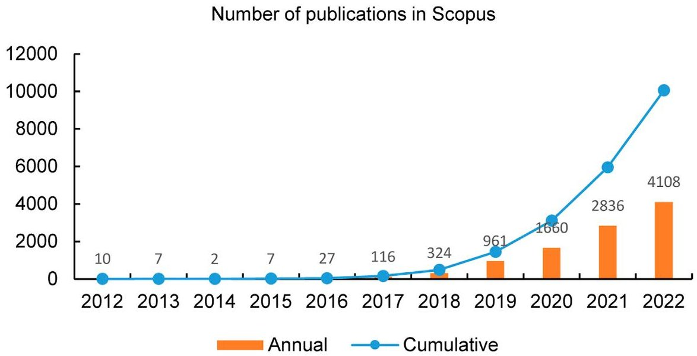
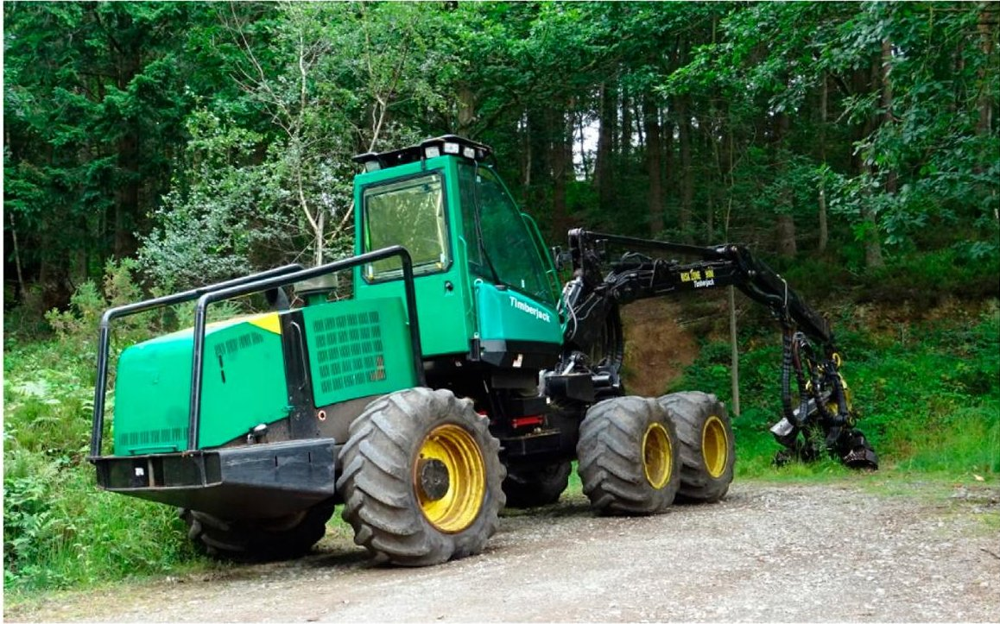
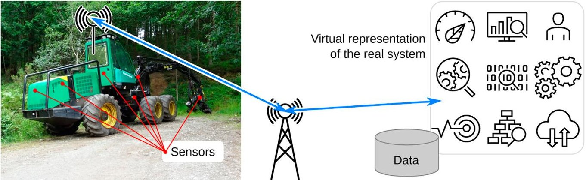
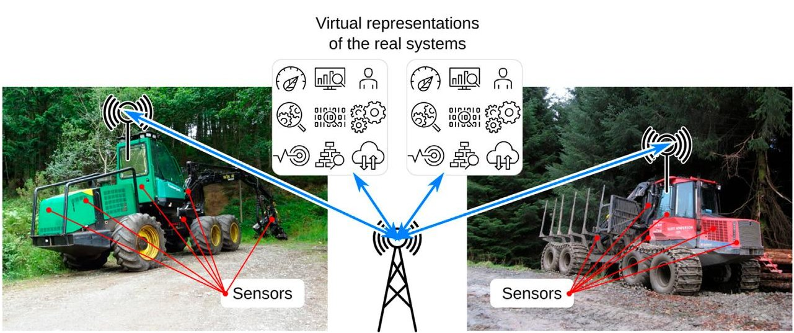
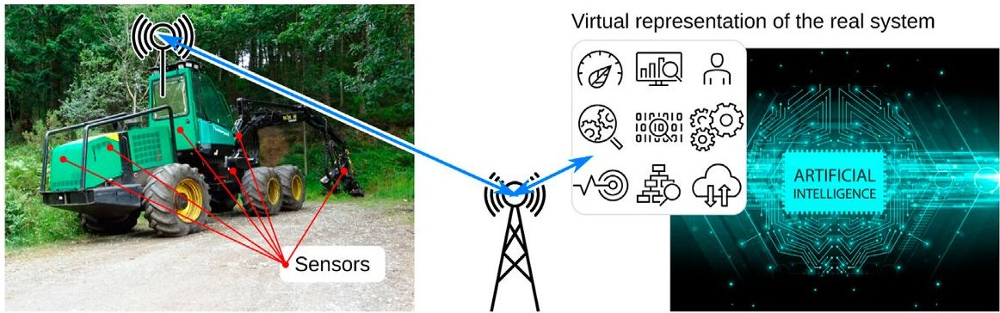
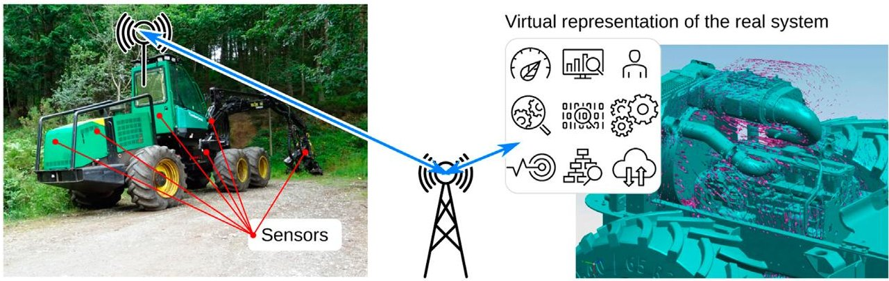
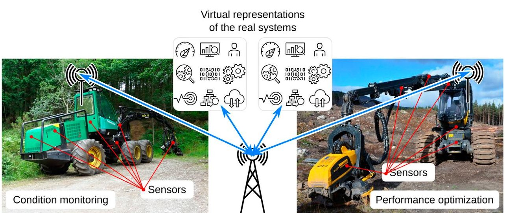

<!-- PDF_PAGE: 1 -->

## OPEN ACCESS

EDITED BY Federico Montori University of Bologna, Italy

REVIEWED BY Marek Sylwester Tatara, Gdansk University of Technology, Poland Javad Ghofrani, University of Lubeck, Germany

*CORRESPONDENCE

Juha Kortelainen,

juha.kortelainen@vtt.fi

These authors have contributed equally to this work and share first authorship

SPECIALTY SECTION This article was submitted to IoT Enabling Technologies a section of the journal Frontiers in the Internet of Things

RECEIVED 26 November 2022

ACCEPTED 27 March 2023

PUBLISHED 06 April 2023

## CITATION

Kortelainen J, Minav T and Tammi K (2023), Digital twin-The dream and the reality. Front. Internet. Things 2:1108777. doi: 10.3389/friot.2023.1108777

## COPYRIGHT

© 2023 Kortelainen, Minav and Tammi. This is an open-access article distributed under the terms of the Creative Commons Attribution License (CC BY). The use, distribution or reproduction in other forums is permitted, provided the original author(s) and the copyright owner(s) are credited and that the original publication in this journal is cited, in accordance with accepted academic practice. No use, distribution or reproduction is permitted which does not comply with these terms.

# Digital twin-The dream and the reality

Juha Kortelainen $ ^{1\ast\dagger} $ , Tatiana Minav $ ^{2\dagger} $ and Kari Tammi $ ^{3\dagger} $

$ ^{1} $VTT Technical Research Centre of Finland Ltd., Espoo, Finland, $ ^{2} $Hybrid Drives, Faculty of Engineering and Natural Sciences, Automation Technology and Mechanical Engineering, Tampere University, Tampere, Finland, $ ^{3} $Design of Mechatronic Machines, Engineering Design, Aalto University, Espoo, Finland

Digital twins (DTs) are under active research and development in the research community, industry, and in the digital engineering solution business. The roots of the concept of DT are almost 2 decades old, but the fast progress in enabling technologies, especially in data analytics, artificial intelligence, and the Internet of Things, has accelerated the evolution of DT during the last 5 years. The growing interest, increasing development activities, and increasing business opportunities of the concept are also feeding the hype in the media. Consequently, this has led to the scattering and even misuse of the concept and its definition. In this article, we discuss different applications of DTs and what kinds of solutions there are for DTs. We analyze some most cited definitions of DT in the scientific literature and discuss the interpretation of the definitions through a hypothetical case example. Furthermore, we discuss different life cycle aspects of DTs and potential risks that may arise. To further concretize the concept of DT, we introduce ten reported case examples of implemented DTs in the scientific literature and analyze their features. Finally, we discuss the future development directions of DTs and the aspects that will affect the development trends.

## KEYWORDS

digital twin, digital twin definitions, digital twin applications, digital twin use cases, digital twin future trends

## 1 Introduction

The interest in the concept of a digital twin (DT) has been growing fast-partially, due to the maturing and evolving of the concept itself, but also due to the rapid development of enabling and supporting technologies, such as the Internet of Things (IoT), data analytics, and artificial intelligence (AI), and because of the growing business potential the DT concept has shown. Industry's interest in DTs mostly concentrates on managing large assets, optimizing their operation and use, and improving the data and information flow from the installation base of machines and systems back to their engineering and design. The increasing industrial interest in the concept and especially the growing business opportunities also generate hype, i.e., via active communication, discussion and publicity in the media, surrounding it. This has led to the blurring of the concept and even to the misuse of the hype to promote solutions and services that may not have the fundamental features of DT.

According to one general definition of the DT concept by Grieves (2014), a DT has three main elements: "a) physical products in real space, b) virtual products in virtual space, and c) the connections of data and information that tie the virtual and real products together". The three elements in the definition are each rather large and open, and leave room for interpretation. The product can be seen in a wider context as a concrete product or a system, even a non-physical one. The virtual representation of a product or a system can vary

<!-- PDF_PAGE: 2 -->

from a relatively simple set of facts, attributes and parameters that define the product and its state to a highly detailed and complex model. The virtual representation defines the composition, assembly, relations, state, and dynamics of the product or system from the micro to the macro level, from the smallest part, component, or material microstructure to the overall assembly of the product or the system. The connections of data and information can be a one or two directional data exchange. It could be full-time and continuous or occasional, and the data exchange interval and latency can be short, e.g., milliseconds, or long, e.g., days. Despite of the indeterminate definition, the concept is inspiring research, engineering, and business, and it continues to evolve. Currently the concept of DT is proposed to penetrate all aspects of human life from learning and health to conventional industries.

## 1.1 Purpose of DT

Overall, DTs can be divided into operational and structural (assembly) types based on their purpose. Operational DTs are applied for the following purposes: supervisory, diagnostic and control or predictive planning (Aitken, 2018). The first allows monitoring static or dynamic operational characteristics, or to follow performance outcome, while the second one enables analyzing the end-to-end process performance in real time, whereas the third category has capabilities to evaluate future scenarios. On one hand, operational DT is a step towards operational excellence, and a problem-free solution (Microsoft, 2017). On the other hand, structural DT represents a category where the components of an individual twin are combined into system and the DT gives an opportunity to check how the individual parts work together, the same time to represent the state of the structure, the current working structure. A structural DT provides condition information about the up-to-date assembly—"as is" with the exact maintained components, as well as the state of the current configuration.

## 1.2 Applications of DT

The smallest unit of system scale is a single component. For instance, the authors in Peng and Wang (2019) presented a DT-based condition monitoring method for a DC-DC power converter. The proposed method is able to monitor the health indicators of the main components in a buck converter without adding extra measurement circuits or the need to access the internals of the buck converter, which is a significant advantage compared to conventional methods. On the other hand, with the combination of the DTs of single components and small subsystems, it has become possible to create larger systems, such as convenience stores (Xiuyu and Tianyi, 2018), shop-floor factories (Tao and Zhang, 2017), bridges (Ye et al., 2019) and even whole cities (Mohammadi and Taylor, 2018).

In wellbeing and healthcare, DTs are spreading to different applications. The state-of-the-art varies from simple wellbeing to more complex diagnosis (doctoral task) and illnesses (James, 2021), a human DT for tracking fitness-related measurements (Barricelli et al., 2020), a prediction method for a heart stroke (Alam and El

Saddik, 2017), and personalized medicines for illnesses, such as diabetes (Bruynseels et al., 2018). A further trend towards other living beings can be also observed. For instance, biologists have created a DT of a tree and extended it to an orchard scale, similarly to the non-living DT systems. In Moghadam et al. (2020), a DT system was proposed and trialed for mango, macadamia, avocado, and grapevines orchards and generated a digital twin of 15,000 trees.

The concept of DT has been explored further for human or personal DT (Shengli, 2021) and human related activities, such as e-learning, financial management (banking Miskinis (2019), e.g., simulating digital security breaches to improve banking institution safety), virtual tours, shopping, and online social interactions. The meteorological institutes all over the world have been using the concepts of DT extensively: involving a weather model combined with a network of measurements. For instance, in Bauer et al. (2021) the authors proposed a scalable and more adaptable method to control workflows for earth-system modeling and data assimilation based on a DT.

## 1.3 Overview of market products and commercial solutions for DTs

IoT and its rapid development has been seen as one of the key enablers for DT. On the other hand, DT is an interesting use case for the IoT solution providers, and their offering is wide. Dedicated solutions for DTs are available at least from General Electric (Predix), Microsoft (Azure), PTC (Windchill), and Siemens (MindSphere). The solutions are based on an Industrial IoT (IIoT) platform together with additional features that enable data connectivity from the edge, i.e., from the real system, to the virtual representation of the system. The variation of digital representations of real systems is boundless and the IIoT solutions do not offer comprehensive means to build DT models, such as a physics-based model, of the real system. Instead, the general trend has focused on creating virtual models of the real entities and connecting the data between the two.

To create a system-level DT, existing individual components are combined to achieve the full benefits of DT. The combination of system-level DT is challenging if the components utilize different software and potentially contain confidential business data related to the systems and their components. Various solutions have been proposed in scientific literature to respond to this challenge. For instance, in Skjong et al. (2018) a cross-platform integration and simulation of maritime subsystems was proposed. The approach is based on the open-source Coral co-simulation master software. In Perabo et al. (2020), individual functional mock-up units (FMUs) that represent single subsystems were utilized for building a co-simulation environment and for routing the data between the subsimulators of the system-level DT.

With the arrival of DT generation technologies in industry and the obvious progress in the areas of DT and IoT, more question are arising. The following questions are raised by the authors.

- Has a new era in product design already begun, or has it been just announced?

- The life cycle of DT is short and appears not to be considered by the software companies. Is DT simply a new method for

<!-- PDF_PAGE: 3 -->

marketing digital tools and systems, or is it truly a new solution?

- Is DT already a product, or is it still a maturing concept?

Overall, the progress of the DT concept from the industry's point of view brings uncertainty and is blurry. Therefore, in this article, we focus on the image and realization of the concept of DT, analyze and discuss selected definitions, and present and compare selected concrete examples of DT applications. In addition, the concept of DT from the main stakeholders point of view is discussed and the life cycle aspects of DTs are illustrated for long time spans.

This article focuses on studying the definitions of DT and how the definition has been evolving and expanding. Our main contributions are:

- We have consolidated the main features of the definitions of DT into our definition.

- We have collected and analyzed existing definitions of DT to draw an overview of the definition of DT and its evolution.

- We have concertized the variety of definitions of DT in a hypothetical case example.

- We have collected and presented ten examples of implementations of DTs from the literature.

- We introduce potential future directions for the research and development of DTs.

The rest of this article is constructed as follows. In Section 2, the concept of DT is discussed from the application, purpose point of view. In Section 3, the concept of DT is discussed from the product or system providers or other stakeholders point of view, and Section 4 contains an analysis of eight case example scientific articles of implemented DTs, respectively. In addition, the realization of the DT concept through selected literature cases is presented and some possible life-cycle risks are discussed in Section 4. Section 5 discusses the future trends and directions of DTs. Finally, the findings and research gaps are analyzed and discussed, and the conclusions are presented in Section 6.

## 2 About the definitions of DT

The definition of DT has been evolving since it was introduced. The variety of definitions is getting increasingly wide and it is hindering the communication of the concept. In the following subsections, we discuss the definitions of the DT concept and concretize the differences of the definitions by testing them on a fictive case example.

## 2.1 Defining the concept of DT

The concept of DT has been defined in several ways over the past 2 decades. The concept was introduced already in early 2000 by Grieves and Vickers (2017), even though it was first called a "conceptual ideal for PLM", a "mirrored spaces model" and an "information mirroring model". The idea of combining measured data with computational models has even longer history, and it has been used, e.g., in model-based control systems (Balchen et al., 1980).

Tuegel et al. (2011) define DT in a visionary and hypothetical way to describe a detailed microstructure-level phenomena as well as the aerodynamic details of an airplane in real time. In their vision, the DT would be a 1,000 billion degree-of-freedom simulation model of a real airplane, with structural analysis and computational fluid dynamics capabilities, and it would be able to simulate in real time. On the other hand, Grieves and Vickers (2017) define the concept of DT as "a set of virtual information constructs that fully describes a potential or actual physical manufactured product from the micro atomic level to the macro geometrical level". They also introduce the concepts of a digital twin prototype, a digital twin instance and a digital twin environment.

In 2012, the National Aeronautics and Space Administration (NASA) defined DT as "a multi-physics, multi-scale, probabilistic, ultra-fidelity simulation that reflects, in a timely manner, the state of a corresponding twin based on the historical data, real-time sensor data, and physical model" (Glaessgen and Stargel, 2012; Nikula et al., 2020).

According to Gabor et al. (2016), a DT is a special simulation, built based on expert knowledge and real data collected from an existing system, to realize a more accurate simulation on different scales of time and space. One of the most commonly referred definitions of DT is Glaessgen and Stargel (2012): "A digital twin means an integrated multi-physics, multi-scale, probabilistic simulation of a complex product, which functions to mirror the life of its corresponding twin".

Barricelli et al. (2019) have analyzed the definitions, characteristics and realization of DT. They define the characteristics of DT in an ambitious manner to include seamless and continuous data connection and a dynamic data exchange between the real system and its DT. Based on this data, the DT sends back predictions and prescriptions for maintenance and operational optimizations to the real system, the domain experts, and other DTs. The exchanged data is stored for later use and it is semantically defined. The data is high-dimensional big data, and data analyses, fusion technologies and AI are applied. The data is used for continuous optimization of the operations in a closed-loop manner. The DT is capable of making predictive and prescriptive analytics of the future operation of the system. In addition, the DT is able to provide modeling and simulation features for representing both the current and potential future state of the real system.

In their article, Negri et al. (2017) ask a relevant question: "What is the definition of a Digital Twin in the scientific literature?" They have collected a list of 16 definitions for a DT from the productions systems and cyber-physical systems point of view.

1. "An integrated multi-physics, multi-scale, probabilistic simulation of a vehicle or system that uses the best available physical models, sensor updates, fleet history, etc., to mirror the life of its flying twin. The digital twin is ultra-realistic and may consider one or more important and interdependent vehicle systems" (Glaessgen and Stargel, 2012)

2. "A cradle-to-grave model of an aircraft structure's ability to meet mission requirements, including submodels of the electronics, the flight controls, the propulsion system, and other subsystems" (Tuegel, 2012)

3. "Ultra-realistic, cradle-to-grave computer model of an aircraft structure that is used to assess the aircraft's ability to meet mission requirements" (Gockel et al., 2012)

4. "Coupled model of the real machine that operates in the cloud platform and simulates the health condition with an integrated

<!-- PDF_PAGE: 4 -->

knowledge from both data driven analytical algorithms as well as other available physical knowledge” (Lee et al., 2013)

5. "Ultra-high fidelity physical models of the materials and structures that control the life of a vehicle" (Reifsnider and Majumdar, 2013)

6. "Structural model which will include quantitative data of material level characteristics with high sensitivity" (Majumdar et al., 2013)

7. "Very realistic models of the process current state and its behavior in interaction with the environment in the real world" (Rosen et al., 2015)

8. "Product digital counterpart of a physical product" (Rios et al., 2015)

9. "Ultra-realistic multi-physical computational models associated with each unique aircraft and combined with known flight histories" (Bielefeldt et al., 2015)

10. "High-fidelity structural model that incorporates fatigue damage and presents a fairly complete digital counterpart of the actual structural system of interest" (Bazilevs et al., 2015)

11. "Virtual substitutes of real world objects consisting of virtual representations and communication capabilities making up smart objects acting as intelligent nodes inside the internet of things and services" (Schluse and Rossmann, 2016)

12. "Digital representation of a real world object with focus on the object itself" (Canedo, 2016)

13. "The simulation of the physical object itself to predict future states of the system" (Gabor et al., 2016)

14. "Virtual representation of a real product in the context of CyberPhysical Systems" (Schroeder et al., 2016)

15. "An integrated multi-physics, multi-scale, probabilistic simulation of an as-built system, enabled by Digital Thread, that uses the best available models, sensor information, and input data to mirror and predict activities/performance over the life of its corresponding physical twin" (Kraft, 2016)

16. "A unified system model that can coordinate architecture, mechanical, electrical, software, verification, and other discipline-specific models across the system lifecycle, federating models in multiple vendor tools and configuration-controlled repositories" (Bajaj et al., 2016)

The same authors have analyzed the scientific literature concerning DTs and concluded that the main use cases for DTs are condition monitoring and maintenance, physical system life-cycle data management (digital mirroring of the real system), and support in decision making, e.g., in engineering. They have also found that simulation is often incorporated with DTs and, in most cases, it is seen either as an extension to the DT or the actual simulation model is the digital representation of the real system. Computer simulations or computational models are included in nine DT definitions on the list. Another feature that appears in several definitions is the life cycle scope of DTs, i.e., they follow the real system for its entire life cycle.

Repeating the same search as Negri et al. (2017) did in Scopus, $ ^{1} $ i.e., searching for the string "digital twin" in titles, abstracts, and keywords, in scientific publications (no specification of exact type)

published during the years 2012-2016 (i.e., the year 2016 included) in English language now produces 53 hits. Excluding the year 2016 (i.e., setting the search for period 2012-2015) produces 26 hits as mentioned in their paper. Performing the same search for the year period 2012-2022 (i.e., including year 2022 in the search) produces 10,058 hits. The number of publications published annually between the years 2012-2022 is shown in Figure 1. The graph shows close to an exponential rate of growth in the number of publications. The same trend is visible in the number of publications combining DT with simulation. A search with the combined terms "digital twin" and "simulation" for the year period 2012-2015 gives 22 hits and for the year period 2012-2022 3322 hits. The details of the Scopus search used above are given in Appendix 1.

The purpose, scope, included features, and the level of detail of a DT varies remarkably between different application domains. In many of the definitions, a DT is described to have simulation capabilities, and DTs are capable of doing predictive and prescriptive analytics. Simulation can be seen as a physics-based and detailed representation of the function, behavior, and dynamics of a real system, or it may be a simple estimation of the future state of the system, based on historical data and information on the correlation between the measured features and the behavior of the system in a form of response surfaces (i.e., an empirical databased model). The same indeterminate definition applies to the predictive and prescriptive analytics features of DTs. The level and implementation of the analytics may vary from a simple historical data model to a complex model that takes into account physics, the operating environment and history of the system, and other relevant matters. It seems that the research focus and the background of the author(s) influence how the definition of DT is formulated and which features are emphasized.

Our interpretation of the DT definitions is that DT has at least the following elements and features.

- The overall embodiment of DT contains:

1. A real product or system, i.e., the real twin,

2. The virtual representation of the real product or system, and

3. Continuous data communication and interaction between the real twin and its virtual representation.

- The real product or system can be a physical product or system, such as a machine, or a non-physical system or process, e.g., a decision-making process, such as a project or an investment process.

- The virtual representation of the DT represents the state of the real twin in real time, compared and relevant to the application and purpose of the DT.

- The DT may have data analytics, simulation, optimization, or other advanced features.

- The purpose and context of the DT is defined.

Defining the purpose and context for the DT is crucial to clarify what is meant by DT representing the state of the real system in real time. The state of the system and real time for maintenance purposes have different meanings in practice compared to the application of DTs for model-based control. A relevant time step size for the former may be days, and for the latter it may be as short as milliseconds.

<!-- PDF_PAGE: 5 -->

Number of articles published annually between years 2012 and 2022 having string "digital twin" in title, abstract, or keywords; Scopus (the search performed on 2 February 2023). The numbers on top of the bars present the annual publishing figures.

FIGURE 2 An example case of a forest machine (a logging vehicle).

## 2.2 Testing the DT definitions on a hypothetical case

To extend and further concretize our understanding of the concept of DT and how it has been defined, the following sections will present examples of adapting the concept of DT to a concrete but hypothetical case of a forest machine (Figure 2). In the following sections, we take one definition at a time and illustrate what it would mean if it was applied to the case. This is to show how the definition of the DT concept has

evolved, and on the other hand, how wide and unclear the definitions of DT have become.

## 2.2.1 The DT definition by grives on a forest machine

Grieves (2014) defines the DT to contain three main elements: "a) physical products in real space, b) virtual products in virtual space, and c) the connections of data and information that ties the virtual and real products together". Applying this definition to the example case of a forest machine gives freedom for the interpretation and the

<!-- PDF_PAGE: 6 -->

FIGURE 3

An example of a forest machine DT, according to the DT definition of Grieves (2014).

implementation of the DT. Figure 3 illustrates the three elements of the DT concept for the example case: the real forest machine (the physical products in real space), a bill of materials of the forest machine as-operated together with an up-to-date machine service history in digital form (the virtual product in virtual space), and sensor data transmitted from the real forest machine via IoT to the virtual space, e.g., a monitoring display that uses the virtual product data and measured data to show the status of the machine.

On the other hand, the same definition would apply to an implementation, in which there is a detailed real-time simulation model that adapts with the operation of the real machine and produces detailed information about the forces, loads, and strains of the machine structures together with other operational data. In addition, the measured data from the machine combined with the data from the simulation could be used to predict the structural health of the machine and for optimizing the operation for both performance and fatigue. Thus, this definition of DT enables a flexible implementation of the concept depending on the requirements and needs.

## 2.2.2 The DT definition by Tuegel et al. on a forest machine

Taking the Tuegel et al. (2011) vision of a DT, the forest machine would have a digital representation as a structural analysis model with 100-1,000 billion degrees-of-freedom. The model would be linked to the real forest machine with a large number of sensors measuring strains and deformations of the machine structure, together with measurements from actuators, control and automation systems, and the environment of the machine. In Figure 4 the data would be processed and fed to the digital model to initiate the computation and to keep it synchronized with the real machine.

As the machine is operating in the forest, the data connection between the real system and its digital representation would need to be wireless. The application of the DT would be to monitor the operation and loading of the machine structures to optimize the performance, but also the fatigue life of the machine. To do this, the DT would need to carry out online optimization based on the structural analysis and measured data (predictive analytics), and directly control or influence the control of the machine (prescriptive analytics).

## 2.2.3 The DT definition by Barricelli et al. on a forest machine

Following the same approach with the definition of DT by Barricelli et al. (2019) would mean that the forest machine is measured with a large number of sensors, and the sensor data is sent to an IoT environment as illustrated in Figure 5. The data is analyzed with data analytics algorithms, and stored on a big data platform. The measured and extended data would be used by AI algorithms to affect the control of the machine in order to optimize the performance and the fatigue life of the machine.

## 2.2.4 The DT definition by Glaessgen and Stargel on a forest machine

Glaessgen and Stargel (2012) have visioned the concept of DTs for flying vehicles, such as airplanes, of the future: "A Digital Twin is an integrated multiphysics, multiscale, probabilistic simulation of an as-built vehicle or system that uses the best available physical models, sensor updates, fleet history, etc., to mirror the life of its corresponding flying twin". Taking their definition and applying it to the forest machine case would mean that DT of the machine would contain multibody system and structural analysis models representing the machine system and machine component-level dynamics (see Figure 6).

The system model would combine actuators, such as hydraulics and electrical actuators, their control, and machine automation. The structural models would include multiscale models from the components' material microstructure level to component level (continuum models of structural behavior). The DT would use a hybrid modeling approach, combining data from physics-based simulations and sensors, and would utilize data from the fleet of forest machines and their related DTs. The still unresolved challenge is how these computationally demanding simulations could be combined and the simulations performed in real-time? In addition, a noticeable challenge is to enable this for a large fleet of forest machines.

## 2.2.5 The DT definition by the authors on a forest machine

Applying the definition of DT by the authors of this article to the example forest machine case would mean that there is a real system, i.e., the forest machine, a virtual representation of the real system,

<!-- PDF_PAGE: 7 -->

An example of a forest machine DT, according to the DT definition of Tuegel et al. (2011).

FIGURE 5 An example of a forest machine DT, according to the DT definition of Barricelli et al. (2019).

FIGURE 6 An example of a forest machine DT, according to the DT definition of Glaessgen and Stargel (2012).

e.g., a multibody system simulation model, and continuous data connection between the two. The data connection is interactive and somehow influences the behavior of the forest machine and its virtual representation. The virtual representation of the forest machine adapts to the state of the real system. The DT may

have, e.g., simulation-based analytics of structural loads, or the control system of the forest machine may use the simulated signals to minimize the structural loading. In addition, the purpose and context for the DT is defined and it can be, e.g., to maximize the structural durability of the forest machine frame by

<!-- PDF_PAGE: 8 -->

An example of a forest machine DT, according to the DT definition of the authors of this article.

minimizing the structural load while maximizing the forest machine performance (condition monitoring, performance optimization) (see Figure 7).

## 3 DT from product lifecycle and stakeholders' point of view

In this section, the concept of DT is discussed from the product or system providers, and stakeholders, point of view. We discuss the use of DTs in the early phase of the system life cycle and in the operational phase. We consider potential risks of DTs from the technical but, to some extent, also from the business perspective.

## 3.1 DT for engineering and design

Pahl et al. (2007) have formalized the machine design process and it has been further re-defined in various process charts, such as waterfall, spiral, V-cycle, and scrum charts. Will DT technologies redefine the process or fit into the existing processes? We do not know. Regardless of definition, data plays a larger role than earlier in machine design. Furthermore, online connectivity makes it possible to examine machine performance in actual use. This, in turn, makes it possible to examine the machine life cycle performance and design choices in the light of actual use of the machine. Further, the role of data is likely to change responsibilities from the design department to the information technology (IT) department and the management of a company as the IT tools and connections for data access grow in importance.

Early phase DTs in design appear to be an efficient usage of data, with novel user interface concepts for designers, and possibly even involving crowd sourcing and social media usage. For the final design, product configurators, design assistants, and other automatic design solutions can be used.

The IoT systems provide data over the machine life cycle and these data may be mapped back for the use of machine designers.

Design software is starting to include features for showing data (e.g., Siemens Teamcenter or Mindsphere). Using this data is possible while making design decisions.

Different kinds of models have been used for a long time in design and engineering. What makes it different in the era of DTs is that the fleet of models can be large, especially if all the produced machines are equipped with a DT. In addition, the ability to measure the state of the machine and transfer the data with IoT would make it possible for engineers to have large amounts of data about the loading and conditions the machines are operating in. This would enable the designers to better understand how the machines are operated and what kind of loading profiles they have. The difference compared to the traditional approach of using models in engineering and design is in the number of model instances and the amount of data received. The larger model base enables statistically representative data of the use and, thus, it provides a more realistic basis for the design. Large amounts of operational data enable the engineers to use the data for data-based models for online condition monitoring (application of machine learning) or machine control. Likely models have become more functional and again data is available. System-level modeling has emerged compared to traditional detailed models.

Continuing the speculative example of a forest machine that was introduced in Section 2.2, DTs could serve the development of the forest machine by providing detailed load history data of the machine structures to the engineers in or close to real time. The data would enable the engineering to optimize the machine structures to minimize the weight of the machine, thus optimizing the pressure load the machine produces on the ground and maximizing the payload of the machine. In addition, the structural optimization would enable improved control over structure's fatigue life. Furthermore, using comprehensive load data of the machine to create fast data-based models of the correlation of load and fatigue, the machine could have an online monitoring system and smart control over actuators to optimize the machine operation by affecting the control signals the operator is giving.

In this scenario, the fleet of DTs would first serve the design and engineering of the machines by providing valuable information. If

<!-- PDF_PAGE: 9 -->

the data from the measurements and the DT would be used only by the design and engineering, the DT would not affect the owner/ operator of the machine and would not pose any challenges to the use of the machine, if something goes wrong with the DT. In addition, the need for DTs connected with real machines would vary based on the need for data. If only representative data of the loading conditions and environment of the operations is needed, only a small number of machines would need to have a DT. On the other hand, if the data was to be used for thorough data analytics or extensive machine learning applications, e.g., using deep learning methods, more DT instances would be needed. If the outcome of the use of DT data would be a solution that affects the owning and operation of the machine, the overall context of the DT changes.

## 3.2 DT for product or system operational life cycle phases

A DT can produce added value throughout the product or system life cycle. Grieves and Vickers (2017) discuss the value of a DT due to the information it provides in different product life cycle phases. In the design phase of the product, DTs can decrease the need for physical prototypes and, thus, save both costs in the form of wasted materials and other resources, and time. In the production phase, simulation of the product and its production can reduce unnecessary trials and errors. In addition, the DT can store the as-built information about the product. In the operational phase, DTs can serve in the maintenance of the product and they can provide information about the behavior of the product and prevent failures. In the disposal phase, DTs can provide information about how the product was produced and help in planning and implementing the disposal in a safe and efficient manner (Grieves and Vickers, 2017).

In the early product life cycle phases, at the time of designing and engineering the product or the system, the DTs of other, already operational products or systems, can provide valuable information about the operation, operating conditions, loads and dynamics of the real system. This information can be used for understanding the behavior of the products and for taking into account all the complex physical phenomena affecting it. During the operational life cycle phase, DTs can be used for condition monitoring, fault detection, control and operation of the real system, or optimizing the operation. At the end of the life cycle, a DT can help for the controlled shutdown of the system and for monitoring the state of the real system.

The various use cases of DTs throughout the entire life cycle can also rise some challenges. If the lifetime of the overall system is long, in a scale of decades, and the DT is an integral and essential part of the overall system, reliability and operability of the DT itself may become an issue.

## 3.3 Life cycle risks of DTs

As DTs are gradually becoming a common technology and their application in overall solutions are becoming more important, the risks involved in the concept should be understood and evaluated. In general, increasing the complexity in solutions tends to make them more prone to problems, which may cause challenges for the owners,

users and service providers. As the main elements of the DT concept are the real system, its virtual representation, and the data connection between them, issues in any of these may cause the overall solution to malfunction or even fail. In a DT that is based on a physics-based simulation, the main elements of the implementation are the computing infrastructure, including the computing hardware and its operating system, simulation software, and the model describing the relevant physics of the real system, i.e., the DT model. In system-critical applications of DTs, all the aspects of preserving information and minimizing any additional work should be taken into account. Zeb et al. (2022) discuss the risks involved in DTs both from the technical and business point of views.

## 3.3.1 Computing system and hardware risks

As in any real-world physical system or machine, the components of a computer may break. If the computer that is running the operating system and the simulation software fails, it needs to be replaced. In a case of a lifetime of decades for the overall system, one cannot expect that a spare component or computer can be bought to replace the original one. As an example, the commonly used computers 20 years ago (year 2021) had 32-bit processors with only one processor core—nowadays 64-bit processors are dominant and workstation processors may have up to 12 processor cores. Twenty years ago, the operating systems mainly used were Microsoft Windows 95, Microsoft Windows NT or some proprietary UNIX operating systems, such as Sun Microsystems Solaris or Silicon Graphics IRIX (Chan and Bravo Technology Center (2020); Wikipedia (2021c; a)). The popularity of the Linux operating system was rising and the Linux kernel version at the time was 2.2 (Wikipedia L. 2021). Based on this information, if we now extrapolate the development of computing 20 years ahead and take into account the pace of the development in the past, it is practically impossible to imagine what kind of computers, operating systems and computing technology will be used and if the current technology will even be available.

## 3.3.2 Risks with DT software and technical data

If the DT relies on physics-based simulation, a straightforward process for creating the DT model is to use the product's or system's engineering phase simulation models as the starting point. In today's engineering work, highly developed commercial digital engineering tools, such as finite element analysis (FEA), computational fluid dynamics, and system simulation tools, are commonly used, due to their efficiency and available support services. In a case, when the DT is relying on a commercial simulation tool, the life cycle risk is in the availability of the software throughout the product or system life cycle and the compatibility of the models with the later versions of the software after a long time. Here, the risk is in running the simulation software after a long time. This comes from the fact that the DT is to run in parallel with the real-world system throughout its life cycle.

If the real system (the real twin) needs to be modified, the modifications need to be reflected also in the DT. In a case, when the DT is originally created with commonly used modeling and simulation software, the model is typically modified with the same software and a new version of it is saved. Now, again, after a long time, the availability and usability of the modeling and

<!-- PDF_PAGE: 10 -->

simulation software may become an issue. If the simulation and computing details, such as how the physics is represented in the DT model are not available, reproducing the DT model may require substantial remodeling work or it may not be possible.

## 3.3.3 Scaling risks in business

A DT is related to an individual real-world product or system and is connected with it to exchange data. This means that for each real-world product or system produced, there is an instance of a DT implemented and running. If the DT is based on a simulation and contains the elements described above, the technical risk of failure increases with every implemented unit. There is a risk for the owner and user of the solution that relies on a DT, but there is also a risk for the solution provider as the number of DTs grows with every sold and delivered unit, and the technology involved with the DT gets older. If the system depends on the DT, the risk may be also economic, due to the large number of instances and the growing risk in time of failing to have spare parts and components for the systems. An example of the scaling risk in keeping a delivered solution up-to-date are smart phones. A smart phone, to be functional and secure to use, requires an up-to-date operating system and applications. As the number of delivered phones is growing, the number of different product models is increasing, and the technology involved in smart phones is getting increasingly divergent, the smart phone providers are having difficulties in keeping the sold phones updated. The required effort to support the different phone models increases, but the effort does not bring any additional income. From the business perspective, that is a mandatory evil which has to be taken care of due to harsh competition in the market. A similar kind of risks may apply to DTs, especially when the DT is an integral part of and plays a crucial role in the overall system.

## 3.3.4 Means to mitigate data related risks

Modeling and simulations have been used in engineering design for several decades and the offering of digital design tools and solutions is wide. Still, the digital design data exchange between software applications is often cumbersome and not even possible in many engineering domains. Standardization has provided help in many cases, and, e.g., in computer-aided design (CAD), the status of standardization is good.

The application of simulation models in the product design life cycle phase differs from the one in product operation life cycle phase. The product design phase usually lasts from a couple of months to a couple of years, it is done by a relatively small group of people, and the software tools can be selected based on flexible preferences. On the other hand, in the product operational life cycle phase, when simulation models are used in DTs, the phase of the active use may be as much as several decades and there may be numerous organizations and users involved. This sets strict requirements for the simulation technology, and the decisions made in the early life cycle phase can have longlasting consequences. Standardization, common formats for models, and open information specifications become increasingly important to guarantee the operation of DTs for long lifetimes. In addition, the technical and business risks for both the solution providers as well as for the solution users can be noticeably reduced by enabling complementary solutions, such as alternative simulation software or computer hardware, to be used when needed.

## 4 Realizations of the DT concept

We studied and analyzed ten selected case examples of implemented DTs that are represented in scientific articles (see Table 1). The fact that the cases were reported in scientific publications may have biased the sample. The research and development of the concept of DT and its application is active, which can be seen from the global distribution of the selected cases. For example, Europe, America, and Asia are all represented among the selected ten cases. In the following sections, we introduce and discuss the cases.

## 4.1 Case 1: DT of smart assembly process design

Yi et al. (2020) presented an experimental case study of field assembly with DT-based human-machine collaboration, which combines assembly process planning (APP) and laser projection planning. In the study, a DT is proposed to support laser projection aided assembly of complex products. The authors do not explore the meaning of DT, the just refer to the existing description in Qi et al. (2021) of a five-dimension DT model.

An assembly process planning system, called an AMTProcesser (Liu et al., 2016), was developed based on the proposed modeling mechanics. The system was developed based on ACIS (a geometry modeling kernel) and HOOPS (visualization software library) software libraries using the Microsoft Visual C++ (MSVC) 2008 compiler package. The input model was a three-dimensional assembly model, which was modeled with CAD software, such as PTC Pro/ENGINEER, Unigraphics (UG), or Dassault Systemes CATIA. Then the assembly model was imported into the AMTProcesser and could be used for the field assembly.

## 4.2 Case 2: DT of a manufacturing system

Ashtari Talkhestani and Weyrich (2020) present an example case study of a DT of an automated manufacturing system. In the study, the DT is used for reconfiguring the manufacturing system. The performance of the reconfiguration process is compared with a case that does not contain the DT. In their article, the authors first present some definitions of DT, partially based on their previous study (Ashtari Talkhestani et al., 2019), and present a definition that is then used for the study. In their study, they define a DT as: "virtual representation of a physical asset in a cyber-physical system that can represent its static and dynamic characteristics. A DT includes and maps cross-domain models of a physical asset. It states that not all models of the DT need to be executable; therefore, the DT is more than just a simulation of a physical asset." Their definition emphasizes the use of mapped cross-domain models, including static and nonexecutable, i.e., non-simulatable, models. Their definition does not define how the models and their states are exactly synchronized with the real asset and how the models interact with the real asset in real time. In the paper, the use of interlinked models and the overall system and its configuration data is emphasized. As the DT is used for reconfiguring a real manufacturing system, the DT and the real

<!-- PDF_PAGE: 11 -->

TABLE 1 Mapping of the found DT defining features and selected DT case examples.

<table border="1"><tr><td>Feature</td><td>Case 1:DT for a smart assembly process design Yi et al.(2020)</td><td>Case 2:DT of a manufacturing system Ashtari Talkhestani and Weyrich(2020)</td><td>Case 3:DT of DC-DC converter Peng and Wang(2019)</td><td>Case 4:DT-driven product design framework Tao et al.(2019)</td><td>Case 5:DT of a cutting tool Botkina et al.(2018)</td><td>Case 6:3D avatar as a DT Wang et al.(2019)</td><td>Case 7:DT for design and production engineering Schleich et al.(2017)</td><td>Case 8:DT of a manufacturing process Roy et al.(2020)</td><td>Case 9:DT of a production system Biesinger et al.(2019)</td><td>Case 10:Layered DT of a production line Villalonga et al.(2021)</td></tr><tr><td colspan="11">Purpose</td></tr><tr><td>Country?(1st author)</td><td>China</td><td>Germany</td><td>Denmark</td><td>China</td><td>Sweden</td><td>United States</td><td>Germany</td><td>India</td><td>Germany</td><td>Italy</td></tr><tr><td>In laboratory or company?</td><td>Laboratory</td><td>Laboratory</td><td>Laboratory</td><td>Laboratory</td><td>Laboratory</td><td>Company</td><td>Laboratory</td><td>Laboratory</td><td>Laboratory</td><td>Laboratory</td></tr><tr><td>Outcome of the DT?</td><td>Visual position accuracy of laser projection</td><td>New control configuration for a manufacturing system</td><td>Ability to monitor the degradation of a capacitor and MOSFET</td><td>Tool for product development as a part of a cyber-physical system</td><td>Monitoring and communication of the state of a machining tool</td><td>Giving a feeling of presence</td><td>Improving manufacturing capabilities and product performance</td><td>Bridging the gap between design and manufacturing</td><td>Production plan for a vehicle“body in white”production line</td><td>Optimized scheduling of the production line</td></tr><tr><td>What is the purpose?</td><td>To support laser projection aided assembly of complex products</td><td>To enable faster change of manufacturing system configuration</td><td>Condition monitoring</td><td>Reductions of errors and inconsistencies between the actual and expected behavior</td><td>Process planning for an optimized machining solution</td><td>Entertainment industry by creating creative content with virtual avatars</td><td>Improved product quality and life-cycle management</td><td>Monitoring real processes and making computational predictions</td><td>Manufacturing and production planning</td><td>Predictive maintenance and production optimization</td></tr><tr><td>Business improvements?</td><td>Faster assembly of complex products</td><td>Reduced manufacturing system reconfiguration time, improved availability and productivity</td><td>Predict failure—shorter downtime</td><td>Improved model accuracy, better design tools</td><td>Better machining tool management, improved communication</td><td>Improving the experience of being present</td><td>Implicit</td><td>Implicit</td><td>Improved planning and production efficiency</td><td>Improved productivity</td></tr><tr><td colspan="11">Model</td></tr><tr><td>Data-, model- or physics-based?</td><td>Model-driven</td><td>Data- and model-based</td><td>Physics-based model</td><td>Physics- and data-based</td><td>Data-based</td><td>Data-driven</td><td>Physics- and data-based</td><td>Physics- and data-based</td><td>Data-based</td><td>Data- and model-based</td></tr><tr><td>Real-time(synchronization)?</td><td>No</td><td>No</td><td>Sampling frequency is set to 50 kHz</td><td>Online</td><td>No</td><td>Yes, avatar driven in real-time during application</td><td>No</td><td>Yes</td><td>Yes</td><td>Yes</td></tr><tr><td>Has optimization features?</td><td>No</td><td>No</td><td>Yes</td><td>Yes</td><td>No</td><td>No</td><td>No</td><td>Yes</td><td>Yes</td><td>Yes</td></tr><tr><td>Has data analytics?</td><td>No</td><td>No</td><td>Yes</td><td>Yes</td><td>No</td><td>No</td><td>Yes</td><td>Yes</td><td>Yes</td><td>No</td></tr><tr><td>Has artificial intelligence?</td><td>No</td><td>No</td><td>No</td><td>Yes</td><td>No</td><td>Yes</td><td>Yes</td><td>Uncertain</td><td>No</td><td>Yes</td></tr></table>

(Continued on following page)

<!-- PDF_PAGE: 12 -->

TABLE 1 (Continued) Mapping of the found DT defining features and selected DT case examples.

<table border="1"><tr><td>Feature</td><td>Case 1:DT for a smart assembly process design Yi et al.(2020)</td><td>Case 2:DT of a manufacturing system Ashtari Talkhestani and Weyrich(2020)</td><td>Case 3:DT of DC-DC converter Peng and Wang(2019)</td><td>Case 4:DT-driven product design framework Tao et al.(2019)</td><td>Case 5:DT of a cutting tool Botkina et al.(2018)</td><td>Case 6:3D avatar as a DT Wang et al.(2019)</td><td>Case 7:DT for design and production engineering Schleich et al.(2017)</td><td>Case 8:DT of a manufacturing process Roy et al.(2020)</td><td>Case 9:DT of a production system Biesinger et al.(2019)</td><td>Case 10:Layered DT of a production line Villalonga et al.(2021)</td></tr><tr><td>Data security reported?</td><td>No</td><td>No</td><td>No</td><td>Yes</td><td>No</td><td>No</td><td>No</td><td>No</td><td>No</td><td>No</td><td>No</td></tr><tr><td>Time step?</td><td>N/A</td><td>Event-based</td><td>Sampling frequency is set to 50kHz</td><td>N/A</td><td>No</td><td>30 fps during live application</td><td>N/A</td><td>N/A</td><td>N/A</td><td>N/A</td><td>1Hz</td></tr><tr><td>Component or system level?</td><td>Component level</td><td>Component and system level</td><td>Component level</td><td>Component and system level</td><td>Component level</td><td>Component and system level</td><td>Component and system level</td><td>Component and system level</td><td>System level</td><td>System level</td><td>System level</td></tr><tr><td>Software applications mentioned?</td><td>Developed based on ACIS and HOOPS using Microsoft Visual C++2008</td><td>Siemens Teamleft,Siemens PLCSIM</td><td>No</td><td>No</td><td>ToolMaker</td><td>No</td><td>No</td><td>No</td><td>No</td><td>No</td><td>No</td></tr><tr><td colspan="12">Connectivity</td></tr><tr><td>Has cloud service?</td><td>No</td><td>No</td><td>No</td><td>Yes</td><td>Yes</td><td>Yes</td><td>No</td><td>Yes</td><td>No</td><td>No</td><td>No</td></tr><tr><td>Is IoT mentioned?</td><td>No</td><td>No</td><td>No</td><td>Yes</td><td>Yes</td><td>No</td><td>No</td><td>Yes</td><td>No</td><td>Yes</td><td>Yes</td></tr><tr><td>User interfaces?</td><td>Screen</td><td>Screen</td><td>N/A</td><td>Screen and app</td><td>Screen</td><td>Screen</td><td>N/A</td><td>Screen and voice input</td><td>N/A</td><td>N/A</td><td>N/A</td></tr><tr><td>In-house or world-wide?</td><td>In-house</td><td>World-wide</td><td>In-house</td><td>In-house</td><td>World-wide</td><td>World-wide</td><td>In-house</td><td>In-house and world-wide</td><td>In-house</td><td>In-house</td><td>In-house</td></tr><tr><td>Wi-Fi/Ethernet/Bus/other?</td><td>N/A</td><td>PROFINET,TCP/IP</td><td>N/A</td><td>All</td><td>N/A</td><td>N/A</td><td>N/A</td><td>All</td><td>Manufacturing Service Bus</td><td>OPC UA</td><td></td></tr></table>

<!-- PDF_PAGE: 13 -->

asset do not seem to have any interaction during the operation of the real asset.

## 4.3 Case 3: DT of DC-DC converter

In Peng and Wang (2019), the authors presented an example case study of a DT-based condition monitoring method proposed for DC-DC power converters. In the article, the authors did not present definitions of DT and concentrated on the realization of the concept. The feasibility of DT was demonstrated by building a physical prototype. A particle swarm optimization algorithm was applied to update the internal parameters of the DT from the measured data from a real buck converter. The ability of monitoring the degradation of the capacitor and MOSFET was verified experimentally in the work.

## 4.4 Case 4: DT-driven product design framework

Schleich et al. (2017) discuss the important model properties of DT, such as scalability, interoperability, expansibility, and fidelity, as well as the capability to update throughout the product life cycle. Special focus was placed on geometrical variations management; the research work builds the case from material characteristics and tolerances up to the mechanical performance of the product. The link between the real system and its virtual representation was seen as the observation from the real system to the virtual representation and as a prediction from the virtual representation to the real system.

## 4.5 Case 5: DT of a cutting tool

Botkina et al. (2018) have developed a concept of a DT for a cutting tool. In their work, the DT is used for presenting the status and data of the cutting machining tool to ease the design, assembly, adjustment, and use of it. In the article, the authors describe the overall concept at a general and rather superficial level. The main emphasis of their work was on the development of an information model for machining and in the application of standards in the data model. Their information model, named LISA, is based on ISO standard 13,399 Cutting tool data representation and exchange and other related standards, such as ISO 10303-238 Industrial automation systems and integration. The implementation of the information management is based on the open-source software, ToolMaker. The characteristic feature of the information model and its application is a tweeting mechanism that enables the efficient exchange of information within the manufacturer's organization, but also between the manufacturer and the tool providers.

## 4.6 Case 6: A 3D avatar as a DT

ObEN presented an experimental case for a human avatar with DTs. $ ^{2} $ In this company, the DT was used for various applications in

the entertainment industry by making creative content with virtual avatars. The avatars can be used for live streaming or even DTs as virtual doctors. The proposed and realized technology covers both the visual representation in the form of a 3D avatar and the vocal representation in terms of a voice model. Both the 3D avatar and the voice model are created and trained offline and can be shown at 30 frames per second during live applications. The level of detail of a DT depends on the utilized solutions for the creation of the 3D avatar, such as the data capture device. It could be from high-quality facial scans for celebrities or brands, or just a simple selfie photo for regular users. For details refer to Himawan et al. (2020) and Kuo et al. (2019).

## 4.7 Case 7: DT for design and production engineering

Tao et al. (2019) emphasize that the notion of DT should be differentiated from cyber twins. Generally speaking, the notion of a cyber twin is derived based on the development of cyber physical systems (CPS). Cyber space is defined as a networked space that consists of multiple interconnected cyber twins of critical objects (Lee et al. (2013; 2014); Liu et al. (2016); Xiuyu and Tianyi (2018)). In other words, cyber twins purely exist and are merely meaningful within cyber space. In sharp contrast, a complete DT must include a physical model, a virtual model, and connections between the physical and virtual models. In other words, it emphasizes interaction, communication and collaboration between physical space and cyber space. DT can be regarded as a critical milestone towards smart manufacturing and smart industry, while cybernetics provides the theoretical basis for DT. Cybernetics studies the concepts of control and communication in living organisms, machines and organizations, including self-organization.

## 4.8 Case 8: The DT of a manufacturing process

Industry 4.0 is leaning strongly toward enhanced communication and data usage in manufacturing. Communication involves improved opportunities for human-to-machine and machine-to-machine communication. Data usage involves improved demand pull, manufacturing process optimization, and quality control. DT applications in manufacturing include enhanced user interfaces, such as virtual reality (VR) and augmented reality (AR), digital records of manufacturing equipment, as well as digital records of items manufactured, and advanced-decision-making tools using artificial intelligence (Kaivo-Oja et al., 2020; Roy et al., 2020).

The case example of Roy et al. (2020) emphasizes DT bridging gaps between design, manufacturing, and the product life cycle. DT is expected to help match the supply chain with demand and provide feedback for designers on the manufacturability and material efficiency of items. As a practical example, DT can help matching tolerances of sub-components selected by various suppliers so that the end product is functional but cost efficient.

After manufacturing, DT is expected to provide feedback on the product usage, end of product life, and eventually recycling. Have

<!-- PDF_PAGE: 14 -->

the designers' choices and material selection been successful over the whole product life cycle? Is the product recyclable? These aspects are saved in a digital record and fed back to design (Roy et al., 2020).

## 4.9 Case 9: DT of a production system

Biesinger et al. (2019) present a case of a production system and its DT. The DT is used for the automatic production planning of an automotive assembly line, where the challenge is to keep the "as planned" digital model of the production line in sync with the real production line. Gradual changes and production optimization are causing the real line to diverge from the model, while the model is not actively kept up to date. When the production line is to be changed for a new product, the digital model does not represent the reality and updating of the model is needed. The authors present an approach collecting necessary information from the cyber-physical production system to automatically keep the DT synchronized with the real production line.

## 4.10 Case 10: Layered DT of a production line

Villalonga et al. (2021) present a laboratory case of a production line and its layered DTs. The production line of the case is a simple experimental setup for research and educational purposes. The implemented system demonstrates the function and operation of a real production line system that has DTs implemented in the nodes of the production line (local node DTs) and as a global overall production line system DT. The global system DT controls the operation of the whole system and optimizes the production scheduling based on the information coming from the local production line node DTs. The local node DTs are based on data-based models and the global system DT uses fuzzy logic model for the operation. In addition, a genetic algorithm approach and discrete event simulation are used for the scheduling optimization.

## 4.11 Analysis and conclusions of the DT case table

Nine cases out of ten were implemented in laboratory conditions and were related to research activities; only the case of the 3D avatar as a DT (Wang et al., 2019) has been implemented in other conditions than a laboratory. This may also explain why only one out of ten mentions data security in the description; only the DT driven product design framework (Tao et al., 2019) case discusses data security. This may be explained as data security, even though a crucial feature in digital systems, has not been the main research focus in most of these cases and, thus, it has been either neglected in the research or data security concerns have not been included in the publication.

In the studied cases, the benefits and added value of DTs have been found to be universal and they extend outside of the organization. Still, most of the implementations are local and in-house, even though the description of the potential

applications of the DTs extend outside the organization. This may, again, be due to the research emphasis of the selected cases. In addition, extended and extra-organizational features of DTs may require technical features and infrastructure that do not yet exist or have not been available. Among the cases, the emphasized benefits include improved efficiency, productivity, and quality.

The studied scientific publications describing the DT cases do not give much detailed information about the implementation of the DTs, especially from the software application and system points of view. Only three out of ten cases describe the software elements for their DT implementation, namely, the DT of smart assembly process design (Yi et al., 2020), DT of a manufacturing system (Ashtari Talkhestani and Weyrich, 2020), and DT of a cutting tool (Botkina et al., 2018). This can be explained with the fact that most of the cases are either data based or a data-based approach is at least emphasized. A data-based approach here refers to the nature of the DT focusing on collecting and presenting real system data in processed form. The other category is a physics-based approach, in which the DT has simulation features based on physics-based models. Synchronization of a physics-based DT with the real system is challenging and the models may require calibration, which may explain why data-based DTs are more popular. Of the three mentioned software applications or systems, ISO ToolMaker (Botkina et al., 2018) is a research or in-house software, which has been used for studying the use of standard ISO 13399. The other mentioned software, Siemens Teamcenter (Ashtari Talkhestani and Weyrich, 2020), is a common data management solution in engineering and manufacturing. In the third mentioned case, some of the main software components are described.

The applications of DTs emphasize presenting the status information of the target system and planning new configurations or configuring the system parameters. In most of the studied cases hard real-time communication between the target system and DT is not required. In addition, challenging features, such as detailed physics, optimization, or application of artificial intelligence, are not reported, except in the case of layered DT of a production line (Villalonga et al., 2021) or as future possibilities for DTs.

As the description of the concept of DT can be simplified by combining the target real-world system, its digital replica and the communication that synchronizes the data between the two, it was surprising to notice that the studied cases did not emphasize the use of the Internet of Things (IoT) in the data communication (IoT was mentioned in four out of ten cases). On the other hand, the data communication details were not reported for most of the cases.

## 5 DT future directions

## 5.1 Information value of DTs

The definition of the concept of DT is flexible and, to some extent, abstract. The concrete definition depends on the purpose and the context of the DT. A DT could also be defined through its ability to provide information, i.e., its ability to present

<!-- PDF_PAGE: 15 -->

information about history, current state, as well as to estimate the future, optimize operation for the future, or prescribe the operation for the eligible future. In their article, Altamiranda and Colina (2019) present an altogether six-level categorization of DTs based on their ability to provide information about the target system. Their focus is on systems of systems (SoS), but the categorization can be applied to other types of DT targets as well. The categorization is based on the categorization of data analytics, including descriptive, diagnostic, predictive, and prescriptive DTs. In addition to these, they extend the categorization to cases, when the DT does not yet have the real counterpart, and to cases, when the overall system, including the real system and its virtual representation, can operate autonomously. The DT categories are (Altamiranda and Colina, 2019).

- Stand Alone, disconnected—level 0: The DT is not connected to the real counterpart, e.g., because it does not exist yet. This could be during the engineering and design of the system, when digital models are created before the implementation of the real product or system. In this case, the level 0 DT could also be called a virtual prototype.

- Integrated, descriptive-level 1: The information value comes from the DT's ability to provide up-to-date information about the state and condition of the product or system. In practice, this would mean measuring and sensoring the system or product, processing and transferring the data, and presenting it in a form that serves the user and the task in hand.

- Adaptive, diagnostic-level 2: In addition to describing the state and condition of the product or system, the diagnostic DT would provide analysis features explaining the reasons for the condition. This ability adds more value to the DT, but also requires more functionality for its implementation.

- Intelligent, predictive-level 3: In addition to looking past the data, a predictive DT provides estimations about the future state of a product or system, based on the history and trends of the system state. This ability requires some type of a model of the product or the system for making the prediction.

- Intelligent, prescriptive-level 4: In addition to prediction capabilities, prescription of the future state of the product or system requires optimization capabilities. A set of system attributes need to be defined so that the estimated future state is met.

- Autonomous-level 5: In addition to prescriptive capabilities, a system containing the real twin and the DT is able to operate autonomously without the interaction of a human operator. This could be the case with autonomous vehicles, in which DT is part of the implementation.

The needed information value of the DT should be the determining factor for the selection of the type and implementation of the DT. The above categorization also reflects the phase in the product's or system's life cycle where the DT is used, which is also discussed by Grieves and Vickers (2017). Level 0 emphasizes the early phase of the life cycle, especially the engineering and design phase, while the other levels 1-5 emphasize the operational phase, from the operation or maintenance point of view.

## 5.2 Other future trends for DTs

Cloud computing platforms and services provide interesting future opportunities for DTs. IoT and cloud computing solutions, such as Microsoft Azure, and GE Predix, already offer features for DTs, have the needed large-scale infrastructure to manage fleets of DTs, and contain functionalities that are needed in DTs, such as data analytics and machine learning. Scaling is needed as the main idea in the concept of DT is to have a digital counter part of individual realworld products or systems, and the number of these digital representations may grow very large. In addition, the data processing and analytics features already existing in the cloud computing platforms support the current and future needs of DTs well. This trend may also lead to concentrations of services and solutions with the major cloud computing service providers, as has happened with general cloud computing and IoT.

For the graphical user interfaces (GUIs), it is hard to see one development solving all the interface needs. AR/VR devices have been making such a promise for the needs of designers, users and maintainers. We expect AR/VR technologies to emerge among designers. However, the usability of AR/VR devices still needs to improve in order to become widely adopted on the factory floor. In contrast, portable devices, such as smart phones and tablets, have been widely utilized and possess good potential for connecting the different features of DT. We expect portable devices to emerge among users and maintainers as they have already emerged in logistics. There may be several reasons for the popularity of portable devises. One is their availability and affordability, but also the role of the GUI in a DT application is important. In many cases, a simple screen display is a convenient interface for the information a DT provides.

The growing importance of DTs can be seen in the increasing activity to promote certain concepts and technologies, and to build consortiums to strengthen the capability to access the forming markets. There are currently two major industrial consortiums dedicated to promoting DTs, the Industrial Digital Twin Association $ ^{5} $ and the Digital Twin Consortium $ ^{6} $

The DT concept relies heavily on numerous technologies, such as those for data connectivity and data representation, and requires their integration. The growing importance and opportunities for business are also shown in standardization. The International Organization for Standardization (ISO) is developing a set of standards for Automation systems and integration—Digital twin framework for manufacturing. Currently four separate standards are under development: $ ^{7} $

- ISO/FDIS 23247-1, Part 1: Overview and general principles

- ISO/FDIS 23247-2, Part 2: Reference architecture

<!-- PDF_PAGE: 16 -->

- ISO/FDIS 23247-3, Part 3: Digital representation of manufacturing elements

- ISO/FDIS 23247-4, Part 4: Information exchange

The creation of DTs should be smooth, even automatic and the content, e.g., models and data links between the real twin and the DT, should be designed and configured from the engineering and design data without any additional actions. The DT would scale up with the production and new DTs could be copied easily. Today, the interoperability of DTs is limited due to proprietary formats. We see three paths to solve this problem: more standardization, a proprietary solution becomes a de facto standard, or an open-source-type of solution.

The discussion on original data stakeholders is ongoing in the data economy (Chuang et al., 2018; Munoz-Arcentales et al., 2019). The same question can be asked in the future for DTs. Is DT a product, or is it still a concept? How is it applicable to a selected hypothetical case, such as a mobile machine, for instance? Further, is DT owned by the machine manufacturer, or the owner of the machine? And further, what type of services could be provided based on a DT? Could it serve the machine provider or a party providing condition monitoring and maintenance services for the machine?

## 6 Analysis, discussion and conclusion

In this article, we have studied and analyzed the definitions and embodiment of DTs, which were introduced by different schools, with comprehensive depth and a balanced perspective. Our findings illustrate that the DT concept has been found to be vaguely defined, and it is used carelessly for marketing purposes. In addition, we have studied the existing scientific literature describing implementations of DT. Furthermore, we have assessed the potential future trends and needs of the development of DTs as a fundamental concept.

The DT concept was introduced almost 2 decades ago, and it has been evolving since then due to the progress in enabling technologies and the development of the concept itself together with the needs defined by the applications. The concept has been defined in numerous ways in the scientific literature, and the spectrum of definitions is becoming increasingly wide. Our finding indicates that instead of focusing on the definition and compliance with the definition, scientists' research should focus on the applications, the functionality required, and the added value that the concept of DT can produce. However, some consensus on the definition is needed for the communication. Technology hypes, such as virtual prototypes and cyber-physical systems, tend to garner the interest within the domain in terms of new opportunities, until the hype dissolves and the development focuses on the most promising aspects of the concept. This seems to be the case also with DTs. Our research summarizes that the hype in this case has gained widespread recognition in industry and academia and has seen considerably active development and applications across the globe.

Compared to the concept of virtual prototypes, the concept of DTs is technically very challenging, especially if it is based on hard real-time data communication and physics-based simulation, and if optimization and advanced data analytics are involved. However, fulfilling the true potential of the concept requires technological

improvements and new solutions in many areas of the concept. For example, synchronizing physics-based simulation with real systems in a robust and reliable manner remains a challenge. In addition to the above research and development gap, utilizing artificial intelligence and machine learning in DTs in mission-critical conditions is far from being solved.

As previously discussed, the definition of the concept of DT has clearly expanded beyond reasonable limits. The new definitions and visions of potential DT applications and their technical requirements fail to serve their purpose. The scope and context of a DT should always be defined in concrete terms, and the concept should have descriptive attributes, such as "real-time", "simulationbased", or "data-based", to narrow the scope of the application or the purpose of the DT instead of attempting to create a general and unified definition that fits all purposes. For example, the need for real-time response, operation, or evaluation seems to be a general feature of DTs. The meaning of "real-time" must then be defined. Is it hard real-time (e.g., a set of operations or functions must be performed within a strict deadline) or is it soft real-time (i.e., the latency and accuracy depend on the use of information that the DT is providing)? The concepts of real-time and online may also be confused. E.g., a condition monitoring application hardly needs to be connected in real time, but an online connection makes it useful.

Similarly, the discussion about DTs within the scientific community is suffering from increasing inflation and imbalance. It seems that the research focus and the background of the author(s) influence how the definition of a DT is formulated, and which features are emphasized. New and more demanding definitions are produced to cover all and every possible future need for a DT, even though the realization of such a technology would have no realistic basis. Instead, the focus should turn to domain- and application-specific DTs with still visionary but more realistic and concrete ways to achieve realizable objectives. This is identified above as one of the research gaps.

In Section 2.2.4, we concretized the differences and the wide spectrum of DT definitions with a fictive forest machine case. Our case examples summarize that the differences in the concretizations of the definitions for the same concept show the diffusion of the definitions, which may lead to poor communication and misconceptions and may eventually reduce the interest in the concept of DTs.

Moreover, a DT as an additional data source will change the design process to further automatization and interconnectivity between several design stages of the product. The current discussion around the concept of DTs in industry emphasizes digital design models and related tools. Even though they share several common features with the digital models in engineering design, DTs have also several distinctive properties with a noticeable influence on the operation and maintenance of the DT and the related business and services. The risks involved in applying DTs are substantially different when the beneficiaries of DTs are the product or system providers compared to the case of product or system owners or operators. These risks are also affected by the expected length of the active life cycle, the number of stakeholders involved, and the type of stakeholders, i.e., whether the customers are involved or not. It is particularly noteworthy that the DT life cycle can extend beyond a product life cycle. Long-term investment in products pose a challenge for

<!-- PDF_PAGE: 17 -->

DTs and other digital records. This is a rather new perspective for digital solutions and software which change regularly and are not always compatible with earlier versions (e.g., legacy software). DTs must retain their compatibility and connectivity to guarantee their usefulness over time. This forms an additional and critical research gap.

In Section 1, we raised the following questions: "Has a new era in product design already begun, or has it been just announced?" and "Is DT simply a new method for marketing digital tools and systems, or is it truly a new solution?" The answers to these are not as straightforward as they might seem. The technology for widely applying DTs in design and engineering is more or less already in existence, but the design processes and practices take time to renew. The benefits in closing the data and information loops in the product life cycle speak to the potential wide application of DTs already in the near future. On the other hand, there still remain many technical and other issues to be solved, such as the ownership of the data coming from DTs and the life cycle management of DT components, i.e., computing hardware and software. In addition, the concept of a DT is clearly used to market software tools and systems, sometimes even misleadingly.

The increasing value and future business potential of DTs is already showing signs of forming consortiums and ecosystems to promote certain technologies and to gain momentum in the market. Likewise, standardization work is progressing. As previously discussed, the role of already existing large ecosystems of IoT platforms is an interesting development. The IoT platforms offer a natural way to scale the management of DTs and already have the required functionalities, such as data analytics and AI features. IoT ecosystems may play an important role in driving and unifying technologies for DTs. The standardization of the most important common elements of DTs, such as data interfaces, is expected to continue, and standardization efforts will increase. This is necessary to provide technological stability for large development efforts and to enable large investments based on DTs. A research gap remains as to whether DTs will develop further under proprietary systems or be based on open source, such as Eclipse Ditto $ ^{8} $ and OpenModelica $ ^{9} $ . Development initiatives towards Internet and HTML types of solutions already exist. This would represent a more open network of DTs but also more variation and diversity which will bring potential developments in the field (Autiosalo et al., 2021).

Our finding indicates that autonomous functionalities are likely to emerge in virtually all the domains and applications, the same trend concerns DTs as well. Even though the fully autonomous

systems are likely far in the future, the following research gap was identified. DTs are developing in the direction of connectivity, bringing data together, and suggesting different smart solutions will emerge.

In the beginning of this article, in Section 1, we also asked: "Is DT already a product, or is it still a maturing concept?". As a complex concept, it is difficult to see DT to become a product. It is obvious that the concept is still maturing and it is likely that it will keep evolving and maturing for many years to come. There will be new technologies enriching the concept and new applications befitting from it.

## Author contributions

This work describes collaborative research in which all the authors contributed creative insights and ideas over an extended period of time. The writing was done by all the authors. All authors reviewed the drafts and gave valuable feedback for the final submission.

## Funding

This work was supported in part by the DigiBuzz and Machinaide (ITEA3) research projects, under the Business Finland grant nos. 4437/31/2019 and 3508/31/2019, respectively.

## Conflict of interest

JK was employed by VTT Technical Research Centre of Finland Ltd.

The remaining authors declare that the research was conducted in the absence of any commercial or financial relationships that could be construed as a potential conflict of interest.

## Publisher's note

All claims expressed in this article are solely those of the authors and do not necessarily represent those of their affiliated organizations, or those of the publisher, the editors and the reviewers. Any product that may be evaluated in this article, or claim that may be made by its manufacturer, is not guaranteed or endorsed by the publisher.

## References

<!-- PDF_PAGE: 18 -->

Autiosalo, J., Ala-Laurinaho, R., Mattila, J., Valtonen, M., Peltoranta, V., and Tammi, K. (2021). Towards integrated digital twins for industrial products: Case study on an overhead crane. Appl. Sci. 11, 683-735. doi:10.3390/app11020683

Bajaj, M., Zwemer, D., and Cole, B. (2016). Architecture to geometry - integrating system models with mechanical design. American Institute of Aeronautics and Astronautics Inc, AIAA. doi:10.2514/6.2016-5470

Balchen, J. G., Jenssen, N. A., Mathisen, E., and Saelid, S. (1980). A dynamic positioning system based on kalman filtering and optimal control. Model. Identif. Control 1, 135-163. doi:10.4173/mic.1980.3.1

Barricelli, B. R., Casiraghi, E., and Fogli, D. (2019). A survey on digital twin: Definitions, characteristics, applications, and design implications. IEEE Access 7, 167653-167671. doi:10.1109/ACCESS.2019.2953499

Barricelli, B. R., Casiraghi, E., Gliozzo, J., Petrini, A., and Valtolina, S. (2020). Human digital twin for fitness management. IEEE Access 8, 26637-26664. doi:10.1109/ACCESS. 2020.2971576

Bauer, P., Dueben, P. D., Hoefler, T., Quintino, T., Schulthess, T. C., and Wedi, N. P. (2021). The digital revolution of earth-system science. Nat. Comput. Sci. 1, 104-113. doi:10.1038/s43588-021-00023-0

Bazilevs, Y., Deng, X., Korobenko, A., Scalea, F. L. D., Todd, M. D., and Taylor, S. G. (2015). Isogeometric fatigue damage prediction in large-scale composite structures driven by dynamic sensor data. J. Appl. Mech. Trans. ASME 82. doi:10.1115/1.4030795

Bielefeldt, B., Hochhalter, J., and Hartl, D. (2015). Computationally efficient analysis of sma sensory particles embedded in complex aerostructures using a substructure approach. American Society of Mechanical Engineers. doi:10.1115/SMASIS2015-8975

Biesinger, F., Meike, D., Kraß, B., and Weyrich, M. (2019). "A digital twin for production planning based on cyber-physical systems: A case study for a cyber-physical system-based creation of a digital twin," in 12th CIRP Conference on Intelligent Computation in Manufacturing Engineering, Gulf of Naples, Italy, 18-20 July 2018 (Elsevier B.V.), 355-360. doi:10.1016/j.procir.2019.02.087

Botkina, D., Hedlind, M., Olsson, B., Henser, J., and Lundholm, T. (2018). "Digital twin of a cutting tool," in 51st CIRP Conference on Manufacturing Systems (CIRP CMS 2018), Stockholm, Sweden, 16-18 May 2018 (Elsevier B.V.), 215-218. doi:10.1016/j.procir.2018.03.178

Bruynseels, K., de Sio, F. S., and van den Hoven, J. (2018). Digital twins in health care: Ethical implications of an emerging engineering paradigm. Front. Genet. 9, 31-11. doi:10.3389/fgene.2018.00031

Canedo, A. (2016). Industrial iot lifecycle via digital twins. Institute of Electrical and Electronics Engineers Inc. doi:10.1145/2968456.2974007

Chan, S. C.Bravo Technology Center (2020). Microsoft operating systems timeline. Available at: http://bravotech.us/info/msos-timeline.htm (Accessed 04 19, 2021).

Gabor, T., Belzner, L., Kiermeier, M., Beck, M. T., and Neitz, A. (2016). "A simulationbased architecture for smart cyber-physical systems," in International Conference on Autonomic Computing (ICAC), Wuerzburg, Germany, 17-22 July 2016 (IEEE), 374-379. doi:10.1109/ICAC.2016.29

Chuang, I.-H., Weng, T.-C., Tsai, J.-S., Horng, M.-F., and Kuo, Y.-H. (2018). "A reliable iot data economic system based on edge computing," in IEEE International Symposium on Personal, Indoor and Mobile Radio Communications (PIMRC), Bologna, Italy, 9-12 September 2018 (IEEE), 1-5. doi:10.1109/PIMRC.2018.8580742

Glaessgen, E. H., and Stargel, D. S. (2012). "The digital twin paradigm for future nasa and U.S. Air Force vehicles," in 53rd AIAA/ASME/ASCE/AHS/ASC Structures, Structural Dynamics and Materials Conference - Special Session on the Digital Twin, Honolulu (HI), 1-14. doi:10.2514/6.2012-1818

Gockel, B. T., Tudor, A. W., Brandyberry, M. D., Penmetsa, R. C., and Tuegel, E. J. (2012). "Challenges with structural life forecasting using realistic mission profiles," in 53rd AIAA/ASME/ASCE/AHS/ASC Structures, Structural Dynamics and Materials Conference, Honolulu, Hawaii, 23 April 2012 - 26 April 2012. doi:10. 2514/6.2012-1813

Grieves, M., and Vickers, J. (2017). "Digital twin: Mitigating unpredictable, undesirable emergent behavior in complex systems," in Transdisciplinary perspectives on complex systems. Editors F.-J. Kahlen, S. Flumerfelt, and A. Alves (Springer Cham), 85-114. doi:10.1007/978-3-319-38756-7

Grieves, M. (2014). Digital twin: Manufacturing excellence through virtual factory replication. Available in ResearchGate

Himawan, I., Aryal, S., Ouyang, I., Kang, S., Lanchantin, P., and King, S. (2020). "Speaker adaptation of a multilingual acoustic model for cross-language synthesis," in International Conference on Acoustics, Speech, and Signal Processing (ICASSP), 4-8 May 2020, Barcelona, Spain (IEEE), 7629-7633. doi:10.1109/ICASSP40776.2020

James, L. (2021). Digital twins will revolutionise healthcare: Digital twin technology has the potential to transform healthcare in a variety of ways improving the diagnosis and treatment of patients, streamlining preventative care and facilitating new approaches for hospital planning. Eng. Technol. 16, 50-53. doi:10.1049/et.2021.0210

Kaivo-Oja, J., Kuusi, O., Knudsen, M. S., and Lauraeus, I. T. (2020). Digital twin: Current shifts and their future implications in the conditions of technological disruption. Int. J. Web Eng. Technol. 15, 170-188. doi:10.1504/ijwet.2020.109730

Kraft, E. M. (2016). "The air force digital thread/digital twin - life cycle integration and use of computational and experimental knowledge," in 54th AIAA Aerospace Sciences Meeting (American Institute of Aeronautics and Astronautics). doi:10.2514/6.2016-0897

Kuo, F. Y., Aryal, S., Degottex, G., Kang, S., Lanchantin, P., and Ouyang, I. (2019). "Data selection for improving naturalness of tts voices trained on small found corpuses," in 2018 IEEE Spoken Language Technology Workshop (SLT), 18-21 December 2018, Athens, Greece. (IEEE), 319-324. doi:10.1109/SLT.2018.8639642

Lee, J., Lapira, E., Bagheri, B., and Kao, H.-A. (2013). Recent advances and trends in predictive manufacturing systems in big data environment. Manuf. Lett. 1, 38-41. doi:10.1016/j.mfglet.2013.09.005

Lee, J., Bagheri, B., and an Kao, H. (2014). "Recent advances and trends in predictive manufacturing systems in big data environment," in Proceeding of Int. Conference on Industrial Informatics (INDIN) 2014, 27-30 Jul 2014, Porto Alegre, Brazil. 6

Liu, X., Ni, Z., Liu, J., and Cheng, Y. (2016). Assembly process modeling mechanism based on the product hierarchy. Int. J. Adv. Manuf. Technol. 82, 391-405. doi:10.1007/s00170-015-7372-z

Majumdar, P. K., Haider, M. F., and Reifsnider, K. (2013). "Multi-physics response of structural composites and framework for modeling using material geometry," in 54th AIAA/ASME/ASCE/AHS/ASC Structures, Structural Dynamics, and Materials Conference, 1-8. doi:10.2514/6.2013-1577

Microsoft (2017). The process digital twin: A step towards operational excellence. Tech. Rep. Microsoft.

Miskinis, C. (2019). Disrupting the financial and banking services using digital twins. Available at: https://www.challenge.org/insights/digital-twin-for-finance/(Accessed 08 06, 2021).

Moghadam, P., Lowe, T., and Edwards, E. J. (2020). Digital twin for the future of orchard production systems. Proceedings 36, 92. doi:10.3390/proceedings2019036092

Mohammadi, N., and Taylor, J. E. (2018). "Smart city digital twins," in IEEE Symposium Series on Computational Intelligence (SSCI), Honolulu (HI), USA, 27 Novovember - 1 December 2017, 1-5. doi:10.1109/SSCI.2017.8285439

Munoz-Arcentales, A., Lopez-Pernas, S., Pozo, A., Alonso, A., Salvachua, J., and Huecas, G. (2019). "An architecture for providing data usage and access control in data sharing ecosystems," in The 6th International Symposium on Emerging Information, Communication and Networks (EICN 2019), Coimbra, Portugal, 4-7 November 2019, 590-597. doi:10.1016/j.procs.2019.11.042

Negri, E., Fumagalli, L., and Macchi, M. (2017). A review of the roles of digital twin in CPS-based production systems. Procedia Manuf. 11, 939-948. doi:10.1016/j.promfg.2017.07.198

Nikula, R.-P., Paavola, M., Ruusunen, M., and Keski-Rahkonen, J. (2020). Towards online adaptation of digital twins. Open Eng. 10, 776-783. doi:10.1515/eng-2020-0088

Pahl, G., Beitz, W., Feldhusen, J., and Grote, K.-H. (2007). Engineering design. 3 edn. London: Springer-Verlag. doi:10.1007/978-1-84628-319-2

Peng, Y., and Wang, H. (2019). "Application of digital twin concept in condition monitoring for dc-dc converter," in IEEE Energy Conversion Congress and Exposition (ECCE), Baltimore (MD), USA, 29 September - 3 October 2019 (IEEE), 2199-2204. doi:10.1109/ECCE.2019.8912199

Perabo, F., Park, D., Zadeh, M. K., Smogeli, O., and Jamt, L. (2020). "Digital twin modelling of ship power and propulsion systems: Application of the open simulation platform (osp)," in IEEE International Symposium on Industrial Electronics (ISIE), Delft, Netherlands, 17-19 June 2020, 1265-1270. doi:10.1109/ISIE45063.2020. 9152218

Qi, Q., Tao, F., Hu, T., Anwer, N., Liu, A., Wei, Y., et al. (2021). Enabling technologies and tools for digital twin. J. Manuf. Syst. 58, 3-21. doi:10.1016/j.jmsy.2019.10.001

Reifsnider, K., and Majumdar, P. (2013). "Multiphysics stimulated simulation digital twin methods for fleet management," in 54th AIAA/ASME/ASCE/AHS/ASC Structures, Structural Dynamics, and Materials Conference (American Institute of Aeronautics and Astronautics). doi:10.2514/6.2013-1578

Rios, J., Hernandez, J. C., Oliva, M., and Mas, F. (2015). "Product avatar as digital counterpart of a physical individual product: Literature review and implications in an aircraft," in 22nd ISPE Inc. International Conference on Concurrent Engineering (CE2015) (IOS Press BV), 657-666. doi:10.3233/978-1-61499-544-9-657

Rosen, R., Von Wichert, G., Lo, G., and Bettenhausen, K. D. (2015). About the importance of autonomy and digital twins for the future of manufacturing. IFAC PapersOnLine 28, 567-572. doi:10.1016/j.ifacol.2015.06.141

Roy, R. B., Mishra, D., Pal, S. K., Chakravarty, T., Panda, S., Chandra, M. G., et al. (2020). Digital twin: Current scenario and a case study on a manufacturing process. Int. J. Adv. Manuf. Technol. 107, 3691-3714. doi:10.1007/s00170-020-05306-w

Schleich, B., Anwer, N., Mathieu, L., and Wartzack, S. (2017). Shaping the digital twin for design and production engineering. CIRP Ann. 66, 141-144. doi:10.1016/j.cirp.2017.04.040

Schluse, M., and Rossmann, J. (2016). "From simulation to experimentable digital twins: Simulation-based development and operation of complex technical systems," in 2016 IEEE International Symposium on Systems Engineering (ISSE) (Institute of Electrical and Electronics Engineers Inc.). doi:10.1109/SysEng.2016.7753162

<!-- PDF_PAGE: 19 -->

Schroeder, G. N., Steinmetz, C., Pereira, C. E., and Espindola, D. B. (2016). Digital twin data modeling with automationml and a communication methodology for data exchange. IFAC-PapersOnLine 49, 12-17. doi:10.1016/j.ifacol.2016.11.115

Shengli, W. (2021). Is human digital twin possible? Comput. Methods Programs Biomed. Update 1, 100014-100018. doi:10.1016/j.cmpbup.2021.100014

Skjong, S., Rindaroy, M., Kyllingstad, L. T., AEsoy, V., and Pedersen, E. (2018). Virtual prototyping of maritime systems and operations: Applications of distributed co-simulations. J. Mar. Sci. Technol. 23, 835-853. doi:10.1007/s00773-017-0514-2

Tao, F., and Zhang, M. (2017). Digital twin shop-floor: A new shop-floor paradigm towards smart manufacturing. IEEE Access 5, 20418-20427. doi:10.1109/ACCESS.2017. 2756069

Tao, F., Sui, F., Liu, A., Qi, Q., Zhang, M., Song, B., et al. (2019). Digital twin-driven product design framework. Int. J. Prod. Res. 57, 3935-3953. doi:10.1080/00207543.2018.1443229

Tuegel, E. J., Ingraffea, A. R., Eason, T. G., and Spottswood, S. M. (2011). Reengineering aircraft structural life prediction using a digital twin. Int. J. Aerosp. Eng. 2011, 1-14. doi:10.1155/2011/154798

Tuegel, E. J. (2012). "The airframe digital twin: Some challenges to realization," in 53rd AIAA/ASME/ASCE/AHS/ASC Structures, Structural Dynamics and Materials Conference (American Institute of Aeronautics and Astronautics Inc.). doi:10.2514/6.2012-1812

Villalonga, A., Negri, E., Biscardo, G., Castano, F., Haber, R. E., Fumagalli, L., et al. (2021). A decision-making framework for dynamic scheduling of cyber-physical production systems based on digital twins. Annu. Rev. Control 51, 357-373. doi:10. 1016/j.arcontrol.2021.04.008

Wang, R., Chen, C. F., Peng, H., Liu, X., Liu, O., and Li, X. (2019). Digital twin: Acquiring high-fidelity 3d avatar from a single image. arXiv. doi:10.48550/arXiv.1912. 03455

Wikipedia, I. (2021a). IRIX. Available at: https://en.wikipedia.org/wiki/IRIX (Accessed 04 19, 2021).

Wikipedia, L. (2021b). Linux kernel version history. Available at: https://en.wikipedia.org/wiki/Linux_kernel_version_history (Accessed 04 19, 2021).

Wikipedia, S. (2021c). Solaris (operating system). Available at: https://en.wikipedia.org/wiki/Solaris_(operating_system) (Accessed 04 19, 2021).

Xiuyu, C., and Tianyi, G. (2018). "Research on the predicting model of convenience store model based on digital twins," in Proceedings - 2018 International Conference on Smart Grid and Electrical Automation, ICSGEA, 224-226. doi:10.1109/ICSGEA.2018. 00062

Ye, C., Butler, L., Bartek, C., Iangurazov, M., Lu, Q., Gregory, A., et al. (2019). "A digital twin of bridges for structural health monitoring," in 12th International Workshop on Structural Health Monitoring, 10-12 September 2019 (USA: Stanford University CA).

Yi, Y., Yan, Y., Liu, X., Ni, Z., Feng, J., and Liu, J. (2020). Digital twin-based smart assembly process design and application framework for complex products and its case study. J. Manuf. Syst. 58, 94-107. doi:10.1016/j.jmsy.2020.04.013

Zeb, A., Kortelainen, J., Rantala, T., Saunila, M., and Ukko, J. (2022). On the alleviation of imminent technical and business challenges of long-lasting functional digital twins. Comput. Indust. 141, 103701. doi:10.1016/j.compind. 2022.103701

<!-- PDF_PAGE: 20 -->

## Appendix 1: Search strategy

In Section 2.1, the publication activity related to DTs was studied. The data for the study were collected using the Scopus service $ ^{10} $ . The study uses a quantitative case study approach to investigate the numbers of articles annually published between years 2012 and 2022 to provide understanding of the scale of the research topic. The study in Scopus was done on 2 February 2023.

The detailed definition (the query string in Scopus advanced search) for the first search of articles written in English language, having string "digital twin" in the title, abstract, or keywords, and

that were publish between years 2012-2022 (these years included) was.

TITLE-ABS-KEY ("digital twin") AND PUBYEAR >2011 AND PUBYEAR <2023 AND (LIMIT-TO (LANGUAGE, "English"))).

The same Scopus search, but having strings "digital twin" and "simulation" included, was done with the search definition.

(TITLE-ABS-KEY ("digital twin") AND TITLE-ABS-KEY ("simulation")) AND PUBYEAR >2011 AND PUBYEAR <2023 AND (LIMIT-TO (LANGUAGE,"English"))).