<!-- PDF_PAGE: 1 -->

Article

# An Orchestration Method for Integrated Multi-Disciplinary Simulation in Digital Twin Applications

Eugenio Brusa $ ^{1} $ D, Alberto Dagna $ ^{1,*} $ D, Cristiana Delprete $ ^{1} $ D and Rocco Gentile $ ^{2} $

$ ^{1} $ Department of Mechanical and Aerospace Engineering, Politecnico di Torino, Corso Duca degli Abruzzi 24, 10129 Torino, Italy; eugenio.brusa@polito.it (E.B.); cristiana.delprete@polito.it (C.D.)

$ ^{2} $ Leonardo LABS, Leonardo S.p.a., Corso Castelfidardo 22, 10138 Torino, Italy; rocco.gentile.ext@leonardo.com

* Correspondence: alberto.dagna@polito.it

Abstract: In recent years, the methodology of Model-Based System Engineering (MBSE) has become relevant to the design of complex products, especially when safety critical systems need to be addressed. It allows, in fact, the deployment of product development directly through some digital models, allowing an effective traceability of requirements, being allocated upon the system functions, components, and parts. This approach enhances the designer capabilities in controlling the product development, manufacturing and after-market services. However, the application of such a methodology requires overcoming several technological barriers, especially in terms of models integration. The interoperability and management of several models—developed within different software to cover multiple levels of detail across several technical disciplines—is still very difficult, despite the level of maturation achieved by Systems Engineering. This paper describes a possible approach to provide such a connection between tools to allow a complete multi-disciplinary and heterogeneous simulation to analyse complex systems, such as safety-critical ones, which are typical of aerospace applications. Such an application is within a defined industrial context, placing particular attention on the compatibility of the approach with the legacy processes and tools.

Received: 29 January 2023

Revised: 27 June 2023

Accepted: 28 June 2023

Published: 30 June 2023

Citation: Brusa, E.; Dagna, A.; Delprete, C.; Gentile, R. An Orchestration Method for Integrated Multi-Disciplinary Simulation in Digital Twin Applications. Aerospace 2023, 10, 601. https://doi.org/ 10.3390/aerospace10070601

Academic Editor: Dimitri Mavris

Copyright: 2023 by the authors. Licensee MDPI, Basel, Switzerland. This article is an open access article distributed under the terms and conditions of the Creative Commons Attribution (CC BY) license (https:// creativecommons.org/licenses/by/ 4.0/).

Keywords: Digital Twin; Model-Based Systems Engineering; heterogeneous simulation; Functional Mock-up Unit

## 1. Introduction

The industrial context has always strode towards improving every issue of the design, production and after-services of new products. However, new and harder challenges are continuously appearing in today's market, with more and more difficult customer needs to be satisfied [1]. Such an economic environment requires innovative solutions and, especially, some improved and effective approaches to product development. For this reason, particularly during the last decade, the Model-Based Systems Engineering (MBSE) methodology has resonated heavily in the industrial field, particularly where safety critical systems are involved [2]. The main aim of this methodology is to convert the traditional document-based approach [3] of design into a model-based product development, whose digital models include all the relevant information useful for design, manufacturing and service [4,5]. To achieve this goal, the MBSE methodology requires the implementation of the so-called RFLP (Requirements, Functional, Logical, Physical) chain, which starts with the requirements analysis, proceeds with the identification of the system functions and the logical components, and terminates with the physical models [6,7], guaranteeing a solid link between all stages through the downstream allocation of the relevant information.

However, the interconnection between all stages is the most critical issue of this methodology, since it requires finding a robust link between tools, formats and standards that are different from each other [8]. In particular, such a connection becomes very problematic, as the RFL (Requirements, Functional, Logical) stages (usually managed

<!-- PDF_PAGE: 2 -->

through the use of SysML language [9]) are allocated to physical architecture. Moreover, the integration between physical models themselves is rather difficult, since they exhibit different properties, levels of detail and tool compliance [10]. The latter aspect is particularly important if the application of the MBSE methodology for a Digital Twin development is considered.

A Digital Twin is defined as a completely virtual representation of a product in all its parts, characteristics and details with a high fidelity, enabling the designer to test the overall system behaviour by running the simulation based on those digital models and to predict the response of the real system [11,12]. Therefore, it is fundamental that during the product development process, the digital models of every system/component are seamlessly interconnected [13]. Such integration implies the definition of a link in two different directions: a "horizontal" one, which encompasses the integration of models with the same simulation approach within the architecture of the whole system, resulting from the interaction between subsystems, and a "vertical" one, involving the communication between models developed in different tools, which often coincides with the need to achieve a higher level of detail of the product models. This approach allows predicting the product behaviour in operation, including the interaction between systems.

Based on these integration requirements identified by the partner company, this paper investigates how a tool chain can be suitably orchestrated to manage the interoperation between tools and related models for the definition of an MBSE-compliant Digital Twin. The definition of such a tool chain is carried out in a specific industrial context, which employs a wide set of tools and validated processes to achieve its goals in terms of product development. As such, the integration approach here presented attempts to satisfy a series of needs identified by the partner company taking into account the necessity of compatibility with pre-existing processes and methods. Particularly, it focuses on linking models of different systems and enabling the connection between models of different levels of detail of those systems, which are developed through tools that are usually incompatible between each other. The present exploration exploits some specific tools and standards that are currently available. These tools allow creating a simulation environment in which the whole product can be modelled and analysed and, therefore, enabling the generation of the Digital Twin counterpart of a real product. To showcase the application of such process, models for the design of a generic aircraft, which are being developed as a preliminary Digital Twin, will be employed as a test case.

## 2. Literature Review and Scope

Many projects and tools have strode towards achieving a complete interoperability between different levels of model detail and between the many disciplines that are tackled during the design process of a complex system, such as an aircraft.

In particular, some of the projects and initiatives found were the following:

- The INTEROP project [14] was funded by the European Commission, and it aimed specifically at developing a research community around systems and software interoperability. Their main result was to create a network of companies and universities all devoted to the definition of interoperability standards and create a homogeneous business environment. However, while the main goals of the project were achieved, it seems that the focus was not on the modelling techniques of the design process of products and how to interconnect these aspects.

- The ATHENA project [15,16] was focused on the creation of a collaborative platform and framework for large enterprises. It is a quite extensive project, which tackled the main aspects of enterprise interoperability. It was able to identify languages, frameworks and semantics related to interoperability. Nevertheless, similarly to INTEROP, it appears that an approach for successfully integrating models of different systems and/or from different tools is not explored and not applied in a practical industrial context.

<!-- PDF_PAGE: 3 -->

- The CRESCENDO project [17] aimed at developing the BDA or Behavioural Digital Aircraft. Such a project encapsulated many physical disciplines and techniques, integrating multiple models and obtaining a collaborative framework usable by a multitude of companies and their respective partners. While it seems to cover very widely the aircraft design process, it seems that a very high focus was placed on the optimisation of the systems geometry and on automatising certain specific aspects of the simulations setup. Moreover, it appears that the multi-tool integration was not tackled, focusing, to a certain extent, on each design step in a compartmentalised manner.

- AGILE [18] and TIVA [19] are closely related to each other, and both were developed by DLR (German Aerospace Center). These projects developed a comprehensive framework for the design of an aircraft, including the introduction of many relevant tools, such as the CPACS format [20], for the management of aircraft data, and the RCE (Version 10.4; https://rcenvironment.de/，2022) software [21], which is a tool for the creation of multi-disciplinary workflows. Their work revolved heavily around the definition of a collaborative design process, similarly to the CRESCENDO initiative. However, it is noticeable that it is mainly focused on the multi-disciplinary and multi-tool integration, without expanding on the techniques and methods for multi-systems interoperability.

These initiatives clearly allowed opening the gates towards the research and application of these methodologies and processes with the aim of achieving interoperability. In fact, many publications were found that made extensive use of the available tools, and it was noticed that their application focused mainly on the design [22,23] and optimisation [24-26] of specific structures or systems of the aircraft. In some cases, the main focus was the preliminary sizing through specifically made tools, such as UNICADO [27].

What seems apparent, however, from the reviewed contributions is that most papers tend to focus on the attainment of interoperability of multiple physical disciplines, with brief comments on the actual design workflow they adopted, without expanding upon it and/or limiting it to a single system. Therefore, in a practical industrial application, which requires to take into account the various established processes and the tools that are adopted, a clear need arises to find an approach capable of creating a flexible tool chain, which encompasses the interoperability problem between models of different systems that interact between each other and between the many tools used for the multitude of disciplines analysed during the design process. Such a task is a key factor especially in the development of the Digital Twin of a product [28] and when dealing with the design of such an entity. In fact, the literature has been heavily invested in the conception of the Digital Twin as an asset for the monitoring and maintenance phases [29-31]. As such, the Digital Twin can be seen as a post-design tool. However, it is clear how the trend is towards the definition of the Digital Twin counterpart of a product even before its existence and employing it as a tool for its design [32-34].

The implementation of such a process requires a shift in how the design process is carried out. In fact, the process should revolve around the definition and development of the digital counterpart of a real product, therefore keeping all stages of the process in digital form. Only once the Digital Twin has been tested, verified and validated can the process proceed with the materialisation of the product (prototyping, manufacturing...). At this stage, no more modifications should be made to the product, and what enters into the market should be entirely identical to the digital counterpart that was designed [35,36]. Such a kind of Digital Twin requires a high level of interoperability between simulation and design tools and between the different systems which constitutes a product [37,38].

In light of what the engineering environment is striving towards in terms of improvement of the overall design process and based on the achievements previously obtained by the research community, the current contribution aims at developing a simulation environment capable of characterising a complex system in its entirety and in completely digital form, from the earliest conception of the product until its end-of-life phase. Such an environment is characterised by the application of currently available tools and standards,

<!-- PDF_PAGE: 4 -->

employing them in a cohesive and integrated manner. These tools, which are presented in the next sections, have been thoroughly tested, in a multitude of scenarios, allowing the definition of a framework that encompasses the two main levels of integration of the models (multi-system and multi-tool). Therefore, the framework here proposed will enable the seamless connection between different systems of the product, thus obtaining a product-wide virtual simulation, and between different tools, allowing to automatically step into more detailed models of the same product and incrementally improve the quality of the Digital Twin. At present, as highlighted in Figure 1, the focus is placed on the design phase of the Digital Twin, more specifically in its preliminary design. Therefore, what can be obtained from the approach here introduced is a complete preliminary configuration of what will become a real product in terms of its physical characteristics and behaviour. However, the process has been made as flexible as possible, being characterised by a high level of modularity, through the use of agnostic tools, allowing for the inclusion of an ever-increasing number of systems and tools used by the design process of a company. Thus, in the future, it is possible to expand the process and framework to much larger systems and with a much higher level of detail.

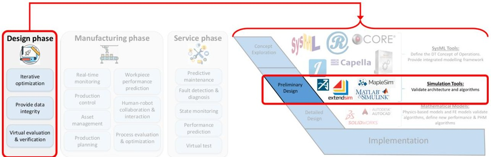

Figure 1. Current scope of the development of the Digital Twin design framework [36,39].

As such, the developed framework may allow for a design process that revolves around the creation of a Digital Twin of the product, since it enables the designer to use multiple tools and study different physical disciplines entirely in a virtual environment and thus obtain a completely virtual counterpart of the product that is being designed. Then, in order to showcase how the tools and approach can be employed in a practical application, models for the preliminary design of an aircraft will be used as a test case, recreating the early stages of its design through the interconnection of its multiple systems and the linking of the different tools available.

## 3. Approach Definition and Application

Conducive to the creation of a properly integrated simulation environment capable of encompassing the multiple steps required for the complete definition of a Digital Twinoriented design process, the different types of physical simulations involved in the design of a product such as an aircraft, i.e., its real counterpart, must be identified. Being a complex system, a very wide range of disciplines are covered during design, which make use of a multitude of tools. A few examples are reported in Table 1.

It can be noticed that each of those simulations represents a step into the design process, usually requiring an increase in development and computational time and allowing for the comprehension of additional aspects of the real object. Therefore, the level of understanding with respect to the behaviour of the real system increases at each modelling step. Additionally, each specific model is often developed within a dedicated simulation tool, which might exploit a numerical solver incompatible with other ones, or a different format. Thus, passing through different disciplines and/or tools becomes often problematic and cumbersome. This is a first issue in integrating physical models if one considers the so-called "vertical" or multi-tool integration. A second barrier to overcome is the property of a system such as an aircraft to be a "system of systems", meaning that it is composed of

<!-- PDF_PAGE: 5 -->

multiple complex systems [40], each with their own sub-systems and components, as it can be seen in Figure 2.

Table 1. Examples of disciplines and analysis tackled during aircraft design process, with a few examples of relative tools.

<table border="1"><tr><td>Discipline/Analysis</td><td>Tools</td></tr><tr><td>Numerical sizing</td><td>MATLAB$ ^{\textcircled{R}}$(Version 9.12;MathWorks,2022),Python(Version 3.10;https://www.python.org/,2022)</td></tr><tr><td>Dynamical systems simulations</td><td>Simulink$ ^{\textcircled{R}}$(Version 10.5;MathWorks,2022,Natick,MA,USA),AMEsim$ ^{\textcircled{R}}$(Version 2021.1;Siemens,2021,Munich,Germany),Dymola$ ^{\textcircled{R}}$(Version 2022;Dassault Systèmes,2022,Vélizy-Villacoublay,France)</td></tr><tr><td>CAD modelling</td><td>SolidWorks$ ^{\textcircled{R}}$(Version 2021;Dassault Systèmes,2021),Siemens NX$ ^{\textcircled{R}}$(Version 12;Siemens,2017),CATIA$ ^{\textcircled{R}}$(Version R21;Dassault Systèmes,2011)</td></tr><tr><td>Vibro-acoustic simulations</td><td>SIMULIA$ ^{\textcircled{R}}$(Version 2021;Dassault Systèmes,2021),ANSYS$ ^{\textcircled{R}}$(Version 2021R1;ANSYS Inc.,2021,Canonsburg,PA,USA)</td></tr><tr><td>FEM thermo-structural analysis</td><td>ANSYS$ ^{\textcircled{R}}$(Version 2021R1;ANSYS Inc.,2021),HyperMesh$ ^{\textcircled{R}}$(Version 2021;Altair,2021,Troy,MI,US)</td></tr><tr><td>CFD simulations</td><td>STAR-CCM+$ ^{\textcircled{R}}$(Version 2021.1;Siemens,2021),OpenFOAM(Version v2106;https://www.openfoam.com/,2021)</td></tr></table>

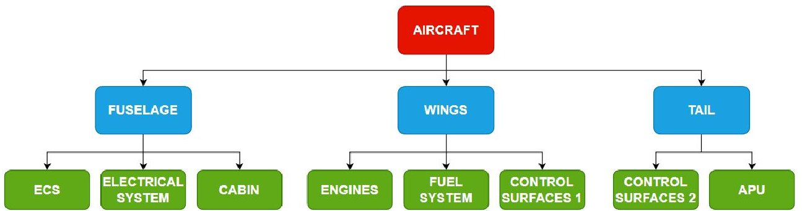

Figure 2. An example of structural decomposition of part of the systems of an aircraft.

This means that since the design process involves numerous groups of specialists, each dedicated to their respective system or component, in order to simulate the behaviour of the aircraft as a whole, it is required to integrate the models of multiple systems in a single simulation environment. Such models, most likely, are developed in different tools and, going forward in the design process, the level of detail of such models increases, possibly rendering them incompatible with each other. To capture the complexity that arises in modelling the aircraft as a system of systems, the representation in Figure 3 might help.

The complexity of a system of systems such as an aircraft depends on its architecture, which includes several subsystems, but also on the multi-physical nature of the phenomena exploited for its operation. Therefore, the design process can take full advantage from a seamless integration of models, both in the multi-system and multi-tool domains, that are capable of guaranteeing an easier interoperability and a faster simulation. Moreover, once that complexity has been decomposed through a suitable distribution of the related information between models, the overall efficiency of the design process can increase. Additionally, the traceability introduced by the MBSE is greatly enhanced if any manual insertion of data between simulations is avoided.

<!-- PDF_PAGE: 6 -->

As briefly mentioned in Section 1, in order to test the approach and design process, the models for the design and simulation of a generic aircraft have been used. These models have been kindly provided by a partner company and have not been modified in any way but only integrated according to the design framework here presented.

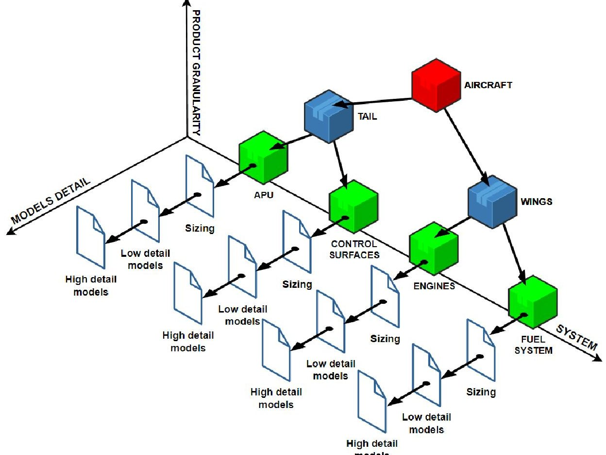

Figure 3. Features of the design process for a portion of the systems of an aircraft.

## 3.1. Multi-System Integration

The first typical obstacle to models integration for the creation of a Digital Twin for design is the mutual interconnection between product systems. In fact, any real object is made up of multiple systems and components that interact and influence each other. Therefore, prediction of the real product behaviour will be reliable as long as the Digital Twin is properly set up to replicate realistically the physical system and the models of subsystems are effectively integrated. When multiple systems are analysed together, however, in order to simulate the behaviour of a complex system, such as in a dynamical simulation, which usually involves the presence of differential equations that need dedicated solvers, a flexible and modular integration strategy is required. In fact, the normal practice in the design of very complex systems is to involve numerous development teams where each is specialised on an individual system. Due to the different physical and functional characteristics of each system, it is most likely that throughout the design process, different incompatible modelling tools are employed, limiting the possibility of the simulation of the product as a whole.

To enable such capability, the Functional Mock-up Unit (FMU) standard [41] is reaching increasing popularity throughout the industrial applications. The logic behind an FMU is very similar to a black-box approach: it allows, in fact, to encapsulate a simulation model inside a black-box that can be exported into other FMU-compatible simulation environments. Each FMU will expose to the outside only the input and output variables, allowing to connect each variable to the corresponding one of another system. In Figure 4, the two types of FMUs are reported, showcasing their respective logic.

<!-- PDF_PAGE: 7 -->

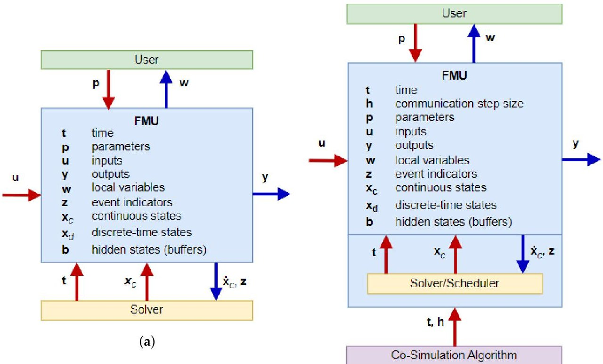

(b)

Figure 4. The two types of Functional Mock-up Units and their respective logic. (a) Model Exchange; (b) Co-Simulation [42].

In terms of flexibility, the best option is the Co-Simulation FMU, described in Figure 4b, since it carries over to the new simulation environment the solver of the original modelling tool, allowing to introduce any model into any FMU-compatible tool. Unfortunately, that flexibility may increase the simulation time, since it exploits a "fixed-step" numerical integrator, which is generally slower than a "variable-step" one [43]. The Model Exchange FMU, reported in Figure 4a, reduces such a disadvantage, thanks to the absence of the solver in the FMU and resorting to the solver of the simulation environment of the destination tool. Of course, in this case, only models compatible with the host's solver can be used.

Regarding the current application, being contextualised in a practical industrial environment, one of the main requirements was to enable the compatibility between models from different modelling environments, which are derived from the multiple tools that a wide consortium of companies may employ. Therefore, the best option to this end was the Co-simulation FMU, which allows exporting a model to any other simulating environment. An example of an application of such an approach in a wide industrial context is proposed in Figure 5.

It can be noticed that the three systems compose a section of the propulsion system. Each one of them is developed by a different partner within the consortium of allied companies, and each is prone to exploit their own modelling tool, by practice. However, to describe the behaviour of the whole system, it is required to achieve a multi-system integration. Here, the FMU standard plays a crucial role, since it enables the setup of a common simulation environment, where the interactions between systems can be modelled, simulated and then evaluated.

Therefore, the FMU approach was applied to create a connection between the main systems of the aircraft in a dynamical simulation performed in AMESim $ ^{\mathrm{TM}} $ . The original models have been created by different specialists, each defining its own system and/or discipline. The outcome of the simulation of each system's model is the dynamic behaviour of said system while following a pre-defined flight mission, consisting of the following phases:

1. CLIMB, starting from a defined altitude;

2. CRUISE, representing the majority of the mission;

3. DESCENT, terminates at the starting altitude;

4. Alternate CLIMB, immediately started after the DESCENT, shorter than CLIMB;

<!-- PDF_PAGE: 8 -->

5. Alternate CRUISE, much shorter then the CRUISE phase;

6. Alternate DESCENT, ends, once again, at the starting altitude;

7. LOITER, of similar length to Alternate CRUISE.

Such models implement the basic physical behaviour of the respective system alongside control logics managed by PID controllers. Altogether, they allow obtaining a preliminary understanding of how an aircraft with a certain configuration behaves and confirming if it is able to follow the flight mission as expected.

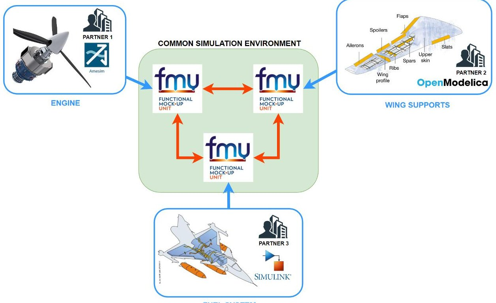

Figure 5. Example of multi-system integration between multiple partners with different modelling tools [44-46].

Due to the nature of the models developed, we can consider them as a very first iteration towards the creation of a high-fidelity Digital Twin, since they allow for the prediction of the aircraft behaviour during its operation, albeit in a simplified manner. As stand-alone models, however, it is not possible to capture the entire aircraft, since each model has to be executed individually, causing a dispersion of the information among the different specialists. So, the FMU protocol comes into play to provide a unified method to interconnect the models in a single simulation environment.

In order to achieve this, the different models developed for each system were adapted in order to make them compatible with the FMU interface but without changing any previously modelled elements. In Figure 6, an example is shown of how an AMESim $ ^{\mathrm{TM}} $ super-component can be prepared for the export as an FMU. It can be seen that the "FLIGHT DYNAMICS" block is the super-component including the model for the simulation of the dynamics of the aircraft, including its aerodynamic characteristics during flight, with its input and output variables. Then, we added a fictitious block (on the left) which is the FMU interface block: its function is to define which variables the FMU, once exported, must exchange with the external environment.

Once the FMU interface for each model (i.e., for each super-component) was prepared, the FMUs were generated. The created FMUs were then imported and connected with all the necessary input and output variables, allowing the creation of a new model for the entire aircraft, enabling the simulation of the entire complex system but characterised by a high degree of modularity. Such a model can be seen in Figure 7.

<!-- PDF_PAGE: 9 -->

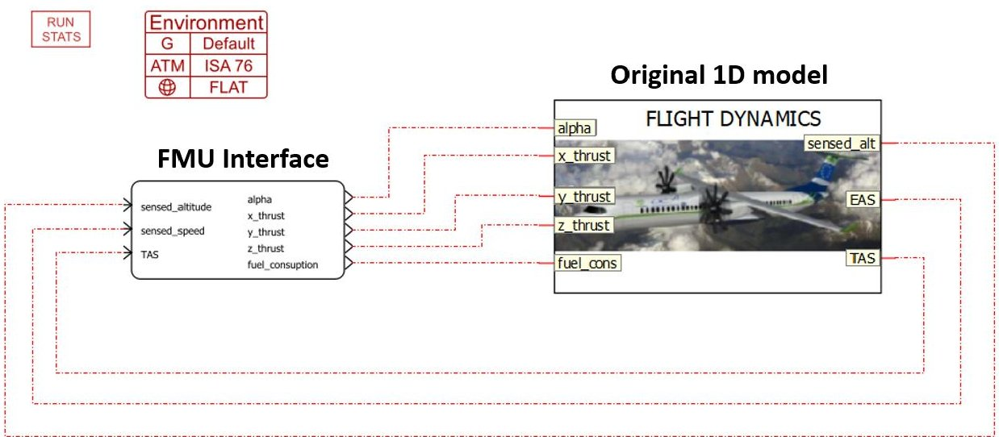

Figure 6. The model for the Flight Dynamics of the aircraft, prepared for the FMU export.

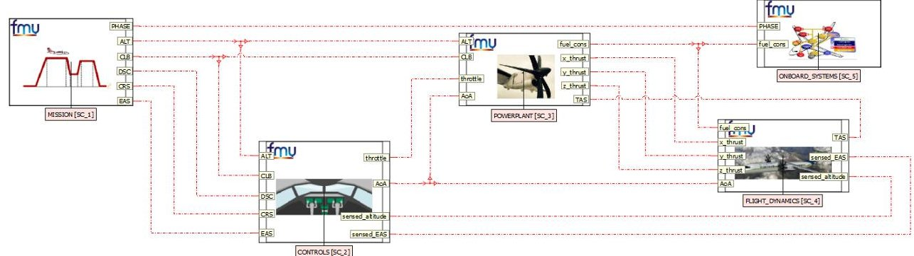

Figure 7. The aircraft dynamic model including all the FMUs of each individual system.

It can be noticed that five main blocks are included:

- MISSION, dedicated to the creation of the flight path previously described;

- CONTROLS, dedicated to the management of the behaviour of the aircraft;

- POWERPLANT, dedicated to the evaluation of the propulsion system performance;

- FLIGHT DYNAMICS, introduced previously;

- ON-BOARD SYSTEMS, dedicated to the simulation of various auxiliary systems.

These FMUs are the equivalent of the original models, but they are enclosed in a black-box with only the inputs and outputs exposed. From Figure 8, a clearer view of what each individual FMU exchanges with the others can be seen.

It can be noticed that many elements of the aircraft are considered and that each FMU has a certain number of input and output signals. The inputs of a certain FMU are used to compute, through the modelling elements setup by the designer and enclosed in the FMUs, quantities that are used by the other systems. For instance, the CONTROLS FMU receives from the MISSION FMU some data related to the target flight path (altitude, air speed...) and from the FLIGHT DYNAMICS FMU the computed altitude and air speed of the aircraft (obtained using other signals from the other FMUs). It then compares the target and computed values to manage the engines throttle and aircraft angle of attack, to change the trajectory and the speed of the aircraft and to simulate how the auto-pilot might behave in a real application. Of course, these five models alone do not represent the model of the whole aircraft but rather some critical functions and subsystems. However, it can be confirmed that the model constitutes a closed-loop simulation circuit, allowing for the execution of the aircraft-wide simulation.

<!-- PDF_PAGE: 10 -->

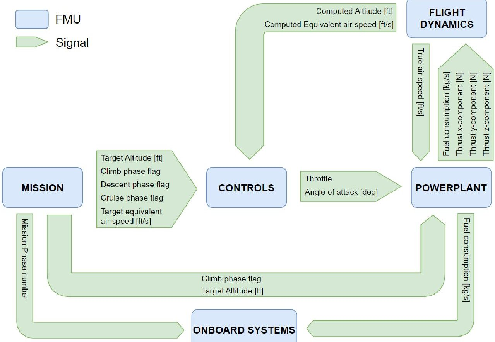

Figure 8. Signals exchanged between the FMUs of the aircraft dynamic model.

It can be gathered from the presented method that the implementation of the FMU protocol allows integrating different systems in a common simulation environment, enabling a smoother system-wide analysis of the product. In fact, once each development team has defined and validated their own model, it is then possible to interconnect them and recreate digitally the entirety of the product or aircraft in the present case. Such a capability allows, therefore, to eliminate the barriers between different specialists of a company and increase the reliability and quality of the results obtained. With the model created and once it was verified that it works correctly (i.e., the simulation runs and reaches completion), the next step was to implement it in the workflow for the multi-tool analysis, thus obtaining the "vertical" integration introduced in Section 1.

## 3.2. Multi-Tool Integration

When dealing with the interconnection between models of systems that need to interact with each other, the FMU integration approach is one of the most promising routes. However, to reach a complete integration connecting properly the simulations performed by different tools, it is crucial to assure the required compatibility. This step is fundamental in the definition of a complete design process. As it has been introduced in Section 3, at each stage in the development of a product, the level of detail to be analysed increases, allowing gradually reaching the final product definition. In many cases, each forward step requires the use of different tools that enable the study of models developed for different purposes or to study various disciplines, which tend to be mutually incompatible. Therefore, a great improvement of the process performance can be obtained through its complete automatisation, going from the higher-level steps towards the most finely detailed ones. This is especially true when, along the design process, each milestone acts as a starting point for the next phase. An automatisation of the process may allow avoiding some time-consuming tasks such as the exchange of data between models. Hence, from this step in the approach, the expected outcome is the definition of a structure for an integrated tool chain that is compatible with any tool that a company employs, thus avoiding the need to retrain the personnel to use different tools.

<!-- PDF_PAGE: 11 -->

The main barrier towards this goal, which, as introduced in Section 1, represents the "vertical" integration, is the possibility to automatically launch simulations of multiple tools and to seamlessly exchange the results from one model to the next. Several approaches are currently applied, employing different logics. Among the many available, three types can be identified as the most promising:

- Ad hoc scripting;

- Container-based workflows [47];

- Black-box-based workflows [48].

In terms of user-friendliness and tool compatibility, the last appears to be the most suitable for this activity. The "ad hoc scripting" approach is very flexible, but it requires specific and advanced coding skills, while the "container-based" approach can be demanding in terms of time-to-learn and development. The common logics of a workflow can be easily applied in the "black-box-based workflows", since it allows creating some simulation streams as workflows where, for instance, parallel and series connections or logic loops can be implemented. They are composed of multiple simulations encapsulated in black boxes through "wrappers" (which are simple scripts developed to interface with a tool) dedicated to the specific simulation tool. Such a technique is generally adopted by some commercial tools, such as ModelCenter Integrate $ ^{\textcircled{R}} $ (Version 2021; ANSYS Inc., 2021), which was employed for the current application.

As said in Section 2, the present contribution focuses on a small portion of the entire design process. However, the application of the approach is entirely compatible with any design phase. A schematisation of the steps that have been considered here is shown in Figure 9.

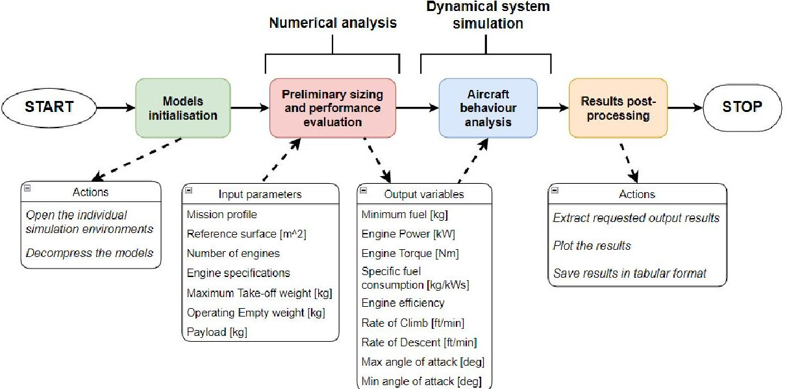

Figure 9. Logic path followed by the multi-tool workflow for the simulations.

Such a process consists of two main steps: the numerical analysis for preliminary sizing and the dynamic verification through a dynamical model. The latter is the exact same one presented in Section 3.1, which is composed of the dynamic model integrated through the application of the FMU protocol. The numerical analysis, instead, refers to the process of preliminary sizing of the main systems of the aircraft based on set flight conditions, in terms of flight path, passengers on-board, payload and other user-defined parameters, as reported in Figure 9. Such a step is originally conducted through the use of a MATLAB $ ^{\circled{r}} $ script that, through the use of multiple sizing functions, one for each system, allows obtaining a preliminary configuration of the aircraft in terms of total mass, fuel on-board, engine thrust and many more. In the traditional design process, all the data captured from this step would be then manually transferred to the dynamic verification model in order to test that the generated aircraft configuration is capable of completing correctly the set mission. Through the use of this integration, as it can be again seen in Figure 9, such a task is performed in a completely automatic manner, allowing for the

<!-- PDF_PAGE: 12 -->

simulation of the dynamic model to start as soon as the data from the preliminary sizing are inserted in the correct location. The model will then be able to simulate the behaviour of the aircraft based on a set architecture and configuration, without any discontinuities in form of data extraction and exchange.

As mentioned earlier, the multi-tool integration has been conducted through the use of the tool ModelCenter Integrate $ ^{\textcircled{R}} $ (Version 2021; ANSYS Inc., 2021), in which the two steps of the design process have been integrated, as shown in Figure 10.

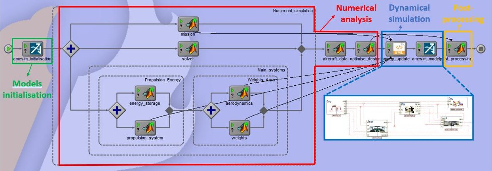

Figure 10. Multi-tool workflow created in the tool ModelCenter Integrate $ ^{\circledR} $

The two main sections of the design process can be identified in this workflow: the one highlighted in red encompasses the numerical simulation, which is dedicated to the preliminary sizing of the aircraft. The results from this step are then used to generate an initial configuration of the aircraft, allowing to populate the dynamical simulation with input parameters based on the project specifications. It can be noticed in this section that multiple blocks have been setup: in fact, the original script has been subdivided into multiple ones based on the systems that they are in charge of. Such a setup showcases how the flexible nature of the workflow logical connections employed in the the black-box-based approach allows for the creation of parallel branches, allowing multiple instances of the same tool to run at the same time. This structure can decrease the computational time and can potentially make great use of a higher-performing HPC system. In the other section, highlighted in blue, the tool manages the dynamical simulation, which is aimed at verifying that the aircraft configuration derived from the previous section is capable of completing the set mission in a dynamic environment. In addition, two more sections can be seen, which are also reported in Figure 9: an initialisation block, which is in charge of preparing the models for their execution, and a post-processing block, which allows extracting the numerical results and relevant plots obtained from the execution of the workflow.

The flow of information follows the same structure of the one in Figure 9. In each block of Figure 10 runs a specific simulation, and it executes a code expressively written for a subsystem or for a defined analysis. The orchestrator never interferes with the simulation running, but it just launches the execution code, inserts the input parameters required and captures the outputs requested by the downstream simulations. For instance, it can be seen that the "propulsion_system" block is connected to the "amegp_update" block by an arrow, which indicates the transfer of all the necessary parameters from the numerical simulation to the dynamical simulation. These connections can be created for any number of variables or parameters, through a dedicated editor, as reported in Figure 11.

This approach to handle variables is not the only option available; other methods are viable, depending on the tool. For instance, each tool could retrieve the required variables from a repository expressively set up, as is the case for the CPACS format introduced in Section 2. However, the presented approach allows for a very quick setup of the workflow and, through a very intuitive connection solution for the models variables, the learning curve is very forgiving, allowing the user to launch a complete design process and obtain at the end a finalised configuration and analysis of an aircraft or any other product and quickly visualise the obtained results.

<!-- PDF_PAGE: 13 -->

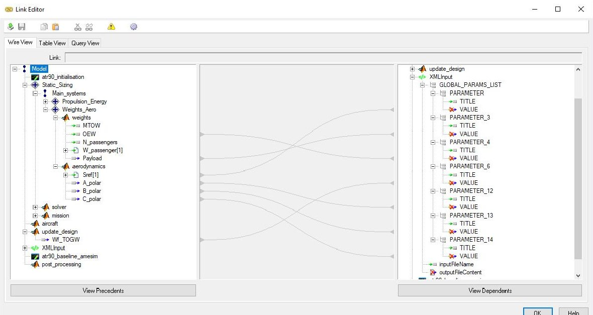

Figure 11. The link editor dedicated to the connection of the variables of different simulations.

## 4. Aircraft Test Case Results

To better convey what the approach can achieve in terms of design process capability, in this section, the results of the gradual application of the proposed interoperability approach are presented, starting from the simulation results from the original models, in order to provide a frame of reference. Then, a gradual increase of the models integration complexity is showcased, showing the capabilities of the approach and highlighting the differences with the original models. As an additional demonstration, a sensitivity analysis is performed on the same models to showcase its compatibility with conventional analysis tools adopted in the industrial environment.

## 4.1. Reference Results

In order to capture a reference to which the results of the simulations can be compared to, the first simulation performed was the one for the original dynamical model. This model allows simulating the main behaviour of a generic aircraft based on the input parameters set by the user. This model was provided and validated by our partner company and not modified in any way. The results captured from the simulation are reported in Figure 12. We can see that four main aspects of the aircraft are considered:

- the mission profile followed by the aircraft;

- the velocity/mach of the aircraft;

- the aerodynamic coefficients (lift and drag);

- the propulsion system characteristics, including the thrust and drag forces of the aircraft and the fuel remaining.

Analysing the plot of the mission profile in Figure 12a, several phases of can be clearly identified. As it has been presented earlier, the dynamical model of the aircraft includes, after the take-off, an immediate climb, which is followed by a long cruise and a descent to lower altitude. After the first stage, a second flight step follows, which is composed of a climb, a cruise at lower altitude and a final descent. The mission terminates through a loiter flight at constant altitude. Each phase can be investigated exploiting the other plots in Figure 12. For instance, in Figure 12d, it can be noticed that during the climb, the thrust plot decreases due to the lower air density at higher altitudes. During the cruise, instead, it remains almost constant, since the atmosphere conditions remain the same, as the air speed of the aircraft does, as reported in Figure 12b. Finally, during the last phases, the thrust more significantly varies, decreasing in the descent and increasing during the climb. Meanwhile, the on-board fuel shows an almost linearly decreasing trend due to the continuous use along the mission, with a slightly lower consumption during the descent phases. The model was then used in the proposed interoperability approach presented in Section 3.

<!-- PDF_PAGE: 14 -->

Therefore, we performed a multi-system integration through the generation of the FMUs and then further integrated it in a multi-tool workflow for the vertical automatisation of the design process. The expectation is that the plots presented here will not change much, since the two integration steps are intended to be as transparent as possible with respect to the simulation itself.

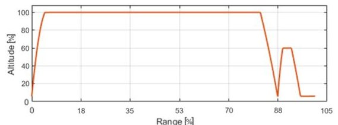

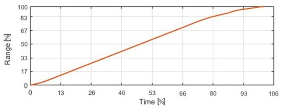

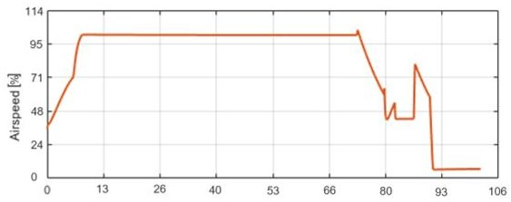

(a)

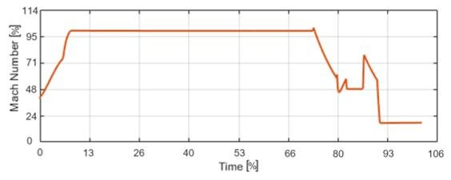

(b)

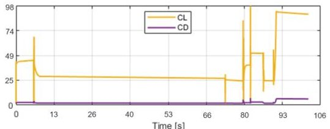

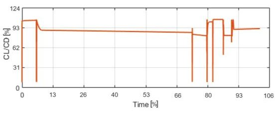

(c)

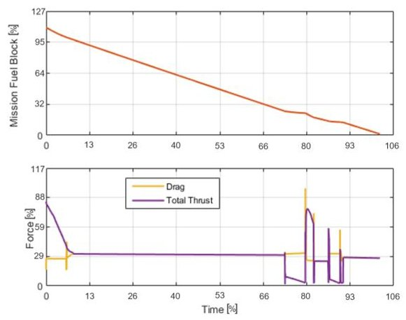

(d)

Figure 12. The results from the reference simulation of the test case aircraft. (a) Mission profile; (b) Velocities; (c) Aerodynamic coefficients; (d) Fuel and drag/thrust.

## 4.2. Multi-System Integration Results

The first step towards the complete integration of the models is to perform the multisystem integration, as presented in Section 3.1. Therefore, each system of the aircraft was exported as a stand-alone FMU and then integrated in a common simulation environment. The dynamical simulation was then launched using the same conditions as the one for the reference simulation. In Figure 13, the same plots as for the reference results are reported.

Comparing the curves obtained from the simulation with FMUs with the reference ones, we can clearly notice that the behaviour of the aircraft is basically not affected by the introduction of the FMUs, showcasing basically the same trends. The only very slight difference is in Figure 13d, where the thrust curve of the FMU model shows a slight delay in the trailing end. Such an effect, which can be better visualised in Figure 14, may be traced back to the synchronisation of the data exchange between the different FMUs, which might be corrected with a reduction of the integration step. In fact, it appears that as the aircraft passes from the alternate cruise to the descent, at around 87% of the total mission, the change in thrust delivered by the POWERPLANT FMU is delayed with respect to the reference curve. This is caused by the PID controller in charge of the throttle, which seems to not react fast enough to the change in flight path, therefore delaying the reduction of throttle and thrust delivered with respect to the actual phase change. The model is then unable to recover this delay, appearing for the rest of the mission, due to higher variations during this section of the mission. Such an error could be attenuated with an integration step reduction, since it would allow the model to react faster to the sudden changes in the

<!-- PDF_PAGE: 15 -->

flight path. However, overall, the "transparency" of the FMUs on the simulation results can be confirmed, enabling the possibility to integrate multiple systems modelled in different simulation tools.

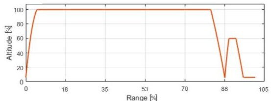

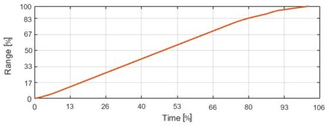

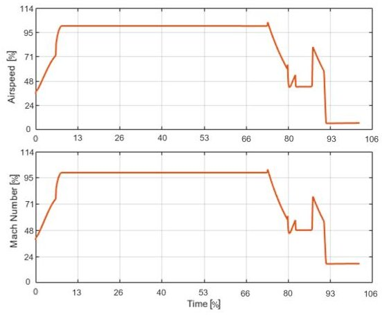

(a)

(b)

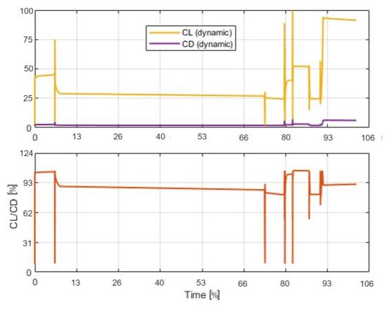

(c)

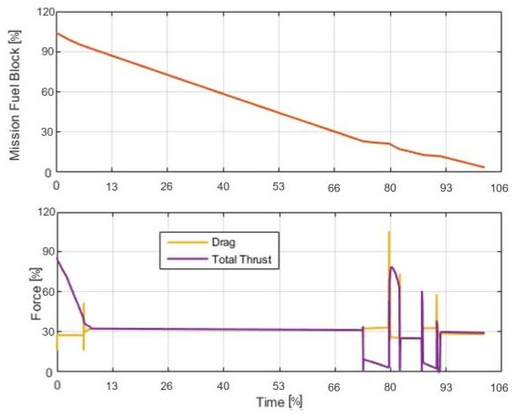

(d)

Figure 13. The results from the dynamic simulation of the aircraft performed using the FMUs. (a) Mission profile; (b) Velocities; (c) Aerodynamic coefficients; (d) Fuel and drag/thrust.

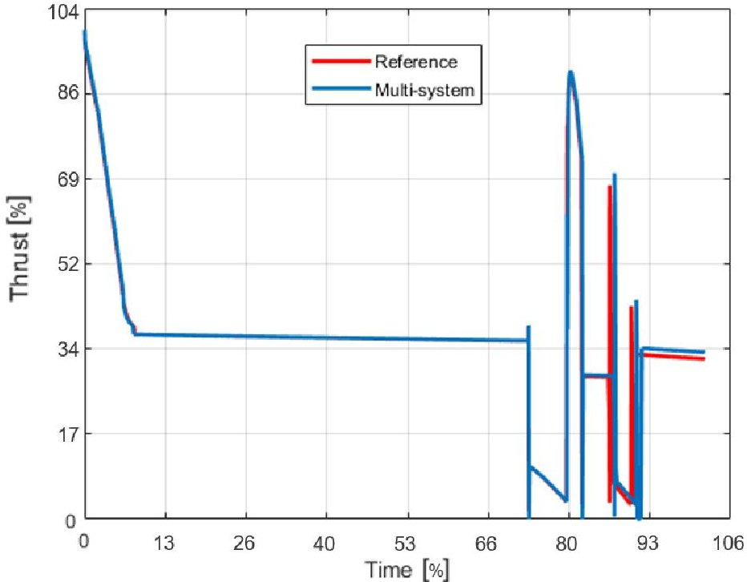

Figure 14. Thrust curve comparison between the reference model and the FMU integrated one.

One important point that needs attention is relative to the setup of the FMUs themselves, particularly regarding the co-simulation $ T_{step} $ , which determines the frequency of data exchange between FMUs. As a matter of fact, all the FMUs in the dynamic model have been setup with a $ T_{step}=0.1 $ s, except for the "CONTROLS" FMU, where it was

<!-- PDF_PAGE: 16 -->

set at $ T_{step}=0.01 $ s. This setup was required for the model to work correctly, since the "CONTROLS" FMU has multiple PIDs inside, which would not able to keep up with the rest of the models with larger time-steps. Such an issue demonstrates one of the main limitations of the co-simulation FMU. With the time-steps used, it was possible to have a complete simulation which matches quite well the reference analysis. However, a wrong tuning of this parameter could cause the failure of the simulation: these events could be eliminated by further reducing the $ T_{step} $ allowing it to better cope with discontinuities. Such a solution will come at the cost of an increased simulation time due to the fixed time-step integrator that co-simulation requires, which will cause the smallest time-step to act as a "bottleneck" of the entire analysis.

## 4.3. Multi-Tool Integration Results

Once the multi-system integration was successfully performed, the multi-tool integration was carried out. The objective in this case is to obtain a complete workflow capable of executing the entire simulation tool-chain, allowing to increase the degree of automatisation of the design process, especially during the data exchange phases between models, as previously explained in Section 3.2.

Once the workflow was set up, the entire simulation was launched performing the sizing of the aircraft first, so to generate a configuration that could be simulated in the dynamical simulation integrated through the FMUs. The plots that resulted from this analysis are reported in Figure 15. One fundamental point of this process is that such plots are automatically extracted by the "post-processing" block of the workflow in Figure 10, therefore avoiding the time-consuming task of manually generating the required plots.

It can be noticed that the results are close to the reference plots previously presented and to the results from Section 4.2. The main difference is found in the trailing end of the plot in Figure 15d, where the computation of the thrust exhibits an anomalous trend characterised by a numerical instability. In Figure 16, a better visualisation of the difference with the reference model curve is reported.

Such instability may be again correlated to the integration step. In fact, this behaviour arises when the mission transitions from the alternate descent phase to the loiter. It is plausible that due to the necessity of using a fixed-step solver to achieve the multi-system integration through the FMUs, the model has a slight incompatibility with the adopted solver. Additionally, the integration of multiple simulation tools, which allowed defining, from the numerical sizing model, the configuration for the dynamical model may have added a certain degree of variability in how the simulation progresses, causing the difference in behaviour with respect to the curves reported in Figure 13d. From these results, it can be noticed that a very critical aspect for the interoperability is the management of discontinuities, which can cause some anomalous trends in the simulation results, especially when controllers are involved as is the case in the CONTROLS FMU. However, as a whole, the integration could be deemed successful, considering that said error corresponds to a slightly less relevant phase with respect to the rest of the mission, for which, instead, the plots show a very close trend compared to the reference curves. Despite those imperfections, a very remarkable advantage that such integration guarantees is that it removes the manual handling of the transfer of outputs from the numerical sizing into the dynamic simulation, being automatically completed by the orchestrator and thus further reducing the time required to perform the entire design process.

<!-- PDF_PAGE: 17 -->

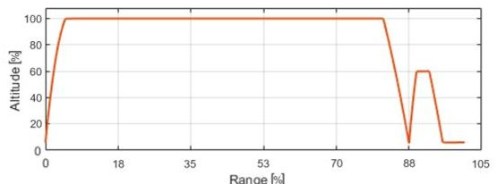

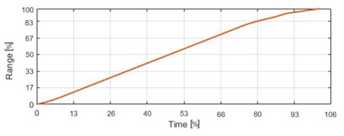

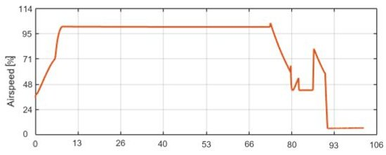

(a)

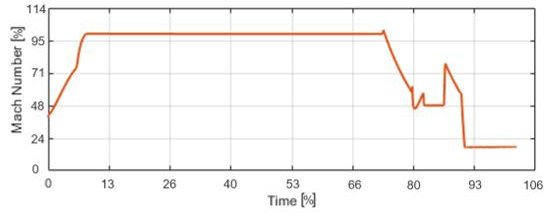

(b)

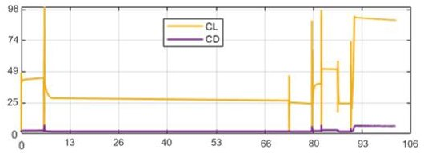

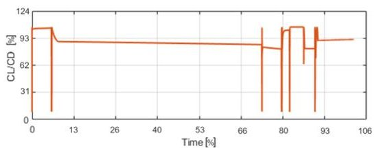

(c)

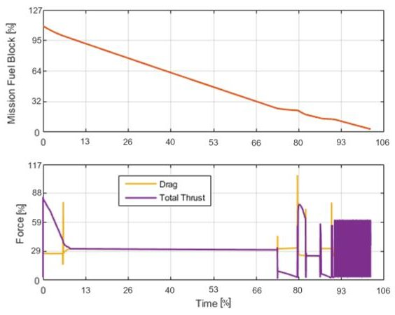

(d)

Figure 15. The results from the entire design workflow performed using the integrated numerical sizing and the FMUs dynamic model. (a) Mission profile; (b) Velocities; (c) Aerodynamic coefficients; (d) Fuel and drag/thrust.

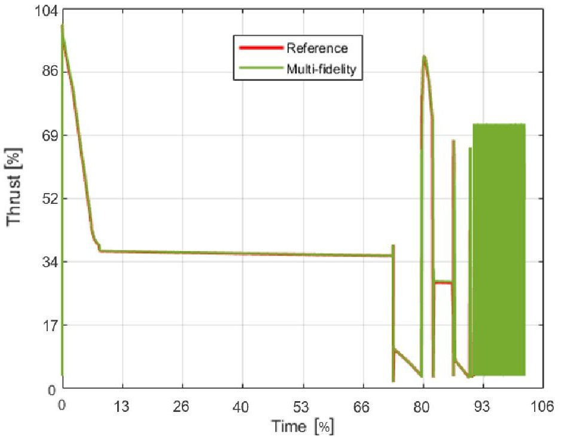

Figure 16. Thrust curve comparison between the reference model and the orchestrated workflow models.

## 4.4. Sensitivity Analysis

In order to further prove the capabilities of the approach presented in this contribution, a sensitivity analysis, commonly used in the development of industrial products, is showcased. The analysis was conducted to investigate the influence of the variation in number of on-board passengers on the aircraft behaviour. It has been set up directly in the

<!-- PDF_PAGE: 18 -->

orchestrator environment (i.e., ModelCenter) by requesting the execution of five runs of the entire workflow with varying numbers of passengers.

The most immediate change that can be predicted is that, as it can be noticed in Figure 17, a change in the number of passengers causes a variation of required fuel. As a matter of fact, it can be expected that due to the increase of passengers, the total weight of the aircraft increases as well, thus requiring a higher amount of thrust from the engines and a larger amount of fuel burned. This effect is also evident in Figure 18. It can be clearly seen that if the number of passengers increases, even the fuel stored on-board has to be increased. Moreover, it can be seen that if more passengers are on-board, the time to complete the climb phase is longer and flight at cruise altitude, where engines reach their highest efficiency, is postponed.

Additionally, each run of the simulation gives us the plots of the dynamic behaviour of the aircraft, allowing for a comprehensive comparison of the varying conditions. For instance, comparing the plots in Figures 15 and 19, the latter one reports the predicted behaviour with almost half the number of passengers of the one introduced in Section 4.1.

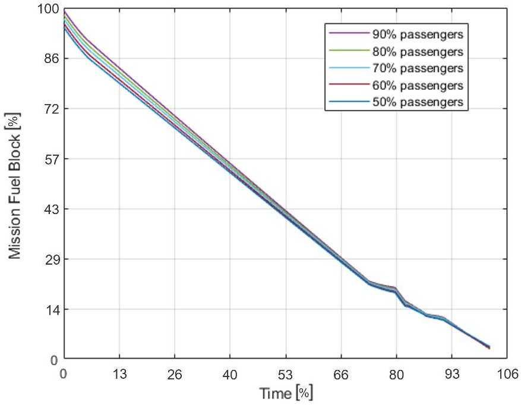

Figure 17. Curves of the remaining on-board fuel for each run of the sensitivity analysis.

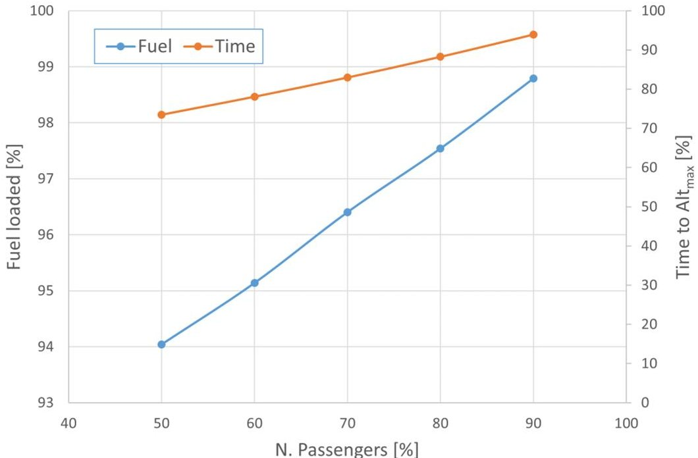

Figure 18. On-board fuel and passengers trade-off, including the variation of time required for the climb phase.

<!-- PDF_PAGE: 19 -->

It can be immediately noticed that the behaviour of the aircraft with less passengers tends to be similar to the first configuration, although some differences are appreciated. In the configuration with reduced payload, the fuel required is less for a given mission profile, and the thrust supplied is lower, as the comparison between Figures 15d and 19d demonstrates.

Those plots also allow perceiving a weaker reactiveness of the dynamic simulation with a lower number of passengers. This is due to the PID controls applied, which have been tailored for the reference configuration. Therefore, as the number of passengers changes, the model exhibits an evident difficulty in matching the ideal curve, while with a number of passengers closer to the reference, this effect vanishes. Despite those differences and approximations, the overall quality of the simulation is confirmed, and this demonstrates the effectiveness of the integration approach herein proposed also in managing more complex types of analysis. This is also confirmed by the advantage that this approach provides in terms of comprehensiveness of the simulation and the required process time. In fact, through traditional methods, it would not be possible to perform a sensitivity analysis which encompasses multiple systems of the product or, even more so, the different tools used for its modelling. The latter case, in particular, would require tackling each level individually, requiring the manual exchange of data between models. The present approach manages this communication automatically, allowing the launch of multiple runs of the workflow without any user input.

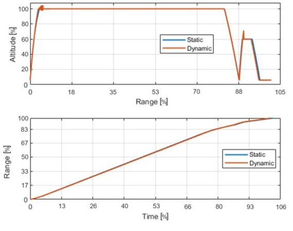

(a)

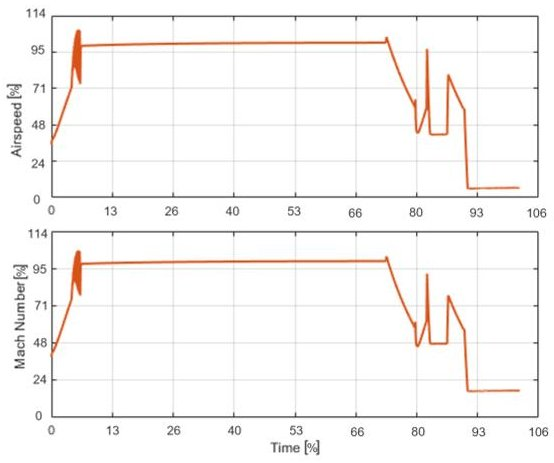

(b)

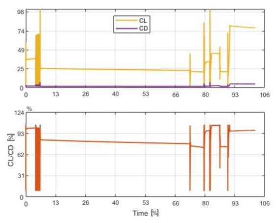

(c)

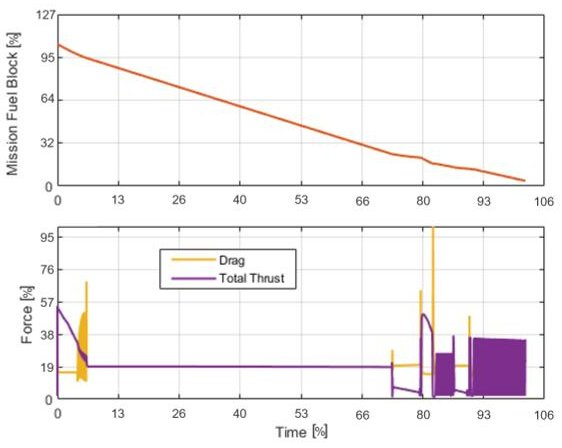

(d)

Figure 19. The results from the entire design workflow with 50% passengers on-board. (a) Mission profile; (b) Velocities; (c) Aerodynamic coefficients; (d) Fuel and drag/thrust.

## 5. Review of Process Performance

The approach presented in this contribution allowed obtaining a simulation environment in which the design of a complex product could be managed, enabling the study of its behaviour both in the multi-system and the multi-tool domains. Such comprehensiveness enables the design team to study and monitor the evolution of the product development in a more cohesive and traceable manner. In order to have a better picture of the effects of the multiple steps of integration applied in the presented approach, a summary of the process

<!-- PDF_PAGE: 20 -->

performance is reported, in which the changes that each interoperability step causes are analysed. Such a review is carried out considering the differences between the thrust curves (Figures 14 and 16) obtained from each simulation presented in Section 4, which show the biggest difference between each step in the integration process.

## 5.1. Multi-Systems Integration Performance

First of all, as presented in Section 4.2, the integration of multiple systems was tackled applying the FMU protocol for each sub-system of the original dynamic model. In Table 2 a few relevant parameters are reported.

Table 2. Statistical analysis of the multi-system integration performance compared to the original dynamic model.

<table border="1"><tr><td></td><td>Original Dynamic Model</td><td>Multi-Systems Simulation</td></tr><tr><td>Simulation Time</td><td>≈3s</td><td>≈87s</td></tr><tr><td>Thrust-ME*</td><td>ref</td><td>+0.005%</td></tr><tr><td>Thrust-MAPE*</td><td>ref</td><td>8.41%</td></tr><tr><td>Thrust-RMSE*</td><td>ref</td><td>14.3%</td></tr></table>

$ ^{*} $ compared to the thrust curve of original model.

It can be immediately seen that in terms of simulation times, as already discussed previously, the introduction of the FMUs causes a noticeable increase, which is due to the impossibility of applying a variable-step solver as in the original model. Such an aspect can also be confirmed by Figure 20. Here, the simulation times of multiple runs of the original dynamic model are reported, where the variable-step solver is compared to the fixed-step solver with a gradually smaller $ T_{step} $ . Of course, a smaller integration step would yield more accurate results but in exchange of exponentially longer simulation times. In this graph, the simulation time of the model with FMUs is reported, and the variation with respect to the original one is apparent. However, it is comparable to the simulation with a $ T_{step}=0.001 $ s. Such a result demonstrates that the fixed-step solver employed by the FMU model is the limiting factor of the simulation.

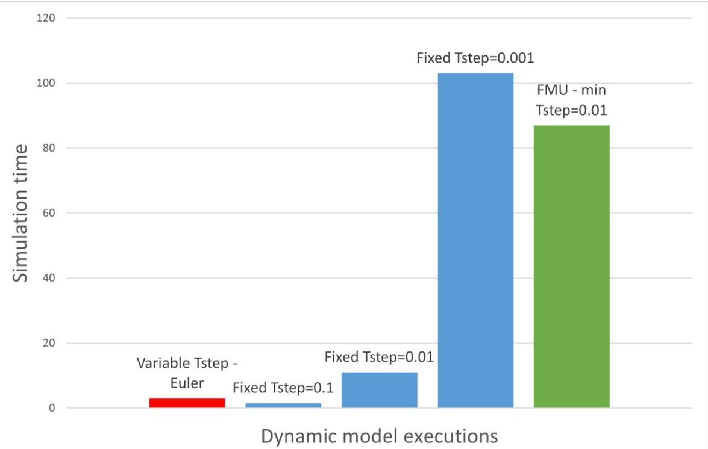

Figure 20. Simulation time comparison between different $ T_{step} $ and with the multi-system integration through FMUs.

<!-- PDF_PAGE: 21 -->

In terms of quality of the simulation achieved, we can again refer to Table 2, where a comparison in terms of errors between the curves of the thrust in Figure 14 is also drawn. It can be seen that the addition of FMUs introduced an overall slight worsening of the results accuracy, especially with regard to the RMSE values. Such a level of error is to be expected in particular when multiple control logics (such as PID controllers) are employed. However, it is reasonable to think that through a more intensive tuning of the models parameters and adopting a more interoperability-compliant approach to the creation of new models, an improvement of the accuracy of the results could be achieved.

Following this discussion, as a whole, the increase in the level of interoperability through the multi-systems integration may be classified as a loss in performance, since they both effectively simulate the same model but with a higher simulation time and less accurate results. However, it is fundamental to consider that such a method allows for many unquantifiable advantages. First and foremost, a great modularity and flexibility is achieved, enabling the possibility of integrating a multitude of systems coming from a wide variety of simulating tools. Additionally, the FMU protocol, enclosing the original model in a black box, inherently masks the source code, therefore guaranteeing a much easier collaboration with third-party partners.

## 5.2. Multi-Tool Integration Performance

Once the multi-system integration was achieved, the multi-tool integration was the next addition to the design process, as presented in Section 4.3. Similarly to the analysis of the multi-system integration performance, the main parameters of the integration quality are reported in Table 3.

Table 3. Statistical analysis of the multi-tool integration performance compared to the manual execution of the design process.

<table border="1"><tr><td></td><td>Manual Execution of Design Process</td><td>Design Process with Multi-Tool Integration</td></tr><tr><td>Simulation Time</td><td>≈370s</td><td>≈480s</td></tr><tr><td>Thrust-ME*</td><td>ref</td><td>+0.006%</td></tr><tr><td>Thrust-MAPE*</td><td>ref</td><td>8.32%</td></tr><tr><td>Thrust-RMSE*</td><td>ref</td><td>23.6%</td></tr></table>

* compared to the Thrust curve of original model.

In this case, the comparison is drawn out between the manual execution of the design process (i.e., launching the numerical sizing and then the dynamic model once the results from the former are introduced in the latter) and the completely automatic run of the process thanks to the multi-tool integration, using the curves of Figure 16 for the comparison.

Much like the multi-system integration, the increase in the level of interoperability causes an overall worsening of the quality of the process in terms of simulation time and results accuracy. In fact, an increase of around 22% in the time required to complete the design process can be noticed, and the error between the resulting curves is slightly higher (especially the RMSE). Nevertheless, a few considerations must be made. First, the majority of the increase of the simulation time is actually caused by the aforementioned multi-system integration: in fact, the manual execution of the process employs the original dynamic model while the automatised version makes use of the FMU integrated model. Consequently, the actual time increase resulting from the multi-tool integration is only around 5%, since 76% of the increase can be attributed to the multi-system integration alone. A very similar discussion can be had for the accuracy of the results: most of the error is actually derived from the multi-system integration, while a small percentage is related to the multi-tool one.

Just like for the multi-system integration, the present level of interoperability guarantees great advantages in terms of flexibility and modularity of the design process: in

<!-- PDF_PAGE: 22 -->

fact, since the workflow employed is completely tool-agnostic, it is possible to connect models coming from basically any modelling tool. The test case used in this contribution connected a numerical sizing analysis with a dynamical model, but all the types of simulation presented in Section 3 and many others may be integrated. Additionally, the complete automatisation of the data exchange process completely eliminates the time required by a designer to extract the results from one simulation and to insert them into the next one. Such an advantage, specifically, becomes more and more relevant the higher the number of variables to be exchanged and the number of execution steps of the design process to be performed.

## 6. Conclusions and Next Steps

This paper deals with the setup of an integration approach to orchestrate some tools currently used in aircraft system design. As presented, industrial applications are currently striving towards the implementation of the MBSE methodology and the conception of a Digital Twin-oriented design process, both of which, in turn, necessitates, particularly at the physical models level, a defined framework to properly manage the multitude of models developed during the design process. As such, the need for the definition of an automatised tool chain compatible with the legacy tools and processes of a company and capable of incorporating the models coming from third-party partners is clear. The current investigation has been able to reach some significant goals in this context, more specifically towards the integration of models of different systems that interact with each other (multi-system integration) and the integration of the various tools used to model the physical realm with different degrees of detail (multi-tool integration).

The proposed integration approach suitably manages two main features of the design process, namely a multi-system architecture and the interconnection between modelling tools. In particular, the multi-system integration, through the use of the FMU standard, demonstrated the great flexibility of this method, allowing for the integration of any number of systems or components in a single simulation environment. Such a standard allowed for the overcoming of two complex barriers: the difficulty of having multiple systems of different granularity to communicate between each other and the inherent incompatibility of different simulation tools which employ different solvers. With regards, instead, to the multi-tool integration, it was possible to achieve it thanks to the use of a highly flexible black-box orchestrator, which, being completely tool-agnostic, enabled the communication between simulations of developed in different tools. In fact, the nature of the orchestrator makes it possible to connect the inputs and outputs of the different simulations, enabling the automatic step-by-step management of the simulations and introducing the workflow logics, allowing to better take advantage of highly parallel computing systems.

In syntheses, all these characteristics enhance two aspects of the traditional aircraft design process, which are its flexibility and modularity. In fact, a more flexible approach allows avoiding compatibility issues between tools and company departments, since it bypasses possible roadblocks in the development chain. Instead, a modular framework enables continuous improvement of the capability of the design environment, opening the possibility to the easy and quick addition of new or improved models of different systems. However, introducing an approach that aims at interconnecting various aspects of the design process of complex systems, such as an aircraft, which employ a vast number of experts and validated processes, will require intensive testing and a continuous improvement of its compatibility and features. So, to achieve an effective application to complex industrial systems of the methodologies and the concepts of the MBSE and the Digital Twin, it is necessary to further develop and improve the integrations achieved in this contribution.

More specifically, it is very important to always look for new possible ways to achieve integration, since, as explained earlier, the techniques available are numerous and evergrowing, and new and improved tools are being continuously released. Moreover, the integrations here covered are just two types, the multi-system and the multi-tool, but there

<!-- PDF_PAGE: 23 -->

are more to consider. Especially the integration of multi-levels, i.e., the integration between the different levels of the system's hierarchy, is a challenging aspect that would allow for a further deepening of the capabilities of the integrated design process, with a consequent improvement of the effectiveness and efficiency in applying the methodologies of Model-Based Systems Engineering to the entire design process. Finally, the presented workflow encompasses just a small portion of the entire aircraft design. It is definitely necessary to also expand the process in terms of systems involved and types of simulation, gradually increasing the level of detail. All of these are most certainly points to address in future works, which would allow providing to the industrial context a more comprehensive design process characterised by a higher level of interoperability and flexibility.

Author Contributions: Conceptualization, E.B., A.D., C.D. and R.G.; methodology, A.D.; software, A.D. and R.G.; investigation, A.D. and R.G.; formal analysis, A.D.; writing—original draft preparation, A.D.; writing—review and editing, E.B., C.D. and R.G.; supervision, E.B., C.D. and R.G. All authors have read and agreed to the published version of the manuscript.

Funding: This research received no external funding.

Data Availability Statement: Not applicable.

Acknowledgments: We wish to thank our partner Leonardo S.p.a. for the provided material and helpful support.

Conflicts of Interest: The authors declare no conflict of interest.

## Abbreviations

The following abbreviations are used in this manuscript:

<table border="1"><tr><td>MBSE</td><td>Model-Based Systems Engineering</td></tr><tr><td>PID</td><td>Proportional Integral Derivative</td></tr><tr><td>UNICADO</td><td>University Conceptual Aircraft Design and Optimization</td></tr><tr><td>TIVA</td><td>Technology Integration for the Virtual Aircraft</td></tr><tr><td>CPACS</td><td>Common Parametric Aircraft Configuration Schema</td></tr><tr><td>INTEROP</td><td>Interoperability research for networked enterprises applications and software</td></tr><tr><td>RCE</td><td>Remote Component Environment</td></tr><tr><td>DLR</td><td>Deutsches Zentrum für Luft- und Raumfahrt</td></tr><tr><td>AGILE</td><td>Aircraft 3rd Generation MDO for Innovative Collaboration of Heterogeneous Teams of Experts</td></tr><tr><td>CRESCENDO</td><td>Collaborative and Robust Engineering using Simulation Capability Enabling Next Design Optimisation</td></tr><tr><td>ATHENA</td><td>Advanced Technologies for Interoperability of Heterogeneous Enterprise Networks and their Applications</td></tr><tr><td>BDA</td><td>Behavioural Digital Aircraft</td></tr><tr><td>SE</td><td>Systems Engineering</td></tr><tr><td>RFLP</td><td>Requirements, Functional, Logical, Physical</td></tr><tr><td>FMU</td><td>Functional Mock-up Unit</td></tr><tr><td>CAD</td><td>Computer-Aided Design</td></tr><tr><td>FEM</td><td>Finite Element Method</td></tr><tr><td>CFD</td><td>Computational Fluid Dynamics</td></tr><tr><td>HPC</td><td>High-Performance Computing</td></tr><tr><td>AM</td><td>Arithmetic Mean</td></tr><tr><td>ME</td><td>Mean Error</td></tr><tr><td>MAPE</td><td>Mean Absolute Percentage Error</td></tr><tr><td>RMSE</td><td>Root Mean Square Error</td></tr></table>

<!-- PDF_PAGE: 24 -->

## References

1. McColl-Kennedy, J.; Schneider, U. Measuring customer satisfaction: Why, what and how. Total Qual. Manag. 2000, 11, 883-896. [CrossRef]

2. Tundis, A.; Ferretto, D.; Garro, A.; Brusa, E.; Muhlhauser, M. Dependability assessment of a deicing system through the RAMSAS method. In Proceedings of the 2017 IEEE International Systems Engineering Symposium (ISSE), Vienna, Austria, 11-13 October 2017.

3. Asan, E.; Bilgen, S. Agility Problems in Traditional Systems Engineering-A Case Study. In Complex Systems Design & Management; Springer: Berlin/Heidelberg, Germany, 2013; pp. 53-71. [CrossRef]

4. Brusa, E.; Cala, A.; Ferretto, D. Systems Engineering and Its Application to Industrial Product Development; Springer International Publishing: Berlin/Heidelberg, Germany, 2019.

5. Ramos, A.L.; Ferreira, J.V.; Barcelo, J. Model-Based Systems Engineering: An Emerging Approach for Modern Systems. IEEE Trans. Syst. Man, Cybern. Part C (Appl. Rev.) 2012, 42, 101-111. [CrossRef]

6. Kleiner, S.; Kramer, C. Model Based Design with Systems Engineering Based on RFLP Using V6. In Lecture Notes in Production Engineering; Springer: Berlin/Heidelberg, Germany, 2013; pp. 93-102. [CrossRef]

7. Pessa, C.; Cifaldi, M.; Brusa, E.; Ferretto, D.; Malgieri, K.M.; Viola, N. Integration of different MBSE approaches within the design of a control maintenance system applied to the aircraft fuel system. In Proceedings of the 2016 IEEE International Symposium on Systems Engineering (ISSE), Edinburgh, UK, 3-5 October 2016. [CrossRef]

8. Brusa, E.G.M.; Morsut, S. Design and Structural Optimization of the Electric Arc Furnace Through a Mechatronic-Integrated Modeling Activity. IEEE/ASME Trans. Mechatron. 2015, 20, 1099-1107. [CrossRef]

9. Biggs, G.; Juknevicius, T.; Armonas, A.; Post, K. Integrating Safety and Reliability Analysis into MBSE: Overview of the new proposed OMG standard. INCOSE Int. Symp. 2018, 28, 1322-1336. [CrossRef]

10. Brusa, E.; Ferretto, D.; Cala, A. Integration of heterogeneous functional-vs-physical simulation within the industrial system design activity. In Proceedings of the 2015 IEEE International Symposium on Systems Engineering (ISSE), Rome, Italy, 28-30 September 2015. [CrossRef]

11. Tomczyk, M.; van der Valk, H. Digital Twin Paradigm Shift: The Journey of the Digital Twin Definition. In Proceedings of the 24th International Conference on Enterprise Information Systems, Online, 25-27 April 2022; SCITEPRESS—Science and Technology Publications. [CrossRef]

12. Glaessgen, E.; Stargel, D. The Digital Twin Paradigm for Future NASA and U.S. Air Force Vehicles. In Proceedings of the 53rd AIAA/ASME/ASCE/AHS/ASC Structures, Structural Dynamics and Materials. American Institute of Aeronautics and Astronautics, Honolulu, HI, USA, 3-26 April 2012. [CrossRef]

13. Brusa, E. Digital Twin: Toward the Integration Between System Design and RAMS Assessment Through the Model-Based Systems Engineering. IEEE Syst. J. 2021, 15, 3549-3560. [CrossRef]

14. Panetto, H.; Scannapieco, M.; Zelm, M. INTEROP NoE: Interoperability Research for Networked Enterprises Applications and Software. In On the Move to Meaningful Internet Systems 2004, Proceedings of the OTM 2004 Workshops: OTM Confederated International Workshops and Posters, GADA, JTRES, MIOS, WORM, WOSE, PhDS, and INTEROP 2004, Agia Napa, Cyprus, 25-29 October 2004; Meersman, R., Tari, Z., Corsaro, A., Eds.; Springer: Berlin/Heidelberg, Germany, 2004; Volume 3292, LNCS; pp. 866-882.

15. Ruggaber, R. ATHENA—Advanced Technologies for Interoperability of Heterogeneous Enterprise Networks and their Applications. In Technical Report Activities; SAP Research: Walldorf, Germany, 2003.

16. Berre, A.J.; Elvesæter, B.; Figay, N.; Guglielmina, C.; Johnsen, S.G.; Karlsen, D.; Knothe, T.; Lippe, S. The ATHENA Interoperability Framework. In Enterprise Interoperability II; Springer: London, UK, 2007; pp. 569-580. [CrossRef]

17. Coleman, P. The CRESCENDO project—Summary of a key European R&T initiative and key results. In Proceedings of the PDT Europe, The Hague, The Netherlands, 25-26 September 2012.

18. Ciampa, P.D.; Nagel, B. AGILE Paradigm: The next generation collaborative MDO for the development of aeronautical systems. Prog. Aerosp. Sci. 2020, 119, 100643. [CrossRef]

19. Bachmann, A.; Kunde, M.; Litz, M.; Schreiber, A. A Dynamic Data Integration Approach to Build Scientific Workflow Systems; Technical Report; German Aerospace Center: Cologne, Germany, 2003.

20. Rizzi, A.; Zhang, M.; Nagel, B.; Boehnke, D.; Saquet, P. Towards a Unified Framework using CPACS for Geometry Management in Aircraft Design. In Proceedings of the 50th AIAA Aerospace Sciences Meeting including the New Horizons Forum and Aerospace Exposition. American Institute of Aeronautics and Astronautics, Nashville, TN, USA, 9-12 January 2012. [CrossRef]

21. Boden, B.; Flink, J.; Först, N.; Mischke, R.; Schaffert, K.; Weinert, A.; Wohlan, A.; Schreiber, A. RCE: An Integration Environment for Engineering and Science. SoftwareX 2021, 15, 100759. [CrossRef]

22. Weiand, P.; Buchwald, M.; Schwinn, D. Process Development for Integrated and Distributed Rotorcraft Design. Aerospace 2019, 6, 23. [CrossRef]

23. Liersch, C.M.; Hepperle, M. A distributed toolbox for multidisciplinary preliminary aircraft design. CEAS Aeronaut. J. 2011, 2, 57-68. [CrossRef]

24. Torrigiani, F.; Bussemaker, J.; Ciampa, P.; Fioriti, M.; Tomasella, F.; Aigner, B.; Rajpal, D.; Timmermans, H.; Savelyev, A.; Charbonnier, D. Design of the strut braced wing aircraft in the AGILE collaborative MDO framework. In Proceedings of the 31st Congress of the International Council of the Aeronautical Sciences, Belo Horizonte, Brazil, 9-14 September 2018.

<!-- PDF_PAGE: 25 -->

25. Görtz, S.; Ilić, C.; Abu-Zurayk, M.; Liepelt, R.; Jepsen, J.; Führer, T.; Becker, R.; Scherer, J.; Kier, T.; Siggel, M. Collaborative multi-level MDO process development and application to long-range transport aircraft. In Proceedings of the 30th Congress of the International Council of the Aeronautical Sciences, Daejeon, Republic of Korea, 25-30 September 2016.

26. Walther, J.N.; Gastaldi, A.A.; Maierl, R.; Jungo, A.; Zhang, M. Integration aspects of the collaborative aero-structural design of an unmanned aerial vehicle. CEAS Aeronaut. J. 2019, 11, 217-227. [CrossRef]

27. Zimmnau, M.; Schultke, F.; Stumpf, E. UNICADO: Multidisciplinary analysis in conceptual aircraft design. CEAS Aeronaut. J. 2022, 14, 75-89. [CrossRef]

28. Zhang, C.; Zhang, L. Model of multidisciplinary simulation integration in helicopter rotor blade design process. Int. J. Comput. Integr. Manuf. 2013, 27, 229-241. [CrossRef]

29. Errandonea, I.; Beltrán, S.; Arrizabalaga, S. Digital Twin for maintenance: A literature review. Comput. Ind. 2020, 123, 103316. [CrossRef]

30. D'Amico, R.D.; Erkoyuncu, J.A.; Addepalli, S.; Penver, S. Cognitive digital twin: An approach to improve the maintenance management. CIRP J. Manuf. Sci. Technol. 2022, 38, 613-630. [CrossRef]

31. Mahmoodian, M.; Shahrivar, F.; Setunge, S.; Mazaheri, S. Development of Digital Twin for Intelligent Maintenance of Civil Infrastructure. Sustainability 2022, 14, 8664. [CrossRef]

32. Tao, F.; Xiao, B.; Qi, Q.; Cheng, J.; Ji, P. Digital twin modeling. J. Manuf. Syst. 2022, 64, 372-389. [CrossRef]

33. Schleich, B.; Anwer, N.; Mathieu, L.; Wartzack, S. Shaping the digital twin for design and production engineering. CIRP Ann. 2017, 66, 141-144. [CrossRef]

34. Zhang, H.; Liu, Q.; Chen, X.; Zhang, D.; Leng, J. A Digital Twin-Based Approach for Designing and Multi-Objective Optimization of Hollow Glass Production Line. IEEE Access 2017, 5, 26901-26911. [CrossRef]

35. Tao, F.; Cheng, J.; Qi, Q.; Zhang, M.; Zhang, H.; Sui, F. Digital twin-driven product design, manufacturing and service with big data. Int. J. Adv. Manuf. Technol. 2017, 94, 3563-3576. [CrossRef]

36. Liu, M.; Fang, S.; Dong, H.; Xu, C. Review of digital twin about concepts, technologies, and industrial applications. J. Manuf. Syst. 2021, 58, 346-361. [CrossRef]

37. Ariansyah, D.; Pardamean, B. Enhancing Interoperability of Digital Twin in the Maintenance phase of Lifecycle. In Proceedings of the 2022 6th International Conference on Information Technology, Information Systems and Electrical Engineering (ICITISEE), Xiamen, China, 21-23 October 2022. [CrossRef]

38. da Rocha, H.; Pereira, J.; Abrishambaf, R.; Santo, A.E. An Interoperable Digital Twin with the IEEE 1451 Standards. Sensors 2022, 22, 7590. [CrossRef] [PubMed]

39. Bickford, J.; Bossuyt, D.L.V.; Beery, P.; Pollman, A. Operationalizing digital twins through model-based systems engineering methods. Syst. Eng. 2020, 23, 724-750. [CrossRef]

40. Gudmundsson, S. Aircraft Structural Layout. In General Aviation Aircraft Design; Elsevier: Amsterdam, The Netherlands, 2022; pp. 113-146. [CrossRef]

41. Junghanns, A.; Gomes, C.; Schulze, C.; Schuch, K.; Pierre, R.; Blaesken, M.; Zacharias, I.; Pillekeit, A.; Wernersson, K.; Sommer, T.; et al. The Functional Mock-up Interface 3.0—New Features Enabling New Applications. In Proceedings of the Linkoping Electronic Conference Proceedings; Linkoping University Electronic Press: Linkoping, Sweden, 2021. [CrossRef]

42. Available online: https://fmi-standard.org/docs/3.0/ (accessed on 10 November 2022).

43. Popovici, K.; Mosterman, P. (Eds.) Real-Time Simulation Technologies: Principles, Methodologies, and Applications; CRC Press: Boca Raton, FL, USA, 2017. [CrossRef]

44. Wikström, J. 3D Model of Fuel Tank for System Simulation: A Methodology for Combining CAD Models with Simulation Tools. Master's Thesis, Department of Management and Engineering, Linkoping University, Linkoping, Sweden, 2011. Available online: http://liu.diva-portal.org/smash/get/diva2:448364/FULLTEXT01.pdf (accessed on 1 April 2023).

45. Wing Image. Available online: https://www.airbus.com/en/newsroom/news/2017-01-wing-of-the-future (accessed on 1 April 2023).

46. Engine Image. Available online: https://turb.aero/ (accessed on 1 April 2023).

47. Gonzalez-Abad, J.; Garcia, A.L.; Kozlov, V. A container-based workflow for distributed training of deep learning algorithms in HPC clusters. In Proceedings of the Cluster Computing, Heidelberg, Germany, 6-9 September 2022. [CrossRef]

48. Thummerer, T.; Stoljar, J.; Mikelsons, L. NeuralFMU: Presenting a Workflow for Integrating Hybrid NeuralODEs into Real-World Applications. Electronics 2022, 11, 3202. [CrossRef]

Disclaimer/Publisher's Note: The statements, opinions and data contained in all publications are solely those of the individual author(s) and contributor(s) and not of MDPI and/or the editor(s). MDPI and/or the editor(s) disclaim responsibility for any injury to people or property resulting from any ideas, methods, instructions or products referred to in the content.