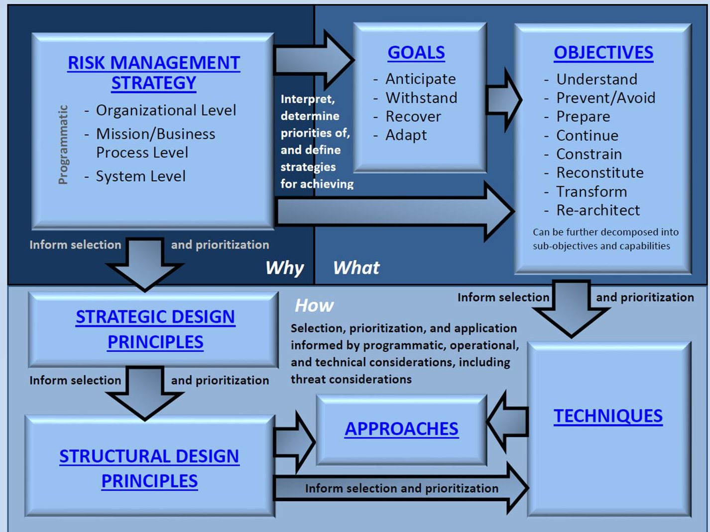
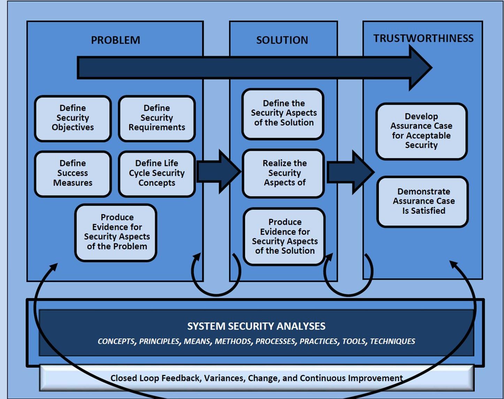
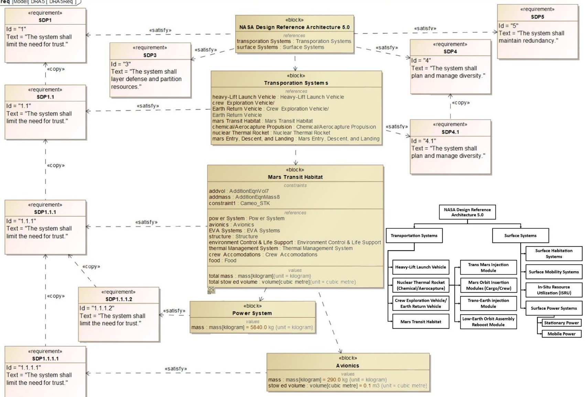

<!-- PDF_PAGE: 1 -->

Article

# Model-Based Systems Engineering Cybersecurity for Space Systems

Mitchell Kirshner ID

Department of Systems & Industrial Engineering, University of Arizona, Tucson, AZ 85745, USA; mkirshner@arizona.edu

Abstract: As industries in various sectors increasingly adopt model-based systems engineering (MBSE) for system lifecycle design and development, engineers can manage and describe systems of higher complexity than ever before. This is especially true for the field of space systems; while past missions have developed using document-based planning, it is only in the last several years that NASA and other organizations in the space industry have begun using MBSE. One crucial factor of space systems development that is often overlooked is cybersecurity. As space systems become more complex and cyberphysical in nature, cybersecurity requirements become more difficult to capture, especially through document-based methods; a need for a means by which to continuously verify and validate systems cybersecurity for cyberphysical space missions arises. By expanding upon a National Institute of Standards and Technology (NIST) framework for cyber resiliency, this work proposes a methodology that uses MBSE traceability functionality to demonstrate adequate cybersecurity for cyberphysical space systems using SysML requirements modeling capabilities. Key goals, objectives, and strategic principles leading to achieving cybersecurity at all levels of the system's architectural hierarchy are presented. Recommendations for the future of space cybersecurity include the addition of the space sector to the Department of Homeland Security Cybersecurity & Infrastructure Security Agency's list of critical infrastructure sectors to improve standardization and control of space cyberinfrastructure.

Received: 22 September 2022

Revised: 17 January 2023

Accepted: 19 January 2023

Published: 25 January 2023

Citation: Kirshner, M. Model-Based Systems Engineering Cybersecurity for Space Systems. Aerospace 2023,10, 116. https://doi.org/10.3390/aerospace10020116

Academic Editors: Alejandro Salado, Alessandro Golkar, Bryan Mesmer and Hanumanthrao Kannan

Copyright: 2023 by the author. Licensee MDPI, Basel, Switzerland. This article is an open access article distributed under the terms and conditions of the Creative Commons Attribution (CC BY) license (https:// creativecommons.org/licenses/by/ 4.0/).

Keywords: model-based systems engineering (MBSE); digitalization of systems engineering; new space; cybersecurity

## 1. Introduction

Simulation of novel, complex space systems for mission feasibility assessment requires modeling of system-of-interest (SOI) parameters. Maintaining information in a digital environment enables rapid trade studies of system design alternatives and theoretical testing across different scenarios. For cyberphysical systems with interconnected software components and multiple attack surfaces, maintaining a structured information repository becomes tantamount to ensuring overall systems cybersecurity and, by extension, security for contextual missions and enterprises.

Model-based systems engineering (MBSE) digital tools, including the UML-extended language SysML, can inform engineers of cybersecurity considerations of which they should be aware during the different phases of system development. This advantage enables engineers to work on subsystems of the design without having to understand the entirety of the design holistically; modeling cybersecurity requirements and tracing them throughout the SOI implementation using SysML can automate the process of identifying design conflicts. As cyberphysical space systems are the culmination of integrated scientific disciplines (mechanical, electrical, aerospace, chemical, etc.), the space industry can especially benefit from the use of MBSE and SysML. Specific literature-backed benefits of using MBSE, in general, include: increased traceability, reduced errors, better information accessibility, and improved automation [1].

<!-- PDF_PAGE: 2 -->

For the purposes of this research, MBSE shall be contextualized by the International Council of Systems Engineers (INCOSE) definition: "Definition: MBSE is the formalized application of modeling to support system requirements, design, analysis, verification, and validation, beginning in the conceptual design phase and continuing throughout development and later life cycle phases" [2]. This definition is conceptually generalized; for this paper, we apply MBSE to the domain of space cybersecurity to advance space technology.

## 2. Materials and Methods

Developing best practices for implementing space cybersecurity needs through MBSE requires knowledge of past, ongoing, and planned research at the nexus of these three distinct fields. While private companies developing cyberphysical space systems might not release internal information about their development processes, government space programs and universities are able to release peer-reviewed publications on their advances to space MBSE. Meanwhile, modern cybersecurity guidance for the growing commercial space sector is in its infancy.

Many of these publications on the use of MBSE for developing complex space systems have only been published in the last decade; this technology has not yet been fully adopted. A notable example is the 2016 NASA Pathfinder effort through the NASA Engineering Safety Center. This effort aimed to develop and advance MBSE capabilities across NASA to apply MBSE to real issues. Additionally, the 2016 Pathfinder effort sought to capture various issues and opportunities surrounding MBSE in general and expand its use to various fields such as cybersecurity [3].

In the last decade, over 20 development programs at NASA Jet Propulsion Lab (JPL) alone have applied MBSE, including the Mars 2020 mission and the Jupiter Europa Orbiter [4]. NASA JPL used MBSE to: explore more comprehensive options for space systems, perform validation of system designs with a reduction in paper management for the design engineers, and improve quality of communications between system and subsystem engineers [4].

Despite the growing number of MBSE projects at NASA, no projects approach the development of cyberphysical, cybersecure systems from a holistic, all-encompassing view. As a result, even though SysML models might represent, for example, the integrated power, avionics, and deep space habitat systems of a Mars mission [5], these models do not inherently communicate with each other. Even if NASA researchers are able to digitally capture cybersecurity requirements for each of these three systems, the researchers would still have to identify new attack surfaces that arise when these systems communicate as part of the overall mission.

Generally, cyberphysical systems depend on the synergy of computation and physical components [6]. Because of the relation between computational and physical systems, hacked navigation software could cause a physical vehicle to crash. Furthermore, instrument data onboard these systems are susceptible to tampering by malicious agents, which can cause further difficulties either for the system or a human operator [6]. Although other industries (i.e., automobile, airline) contribute to research into cybersecurity for complex systems with both digital and physical components, this research focuses on how the space industry currently handles cybersecurity and how to implement those practices through SysML to better enable automation of vulnerability discovery amongst machines comprised of large numbers of subsystems and components.

Literature as recent as 2018 discusses the lack of space-domain-specific standards or information-sharing organizations for cybersecurity [7]. Even more recent studies from 2020 have expounded on the need to mitigate space cyber threats in commercial space systems, not just for government space programs [8]. In fact, prior to June 2022, cybersecurity standards for generalized space systems were not standardized in either the public or private sectors [9].

<!-- PDF_PAGE: 3 -->

To understand the rationale behind developing standards for space systems cybersecurity, one must understand the types of attacks that could occur. Hackable space system communications often consist of two components: a ground segment and a space segment. Attacks on either of these segments could cause some loss of the space asset [10]. Specific examples in literature of attack types include:

- Attacks on satellite control systems or mission packages to shut them down in orbit;

- Targeting ground infrastructure, such as data centers and control centers;

- Spoofing and hacking attacks on communication networks used by space segments;

- Terrestrial jamming of receivers in specific geographic regions or orbital jamming of a signal sent from a ground station to a satellite [10].

However, these attack types do not consider new attack surfaces that arise when multiple satellites work together in conjunction as constellations. Research in 2021 considers new threat types in the emerging concept of 'New Space,' in which number of satellites in order will increase drastically [9]. In the past, ground-based radio frequency communication segments were the targets of attacks on space systems. Now, as the space industry releases more satellites with uniform parts into orbit, attacks might focus on common cyberphysical architectures among the satellites. This is especially true if commercial companies use commercial off-the-shelf products for their satellites without conducting due diligence into their potential cybersecurity weaknesses [9].

## 3. Results

The following section reviews recent standards and proposes a path forward for implementing document-based cybersecurity frameworks through MBSE.

## 3.1. Space Cybersecurity Standardization

Without standards for cybersecurity set for private companies commercializing space, risks exist for all institutions in space. Even if one company secures its assets from potential hacks, there could be a scenario where a hacker gains control over another asset to force a conjunction event, resulting in the loss of both space assets. If a hacker gains control of a satellite's solar panels, they could cause the system to overheat and lose attitude adjustment ability [9].

Because this type of danger exists, the literature has called for the newly formed Space Force to champion the task of standardizing space asset cybersecurity [11]. In 2018, Harvard University's School for International Affairs released a report bringing attention to the fact that even though the US's critical infrastructure relies heavily on space systems, there is a startling lack of standards, let alone enforced standards. This report also outlined the need to standardize defense against an attack unique to satellite systems-GPS spoofing. GPS spoofing is a cyberattack in which the end user of the satellite believes that the GPS signal they have received from the satellite is accurate, even though the data has been compromised [11]. This type of attack could be particularly devastating to seaborne units that rely on satellite GPS for navigation.

## 3.1.1. United States Space Cybersecurity Standards

On 26 May 2022, the United States Space Force released a cybersecurity standard for commercial satellite providers [12]. The Infrastructure Asset Pre-Approval Program, or IA-Pre, evaluates commercial suppliers of satellite services based on cybersecurity practices. If the suppliers meet government standards, they earn their place on a list of trusted vendors that can more easily apply to Department of Defense contracts in the future [13]. While this program helps ensure consistent cybersecurity for space systems provided by government contractors, it does not fully solve the need for enhanced cybersecurity at the architectural holistic systems level. Furthermore, it is directed at specifically securing the Department of Defense and its missions [12]; international organizations or private companies seeking to enter the space industry without the Department of Defense still lack guidance on developing cybersecure space systems.

<!-- PDF_PAGE: 4 -->

## 3.1.2. European Space Cybersecurity Standards

Several European government space organizations have released public information pertaining to cybersecurity. In August of 2022, the German Federal Office for Information Security (BSI) published recommendations online on the subject of "Cyber Security for Air and Space Applications." Within this online post, BCI states that they will develop a Centre of Excellence for IT Security in Aerospace to act as Germany's central coordinating organization for cybersecurity in both federal civilian and military applications. This extension of BCI includes the goal of identifying the minimum requirements for cybersecurity and space to develop a system specification for federal clients. This specification has yet to be released at the time of this writing [14].

In 2019, the European Space Agency (ESA) planned to have its European Space Security and Education Centre (ESEC) in Belgium become a reference center for cybersecurity services [15]. In that year, ESEC simulated a cyberattack and associated response to demonstrate ESA cyber resiliency practices [16]. Since then, there have been no plans to standardize space cybersecurity from ESEC. Websites related to proposing new studies for space cybersecurity for ESA are outdated, still listing dates in 2019 [17]. As such, there have been no publicized attempts from ESA to standardize cybersecurity practices.

Aside from the BSI and ESEC research into cybersecurity standardization, there has been significant discussion within the United Nations on how to reduce space cyber threats through norms, rules, and principles of responsible behaviors [18]. In 2021, the UN Secretary-General released a report including cyber as a significant threat to space infrastructure used by billions worldwide. As part of this report, the Secretary-General called for the creation of an open-ended working group for space threats, which has come into existence [19]. While this group does discuss cyber threats, it has yet to produce standards or guidelines for space cybersecurity in either the public or private sector.

## 3.1.3. Industry Cybersecurity Standards

With a lack of clearly accessible space cybersecurity standards, private companies are often left to their own resources to develop best practices to ensure their asset safety. Some private corporations are more transparent in their cybersecurity methodologies than others. For example, the Aerospace Corporation explains online how it implements cybersecurity within its space systems by extending US government general cybersecurity standards within its Space Safety Institute [20]. Furthermore, Aerospace's Space Safety Institute uses the company's Cybersecurity and Advanced Platforms Subdivision for enhanced system security analysis; however, other space system operators outside Aerospace's stakeholders may be unable to access this system. As such, these practices become more proprietary in nature than a potential global standard.

Nonprofits devoted to the dissemination of space cybersecurity information exist. The Space Information Sharing and Analysis Center (ISAC) was launched in 2019 to facilitate dialogue between the public and private space sectors. This Space ISAC is a member of the National Council of ISACs from other disciplines; the National Cybersecurity Center, another nonprofit, operates the Space ISAC [21]. While the Space ISAC is helpful for promoting information sharing for all operators in the space sector, its goals are not specifically to develop a codified standard for space cybersecurity. Because of the lack of consensus on an international, national, or industrial space cybersecurity standard, this research pursues general cybersecurity standards for implementation in MBSE for modeling systems.

## 3.2. General Cybersecurity Standardization

The National Institute of Standards and Technology (NIST) has published multiple documents detailing heuristics and procedures for developing cybersecurity and general security within any type of system. The following section reveals four published standards and discusses how their proposed frameworks can be interconnected for a holistic approach to developing cyberphysical space systems through MBSE.

<!-- PDF_PAGE: 5 -->

## 3.2.1. NIST SP 800-160 Volume 2

The NIST Special Publication (SP) "Developing Cyber Resilient Systems: A Systems Security Engineering Approach" is a self-described tutorial for achieving cyber resiliency outcomes [22]. NIST defines cyber resiliency as the ability to anticipate, withstand, recover from, and adapt to adverse conditions, stresses, attacks, or compromises on systems that use or are enabled by cyber resources. Cyber resiliency conceptually intends to enable mission or business objectives that depend on cyber resources to be achieved in a contested cyber environment. Figure 1 shows a top-level overview of the NIST Cyber Resiliency Framework, demonstrating how the self-described tutorial has readers implement cyber resiliency into their systems [22].

CYBER RESILIENCY SOLUTION

Figure 1. Top-level view of NIST Cyber Resiliency Framework [22].

The cyber resiliency approach described in Figure 1, and further detailed within the NIST publication, extends NIST SP 800-160 Vol. 1 developed for general systems security providing further enterprise-level context for the specific goals and objectives that create cyber resiliency [22]. Other distinguishing characteristics of cyber resiliency include:

- System focuses on mission functions and on the effects of a persistent threat;

- Assumption of a changing environment;

- Assumption that the adversary will compromise or breach the system or organization and maintain a presence [22].

<!-- PDF_PAGE: 6 -->

## 3.2.2. NIST SP 800-160 Volume 1

The NIST SP, which precedes the cyber resiliency framework, contextualizes cybersecurity within a larger umbrella concept of systems security engineering [23]. NIST SP 800-160 Vol. 1 considers a multidisciplinary approach in engineering trustworthy, secure systems by establishing problem, solution, and trustworthiness contexts as key components of a framework, summarized in Figure 2. By using these contexts as a basis for system security, this standard ensures that systems security is based on achieving a complete understanding of the problem as defined by the stakeholder security objectives, concerns, protection needs, and security requirements. Cybersecurity is just a type of security engineering within this context.

Figure 2. Top-level view of NIST System Security Framework [22]. The framework in Figure 1 is one example of a type of security consideration contextualized for the SOI by this Security Framework.

## 3.2.3. NIST Framework for Improving Critical Infrastructure Cybersecurity

Aside from the NIST SP for developing cyber-resilient systems contextualized by overall system security, another cybersecurity-focused NIST framework standard exists. Published in 2018, the NIST Framework for Improving Critical Infrastructure Cybersecurity does not speak directly about the space industry [24]. Furthermore, according to the United States Cybersecurity & Information Security Agency (CISA), the space sector is not a critical sector—a critical sector being an industry whose incapacitation would cause harm to the daily operations of the United States [25]. However, much critical infrastructure relies on satellite communications [11]; therefore, when gathering information for implementing system cybersecurity resiliency in MBSE for space systems, this NIST publication has relevant information. The Cybersecurity Framework lists functions, categories, subcategories,

<!-- PDF_PAGE: 7 -->

and informative references for specific cybersecurity activities common across all critical infrastructure sectors [24]. Systems engineers can apply this framework, expounded on in Figure 3, directly to the development of cyberphysical space systems.

<table border="1"><tr><td>Function Unique Identifier</td><td>Function</td><td>Category Unique Identifier</td><td>Category</td></tr><tr><td rowspan="7">ID</td><td rowspan="7">Identify</td><td>ID.AM</td><td>Asset Management</td></tr><tr><td>ID.BE</td><td>Business Environment</td></tr><tr><td>ID.GV</td><td>Governance</td></tr><tr><td>ID.RA</td><td>Risk Assessment</td></tr><tr><td>ID.RM</td><td>Risk Management Strategy</td></tr><tr><td>ID.SC</td><td>Supply Chain Risk Management</td></tr><tr><td rowspan="7">PR</td><td rowspan="7">Protect</td><td>PR.AC</td><td>Identity Management and Access Control</td></tr><tr><td>PR.AT</td><td>Awareness and Training</td></tr><tr><td>PR.DS</td><td>Data Security</td></tr><tr><td>PR.IP</td><td>Information Protection Processes and Procedures</td></tr><tr><td>PR.MA</td><td>Maintenance</td></tr><tr><td>PR.PT</td><td>Protective Technology</td></tr><tr><td rowspan="3">DE</td><td rowspan="3">Detect</td><td>DE.AE</td><td>Anomalies and Events</td></tr><tr><td>DE.CM</td><td>Security Continuous Monitoring</td></tr><tr><td>DE.DP</td><td>Detection Processes</td></tr><tr><td rowspan="6">RS</td><td rowspan="6">Respond</td><td>RS.RP</td><td>Response Planning</td></tr><tr><td>RS.CO</td><td>Communications</td></tr><tr><td>RS.AN</td><td>Analysis</td></tr><tr><td>RS.MI</td><td>Mitigation</td></tr><tr><td>RS.IM</td><td>Improvements</td></tr><tr><td rowspan="3">RC</td><td rowspan="3">Recover</td><td>RC.RP</td><td>Recovery Planning</td></tr><tr><td>RC.IM</td><td>Improvements</td></tr><tr><td>RC.CO</td><td>Communications</td></tr></table>

Figure 3. NIST Framework for Improving Critical Infrastructure Cybersecurity: core concepts [24].

## 3.2.4. NIST SP 800-161r1

In May 2022, NIST published a Special Publication for Cybersecurity Supply Chain Risk Management (C-SCRM) Practice for Systems and Organizations. As the space industry grows and increasing numbers of satellites enter Earth's orbit, a global space supply chain will arise. Leveraging the information from NIST SP 800-161r1 while researching heuristics for best cybersecurity practices for the purpose of modeling them using MBSE tools may improve overall space mission security by reducing risks to the supply chain associated

<!-- PDF_PAGE: 8 -->

with the system development and operations [26]. Fully securing global C-SCRM using MBSE for a mission is beyond the scope of this present research but should be considered by private and public industries.

## 3.3. Modeling Key Takeaways from Cyber Resiliency Standards

Of the four NIST manuals evaluated for codifying cybersecurity through MBSE for complex cyberphysical space systems, the cyber resiliency standard is most directly applicable. Appendix D provides multiple tables detailing the goals, objectives, techniques, approaches, strategic design principles, and structural design principles outlined in Figure 1. By interconnecting these concepts through traceability matrices, one can create a definition for system goal completion and provide evidence for cybersecurity implemented at all levels of a system's architectural hierarchy. Tables 1-4 summarize information from Appendix D of NIST 800-160 Volume 2, showing traceability between system cyber resiliency goals (as put forth by NIST's standardization) and objectives, then those objectives to strategic design principles [22]. MBSE solutions should leverage the traceability matrices in the following tables to demonstrate adequate system cyber resiliency:

Table 1. NIST 800-160 Vol. 2 Table D-12: objectives supporting cyber resiliency goals [22].

<table border="1"><tr><td>Goals Traced to Objectives</td><td>Anticipate</td><td>Withstand</td><td>Recover</td><td>Adapt</td></tr><tr><td>Prevent/Avoid</td><td>X</td><td>X</td><td></td><td></td></tr><tr><td>Prepare</td><td>X</td><td>X</td><td>X</td><td>X</td></tr><tr><td>Continue</td><td></td><td>X</td><td>X</td><td></td></tr><tr><td>Constrain</td><td></td><td>X</td><td>X</td><td></td></tr><tr><td>Reconstitute</td><td></td><td></td><td>X</td><td></td></tr><tr><td>Understand</td><td>X</td><td>X</td><td>X</td><td>X</td></tr><tr><td>Transform</td><td></td><td></td><td>X</td><td>X</td></tr><tr><td>Rearchitect</td><td></td><td></td><td>X</td><td>X</td></tr></table>

Table 2. NIST 800-160 Vol. 2 Table D-14: strategic design principles supporting cyber objectives [22].

<table border="1"><tr><td>Strategic Design Principles Traced to Objectives</td><td>Focus on Common Critical Assets</td><td>Support Agility and Architect for Adaptability</td><td>Reduce Attack Surfaces</td><td>Assume Compromised Resources</td><td>Expect Adversaries to Evolve</td></tr><tr><td>Prevent/Avoid</td><td>X</td><td></td><td>X</td><td></td><td></td></tr><tr><td>Prepare</td><td></td><td>X</td><td></td><td>X</td><td>X</td></tr><tr><td>Continue</td><td>X</td><td>X</td><td></td><td>X</td><td></td></tr><tr><td>Constrain</td><td></td><td></td><td>X</td><td>X</td><td></td></tr><tr><td>Reconstitute</td><td>X</td><td>X</td><td></td><td>X</td><td></td></tr><tr><td>Understand</td><td>X</td><td></td><td>X</td><td>X</td><td>X</td></tr><tr><td>Transform</td><td></td><td>X</td><td>X</td><td>X</td><td>X</td></tr><tr><td>Rearchitect</td><td>X</td><td>X</td><td>X</td><td>X</td><td>X</td></tr></table>

<!-- PDF_PAGE: 9 -->

Table 3. NIST 800-160 Vol. 2 Table D-13: cyber resiliency techniques and implementation approaches supporting cyber resiliency objectives.

<table border="1"><tr><td>Objectives Traced to Techniques/Approaches</td><td>Prevent/Avoid</td><td>Prepare</td><td>Continue</td><td>Constrain</td><td>Reconstitute</td><td>Understand</td><td>Transform</td><td>Rearchitect</td></tr><tr><td>ADAPTIVE RESPONSE</td><td>X</td><td>X</td><td>X</td><td>X</td><td>X</td><td>X</td><td></td><td></td></tr><tr><td>Dynamic Reconfiguration</td><td>X</td><td></td><td>X</td><td>X</td><td>X</td><td>X</td><td></td><td></td></tr><tr><td>Dynamic Resource Allocation</td><td>X</td><td></td><td>X</td><td>X</td><td>X</td><td></td><td></td><td></td></tr><tr><td>Adaptive Management</td><td>X</td><td>X</td><td>X</td><td>X</td><td>X</td><td>X</td><td></td><td></td></tr><tr><td>ANALYTIC MONITORING</td><td></td><td></td><td>X</td><td>X</td><td>X</td><td>X</td><td></td><td></td></tr><tr><td>Monitoring and Damage Assessment</td><td></td><td></td><td>X</td><td>X</td><td>X</td><td>X</td><td></td><td></td></tr><tr><td>Sensor Fusion and Analysis</td><td></td><td></td><td></td><td></td><td></td><td>X</td><td></td><td></td></tr><tr><td>Forensic and Behavioral Analysis</td><td></td><td></td><td></td><td></td><td></td><td>X</td><td></td><td></td></tr><tr><td>CONTEXTUAL AWARENESS</td><td></td><td>X</td><td>X</td><td></td><td>X</td><td>X</td><td></td><td></td></tr><tr><td>Dynamic Resource Awareness</td><td></td><td>X</td><td></td><td></td><td></td><td>X</td><td></td><td></td></tr><tr><td>Dynamic Threat Awareness</td><td></td><td></td><td></td><td></td><td></td><td>X</td><td></td><td></td></tr><tr><td>Mission Dependency and Status Visualization</td><td></td><td>X</td><td>X</td><td></td><td>X</td><td>X</td><td></td><td></td></tr><tr><td>COORDINATED PROTECTION</td><td>X</td><td>X</td><td>X</td><td></td><td>X</td><td>X</td><td>X</td><td>X</td></tr><tr><td>Calibrated Defense-in-Depth</td><td>X</td><td>X</td><td></td><td></td><td>X</td><td></td><td></td><td></td></tr><tr><td>Consistency Analysis</td><td>X</td><td>X</td><td></td><td></td><td>X</td><td>X</td><td>X</td><td>X</td></tr><tr><td>Orchestration</td><td>X</td><td>X</td><td>X</td><td></td><td>X</td><td>X</td><td>X</td><td>X</td></tr><tr><td>Self-Challenge</td><td></td><td>X</td><td></td><td></td><td></td><td>X</td><td></td><td></td></tr><tr><td>DECEPTION</td><td>X</td><td></td><td></td><td></td><td></td><td>X</td><td></td><td></td></tr><tr><td>Obfuscation</td><td>X</td><td></td><td></td><td></td><td></td><td></td><td></td><td></td></tr><tr><td>Disinformation</td><td>X</td><td></td><td></td><td></td><td></td><td></td><td></td><td></td></tr><tr><td>Misdirection</td><td>X</td><td></td><td></td><td></td><td></td><td>X</td><td></td><td></td></tr><tr><td>Tainting</td><td></td><td></td><td></td><td></td><td></td><td>X</td><td></td><td></td></tr><tr><td>DIVERSITY</td><td>X</td><td>X</td><td>X</td><td>X</td><td></td><td></td><td></td><td>X</td></tr><tr><td>Architectural Diversity</td><td></td><td>X</td><td>X</td><td></td><td></td><td></td><td></td><td>X</td></tr><tr><td>Design Diversity</td><td></td><td>X</td><td>X</td><td></td><td></td><td></td><td></td><td>X</td></tr><tr><td>Synthetic Diversity</td><td>X</td><td>X</td><td>X</td><td>X</td><td></td><td></td><td></td><td></td></tr><tr><td>Information Diversity</td><td></td><td>X</td><td>X</td><td></td><td></td><td></td><td></td><td>X</td></tr><tr><td>Path Diversity</td><td></td><td>X</td><td>X</td><td></td><td></td><td></td><td></td><td>X</td></tr><tr><td>Supply Chain Diversity</td><td></td><td>X</td><td>X</td><td></td><td></td><td></td><td></td><td>X</td></tr><tr><td>DYNAMIC POSITIONING</td><td>X</td><td></td><td>X</td><td>X</td><td>X</td><td>X</td><td></td><td></td></tr><tr><td>Functional Relocation of Sensors</td><td></td><td></td><td></td><td></td><td>X</td><td>X</td><td></td><td></td></tr><tr><td>Functional Relocation of Cyber Resources</td><td>X</td><td></td><td>X</td><td>X</td><td></td><td></td><td></td><td></td></tr><tr><td>Asset Mobility</td><td>X</td><td></td><td>X</td><td>X</td><td></td><td></td><td></td><td></td></tr><tr><td>Fragmentation</td><td>X</td><td></td><td></td><td></td><td>X</td><td></td><td></td><td></td></tr><tr><td>Distributed Functionality</td><td>X</td><td></td><td></td><td></td><td>X</td><td></td><td></td><td></td></tr></table>

<!-- PDF_PAGE: 10 -->

<table border="1"><tr><td>Objectives Traced to Techniques/Approaches</td><td>Prevent/Avoid</td><td>Prepare</td><td>Continue</td><td>Constrain</td><td>Reconstitute</td><td>Understand</td><td>Transform</td><td>Rearchitect</td></tr><tr><td>NONPERSISTENCE</td><td>X</td><td></td><td></td><td>X</td><td></td><td></td><td>X</td><td>X</td></tr><tr><td>Nonpersistent Information</td><td>X</td><td></td><td></td><td>X</td><td></td><td></td><td>X</td><td>X</td></tr><tr><td>Nonpersistent Services</td><td>X</td><td></td><td></td><td>X</td><td></td><td></td><td>X</td><td>X</td></tr><tr><td>Nonpersistent Connectivity</td><td>X</td><td></td><td></td><td>X</td><td></td><td></td><td>X</td><td>X</td></tr><tr><td>PRIVILEGE RESTRICTION</td><td>X</td><td></td><td></td><td>X</td><td>X</td><td></td><td></td><td></td></tr><tr><td>Trust-Based Privilege Management</td><td>X</td><td></td><td></td><td>X</td><td></td><td></td><td></td><td></td></tr><tr><td>Attribute-Based Usage Restriction</td><td>X</td><td></td><td></td><td></td><td>X</td><td></td><td></td><td></td></tr><tr><td>Dynamic Privileges</td><td>X</td><td></td><td></td><td>X</td><td>X</td><td></td><td></td><td></td></tr><tr><td>REALIGNMENT</td><td>X</td><td></td><td></td><td></td><td></td><td></td><td>X</td><td>X</td></tr><tr><td>Purposing</td><td>X</td><td></td><td></td><td></td><td></td><td></td><td></td><td>X</td></tr><tr><td>Offloading</td><td></td><td></td><td></td><td></td><td></td><td></td><td>X</td><td>X</td></tr><tr><td>Restriction</td><td></td><td></td><td></td><td></td><td></td><td></td><td>X</td><td>X</td></tr><tr><td>Replacement</td><td></td><td></td><td></td><td></td><td></td><td></td><td>X</td><td>X</td></tr><tr><td>Specialization</td><td></td><td></td><td></td><td></td><td></td><td></td><td>X</td><td>X</td></tr><tr><td>Evolvability</td><td></td><td></td><td></td><td></td><td></td><td></td><td>X</td><td>X</td></tr><tr><td>REDUNDANCY</td><td>X</td><td>X</td><td>X</td><td></td><td>X</td><td></td><td>X</td><td>X</td></tr><tr><td>Protected Backup and Restore</td><td></td><td>X</td><td>X</td><td></td><td>X</td><td></td><td></td><td></td></tr><tr><td>Surplus Capacity</td><td></td><td>X</td><td>X</td><td></td><td></td><td></td><td></td><td></td></tr><tr><td>Replication</td><td>X</td><td>X</td><td>X</td><td></td><td></td><td></td><td>X</td><td>X</td></tr><tr><td>SEGMENTATION</td><td>X</td><td></td><td></td><td>X</td><td>X</td><td></td><td></td><td>X</td></tr><tr><td>Predefined Segmentation</td><td>X</td><td></td><td></td><td>X</td><td>X</td><td></td><td></td><td>X</td></tr><tr><td>Dynamic Segmentation and Isolation</td><td>X</td><td></td><td></td><td>X</td><td>X</td><td></td><td></td><td></td></tr><tr><td>SUBSTANTIATED INTEGRITY</td><td></td><td></td><td>X</td><td>X</td><td>X</td><td>X</td><td></td><td></td></tr><tr><td>Integrity Checks</td><td></td><td></td><td>X</td><td>X</td><td>X</td><td>X</td><td></td><td></td></tr><tr><td>Provenance Tracking</td><td></td><td></td><td>X</td><td></td><td>X</td><td>X</td><td></td><td></td></tr><tr><td>Behavior Validation</td><td></td><td></td><td>X</td><td>X</td><td>X</td><td>X</td><td></td><td></td></tr><tr><td>UNPREDICTABILITY</td><td>X</td><td></td><td></td><td>X</td><td></td><td></td><td></td><td></td></tr><tr><td>Temporal Unpredictability</td><td>X</td><td></td><td></td><td>X</td><td></td><td></td><td></td><td></td></tr><tr><td>Contextual Unpredictability</td><td>X</td><td></td><td></td><td>X</td><td></td><td></td><td></td><td></td></tr><tr><td>Integrity Checks</td><td></td><td></td><td>X</td><td>X</td><td>X</td><td>X</td><td></td><td></td></tr></table>

<!-- PDF_PAGE: 11 -->

Table 4. NIST 800-160 Vol. 2 Table D-15: cyber resiliency structural design principles and associated implementation techniques [22].

<table border="1"><tr><td>Structural Design Principle</td><td>Associated Technique</td></tr><tr><td>Limit the Need for Trust</td><td>Coordinated Protection, Privilege Restriction, Realignment, Substantiated Integrity</td></tr><tr><td>Control Visibility and Use</td><td>Deception, Nonpersistence, Privilege Restriction, Segmentation</td></tr><tr><td>Layer Defense and Partition Resources</td><td>Analytic Monitoring, Coordinated Protection, Diversity, Dynamic Positioning, Redundancy, Segmentation</td></tr><tr><td>Plan and Manage Diversity</td><td>Coordinated Protection, Diversity, Redundancy</td></tr><tr><td>Maintain Redundancy</td><td>Coordinated Protection, Diversity, Realignment, Redundancy</td></tr><tr><td>Make Resources Location Versatile</td><td>Adaptive Response, Diversity, Dynamic Positioning, Nonpersistence, Redundancy, Unpredictability</td></tr><tr><td>Leverage Health and Status Data</td><td>Analytic Monitoring, Contextual Awareness, Substantiated Integrity</td></tr><tr><td>Maintain Situational Awareness</td><td>Analytic Monitoring, Contextual Awareness</td></tr><tr><td>Manage Resources (Risk) Adaptively</td><td>Adaptive Response, Coordinated Protection, Deception, Dynamic Positioning, Nonpersistence, Privilege Restriction, Realignment, Redundancy, Segmentation, Unpredictability</td></tr><tr><td>Maximize Transience</td><td>Analytic Monitoring, Dynamic Positioning, Nonpersistence, Substantiated Integrity, Unpredictability</td></tr><tr><td>Determine Ongoing Trustworthiness</td><td>Coordinated Protection, Substantiated Integrity</td></tr><tr><td>Change or Disrupt the Attack Surface</td><td>Adaptive Response, Deception, Diversity, Dynamic Positioning, Nonpersistence, Unpredictability</td></tr><tr><td>Make the Effects of Deception and Unpredictability User-Transparent</td><td>Adaptive Response, Coordinated Protection, Deception, Unpredictability</td></tr><tr><td>Structural Design Principle</td><td>Related Technique</td></tr><tr><td>Limit the Need for Trust</td><td>Coordinated Protection, Privilege Restriction, Realignment, Substantiated Integrity</td></tr><tr><td>Control Visibility and Use</td><td>Deception, Nonpersistence, Privilege Restriction, Segmentation</td></tr><tr><td>Layer Defense and Partition Resources</td><td>Analytic Monitoring, Coordinated Protection, Diversity, Dynamic Positioning, Redundancy, Segmentation</td></tr><tr><td>Plan and Manage Diversity</td><td>Coordinated Protection, Diversity, Redundancy</td></tr></table>

Now that this vital information guiding cyber resilience in system development is organized and traced, it is possible to implement NIST's frameworks through MBSE for a space system by deriving and refining requirements from the goals and objectives. These derived requirements could be satisfied by structural components of the system model

<!-- PDF_PAGE: 12 -->

and would contribute to a larger repository of requirements for system development and security as standardized by NIST [23]. Although additional requirements from the NIST standards for critical infrastructure and C-SCRM can bolster the cybersecurity proving for a system modeled in SysML, the cyber resiliency manual provides a stronger foundation for developing the process of converting framework standards into traceable, satisfied MBSE cyber requirements.

## 4. Discussion

The traceability matrices in Tables 1-4 derived from NIST cyber resiliency standards and contextualized by overall system security standards provide a basis for a methodology to ensure that all systems and interfaces in a cyberphysical system meet the same applicable goals and objectives. The NIST frameworks are very generalized and do not speak to the security concerns of the components and parts comprising the SOI. MBSE can help bridge the gap between low-level (components, parts) and top-level (system, mission) cybersecurity through SysML requirements.

## 4.1. Integrating Cybersecurity Requirements into MBSE

While many MBSE software exist and may have different methods to capture requirements, to best enable collaboration between different engineering specialties and enable the combination of multiple complex models for an overall system, systems engineers should choose software tools featuring interoperability to avoid an enterprise to experience vendor lock-in; otherwise, developers might be forced to develop models only in one tool, which might limit collaboration depending on the system being built. Aside from interoperability, SysML allows for the modeling of a requirements hierarchy, such that engineers can generate requirements from the framework standards and further derive requirements for lower-level system characteristics.

Evidence in the literature exists for SysML and UML methodologies for implementing cybersecurity requirements to cyberphysical systems in SysML. In 2020, researchers developed reusable SysML profiles designed to verify cybersecurity in parallel with the system design process [27]. That cybersecurity requirement integration research differs from this methodology in that the researchers only applied their security domain model and SysML profile to the power subsystem of a cyberphysical hybrid sports utility vehicle and not a holistic analysis for an analogous space system [27]. In further contrast, this methodology takes a broader look at cybersecurity requirement standardization and general heuristics for application for a robust methodology reusable regardless of any software changes by vendors providing MBSE digital environments.

Two examples of software that enable interoperability and detailed requirements modeling are the Vitech GENESYS and the Dassault Cameo Systems Modeler; the latter is demonstrated in the forthcoming section. GENESYS leverages multiple tools to allow users with requirements already generated from outside sources to import said requirements into an interactive modeling environment. Two GENESYS connectors that accomplish this are for external interoperability with IBM DOORS and Microsoft Excel. DOORS is a software specifically devoted to requirements management that has existed in the industry for decades; as such, it could be possible to port existing requirements to improve model generation to retroactively digitalize legacy systems, which could comprise a cyberphysical system.

Although Microsoft Excel is a commonly known and understood software and can serve as a simple solution for tabulating and organizing system requirements, depending on the formatting of the requirements hierarchy modeling in the engineer's spreadsheet, importing requirements to GENESYS or Cameo Systems Modeler may prove to be problematic. Once ported, these requirements are much more traceable to system components, regardless of whether they are in GENESYS, Cameo, or other MBSE software.

<!-- PDF_PAGE: 13 -->

## 4.2. Use Case: Crewed Mars Mission Planning Cybersecurity

To demonstrate the concepts of systems cybersecurity standards gathered in this research using MBSE technology, this article builds upon the author's past work on modeling a holistic crewed Mars mission plan comprised of heterogenous cyberphysical space systems [28]. In this research, published in 2021, the authors retroactively model the NASA Design Reference Architecture 5.0, published in 2009, as guidance to develop crewed missions to Mars. Cameo Systems Modeler enables the digital transformation of this document-based architecture; the SysML block definition diagrams describing interrelations within the mission systems hierarchy are both broader and more complex than similar research endeavors describing a singular cyberphysical systems, such as a cyberphysical hybrid electric vehicle or individual space systems [4,27].

This research reuses the models published in 2021 and adds requirements directly related to structural design principles listed in Table 4 [28]. In this way, the cyberphysical elements of the system architecture represented by elements in a SysML block definition diagram can digitally satisfy the standard-derived requirements of cyber resiliency security using a human and machine-readable programming language [29]. Because the cyberphysical elements are semantically linked to strategic design principles, organizations developing mission plans can digitally thread together system components to design principles for higher-level enterprise goals and objectives such as those listed in Tables 1 and 2. SysML facilitates presentation of the traceability between system elements, requirements, design principles, objectives, and goals using requirements tables and requirements diagrams [29]. Figure 4 shows a requirements diagram with a selection of requirements derived from structural design principles satisfied at all levels of the NASA Design Reference Architecture 5.0. SysML nested requirements create a number scheme commensurate to the level of system hierarchy meeting the cyber resiliency requirement. Using the SysML "copy" relationship helps develop a heuristic for engineers to apply the same level of stringency for cyber requirements at all levels of the system hierarchy.

SysML semantics between nested requirements indicating architecture hierarchy depths and system elements in Figure 4 can be applied on all levels: the mission, systems, subsystem, component, subcomponent, and even parts throughout a holistic enterprise model could have cyber resiliency adequately captured. This builds upon previous work on holistic modeling for space missions and serves as a proof of concept for developing more complex models [28]. Future work expanding upon this research and leveraging heuristics and best practices proposed in this research for satisfying cyber resiliency requirements derived from current standards will use more complex relationships between systems elements and more quantifiable requirements leveraging "derive" relationships in SysML to maintain traceability to document-based frameworks.

## 4.3. Quantifying MBSE Benefit Metrics for Cybersecure Space System Design and Development

As mentioned in the Introduction, the literature-backed benefits of using MBSE, in general, include: increased traceability, reduced errors, better information accessibility, and improved automation [1]. These specific metrics were chosen from the results of a 2020 research paper. In this paper, authors Henderson and Salado reviewed 360 articles citing the benefits of MBSE and found only two instances demonstrating empirical evidence of purported benefits; these two papers measured the aforementioned four metrics [1]. One of these papers detailed the process of calculating the scores for each measure of effectiveness by leveraging the Analytical Hierarchy Process (AHP), a theory of relative measurement for intangible criteria through pairwise comparison measurements [30]. This seems to be a viable formalized method to develop scores for the chosen metrics, but as the Henderson and Salado paper states, there is not much explanation for the choices of measures of effectiveness [1]. Furthermore, the researchers from the paper leveraging AHP do not describe their logic for estimating metric scores for MBSE benefits they just state that their estimates were from 'argumentation' [31]. However, through their proposed methodology and self-consistent logic, the authors are able to compare MBSE processes directly and

<!-- PDF_PAGE: 14 -->

quantitatively against traditional document-based methods across key systems engineering activities, concluding improvement while using MBSE in the architecture design phase and comparable performance in the requirements definition phase [8]. A much larger study with user data would help empirically and adequately assess the benefits of MBSE in the specific use case in Figure 4 of comparing a SysML cybersecurity modeling design process to that of a document such as the Design Reference Architecture 5.0.

Figure 4. Dassault Cameo SysML requirements diagram showing cyber-resilient structural design principle (SDP) requirements satisfied by different levels of architectural hierarchy in a crewed Mars mission plan comprised of heterogenous cyberphysical systems. This builds upon previous work on holistic modeling for complex space missions and serves as a proof of concept for developing more complex models. The diagram on the bottom right of the figure shows a top-level breakdown of the NASA Mars Design Reference Architecture 5.0 modeled in this example [28]. SDP requirements stem from NIST 800-160 Vol. 2 Table D-15, shown in Table 4 [22].

Thus, we have demonstrated a viable methodology to model cyber resiliency and, by extension, cybersecurity, for all levels of a system's architectural hierarchy. By adhering to a refined standard published and reviewed by NIST and applying the traceability matrices in Tables 1-4 to provably achieve security goals through objectives and design principles, space systems engineers can begin to holistically model cybersecurity for missions involving complex cyberphysical systems. Furthermore, with interoperable software, engineers can retroactively edit SysML models to add cybersecurity requirements. This can be very effective for ongoing modeling efforts and academic research into digitally simulating space missions in real time, which opens additional cybersecurity concerns in which vulnerabilities might arise only at certain times in a dynamic mission [28].

<!-- PDF_PAGE: 15 -->

## 5. Conclusions

By reviewing cybersecurity frameworks and ongoing endeavors to standardize space cyber resiliency, this research has posited a path forward to adequately capturing cybersecurity requirements for space systems using the interoperable MBSE language SysML. Tracing requirements derived from common goals and objectives to system components in a modeling environment can help improve engineer communication and reduce design and development errors. This paper has demonstrated a use case in holistic crewed Mars mission cybersecurity planning with NIST cyber resiliency frameworks modeled as SysML requirements at multiple hierarchical levels of a heterogenous cyberphysical space systems mission using the Cameo Systems Modeler.

This work further highlights the viewpoint already taken in the literature that space cybersecurity must be standardized, especially as more human-made space systems exponentially populate near-Earth orbit [11]. Because of the space sector's importance to critical infrastructure, the author of this work believes that the space industry must solidify cybersecurity standards to ensure the safety of all space-borne assets; malicious actors could attack targets using insecure proxies. Therefore, the US Department of Homeland Security should consider space a critical infrastructure and apply resources to ensure its cybersecurity. This action would set an international example for all space actors.

The US Department of Homeland Security's (DHS) Cybersecurity & Infrastructure Security Agency (CISA) has identified industrial sectors whose assets are vital to the nation such that their incapacitation could debilitate national security, public health, or safety. Many of the sectors rely on cybersecure resilience, such as the transportation, communications, and information technology sectors, for effective, reliable, safe operations. However, these three sectors, which enable interfaces between sectors, are becoming increasingly reliant on space infrastructure: satellites enable GPS for transportation as well as wireless communications for IT systems.

Because of the United States', and indeed the world's, reliance on space infrastructure and because the growing space sector is relatively unregulated compared to other domain-specific sectors, it is important that space systems receive special attention to ensure cybersecure operations. The DHS CISA should consider space to be the US's 17th critical infrastructure sector, not only for its unique properties but also for its similarities and interoperability with other sector systems. Perhaps then, additional cybersecurity standards and frameworks specifically intended for space systems will arise globally, allowing for even more effective MBSE for complex cyberphysical systems.

Future research into this topic should begin characterizing frameworks based on the information provided by current and upcoming cybersecurity standardization efforts to work toward a reference model built in SysML. Such a reference model should use features within SysML, such as activity diagrams, to develop fault or threat trees common in cybersecurity practice linked directly to system components. Creating a space cybersecurity reference model would provide a methodology for developing reference models for other mission-critical standards, such as MIL-STD 516C (Airworthiness) and MIL-STD 881E (Cost). In this way, different programs such as Space Force would be able to use ModelBased Systems Engineering to implement multiple reference models interlinked with all hierarchical aspects of a given mission, complete with requirement traceability to ensure all cybersecurity criteria are satisfied.

Funding: This research received no external funding.

Data Availability Statement: Not applicable.

Acknowledgments: The author would like to acknowledge the following professors from the University of Arizona for their guidance on this article: Mohammed Shafae, Ricardo Valerdi, and Eric Pearce.

Conflicts of Interest: The author declares no conflict of interest.

<!-- PDF_PAGE: 16 -->

## References

1. Henderson, K.; Salado, A. Value and benefits of model-based systems engineering (MBSE): Evidence from the literature. Syst. Eng. 2021, 24, 51-66. [CrossRef]

2. Friedenthal, S.; Oster, C. Chapter 4: Applying SysML and a Model-Based Systems Engineering Approach to a Small Satellite Design. In Advances in Systems Engineering; American Institute of Aeronautics and Astronautics, Inc.: Reston, VA, USA, 2016; pp. 127-218. [CrossRef]

3. Modeling to Mars: A NASA Model Based Systems Engineering Pathfinder Effort | AIAA SPACE Forum. Available online: https://arc.aiaa.org/doi/abs/10.2514/6.2017-5235 (accessed on 24 February 2021).

4. Pavalkis, S. MBSE in Real-Life Space Exploration Projects. Modeling Community Blog, 15 July 2015. Available online: https://blog.nomagic.com/mbse-real-life-space-exploration-projects/ (accessed on 4 November 2020).

5. Wang, L.; Izygon, M.; Okon, S.; Wagner, H.; Garner, L. Effort to Accelerate MBSE Adoption and Usage at JSC. In Proceedings of the AIAA SPACE 2016, Long Beach, CA, USA, 13-16 September 2016. [CrossRef]

6. Klesh, A.T.; Cutler, J.W.; Atkins, E.M. Cyber-Physical Challenges for Space Systems. In Proceedings of the 2012 IEEE/ACM Third International Conference on Cyber-Physical Systems, Beijing, China, 17-19 April 2012; pp. 45-52. [CrossRef]

7. Falco, G. The Vacuum of Space Cyber Security. In Proceedings of the 2018 AIAA SPACE and Astronautics Forum and Exposition, Orlando, FL, USA, 17-19 September 2018. [CrossRef]

8. Suloway, T.; Visner, S.S.; Kordella, S. A Cyber Attack-Centric View of Commercial Space Vehicles and the Steps Needed to Mitigate, November 2020. Available online: https://www.mitre.org/publications/technical-papers/a-cyber-attack-centric-view-of-commercial-space-vehicles (accessed on 8 June 2021).

9. Manulis, M.; Bridges, C.P.; Harrison, R.; Sekar, V.; Davis, A. Cyber security in New Space. Int. J. Inf. Secur. 2021, 20, 287-311. [CrossRef]

10. Space, the Final Frontier for Cybersecurity? Chatham House—International Affairs Think Tank, 22 September 2016. Available online: https://www.chathamhouse.org/2016/09/space-final-frontier-cybersecurity (accessed on 1 November 2021).

11. Job One for Space Force: Space Asset Cybersecurity. Belfer Center for Science and International Affairs. Available online: https://www.belfercenter.org/publication/job-one-space-force-space-asset-cybersecurity (accessed on 1 November 2021).

12. Erwin, S. Space Force Rolls out Cybersecurity Standards for Commercial Providers of Satellite Services. SpaceNews, 26 May 2022. Available online: https://spacenews.com/space-force-rolls-out-cybersecurity-standards-for-commercialproviders-of-satellite-services/ (accessed on 18 September 2022).

13. United States Space Force. USSF Commercial SATCOM Office Announces Development of New Security Program. Available online: https://www.spaceforce.mil/News/Article/2230831/ussf-commercial-satcom-office-announces-development-of new-security-program/https%3A%2F%2Fwww.spaceforce.mil%2FNews%2FArticle%2F2230831%2Fussf-commercial-satcom-office-announces-development-of-new-security-program%2F (accessed on 18 September 2022).

14. Federal Office for Information Security. Cyber Security for Air and Space Applications. Available online: https://www.bsi.bund.de/EN/Themen/Unternehmen-und-Organisationen/Informationen-und-Empfehlungen/IT-Sicherheit-inLuft-und-Raumfahrt/it-sicherheit-in-luft-und-raumfahrt.html?nn=916896 (accessed on 30 November 2022).

15. ESA ESEC. Available online: https://www.esa.int/About_Us/Corporate_news/ESA_ESEC (accessed on 30 November 2022).

16. ESA Practices Cybersecurity. Available online: https://www.esa.int/Space_Safety/ESA_practices_cybersecurity (accessed on 30 November 2022).

17. Space19+ Road to ESA's Council at Ministerial Level. Available online: https://blogs.esa.int/space19plus/ (accessed on 30 November 2022).

18. UNODA. Report of the Secretary-General on Reducing Space Threats through Norms, Rules and Principles of Responsible Behaviors. 2021. Available online: https://www.un.org/disarmament/topics/outerspace-sg-report-outer-space-2021/ (accessed on 30 November 2022).

19. Indico. Open-Ended Working Group on Reducing Space Threats through Norms, Rules and Principles of Responsible Behaviours Second Session. Available online: https://indico.un.org/event/1001999/ (accessed on 30 November 2022).

20. Aerospace Corporation. SSI: Cybersecurity Implementation | The Aerospace Corporation. Available online: https://aerospace.org/ssi-cybersecurity-implementation (accessed on 30 November 2022).

21. Space ISAC. About Us. Available online: https://s-isac.org/about-us/ (accessed on 30 November 2022).

22. Ross, R.; Pillitteri, V.; Graubart, R.; Bodeau, D.; McQuaid, R. Developing Cyber-Resilient Systems: A Systems Security Engineering Approach. SP 800-160 Vol. 2 Rev. 1. Available online: https://csrc.nist.gov/publications/detail/sp/800-160/vol-2-rev-1/final (accessed on 18 September 2022).

23. Ross, R.; McEvilley, M.; Oren, J. Systems Security Engineering: Considerations for a Multidisciplinary Approach in the Engineering of Trustworthy Secure Systems; NIST Special Publication (SP) 800-160; National Institute of Standards and Technology: Gaithersburg, MD, USA, 2018; Volume 1. [CrossRef]

24. Barrett, M.P. Framework for Improving Critical Infrastructure Cybersecurity, Version 1.1. NIST, April 2018. Available online: https://www.nist.gov/publications/framework-improving-critical-infrastructure-cybersecurity-version-11 (accessed on 18 September 2022).

25. Critical Infrastructure Sectors | CISA. Available online: https://www.cisa.gov/critical-infrastructure-sectors (accessed on 4 November 2020).

<!-- PDF_PAGE: 17 -->

26. Boyens, J.; Smith, A.; Bartol, N.; Winkler, K.; Holbrook, A.; Fallon, M. Cybersecurity Supply Chain Risk Management Practices for Systems and Organizations; NIST Special Publication (SP) 800-161 Rev. 1; National Institute of Standards and Technology: Gaithersburg, MD, USA, 2022. [CrossRef]

27. Mažeika, D.; Butleris, R. Integrating security requirements engineering into MBSE: Profile and guidelines. Secur. Commun. Netw. 2020, 2020, 5137625. [CrossRef]

28. Kirshner, M.; Valerdi, R. Integrating Model-Based Systems and Digital Engineering for Crewed Mars Mission Planning. J. Aerosp. Inf. Syst. 2022, 19, 668-676. Available online: https://arc.aiaa.org/doi/10.2514/1.I010986 (accessed on 3 October 2021). [CrossRef]

29. Friedenthal, S.; Moore, A.; Steiner, R. A Practical Guide to SysML: The Systems Modeling Language, 3rd ed.; Morgan Kaufmann Publishers Inc.: San Francisco, CA, USA, 2014.

30. Biria, A. Analytical Approach to the Design of Optimal Satellite Constellations for Space-Based Space Situational Awareness Applications. Ph.D. Thesis, University of Texas at Austin, Austin, TX, USA.

31. Maurandy, J.; Helm, A.; Gill, E.; Stalford, R. 11.5.3 Cost-Benefit Analysis of SysML Modelling for the Atomic Clock Ensemble in Space (ACES) Simulator. INCOSE Int. Symp. 2012, 22, 1726-1745. [CrossRef]

Disclaimer/Publisher's Note: The statements, opinions and data contained in all publications are solely those of the individual author(s) and contributor(s) and not of MDPI and/or the editor(s). MDPI and/or the editor(s) disclaim responsibility for any injury to people or property resulting from any ideas, methods, instructions or products referred to in the content.