<!-- PDF_PAGE: 1 -->

Article

# Agile Stage-Gate Approach for Design, Integration, and Testing of a 1U CubeSat

Enrique Rafael García-Sánchez $ ^{1,*} $ , Héctor Simón Vargas-Martínez $ ^{2} $ , Filiberto Candia-García $ ^{3} $ and Joel Contreras-Lima $ ^{4} $

1 Faculty of Electronics, Benemérita Universidad Autónoma de Puebla, Blvd Valsequillo, Cd Universitaria Jardines de San Manuel, Puebla 72570, Mexico

$ ^{2} $ Faculty of Bionics, Aerospace and Mechatronics, Universidad Popular Autonoma del Estado de Puebla, 21 sur #1103, Barrio de Santiago, Puebla 72410, Mexico; hectorsimon.vargas@upaep.mx

$ ^{3} $ Faculty of Engineering, Benemérita Universidad Autónoma de Puebla, Blvd Valsequillo, Cd Universitaria, Jardines de San Manuel, Puebla 72570, Mexico; filiberto.candiagarcia@viep.com.mx

4 Department of Mechatronics, Universidad Politécnica de Puebla, Tercer Carril del Ejido Serrano, San Mateo Cuanalal, Juan C. Bonilla, Puebla 72640, Mexico; joel.contreras469@uppuebla.edu.mx

Citation: García-Sánchez, E.R.; Vargas-Martínez, H.S.; Candia-García, F.; Contreras-Lima, J. Agile Stage-Gate Approach for Design, Integration, and Testing of a 1U CubeSat. Aerospace 2024,11,324. https://doi.org/ 10.3390/aerospace11040324

* Correspondence: rafael.garciasan@correo.buap.mx

Received: 11 September 2023

Revised: 30 October 2023

Accepted: 9 November 2023

Published: 22 April 2024

Academic Editor: Paolo Tortora

Abstract: Life cycle stages are very important for the aerospace industry. Many models have emerged for handling the processes within and across the development of new products. Developing CubeSatbased missions has shortened the required time and has reduced expenses. However, the lack of strategic planning in the design, integration, and testing of product development models has been highlighted as one of the key issues contributing to failures. The objective of this study is to propose a new hybrid model for the physical development of a product using an Agile Stage-Gate methodology focused on a 1U CubeSat (AztechSat-1). This study aims to explain the full process throughout the project timeline from conceptualization to execution. The benefits of such a model include ensuring adaptive responses to not only improve technical integration but also allow the successful validation and verification of a nanosatellite. Our theoretical approach articulates an in-depth understanding of Agile Stage-Gate methodology through experience obtained from experts and team members. Our analysis supports the expected benefits of the iterative process at every stage. Through this approach, product development could benefit from reduced times and better innovations. Nevertheless, there are also drawbacks to this method. The requirements of greater human effort, more frequent demonstrations, and a constant review process have negative impacts. Additionally, particular modifications must be made for each area of research. For educational purposes, the initial results seem to be encouraging.

Copyright: 2024 by the authors. Licensee MDPI, Basel, Switzerland. This article is an open access article distributed under the terms and conditions of the Creative Commons Attribution (CC BY) license (https:// creativecommons.org/licenses/by/ 4.0/).

Keywords: CubeSat; nanosatellite; hardware; product development; Agile Stage-Gate; hybrid model

## 1. Introduction

A CubeSat is a cube-shaped satellite in which the unit is defined as U. A 1U satellite has limited dimensions and mass (volume of $ 1 0 \times1 0 \times1 0 \mathrm{c m}^{3} $ with mass up to 2 kg) according to the CubeSat program initiated in 1999 by California Polytechnic State University (Cal Poly) and Stanford University [1]. Since 2000, the National Aeronautics and Space Administration (NASA) has allowed nanosatellites to be launched through the CubeSat Launch Initiative (CSLI). The idea of this program is to launch secondary payloads via planned launch or as deployments from the International Space Station (ISS); for this possibility to be realized, the project must go through a process in which only strategic missions are selected. As of 2023, NASA has invested in the future of technology and science through the CSLI program, which has launched over 150 nanosatellites. The AztechSat-1 project started in 2017 at the Universidad Popular Autonoma del Estado de Puebla (UPAEP) in collaboration with the Mexican Space Agency (AEM). This project began as a requirement

<!-- PDF_PAGE: 2 -->

established by NASA in which the core mission was to develop the first nanosatellite designed and assembled in Mexico for further deployment from the International Space Station. The primary goal of the project is to enable intersatellite communications between the nanosatellites and the GlobalStar constellation.

The GlobalStar first-generation satellite communication system operates in low earth orbit and originally consisted of a constellation of 48 satellites positioned at an approximate altitude of 1414 km; 12 satellites have since been added. These satellites are distributed among eight planes, each accommodating six satellites and following circular orbits with an inclination of approximately 52 degrees. Table 1 shows the parameters of the first-generation GlobalStar constellation.

Table 1. Parameters of the first-generation GlobalStar constellation.

<table border="1"><tr><td>Parameter</td><td>Value</td></tr><tr><td>Number of satellites</td><td>48</td></tr><tr><td>Orbital altitude(km)</td><td>1414</td></tr><tr><td>Orbital inclination(°)</td><td>52°</td></tr><tr><td>Orbital planes</td><td>8</td></tr><tr><td>Satellite by orbital plane</td><td>6</td></tr></table>

The GlobalStar constellation was upgraded with 24 second-generation satellites whose frequencies are within the L band (1-2 GHz), S band (2-4 GHz), and C band (4-8 GHz) [2]. In recent years, a new industry of nanosatellites has been created, and leading universities have now set a standard [3].

Nanosatellites are generally placed in low earth orbits (LEOs) [4]. Sometimes, such satellites rely on constellations that can improve the communication budget and simultaneously reduce costs [5]. Even with a reduced number of ground stations, the window of communication can be increased considerably compared with that of single stations. The AztechSat-1 proposal is based on the idea of communication between nanosatellites and an existing constellation of satellites. Although there have been attempts at constellation missions using nanosatellites, there are few proposals for nanosatellite communications using an existing satellite constellation. For example, the BIRDS Project started in 2015 as a constellation of five 1U CubeSat nanosatellites; however, each CubeSat communicates between its own ground station [6].

Aerospace projects depend on a sequence of methodological procedures for developing product solutions through various life cycle stages. The nature of these products is generally complex, and making decisions is a difficult task. Aerospace manufacturers, unlike those in many other industries, examine information and knowledge in a Stage-Gate process also known as the waterfall approach. Stage-Gate methods describe a product development process broken into phases, each with tasks and due dates [7]. Although different models for managing aerospace projects entail a unidirectional course, most of them provide dynamic approaches based on recursive and iterative methods.

The Stage-Gate model utilizes sequential processes for a given pattern. In-depth studies have been carried out to review these practices using key elements such as stages (where activities take place) and gates (where information is assessed). Even though many results highlight the weaknesses and risks in the model, as requirements can change during the execution of the project, this pragmatic approach, in practice, facilitates communication among team members [8].

When requirements are not clear, iterative methods are a better option for handling a project. In these methods, the designs are constantly assessed, and, therefore, new additions can be integrated, producing a better match according to evolving requirements. The iterative approach is useful for simple systems. One of the most dominant iterative models is the V model, which improves over time from requirement identification to conceptualization, design, integration, and testing because this model allows for iteration and recursion. The main disadvantage of the V model is its inability to respond to changes

<!-- PDF_PAGE: 3 -->

during the life cycle. Thus, an issue in the design discovered during implementation can lead to a setback. Unlike Stage-Gate projects, the V model encourages activities in parallel but can be rigid and not as flexible as desired [9].

On the other hand, Agile methods taken from the software industry are now used in some manufacturing industries. In many projects, definitions and actions change as the project proceeds. Stage-Gates do not offer adaptability as the nature of the method is simple and linear. Agile methods address collaboration, responses to changes, and working products. An Agile methodology starts with a design and adds capabilities through iterations, thereby facilitating changes and feedback. The Agile Stage-Gate combines both the Stage-Gate and Agile approaches. This approach is considered a hybrid model that offers the best of both systems [10].

A general development process approach is usually focused on design, integration, and verification through testing or analysis. Some case studies have been applied to CubeSat projects. One such study was developed by the University of Patras. The Patras team successfully manufactured a CubeSat structure that was later verified by testing and analysis [11]. After testing the new structure, the researchers were able to meet the requirements imposed by the EU-funded FP7-QB50 project. The AztechSat-1 model also utilized sequential verification though its various stages. However, development of this model also involved iterative reviews by experts from NASA and members of the team to make improvements that could help in the development of the nanosatellite in the early stages with no great changes. AztechSat-1's verification via testing and analysis was accomplished only after applying an Agile Stage-Gate approach to ensure a higher rate of success.

However, some authors have taken a different approach and proposed the creation of an integration and validation method for nanosatellites. The nanosatellite ISTSat-1 was also developed following an iterative approach, offering verification of unfinished prototypes and proving highly useful for educational projects. However, no flight results are yet available [12]. AztechSat-1 was already tested and verified, and its mission was proven to be successful. As stated in research on the ISTSat-1 nanosatellite, it is possible to implement an iterative model for a development process. AztechSat-1 uses a hybrid model for both sequential and iterative approaches in the same model for product development.

Our literature review of the development of CubeSat missions also underscored the idea of presenting a hybrid framework for software development in academic nanosatellite missions whose results highlighted the simplification of processes and documentation for the Libertad-2 nanosatellite [13]. The present work highlights the idea of combining different approaches oriented toward hardware development.

This paper describes a methodology for implementing an Agile Stage-Gate approach in the product development of a nanosatellite. Additionally, given the emphasis on the hybrid development of a physical product, we explain the full process from initiation to completion of the project. Stakeholders, team members, and customers are identified along with the main objectives of the project. The key milestones (stages or phases) are also highlighted. Each gate is described, and we explore how activities within each gate are distributed in an Agile development. This work focuses on the development of a new product, a 1U CubeSat with no earlier starting point. To this end, we conducted a study including conceptualization, design, integration, physical testing, and launching that integrated Agile iterations to achieve successful verification and validation of a product.

## 2. Materials and Methods

The main objective of the AztechSat-1 project is to develop a flight-certified 1U CubeSat type nanosatellite for deployment from the International Space Station and to establish a communication link between the nanosatellite and the GlobalStar satellite constellation [14]. As a secondary objective, this project seeks to transmit tokens to radio amateurs on the 435 to 438 MHz bands. Upon receiving these tokens, the radio amateurs can decode the tokens and, thus, obtain a QSL (from the Q code "I confirm receipt of your transmission) card

<!-- PDF_PAGE: 4 -->

endorsed by NASA, AEM, and UPAEP. Figure 1 illustrates the diagram of operation for the AztechSat-1 mission. The mission demonstration will motivate new CubeSat projects to use this resource so that they can download their mission data at higher speeds without the need for an intermediary ground station.

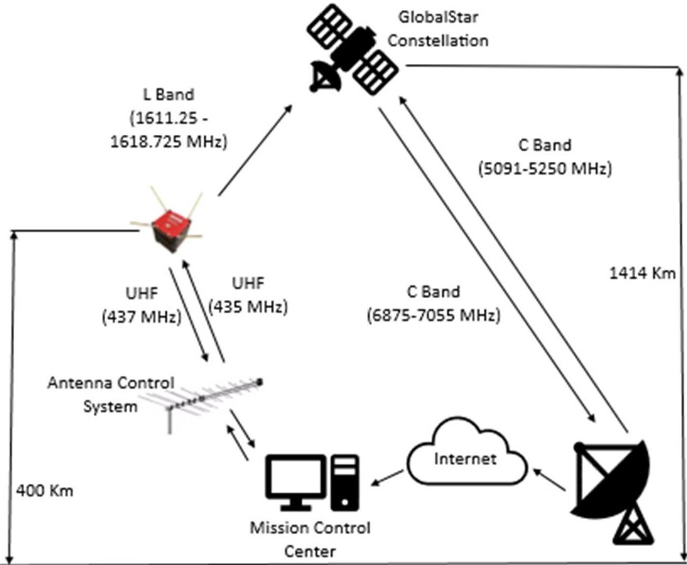

Figure 1. AztechSat-1 mission operation diagram.

AztechSat-1 consists of a single 1U CubeSat. The main component of the AztechSat-1 is the payload, which is a standard CubeSat board used for intersatellite communication. The payload is a circuit board designed by UPAEP which works as the core of the spacecraft by sending data from the nanosatellite to the GlobalStar LEO constellation, thereby enabling and demonstrating intersatellite communication. This satellite is also equipped with a communication board to allow Earth-to-satellite communication.

The nanosatellite will also offer ground-to-satellite communication as a backup and is intended to be the trigger for the aerospace industry in the region. Some efforts have already been made to provide low-cost ground stations for nanosatellite missions, such as the Canadian Advanced Nanospace eXperiment program (CanX), in which the University of Toronto demonstrated the feasibility of an affordable S-Band ultra-high frequency (UHF) ground station by utilizing a terminal node controller (TNC) based on a Gaussian Frequency Shift Keying (GFSK) modem and an ARM computer with a Linux kernel [15]. Nevertheless, AztechSat-1 involves an intersatellite communication approach backed up by a communication system between the ground station and the nanosatellite following a similar approach proposed by the University of Toronto.

NASA, AEM, and UPAEP collaborated on a project in which Mexican students could learn from experts throughout development from planning to mission operations. Some nanosatellite missions have already examined the constraints and impacts for CubeSats in low earth orbits, highlighting the design of the communication system [16]. Figure 2 shows the complete configuration details of the AztechSat-1 communication block. As illustrated, the nanosatellite possesses a backup system for its communications based on a standard communication system, through which it can receive commands and send telemetry. The nanosatellite computer can send information to the ground station through the communication module, after which the information is processed by a computer and can be analyzed by the user. In another possibility, the on-board computer of the nanosatellite sends information via the intersatellite module. In this scenario, the data are sent to the

<!-- PDF_PAGE: 5 -->

nearest satellite of the GlobalStar constellation. Then, the satellite redirects the information to the Earth gateways. Finally, the message goes through a simplex gateway connected to the Internet, and the user can access the information through any web browser. Importantly, the user must know the authentication credentials for this purpose.

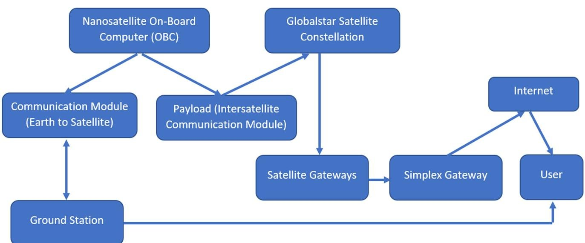

Figure 2. AztechSat-1 communication block diagram.

AztechSat-1 was intended to follow general guidance from NASA and AEM. The scope of this project included system engineering and project management performed by engineers from NASA [17,18]. AztechSat-1 is the first nanosatellite designed in a Mexican university by a group of professors and students with no previous field experience. A level of experience is needed, however, for projects implementing the Stage-Gate process. A classic Stage-Gate model is suitable for predictable contexts and an in-depth understanding of the requirements [19]. Therefore, the Stage-Gate process seems to be impractical for the AztechSat-1 project. Both students and professors from UPAEP had not previously implemented a similar case.

To begin with, State-Gate processes require different groups to work on different subsystems, but some prior experience is needed. At the beginning of the project, the AztechSat-1 team, like teams from many other universities, lacked necessary expertise, making it impossible to design, manufacture, integrate, and test all components. Despite being an educational project, AztechSat-1 focused on the scientific and technological goal of providing both satellite and intersatellite communications.

## 2.1. Work Breakdown Structure (WBS)

This section describes details of the project structure of AztechSat-1 and lists an overview of each subsystem based on NASA's Procedural Requirements [20]:

01: Project Management: This task involves managing the planning, organization, coordination, analysis, control, and approvals of administrative operations to sustain the feasibility of the project. The subsystem works as an agent to review and prepare documentation and also controls facilities that do not belong to the project. This stage excludes technical planning.

02: System Engineering: This task involves handling and managing all technical aspects of the project. This subsystem oversees defining the space vehicle; the ground system; and all design, software, manufacturing, system architecture, testing, and planning. This subsystem's team also works as an agent to review and prepare documents focused on engineering tasks such the master plan for verification and validation (V&V) and the Interface Control Document (ICD).

03: Safety and Assurance: All safety and assurance efforts are controlled by this subsystem. This subsystem's team focuses on failure criteria aimed at ensuring that the spacecraft,

<!-- PDF_PAGE: 6 -->

ground system, payload, and mission operations meet the necessary requirements. This subsystem does not support suppliers or subcontractors.

04: Science and Technology: This subsystem includes the management and control of scientific research. Specific responsibilities include defining science requirements and providing algorithms for data processing and analysis. The payload is not considered in this element.

05: Payload: The main mission of this subsystem is to design and implement the hardware and software payload of the mission and includes the experimental functions of data collection on board as well as the demonstration of intersatellite communication technology for the mission.

06: Spacecraft: The attitude determination and control subsystem (ADCS) and Mechanical Structure, Power Electronics, Flight Software, and Thermal Control subsystems are all included in this block.

07: Mission Operation: The implementation of human resources, procedures, and training necessary to carry out the mission operation is managed by this block. This element includes tracking, reception, telemetry, and system state analysis of the mission.

08: Launch Vehicle: Analysis of the launch vehicle is included in this block. All activities related to the launch operation, service, vehicle, and associated ground teams are controlled by this subsystem.

09: Ground Segment: The installation, implementation, and control of the ground facilities to send and receive data through the satellite to the Earth station communication system are controlled by this subsystem. This subsystem includes all design, development, assembly, and testing necessary for the ground support equipment to deliver full system integration with the spacecraft.

10: Integration and Testing: The Integration and Testing team is responsible for understanding each system on the space vehicle (AztechSat-1) and how it is interconnected with every subsystem. This team must have full knowledge of the satellite to understand its design, schematics, operations, manufacturing, testing, and flight. The goal of the team is to ensure that the AztechSat-1 cargo interfaces successfully with the destination (space station) and, thus, ensure the success of the mission. This subsystem also handles the hardware, software, procedures, and facilities of the project required to perform integration and testing of the systems.

11: Education and Divulgation: All educational and divulgation information is managed by this team. This block also includes marketing, media support, and public web pages.

## 2.2. Gates of the Project

The development of AztechSat-1 began on May 2017, when the official kickoff took place. During this month, the mentoring team from NASA validated the first stage of the project. The AztechSat-1 project followed the recommended best practices for success. During the project, AztechSat-1 passed through six important gates at NASA and two internal gates, summarized in the following:

Mission Concept Review/System Requirements Review (MCR/SRR): This was the first gate of the project after the kickoff meeting. In this stage, a review was carried out by NASA to ensure that the system requirements were identified. At this point, the concept had been properly established as a requirement by the stakeholders, and the construction of the clean room was completed. The mission requirements were established, and the proposed objectives were defined. Even though this stage presented two reviews, both were held at the same time given the nature of the project.

Preliminary Design Review (PDR): The second gate of the project was to build a prototype for the module to enable intersatellite communication. A technical review by NASA was also completed successfully, and all technical subsystems were able to demonstrate a good understanding of the project. The first engineering model with no spatial capacities was presented. From this point, verification testing was conducted.

<!-- PDF_PAGE: 7 -->

Critical Design Review (CDR): The second gate was split to demonstrate the maturity of the project. The second part of the second stage was also evaluated by NASA, and the engineering unit for the nanosatellite was built. Intersatellite communication and ground-to-satellite communication were successfully proven. A technical review ensured that most of the AztechSAT-1 subsystems could proceed. However, three subsystems were given the task of improving the performance in order to pass the review.

Delta Critical Design Review (Delta CDR): The Integration and Testing team was re-evaluated, and then the project was able to proceed as defined with minimal changes; this stage mostly focused on the sequence of testing.

System Integration Review (SIR): The success of the system integration review ensured that all elements of the project such as modules, components, subsystems, and the system were integrated. It identified facilities, planning for integration, documented procedures, and external support as needed. After the third gate of the project was successfully completed and the nanosatellite was fully assembled, validation testing began.

Flight Readiness Review (FRR): This gate validated the readiness to initiate and conduct the flight. In this stage, the nanosatellite was tested at the NASA Ames Research Center, and all previously conducted environmental testing was approved.

Post-Launch Review: Students and professors presented a review that evaluated the status of the on-board system. The Mission Operation team assumed the main role from this point onward.

Results: In the final stage of the project, results and learned lessons were documented for future projects.

## 2.3. Agile Stage-Gate Methodology

As noted, many industries employ traditional Stage-Gate approaches. The development of the AztechSat-1 nanosatellite using the proposed model combines Agile ideologies, such as using one room and daily meetings, with stages that provide a guide for the recommended activities. Iterations enable feedback and give opportunities to review and plan new perspectives. The AztechSat-1 Agile Stage-Gate model is shown in Figure 3.

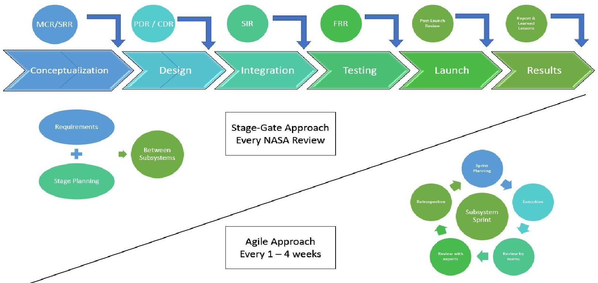

Figure 3. AztechSat-1 Agile Stage-Gate hybrid model.

The AztechSat-1 process started with a small task force composed of professors and a medium task force of students from different backgrounds involved in product design and process development. The team also employed external experts (NASA and AEM

<!-- PDF_PAGE: 8 -->

engineers). From the beginning, while working on the Agile method, all members of the team dissected the existing stages. The first step was to streamline the process. To make the requirements less troublesome, UPAEP organized different teams for each subsystem; then, a training program was created for participants interested in working on the project with the goal of evaluating their skills and reducing cycle time before moving to the hybrid model. In each phase of the Stage-Gate method, project leaders determined where Agile would work. A pilot test for planning and working on the model was established with some members of the project. After the results of this pilot test were confirmed, the whole project was moved to work on this project. Before this project, the AztechSat-1 team had no previous experience, so everyone learned how to proceed during the course of the work. The learning process at some points seemed to be impeded, producing a sense of frustration. However, external coaching was efficient and, as a result, coaching and open dialogue became the de facto standard.

AztechSat-1's design, integration, and testing went through an iterative and recursive process. The advantage of following a cycle in each of the stages allowed the team to detect as many failures and errors as possible in the early stages so that changes could be solved, starting from the most basic level with the lowest impact.

The Agile Stage-Gate hybrid model focuses on customer requirements or needs and incorporates sprints from other methodologies. Sprints are held in short time intervals (AztechSat-1 project sprints were executed every one to four weeks).

For our grounded theory, the case study method was chosen because it allowed respondents to describe their perspectives with flexibility. Three levels were leveraged: identification of concepts, iterative analysis and testing, and integration for validation and verification.

Figure 4 illustrates the iterative and recursive strategy for the conceptualization, design integration, testing, and transition (post-launch events) of the AztechSat-1 nanosatellite adapted from Wells [21]. Figure 3 highlights the importance of having a heartbeat for the project. Such a heartbeat requires inputs like those in any other system in which unfinished features or feedback need to be implemented or finished. Most of the aerospace project will present numerous features, but only the most important features need to be considered. Once activities have been determined, daily iterations though planning and improvements will consistently improve. Team empowerment and post-sprint reviews create a responsive heartbeat. This framework needs to be implemented in every stage of the project.

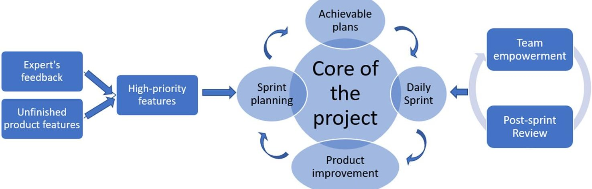

Figure 4. Framework of the AztechSat-1 Agile Stage-Gate hybrid model adapted from Wells.

The methodology for the Agile development of space hardware and corresponding opportunities have also been identified in the development processes of nanosatellites. Preliminary results have indicated this method's effectiveness, but none of these previous studies presented a hybrid proposal [22].

This hybrid model allows the Stage-Gate process to be integrated with the Agile methodology. Some of the biggest benefits of this model are its speed of product release,

<!-- PDF_PAGE: 9 -->

better responses to changes, and improved team communication compared to the traditional approach. One of the disadvantages of this model is its increase in collaborative risks.

## 2.4. Conceptualization and Design

In product realization, conceptualization allowed the team to extract all performance and mission requirements. Before reaching the first gate, the project had completed the following actions: Project Execution Plan, System Goals, System Model, Communication Diagrams, Verification Requirements, and Validation Requirements.

The majority of CubeSats rely on commercial off-the-shelf (COTS) components to meet the required criteria. AztechSat-1 integrates both COTS and self-developed modules.

Subsequently, all requirements were defined through Agile methods inside a Stage-Gate model. The success criteria could be rearranged by the team, if necessary, to avoid losses. For the quick development of the AztechSat-1 project, rapid prototyping was also considered as a medium to visualize the results from an initial perspective. Figure 5 shows the design obtained from rapid sprint meetings during the project's early stages.

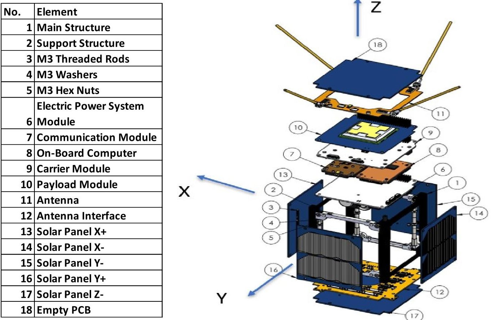

Figure 5. AztechSat-1 design obtained from sprints.

The design process for AztechSat-1 began by defining requirements, as also performed in the traditional approach. Every meeting, each subsystem leader outlined the relevant requirements, advances, and improvements. Some teams developed 3D prototypes to quickly visualize the dimensions, shapes, and methods of integration. All spacecraft and payload modules were printed, starting from the beginning of the project based on a preliminary concept. Because some modules belonged to the COTS category, it was easier to identify mechanical interference. A weekly schedule was established to offer continuous feedback and proposals for improvement. At the end of the design process, all COTS and self-developed modules were already identified. The decisions made during the design process remained for the entirety of the project with only slight variations in the structure selected from a small satellite manufacturer. The following different models were prototyped: a CubeSat Structure, a module for both communications and the on-board computer, an EPS board, a total of five solar panels, and some empty modules. Decisions were based on the perspectives of experts and research proposals. In addition, 3D printing

<!-- PDF_PAGE: 10 -->

was advantageous for engineering and other purposes [23]. The AztechSat-1 printed model is visualized in Figure 6.

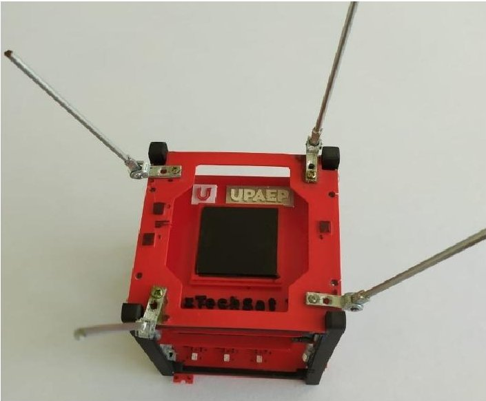

Figure 6. 3D printed version of AztechSat-1.

FlatSat testing: From the beginning, the AztechSat-1 team sought to mitigate risks by implementing COTS components. However, given their requirements and innovations, core mission modules were designed completely by the team. To test the self-developed subsystems, a FlatSat model was implemented. A FlatSat unit was used to reduce time and allow students to test their capabilities and training. Before wiring and assembling the modules, all participants from the AztechSat-1 team dealing with technical responsibilities were trained using empty modules in which only connectors were assembled. Verification tests were carried out to achieve communications between the intersatellite communication module and the communication module. The Agile Stage-Gate methodology was integrated into the FlatSat testing methodology so that all teams were notified of success or failure in the development of the core modules as soon as possible. AztechSat-1's mission is to allow intersatellite communication between a nanosatellite and a satellite constellation; therefore, most of the prototyping and testing relied on communication. Figure 7 highlights the implementation and use of the FlatSat unit.

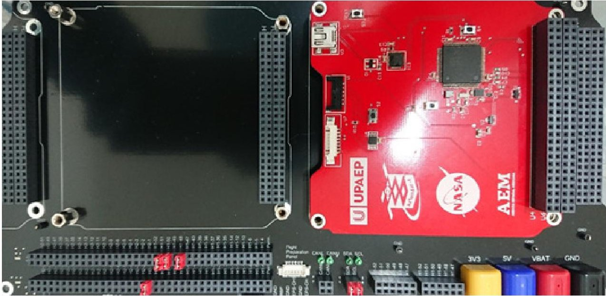

Figure 7. AztechSat-1 FlatSat.

FlatSat testing resulted in the verification of data packet transmissions from different sizes for both intersatellite and satellite communications as well as testing of the temperature, sun, and magnetic sensors; reports on housekeeping information; and communication

<!-- PDF_PAGE: 11 -->

between different modules. AztechSat-1 integrated magnetorquer actuators to work as the attitude determination and control subsystem. These actuators are activated by sending $ \mathrm{I}^{2} \mathrm{C} $ signals, which must be synchronized to avoid interfering with other subsystems, as these signals represent the default protocol for internal communication. Serial communication was also tested for monitoring variables because it is the default protocol of communication for the payload module.

The FlatSat used in the project can integrate three systems at the same time and allows subsystems to be easily assembled and disassembled when necessary. The FlatSat uses the PC/104 standard as a connector for the nanosatellite bus and complies with the IPC-A-610 electronic assembly acceptance standard. The system uses banana plugs for external power and Molex PicoBlade connectors for I2C digital communication.

To assess each subsystem board, tests were performed using the FlatSat. However, each board included a Molex PicoBlade UART connector to allow the console to interface with a PC for testing and control.

## 2.5. Integration and Testing Flow and Procedure

NASA's Launch Services Program features payloads with different launch providers. Each launch is named an ELaNa mission (Educational Launch of Nanosatellites) and is assigned a number. Since launch vehicle capabilities commonly exceed customer requirements, there is often space to fit a secondary payload. NASA's CubeSat Launch Initiative provides rides to CubeSats as a secondary payload to schools and non-profit organizations. These secondary payloads can either be released from the launch vehicle or deployed from the ISS. The ISS provides options for deploying nanosatellites. Usually, satellites are launched from below the station to avoid contact and potential risks. AztechSat-1 was sent as a secondary payload for a resupply mission to the International Space Station aboard a SpaceX Dragon capsule atop a Falcon 9 rocket.

For a CubeSat as a secondary payload, the main purpose is to verify that the nanosatellite will not break apart or produce debris, which may damage the primary payload. After successfully completing the first two stages of the project (conceptualization and design), the team decided in a weekly sprint meeting to implement a system tool for satellite projects. After an iterative, recursive, and Agile process involving experts and members from the different teams, a testing and integration flow diagram was chosen as the best system tool [24].

Figure 8 gives a general picture of the AztechSat-1 verification and validation diagram. In this diagram, it is possible to visualize the flow of the testing and integration process.

At the beginning, both self-developed modules (payload) and COTS modules were tested at the university to guarantee their functionality. Secondly, integration was carried out at UPAEP, which was well documented. Thirdly, the integrated nanosatellite was sent to NASA's Ames Research Center where environmental tests were conducted in the following order: functional test, sine test, functional test, random test, functional test, post-sine test, functional test, centrifugal test, functional test, and thermal vacuum power management test. Lastly, one final functional test was conducted, and the satellite was sent to the launcher site.

The integration and testing procedure started with the testing of each module separately using a FlatSat unit. Each board was mounted independently. After verification of successful performance, different modules were combined to probe communications until the full system was verified. The AztechSat-1 was then assembled, integrated, and tested based on a modified version of the 2-Model Philosophy by building a FlatSat/engineering model and a flight model [25]. The team also used a typical standard CubeSat build approach, which involved building a FlatSat, an engineering unit, and a flight model. The AztechSat-1 builds were registered as shown in Table 2. The differences between approaches involved building a FlatSat unit, an engineering unit, and two flight models to reduce failure.

<!-- PDF_PAGE: 12 -->

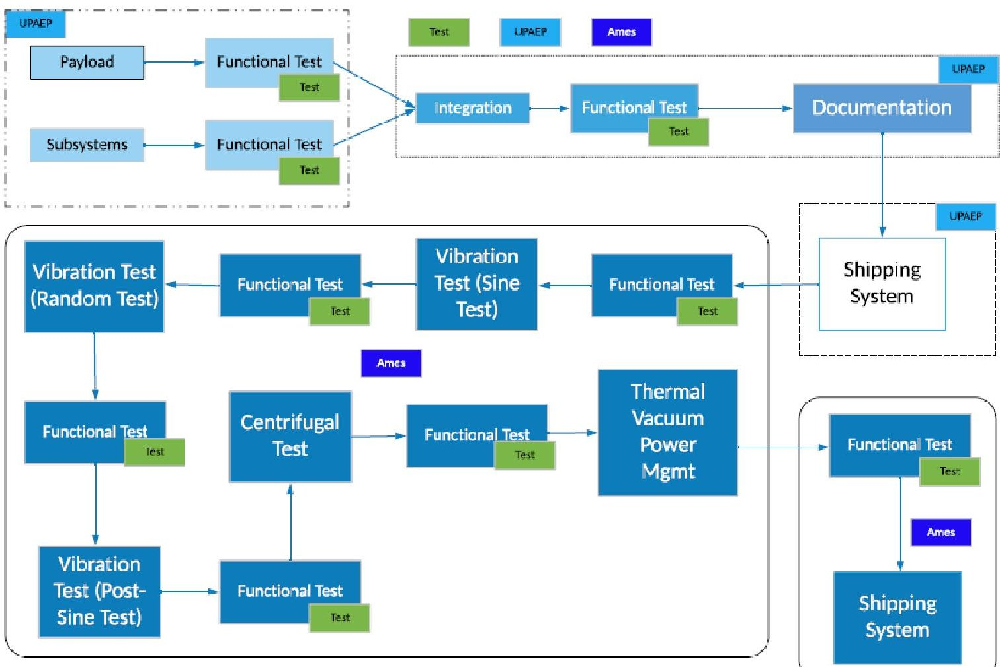

Figure 8. Testing and integration flow diagram.

Table 2. AztechSat-1 builds.

<table border="1"><tr><td>Unit</td><td>Description</td><td>Quantity</td></tr><tr><td>FlatSat</td><td>This unit is for testing the subsystems and payload independently at UPAEP. All software builds are tested with this unit.</td><td>1</td></tr><tr><td>Engineering Model</td><td>This unit is for integration testing for both the subsystems and the payload at UPAEP. All integration software builds are tested with this unit.</td><td>1</td></tr><tr><td>Flight</td><td>There are two flight units, and each one has a payload and a bus. One is the flight-ready unit and the other is for backup. The first unit is tested under real space conditions and the other is intended to be used in case of any failure.</td><td>2</td></tr></table>

The AztechSat-1 project followed the building, testing, and repairing philosophy for critical components [26]. The procedure for integrating the AztechSat-1 nanosatellite aimed at guaranteeing the connections of the interfaces between the different components to ensure the correct operation of the subsystems at the general system level.

## 2.6. Integration Development Process

The integration procedure introduced the principles of Agile project management into the Stage-Gate approach to handle challenges with change. The hybrid model provides a framework to respond to uncertainties and accelerate the process through different iterations. Ultimately, integration and user iteration feedback product processes were released. This method provided incremental success in the development of the project. The idea of interaction among team members and experts in the early stages yielded

<!-- PDF_PAGE: 13 -->

improvements for the new product. Although the integration stage was the first to deploy a working method, the new hybrid method can be used in all stages from conceptualization to launch.

The benefits of combining Agile and Stage-Gate approaches for integration planning can be summarized as follows:

- Verification of integration conditions;

- Visual inspection of the components;

- Interface verification;

- Mechanical-electrical integration;

- Integration and functionality tests;

- External integration elements;

- Full system test.

## 2.7. Testing Development Process

In the software industry, Agile testing is an integral part of product development because developers write integration tests after unit tests. In the development of physical products, the various testing activities are categorized as verification and validation processes.

The testing development process is a feature and well-known identifier of Agile development. In this paper, we highlighted the contribution of validation testing in the Agile development of a nanosatellite within a gate.

The satellite was tested using a thermal vacuum test and a vibration test. Acceptance tests are conducted to demonstrate the acceptability of an item for flight. Acceptance tests measure performance parameters and reveal inadequacies in manufacturing processes such as workmanship or material. Such tests also demonstrate acceptable performance over the specified range of mission requirements [27]. Due to the nature of the system, all validation tests were performed using a serial monitor assessment.

Vibration test: This test is intended for spacecraft with low-to-moderate weight and size. For small payloads, the test should cover the full 20-2000 Hz frequency range for random vibrations [28]. If a random vibration test is appropriate, then the project should obtain the spacecraft's random vibration environment from the launch provider. Random vibrations require that the nanosatellite complies with random acceleration levels. Lowfrequency transient vibrations occur during the launch, and random vibrations under 2000 Hz appear due to the environment. The requirements for power spectral density (PSD) are given in Table 3. The PSD is expressed in $ \mathrm{g}^{2} $ per Hertz. A random test is defined for each axis. The payload in its launch configuration is attached to a vibration fixture using a flighttype launch vehicle adapter (Nanoracks CubeSat Deployer) and attachment hardware. Vibrations are applied to the base of the adapter in each of the three orthogonal axes, one of which is parallel to the thrust axis. The main goal of this test in the spacecraft is to verify the craft's ability to survive the lift-off environment and to provide a final workmanship vibration test. For AztechSat-1, vibration testing used the SpaceX launch vehicle profiles. AztechSat-1 passed the test and survived the environment in the launch vehicle.

Thermal vacuum test: According to NASA standards, an appropriate set of tests and analyses must be selected to demonstrate the spacecraft's capabilities by emulating a space environment using laboratory equipment. The spacecraft must perform satisfactorily within the vacuum and thermal mission limits defined by its final orbit. AztechSat-1 is intended for LEO, with expected temperatures from $ - 2 0 $ to $ 6 0 $ $ ^{\circ} \mathrm{C} $ [27]. However, the AztechSAt-1 thermal vacuum test was conducted in the range of $ - 1 5 $ to $ 6 0 $ $ ^{\circ} \mathrm{C} $ due to the small size of the satellite [29]. During the test, the thermal design and thermal control system must maintain the affected hardware within the established thermal limits of the mission throughout the planned mission phases. The purpose of thermal vacuum testing is to detect defects in materials, processes, and workmanship by subjecting the unit under testing to thermal cycling in a vacuum environment. Both stabilized and transitional conditions were produced; these conditions induce stresses intended to uncover incipient problems. Thermal vacuum testing of the hardware should be conducted after dynamic

<!-- PDF_PAGE: 14 -->

testing is completed. This process helps to ensure that incipient failures induced by transient dynamic tests are discovered during later test phases. In our project, a thermal limit test was conducted to assess the battery, payload, and mission life. The test consisted of cycling the flight system in the thermal chamber at temperatures of $ - 1 5 $ to $ 6 0 \mathrm{~}^\circ \mathrm{C} $

Table 3. AztechSat-1 random vibration profile.

<table border="1"><tr><td rowspan="2">Axis</td><td colspan="2">Frequency and Levels</td></tr><tr><td colspan="2">Random Vibration Test(20-2000Hz)</td></tr><tr><td rowspan="4">X</td><td>20-50Hz</td><td>4.000×10-2g2/Hz</td></tr><tr><td>63Hz</td><td>4.490×10-2g2/Hz</td></tr><tr><td>80Hz</td><td>5.062×10-2g2/Hz</td></tr><tr><td>100Hz</td><td>5.660×10-2g2/Hz</td></tr><tr><td rowspan="8">Y</td><td>125-200Hz</td><td>6.200×10-2g2/Hz</td></tr><tr><td>250Hz</td><td>5.558×10-2g2/Hz</td></tr><tr><td>315Hz</td><td>4.102×10-2g2/Hz</td></tr><tr><td>400Hz</td><td>2.998×10-2g2/Hz</td></tr><tr><td>500Hz</td><td>2.230×10-2g2/Hz</td></tr><tr><td>630Hz</td><td>1.651×10-2g2/Hz</td></tr><tr><td>800Hz</td><td>1.206×10-2g2/Hz</td></tr><tr><td rowspan="4">Z</td><td>1000Hz</td><td>9.000×10-3g2/Hz</td></tr><tr><td>1250Hz</td><td>6.034×10-3g2/Hz</td></tr><tr><td>1600Hz</td><td>3.870×10-3g2/Hz</td></tr><tr><td>2000Hz</td><td>2.600×10-3g2/Hz</td></tr><tr><td></td><td colspan="2">Overall:5.76g rmsDuration:60s/axis</td></tr></table>

AztechSat-1 was placed in the vacuum chamber and decreased to a hard vacuum (a least $ 3\times1 0^{-4} $ Torr). Temperature sensors were used for control and monitoring, as described in Figure 9. Table 4 outlines the positions of the sensors.

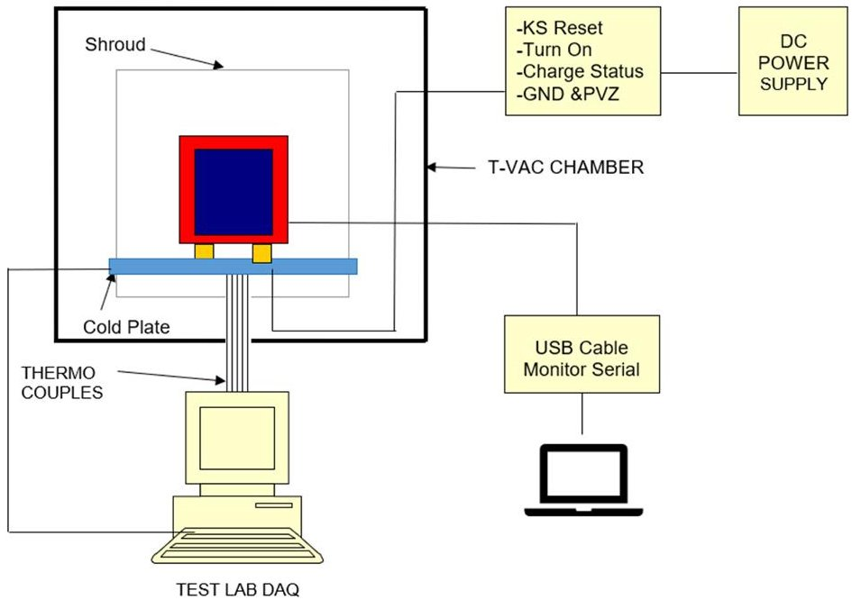

Figure 9. Temperature data acquisition system for AztechSat-1.

<!-- PDF_PAGE: 15 -->

Table 4. Temperature sensor and position for thermal testing.

<table border="1"><tr><td>No.</td><td>Sensor</td><td>Location</td></tr><tr><td>1</td><td>Thermocouple1</td><td>Plate</td></tr><tr><td>2</td><td>Thermocouple2</td><td>Side wall</td></tr><tr><td>3</td><td>Thermocouple3</td><td>Shroud top</td></tr><tr><td>4</td><td>Thermocouple4</td><td>AztechSat-1 satellite, external(Z-Solar panel)</td></tr><tr><td>5</td><td>Thermocouple5</td><td>AztechSat-1 satellite, external(X+Structure Rail down)</td></tr><tr><td>6</td><td>Thermocouple6</td><td>AztechSat-1 satellite, external(Y+Solar panel)</td></tr><tr><td>7</td><td>Thermocouple7</td><td>AztechSat-1 satellite, external(Y-Solar panel)</td></tr><tr><td>8</td><td>Thermocouple8</td><td>AztechSat-1 satellite, external(X-Structure Rail up)</td></tr><tr><td>9</td><td>Thermocouple9</td><td>AztechSat-1 satellite, internal(Z+intersatellite module)</td></tr></table>

Once in a vacuum, the cryo-stasis chamber was cycled down to $ - 1 5 $ degrees and held for 270 min. Then, the chamber was cycled up to 60 degrees and held for the same 270 min. We then repeated the cycle one more time. A functional check was completed after all runs to ensure satellite functionality. Detailed information on the programmed steps and profiles of the thermal vacuum test is provided in Figure 10.

<table border="1"><tr><td>Step</td><td>Function</td><td>Value</td><td>Temp(C°)</td><td>Description</td></tr><tr><td>1</td><td>Time</td><td>1min</td><td>20</td><td>Start Point</td></tr><tr><td>2</td><td>Time</td><td>30min</td><td>-15</td><td>Transition Cold</td></tr><tr><td>3</td><td>Time</td><td>270min</td><td>-15</td><td>Cold Dwell</td></tr><tr><td>4</td><td>Time</td><td>60min</td><td>60</td><td>Transition Hot</td></tr><tr><td>5</td><td>Time</td><td>270min</td><td>60</td><td>Hot Dwell</td></tr><tr><td>6</td><td>Time</td><td>30min</td><td>20</td><td>Transition to start point</td></tr><tr><td rowspan="2">7</td><td>Jump Loop</td><td>2</td><td>N/A</td><td>Repeat steps2-6</td></tr><tr><td>Jump Cycle</td><td>1</td><td>N/A</td><td>Repeat one time</td></tr><tr><td>8</td><td>Time</td><td>60min</td><td>20</td><td>Stabilize at ambient</td></tr><tr><td>9</td><td>End</td><td></td><td></td><td></td></tr></table>

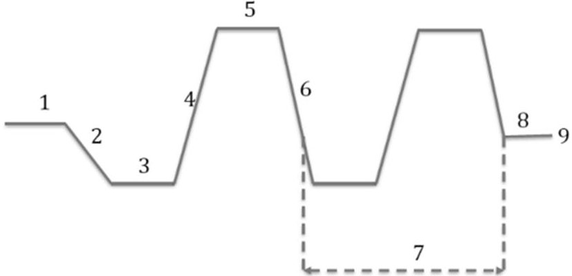

Figure 10. Visual timeline of TVPM temperature profile.

## 3. Results

## 3.1. Environmental Tests

Testing activities were broken down into categories according to our integration and testing flow diagram. The environmental tests enabled us to determine a solution linking validation testing with success using an Agile Stage-Gate approach for a nanosatellite in a real environment. This study shows that the time spent in design, including prototyping and early testing, is linked to a higher probability of success.

The vibration test consisted of three phases. In the first phase, the spacecraft (off) was placed on a transverse axis to the vibration table within the storage configuration launch vehicle adapter, and a sine sweep was performed to obtain a baseline of the system on that axis (Figure 11). Figure 11 illustrates the results of the test on a logarithmic scale where the

<!-- PDF_PAGE: 16 -->

x axis indicates the frequency in Hertz, and the y axis indicates acceleration in g for each axis of the nanosatellite.

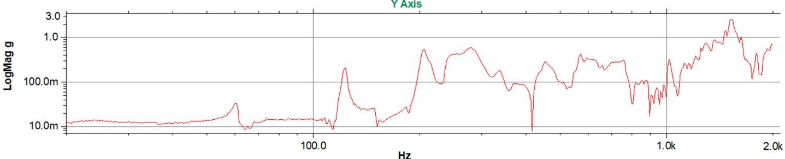

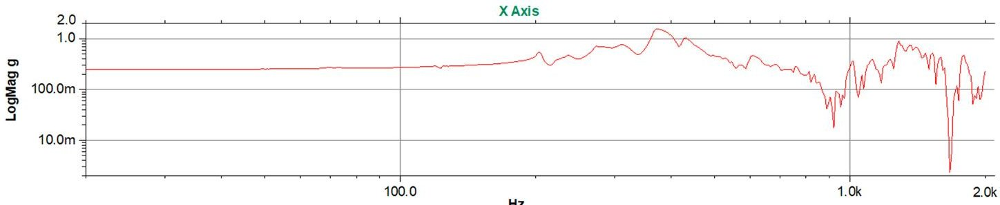

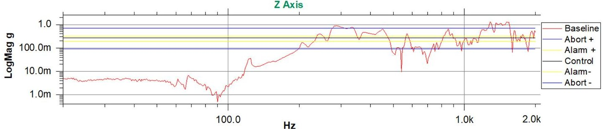

Figure 11. Sine sweep vibration test (baseline).

In the second phase, random vibrations were executed with the values provided by the launcher in the same axis as before (Figure 12). Finally, a sine sweep was again performed (Figure 13) and compared with the first sweep to note differences. As we did not observe any substantial differences, a functional check was completed after all runs to ensure satellite functionality before delivery to the launch provider. For this purpose, a test pod was used to simulate the conditions of the nanosatellite during launch. The test was performed at the Ames Research Center. The vibration setup is shown in Figure 14. For the y and x axes, the nanosatellite was rotated 90 degrees. For the Z axis, the nanosatellite was removed completely from the system and then mounted in the desired position. Figures 10 and 12 indicate a difference of less than 1% compared to the control line on the Z axis.

Figure 12 illustrates the PSD vibration of the entire system. A very common method used to indicate problems during random vibrations involves utilizing the PSD. The method used to evaluate acceleration, which changes constantly, involves comparing the average values. The root mean square value, or Grms, must remain similar. Here, frequencies below 200 Hz were attributed to the vibrations of the table setup. Figure 12 denotes the responses for only one axis. However, all tests yielded results within the necessary range. The yellow lines indicate alarm parameters, and the red lines indicate abort parameters.

A post-sine vibration test was performed to confirm the absence of resonance frequencies in the test range. No acceleration peaks were observed, and there was no damage on the nanosatellite after the test.

As the AztechSat-1 nanosatellite was deployed from the ISS, the path of the ISS was considered for thermal parameters. For thermal testing, a vacuum chamber was needed. The equipment used for this test belonged to the NASA Ames Research Center. The thermal environment's testing conditions did not yield any complications for the system's operations. A cold/hot cycle was completed with no damage to the system. The results are

<!-- PDF_PAGE: 17 -->

shown in Figure 15. In the thermal test, the satellite was functional for the whole period, and the obtained data indicated that the nanosatellite was ready to fly. The results were proven using an actual satellite operating in orbit. All self-developed modules from the nanosatellite and all COTS components were reported to be in good condition after testing. The sensors' responses shown in Figure 15 illustrate the experimental cycles within the range of temperatures. Figure 16 illustrates the thermal vacuum test setup. At the bottom of Figure 15, it is possible to identify the color of each sensor by assigning a number related to the position of the thermocouples given in Table 4. Temperatures are considered accurate within +/ -2 degree Celsius.

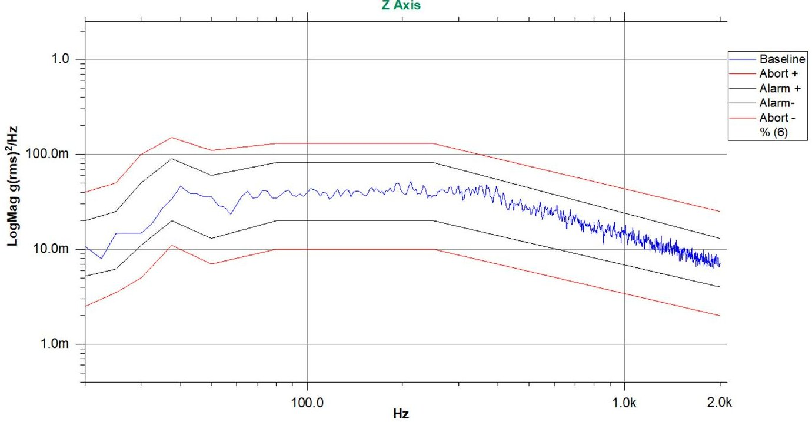

Figure 12. Random vibration test (PSD response for the Z axis).

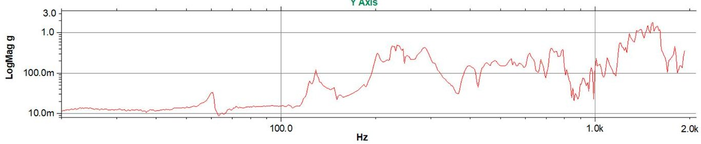

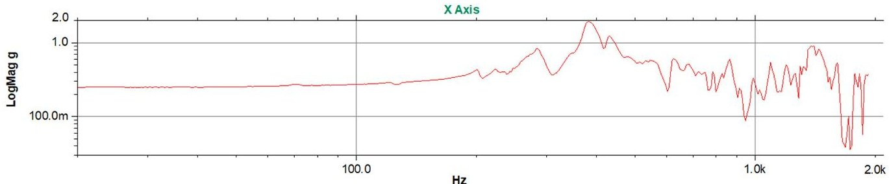

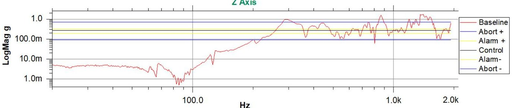

Figure 13. Sine sweep vibration test after the random vibration test.

<!-- PDF_PAGE: 18 -->

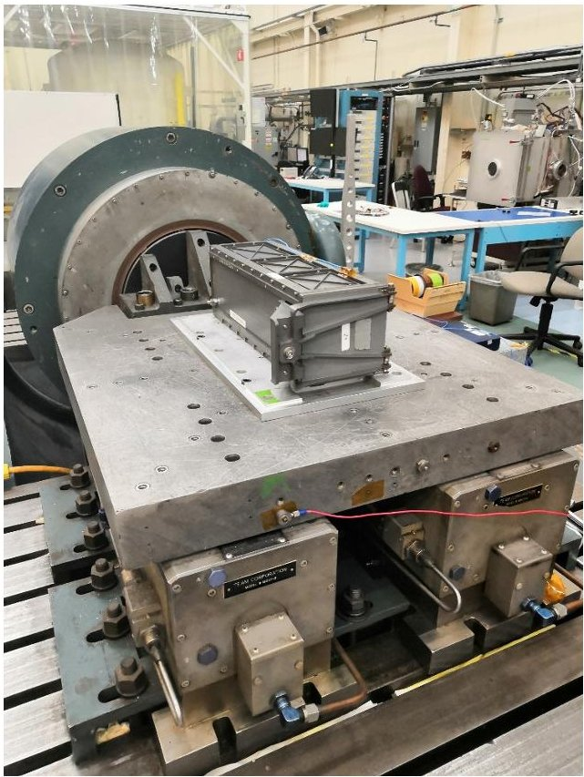

Figure 14. Vibration test setup.

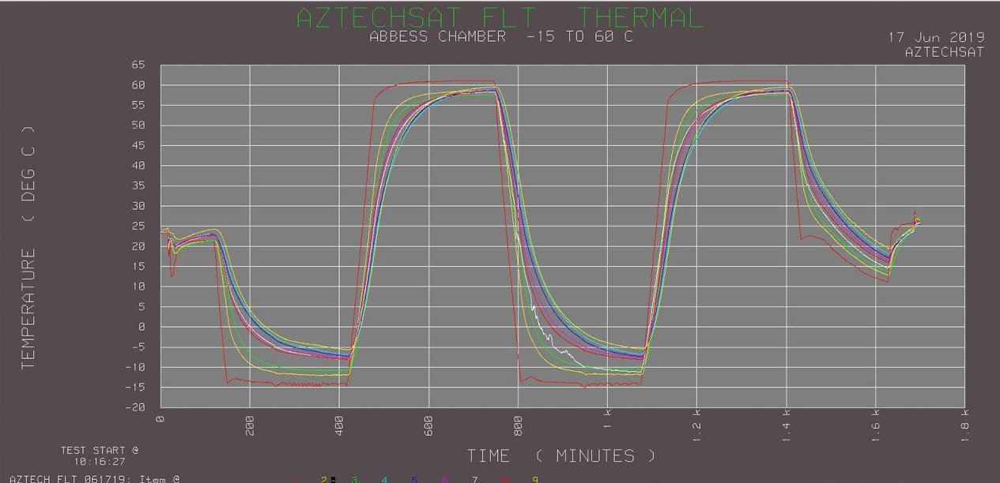

Figure 15. Temperature profiles of AztechSat-1.

It is critical for nanosatellite missions deployed from the Nanoracks CubeSat Deployer located on the International Space Station that the chosen materials do not pose a threat to the lives of astronauts because accumulated gases can exceed safety limits and create a poisonous environment.

A thermal vacuum bakeout test can be performed to remove these contaminants and thereby ensure proper functioning of sensitive hardware before flight. Nanoracks recommends considering two basic properties of outgassing: Total Mass Loss (TML) and Collected Volatile Condensable Material (CVCM). According to data from the NASA/Goddard Space Flight Center (GSFC), which uses the ASTM E-1559 standard, a TML $ \leq $ 1% and CVCM $ \leq $ 0.1% were selected as materials for space flight use.

<!-- PDF_PAGE: 19 -->

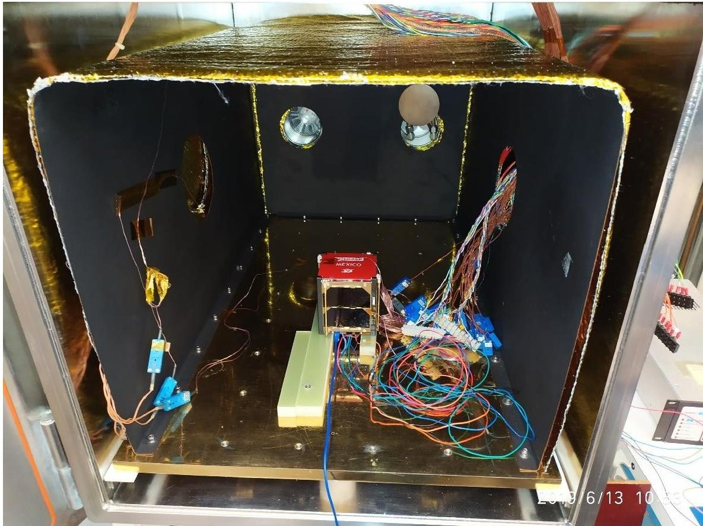

Figure 16. Thermal vacuum test setup.

The AztechSat-1 nanosatellite used compliant materials for outgassing and COTS components qualified to fly with a minimum verifiable flight history. The printed circuit boards (PCBs) were manufactured with layers of glass-reinforced epoxy laminate material (FR4) and copper coated with space-proof conformal coating. The solder used a 95Sn-5Ag silver alloy or a soft solder with a lead content of less than 36% (Sn62Pb36Ag2). The wire insulators and external electric harnesses used polytetrafluoroethylene (PTFE). A 2-mil polyimide tape with low-outgassing acrylic adhesive was also used. No outgassing measurements were performed during the TVAC tests.

Notably, scalability in manufacturing was not considered when linking testing in our process development.

## 3.2. Agile Stage-Gate Results

The Agile Stage-Gate methodology for the AztechSat-1 project worked for not only the technical development process but also for the conceptualization and design stages. The hybrid model was able to integrate the best of both the Agile and Stage-Gate systems and allowed us to handle changing requirements during the different stages of the project. Themes from an analysis of interviews allowed us to identify and support our theory regarding application of the Agile Stage-Gate methodology in physical product development. Figure 17 links the concepts to themes explaining the contributing mechanisms.

All team members participated from the beginning of the project, which yielded good results. Through training, it was possible to gather an excellent team. Dealing with innovative projects always entails uncertainty. However, assessing and validating stages through gates—as in the traditional model—supported by an Agile methodology was found to be an efficient technique for managing product development.

The applied methodology allowed us to adapt to, respond to, and learn from changing situations within certain restrictions. Gates played an important role in the project because experts could review the project from strategic points, which eliminated project weaknesses and optimized human resources and materials. The sprint iteration during each stage of the project inspired early testing for self-developed modules. Through prototyping, the Agile Stage-Gate methodology became more adaptive.

<!-- PDF_PAGE: 20 -->

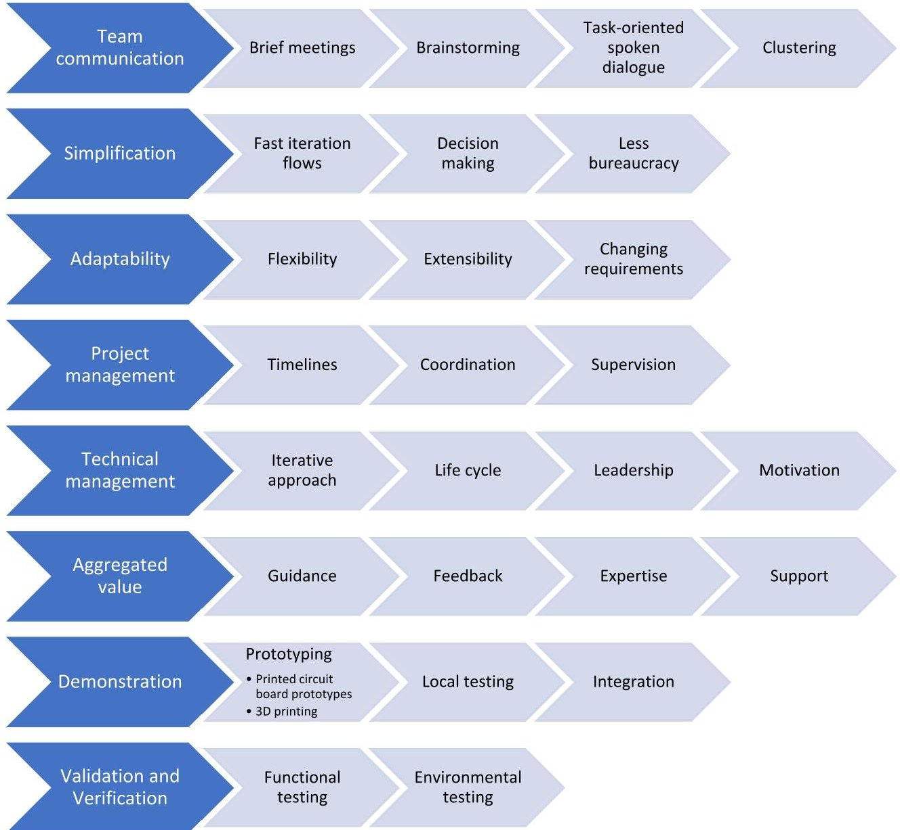

Figure 17. Overview of themes.

## 3.3. Challenges in Implementing Agile Stage-Gate Methodology

By introducing the Agile methodology in a Stage-Gate approach, there is a considerable increase in interactions between stakeholders, which consequently leads to risks.

During execution of the project, NASA and AEM provided technical advice and closely supervised the UPAEP teams.

Despite the benefits of partnering, such as access to knowledge and people who are experts on a topic, this approach also has disadvantages due to loss of autonomy as well as possible negative impacts on reputation if a problem is not resolved.

Other problems identified were related to the difficulty in dedicating resources to the tasks obtained from innovative iterations. In the case of a university, and since AztechSat-1 is an academic project, there was no pre-existing Agile culture, leading to resistance in applying this methodology among members of the team. Holding sprint meetings was also a challenge.

Because a nanosatellite is a physical product, the development process is more complex as it requires more specialized infrastructure and material requirements than a software project.

On the other hand, subsystem leaders must provide information and explain what is planned to be accomplished. In addition, leaders must motivate staff and maintain harmony. Employing undergraduate students close to graduation as team members also carries risks, and measures must be taken to mitigate such problems.

<!-- PDF_PAGE: 21 -->

Finally, there are critical behaviors that must be considered to improve development time and innovation. For example, the exchange of information and coordination between teams are key factors for project success.

One of the main challenges is teams being dedicated to one project. However, when the team is reunited and face-to-face meetings are held, then improvements can be achieved through communication.

## 4. Discussion

Despite Agile representing a key revolutionary element in the software industry, hybrid models applying the Agile Stage-Gate methodology are only now becoming popular in different sectors. By mixing Agile and Stage-Gate systems, this model offers new possibilities to carry out complex projects by accelerating team-based collaboration and interactions. In this work, the design, integration, and testing approach of the first Mexican nanosatellite deployed from the ISS is described, including verification of the nanosatellite at a university and validation at NASA. The development process of a 1U CubeSat is proposed for a scientific and technological payload. The goal of this study was to design, build, verify, and validate a 1U CubeSat through testing. The results showed good satellite and intersatellite communication.

We agree that the Agile Stage-Gate approach improved both team communication and task prioritization. Even though an Agile culture was not previously implemented in our institution, there was no evidence of delays derived from resistance. Stakeholder approval was granted in each stage. Moreover, rapid sprints were adapted among teams, including design process and product tasks.

Quantitative metrics used in the project considered team velocity for burndown points lead time, cumulative flow diagrams, and resource allocation.

The first and most important aspect of the present work is the successful development of a final product by Mexican students following a hybrid approach based on the Agile Stage-Gate method as well as the correct process for integration and testing of a 1U CubeSat using the same approach. AztechSat-1 is working correctly as data can be sent and received. In addition, both vibration and thermal tests were carried out by experts from NASA.

AztechSat-1 was delivered and integrated into the Dragon capsule and was successfully sent into orbit, fulfilling its main mission objective by returning successful data from orbit within 40 min after deployment. AztechSat-1 is the first Mexican-designed and integrated nanosatellite deployed from the ISS.

The proposed design and the assembled system were verified and validated, ensuring that the CubeSat was ready to fly and fulfil all mission requirements.

Through this study, data were obtained for future projects, and the concept of intersatellite communication was proposed for the first time to improve communication between satellites by sharing Earth stations.

AztechSat-1 was launched aboard the 19th SpaceX Commercial Resupply Services contract mission for NASA on 5 December 2019 and delivered to the ISS. The satellite was deployed from the space station on 19 February 2020 [30], NORAD ID: 45261. One of the main challenges to overcome in the proposed model was finding human and material resources to support the hybrid methodology. Agile sprints and deliverables are difficult to realize, especially when all members are widely distributed; for example, many students and professors belonged to different departments.

Author Contributions: Writing-review and editing, E.R.G.-S.; supervision J.C.-L.; project administration H.S.V.-M.; methodology F.C.-G. and E.R.G.-S. All authors have read and agreed to the published version of the manuscript.

Funding: This study was mainly supported by a sectoral fund for Research, Technological Development, and Innovation in Space Activities AEM-CONACYT. Project number: 292767 under the title "Diseño y construcción del módulo de enlace intersatelital AztechSat-1—GlobalStar", a Council of Science and Technology of the State of Puebla (CONCYTEP) fund. Project number 08 Bis/2018 under

<!-- PDF_PAGE: 22 -->

the title "Diseño y construcción del Módulo de Enlace Intersatelital "AzTechSat-1"—GlobalStar", an internal budget from UPAEP, a non-profit university located in Puebla, Mexico, from 2017 to 2019, as part of a continuing education project for students from the Electronics department for CubeSat subsystem acquisition, development, and manufacturing.

Data Availability Statement: Publicly available datasets were analyzed in this study. This data can be found here: https://upaep.mx/aztechsat.

Acknowledgments: We appreciate the support from the National Council of Humanities Science and Technology in Mexico (CONAHCYT) for granting scholarships to students. The authors wish to acknowledge contributions from the AztechSat-1 team at UPAEP, particularly students belonging to the Faculty of Electronics and all professors who supported the project, as well as the Office of Academic Research at UPAEP. The authors also thank the support of the National Institute of Astrophysics, Optics, and Electronics (INAOE) and the Meritorious Autonomous University of Puebla (BUAP) for sponsoring verification tests throughout the project. A very special thank you to NASA for mentoring, validation testing, launching, and deployment of the nanosatellite from the ISS. The authors also wish to thank the reviewers for their comments, which led to the improvement of this article.

Conflicts of Interest: The authors declare no conflict of interest.

## References

1. Johnstone, A. Cubesat Design Specification Rev. 14; The CubeSat Program; Cal Poly: San Luis Obispo, CA, USA, 2020.

2. Zhang, J.; Cai, Y.; Xue, C.; Xue, Z.; Cai, H. LEO mega constellations: Review of development, impact, surveillance, and governance. Space Sci. Technol. 2022, 2022, 9865174. [CrossRef]

3. Puig-Sauri, J.; Twiggs, R.J. Cubesat Design Specifications Document: Revision IV; California Polytechnical State University: San Luis Obispo, CA, USA, 2001.

4. Da Silva, R.C.; Ishioka IS, K.; Cappelletti, C.; Battistini, S.; Borges, R.A. Helmholtz cage design and validation for nanosatellites HWIL testing. IEEE Trans. Aerosp. Electron. Syst. 2019, 55, 3050-3061. [CrossRef]

5. Curzi, G.; Modenini, D.; Tortora, P. Large constellations of small satellites: A survey of near future challenges and missions. Aerospace 2020, 7, 133. [CrossRef]

6. Azami, M.H.; Maeda, G.; Faure, P.; Yamauchi, T.; Kim, S.; Masui, H.; Cho, M. BIRDS-2: A Constellation of Joint Global Multi-Nation 1U CubeSats. J. Phys. Conf. Ser. 2019, 1152, 012008. [CrossRef]

7. Cooper, R.G. Winning at New Products: Creating Value through Innovation, 5th ed.; Basic Books: New York, NY, USA, 2017.

8. Johansson, C. Managing uncertainty and ambiguity in gates: Decision making in aerospace product development. Int. J. Innov. Technol. Manag. 2014, 11, 1450012. [CrossRef]

9. Stephen, O.; Oriaku, K. Software Development Methodologies: Agile Model Vs V-Model. Int. J. Eng. Tech. Res. 2014, 2, 108-113.

10. Cooper, R.G.; Sommer, A.F. Agile-Stage-Gate for Manufacturers: Changing the Way New Products Are Developed Integrating Agile project management methods into a Stage-Gate system offers both opportunities and challenges. Res.-Technol. Manag. 2018, 61, 17-26. [CrossRef]

11. Ampatzoglou, A.; Kostopoulos, V. Design, Analysis, Optimization, Manufacturing, and Testing of a 2U Cubesat. Int. J. Aerosp. Eng. 2018, 2018, 9724263. [CrossRef]

12. Monteiro, J.P.; Rocha, R.M.; Silva, A.; Afonso, R.; Ramos, N. Integration and Verification Approach of ISTSat-1 CubeSat. Aerospace 2019, 6, 131. [CrossRef]

13. González, F.A.D.; Cabrera, P.R.P.; Calderón, C.M.H. Design of a nanosatellite ground monitoring and control software-a case study. J. Aerosp. Technol. Manag. 2016, 8, 211-231. [CrossRef]

14. Kobayashi, M. Experience of infrastructure damage caused by the Great East Japan Earthquake and countermeasures against future disasters. IEEE Commun. Mag. 2014, 52, 23-29. [CrossRef]

15. Tuli, T.S.; Orr, N.G.; Zee, R.E. Low cost ground station design for nanosatellite missions. In Proceedings of the AMSAT Symposium, Toronto, ON, Canada, 2 October 2006.

16. Popescu, O.; Harris, J.S.; Popescu, D.C. Designing the communication sub-system for nanosatellite CubeSat missions: Operational and implementation perspectives. In Proceedings of the SoutheastCon, Norfolk, VA, USA, 30 March-3 April 2016; pp. 1-5.

17. Hirshorn, S.R.; Voss, L.D.; Bromley, L.K. Nasa Systems Engineering Handbook; NASA: Washington, DC, USA, 2017.

18. Blythe, M.P.; Saunders, M.P.; Pye, D.B.; Voss, L.D.; Moreland, R.J.; Symons, K.E.; Bromley, L.K. NASA Space Flight Program and Project Management Handbook; NASA: Washington, DC, USA, 2014.

19. Antons, D.; Brettel, M.; Hopp, C.; Salge, T.O.; Piller, F.; Wentzel, D. Stage-gate and agile development in the digital age: Promises, perils, and boundary conditions. J. Bus. Res. 2019, 110, 495-501.

20. NASA. NASA Systems Engineering Processes and Requirements; NASA Procedural Requirement 7123.1B, Effective 29 March 2018; NASA: Washington, DC, USA, 2013. Available online: https://nodis3.gsfc.nasa.gov (accessed on 5 September 2023).

<!-- PDF_PAGE: 23 -->

21. Wells, D. A Project Heartbeat. The Agile Process. 2009. Available online: http://www.agile-process.org/heartbeat.html (accessed on 5 September 2023).

22. Garzaniti, N.; Briatore, S.; Fortin, C.; Golkar, A. Effectiveness of the scrum methodology for agile development of space hardware. In Proceedings of the 2019 IEEE Aerospace Conference, Big Sky, MT, USA, 2-9 March 2019; pp. 1-8.

23. Romero-Alva, V.; Alvarado-Diaz, W.; Roman-Gonzalez, A. Design of a 3D printer and integrated supply system. In Proceedings of the 2018 IEEE XXV International Conference on Electronics, Electrical Engineering and Computing (INTERCON), Lima, Peru, 8-10 August 2018; pp. 1-4.

24. Decker, Z.S. A Systems-Engineering Assessment of Multiple CubeSat Build Approaches. Ph.D. Thesis, Massachusetts Institute of Technology, Cambridge, MA, USA, 2016.

25. Ee, E.W.H.; Nikicio, A.N.; Feng, D.; Kumar, H.; Askari, H.A.; Luo, S.; Runqi, Z.; Hiang, G.C.; Liaw, H.C. Design, AIT, Launch & Early-Operations of Galassia Nano-Satellite. In Proceedings of the 30th Annual AIAA/USU Conference on Small Satellites, Logan, UT, USA, 6-11 August 2016.

26. Clagett, C.; Santos, L.; Azimi, B.; Cudmore, A.; Marshall, J.; Starin, S.; Sheikh, S.; Zesta, E.; Paschalidis, N.; Kepko, L. Dellingr: NASA Goddard Space Flight Center's First 6U Spacecraft; NASA: Washington, DC, USA, 2017.

27. NASA CubeSat Launch Initiative. CubeSat 101: Basic Concepts and Processes for First-Time CubeSat Developers. No. October, 96; NASA: Washington, DC, USA, 2017.

28. Darvish, M. Vibration and functional tests on a new designed battery pack of a micro-satellite. Eng. Solid Mech. 2018, 6, 129-134. [CrossRef]

29. Estela, J. COTS and the NewSpace. In Radiation Effects on Integrated Circuits and Systems for Space Applications; Springer: Cham, Switzerland, 2019; pp. 329-346.

30. Tabor, A. What is AzTechSat-1? 14 February 2020. Available online: https://www.nasa.gov/ames/aztechsat-1 (accessed on 11 September 2023).

Disclaimer/Publisher's Note: The statements, opinions and data contained in all publications are solely those of the individual author(s) and contributor(s) and not of MDPI and/or the editor(s). MDPI and/or the editor(s) disclaim responsibility for any injury to people or property resulting from any ideas, methods, instructions or products referred to in the content.