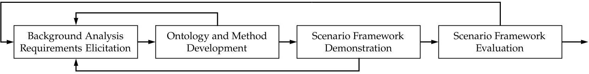
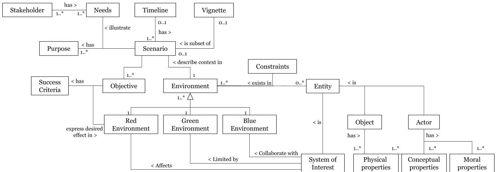
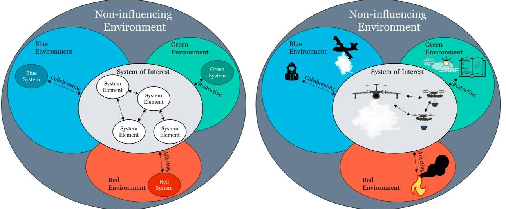
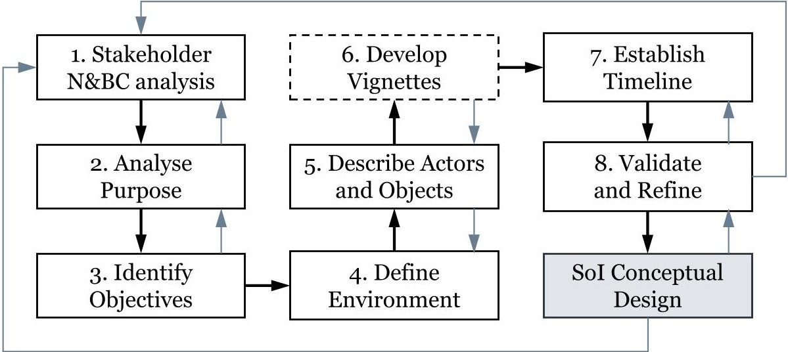
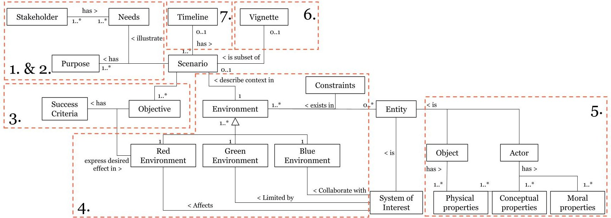

<!-- PDF_PAGE: 1 -->

Article

# Development of Scenarios as Problem-Space Descriptions in Aerospace Conceptual Design

Karl Kindström Andersson $ ^{1,2,3,*} $ and Kent E. Andersson $ ^{2} $

$ ^{1} $ Fluid and Mechatronic Systems Division, Linkoping University, 58183 Linkoping, Sweden

$ ^{2} $ Department of Systems Science for Defence and Security, Swedish Defence University,

$ ^{3} $ Advanced Programs, Saab Aeronautics, 58188 Linkoping, Sweden

* Correspondence: karl.kindstrom.andersson@liu.se; Tel.: +46-734-182349

Academic Editor: Konstantinos Kontis

Citation: Kindström Andersson, K.; Andersson, K.E. Development of Scenarios as Problem-Space Descriptions in Aerospace Conceptual Design. Aerospace 2024,11,565. https://doi.org/10.3390/aerospace11070565

Abstract: In the defense and security domain, scenarios are often descriptions of stakeholder needs, future events, and the environment. They are used for the elicitation of requirements in development of capabilities, organizations, and technical systems. In the conceptual design of aerospace applications, models of scenarios can also represent and communicate a problem-space, enabling trade-space exploration and system effectiveness robustness analysis, which provide valuable input to decision-makers. This study utilizes design science to develop a scenario framework for solution-agnostic representations of a problem-space for use in aerospace conceptual design- and trade-space exploration. A scenario ontology is developed, describing the constituent concepts of scenarios and their relationships, followed by a method for creating scenarios and evaluating their validity. Within the EU project COLOSSUS, it is demonstrated that the scenario framework has utility both for market-pull and technology-push conceptual design. Establishing an ontology for scenarios and a method for creating them as well as evaluating their validity is another step in improving the aerospace conceptual design phase.

Received: 14 June 2024

Accepted: 8 July 2024

Published: 10 July 2024

Copyright: 2024 by the authors. Licensee MDPI, Basel, Switzerland. This article is an open access article distributed under the terms and conditions of the Creative Commons Attribution (CC BY) license (https:// creativecommons.org/licenses/by/ 4.0/).

Keywords: scenario; problem-space; aerospace conceptual design; capability development; design science research; system-of-systems

## 1. Introduction

The first step in any problem-solving process is understanding the problem-space to develop a suitable solution. Traditional technology performance-driven planning and acquisition of technical systems in the defense sector is now being phased out in favor of capability-centric planning and acquisition [1]. This new approach opens up the design-space to include more than the technical system, offering the potential to generate more flexible and resilient solutions, as indicated in the research by Harper and Dietl et al. [2,3]. Harper demonstrated the benefits of an effectiveness-based approach to design, as opposed to a performance-based approach, during the conceptual design phase. Simulating a close air support scenario, the effectiveness-based design reported shows how trade-offs in multidisciplinary design parameters affect outcomes in mission scenario measures of effectiveness [2]. In addition, Dietl et al. established and studied links between aircraft design, weapon performance, and effectiveness measures at the system-of-system level in their simulations of counter-air scenarios [3]. Thus, the research by Biltgen, Harper, and Dietl show that aircraft performance metrics are shifting from technical performance measures to desired capabilities or mission effects. This will result in new requirements for how to express aircraft specifications, shifting away from technical specifications towards new criteria.

In the holistic engineering approach for aeronautical product development by Staack et al. we can begin to glimpse how these new criteria might take shape. They proposed to express the end-users' needs and system-of-systems' boundary conditions (i.e., the problem-space)

<!-- PDF_PAGE: 2 -->

as scenarios [4]. They showed that from the solution-agnostic scenarios, the necessary system-of-systems capabilities can be explored, and the constituent system constellations that provide these desired capabilities can be assembled. Knöös Franzén contributed by showing that scenarios can be used to present stakeholder needs in their method for the breakdown of end-users' needs into the capabilities and functions of a system-of-systems design-space [5]. However, he does not elaborate its content nor what constitutes a good scenario in this context. Finding a conceptual model is necessary in order for to automate design-space exploration.

However, no reports of such a suitable model has been found. A review of pertinent literature reveals that the term scenario is used across various sectors, often for purposes other than capability requirements elicitation, and with differing meanings and definitions. In the aerospace and defense sectors, scenarios are encountered in, e.g., the Swedish Armed Force's Traceability model (Spårbarhetsmodellen in Swedish) [6], the Mission Engineering Guide [7], the U.S. Department of Defense Dictionary of Military and Associated Terms [8], and the Swedish Defence Research Agency [9,10]. Scenarios are also used in the systems engineering community, e.g., in the standard ISO/IEC/IEEE 15288 [11], the INCOSE Systems Engineering Handbook [12], and in textbooks such as [13]. Sutcliffe has made a review of scenarios in the context of requirements engineering [14], while Specking et al. have demonstrated the benefits of using trade-space exploration and setbased design with model-based systems engineering in early design-space exploration [15]. Specking et al. use a process that includes scenarios, e.g., as support for task definition, and they state that modeling and simulation help analyze scenarios and threats for design decisions. All the aforementioned references provide valuable insight to what constitute as a scenario, but do not offer a suitable definition of a scenario as solution-agnostic representations of stakeholder needs, particularly in the context of conceptual aerospace design. Hence, the following question arises:

## How can scenarios be constructed to reflect the full problem-space for aerospace conceptual design?

To address the research question, design science research [16] is employed with the goal of developing a scenario framework towards the automated support of design- and trade-space exploration. The requirements for scenarios as descriptions of the problem-space are first analyzed from the perspective of aerospace conceptual design, capability development, and exploration of the problem- and design-space. Based on these requirements, a scenario framework is iteratively developed using knowledge gained through literature studies, and meetings and workshops with subject matter experts. The scenario framework consists of a scenario ontology and a method for creating and evaluating scenarios. Ontologies are suitable for structuring and sharing information for both people and software agents [17].

This study's results show that the scenario framework enables researchers and developers in the aerospace defense and security domain to create scenarios that represent and communicate a solution-agnostic problem-space. In the conceptual design phase, scenario models representing the problem-space improve efficiency and traceability between stakeholder needs and the proposed solution. A problem-space model can aid the search for suitable solution alternatives using design-space exploration, the study of design alternatives using trade-space exploration, and the validation of requirements and solutions using simulations or other tests. This framework is a step closer towards a complete digital thread from stakeholder needs to a designed solution, providing a link between stakeholder needs and system (or system-of-systems) characteristics, needed in a digital engineering trade-space analysis framework, according to Browne et al. [18,19].

This research paper is outlined according to Johannesson and Perjon's proposal for design science papers [16]: First, Section 2 presents the research method followed by a description of the problem definition and the identified scenario framework requirements in Section 3. Section 4 presents the research results, which include the scenario framework consisting of a scenario ontology, and a method for scenario creation and validation. In

<!-- PDF_PAGE: 3 -->

Section 5, a demonstration and evaluation of the scenario framework is presented. The paper concludes with a discussion on the significance of the results in Section 6 and with conclusions and ideas for future work in Section 7.

## 2. Method

Given the problem outlined in the introduction, this study adopts a design science research approach [16] to identify an ontology model for scenarios and a method for their construction and validation (see Figure 1). This is an approach often used in the information system development research community when developing models and methods [16]. A similar approach has also recently been used by Oprea in an aerospace conceptual design setting [20]. Our aim in this study is to find an acceptable first version of a scenario framework that satisfies the needs of the aerospace conceptual design community. Then, in future work, we aim to successively do further iterations as the framework is used and lessons are learned.

Figure 1. Illustration of our design science research approach for developing a scenario framework for aerospace conceptual design.

The method, as illustrated above in Figure 1, is a four-step method; (1) background analysis and requirements elicitation, (2) ontology and method development, (3) scenario framework demonstration, and (4) scenario framework evaluation. During development, the method was iterated several times. The seed of a framework was first developed by a focus group consisting of: a senior operational analyst from industry (author), two senior aircraft concept developers and designers from industry, a professor of fluid and mechatronic systems with experience in aircraft conceptual design, and a senior development officer from the air force (author). As the artifact developed, the use of subject matter experts increased, both as sources of information, but also as a means for evaluation.

## 2.1. Background Analysis and Requirements Elicitation

In Step 1, the problem was first identified and described (see Section 3.1). Knowledge was gathered from reports in the current academic literature as well as from the combined extensive experience of the participating subject matter experts. From that problem description, a set of requirements for a scenario framework was elicited (see Section 3.2).

## 2.2. Ontology and Method Development

In Step 2, information from Step 1 was used to build an ontology, describing scenarios' constituent concepts, types, relationships, and parameters. A first version of a working ontology model and a useful method to create and evaluate scenarios was initially developed in a series of seminars with the expert focus group. Later in the process, during demonstration, the model and the method were iteratively modified until the focus group thought it was no longer necessary. The ontology was successively modeled and documented using an entity relationship diagram tool (see Section 4.1) and the scenario creation method is presented in Section 4.2.

## 2.3. Scenario Framework Demonstration

In Step 3, the utility of the scenario framework was demonstrated [16] (pp. 133-137) by applying it to a specific case, the COLOSSUS project [21]. The objectives of the project,

<!-- PDF_PAGE: 4 -->

which is ongoing at the time of writing, are to develop a multi-role seaplane and a multi-role eVTOL for application in aerial wildfire firefighting and advanced air mobility. The scenario framework was applied in the creation of scenarios for development of the new aircraft, catering to both market-pull and technology-push project requirements. It was used iteratively, utilizing literature studies, meetings, and workshops with subject matter experts. The scenarios presenting the aircraft problem-space were then reviewed by both subject matter experts and aircraft designers who will later use them for requirement elicitation. Results from the application of the scenario framework are presented in Section 5.1.

## 2.4. Framework Evaluation

Finally, in Step 4 the scenario framework was evaluated. Each scenario framework requirement was analyzed and evidence to its fulfillment is provided by reference to the framework definition or to results from the application of the framework in the demonstrated case (see Section 5.2).

## 3. Problem and Requirements

Under this heading, the needs for the scenario framework and the derived requirements are outlined. The problem description is presented first (Section 3.1), followed by the derived requirements (Section 3.2). The text in Section 3.1 includes references " (# ) " to derived requirements, aiding the reader with requirement/context traceability.

## 3.1. Explicate Problem

As previously described in the introduction (Section 1), scenarios are used in a wide variety of applications and with different definitions, without a clear definition for application as solution agnostic problem-space description in aerospace conceptual design (1). This paper is based on the hypothesis that scenarios can be used as solution-agnostic descriptions of stakeholder needs and boundary conditions, intended to identify the needed capabilities of the system-of-interest [4] (1,2,3). This implies a need to align with previous findings on capability development within a system-of-systems context [22] (2,3). In other applications, scenarios are used to describe or demonstrate how an existing product concept could be used (see, e.g., [23] (4)). From this, it is evident that scenarios are applied both for market-pull (i.e., top-down), where stakeholder needs drive requirements on the solution, and a technology-push approach (i.e., bottom-up), where a solution's utility can be demonstrated in a scenario (4).

Another challenge in using scenarios to describe the problem-space is ensuring comprehensive coverage. It can be difficult to assess whether the created scenarios fully encapsulate the breadth and depth of the problem-space. Consequently, there is a need for a systematic method and structured approach to guide the creation of scenarios, ensuring an accurate reflection of the complexity and entirety of the issues at hand (5,6,7).

Further, in aerospace design there is a constant search not only for evolutionary advancements but also revolutionary and ideally disruptive innovations that redefine what is possible. Design thinking, with its emphasis on user centricity, iterative prototyping, and creative problem-solving, offers a perspective from which the challenges of aerospace design can be viewed and addressed. Design thinking principles could aid navigation of stakeholder needs and boundary conditions, fostering an environment for innovation (1,8). The starting point is to study the problem, the desired effect ("Outcome") expressed in the scenario, and then to design the solution, the "Elements" and the "Patterns of Relationship" using abduction reasoning [24].

Following the description of the problem-space, the aim in design is to explore possible, feasible, and-desirably-optimal solutions (2). In the development of aerospace products with multiple stakeholders, the problem-space is complex, and with design solutions embracing system-of-systems approaches, the design-space is both larger and more complex than in traditional design (8). One solution to manage constantly evolving technologies is to start defining desired capabilities or functions, rather than a predefined solution or technical

<!-- PDF_PAGE: 5 -->

system specification (2), as first pointed out by Rasmussen in their abstraction hierarchy on design logic [25]. Further, employing digital tools aid navigation and exploration of the large, complex, and multi-leveled problem- and design-spaces. Thus, the scenario framework should fit into a digitized working environment to enable efficient problem- and trade-space exploration (9), such as the digital engineering trade-space analysis framework suggested by Browne et al. [18,19].

## 3.2. Scenario Framework Requirements

From the problem outlined in Section 3.1, it is hypothesized that a scenario framework could provide a solution, where scenarios constitute a solution-agnostic model of the problem-space. From the problem description, the below listed requirements on the scenario framework are elicited. These requirements will guide the design of the scenario framework. The framework will accomplish the following:

1. Enable the creation of scenarios that are independent of specific solutions, focusing instead on stakeholder needs and boundary conditions for the purpose of designing a system-of-interest.

2. Enable the identification and definition of key capabilities required to address the problem-space.

3. Be agnostic regarding the system level to which the system-of-interest belongs.

4. Enable both market-pull (top-down) and technology-push (bottom-up) approaches, accommodating scenarios driven by stakeholder needs as well as those demonstrating the utility of solutions.

5. Enable the identification of scenario contents, their relationships, and structure, facilitating a systematic and organized approach to scenario creation.

6. Provide a method for scenario development, guiding users through the steps necessary to create effective and comprehensive scenarios.

7. Ensure that the sum of the created scenarios cover the full breadth and depth of the problem-space, including all relevant stakeholder perspectives and boundary conditions.

8. Support an iterative development process, allowing for rapid prototyping, testing, adjusting the solution, and/or re-framing of the problem based on continuous feedback.

9. Enable creation of digital models of scenarios within the framework, enabling detailed analysis and simulation.

These requirements are subject to be updated in later research efforts aimed at improving the scenario framework according to the iterative approach described in Figure 1.

## 4. The Artifact—A Proposed Scenario Framework

The proposed scenario framework consists of two parts: First, an ontological model that describes scenarios, their constituent components, and their relations, presented in Section 4.1. Second, a method describing how scenarios can be created where the ontological model supports the creation method is presented in Section 2. The two parts are described in the form they have after finalizing the iterations reported in this study.

## 4.1. The Proposed Scenario Ontology

The developed scenario ontology model has two purposes: (1) to assist those using the ontology in their scenario creation method to know what information is important to capture and (2) to structure the scenario in order to make an efficient transition from a natural language description to a model that can be used for design- and trade-space exploration. The scenario ontology developed is presented in Figure 2. Components in the ontology are written in italics below in the ontology description. To aid the reader in understanding the components, they are exemplified using the aerial wildfire firefighting case that was developed during the COLOSSUS project.

<!-- PDF_PAGE: 6 -->

Figure 2. The proposed scenario ontology presenting the components and their relations. The asterisks $ ^{*} $ in the figure denote an unknown integer number of possible instances

The scenario describes a problem-space that illustrate the stakeholders' needs for developing a system-of-interest (a collective set of all elements of any system considered by a lifecycle, this may include both operational and enabling systems, https://sebokwiki.org/wiki/System-of-Interest_(glossary), accessed on 4 June 2024), which will fulfill these needs when operational. From the studied literature, it was concluded that scenarios can be described by combining two major components, (1) the objectives (something toward which effort is directed: an aim, goal, or end of action, https://www.merriam-webster.com/dictionary/objective, accessed on 4 June 2024) that stakeholders needs to achieve and (2) the environment (The circumstances, objects, or conditions by which one is surrounded, https://www.merriam-webster.com/dictionary/environment, accessed on 4 June 2024), describing circumstances and context. Depending on the study question and system-of-interest, the size of the scenario may vary. For large scenarios, with many objectives that may progress over a long time, it may be beneficial to break down the scenario into several vignettes. Each vignette can then focus on a certain objective, event, or part of the environment such as a specific geographical area. In the event that the vignettes build off of each other, a timeline help describing when the scenario starts, and how the scenario unfolds. The timeline can also describe events unfolding up to the start of the scenario, providing the reader with a history and background to why the situation has come to this, while putting the scenario in a time epoch. A vignette has the same main components as the scenario, i.e., objectives and environment, but are smaller in time and space.

An objective shall express the purpose, goal, or desired end. Objectives are described as a desired effect in a situation system [26] (p.23). It is important to include the success criteria for elicitation of requirements, and for evaluation of system concepts in simulations or tests. In a military context, objectives are often received from a super-ordinate in the form of an order. If the scenario has vignettes, these have sub-objectives that build towards the greater scenario objective.

The environment encompasses all external factors that may influence or are influenced by the system-of-interest, including active (actors) and passive (objects) entities, and constraints, such as weather and geographical conditions, standards, and governing regulations. All entities have physical properties, such as size, ability to maneuver, observability, and resistance to different effects. Actors differ from objects in that they have additional conceptual (e.g., behavior) and moral properties (see, e.g., UK MoD Fighting Power [27,28] (p. 31)). Examples of actors include ground-based firefighters and legacy firefighting aircraft, while objects include trees, buildings, infrastructure, and lakes. Constraints could be smoke from the fire, rain, and local air traffic control rules.

<!-- PDF_PAGE: 7 -->

To aid the scenario developer in the creation method, the environment is divided into three sub-categories, based on the characteristics of the inherent entities and constraints: blue, green, and red environments. The breakdown of an environment into sub-environments is further illustrated in Figure 3, exemplified with an aerial wildfire firefighting case.

Figure 3. Description of the environment components, exemplified with aerial wildfire firefighting.

The blue environment consists of entities and constraints that, in collaboration with the system-of-interest, actively work towards solving the scenario objectives. The solution to the problem described by the scenario will be solved by the system-of-interest in collaboration with the blue environment. In a firefighting scenario, such entities could be the incident commander, ground-based fire fighters and their equipment or communication infrastructure for emergency responders. Constraints in the blue environment could be protocols for communicating with collaborating entities. The entities described in the blue environment can be systems in their own rights and may or may not be included in a proposed system-of-systems solution as constituent systems depending on their and the developed system-of-interest's capabilities. However, the constituent systems that—together with the developed system-of-interest—constitute the proposed system-of-systems solution for the scenario are a design decision for later and not part of the scenario creation method.

The green environment consists of entities and constraints that passively work towards or against the scenario objectives. In an aerial firefighting scenario, the green environment may contain entities such as civilian support infrastructure, e.g., airports, and constraints such as weather phenomena, e.g., wind or fog, and rules and regulations for aviation.

The red environment consists of entities and constraints that work against the scenario objectives, and it is within the red environment that the system-of-interest should achieve the desired effect. From a systems thinking perspective, the red environment represents the situation system, which the respondent system (i.e., the system-of-interest) wants to affect (see Lawson [26] (p.23)). In an aerial firefighting scenario, the red environment includes the fire, the smoke, and the fuel that keeps the fire burning. In military scenarios, the red environment is more comprehensive, describing the adversary, its forces, their conceptual and moral properties, and the performance of their systems.

In summary, the system-of-interest, including its operator (if one exists), is generally regarded as an actor, possibly collaborating with other actors in the blue environment, to meet an objective, i.e., to achieve an effect in the red environment while being constrained by the green environment.

## 4.2. The Proposed Scenario Creation and Validation Method

Figure 4 above presents an eight-step method for creating and evaluating scenarios, developed iteratively using the scenario ontology as a starting point. The method follows similar basic steps as the design science research method described in Figure 1. The scenario creation method, depicted in Figure 4, starts with background analysis to find

<!-- PDF_PAGE: 8 -->

requirements for the scenario (steps 1-2). This is followed by scenario creation (steps 3-7). Step 3 includes identifying which objectives should be met, while step 4 focuses on the circumstances under which the effect should be achieved. Step 5 focuses on detailing the environment by describing the properties of the inherent actors and objects. Step 6 is not mandatory and should only be carried out if the scenario is large and there is a benefit in creating and detailing vignettes. Since a vignette has the same main components as a scenario, creating a vignette involves going through steps 3-5 for each instance. Possibly linked to the previous step, step 7 focuses on what has happened before the scenario starts, and how the scenario unfolds. Lastly, validation of the scenario is performed (step 8). The outcome of the eighth step might call for changes or refinements of the scenario, which could trigger a new iteration back to previous steps. Although the method is visualized as a linear flow, it should be seen as an iterative method, with smaller iterations between each step and larger iterations where the entire method is iterated successively as knowledge about the problem is gained. The iterations are illustrated with gray arrows.

Figure 4. Proposed scenario creation method. Gray arrows indicate iterations. N&BC stands for needs and boundary conditions. SoI stands for system-of-interest.

## Step 1: Stakeholder Needs and Boundary Conditions Analysis

The first step of the method is to understand the stakeholder needs and boundary conditions (N&BC), the environmental circumstances and context that the system-of- interest (SoI) is intended to be used in, and what intentions the stakeholders have with the system-of-interest. The scenario developer must decide how to frame the problem and define the system-of-interest's boundary, which will separate the problem-space to be expressed in the scenarios and the solution-space to be explored later. In addition to bringing an initial understanding about the objectives and environment, this analysis helps the scenario developer plan how many scenarios are needed to sufficiently describe the system-of-interest's problem-space. Systems such as a multirole fighter might require several scenarios to fully describe the different objectives and environments, whereas one scenario might suffice for a simpler aircraft such as a crop duster.

## Step 2: Analyze Scenario Purpose

Before starting to define the scenario content, the purpose of the scenario should be analyzed. The results from this analysis aid the scenario creator with what level of detail is needed in the description of the various scenario concepts. Also, it is important to consider whether the scenario will be used for problem-space sensitivity analysis with the purpose of investigating the system-of-interest's robustness. The scenario creator should consider the following: What possible scenario variations exist? How likely are their outcomes? Are there uncertainties in some scenario parameters worth

<!-- PDF_PAGE: 9 -->

investigating? These are some of the questions that could be relevant to answer before moving on to the next step.

## Step 3: Identify Objectives

Objectives in the ontology describe the desired effect that should be achieved. The scenario developer should use the stakeholder analysis in step 1 to identify and articulate the objectives that the system-of-interest should achieve. The goal should be to quantify the objectives as metrics, so that requirements can be expressed as measurables and the system-of-interest evaluation becomes objective.

## Step 4: Define Environment

The environment provides the circumstances and context under which the objectives are to be achieved. The scenario developer should define the blue, green, and red environments as per the ontology, identifying entities and constraints that will affect the system-of-interest's operation.

- Blue Environment: Considers the systems, actors, and organizations outside the system-of-interest's boundary are available for collaboration and describe the interfaces. Although entities in the blue environment work towards the same goals as the system-of-interest, changes in their design are generally out of the scope for the system-of-interest design. The description of the blue environment is important for the problem framing, i.e., defining the system-of-interest boundaries, what lies outside the system-of-interest boundaries, and what opportunities for, and requirements on, collaboration, and communication exists.

- Green Environment: Considers the systems, actors, and organizations outside the system-of-interest's boundary that constrain the system-of-interest's design or operation. This includes weather and geographical conditions, as well as governing regulations and standards.

- Red Environment: Considers the systems, actors, and organizations outside the system-of-interest's boundary, where either the effect should be achieved, or those actively trying to prevent the system-of-interest from achieving the scenario objectives.

This step, step (4), results in a broad definition of the environment, while the next step, step (5), focuses on detailing the actors' and objects' properties. After the initial scenario and solution have been developed, updates to the Scenario might be needed due to problem re-framing, or aspects of the solution-dependent environment that were not initially thought of, e.g., if the development of the system-of-interest presents possibilities for collaboration with new systems, these should be added to the blue environment in the next iteration of the scenario creation method.

## Step 5: Describe Actors and Objects

Actors and objects exist in the three sub-environments and can play active or passive roles in the scenario, affecting the system-of-interest's ability to accomplish its objectives. Factors that affect an actor's ability to act can include physical, conceptual, and moral factors. The scenario developer should identify and describe actors and objects in the environment that will interact with the system-of-interest. Physical properties and conceptual properties should be considered, including how the actors are organized, acting and collaborating, and how moral factors (will, values, and risk inclination) affect their actions. Physical properties include size, weight, location, endurance, and the ability to maneuver, communicate, sense, resist/generate effects from/on other objects, and stay undetected. The conceptual factors relate to an actor's objective and its ability to, on its own or in collaboration, observe the surroundings, make decision based on these observations, execute actions towards accomplishing the objectives, and observe the effects of the actions to take new decisions.

## Step 6: Optional. Develop Scenario Vignettes

Vignettes are smaller units of the scenario focusing on certain objectives, events, time, or geographical areas. If it is deemed beneficial, the scenario developer should break down the scenario into vignettes to focus on specific objectives or events, providing

<!-- PDF_PAGE: 10 -->

detailed insights into various aspects of the scenario. A vignette's narrower focus could both help in the effectiveness analysis of the system-of-interest concept, and better describe how the scenario unfolds (see step 7). The same general method for scenario creation applies to vignettes, i.e., steps 3-5.

## Step 7: Establish Scenario Timeline

A timeline helps in understanding the sequence and progression of events before the scenario starts or as the scenario progresses. If applicable, the scenario developer should construct a timeline describing how vignettes and events unfold over time. Consider describing events that have led up to the start of the scenario to provide context to the situation at scenario start. A timeline could also place the scenario in a time epoch of interest, which would dictate the available technology level for the system-of-interest and its surrounding technical systems.

## Step 8: Validate and Refine the Scenario

A validation of the developed scenario ensures that the description of the problem space is aligned with stakeholder needs. Validate the instantiated scenario, refining it to ensure it is comprehensive, achievable, and testable. If needed, reiterate and develop more scenarios to ensure all necessary stakeholder needs are covered.

As the problem- and design-spaces are explored and the system-of-interest concept is developed and evaluated, a need may arise to re-frame the problem and update the scenarios. This can include adjusting objectives, adding vignettes, or changing the boundary between the problem-space and the design-space, e.g., adjusting the boundaries and content of the blue or red environments. This is indicated by the arrow from the conceptual design phase back to Step 1 in Figure 4.

To aid the user of the scenario framework, Figure 5 describes the relations between the ontology and the method. It combines the scenario ontology and scenario creation method to highlight what concepts to consider and focus on during the different steps of the scenario creation.

Figure 5. Illustrates what ontology areas to focus on during the different scenario creation, referencing the method's different steps, 1 to 7. The asterisks (*) in the figure denote an unknown integer number of possible instances

## 5. Demonstration and Evaluation of the Scenario Framework

The utility of the proposed framework was then demonstrated in the COLOSSUS project (Section 5.1) and evaluated by comparing the designed framework to its requirements (Section 5.2). The framework was applied in the COLOSSUS project where two aerial wildfire firefighting scenarios and two intermodal travel scenarios were created [29]. The aims of the scenarios were to drive the development of a multi-role seaplane and a multi-role eVTOL. This section present the results, which are later discussed in Section 6.

<!-- PDF_PAGE: 11 -->

The complete results are extensive and have therefore been reported in separate reports for the purpose of saving space. The four COLOSSUS scenarios, created using the proposed method, are reported in [29].

## 5.1. Demonstration: Application of the Scenario Framework in the COLOSSUS Project

During the first six months of the COLOSSUS project, the aim was to identify stakeholders and their needs and develop scenarios for two use cases: a system-of-systems concept for sustainable intermodal mobility ("ADAM") and a system-of-systems concept for protection against the increasing risk of wildfire ("EVE"). The scenarios were later to be processed to define requirements for two air vehicle designs: a multi-role sea plane and an eVTOL air mobility vehicle. Two scenarios were developed for each use case, as per the project specification, i.e., no analysis was made to identify how many scenarios were needed to sufficiently cover the problem-space. The four scenarios were documented and presented in the project deliverable [29]. The COLOSSUS project is still in its first year at the time of submitting this paper. This implies that the full extent of the results, in terms of how well the scenarios have met the project's expectations, is yet to be determined.

The proposed eight-step method was applied, though parts of Step 1 were performed and documented in a separate project deliverable [30]. Step 2 two centered around understanding the project objectives and how and for what purpose the scenario would be used later in the conceptual design process. The scenario content created from steps 3-5 evolved gradually through literature studies, internal meetings, and workshops with external subject matter experts. It was not deemed necessary for either of the two use cases to break down the scenario in vignettes. This might be reconsidered later in the conceptual design process when exploring system-of-systems solutions more thoroughly, which might require the individual constituent system's missions to be specified in greater detail. In the wildfire firefighting scenarios, a timeline was included to describe the events leading up to the point when the system-of-interest was engaged. In the intermodal travel scenarios, a historical timeline is not relevant. In a final step, the scenarios were reviewed. First internally by the sub-task group, then by subject matter experts, and lastly, before formal project delivery, by the larger COLOSSUS group. Sections 5.1.1 and 5.1.2 below present brief summaries of the two aerial firefighting scenarios developed using the presented ontology and method during the COLOSSUS project [29].

## 5.1.1. Summary of COLOSSUS Scenario 1—"Inland (Landlocked)"

On the morning of 17 August, a fire is detected by tourists in Pyrrenees National Park, 2 km west of Luz-Saint-Sauveur. The weather is sunny, 26 $ ^{\circ} $ C, with a light breeze from the west at 4 m/s. The Lourdes fire department sets up a base camp 1 km from the fire. Due to low vegetation moisture and rough terrain, the incident commander requests aerial firefighting support to start the next morning at 08:00. Objectives include minimizing wildfire damage, greenhouse gas emissions, environmental impact, and operational costs, while maximizing aerial firefighting effectiveness. The operation, led by the Lourdes Rescue Centre, involves six fire engines, 50 firefighters, and aerial assets including helicopters from Pau and Tarbes, and a Canadair CL-415 from Spain. Communication is maintained via radio and cellular services, with continuous contact with national authorities. The Tarbes-Lourdes-Pyrrenees Airport provides fuel, electricity, maintenance, and re-fueling services. The fire is at 950 m above sea level, in steep slopes and forest vegetation. Weather forecasts indicate a 55% chance of wind shifting to a strong breeze from the east, with temperatures rising to 30 $ ^{\circ} $ C. The initial fire spans 15-50 m $ ^{2} $ in discontinuous vegetation, ignited by a campfire spark, detected by locals, leading to the incident commander's aerial support request within an hour.

## 5.1.2. Summary of COLOSSUS Scenario 2—"Island (Seaside)"

On the afternoon of 17 July, a wildfire is detected in the forest between Peresteria and Aiánteio on the island of Salamina, west of Athens. The weather is sunny, $ 3 5 \,^{\circ} \mathrm{C} $ , with a

<!-- PDF_PAGE: 12 -->

light breeze from the SSW at 3 m/s. The local fire department approaches the fire. Due to low vegetation moisture, increasing wind, and proximity to residential buildings, the incident commander requests aerial firefighting support to start the next morning at 08:00. Objectives include minimizing wildfire damage, greenhouse gas emissions, environmental impact, and operational costs, while maximizing aerial firefighting effectiveness. The Salamina fire department leads the operation with three fire engines, 20 firefighters, and a helicopter from mainland Greece. Communication is maintained via radio and cellular services, with continuous contact with national authorities in Athens. Megara Airport, 12 km from the fire, provides fuel, electricity, maintenance, and re-fueling services. The fire is located at N 37 $ ^{\circ} $ 54'12" $ ^{\circ} $ E 23 $ ^{\circ} $ 27'44" $ ^{\circ} $ in an area with discontinuous hill vegetation, grass, and small bushes. Weather forecasts predict a 60% chance of wind shifting to a strong breeze from the WNW with increasing strength and a temperature drop to 32 $ ^{\circ} $ C. The initial fire spans 25-100 m $ ^{2} $ with a ground vegetation moisture level of 20%. The timeline begins with the fire's ignition from a broken glass bottle, detection by locals at 15:39, and the incident commander's aerial support request within an hour.

## 5.2. Evaluation of the Scenario Framework

The scenario framework was evaluated against the elicited requirements established to guide its development. Table 1 below present these requirements and summarizes evidence from how the scenario framework satisfies each one.

Table 1. Summary of the scenario framework requirements and evidence that the proposed framework satisfies them.

<table border="1"><tr><td>Requirement</td><td>Evidence</td></tr><tr><td>1. Enable the creation of scenarios that are independent of specific solutions, focusing instead on stakeholder needs and boundary conditions for the purpose of designing a system-of-interest.</td><td>The results shows that the structure of the ontology, supported by the creation method, helps separate the problem from the solution. Although the blue environment was part of the solution to the problem defined in the scenario, its definition highlights what is not part of the system-of-interest design-space. During COLOSSUS workshops with stakeholders this separation helped focus on the problem. Inspection of the developed scenarios shows that they describe the problem-space but are free from descriptions of the system-of-interest&#x27;s solution-space.</td></tr><tr><td>2. Enable the identification and definition of key capabilities required to address the problem-space.</td><td>Capabilities are generally seen as the ability to achieve an effect under specified conditions (see, e.g., [22,28]). An inspection of the scenarios created in COLOSSUS [29] shows they contain objective definitions, including success criteria, and a description of conditions, i.e., the environment. It is thus reasonable to believe that scenarios developed with the proposed framework fit with the capability-based development approach, although identification of capabilities will be made in later steps of the conceptual design phase.</td></tr><tr><td>3. Be agnostic regarding the system level to which the system-of-interest belongs.</td><td>Inspection of the scenario ontology shows that there are no restrictions to where in the system hierarchy the system-of-interest is situated. The framework allows for describing a system-of-interest&#x27;s problem-space irrespective of its place in a system hierarchy. The framework is size-agnostic with respect to time and space, and the blue environment can be framed to allow the scenario to describe the problem-space for a system-of-interest at any system level. The COLOSSUS project will at its end have demonstrated that requirements for system-of-systems, constituent systems, as well as sub-system technologies, can be elicited from the scenarios.</td></tr></table>

<!-- PDF_PAGE: 13 -->

Table 1. Cont.

<table border="1"><tr><td>Requirement</td><td>Evidence</td></tr><tr><td>4. Enable both market-pull(top-down) and technology-push(bottom-up) approaches, accommodating scenarios driven by stakeholder needs as well as those demonstrating the utility of solutions.</td><td>The demonstration in COLOSSUS[29] shows the framework can be used for both approaches:(1)to describe scenarios for system-of-interest requirements elicitation(top-down),as two aerial wildfire firefighting scenarios were developed,and(2)as a means to develop scenarios for system-of-interest utility demonstration(bottom-up),as two intermodal travel scenarios were developed.</td></tr><tr><td>5. Enable the identification of scenario contents,their relationships,and structure,facilitating a systematic and organized approach to scenario creation.</td><td>The scenario ontology describe the scenario components and their relationships.The developed method,supported by the ontology,brings structure to the scenario creation method.The ontology and method was used in the COLOSSUS project,providing a guide during the scenario creation.An inspection of the scenarios in[22]shows that the concepts necessary for this specific case have been captured in the scenario description.</td></tr><tr><td>6. Provide a method for scenario development, guiding users through the steps necessary to create effective and comprehensive scenarios.</td><td>The demonstration shows that the method supports the creation of scenarios as problem-space descriptions.The use of the scenario framework in the COLOSSUS project demonstrates its utility.Four scenarios were created as presented in[29].</td></tr><tr><td>7. Ensure that the sum of the created scenarios cover the full breadth and depth of the problem-space,including all relevant stakeholder perspectives and boundary conditions.</td><td>In the COLOSSUS project,the number of scenarios was predetermined by the project specifications.However,an inspection of the final step of the proposed scenario creation method,where the scenarios are evaluated,requires a review of the completeness of the scenarios against the stakeholder needs.In case of incompleteness,new iterations should be initiated.</td></tr><tr><td>8. Support an iterative development process,allowing for rapid prototyping,testing,adjusting the solution,and/or re-framing of the problem based on continuous feedback.</td><td>An inspection of the proposed scenario creation method shows that it contains several iterative feedback loops.These enable and encourage continuous development validation adjustment,both in terms of the development of the problem(the scenario)and the solution(the system-of-interest).</td></tr><tr><td>9. Enable creation of digital models of scenarios within the framework,enabling detailed analysis and simulation.</td><td>The framework itself does not generate digital scenario models.However,the framework with its ontology and system perspective describes scenarios with related building blocks.This facilitates creating models of actors and environment for trade-space exploration simulations.The framework&#x27;s intention to capture stakeholder needs,and to express desired effects,thus fits well with current digital engineering efforts,e.g.,[18]</td></tr></table>

## 6. Discussion

Scenarios in aerospace conceptual design have traditionally lacked an agreed-upon solution-agnostic definition, leading to varying applications and meanings of the term. This study set out to establish a structured approach for creating scenarios that focuses on stakeholder needs and boundary conditions without being tied to specific solution paths. From this, the following question was posed: How can scenarios be constructed to reflect the full problem-space for aerospace conceptual design? Presented in this paper are the results of the development and validation of a proposed scenario framework, which offers an answer to the posed question. The proposed scenario framework is established through the application of design science research. The framework contains a structured, eight-step method for scenario creation and validation, which is underpinned by a scenario ontology. This section discusses the implications of the findings, examines the strengths and limitations of the work, and proposes ideas for future research.

The resulting definition suggests that scenarios describe what objectives a system-of-interest should achieve and under what conditions, referred to as the surrounding environment. We argue this aligns well with needs for capability development [28]. The researched scenario framework was developed to include previous insights from, e.g., Kindström

<!-- PDF_PAGE: 14 -->

Andersson et al. [22] and Staack et al. [4], and requirements from capability development in the system-of-systems context have also been accounted for. We have shown that the proposed scenario framework offers a method agnostic to specific solutions and system levels, aligning with the hypothesis that scenarios can represent stakeholder needs and boundary conditions for capability identification. Results were validated in developing scenarios in a real case [29]. Furthermore, it is demonstrated through applying the framework that the scenarios are not only aligned with stakeholder needs and boundary conditions in the traditional market-pull approach, but that they have utility in the technology-push approach. Overall, it is argued that the demonstrated application of the proposed scenario framework demonstrates useful contributions to practice.

As this study comes to an end, the COLOSSUS project continues, having just completed the initial year of its three-year duration. As a consequence, not all lessons of the scenario framework's application can yet be learned. Therefore, the results discussed herein should be considered preliminary. Future project results emerging from the use of the scenarios will contribute to future development iterations, evolving and refining the scenario framework in line with the iterative nature of the design science research method. It is difficult to assess the completeness of the captured artifact requirements, but the inherent iterative approach in design science research is a means to counter this. Therefore, the framework presented herein should be regarded as the results from the first development iterations. We welcome continued application of the framework in new contexts, continuous assessment of the validity, and if necessary, updating the requirements and adjusting the scenario framework in new iterations based on findings.

Similarly, an inherent limitation of the currently proposed scenario creation method is the lack of support for assessing the completeness of created scenarios and vignettes with respect to modeling the problem-space. Even if one could prove that the entire problem-space was captured within the scenarios, over time, changes in the environment, such as technological developments, would create a gap between the created scenarios and the real problem-space. To counter this, based on the authors experience, we recommend to consider the following: (1) being aware that the scenarios are models of the problem-space and gaps may exist, (2) utilizing sensitivity analysis to investigate the developed system-of-interest's robustness to uncertainties, (3) relying on experts' experience to judge when the created scenarios cover a sufficient part of the problem-space, and (4) treating the scenarios as living documents, continuously updating them as technology develops and lessons are learned.

An aim of developing the scenario framework has been to contribute to the digital thread between a problem, expressed as stakeholders' needs and boundary conditions, and the solution developed during conceptual design. The scenario framework's ontology offers a structured approach to describing scenarios as components, aiding in the creation of digital models for simulation within conceptual design. The research study results indicate that the proposed scenario framework provides a starting point for future digitization efforts, contributing theoretically towards a digital thread in conceptual design. In this digital thread, stakeholder needs and scenarios are linked and represented as a model of the problem-space, potentially integrating seamlessly with digital tools for trade-space exploration. Thus, the proposed scenario framework lays the groundwork for future research in transition towards a complete digital thread, stretching from the stakeholders' needs to the design.

Although the focus in this paper has been on the aerospace domain, we argue that the proposed scenario framework can have utility in other domains. The author's intent has been to make the framework domain agnostic. The development of complex products, aimed at operation in system-of-systems contexts, benefits from a structured approach to express and explore the problem-space. The proposed ontology remains at a high level, meaning it should be able to express the problem-space for other domains as well. Future work where the scenario framework is applied in other domains is encouraged,

<!-- PDF_PAGE: 15 -->

as it could lead to important conclusions on how it could be improved and become even more generalized.

An initial idea of the research project was to investigate the possibilities with large language models, such as ChatGPT. Two main applications were considered: (1) validating the ontology and (2) using the ontology with instructions to let the large language model generate scenario descriptions. Efforts showed it was possible to task ChatGPT-4 with generating an ontological graph from a description of the scenario component concepts and their relations. However, it seemed that ChatGPT-4 struggled with the length of the text, resulting in some components being left out. Furthermore, the graphical ontology representation required much manual work through iterations with ChatGPT-4 before it was readable. When generating scenario descriptions, it became evident that ChatGPT suffered from similar limitations as humans, struggling to separate the problem-space from the solution-space, while describing the problem in the scenario, ChatGPT could not help but to also explain why this problem would easily be solved by the system-of-interest to be designed. It seemed that ChatGPT made presumptions on certain characteristics in the system-of-interest. Based on these findings, it was concluded that ChatGPT-4 was not yet mature enough to be used in this study.

## 7. Conclusions

The aim of this study was to answer the question: "How can scenarios be constructed to reflect the problem-space for aerospace conceptual design?" The findings have resulted in the development of a scenario framework that contains a scenario ontology and an eight-step scenario creation method. This framework, developed through design science research, has demonstrated utility in both market-pull and technology-push scenarios. It represents a step towards a complete digital thread in aerospace conceptual design, offering a method agnostic to specific solutions and capable of encapsulating a large scope of a system-of interest's problem-space.

While the focus has primarily been on the aerospace domain, the universality of the developed framework suggests that it has potential applicability across various sectors facing complex system design challenges. Future research should aim to test and refine this framework in different contexts to enhance its versatility and generalizability. By contributing to the improvement of the conceptual design phases for aerospace systems, this study builds towards a digital thread essential for leveraging the efficiency and quality improvements provided by trade-space exploration tools. Continued exploration, refinement, and application of methods and tools are encouraged to ensure that the full potential of digital tools is realized in future developments to include domains beyond aerospace.

Author Contributions: K.K.A.: conceptualization, methodology, validation, investigation, data curation, writing—original draft, writing—review and editing, project administration, and funding acquisition. K.E.A.: Methodology, writing—review and editing, and supervision. All authors have read and agreed to the published version of the manuscript.

Funding: This research was funded by the Swedish Innovation Agency (VINNOVA) under grants no. NFFP7/2019-02775 and 2023-01192, as well as the European Union under Grant Agreement no. 101097120.

Data Availability Statement: The scenarios developed in the COLOSSUS project are available at [29].

Acknowledgments: The work presented in this paper was made possible thanks to funding support from Vinnova and the National Aeronautics Research Programme under the project COMTE. Research was also partly performed within the COLOSSUS project, funded by the European Union. The authors wish to express their gratitude to Petter Krus, Kristian Amadori, and Christopher Jouannet for their invaluable supervision of this research. We are also deeply thankful to Hans Liwång, Eva Lagg, and our colleagues at the Department of Systems Science for Defence and Security at the Swedish Defence University for their input on the theory and research concept and methodology. Additionally, we extend our sincere thanks to Jakob Axelsson at Mälardalen University for his constructive feedback

<!-- PDF_PAGE: 16 -->

on an earlier version of this manuscript. Finally, we appreciate the anonymous journal reviewers for their insightful and highly valuable comments on the initially submitted manuscript.

Conflicts of Interest: Author Karl Kindström Andersson was employed by the company Saab Aeronautics. The remaining authors declare that the research was conducted in the absence of any commercial or financial relationships that could be construed as a potential conflict of interest.

## Abbreviations

The following abbreviations are used in this manuscript:

<table border="1"><tr><td>COLOSSUS</td><td>Collaborative System of Systems Exploration of Aviation Products, Services and Business Models</td></tr><tr><td>COMTE</td><td>Concept of Operation and tactical Modelling for Tradespace Exploration</td></tr><tr><td>eVTOL</td><td>electric Vertical Take-Off and Landing</td></tr><tr><td>GPT</td><td>Generative Pre-trained Transformer</td></tr><tr><td>INCOSE</td><td>International Council on Systems Engineering</td></tr><tr><td>IEC</td><td>International Electrotechnical Commission</td></tr><tr><td>IEEE</td><td>Institute of Electrical and Electronics Engineers</td></tr><tr><td>ISO</td><td>International Organization for Standardization</td></tr><tr><td>N&amp;BC</td><td>Needs and Boundary Conditions</td></tr><tr><td>SE</td><td>Systems Engineering</td></tr><tr><td>SoI</td><td>System-of-Interest</td></tr></table>

## References

1. Biltgen, P. A methodology for capability-focused technology evaluation of systems-of-systems. In Proceedings of the 45th AIAA Aerospace Science Meeting and Exhibit, Reno, Nevada, 8-11 January 2007. [CrossRef]

2. Harper, D.J. Operations analysis integration for Effectiveness-Based Design in the AFRL EXPEDITE program. In Proceedings of the AIAA Scitech 2020 Forum, Orlando, FL, USA, 6-10 January 2020. [CrossRef]

3. Dietl, T.; Prakasha, P.S.; Schmitz, M.; Zill, T.; Nagel, B.; Pinson, N. Fighter Design and Fleet Effectiveness Evaluation via System of Systems Battlespace Simulation. In Proceedings of the AIAA AVIATION 2023 Forum, San Diego, CA, USA, 12-16 June 2023. [CrossRef]

4. Staack, I.; Amadori, K.; Jouannet, C. A holistic engineering approach to aeronautical product development. Aeronaut. J. 2019, 123, 1545-1560. [CrossRef]

5. Knöös Franzén, L.; Staack, I.; Krus, P.; Jouannet, C.; Amadori, K. A Breakdown of System of Systems Needs Using Architecture Frameworks, Ontologies and Description Logic Reasoning. Aerospace 2021, 118, 118. [CrossRef]

6. Försvarsmakten. Beslut om Utkast Till Ramvilkor för Typförband (U RVT); FM2021-17939-1; Försvarsmakten: Stockholm, Sweden, 2021.

7. OUSD(R&E). Mission Engineering Guide Version 2.0; Number 2.0; Office of the Under Secretary of Defense for Research and Engineering: Washington, DC, USA, 2023.

8. DoD. DoD Dictionary of Military and Associated Terms; Joint Education and Doctrine Division, J-7: Washington, DC, USA, 2020; p. 382.

9. FOI. Referenser. Available online: https://www.foi.se/forskning/krisberedskap-och-civilt-forsvar/scenarier-och-typfall/referenser.html (accessed on 4 June 2024).

10. FOI. Scenarier Och Typfall. Available online: https://www.foi.se/forskning/krisberedskap-och-civilt-forsvar/scenarier-ochtypfall.html (accessed on 4 June 2024).

11. ISO/IEC/IEEE 15288-1; ISO/IEC/IEEE International Standard: Systems and Software Engineering—System Life Cycle Processes; ISO: Geneva, Switzerland, 2015.

12. INCOSE. Systems Engineering Handbook, 4th ed.; Wiley: Hoboken, NJ, USA, 2015; pp. 1-290.

13. Kossiakoff, A.; Sweet, W.N.; Biemer, S.M.; Seymour, S.J. Systems Engineering Principles and Practice; John Wiley & Sons, Inc.: New York, NY, USA, 2011.

14. Sutcliffe, A. Scenario-based Requirements Engineering. In Proceedings of the 11th IEEE International Requirements Engineering Conference, Monterey Bay, CA, USA, 12 September 2003. [CrossRef]

15. Specking, E.; Parnell, G.; Pohl, E.; Buchanan, R. Early Design Space Exploration with Model-Based System Engineering and Set-Based Design. Systems 2018, 6, 45. [CrossRef]

16. Johannesson, P.; Perjons, E. An Introduction to Design Science; Springer: Kista, Sweden, 2014. [CrossRef]

17. Noy, N.F.; McGuinness, D.L. Ontology Development 101: A Guide to Creating Your First Ontology; Stanford University Press: Redwood City, CA, USA, 2001.

18. Browne, D.; Balestrini-Robinson, S.; Fullmer, D. Architecting a Tradespace Analysis Framework in a Digital Engineering Environment. In Systems Engineering for the Digital Age: Practitioner Perspectives; Wiley and Sons: Hoboken, NJ, USA, 2023; pp. 293-315.

<!-- PDF_PAGE: 17 -->

19. Verma, D. Systems Engineering for the Digital Age: Practitioner Perspectives; Wiley and Sons: Hoboken, NJ, USA, 2023.

20. Oprea, A. On Aircraft Simulation in Conceptual Design. Licentiate's Thesis, Linkoping University, Linkoping, Sweden, 2022.

21. COLOSSUS Project. Available online: https://colossus-sos-project.eu/ (accessed on 4 June 2024).

22. Kindström Andersson, K.; Andersson, K.; Jouannet, C.; Amadori, K.; Krus, P. System of systems lessons to be learned in the development of air power for the future—A small state's perspective. In Proceedings of the AIAA Scitech 2022 Forum, San Diego, CA, USA/Virtual, 3-7 January 2022; pp. 1-21. [CrossRef]

23. Andersson, K.; Bang, M.; Marcus, C.; Persson, B.; Sturesson, P.; Jensen, E.; Hult, G. Military utility: A proposed concept to support decision-making. Technol. Soc. 2015, 43, 23-32. [CrossRef]

24. Dorst, K. Frame Innovation: Create New Thinking by Design; The MIT Press: Cambridge, MA, USA; London, UK, 2015.

25. Rasmussen, J. The Role of Hierarchical Knowledge Representation in Decisionmaking and System Management. IEEE Trans. Syst. Man, Cybern. 1985, 234-243. [CrossRef]

26. Lawson, H.W. A Journey through the Systems Landscape; Systems Thinking and Systems Engineering, 1; College Publications: London, UK, 2010.

27. Ministry of Defence. Joint Doctrine Publication 0-20. UK Land Power, 6th ed.; Ministry of Defence: London, UK, 2023.

28. Andersson, K. Notes on Military Capability Concepts and Their Relevance for Analysis of System Characteristics; DiVA: Uppsala, Sweden, 2020; Volume 1, pp. 1-13.

29. Kindström Andersson, K.; Amadori, K.; Bredin, J. Need Definition & Scenario Formulation of the Use Cases-EVE & ADAM COLOSSUS Deliverable D2.2; Technical Report; Zenodo: Meyrin, Switzerland, 2023. [CrossRef]

30. COLOSSUS. Deliverable D2.1 Identification of Stakeholders and Definitions, Issue 2.2; Technical Report; CORDIS-EU: Brussels, Belgium, 2023. [CrossRef]

Disclaimer/Publisher's Note: The statements, opinions and data contained in all publications are solely those of the individual author(s) and contributor(s) and not of MDPI and/or the editor(s). MDPI and/or the editor(s) disclaim responsibility for any injury to people or property resulting from any ideas, methods, instructions or products referred to in the content.