<!-- PDF_PAGE: 1 -->


Article

<div align="center">

# Towards Model Synchronization for Consistency Management of Mechatronic Systems

</div>

Aroua Berriche $ ^{1,2,}$ $ ^{ID} $ $ ^{ID} $ , Faida Mhenni $ ^{2} $ $ ^{ID} $ , Abdelfattah Mlika $ ^{1} $ $ ^{ID} $ and Jean-Yves Choley $ ^{2} $ $ ^{ID} $

1 Laboratory of Mechanics of Sousse, National Engineering School of Sousse, University of Sousse, Hammam Maarouf, Sousse 4054, Tunisia; abdelfattah.mlika@gmail.com

2 Quartz Laboratory, SUPMECA, 93400 Saint-Ouen, France; faida.mhenni@supmeca.fr (F.M.); jean-yves.choley@supmeca.fr (J.-Y.C.)

* Correspondence: aroua.berriche@supmeca.fr

Received: 14 April 2020; Accepted: 19 May 2020; Published: 21 May 2020


Abstract: The development of a mechatronic system involves different designers having various viewpoints on the overall system to handle its complexity. Consequently, multiple models are created from a variety of domains such as mechanical, electronic, and software engineering. These models use different formalisms, modeling languages, and tools to address specific concerns. The major challenge of this approach is to identify and solve any potential inconsistency between models in order to minimize costs and development time before the verification and validation phases. This paper proposes a new collaborative methodology to maintain consistency between different engineering disciplines at an early stage of the development cycle of mechatronic systems based on Model-Based Engineering (MBE). We apply a model synchronization approach to actively check for model consistency in a continuous way during the multidisciplinary design process. As a novel contribution of this paper, we demonstrate how model transformation techniques can be employed; firstly, to abstract various engineering models in a common formalism based on graph theory and, secondly, to update models with appropriate changes evaluated by a project manager. We also show how to detect the differences automatically, and we discuss where designer decisions are essential.

Keywords: consistency management; model synchronization; multi-view modeling; multi-physics modeling; MBSA; MBSE

## 1. Introduction

The development of mechatronic systems is becoming increasingly complex. To overcome this complexity, mechatronic systems design is traditionally supported by the separation of concerns. These systems are increasingly based on the consolidation of various engineering disciplines such as mechanical, hydraulic, electronic, electrical, and software engineering [1]. Therefore, a large number of designers is involved in the development process with different viewpoints. Each designer uses his or her own modeling languages, formalism, techniques, and tools to create their own models [2]. Consequently, designers produce a huge number of models to address different aspects and concerns of the overall system. However, the complete separation of concerns is impossible since the different views created during a multidisciplinary design encode interconnected information and knowledge [3]. These interconnections can lead to the emergence of inconsistencies between the established views [4].

In practice, consistency management is mainly a manual inspection process. Relying on the communication between designers, consistency management allows agreeing on intermediate specifications and manages common interconnections. However, the manual consistency management process can prove to be ineffective, since a lack of a common vocabulary can lead to a misunderstanding

<!-- PDF_PAGE: 2 -->

between various designers [5]. Moreover, inconsistencies are rarely captured formally in a model since they are implicitly known by designers.

Different techniques were proposed to alleviate the problem of consistency in both software engineering and mechatronic engineering research. Herzig et al. [4] investigated the fundamentals of consistency management between models of complex systems. The authors concluded that it is impossible to identify all inconsistencies. Therefore, they identified several types of inconsistencies to be located and managed in models. Inconsistency management originated from model-driven software engineering research. Spanoudakis [6] presented a survey of the many techniques and methods used to support inconsistency management in various software models. Qamar et al. [7] proposed a conceptual approach to explicitly capture dependencies across a set of models as an aid for consistency management. Hehenberger et al. [8] suggested the use of domain-spanning ontologies for the purpose of identifying overlaps between mechatronic design models. Then, they used a rule-based approach to identify inconsistencies. Shah et al. [9] proposed the use of SysML profiles and model transformations for multi-view modeling of embedded systems. The authors proposed a framework in which different domain-specific models can automatically be generated from a common system model.

In this paper, we propose a methodology based on model synchronization approach to further enhance the consistency management during the whole development of a mechatronic system. This work represents an extended version of the model synchronization methodology presented by Legendre et al. [10]. The authors in Reference [10] focused on safety analysis and assessment issues and their synchronization with architecture design. They defined the concepts, practices, and recommendations to support the methodology. However, the complexity and the multitude of domain-specific models integrated into the development process of a mechatronic system require that the consistency management methodology must be supported by automated techniques. The potential contributions of this work are (a) proposing an automatic method to formalize the synchronization of models; (b) proposing a common representation formalism to simplify model structure analysis, to share models among designers, and to reduce ambiguity between models; and (c) presenting the tools and techniques used to establish and demonstrate the applicability of the proposed methodology.

The proposed methodology is based on the observation that multidisciplinary models cannot be compared directly in their respective formalisms because of their heterogeneity. The methodology proposes a set of techniques that will be used to abstract various models in a common formalism and to compare these abstractions. The comparison aims to detect the potential differences between the different models and to ensure their consistency.

In this paper, we propose a framework that addresses the model synchronization problem by means of a graph-based structure as a pivot formalism and model transformations. The core idea is to use the Query View Transformation (QVT) standard [11] to specify the abstraction and the concretization operators with a set of formal transformation rules. Using a graph-based structure for model synchronization offers many conveniences, especially good understanding, simplicity for expressing abstraction and concretization rules, and suitable technique with formal analysis tools. Especially in the comparison phase, critical pair analysis was used in the automatic detection of the inconsistencies and the differences between abstracted models. The presented framework complies with industry standards such as Meta-Object Facility (MOF) [12] and Model Driven Architecture (MDA) [13]. The use of these standards facilitates the integration of our framework with a variety of existing tools and standard frameworks.

The remainder of this paper is organized as follows. Section 2 presents the state-of-the-art dealing with the consistency management between domain-specific models of a complex system. In Section 3, we propose a methodology to maintain consistency during the design process. A proof of concept implementation is developed in Section 4. The methodology and the proof of concept implementation are applied to a case study from the aircraft industry in Section 5. Results and insights gained from developing and implementing our methodology are discussed in Section 6. Finally, the conclusion is given in Section 7.

<!-- PDF_PAGE: 3 -->

## 2. State-of-the-Art

Recently, considerable attention has been paid to ensure consistency management among various models integrated in the design process of mechatronic systems. A multitude of approaches can be found in the related literature. These approaches can be classified into four types described below.

## 2.1. Integration Approach

The integration approach consists in incorporating different domain-pecific models in a single tool. For instance, Mauborgne et al. in Reference [14] proposed to perform safety analysis (Preliminary Hazard Analysis) based on dysfunctional scenarios described within the system model in a Model-Based Systems Engineering (MBSE) approach. Moreover, CATIA V6 [15] is presented as a commercial application that proposes a single tool for multiple views using the RFLP (Requirement, Functional, Logical, and Physical) process corresponding to the different steps of the conceptual design.

This approach allows different disciplines to be integrated and managed in a collaborative manner. However, it is not widely used since it requires designers to change their usual tools for the new single tool.

## 2.2. Model Federative Approach

The model federative approach was proposed in Reference [16] to build a unique database where all the data could be stored. Thereafter, a partial projection is executed to generate different models for each tool. Thramboulidis in Reference [17] proposed a framework to implement the model federative approach using the powerful and rich semantics of SysML language. They considered the SysML view as the main view that allowed generating the respective viewpoints under study.

Although this approach allows ensuring global consistency and maintaining traceability between models in the context of developing complex systems, it presents several practical limitations. The approach raises security problems related to the use of a single database by all actors. In addition, the manipulation of a single database contains information on each version of each component of a mechatronic system. Therefore, the development of such technology requires managing huge quantities of data.

## 2.3. Model Transformation Approach

The model transformation approach provides a mapping from one discipline to another. In the literature, we distinguish two technologies often used to apply this approach.

## 2.3.1. The Use of Profiles or SysML extensions

This technique allows the customization of SysML metamodels to define new semantics specific to a domain or a language. Many profiles are defined to enrich SysML with external information. For example, Pop et al. in Reference [18] proposed a UML (Unified Modeling Language) profile for Modelica language called ModelicaML. Moreover, Paredis et al. [19] suggested another profile called SysML4Modelica to link SysML and Modelica. Another profile named "SafeSysE" was developed in Reference [20] to enable the extension of system models with some safety properties. With these extensions, the system models are used to generate safety artifacts that would be used by safety experts.

## 2.3.2. The Emergence of Model Transformation Languages

Model transformation is based on creating a program to transform a model from one representation to another. The approach has been implemented in a large number of languages specialized in model transformation, like QVT [11] and Triple Graph Grammars (TGGs) [21], among others. Therefore, the approach has been applied to various research studies.

Adourian et al. in Reference [22] used a TGG tool to construct links of the interconnections between geometric models (CAD) and the corresponding dynamic simulation models (Modelica).

<!-- PDF_PAGE: 4 -->

A bidirectional transformation was then performed to build models in a CAD tool and to synchronize the changes based on a dynamic simulation model. Anwar et al. [23] also used TGG to formalize a model composition activity, which is used to produce a composed model that would represent an integrated view of different domain-specific views.

Model transformation is an interesting approach used to manage interoperability between modeling languages, allowing each designer to use his or her own language and tool. However, the major drawback of this technique is that there is a rapid increase in the number of tools and design actors involved into the design process. Consequently, this approach requires considerable programming development to implement each transformation process. Moreover, this approach considers orienting relations encoded in the transformation rule. For instance, a SysML model can be transformed into a Modelica model but a change in a Modelica model cannot automatically be transformed back into a SysML model if the transformation rules consider unidirectional model transformation. Therefore, consistency between models cannot always be guaranteed.

## 2.4. Inconsistency Management Approach

Using a proof-theory-based approach, inconsistency management was defined the first time by Finkelstein et al. [24] for model-driven software engineering. They suggested the use of the first-order predicate logic to identify inconsistencies using an automated theorem-proof, and domain-specific rules were used to solve inconsistencies.

Thereafter, Feldmann et al. [5] proposed to use a rule-based approach to identify inconsistencies between various models in the mechatronic systems domain. They proposed a conceptual approach, where they suggested the use of the Resource Description Framework (RDF) as a common representational formalism for models. Then, they used a query language SPARQL (SPARQL Protocol and RDF Query Language) to query for types of inconsistencies.

Later, Gausemeier et al. [25] applied a synchronization-based approach during the mechatronic design where mappings are defined between models and then used to propagate changes from a principle solution to domain-specific models using TGG rules.

These approaches have been used for inconsistency management, but they are not well-accepted by the industrial community for many reasons. The proof-theory-based approach can be complex and labor intensive to express models in a logical formalism. The rule-based approach used an incomplete formal system which implies that some inconsistencies may remain undiscovered. The synchronization-based approach enables domain-specific models to be synchronized and checked for consistency management during the overall design process. However, the number and the complexity of the described synchronization rules can be very large due to an increase in the complexity of the interconnection between models.

The different approaches proposed in this section present some limitations regarding the consistency management process. Therefore, the contribution of this paper is to propose a continuous and automated process for consistency management. Also, we provide the appropriate method and tools to automate the process in mechatronic systems domain.

## 3. Methodology

Our methodology responds to the multidisciplinary interaction problems between engineering disciplines in the MBE approach.

This work builds on a previous one presented in Reference [26], where the incremental synchronization approach that progressively solves inconsistencies between domain-specific models was presented. This approach consists of three activities: abstraction, comparison, and concretization. The whole approach is presented in Figure 1 using three different views.

<!-- PDF_PAGE: 5 -->


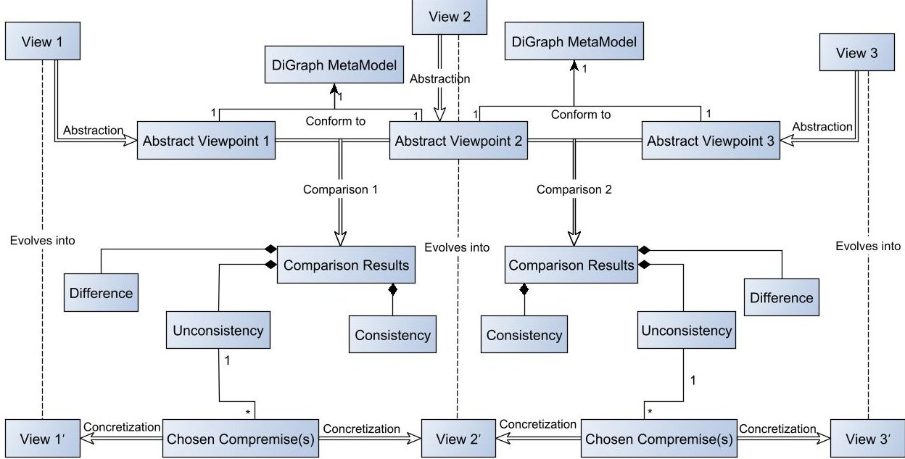


<div align="center">

Figure 1. Model synchronization approach.

</div>

As a first step, these views are abstracted into digraphs (i.e., directed graphs). Then, the abstracted views are compared to extract information about the consistent elements, potential differences, and inconsistencies. Finally, the views evolve in the concretization phase based on the chosen trade-offs proposed by a project manager.

Our study focuses on the configuration and implementation of the model synchronization approach within a mechatronic design project. We consider three domains to illustrate our methodology: systems engineering, dynamic simulation, and safety analysis. In the following, we represent the different concepts used to formalize the model synchronization approach.

## 3.1. Model Transformation Process

The model transformation process is applied in the abstraction and concretization operations. The abstraction operation is the automatic transformation of an engineering model into a digraph model. The concretization is the opposite process of the abstraction operation.

The directed graphs are chosen as a common representational formalism since it allows defining formally information and knowledge captured in any domain-specific model.

In our scenario, we formalized four metamodels that define the structural concepts of SysML, Modelica, Altarica, and the digraph models.

## 3.1.1. Metamodeling

The first step of the model transformation is to depict the metamodel of each domain-specific language to describe the different concepts that integrate each domain.

## SysML Internal Block Diagram (IBD) metamodel

We select the IBD diagram in our study since an IBD expresses the internal structure of a system and the interaction of its parts.

We describe the different concepts of an IBD diagram according to the OMG (Object Management Group) specifications [27]. An IBD model (Figure 2a) is made up of parts, connectors, and ports. One part can be connected to other parts via connectors. A port defines an interaction point for a part and can be a standard port or a flow port. A connector ensures the connection between two parts via a binding connector or an item flow.

<!-- PDF_PAGE: 6 -->

## Modelica metamodel

We express the concepts integrated into a Modelica model through the metamodel shown in Figure 2b. The metamodel is defined with regards to the specifications of Modelica language described in Reference [28].

A Modelica metamodel consists of a fundamental structuring unit called a class, which provides the structure of objects. A class can be connected to zero or more classes. A connection between two classes is introduced by a connection equation. These connections can be presented in two types: causal connection and acausal connection.

## Altarica metamodel

Altarica uses a System Modeling Language (S2ML) [29] as a structuring paradigm to provide a sufficient set of constructs to build hierarchical models. We defined the metamodel of an Altarica model based on the S2ML language. The Altarica metamodel is shown in Figure 2c.

Altarica has two concepts to structure models: block and class. Classes and blocks are the basic units of Altarica language since Altarica applies a prototype-oriented approach. A class or a block has interaction points defined by flow variables. These variables are used to model the propagation of the information between classes or blocks. The connections are represented by assertions. The assertion can be causal or acausal assertions.

## Digraph metamodel

A digraph is composed of a set of nodes (i.e., vertices) and edges (Figure 2d). Each node defines a set of leaving and entering edges. The graph is called directed because, for each edge, we define the source and the target nodes.

In Reference [26], we define the different mapping between the entities of modeling languages (i.e., SysML, Modelica, and Altarica) and the common representational formalism.


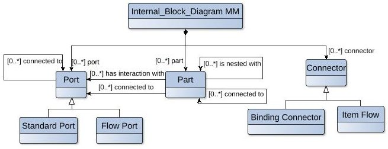


<div align="center">

(a)

</div>


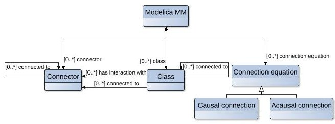


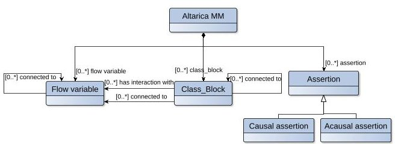


<div align="center">

(b)

</div>

<div align="center">

(c)

</div>


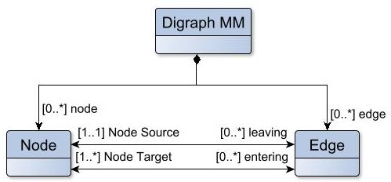


<div align="center">

(d)

</div>

<div align="center">

Figure 2. Metamodeling of different domain-specific models: (a) Partial meta-model of an Internal Block Diagram (IBD) model, (b) partial meta-model of a Modelica model, (c) partial meta-model of an Altarica model, and (d) partial meta-model of a digraph model.

</div>

<!-- PDF_PAGE: 7 -->

## 3.1.2. Expressing Model Transformation Rules

In this part, we present the transformation rules for the abstraction and concretization phases.

## Abstraction rules

The abstraction activity allows the engineering models to be represented as directed graphs. In this step, the SysML, Modelica, and Altarica metamodels are the source metamodels and the digraph metamodel is the target metamodel. To achieve the abstraction activity, we use the following transformation rules.

For each source model (i.e., SysML, Modelica, and Altarica models), entities are transformed into vertices. The flows exchanged between entities are transformed into edges. The interaction points between entities define the direction of edges.

## Concretization rules

The concretization activity allows updating engineering models depending on the changes provided in the abstracted models. This activity is considered the opposite process of the abstraction activity. Thus, the source metamodel is the digraph metamodel and the target metamodels are SysML, Modelica, and Altarica metamodels.

The transformation process is defined as follows. For each updated abstracted model, we transform firstly the vertices to represent the entities of the target models. Then, we transform oriented edges to define the connections and the direction of exchanged flows between different entities.

## 3.2. Comparison Process

Model comparison is a technique used to build specific interconnections between elements of two models in order to interpret the results according to certain criteria. In our study, we appeal to the use of systems engineering and SysML modeling language during the early phase of system design and for the overall life cycle of a mechatronic system. Therefore, we consider the system engineering model as a reference model.

As discussed in Reference [26], we apply the graph theory in the comparison of models. This theory allows consistency checks based on graph properties (i.e., graph and subgraph isomorphism).

We are convinced that our abstracted models cannot be isomorphic due to the specificity of each modeling language. Therefore, we need to find a query graph in a reference graph using subgraph isomorphism [30].

Subgraph isomorphism is used in many applications such as bioinformatics, chemistry, software engineering, computer-aided design, and graph transformation among others.

Finding a subgraph isomorphism is an NP-complete problem [31]. To decrease time and memory space complexity of the subgraph isomorphism search, many algorithms have been proposed, such as Ullman [32], VF2 [33], and BB-Graph [34].

In our study, we implemented a code relying on VF2 algorithm to assist engineers in the consistency checking, to build the consistent interconnections, and to detect the differences between abstracted models. VF2 has a higher performance in terms of matching time and space memory.

The differences detected in the comparison phase should be analyzed by a project manager. Then, he proposes a set of trade-offs that will be annotated in the erroneous views to be updated in the different source models.

## 4. Proof of Concept Implementation

In this section, a proof of concept implementation is developed to demonstrate the technological feasibility of the model synchronization approach. An overview of the basic architecture of our proof of concept implementation is illustrated in Figure 3.

<!-- PDF_PAGE: 8 -->

The different mechanisms of the architecture will be discussed in the following except for the knowledge base mechanism. This mechanism is included in the proof of concept implementation for completeness, but its automation is outside the scope of this paper (i.e., in our study, we address this mechanism manually).


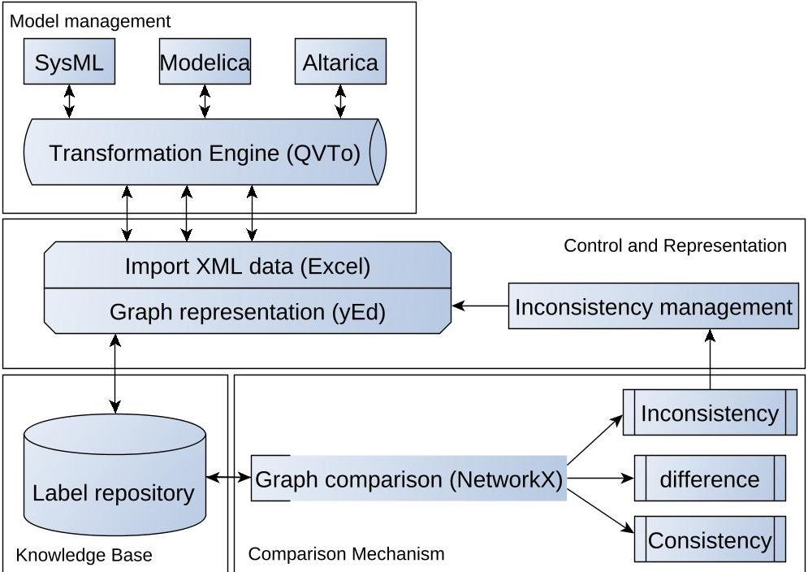


<div align="center">

Figure 3. Tool implementation process.

</div>

## 4.1. Model Management

We implement the model management process in the Eclipse platform [35] since we apply the model-driven approach. We use the technical environment Eclipse Modeling Framework (EMF) as it is adapted to modeling, metamodeling, and model transformation.

The choice of the transformation language is based on specific criteria for our approach. Indeed, the tool must be integrated into the EMF environment to be easily used with the modeling and metamodeling tools. Thus, we used the QVT operational mapping often called QVTo language [11]. We have two types of transformations: the direct transformation and the indirect transformation.

## Direct transformation

Direct transformation allows implementing the abstraction phase. The process is made up of several operations. First, we create the metamodels based on the Ecore metamodeling language. The next step is to create models as instances of the source metamodels that represent the instantiation of source models in the EMF platform. Then, we use the QVT plugin to implement the transformation rules. Finally, we execute the QVT script to provide the abstracted models in an XML Metadata Interchange (XMI) format.

## Indirect transformation

This mechanism allows the model concretization activity that represents the opposite process of the abstraction phase. We conduct the same operations as represented in the direct transformation. However, we use the updated graphs as instances of the source metamodel (i.e., digraph metamodel). Then, we use the QVT plugin to implement the transformation rules. The execution of the QVT script provides the updated models.

## 4.2. Comparison Mechanism

In our study, we considered the systems architecting process. The CESAMES (Center of Excellence on Systems Architecture, Management, Economy, and Strategy) method for systems architecting [36]

<!-- PDF_PAGE: 9 -->

considers three different abstraction levels of a system: the operational level, the functional level, and the physical level. The project manager conducts a cross analysis of the activities of the different engineering disciplines and their possible dependencies. They define the purpose of the synchronization process. Then, they identify the activities for each discipline that will be considered in the consistency management process. The chosen activities deal with different concerns at the same level of abstraction. In this paper, the goal of the synchronization process is to ensure consistency at the physical level. Therefore, the project manager chooses the physical architecture models for the analysis (i.e, IBD in SysML), and they consider the physical architecture of the Modelica and Altarica models). Therefore, we guarantee that the entry models of the comparison process are defined at the same level of abstraction. The comparison process can be applicable in our scenario.

We use NetworkX [37], which is "a python 3 package for the creation, manipulation, and study of the structure, dynamics, and functions of complex networks", as a query engine to demonstrate the comparison process.

In the first step, we import the different graphs representing our abstracted models as shown in Listing 1, lines 3-8. Then, we can display the properties of graphs such as the type of graphs (e.g., digraph, multigraph, etc.), number of nodes, and number of edges in a graph. In addition, we can verify graph isomorphism between abstracted models as represented in Listing 1, lines 10-14.

## Listing 1: An excerpt of the comparison algorithm.

```python

import networkx as nx

import matplotlib.pyplot as plt

g1=nx.MultiDiGraph()

g1.name='Modelica_multigraph'

g2=nx.MultiDiGraph()

g2.name='SysML_multigraph'

g1=nx.read_gml ('SysML_graph_EMA.gml')

g2=nx.read_gml ('Modelica_graph_EMA.gml')

#show graphs properties & verify isomorphism

print (nx.info(g1))

print (nx.info(g2))

iso=nx.is_isomorphic(g1,g2)

print ('g1_and_g2_are_isomorphic:'+str(iso))

#find subgraphs SysML_Modelica

common_subgraph_g1=nx.MultiDiGraph()

common_subgraph_g1=nx.subgraph(g1,g2)

print ('common_subgraph_g1')

pos=nx.circular_layout(common_subgraph_g1)

nx.draw(common_subgraph_g1,pos,with_labels=True,font_size=8)

plt.show()

nx.write_gml(common_subgraph_g1,"common_subgraph_g1.gml")

#best fitting

g4=nx.MultiDiGraph()

g4=nx.compose(g1,g2)

node_colors=[]

for node in g4.nodes:

if node in common_subgraph_g1.nodes:

node_colors.append('r')

else:

node_colors.append('lightgrey')

edge_colors=[]

for edge in g4.edges:

if edge in common_subgraph_g1.edges:

edge_colors.append('k')

elif edge in g2.edges:

edge_colors.append('b')

else:

edge_colors.append('g')

print ('best_fit_SysML_Modelica')

pos=nx.circular_layout(g4)

nx.draw(g4,pos,node_color =node_colors,with_labels=True)

nx.draw_networkx_edges(g4,pos,edge_color=edge_colors)

nx.draw_networkx_edges(g4,pos,edge_color=edge_colors)

plt.show()

nx.write_gml(g4,"best_fit_g4.gml")

#additional nodes and edges

additional_nodes_g1=list(set(g1.nodes)-set(common_subgraph_g1.nodes))

print ('additional_nodes_g1_SysML/Modelica:'+str(additional_nodes_g1))

additional_edges_g1=list(set(g1.edges)-set(common_subgraph_g1.edges))

print ('additional_edges_g1_SysML/Modelica:'+str(additional_edges_g1))

```

Furthermore, we can search for common subgraphs that exist between graphs. Algorithm "subgraph" returns the greatest subgraph of graph g1 that also exists in graph g2. This algorithm

<!-- PDF_PAGE: 10 -->

allows detecting the main correspondences between two graphs. For example, using lines 17-23 of Listing 1, we search for a common subgraph between SysML and Modelica graphs.

Lines 26-48 of Listing 1 allow carrying out a consistency check between two abstracted models; i.e., we use Algorithm "compose" to return a new graph that composes the two abstracted models. The union shows the common subgraph between the two abstracted models and highlights the nodes and arcs that do not appear in both graphs.

Finally, we can conclude the lists of additional nodes and edges in each model considering the common subgraph between every two graphs as shown in Listing 1, lines 51-54. Thereafter, a project manager analyzes the outputs of the comparison process and proposes the appropriate changes to apply in the abstracted models.

## 4.3. Control and Representation

Within the control and representation layer of our demonstrator, inconsistencies can be managed. Then, the changes can be visualized using a general-purpose diagramming program labeled "yEd" [38]. Besides, this layer allows exchanging metadata information between various tools used to implement our methodology. We use the XMI format to exchange metadata between the QVTo language and the yEd tool. We use also the GraphML format to exchange the graph structure data between the yEd tool and the NetworkX language.

## 5. Case Study

In this paper, an Electro-Mechanical Actuator (EMA) is used to better illustrate our methodology. The motivation behind using the EMA system as an example is due to the simplicity of developing the different separate models. Thus, the complexity faced during the verification and validation process can be consequential.

The studied system is a geared EMA onboard a small aircraft. The system's mission is to actuate the aileron of the aircraft. The geared EMA consists of an electric motor, a gearbox, a nut screw mechanism, and an electronic control. The gearbox is used as an intermediate reducer. The nut screw mechanism transfers the mechanic power to the control surface. The Electronic Control Unit (ECU) is the device that controls the system. The schematic architecture of the geared EMA is presented in Figure 4, adopted from Reference [39].


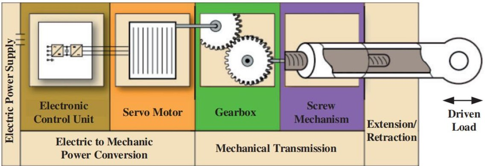


<div align="center">

Figure 4. The schematic structure of a geared Electro-Mechanical Actuator (EMA) (Guan Qiao (2018)).

</div>

## 5.1. Design Models of the EMA

In our scenario, we consider three models of the EMA system created during the engineering design process: a SysML model that defines the physical architecture design of a system, a Modelica model that performs dynamic analysis to predict the performance of the system, and an Altarica model which is dedicated to probabilistic risk and safety analysis. In the following, these models are described in more details.

<!-- PDF_PAGE: 11 -->

## 5.1.1. System Engineering Perspective (SysML)

The Systems Modeling Language (SysML) [27] is a general purpose graphical modeling language for systems engineering. SysML assists the specification, analysis, design, verification, and validation of complex systems. It is used to capture requirements and to specify the structure and the behavior of a complex system to support engineering analysis.

The IBD diagram illustrates the internal structure decomposition of the EMA. It defines the interconnections between its components as represented in Figure 5.


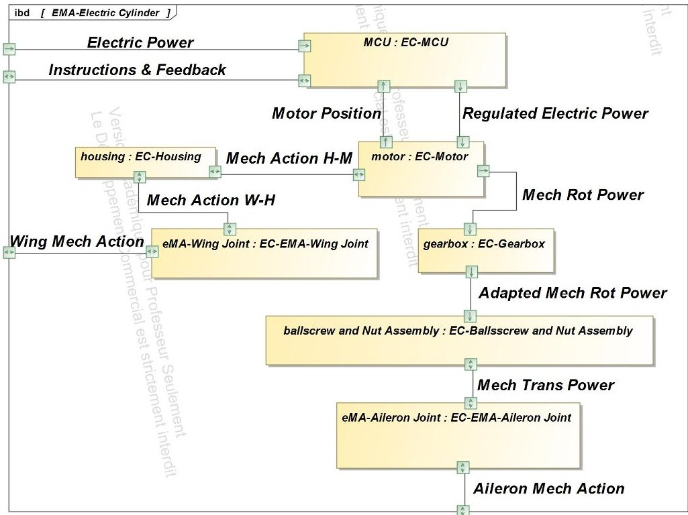


<div align="center">

Figure 5. IBD model of the EMA system.

</div>

The main function of the EMA system is to regulate the incidence angle of the aileron. This function is achieved by the ball screw and nut assembly "bsNA". It provides the necessary mechanical translation power to modify the aileron angle in a given range $ [\theta_{min},\theta_{max}] $ . The aileron angle is controlled by a Micro-Controller Unit "MCU". The MCU provides the DC motor with the regulated electric power that will be transferred into a mechanical rotational power via a gearbox. Then, the bsNA transforms the adapted mechanical rotational power to a mechanical action that will actuate the aileron.

## 5.1.2. System Behavior Analysis (Modelica)

Modelica [28] is an object-oriented and equation-based modeling language. Its main objective is to model the dynamic behavior of large, complex, and heterogeneous physical systems. These systems consist of mechanical, electrical, thermal, and hydraulic, among other components. To predict the dynamic behavior of the EMA system on Modelica, we designed a closed-loop system as represented in Figure 6.

The DC motor receives a regulated signal voltage from the PID (Proportional-Integral-Derivative) controller that employs feedback from the angle sensor. Then, the ideal gear adapts the mechanical rotational power that will be transformed into mechanical transitional power via a set of components (i.e., ideal Gear R2T, prismatic, bodybox2, and bodybox3). The universal joint represents the connection between the wing and the EMA system. The spherical joint represents the joint between the aileron and the EMA system. Moreover, we add an aerodynamic torque to simulate the friction that induces the nonlinearity of the system.

<!-- PDF_PAGE: 12 -->

## 5.1.3. Dysfunctional Behavior Analysis (Altarica)

Altarica [40] is a high-level modeling language dedicated to safety and performance analysis. Altarica is an event-centric language and is combined of two parts:

- A mathematical framework, based on Guarded Transition Systems (GTS) [41]

- Sets of constructing mechanisms stemmed from object-oriented programming, based on the System Structure Modeling Language (S2ML) [29]


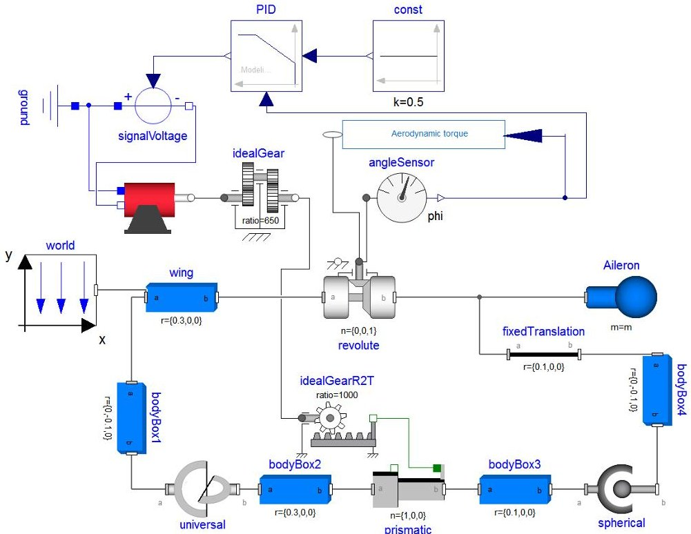


<div align="center">

Figure 6. Modelica model of the EMA system.

</div>

Once the EMA system is specified in the Altarica language, it can be compiled into a lower-level formalism such as fault trees and stochastic Petri nets, among other safety assessments. Listing 2 represents an excerpt of the global model of the EMA system modeled in Altarica 3.0.

<div align="center">

Listing 2: An overview of the Altarica model of the EMA.

</div>

<table border="1"><tr><td>class</td><td>NRComponent</td><td>...</td><td>end</td></tr><tr><td>block</td><td>EMASystem</td><td></td><td></td></tr><tr><td>block</td><td>Instructions</td><td>...</td><td>end</td></tr><tr><td>block</td><td>ElectricPower</td><td>...</td><td>end</td></tr><tr><td>block</td><td>IncidenceSensor</td><td>...</td><td>end</td></tr><tr><td>block</td><td>MCU</td><td>...</td><td>end</td></tr><tr><td>block</td><td>EMAWingJoint</td><td>...</td><td>end</td></tr><tr><td>block</td><td>Housing</td><td>...</td><td>end</td></tr><tr><td>block</td><td>EMAileronJoint</td><td>...</td><td>end</td></tr><tr><td>block</td><td>Motor</td><td>...</td><td>end</td></tr><tr><td>block</td><td>Gearbox</td><td>...</td><td>end</td></tr><tr><td>block</td><td>BallScrewNutAssembly</td><td>...</td><td>end</td></tr><tr><td>block</td><td>Observer</td><td>...</td><td>end</td></tr><tr><td>end</td><td></td><td></td><td></td></tr><tr><td>assertion</td><td></td><td></td><td></td></tr><tr><td>MCU.vfFromElectricPower</td><td colspan="3">= ElectricPower.vfToMCU;</td></tr><tr><td>MCU.vfFromInstructions</td><td colspan="3">= Instructions.vfToMCU;</td></tr><tr><td>MCU.vfFromIncidenceSensor</td><td colspan="3">= IncidenceSensor.vfToMCU;</td></tr><tr><td>Motor.vfFromMCU</td><td colspan="3">= MCU.vfToMotor;</td></tr><tr><td>Gearbox.vfFromMotor</td><td colspan="3">= Motor.vfToGearbox;</td></tr><tr><td>BallScrewNutAssembly.vfFromGearbox</td><td colspan="3">= Gearbox.vfToBallScrewNutAssembly;</td></tr><tr><td>Observer.vfFromBallScrewNutAssembly</td><td colspan="3">= BallScrewNutAssembly.vfToEMAileronJoint;</td></tr><tr><td>Observer.vfFromHousing</td><td colspan="3">= Housing.vfOut;</td></tr><tr><td>Observer.vfFromEMAWingJoint</td><td colspan="3">= EMAWingJoint.vfOut;</td></tr><tr><td>Observer.vfFromEMAileronJoint</td><td colspan="3">= EMAAileronJoint.vfOut;</td></tr><tr><td>end</td><td></td><td></td><td></td></tr></table>

In our scenario, all components may fail and they are non-reparable components. An observer is defined to track the failure event system that consists of the loss of the aileron incidence control.

<!-- PDF_PAGE: 13 -->

## 5.2. Methodology Application

In the following, our methodology is illustrated using the EMA example.

## 5.2.1. Abstraction

As discussed in Section 3, we transform our engineering models into directed graph representations. The abstracted models are visualized in yEd tool, as shown in Figure 7.


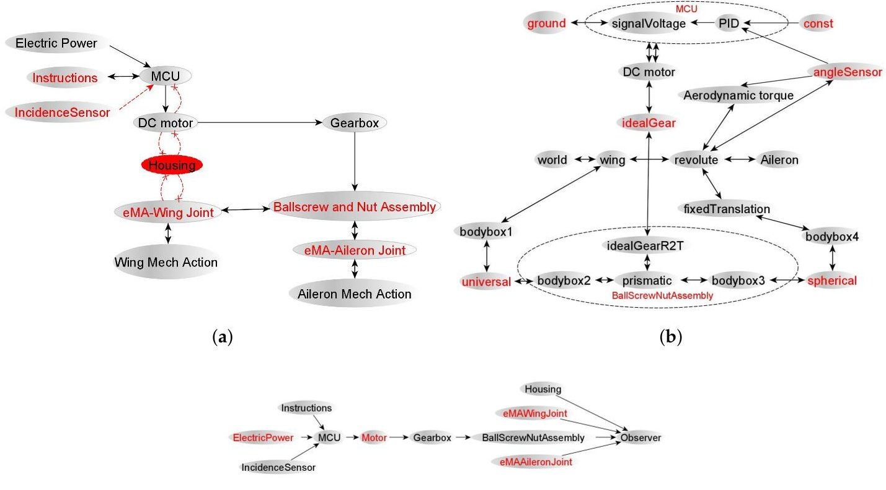


<div align="center">

(c)

</div>

<div align="center">

Figure 7. Abstraction of different domain-specific models (red nodes = incorrect naming, dashed edges = missing or adding edges): (a) SysML abstracted model, (b) Modelica abstracted model, and (c) Altarica abstracted model.

</div>

## 5.2.2. Comparison

The abstracted models (Figure 7) are exported from the yEd tool to the NetworkX tool based on the GraphML format. We used the code depicted in Listing 1 to compare abstracted graphs (e.g., comparing SysML and Modelica graphs). We were able to assess the consistency between models within five iterations. We depict the comparison method as follows: As a first step, we constitute a first version of the label repository, where we list the set of vertices representing the inter-model correspondences. For each iteration, we import the different abstracted graphs (e.g., we imported SysML and Modelica graphs in Listing 1, lines 7-8). Then, we represent graphically the common subgraph that exists between SysML and Modelica graphs in lines 17-23 of Listing 1. After that, we compose the two graphs in a graph g4 in lines 26-48 of Listing 1. In this graph, we represent the common subgraph between SysML and Modelica graphs, and the extra nodes and edges are represented in different colors. The extra nodes and edges represent specific entities for each model. Finally, the code in lines 43-48 of Listing 1 print a graph represented as a chord diagram as shown in Figure 8.

The final iteration enables the visualization of all correspondences and differences between the two modeling languages. As an example, we represent in Figure 8 successively the inter-model connections between SysML and Modelica abstracted models (Figure 8a) and the inter-model connections between the SysML and Altarica abstracted models (Figure 8b) in the final iteration.

<!-- PDF_PAGE: 14 -->


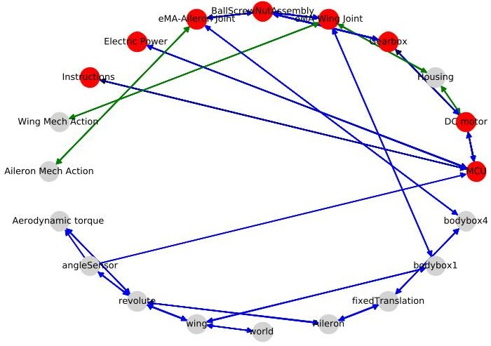


<div align="center">

(a)

</div>


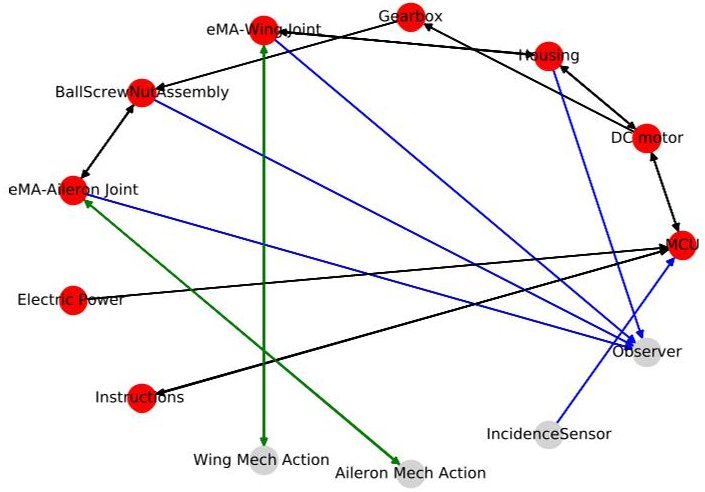


<div align="center">

(b)

</div>

<div align="center">

Figure 8. Comparing Modelica and Altarica abstracted models to SysML abstracted model (Red nodes = common nodes, grey nodes = different nodes, blue edges = Modelica or Altarica specific edges, and green edges = SysML specific edges): (a) SysML/Modelica comparison and (b) SysML/Altarica comparison.

</div>

In this stage, the project manager diagnoses the differences detected in the comparison process. Then, they decide if they are considered as inconsistencies or intentional differences due to the specification of each modeling language. In our case study, the project manager identifies different types of differences:

## Unconventional naming

Each expert uses a very precise and specific vocabulary from other disciplines. Therefore, we detect different naming of modeling elements between various models that refer to the same concept (e.g., Gearbox and idealGear).

## Level of abstraction

The difference between models can be related to the level of abstraction at which a designer considers the system. The design information can be decomposed in subsystems in a different manner between various models (e.g., bsNA).

## Design concerns

In a multi-viewpoint design, each designer focuses on a certain design concern of the overall system and considers these concerns at a certain level of abstraction. Therefore, the comparison process can detect missing or additional elements between models addressing particular perspectives (e.g., aerodynamic torque).

The set of inconsistencies identified in our work is shown below:

## Conflicting information

This type of inconsistency occurs whenever there is knowledge about the system producing contradictory information between different viewpoints (e.g., the housing connections are different between SysML and Altarica digraphs).

## Inconsistencies based on meta-level correspondences

This sort of inconsistency exists when the different mapping between the entities of modeling languages is not guaranteed. For instance, the angle sensor is defined as classes in the Modelica and Altarica models but it is specified via a connection in SysML model.

<!-- PDF_PAGE: 15 -->

## The omission of essential elements in system design

The inconsistency can result from human errors, miscommunication between designers, or misunderstood assumptions that can lead to a misconception of the system elements. For instance, the angle sensor is replaced by a connection in SysML model. This connection defines the motor position which can cause miscommunication between engineers since the angle sensor gives the ECU unit feedback on the measured angle at the bsNA output.

Then, the project manager suggests a list of changes to be performed in various abstracted models (i.e., the changes will be conducted on elements represented in red shown in Figure 7).

## 5.2.3. Concretization

The updated graphs are implemented in the Eclipse platform as discussed in Section 4 to update entry models using model transformation techniques.

The updated graphs are exported from yEd tool to Elipse platform using the XMI format. Then, the project manager implements a code that executes the transformation rules (i.e., indirect transformation rules). Thereafter, they obtain three textual XMI files that represent the updated models based on the concepts of each language. Then, each engineer collects the appropriate XMI file that corresponds to their language and imports it into their proper tool. For example, the systems engineer retrieves an XMI file of their SysML model that contains the corrections proposed by the project manager. They import the XMI file in the Magicdraw tool (SysML tool). As a result, they obtains the IBD model represented in Figure 9.

In this paper, we only represent the IBD updated model (Figure 9) to illustrate the implementation of the concretization process for saving space.


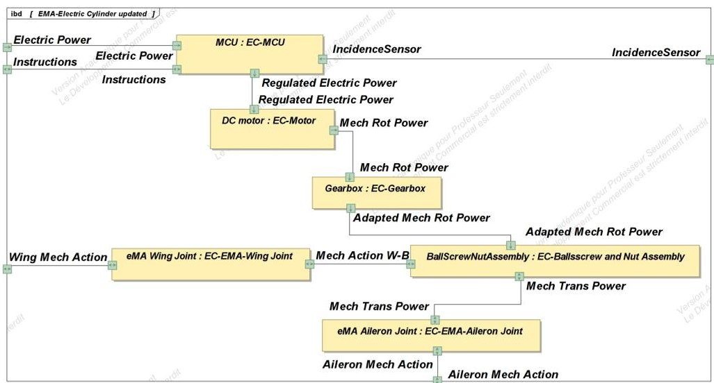


<div align="center">

Figure 9. SysML_IBD updated model.

</div>

## 6. Discussion

In this section, we will conduct a discussion of the main contributions of our method compared to the methods of literature.

The first improvement of our approach compared to the integration approach and the model federative approach is to be able to support specific modeling language for each domain.

The existing model transformation approaches are criticized since there is an epistemic gap between pragmatic models (e.g., SysML) and formal models (e.g., Modelica and Altarica). This make the transformation not fully automatic from pragmatic models to formal ones. Furthermore, implied explicit knowledge in target models can lead to disappointing results where the source models are blurred and overloaded and the generated formal models are incomplete and uselessly complex. Also, the method proposed by Shah et al. [9] did not ensure consistency management since the method considers orienting relations encoded in the transformation rules. The method allowed a SysML

<!-- PDF_PAGE: 16 -->

model to be transformed into Modelica and EPLAN (i.e., to capture the hydraulic schematics) models. However, a change in Modelica or EPLAN models cannot automatically be detected and transformed back into SysML model since the transformation rules consider unidirectional model transformation. To solve that, our approach consists on transforming all our domain-specific models into a common and understandable formalism that reduces the number and complexity of transformation rules used.

The inconsistency management approach relies on either proof-theoretic concepts, rule definitions, or synchronization process based on model transformations. The methodology proposed by Gausemeier et al. [25] faces the challenge of having to transform between different formal systems (i.e., models). This method is not always possible without encoding large amounts of additional knowledge and information in the transformation. This is similar to the methodology proposed by Finkelstein et al. [24] that requires a complete and consistent definition of an underlying formal system. Therefore, these approaches are unlikely to be feasible practically and economically. Also, the rules used by Feldmann et al. [5] need to be maintained (i.e., revised and grown), resulting in possibly time-consuming and costly work.

The different techniques identified in Spanoudakis [6] are based on fundamental concepts developed in model-driven software engineering research. Since a broader knowledge is required to develop mechatronic systems due to their multidisciplinary nature and the heterogeneity of a multitude of disparate models being used, these techniques cannot directly be applied in the process design and development of mechatronic systems. Herzig et al. [4] explored the fundamentals of consistency and relate these concepts to modeling and engineering design. However, the authors consider specific types of inconsistencies and the fundamental theory is not applied to an automated solution. The approach proposed a partial solution for consistency management since some inconsistencies may remain undiscovered. Hehenberger et al. [8] is limited to identifying inconsistencies, but they did not support the method by techniques to resolve them. Qamar et al. [7] presented a dependency modeling language to capture the dependencies between properties in multiple views of a system. Dependencies between these properties are interesting to identify inconsistencies between models but it is insufficient to manage consistency since it considers specific types of inconsistencies (i.e., related to properties). The resolution of inconsistencies is a manual process. This method is proposed as an aid for consistency management.

While being less formal than the methodologies proposed in the literature, we assume that our methodology is a more flexible alternative, since it uses a common representational formalism to abstract models and uses a comparison algorithm allowing easier and quicker detection of different differences and inconsistencies between models without the need of a complete knowledge of an underlying formal system.

The overarching goal of our research is to manage the consistency between different domain-specific models of a mechatronic system in order to deliver viable models in a shorter period of time. Our approach is used to improve the V-cycle systems engineering process for mechatronic development.

Traditionally, inconsistencies are identified as a part of the verification and validation (V&V) process. The time interval between V&V activities is usually very long. Therefore, the cost associated with solving inconsistencies can be very high. According to INCOSE [42], errors are less costly to remove early in the life cycle. Based on statistical analysis, eliminating the detected design errors during the design phase is 6 times more expensive than removing them in the early concept phase. This number can be multiplied by 100 and 1000 if the design errors are detected during the development, production, or test stages.

Consequently, the earlier an inconsistency is identified during the life cycle process, the cheaper it is to fix. Therefore, we propose a continuous and (semi)automatic method of managing inconsistencies to remove inconsistencies early in the life cycle and to positively support the V&V process.

However, as shown in the previous sections, the changes of the models are determined by the project manager who has a global knowledge of the various models. Hence, the comparison phase is a semiautomatic process. This assumption makes the process dependent on the project manager

<!-- PDF_PAGE: 17 -->

and thus relatively centralized. For example, they intervene in checking the consistency between models and they are responsible for proposing appropriate changes, defining correspondences between label components. For these reasons, we will continue our research in future works to enhance the consistency management process by creating a library of label components that can be shared between different designers to enable fast verification of correspondences between models and to reduce the number of iteration of the comparison process. Also, a mechanism for solving inconsistencies should be implemented using transformation rules as proposed for software engineering in [43].

## 7. Conclusions

In the context of MBE, the development of mechatronic systems presents the particular challenge of the consistency between different models arising from the collaboration of multiple domains. Generally, different designers study the system from different viewpoints. Consequently, inconsistencies may occur in the course of the development process due to the existence of different interconnections between different models of a mechatronic system.

The main contribution of this paper is to ensure the consistent development of mechatronic systems. To reach this objective, we have presented a model synchronization methodology composed of three phases. The first phase allows representing domain-specific models in a common formalism based on graphs. These abstractions are used in the second phase to perform comparisons based on a subgraph isomorphism algorithm allowing the identification of differences and inconsistencies between the various models. The comparison process is an iterative process where the project manager is consulted to propose alternatives to solve the detected inconsistencies. The final phase is based on the comparison results to update the original models applying a model transformation mechanism.

The technical viability of the methodology is shown using an EMA case study. Although being a bench-scale, academic case study, the EMA is complex enough to demonstrate an excerpt of the challenges that arise during engineering of mechatronic systems. It illustrates that there are many interconnections between the considered viewpoints. The EMA system proves that our proof of concept implementation allows checking consistency and detected inconsistencies at an early stage of the design process.

The methodology proposed in this work presents many advantages such as ensuring multidisciplinary interactions between multiple designers at an early stage which increase the competitiveness and reduce the development time and cost. It aims to ensure the consistency between domain-specific models and to automate the change propagation during the concretization phase. Furthermore, the methodology allows an exchange between multidisciplinary designers without needing to understand the formalisms of other experts due to the use of a common representational formalism. The developed methodology is not limited to any particular domain and can be provided as a step towards unifying the various domains involved in the process of mechatronic system designs.

However, the methodology has some limitations: The model synchronization approach is applied only on structural and hierarchical models. The use of a specific vocabulary for each domain results in iterative cycles needed to apply the comparison process since the interconnected information is captured a priori by a human (i.e., the project manager). Also, the classification and resolution of differences are manual processes that depend on the project manager activities.

In future works, we will explore how our method can be extended to support the consistency management of behavioral models. As a first step, we will use behavioral models (e.g., the SysML state machine diagrams and the Altarica GTS model that represent states/events formalism for reliability study). Therefore, we can represent the behavior models using graph representations and implement our techniques to analyze the consistency between behavioral models. This is a preliminary solution to ensure semantic consistency based on the model synchronization approach. Afterward, we plan to study the fundamental concepts of semantic consistency management during the development of mechatronic systems and we will investigate how other techniques for multi-domain system

<!-- PDF_PAGE: 18 -->

development, such as DEVSML (Discrete EVent Systems Modeling Language) stack by Mittal et al. [44], can be combined with our approach.

Also, we should automate the creation of a shared repository that contains a common vocabulary that should be used by different designers to minimize the iterative process of the comparison mechanism. We need in further research to adapt a larger case study to evaluate the scalability and the performance of our methodology at a mature phase to allow more types of inconsistencies to be identified. Finally, we should automate the mechanism of resolving inconsistencies.

Author Contributions: Conceived the idea, A.B., F.M., J.-Y.C., and A.M.; implementation, A.B.; writing—original draft preparation, A.B.; writing—review and editing, F.M.; supervision, A.M. and J.-Y.C. All authors have read and agreed to publish this version of the manuscript.

Funding: This research received no external funding.

Acknowledgments: A part of the case study was supported by IRT SystemX (Altarica), University of Naples Federico II (Modelica), and SUPMECA (SysML). The authors would like to thank IRT SystemX, especially to Antoine B. Rauzy, Michel Batteux, and Tatiana Prosvirnova, for the many valuable discussions and for allowing the dissemination of the case study.

Conflicts of Interest: The authors declare no conflict of interest.

## References

1. Isermann, R. Mechatronic systems: Concepts and applications. Trans. Inst. Meas. Control 2000, 22, 29-55. [CrossRef]

2. Broy, M.; Feilkas, M.; Herrmannsdoerfer, M.; Merenda, S.; Ratiu, D. Seamless model-based development: From isolated tools to integrated model engineering environments. Proc. IEEE 2010, 98, 526-545. [CrossRef]

3. Törngren, M.; Qamar, A.; Biehl, M.; Loiret, F.; El-Khoury, J. Integrating viewpoints in the development of mechatronic products. Mechatronics 2014, 24, 745-762. [CrossRef]

4. Herzig, S.J.; Paredis, C.J. A conceptual basis for inconsistency management in model-based systems engineering. Procedia CIRP 2014, 21, 52-57. [CrossRef]

5. Feldmann, S.; Herzig, S.J.; Kernschmidt, K.; Wolfenstetter, T.; Kammerl, D.; Qamar, A.; Lindemann, U.; Krcmar, H.; Paredis, C.J.; Vogel-Heuser, B. Towards effective management of inconsistencies in model-based engineering of automated production systems. IFAC-PapersOnLine 2015, 48, 916-923. [CrossRef]

6. Spanoudakis, G.; Zisman, A. Inconsistency management in software engineering: Survey and open research issues. In Handbook of Software Engineering and Knowledge Engineering: Volume I: Fundamentals; World Scientific: River Edge, NJ, USA, 2001; pp. 329-380.

7. Qamar, A.; Herzig, S.J.; Paredis, C.J. A Domain-Specific Language for Dependency Management in Model-Based Systems Engineering. MPM@MoDELS 2013, 1112, 7-16.

8. Hehenberger, P.; Egyed, A.; Zeman, K. Consistency checking of mechatronic design models. In Proceedings of the ASME 2010 International Design Engineering Technical Conferences and Computers and Information in Engineering Conference, Montreal, QC, Canada, 15-18 August 2010; pp. 1141-1148.

9. Shah, A.A.; Kerzhner, A.A.; Schaefer, D.; Paredis, C.J. Multi-view modeling to support embedded systems engineering in SysML. In Graph Transformations and Model-Driven Engineering; Springer: Berlin/Heidelberg, Germany, 2010; pp. 580-601.

10. Legendre, A.; Lanusse, A.; Rauzy, A. Toward model synchronization between safety analysis and system architecture design in industrial contexts. In Proceedings of the International Symposium on Model-Based Safety and Assessment (IMBSA 2017), Trento, Italy, 11-13 September 2017; Springer: Cham, Switzerland, 2017; pp. 35-49.

11. Barendrecht, P.J. Modeling Transformations Using QVT Operational Mappings; Research Project Report; Department of Mechanical Engineering Systems Engineering Group, Eindhoven University of Technology: Eindhoven, The Netherlands, 2010.

12. OMG. Meta Object Facility (MOF) Core Specification v 2.5.1. 2006. Available online: https://www.omg.org/ spec/MOF/2.5.1/PDF (accessed on 9 August 2019).

13. OMG. Model Driven Architecture (MDA). Available online: https://www.omg.org/mda/ (accessed on 26 February 2020).

<!-- PDF_PAGE: 19 -->

14. Mauborgne, P.; Deniaud, S.; Levrat, E.; Bonjour, E.; Micaelli, J.P.; Loise, D. Preliminary Hazard Analysis Generation Integrated with Operational Architecture-Application to Automobile. In Complex Systems Design & Management; Springer: Cham, Switzerland, 2015; pp. 297-309.

15. Kleiner, S.; Kramer, C. Model based design with systems engineering based on RFLP using V6. In Smart Product Engineering; Springer: Berlin/Heidelberg, Germany, 2013; pp. 93-102.

16. Guychard, C.; Guerin, S.; Koudri, A.; Beugnard, A.; Dagnat, F. Conceptual interoperability through models federation. In Proceedings of the Semantic Information Federation Community Workshop, Miami, FL, USA, October 2013; HAL id: hal-00905036.

17. Thramboulidis, K. The 3+1 SysML view-model in model integrated mechatronics. J. Soft. Eng. Appl. 2010, 3, 109. [CrossRef]

18. Pop, A.; Akhvlediani, D.; Fritzson, P. Towards unified system modeling with the ModelicaML UML profile. In Proceedings of the 1st International Workshop on Equation-Based Object-Oriented Languages and Tools, Berlin, Germany, 30 July 2007; Conjunction with ECOOP; Linkoping University Electronic Press: Linkoping, Sweden, 2007; number 024.

19. Paredis, C.J.; Bernard, Y.; Burkhart, R.M.; de Koning, H.P.; Friedenthal, S.; Fritzson, P.; Rouquette, N.F.; Schamai, W. An Overview of the SysML-Modelica Transformation Specification. In Proceedings of the INCOSE International Symposium, Chicago, IL, USA, 12-15 July 2010; Volume 20, pp. 709-722.

20. Mhenni, F.; Nguyen, N.; Choley, J.Y. SafeSysE: A Safety Analysis Integration in Systems Engineering Approach. IEEE Syst. J. 2018, 12, 161-172, doi:10.1109/JSYST.2016.2547460. [CrossRef]

21. Hildebrandt, S.; Lambers, L.; Giese, H.; Rieke, J.; Greenyer, J.; Schäfer, W.; Lauder, M.; Anjorin, A.; Schürr, A. A survey of triple graph grammar tools. Electron. Commun. EASST 2013, 57, 1-17.

22. Adourian, C.; Vangheluwe, H. Consistency between geometric and dynamic views of a mechanical system. In Proceedings of the 2007 Summer Computer Simulation Conference, San Diego, CA, USA, 15-18 July 2007; Society for Computer Simulation International: San Diego, CA, USA, 2007; p. 31.

23. Anwar, A.; Benelallam, A.; Nassar, M.; Coulette, B. A graphical specification of model composition with triple graph grammars. In Proceedings of the International Workshop on Model-Based Methodologies for Pervasive and Embedded Software, Essen, Germany, 4 September 2012; pp. 1-18.

24. Finkelstein, A.; Gabbay, D.; Hunter, A.; Kramer, J.; Nuseibeh, B. Inconsistency handling in multi-perspective specifications. In Proceedings of the 4th European Software Engineering Conference, Garmisch-Partenkirchen, Germany, 13-17 September 1993; pp. 84-99.

25. Gausemeier, J.; Schafer, W.; Greenyer, J.; Kahl, S.; Pook, S.; Rieke, J. Management of cross-domain model consistency during the development of advanced mechatronic systems. In Proceedings of the 17th International Conference on Engineering Design (ICED 09), Palo Alto, CA, USA, 24-27 August 2009; Volume 6, Design Methods and Tools (part 2).

26. Berriche, A.; Mhenni, F.; Mlika, A.; Choley, J.Y. Towards Model Synchronization in Model Driven Engineering of Mechatronic Systems. In Proceedings of the 2019 IEEE International Systems Engineering Symposium (ISSE), Edinburgh, UK, 3 October 2019; p. 8.

27. OMG. Systems Modeling Language (OMG SysML), Version 1.4. 2012. Available online: https://www.omg.org/spec/SysML/1.4/PDF (accessed on 26 December 2018).

28. Modelica Association. Modelica-A Unified Object-Oriented Language for Systems Modeling, Language Specification Version 3.4. 2017. Available online: https://www.modelica.org/documents/ModelicaSpec34.pdf/view (accessed on 24 April 2019).

29. Batteux, M.; Prosvirnova, T.; Rauzy, A. System Structure Modeling Language (S2ML). 2015. Available online: https://hal.archives-ouvertes.fr/hal-01234903/document (accessed on 18 January 2019).

30. Kotthoff, L.; McCreesh, C.; Solnon, C. Portfolios of subgraph isomorphism algorithms. In Proceedings of the International Conference on Learning and Intelligent Optimization, Ischia, Italy, 29 May-1 June 2016; pp. 107-122.

31. Gallagher, B. The State of the Art in Graph-Based Pattern Matching; Technical report; Lawrence Livermore National Lab: Livermore, CA, USA, 2006.

32. Ullmann, J.R. An algorithm for subgraph isomorphism. JACM 1976, 23, 31-42. [CrossRef]

33. Cordella, L.P.; Foggia, P.; Sansone, C.; Vento, M. An improved algorithm for matching large graphs. In Proceedings of the 3rd IAPR-TC15 Workshop on Graph-Based Representations in Pattern Recognition, Ischia, Italy, 23-25 May 2001; pp. 149-159.

<!-- PDF_PAGE: 20 -->

34. Asiler, M.; Yazicı, A. BB-Graph: A Subgraph Isomorphism Algorithm for Efficiently Querying Big Graph Databases. arXiv 2017, arXiv:1706.06654.

35. Gronback, R.C. Eclipse Modeling Project: A Domain-Specific Language (DSL) toolkit; Pearson Education: London, UK, 2009.

36. Krob, D. CESAM: CESAMES Systems Architecting Method: A Pocket Guide; CESAMES: Paris, France, 2017.

37. Hagberg, A.; Schult, D.; Swart, P. NetworkX Reference. 2020. Available online: https://networkx.github.io documentation/latest/_downloads/networkx_reference.pdf (accessed on 7 May 2019).

38. YWorks. yEd Graph Editor. 2014. Available online: https://www.yworks.com/products/yed (accessed on 13 June 2019).

39. Qiao, G.; Liu, G.; Shi, Z.; Wang, Y.; Ma, S.; Lim, T.C. A review of electromechanical actuators for More/All Electric aircraft systems. Proc. Inst. Mech. Eng. Part C J. Mech. Eng. Sci. 2018, 232, 4128-4151. [CrossRef]

40. Prosvirnova, T.; Batteux, M.; Brameret, P.A.; Cherfi, A.; Friedlhuber, T.; Roussel, J.M.; Rauzy, A. The altarica 3.0 project for model-based safety assessment. IFAC Proc. Vol. 2013, 46, 127-132. [CrossRef]

41. Rauzy, A.B. Guarded transition systems: a new states/events formalism for reliability studies. Proc. Inst. Mech. Eng. Part O J. Risk Reliab. 2008, 222, 495-505. [CrossRef]

42. Haskins, C.; Forsberg, K.; International Council on Systems Engineering. In Systems Engineering Handbook: [SEH]; A Guide for System Life Cycle Processes and Activities; Incose: San Diego, CA, USA, 2007.

43. Mens, T.; Van Der Straeten, R.; D'Hondt, M. Detecting and resolving model inconsistencies using transformation dependency analysis. In Proceedings of the International Conference on Model Driven Engineering Languages and Systems, Genova, Italy, 1-6 October 2006; pp. 200-214.

44. Mittal, S.; Risco-Martín, J.L. DEVSML 3.0 stack: Rapid deployment of DEVS farm in distributed cloud environment using microservices and containers. In Proceedings of the Symposium on Theory of Modeling & Simulation, Virginia Beach, VA, USA, 23-26 April 2017; pp. 1-12.


$ \textcircled{c} $ 2020 by the authors. Licensee MDPI, Basel, Switzerland. This article is an open access article distributed under the terms and conditions of the Creative Commons Attribution (CC BY) license (http://creativecommons.org/licenses/by/4.0/).