<!-- PDF_PAGE: 1 -->

Article

# A Digital Twin-Based Approach for the Fault Diagnosis and Health Monitoring of a Complex Satellite System

Duansen Shangguan $ ^{*} $ , Liping Chen and Jianwan Ding

School of Mechanical Science and Engineering, Huazhong University of Science and Technology, Wuhan 430070, China; chenlp@hust.edu.cn (L.C.); dingjw@hust.edu.cn (J.D.)

* Correspondence: ahcq1990@hust.edu.cn

Received: 30 June 2020; Accepted: 3 August 2020; Published: 5 August 2020

Abstract: The ever-increasing functional density and complexity of the satellite systems, the harsh space flight environment, as well as the cost reduction measures that require less operator involvement are increasingly driving the need to develop new approaches for fault diagnosis and health monitoring (FD-HM). The data-driven FD-HM approaches use signal processing or data mining to obtain implicit information for the operating state of the system, which is good at monitoring systems extensively and shallowly and is expected to reduce the workload of the operators. However, these approaches for the FD-HM of the satellite system are driven primarily by the historical data and some static physical data, with little consideration for the simulation data, real-time data, and data fusion between the two, so it is not fully competent for the real-time monitoring and maintenance of the satellite in orbit. To ensure the reliable operation of the complex satellite systems, this paper presents a new physical-virtual convergence approach, digital twin, for FD-HM. Moreover, we present an FD-HM application of the satellite power system to demonstrate the effectiveness of the proposed approach.

Keywords: digital twin; fault diagnosis; health monitoring; data-driven methods; satellite system

## 1. Introduction

The ever-increasing functional density, complexity, and cost of satellite systems are driving the need for high reliability in operation and maintenance. This is because inevitable abrupt faults or performance degradation could bring about a considerable loss or catastrophic impact on people, equipment, and the environment [1]. Fault diagnosis and health monitoring (FD-HM) have been introduced to ensure the reliable operation of satellite systems. It is used to actively monitor the system state, perform the diagnosis and prognosis, and provide maintenance strategies during operation [2].

The practices of FD-HM for satellite systems involve the collection and analysis of large amounts of telemetry data. Due to the scale of telemetry data, previous approaches relying on operators to detect and correct anomalies are slow and error prone because they cannot accommodate the rapid growth of the systems [3,4]. It should be recognized that advanced decision-support systems (such as data-driven approaches) can be used to automate the FD-HM for the satellite systems.

In the past few years, data-driven FD-HM approaches have been an active area of research. To date, various data-driven methods, including clustering [5], Neural Networks [6], Bayesian Networks [7], Support Vector Machine (SVM) [8], and Principal Components Analysis (PCA) [9], have been employed to get implicit information for the satellite systems. The data mining-based inductive monitoring system (IMS) developed by NASA applies clustering algorithms to analyze historical telemetry data and characterize the nominal interaction between selected parameters to cope with the requirements of autonomous control and state monitoring for deep space probe [10]. Fan et al. combine the radial

<!-- PDF_PAGE: 2 -->

basis function neural network (RBFNN) and the multi-sensor data fusion technology to detect and diagnose the sensor hardware faults in the satellite attitude measurement system to improve the system measurement accuracy and cost performance [11]. Suo et al. propose a fault diagnosis strategy based on fuzzy Bayesian risk (FBR) and support vector machine (SVM) to achieve efficient and accurate fault diagnosis of the satellite power system [12]. Pan et al. propose a data-driven anomaly detection method based on Kernel Principal Component Analysis (KPCA) and association rule mining to more effectively identify satellite power system faults [13]. The main advantage of data-driven approaches is that they do not rely on rich domain knowledge and are suitable for monitoring systems extensively and shallowly.

However, these data-driven methods rely on the physical entity state and its data (historical or online data) in the physical world, with little connection to its virtual model. When the historical data are insufficient or the operating environment is abrupt, the data-driven approaches become inapplicable because the false alarm rate is high and the fault prediction effect is not accurate [14,15]. Moreover, data-driven approaches have little interpretability and expressibility. Currently, in the context of the cyber-physical system (CPS), it is essential to focus on the virtual world and achieve the deep integration and real-time interaction between the physical world and the virtual world, to improve the FD-HM for complex systems [16,17]. In this context, a digital mirror of the physical device and its data from the virtual space is introduced to describe the behavior of the real physical entity. Some studies have been successfully applied in the safety-critical systems [18], but some significant problems still exist in the realization of the FD-HM for the satellite systems driven by both physical and virtual spaces. They are: (1) building an appropriate model (i.e., the digital mirror) for the complex, large-scale, multidomain, and multidisciplinary satellite system; (2) establishing interactions between the satellite in the space environment and the virtual model, to support the FD-HM seamlessly; (3) consolidating the data from the physical space and virtual space to generate valuable information for FD-HM.

In this paper, we propose a digital twin-driven FD-HM approach for the satellite systems. The digital twin, a model framework of physical-virtual convergence, is used to solve the above three problems. Firstly, a multi-domain integrated satellite system model is built based on the object-oriented declarative modeling language Modelica [19,20]. The model is a digital symmetry of the physical entity in a virtual world. Secondly, the interaction data between the orbiting satellite and the virtual models are the bridge between the virtual world and the physical world. Thirdly, the fused data-based FD-HM algorithms and strategies support more reliable operation and maintenance on the ground environment. Additionally, we present a space-ground management application case for the satellite power system following the proposed approach.

The main contribution of this paper is to establish an executable digital twin framework for the FD-HM of the satellite systems. The in-depth integration of the virtual models and the physical entities not only improves the performance of the FD-HM, but also enhances the interpretability and expressibility of the diagnostic results. We have also applied the proposed approach to build a space-ground power management platform to realize the monitoring, diagnosis, and maintenance of the satellite power system. The rest of the paper proceeds as follows. Section 2 provides a review of the literature. Section 3 introduces the overall framework of the digital twin-based application framework for the satellite systems. Section 4 details three key enabling techniques for implementing the framework. Section 5 presents a case study on the satellite power system to prove the effectiveness of the proposed method. Finally, Section 6 discusses the advantages and disadvantages of the proposed approach, and Section 7 concludes.

## 2. Literature Review

The concept of using "twins" is dated to NASA's Apollo program [21]. In this program, two identical spacecrafts were built, and the vehicle left on the ground is called the twin, which is used to reflect and mirror the state and condition of the spacecraft that is performing a mission. During the

<!-- PDF_PAGE: 3 -->

flight preparation, the twin is widely used for training. During the flight mission, the twin reflects and predicts the state of the spacecraft that is performing the mission as accurately as possible, thereby assisting the astronauts on the space orbit to make the most correct decisions in emergency situations. In the light of digital technology, this idea is further expanded at all stages of the entire life cycle to form the complete digital artifacts of the physical entities, namely digital twin.

With the development of data acquisition, computational processing, modeling and simulation, and other digital technologies, the concept of digital twins has become more concrete and mature. The digital twin map various attributes of the physical entities into the virtual world to form a digital replica that is detachable, reproducible, transferable, modifiable, erasable, and repeatable [22,23]. It not only synthesizes the historical data, real data, and model data but also understands the physical entities from both physical and virtual aspects, thereby improving the physical entities in a higher dimension.

In the field of the FD-HM, the digital twin is originally applied to the aircraft systems. Glaessgen et al. use digital twins as a new paradigm for the vehicle's on-board integrated vehicle health management system (IVHMS) to achieve flight safety and reliability [24]. In the actual flight process, the digital twin keeps the real state of the aircraft, so the Digital Twin always represents the current state of the actual aircraft. Therefore, the digital twin system can be used to detect when and where structural damage may occur, thereby predicting the best maintenance period. In this case, the digital twin has stepped from the conceptual model stage to the preliminary planning and implementation stage, and the description and research of its connotation and nature are more in-depth Subsequently, complex models and algorithms were introduced into the digital twin. Li et al. use the dynamic Bayesian network to construct a digital twin model to implement the diagnosis and prognosis of the operating state of the aircraft wing [25]. Of course, the digital twin has also successfully carried out the FD-HI for other mechatronic systems [26-28]. However, the application of digital twins to the FD-HM of the satellite systems is still a novel attempt.

In this paper, we propose a new digital twin-based approach suitable for the FD-HM of the complex satellite systems, where we consolidate the physical and virtual knowledge and data for fault diagnosis and support maintenance decisions. In Table 1, we compare relevant works. From the table, we can see that although these data-driven methods do not rely on rich domain knowledge, their performance depends on training data, and may degrade once the system works under unknown conditions or unknown failure modes. On the other hand, data-driven methods cannot explain the results, that is, they cannot identify the root cause. In our work, the digital twin consolidates the physical understanding of the system and can provide a description of the dynamic behavior of the satellite system. Additionally, the real-time synchronization between the virtual models and the physical entities is maintained, thereby integrating the interaction with the environment into the fault detection and diagnosis process, so the performance of the proposed method is expected to be better than these data-driven methods.

Table 1. Comparison of the data-driven methods and the proposed C2PS model.

<table border="1"><tr><td>Related Works</td><td>Clustering[9]</td><td>Neural Network[10]</td><td>BN&amp;SVM[11]</td><td>KPCA[12]</td><td>Proposed Approach</td></tr><tr><td>Speed of detection</td><td>+++</td><td>++</td><td>++</td><td>+++</td><td>++</td></tr><tr><td>Fault isolation</td><td>+</td><td>++</td><td>++</td><td>+</td><td>++</td></tr><tr><td>Identifiability</td><td>+</td><td>+</td><td>++</td><td>-</td><td>++</td></tr><tr><td>Robustness</td><td>-</td><td>++</td><td>++</td><td>++</td><td>++</td></tr><tr><td>Adaptability</td><td>-</td><td>-</td><td>++</td><td>-</td><td>++</td></tr><tr><td>Priori requirement</td><td>+</td><td>+</td><td>+</td><td>++</td><td>+</td></tr><tr><td>Computational complexity</td><td>+</td><td>++</td><td>++</td><td>++</td><td>+++</td></tr><tr><td>Visualization of results</td><td>+</td><td>-</td><td>+</td><td>+</td><td>+++</td></tr><tr><td>Explanation facility</td><td>-</td><td>-</td><td>-</td><td>-</td><td>+++</td></tr></table>

<!-- PDF_PAGE: 4 -->

## 3. Digital Twin-Based Application Framework for Satellite Systems

## 3.1. Satellite System Characteristics

Satellite systems are often the core of space missions. A block diagram of the typical composition of the satellite is shown in Figure 1. The satellite itself is usually divided into two parts: the loading system and the platform system. The loading system is used to directly complete a specific space mission system, which varies from mission to mission, such as remote sensors for resource satellites and transponders for communication broadcast satellites. The platform system, also known as the service system, is used to ensure the normal operation of all subsystems during the flight life cycle. It generally includes the attitude and orbit control subsystem, power subsystem, telemetry subsystem, onboard data management subsystem, and structural subsystem. At present, with the development of platform and load integration, the degree of integration between the two continues to increase. However, in addition to this, it must be recognized that the ground support system also plays an important part in the collaborative function of the various subsystems.

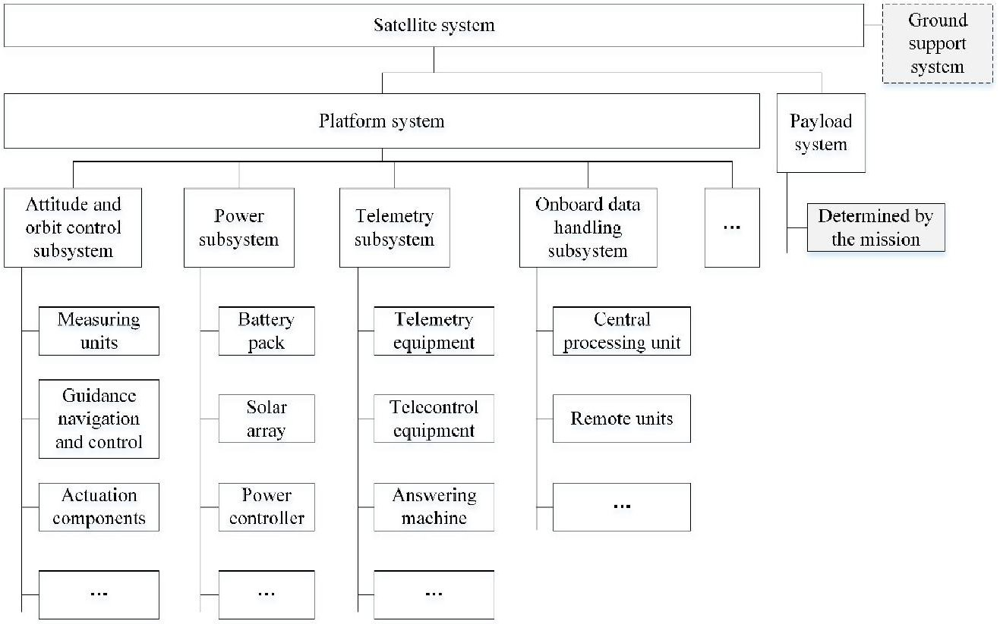

Figure 1. Block diagram of satellite system composition.

Telemetry data collected from sophisticated satellite systems are complicated and coupled. Therefore, the digital twin-driven application should integrate knowledge and data from different fields when implementing intelligent services with digital artifacts. The application framework is described below.

## 3.2. Digital Twin-Based FD-HM Framework

The digital twin-based FD-HM framework shown in Figure 2 is divided into two worlds of symmetry, the virtual world and the physical world. In the physical world, operational information such as telemetry data, remote command, and flight events for satellite system operation and service is sent to the digital twin via the ground control station. In the virtual world, the digital twin consists of three parts:

1. Data parsing and data mapping. On the one hand, telemetry data, including platform data, attitude data, and payload data, are parsed into engineering values with physical meanings. On the other side, the connection is constructed to implement the interaction between the

<!-- PDF_PAGE: 5 -->

simulation data and the parsed telemetry data. As a result, a real-time one-to-one mapping between the virtual model and the physical entity is achieved.

2. Virtual model. The primary function of this module is to describe the flight state of the satellite in the virtual space. Since satellite systems involve multiple disciplines and fields, it is critical to integrate knowledge from different disciplines to build the system model.

3. Integration services. This module is used to support operations and maintenance for satellite. The satellite's real-time state data are transmitted to the virtual model, ensuring that the virtual model is synchronized with the physical entity and is ultra-high fidelity. Then, in the light of virtual and real integration, services such as real-time monitoring, fault diagnosis, and maintenance decision making are provided.

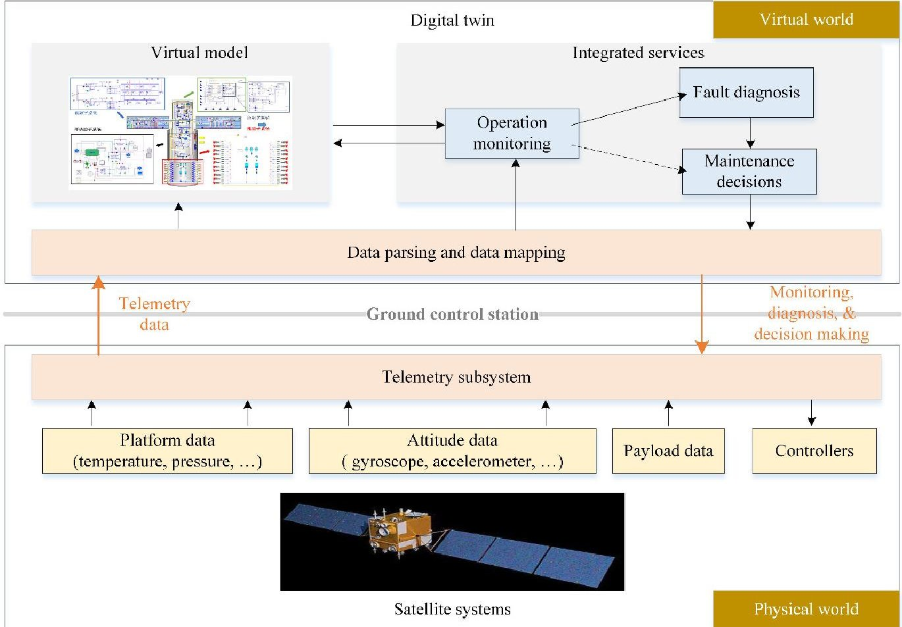

Figure 2. Digital twin-based fault diagnosis and health monitoring (FD-HM) framework for satellite systems.

## 4. Key Enabling Techniques

The most challenging aspects of achieving digital twin-based FD-HM applications are the construction of multi-domain integrated satellite system models,the consolidation of twin data,and the implementation of integrated services. This section describes these key enabling technologies.

## 4.1. Construction of Multi-Domain Integrated Satellite System Models

The virtual model is the loyal digital mirror of the physical entity and the basis for implementing the integrated services. To better describe and understand the nature of physical entities, the best representation of virtual models should be object-oriented and maintain a one-to-one correspondence with physical things, which supports the maximum interaction between the physical world and the virtual world [29]. Therefore, the functional behavior models for the satellite systems will be represented by the object-oriented, multi-domain modeling language Modelica. The Modelica modeling language abstracts the concepts of potential variables and flow variables in different fields and implements unified mathematical expressions of multi-domain knowledge based on the generalized Kirchhoff's law and

<!-- PDF_PAGE: 6 -->

conservation of energy [30]. Besides, due to the complexity of the satellite systems, the modeling process follows the principle of layering and encapsulation to reduce the difficulty of model implementation and integration [31].

According to the principles of layering and encapsulation, the system model implementation can be expanded from both vertical and horizontal dimensions. In the vertical dimension, the satellite systems involve the mutual coupling of different disciplines such as mechanics, electronics, control, thermology, and information. In the horizontal dimension, the satellite systems consist of various functional subsystems such as control subsystem, structural subsystem, power system, thermal control subsystem, propulsion subsystem, and so on. The two dimensions correspond to different roles in the design process: domain experts and design engineers.

Figure 3 shows the multi-domain modeling process for the satellite with the Modelica. Firstly, domain experts familiar with industry knowledge can extract physical behavior equations or algorithms based on design objectives, constraints, and history experience, and then build models for various domain components. Furthermore, the Modelica modeling language allows for interaction between domain experts in different disciplines and supports the cross-platform modeling of complex systems. Secondly, since various subsystems are usually from different departments or suppliers, the model implementation at this stage involves different design engineers. In this case, the design engineers who are familiar with the principle and composition of their respective subsystems combine the vertical association of component models in different domains into a subsystem model. The component models inside the subsystems are connected through abstract domain interfaces that only reflect the variable transfer relationship of a specific domain, such as the mechanical interface. However, the subsystem models are connected by virtual device interfaces. Finally, a parametric and modular system-level comprehensive analysis model can be quickly constructed through the horizontal integration of each subsystem.

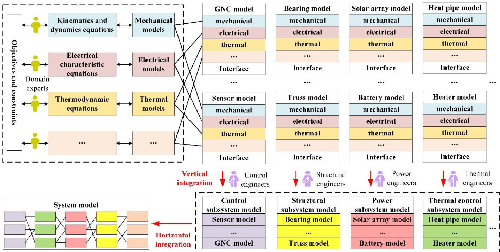

Figure 3. Implementation process of a multi-domain integrated satellite system model.

In this way, each component node of the satellite system can find its corresponding twin thing in the multi-domain integrated model [32]. Moreover, before the operation and maintenance phase, the system model undergoes iterative verification and update to guarantee the fidelity of the simulation output. Dependent on model verification, the output response of the simulation model is compared with the historical data and experimental data of the real physical system, and the optimal model parameters are obtained by least squares or optimization methods [33].

<!-- PDF_PAGE: 7 -->

## 4.2. Consolidation of Twin Data

Twin data are the bridge between the virtual model and the physical entity. Twin data include real-time telemetry data, model data, and data fusion between the two, and are continuously updated and optimized as real-time data are generated. It is necessary to establish a two-way mapping relationship between the model data and the telemetry data. Telemetry data from on-orbit satellites are parsed and transmitted to the virtual model for simulation, verification, and dynamic adjustment. The simulation data are fed back to the physical world in response to changes, improving operations and promoting values.

After the satellite is launched, the ground control station is the primary facility for direct monitoring, control, and operation of the satellite. As shown in Figure 4, from the data distribution server provided by the ground control station, transmission control protocol/internet protocol (TCP/IP) communication is used to establish a connection with the on-orbit telemetry data, and the subscription model is used to receive the telemetry related data.

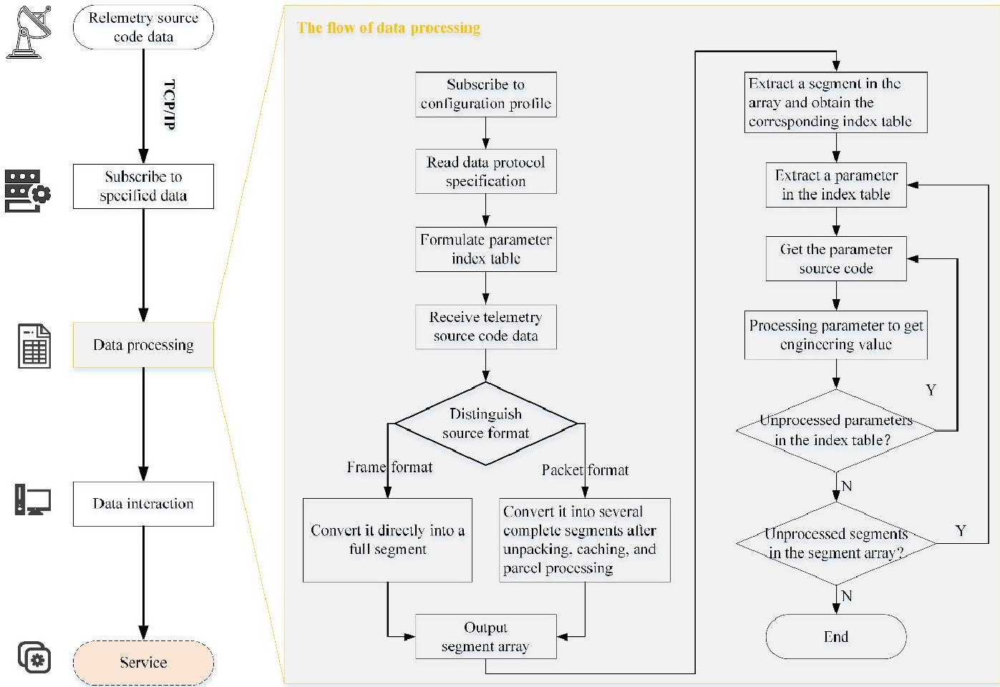

Figure 4. Flow chart of data parsing and mapping strategy.

However, due to the variety of telemetry data, the telemetry source code data need to be processed according to the outline data protocol specification. As shown in Figure 4, the data parsing process consists of three main steps:

1. Build an index table. An index table for decoding the telemetry parameters is established according to the location information of each engineering parameter so that the parameters that need to be parsed in the original code can be quickly located. The table is indexed by frame count for the frame telemetry data and by packet sequence number for the packet telemetry data. Additionally, each index table corresponds to a dynamic array, in which the pointers of the parameters contained in the frame or the packet are stored, as shown in Figure 5.

2. Consolidate data. The frame telemetry data and packet telemetry data are consolidated into a uniform format. For the packet telemetry format, the source packet data obtained by the preprocessing of the data unit are stored in the form of several segments. Additionally, the frame

<!-- PDF_PAGE: 8 -->

telemetry data are stored directly as one segment. In this way, the data formats of the two are similar for subsequent data processing.

3. Data processing. The parameter information to be parsed is obtained from the index table according to the frame number or the packet number. Then, the parameter source code is located and converted into an engineering value.

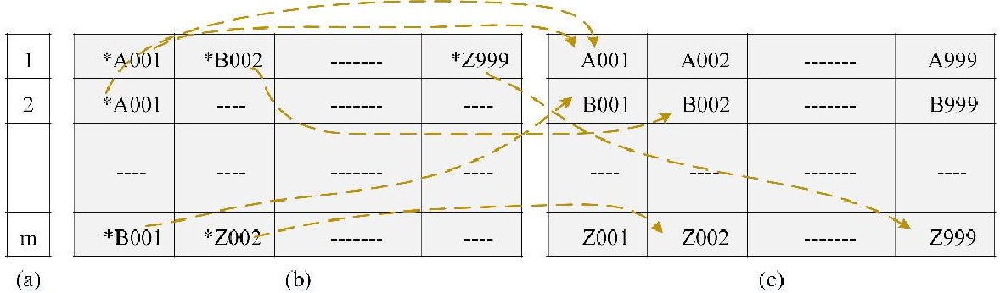

Figure 5. Schematic diagram of frame index table. (a) Frame number. (b) Frame index table. (c) Parameter information storage area.

As a consequence, the obtained engineering parameters are adapted to the model parameters. In the light of the symmetry of the virtual model and the physical entity, a direct one-to-one connection between the real component and the virtual model is achieved through data interaction. The data mapping dictionary between the two is represented by an extensible markup language (XML) file [34]. The data mapping dictionary records the details of the twin data, including:

1. Global parameters, which include the telemetry number, data type, and physical unit of the system-level parameter and the corresponding model parameter names.

2. Local parameters, which include the device code, device name, telemetry number, data type, and physical unit of the low-level parameter and the corresponding model parameter names. Besides, due to the complexity of telemetry data, the established multi-domain integrated system model and its parameters use specific naming rules to avoid errors in the mapping process. The model name is stipulated as "device code (e.g., TRAINH001) ", and the parameter name is agreed to "telemetry number-physical unit (e.g., PTMD001-V)".

## 4.3. Implementation of Integrated Services

Based on the interaction and integration between the physical world and the virtual world, the digital twin can provide cyber-physical closed-loop integrated services. The process shown in Figure 6 is divided into four stages: operation monitoring, data detection, fault diagnosis, and maintenance decision-making. Additionally, all involved data, including twin data, historical data, and test data, are stored in the information database.

<!-- PDF_PAGE: 9 -->

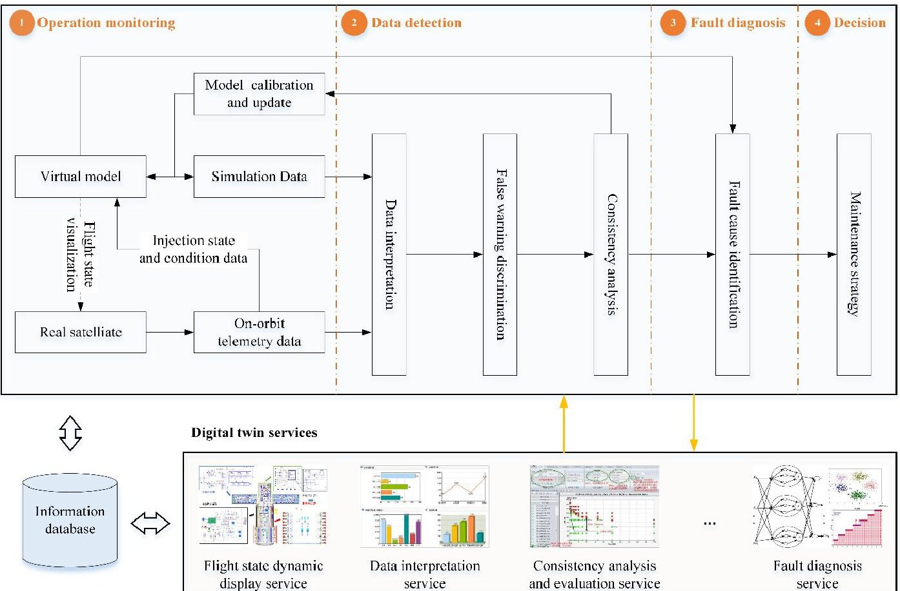

Figure 6. Digital twin-driven integrated services.

## 4.3.1. Operation Monitoring

The foundation of digital twin-driven integrated services is the real-time monitoring of the operating state of the satellite systems in the virtual world. The real-time state data, including the downlink telemetry data, telemetry commands, control commands, and flight events, are transmitted to the virtual model to realize a synchronous link between the real satellite and the virtual model (see Figure 61). With the data, the virtual model can track dynamic changes in the on-orbit satellite. Then, in the virtual world, the real data, the model data, and the fused data between the two are extracted, and the on-orbit operating state of the satellite can be comprehensively displayed utilizing visualization.

## 4.3.2. Data Detection

Data detection refers to the study and reasoning of the twin data to determine whether the satellite operating state meets the design expectations, and then discover faults or design flaws.

The engineering parameter observation matrix $ X_{obs} $ characterizes the real-time state of the satellite under specific operating conditions C (such as telemetry commands, control commands, flight events, and environment).

$$
X _ {o b s} = \left[ \begin{array}{c c c c} x _ {1 1} & x _ {1 2} & \dots & x _ {1 m} \\ x _ {2 1} & x _ {2 2} & \dots & x _ {2 m} \\ \vdots & \vdots & x _ {i j} & \vdots \\ x _ {n 1} & x _ {n 2} & \dots & x _ {n m} \end{array} \right]
$$

where $ x_{ij} $ represents the telemetry value of the observed parameter $ x_{i} $ at the moment $ t_{j} $ , while n and m are the subscript numbers. Denote $ X_{i}=(x_{i1},x_{i2},\cdots,x_{im}) $ as the states of the satellite systems over a period of time (assumed as $ t_{i}-t_{j} $ ), and denote $ X\left(t_{j}\right)=\left(x_{1j},x_{2j}\cdots,x_{nj}\right) $ as the time series for $ X_{i}. $

<!-- PDF_PAGE: 10 -->

Evaluation matrix $ Y_{sim} $ and $ Z_{sim} $ characterize the simulated output of the virtual model under the same operating conditions C. $ Y_{sim} $ is the mapping to $ X_{obs} $ in the virtual world, and $ Z_{sim} $ denotes other analysis results.

$$
Y _ {s i m} = \left[ \begin{array}{c c c c} y _ {1 1} & y _ {1 2} & \dots & y _ {1 m} \\ y _ {2 1} & y _ {2 2} & \dots & y _ {2 m} \\ \vdots & \vdots & y _ {i j} & \vdots \\ y _ {n 1} & y _ {n 2} & \dots & y _ {n m} \end{array} \right]
$$

Denote $ Y_{i}=(y_{i1},y_{i2},\cdots ,y_{im}) $ as the states of the virtual model over a period of time, and denote $ Y\left(t_{j}\right)=\left(y_{1j},y_{2j}\cdots ,y_{nj}\right) $ as the time series for $ Y_{i}. $

As shown in Figure 6 the fused data are analyzed through three steps: data interpretation, false alarm discrimination, and consistency analysis.

1. Data interpretation. If $ \| X \left( t_{j}\right)-Y \left( t_{j}\right) \| \leq T_{p} $ , where $ T_{p} $ is the pre-defined threshold, the operating state of the satellite is in line with design expectations at the moment. Otherwise, there are faults, and a preliminary fault warning is given.

$$
\| X \left(t _ {j}\right) - Y \left(t _ {j}\right) \| = \frac {\| X \left(t _ {j}\right) - Y \left(t _ {j}\right) \| _ {2}}{\| Y \left(t _ {j}\right) \| _ {2}}
$$

2. False alarm discrimination. Set the false alarm range (bigger than the strict interpretation threshold) for each parameter. If the parameter is still in the false alarm range after the preliminary fault warning, other parameters of the same component in $ Y_{sim} $ and $ Z_{sim} $ are introduced for verification. If more than 80% of the parameters are in the normal state, the false alarm is excluded; otherwise, the alarm is to be manually confirmed. This step effectively guarantees the quality of data interpretation.

3. Consistency analysis. When a fault warning is given, the consistency analysis is needed to identify the source of the fault (from satellite or virtual model). In the information database, the time series of historical states $ H \left( t_{j} \right)=\left(x_{h_{1} j}, x_{h_{2} j} \dots , x_{h_{n} j}\right) $ of the satellite under operating condition C is selected as a reference. The Euclidean distance and Pearson correlation coefficient [35] between $ X \left( t_{j} \right) $ and $ H \left( t_{j} \right) $ are calculated to measure the similarity, as well as $ Y \left( t_{j} \right) $ and $ H \left( t_{j} \right) $ . If $ Y \left( t_{j} \right) $ is not similar to $ H \left( t_{j} \right) $ , perform model calibration and update the virtual model. If only $ Y \left( t_{j} \right) $ and $ H \left( t_{j} \right) $ are similar, an abrupt fault occurs on the real satellite because the fault is unknown to the virtual model, and then the fault diagnosis is performed.

## 4.3.3. Fault Diagnosis

When the data detection gives a fault warning (Figure 6 2), a fault occurs in the satellite systems. At the moment, the characteristics of the telemetry parameter change process are analyzed by comparing the telemetry feature parameters $ X_{i} $ with the corresponding model parameters $ Y_{i} $ . Then, in the light of the simulation data as a reference, fault identification algorithms, such as a decision tree, are utilized to determine the fault components and the cause of failure.

## 4.3.4. Maintenance Decision Making

In the design process of satellite systems, the potential failure modes have been fully considered, and corresponding maintenance strategies have been proposed. After confirming the cause of the fault by fault diagnosis (Figure 6 3), select a set of maintenance measures from the pre-arranged planning. In light of the digital twin, the effectiveness of the corresponding maintenance measures is allowed to be verified on the virtual model before the selected strategy is executed. Moreover, digital twin enables the assessment of the current state and the prediction of future trends, so experts can confidently participate in decision making and predictively adjust maintenance plans.

<!-- PDF_PAGE: 11 -->

## 5. Case Study

## 5.1. Problem Description

The satellite power system converts the acquired solar energy into usable electrical energy for the payload and support platform, and its performance directly affects the operating state of the satellite [36]. However, in the orbital operation phase, the ground environment lacks digital means for effective intervention in energy management:

1. The operating state of the system is mostly monitored and recorded manually. The data are scattered and not intuitive, making the work trivial and arduous for the operators and maintainers.

2. For in-orbit operation and maintenance that is invisible in space, there is a lack of effective fault diagnosis and predictive energy management.

## 5.2. Digital Twin-Driven FD-HM Process

To solve the problems mentioned above, a digital twin-based space-ground power management (SGPM) platform is developed (see Figure 7). The proposed platform, with the multi-domain unified modeling and simulation software MWorks [37,38] as the underlying layer, integrates the multi-domain unified system model, fault diagnosis and prognosis algorithms, and maintenance strategies.

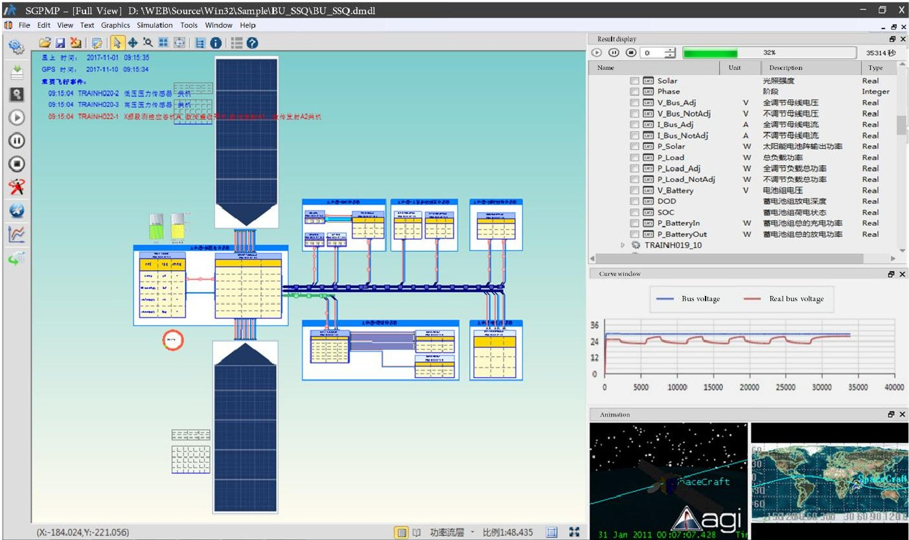

Figure 7. Digital twin-based space-ground power management platform.

## 5.2.1. Power System Model

The power system of the example satellite, a certain Geostationary orbit (GEO) satellite, works in the direct energy transfer (DET) mode, as shown in Figure 8. The DET mode means that the output power of the solar array (SA) and the battery is directly provided to the loads through the bus, and the three are connected in parallel. Therein, the shunt regulator (SR) is used for shunting the excess current of the SA to maintain the stability of the bus voltage during the light period. The battery charge regulator (BCR) provides the battery with a suitable charging rate and charge termination control to prolong the service life of the battery. The battery discharge regulator (BDR) performs discharge control on the battery to ensure the stability of the bus voltage during the ground shadow period.

<!-- PDF_PAGE: 12 -->

The power distribution unit (PDU) realizes the power distribution control function of the loads, as well as detects and controls the power of each load.

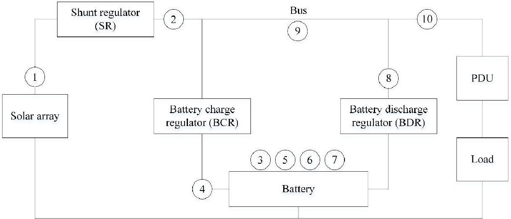

Figure 8. Working principle of the satellite power system and location of telemetry signals.

In the design phase, domain experts and design engineers use the multi-domain unified modeling language Modelica to build the satellite power system model. Following the modeling principles of layering and encapsulation, the hierarchical structure of the model facilitates the close cooperation between experts in different disciplines and the handling of system complexity in the modeling process. In the subsequent system development process, the system model is repeatedly calibrated with the historical data and experimental data to ensure the high fidelity of the model.

The established multi-domain integrated power system model consists of the environment model, the SA model, the battery model, the SR model, the battery BCR model, the BDR model, the PDU model, the filter model, the cable model, and the load models, as shown in Figure 9. The detailed modeling of each model is a daunting task but is not necessary. Therefore, it is essential to make the necessary abstraction and simplification of part of the models. Taking the lithium-ion battery as an example, the traditional electrochemical reaction model and the experimental data fitting model are combined to establish a charge and discharge model of the battery.

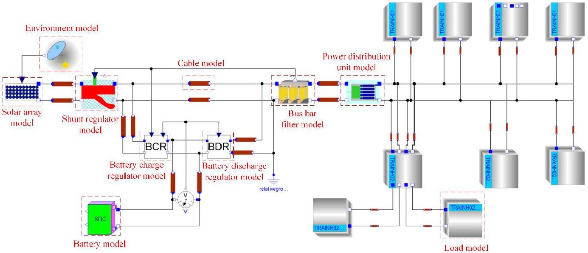

Figure 9. Multi-domain integrated power system model.

The equivalent circuit shown in Figure 10a is used to model the battery characteristics [39,40]. Therein, the combination of the resistor R and the capacitor C in parallel can reflect the dynamic characteristics of the battery; the resistor $ R_{0} $ can reflect the battery's resistance property; the resistor $ R_{L} $ connected in parallel at the output terminal reflects the self-discharge characteristics of the battery; the

<!-- PDF_PAGE: 13 -->

effect of temperature on battery performance is reflected in the relationship between resistance and capacitance with temperature.

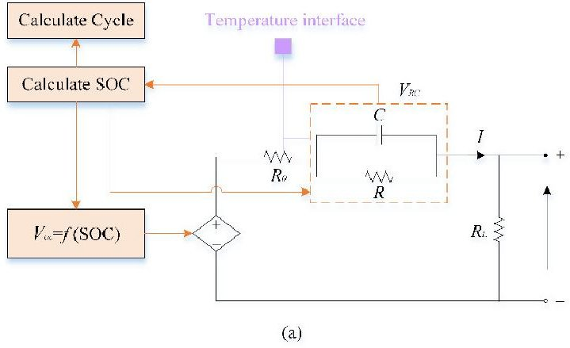

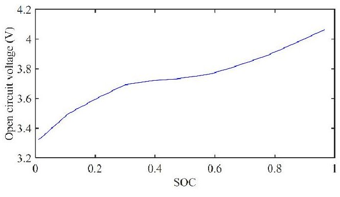

(b)

Figure 10. (a) Calculation model of equivalent circuit for a lithium-ion battery. (b) Actual $ V_{oc}-SOC $ curve of a lithium-ion battery.

Here, the state of charge (SOC) is:

$$
S O C = \frac {\int i d t}{Q}
$$

where Q is the battery capacity. When the battery is fully charged, SOC = 1.

Additionally, the relationship between the SOC and the output voltage is fitted according to the experimental $ V_{oc}-SOC $ curve (see Figure 10b),

$$
V _ {o c} = f (S O C)
$$

Besides, the number of charge-discharge cycles is

$$
C y c l e = \left\lfloor C y c l e _ {i n t} + \frac {\int i d t}{2 Q} \right\rfloor
$$

## 5.2.2. Data Interaction Mapping Strategy

The virtual model and the real power system maintain a one-to-one correspondence on each component node, so the parsed telemetry data on each node can be matched with the corresponding virtual data according to the data-mapping dictionary. Figure 11 shows the data-mapping dictionary described by the XML file, where the telemetry code, device number, variable name, data type, physical device, range of values, and corresponding model parameter information for each physical parameter are recorded.

According to the operation monitoring in Section 3, the real-time interaction between the virtual model and the actual power system is established based on the mapping relationship of the twin data. Then, in the virtual world, the on-orbit operation state of the satellite power system can be visually displayed, as shown in Figure 7.

<!-- PDF_PAGE: 14 -->

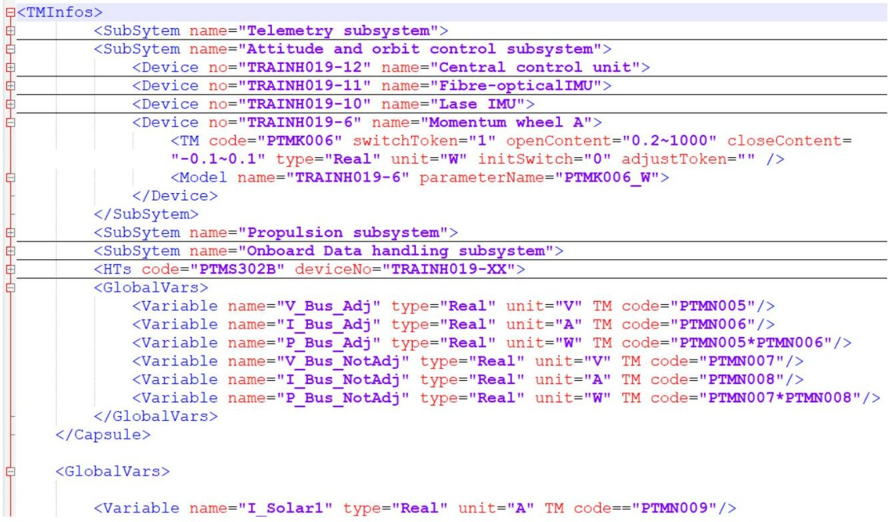

Figure 11. Data-mapping dictionary described by the XML file.

## 5.2.3. Fault Diagnosis

Regarding the power system, we mainly monitor the ten kinds of telemetry data shown in Table 2. All the measurement positions are marked in Figure 8. Therein, the battery capacity and the state of charge are not telemetry data but converted data. Therefore, the state of the real satellite power system is represented by these 10 parameters as:

$$
\boldsymbol {X} = \left(I _ {s a}, I _ {s r}, U _ {b}, I _ {b}, Q, S, S O C, D, U _ {0}, I _ {0}\right)
$$

Table 2. Telemetry data information of satellite power system.

<table border="1"><tr><td>ID</td><td>Parameter</td><td>Rated Range</td><td>Data Type</td><td>Unit</td><td>Description</td></tr><tr><td>1</td><td>$I_{sa}$</td><td>0-60</td><td>Continuous</td><td>A</td><td>Output current of solar array</td></tr><tr><td>2</td><td>$I_{sr}$</td><td>0-5.5</td><td>Continuous</td><td>A</td><td>Shunt current</td></tr><tr><td>3</td><td>$U_{b}$</td><td>23.1-28.7</td><td>Continuous</td><td>V</td><td>Battery voltage</td></tr><tr><td>4</td><td>$I_{b}$</td><td>0-60</td><td>Continuous</td><td>A</td><td>Battery current</td></tr><tr><td>5</td><td>Q</td><td>0-95</td><td>Continuous</td><td>Ah</td><td>Battery capacity</td></tr><tr><td>6</td><td>S</td><td>[-101]</td><td>Discrete</td><td>-</td><td>Status word,1 is charging,0 is not working and-1 is discharging.</td></tr><tr><td>7</td><td>SOC</td><td>0-1</td><td>Continuous</td><td>-</td><td>State of charge</td></tr><tr><td>8</td><td>D</td><td>0-1</td><td>Continuous</td><td>-</td><td>Duty cycle of BDR</td></tr><tr><td>9</td><td>$U_{0}$</td><td>28.5-30.5</td><td>Continuous</td><td>V</td><td>Bus voltage</td></tr><tr><td>10</td><td>$I_{0}$</td><td>0-60</td><td>Continuous</td><td>A</td><td>Bus current</td></tr></table>

The virtual state generated by the power system model corresponding to the physical state is represented as:

$$
\boldsymbol {Y} = \left(V I _ {s a}, V I _ {s r}, V U _ {b}, V I _ {b}, V Q, V S, V S O C, V D, V U _ {0}, V I _ {0}\right)
$$

The value of $ \| X-Y\| $ is calculated according to Equation (3).

If $ \| X-Y\| \geq T_{p} $ , it indicates that the satellite power system has an abrupt fault. A decision tree based on the ID3 algorithm is used for fault identification. The decision tree is a kind of classification and prediction method with the characteristics of a simple structure, few model parameters, low computational complexity, and high decision-making efficiency, which is suitable for the integrated

<!-- PDF_PAGE: 15 -->

scenario of physical entities and virtual models [41,42]. The ID3 algorithm based on information entropy and information gain measures the attribute with the smallest information entropy as the classification attribute, and the branches of the decision tree are recursively expanded until the decision tree is constructed.

The concept of information entropy refers to the degree of confusion in the information. The higher the uncertainty of the variable, the larger the value of entropy $ I (S) $

$$
I (S) = - \sum_ {i = 1} ^ {m} p \left(u _ {i}\right) \log_ {2} p \left(u _ {i}\right)
$$

$$
p \left(u _ {i}\right) = \frac {\left| u _ {i} \right|}{\left| S \right|}
$$

where $ p(u_{i}) $ is the probability that category $ u_{i} $ appears in sample.

Information gain Gain(S,A) refers to the change in entropy after partitioning.

$$
G a i n (S, A) = - \sum_ {V \in V a l u e (A)} \frac {\left| S _ {V} \right|}{\left| S \right|} I \left(S _ {V}\right)
$$

where A is the sample attribute and Value(A) is the set of values of attribute A. V is one of the attribute values of A, and $ S_{V} $ is a sample set where the value of attribute A in sample S is V.

Based on the principle of information entropy, the fault identification of the satellite power system is performed through the decision tree, as shown in Figure 12a.

1. The direct telemetry data $ \{ I_{sa}, I_{sr}, U_{b}, I_{b}, S, D, U_{0}, I_{0} \} $ are selected as the feature parameters to facilitate real-time comparison between the physical data and virtual data. The corresponding relationship between the ten typical failure modes and feature parameters is obtained, as shown in Table 3.

2. The information gain of each attribute is calculated, and the decision tree branch is constructed with the maximum attribute of the gain as the root node. Then, the information gain of the new root node attribute is calculated, and the loop is repeated in turn until the decision tree cannot be divided again.

3. The fault identification rules for the satellite power system can be extracted from the partitioned decision tree (Figure 12b). The classification rules are expressed using if-else, such as if " $ I_{b} $ is consistent" and " $ I_{0} $ is consistent" and $ U_{b} $ is consistent and " $ \mathrm{I I}_{sa} $ becomes smaller", then "the failure mode is F1."

4. The extracted rules are applied to the actual fault classification and identification. In the process of fault identification, the simulation results in the virtual world represent the expected state of the system [43], so the digital twins can visually reflect the dynamic changes of the satellite power system in orbit, thus supporting online fault identification based on classification rules.

<!-- PDF_PAGE: 16 -->

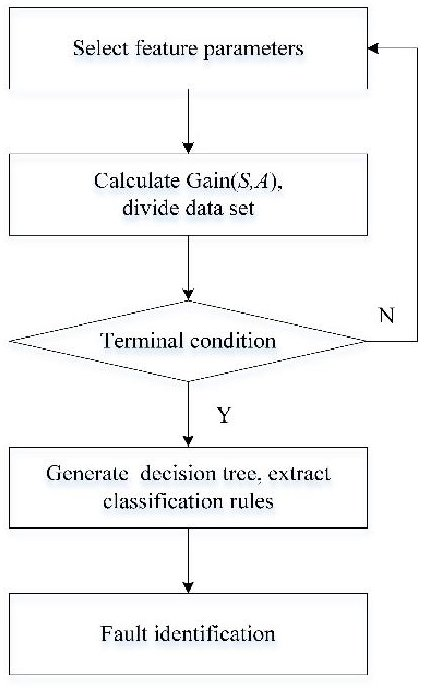

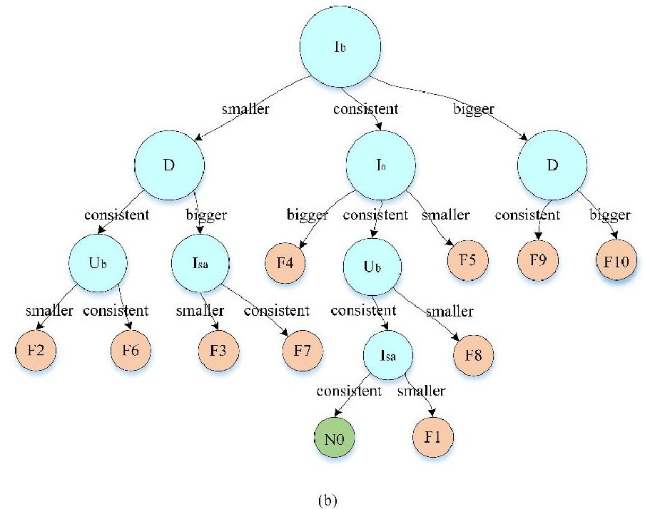

Figure 12. (a) Implementation flowchart of a decision tree based on the ID3 algorithm. (b) Decision tree for a satellite power system.

Table 3. Relationship between feature parameters and failure modes.

<table border="1"><tr><td>ID</td><td>Failure Modes</td><td>$I_{sa}$</td><td>$I_{sr}$</td><td>$U_{b}$</td><td>$I_{b}$</td><td>D</td><td>U_{0}$</td><td>$I_{0}$</td></tr><tr><td>F1</td><td>The performance of the solar array degrades, but it can still meet the charging requirements of the battery pack.</td><td>$\downarrow$</td><td>$\downarrow$</td><td>$\leftrightarrow$</td><td>$\leftrightarrow$</td><td>$\leftrightarrow$</td><td>$\leftrightarrow$</td><td>$\leftrightarrow$</td></tr><tr><td>F2</td><td>The performance of the solar array degrades, and cannot meet the charging requirements of the battery pack.</td><td>$\downarrow$</td><td>$\downarrow$</td><td>$\downarrow$</td><td>$\downarrow$</td><td>$\leftrightarrow$</td><td>$\leftrightarrow$</td><td>$\leftrightarrow$</td></tr><tr><td>F3</td><td>The solar array&#x27;s directional drive mechanism is stuck.</td><td>$\downarrow$</td><td>$\downarrow$</td><td>$\downarrow$</td><td>$\downarrow$</td><td>$\uparrow$</td><td>$\leftrightarrow$</td><td>$\leftrightarrow$</td></tr><tr><td>F4</td><td>The SR does not shunt.</td><td>$\leftrightarrow$</td><td>$\downarrow$</td><td>$\leftrightarrow$</td><td>$\leftrightarrow$</td><td>$\leftrightarrow$</td><td>$\downarrow$</td><td>$\uparrow$</td></tr><tr><td>F5</td><td>The regulator of the power supply array continues to shunt.</td><td>$\leftrightarrow$</td><td>$\uparrow$</td><td>$\leftrightarrow$</td><td>$\leftrightarrow$</td><td>$\leftrightarrow$</td><td>$\uparrow$</td><td>$\downarrow$</td></tr><tr><td>F6</td><td>The regulator of the charging array continues to shunt.</td><td>$\leftrightarrow$</td><td>$\uparrow$</td><td>$\leftrightarrow$</td><td>$\downarrow$</td><td>$\leftrightarrow$</td><td>$\leftrightarrow$</td><td>$\leftrightarrow$</td></tr><tr><td>F7</td><td>The battery is short-circuited during discharge.</td><td>$\leftrightarrow$</td><td>$\leftrightarrow$</td><td>$\downarrow$</td><td>$\downarrow$</td><td>$\uparrow$</td><td>$\leftrightarrow$</td><td>$\leftrightarrow$</td></tr><tr><td>F8</td><td>The battery is short-circuited during constant current charging.</td><td>$\leftrightarrow$</td><td>$\leftrightarrow$</td><td>$\downarrow$</td><td>$\leftrightarrow$</td><td>$\leftrightarrow$</td><td>$\leftrightarrow$</td><td>$\leftrightarrow$</td></tr><tr><td>F9</td><td>The battery is short-circuited during constant voltage charging.</td><td>$\leftrightarrow$</td><td>$\downarrow$</td><td>$\leftrightarrow$</td><td>$\uparrow$</td><td>$\leftrightarrow$</td><td>$\leftrightarrow$</td><td>$\leftrightarrow$</td></tr><tr><td>F10</td><td>The internal resistance of the battery rises.</td><td>$\leftrightarrow$</td><td>$\leftrightarrow$</td><td>$\downarrow$</td><td>$\uparrow$</td><td>$\uparrow$</td><td>$\leftrightarrow$</td><td>$\leftrightarrow$</td></tr><tr><td>N0</td><td>Normal</td><td>$\leftrightarrow$</td><td>$\leftrightarrow$</td><td>$\leftrightarrow$</td><td>$\leftrightarrow$</td><td>$\leftrightarrow$</td><td>$\leftrightarrow$</td><td>$\leftrightarrow$</td></tr></table>

$ \downarrow $ indicates that the feature parameter is smaller than the result in the normal state, $ \uparrow $ indicates that the feature parameter is larger than the result in the normal state, and $ \leftrightarrow $ indicates that the feature parameter is consistent with the result in the normal state.

## 5.2.4. Maintenance Decision Making

In-orbit satellite energy management in the ground environment aims to achieve predictive energy management and scheduling strategies. The total amount of energy that a satellite power system can provide over a specified period is limited. When the power system is degraded due to external or internal cause, or the load power rises beyond the power budget due to potential failure, the SGPM platform determines the power supply capacity of the power system and the power demand of the

<!-- PDF_PAGE: 17 -->

loads according to the telemetry data. The power supply to the loads is dynamically scheduled and used to complete the primary mission and ensure the safety of the power system.

The loading or unloading management for the payload system is based on the load priority. According to the required power, the energy management priorities of main flight states can be divided into nine task levels, as shown in Table 4.

Table 4. Example of electrical mission management priorities in satellite flight.

<table border="1"><tr><td>Flight Area</td><td>Task Priority</td><td>Flight Mission</td><td>Required Power</td></tr><tr><td rowspan="9">Restricted power supply area</td><td>01</td><td>Telemetry and remote control</td><td>P1</td></tr><tr><td>02</td><td>Data management</td><td>P2</td></tr><tr><td>03</td><td>Attitude control</td><td>P3</td></tr><tr><td>04</td><td>Thermal management</td><td>P4</td></tr><tr><td>05</td><td>Satellite pendulum</td><td>P5</td></tr><tr><td>06</td><td>Data record</td><td>P6</td></tr><tr><td>07</td><td>Real-time transmission</td><td>P7</td></tr><tr><td>08</td><td>Recording while placing</td><td>P8</td></tr><tr><td>09</td><td>Environment monitoring</td><td>P9</td></tr></table>

The SGPM platform is capable of monitoring the power usage state in real-time, analyzing and predicting the power usage changes during the flight cycle. When the power supply capacity decreases (failure or performance degradation), the power link is reconstructed. According to the load priority, the load is cut off or the task energy level is lowered in order from low priority to high priority, which adapts the power consumption of the load to the power supply.

When the power supply capacity exceeds the requirements for the current load usage and the battery charging, other loads can be appropriately added to complete more missions. The loading command is not sent directly from the ground control station. Instead, before that, the energy balance analysis is performed on the virtual model to determine whether the power system can meet the power requirements of the loading devices. Then, the order of power-on and power-off operations of each device is determined according to the load priority.

## 5.3. Comparative Experiments and Analysis

The actual satellites in orbit have limited fault types and fault data, so various types of faults are injected into the prototype satellite used for ground testing. The prototype satellite follows the same data communication methods and protocols as the actual satellites in orbit, and the ground control station can receive its normal and faulty operating data. Then, 90 sets of test data are artificially sent from the ground control station to the SGPM platform, of which 10 for the solar array performance degradation (i.e., F1 and F2 in Table 3), 5 for the SR non-shunt (i.e., F4 in Table 3), 10 for SR continuous shunt (i.e., F5 and F6 in Table 3), 15 for battery short circuit (i.e., F7, F8, and F9 in Table 3) and 5 for the battery increased internal resistance (i.e., F10 in Table 3), and 45 sets for normal conditions were used (i.e., N0 in Table 3). Besides, some conventional fault diagnosis methods for satellite power systems, including clustering algorithms [4], SVM [7], and KPCA [12], are compared with digital twin-driven methods to validate the advantages. The telemetry data set D8000*45 from the ground control station is used to train and test these methods, where 8000 is composed of 4000 normal data sampling points and 4000 fault data sampling points. Then, this telemetry data set is divided into training subsets and test subsets. The training subset contains 3000 samples of five parameters (in Table 3), which are used to develop the prognosis and diagnosis algorithms offline. The test subset includes normal samples and fault samples after fault injection.

Referring to the performance evaluation pattern of disease diagnosis [44], we focus on the three concepts of accuracy (ACC), specificity (SPE), and sensitivity (SEN) in the context of the selected fault

<!-- PDF_PAGE: 18 -->

diagnosis methods. These concepts are described in several terms, namely true fault (TF), true normal (TN), false fault (FF), and false normal (FN). The relationship between them is shown in Table 5.

$$
S E N = T F / (T F + F N).
$$

$$
S P E = T N / \left(T N + F F\right)
$$

$$
A C C = \left(T N + T F\right) / \left(T N + T F + F N + F F\right)
$$

Table 5. Relationships between the four terms.

<table border="1"><tr><td rowspan="2">Results of Diagnostic Tests</td><td colspan="2">Reference Standard or‘Truth’</td></tr><tr><td>Fault</td><td>Normal</td></tr><tr><td>Fault</td><td>TF</td><td>FN</td></tr><tr><td>Normal</td><td>FF</td><td>TN</td></tr></table>

Therein, the SEN is the proportion of true faults that are correctly identified by a diagnostic test, which shows the performance of diagnostic methods in detecting faults. It embodies the chance of not missing a diagnosis. The SPE is the proportion of true normal that are correctly identified by a diagnostic test, which shows how well the diagnostic methods perform in identifying normal conditions. It reflects the chance of not being misdiagnosed. The ACC refers to the proportion of true results in the overall test results, which measures the degree of veracity of the diagnostic results. It is a comprehensive reflection of misdiagnosis and missed diagnosis.

As shown in Table 6, the performance of digital twin-driven FD-HM is affected by pre-defined threshold $ T_{p} $ . When $ T_{p} $ is set to 4% , the digital twin is too sensitive to the telemetry data. The operation monitoring module cannot accurately determine the signal change trend due to the fluctuations in the telemetry data, so the diagnosis results are easily misjudged （ SPE=84.44% ）and missed （ SEN= 82.22% ）. When $ T_{p} $ is set to 9% , the operation monitoring module becomes relatively sluggish so that misdiagnosis can be effectively avoided （ SPE=97.78% ）, but the rate of missed diagnosis is still high （ SEN=77.78% ）. Therefore, an appropriate balance needs to be struck between the SPE and the SEN. When $ T_{p} $ is set to 6% , the operation monitoring module can not only effectively avoid the interference of telemetry data fluctuations but also detect anomalies in time （ SEN=91.11% ）. Additionally, because of the false alarm discrimination, the digital twin can effectively avoid misdiagnosis （ SPE=95.56% ）.

Table 6. Evaluation results of various methods.

<table border="1"><tr><td></td><td colspan="3">Digital Twin-Driven FD-HM</td><td rowspan="2">Clustering</td><td rowspan="2">KPCA</td><td rowspan="2">SVM</td></tr><tr><td>Metric</td><td>Tp=4%</td><td>Tp=6%</td><td>Tp=9%</td></tr><tr><td>SEN</td><td>82.22%</td><td>91.11%</td><td>77.78%</td><td>80.85%</td><td>84.09%</td><td>86.67%</td></tr><tr><td>ACC</td><td>83.33%</td><td>93.33%</td><td>87.78%</td><td>84.78%</td><td>87.91%</td><td>90.11%</td></tr><tr><td>SPE</td><td>84.44%</td><td>95.56%</td><td>97.78%</td><td>88.89%</td><td>91.49%</td><td>93.48%</td></tr></table>

Besides, compared with other fault diagnosis methods, the performance of the digital twin-driven FD-HM approach (when $ T_{p}=6\% $ ) is better. The advantages of the digital twin approach mainly lie in its deep integration of virtual and physical. Under the precondition of keeping the physical and virtual satellite systems consistent, the constructed digital twin can fuse signals from different sources (simulation data, historical data, and real data) for diagnosis. Admittedly, the more knowledge and information are consolidated, the more effective and reliable the diagnosis will be. However, data-driven methods rely heavily on historical data. As the telemetry signals are easily disturbed by unknown factors in the harsh space flight environment, the accuracy of data-driven approaches can be affected easily. These same conclusions can be drawn from Figure 13.

<!-- PDF_PAGE: 19 -->

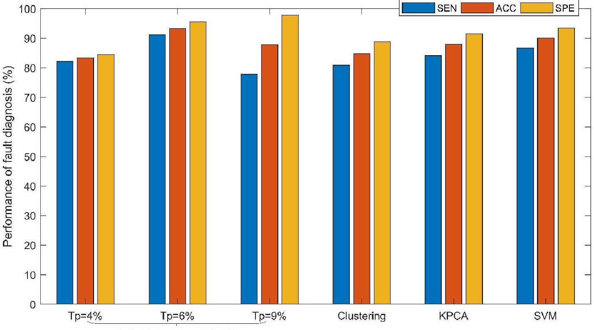

Figure 13. Evaluation results of diagnostic tests for various methods.

## 6. Discussion

In the present study, we innovatively apply the digital twin to the FD-HM of the satellite system. The digital twin is a framework of physical-virtual convergence. In this framework, we make these attempts: (1) following the principles of layering and encapsulation to develop the multi-domain integrated system model to contend with the complexity of the satellite systems; (2) building the data interaction mapping strategy between real-time telemetry data and model data to achieve data fusion; (3) based on the fused data, an appropriate fault diagnosis algorithm and maintenance strategies are provided.

Through the case study and comparative experiments in a previous section, the effectiveness of the proposed method is proved, and the following conclusions can be drawn.

1. The proposed method helps to improve the accuracy and reliability of fault diagnosis. The proposed method helps to improve the accuracy and reliability of fault diagnosis. However, the digital twin can integrate multi-source data and can use data analysis to mine out more potential value. Moreover, the digital twin can update the model in real-time according to the change of the satellite state to ensure the consistency of the physical entity and the virtual model, thus reducing the misdiagnosis rate. Besides, the false alarm discrimination function helps avoid interference. As a result, the digital twin-driven FD-HM performance is improved.

2. The interpretability and expressibility of the FD-HM have been greatly enhanced. The data-driven methods have little interpretability and expressibility. Based on the data interaction mapping strategy, the virtual model is synchronized with the physical entity and can be updated in real-time to track the dynamic changes of the orbiting satellite. The virtual model objectively becomes a dynamic mirror image of the satellite in the virtual space. This means that we can intuitively view the operating status and fault information of the satellites in orbit in the virtual space, as shown in Figure 7.

3. The proposed method contributes to a more reliable maintenance strategy. General maintenance methods are often passive rather than active, based on heuristic experience and worst-case scenarios. Maintenance decisions under the digital twin framework are driven by high-fidelity virtual models instead of predefined algorithms, which will lead to more reasonable maintenance

<!-- PDF_PAGE: 20 -->

strategies, so the satellite power system can better adapt to dynamic task scheduling and unknown environmental changes.

However, there are still several issues to be addressed in future work.

1. The first challenge is a better way to set the pre-defined threshold Tp. According to the above case study, the efficiency of the proposed fault diagnosis approach depends on the fidelity of the model and the selection of the threshold. The high-fidelity models help to measure the performance and state of the satellite systems more accurately. The optimal set of the threshold helps to reduce the risk of diagnosis to avoid misdiagnosis and missed diagnosis.

2. The second challenge is to build a more comprehensive digital twin for the satellite's operation and maintenance. The primary function of the digital twin drive is to help the system get the optimal performance and reduce future operational losses [45]. However, the far-reaching significance is that the digital twin can continue to accumulate the knowledge of satellite systems during operation and maintenance, which can enhance the service process as well as improve the design of next-generation systems.

3. Finally, we hope to incorporate more mature machine learning algorithms [46] into the proposed digital twin framework and extend the method to other satellite systems.

## 7. Conclusions

In this paper, we present a digital twin-driven FD-HM approach for satellite systems. The general idea is to construct a physical-virtual convergence digital twin system to integrate simulation data, real telemetry data, and fused data, and realize the real-time monitoring as well as the maintenance of the on-orbit satellites using data-driven and model-based algorithms.

The present research results theoretically provide a clear and executable digital twin framework for the FD-HM of satellite systems. With the deep integration of the physical and virtual spaces, the digital twin is the de facto status indicator for the satellite, which supports on-orbit operation and maintenance with integrated algorithms in the ground environment. Additionally, as more knowledge and information are merged, the digital twin-driven FD-HI is more effective and reliable. In addition, digital twins greatly enhance the interpretability and expressibility of the diagnostic results.

The present research also has application value, as a digital twin-based space-ground power management platform has been developed. On the platform, the real-time state of the satellite power system can be visually monitored and recorded without substantial manual intervention by the operators. Besides, the data-driven algorithms are provided to implement the fault diagnosis and maintenance decisions. Therefore, it can be foreseen that this digital twin-based approach is also applicable to other satellite subsystems and even whole satellite systems.

As part of ongoing and future work, we plan to study how to better set the interpretation threshold and select feature parameters. Moreover, the realization of the high-fidelity models is a research problem that requires continuous investment.

Author Contributions: Conceptualization, D.S. and L.C.; methodology, D.S. and L.C.; validation, D.S. and J.D.; data curation, L.C.; writing—original draft preparation, D.S.; writing—review and editing, J.D.; visualization, D.S. and L.C.; supervision, L.C. All authors have read and agreed to the published version of the manuscript.

Funding: This research was funded by [National Key R&D Program of China] grant number [2018YFB1700905] and [National Defense Basic Scientific Research program of China] grant number [JCKY2018203A001].

Acknowledgments: Thanks for the support of the members of the complex system design team in Huazhong University of Science & Technology CAD Center.

Conflicts of Interest: The authors declare no conflicts of interest.

## References

<!-- PDF_PAGE: 21 -->

2. Xu, J.; Xu, L. Sensor System and Health Monitoring. In Integrated System Health Management: Perspectives on Systems Engineering Techniques; Xu, J., Xu, L., Eds.; Academic Press: New York, NY, USA, 2017; pp. 55-99.

3. Joshi, A.; Gavriloiu, V.; Barua, A.; Garabedian, A.; Sinha, P.; Khorasani, K. Intelligent and Learning-Based Approaches for Health Monitoring and Fault Diagnosis of RADARSAT-1 Attitude Control System; Proc. ICSMC: Montreal, QC, Canada, 2007; pp. 3177-3183.

4. Park, D.C.; Jeong, T.K. Complex bilinear recurrent neural network for equalization of a satellite channel. IEEE Trans. Neural Netw. 2002, 13, 711-725. [CrossRef] [PubMed]

5. Lei, Y.; He, Z.; Zi, Y.; Chen, X. New clustering algorithm-based fault diagnosis using compensation distance evaluation technique. Mech. Syst. Signal Process. 2008, 22, 419-435. [CrossRef]

6. Li, B.; Chow, M.Y.; Tipsuwan, Y.; Hung, J.C. Neural-network-based motor rolling bearing fault diagnosis. IEEE Trans. Ind. Electron. 2000, 47, 1060-1069. [CrossRef]

7. Pearl, J. Probabilistic Reasoning in Intelligent Systems: Networks of Plausible Inference; Morgan Kaufmann: San Francisco, CA, USA, 1988.

8. Widodo, A.; Yang, B.S. Support vector machine in machine condition monitoring and fault diagnosis. Mech. Syst. Signal Process. 2007, 21, 2560-2574. [CrossRef]

9. Yu, J. Local and global principal component analysis for process monitoring. J. Process. Control 2012, 22, 1358-1373. [CrossRef]

10. Iverson, D.; Stop, M. Inductive System Health Monitoring. In Proceedings of the IC-AI04, Las Vegas, NV, USA, 21-24 June 2004.

11. Fan, C.; Jin, Z.; Zhang, J.; Tian, W. Application of multisensory data fusion based on RBF neural networks for fault diagnosis of SAMS. In Proceedings of the ICARCV, Singapore, 2-5 December 2002; pp. 1557-1562.

12. Suo, M.; Zhu, B.; An, R.; Sun, H.; Xu, S.; Yu, Z. Data-driven fault diagnosis of satellite power system using fuzzy Bayes risk and SVM. Aerosp. Sci. Technol. 2019, 84, 1092-1105. [CrossRef]

13. Pan, D.; Liu, D.; Zhou, J.; Zhang, G. Anomaly detection for satellite power subsystem with associated rules based on kernel principal component analysis. Microelectron. Rel. 2015, 55, 2082-2086. [CrossRef]

14. Ghosh, K.; Ng, Y.S.; Srinivasan, R. Evaluation of decision fusion strategies for effective collaboration among heterogeneous fault diagnostic methods. Comput. Chem. Eng. 2011, 35, 342-355. [CrossRef]

15. Chiang, L.H.; Russell, E.L.; Braatz, R.D. Fault Detection and Diagnosis in Industrial Systems; Springer: London, UK, 2001.

16. Lee, A.E. Cyber Physical Systems: Design Challenges. In Proceedings of the ISORC, Orlando, FL, USA, 5-7 May 2008; pp. 363-369.

17. Lee, J.; Bagheri, B.; Kao, H.A. A cyber-physical systems architecture for Industry 4.0-based manufacturing systems. Manuf. Lett. 2015, 3, 18-23. [CrossRef]

18. Rausand, M. Reliability of Safety-Critical Systems; Wiley: Hoboken, NJ, USA, 2014.

19. Mattson, S.E.; Elmqvist, H.; Otter, M. Physical system modeling with Modelica. Control Eng. Pract. 1998, 6, 501-510. [CrossRef]

20. Fritzson, P. Principles of Object-Oriented Modeling and Simulation with Modelica 3.3: A Cyber-Physical Approach; John Wiley&Sons: New York, NY, USA, 2014.

21. Rosen, R.; Wichert, G.V.; Lo, G.; Bettenhausen, K.D. About the importance of autonomy and digital twins for the future of manufacturing. IFAC Pap. 2015, 48, 567-572. [CrossRef]

22. Boschert, S.; Rosen, R. Digital Twin-The Simulation Aspect. In Mechatronic Futures: Challenges and Solutions for Mechatronic Systems and their Designers; Hehenberger, P., Bradley, D., Eds.; Springer: Berlin/Heidelberg, Germany, 2016; pp. 59-74.

23. Tao, F.; Cheng, J.; Qi, Q.; Zhang, M.; Zhang, H.; Sui, F. Digital twin-driven product design manufacturing and service with big data. Int. J. Adv. Manuf. Technol. 2017, 94, 3463-3576. [CrossRef]

24. Glaessgen, E.; Stargel, D. The Digital Twin Paradigm for Future NASA and US Air Force Vehicles. In Proceedings of the 53rd Structures, Structural Dynamics, and Materials Conference: Special Session on the Digital Twin, Honolulu, HI, USA, 23-26 April 2012; pp. 1-14.

25. Li, C.; Mahadevan, S.; Ling, Y.; Choze, S.; Wang, L. Dynamic Bayesian network for aircraft wing health monitoring digital twin. AIAA J. 2017, 55, 930-941. [CrossRef]

26. Tao, F.; Zhang, M.; Liu, Y.; Nee, A.Y.C. Digital twin driven prognostics and health management for complex equipment. CIRP Ann. 2018, 67, 169-172. [CrossRef]

<!-- PDF_PAGE: 22 -->

27. Wang, J.; Ye, L.; Gao, R.X.; Li, C.; Zhang, L. Digital twin for rotating machinery fault diagnosis in smart manufacturing. Int. J. Prod. Res. 2018, 57, 3920-3934. [CrossRef]

28. Jain, P.; Poon, J.; Singh, J.P.; Spanos, C.; Sanders, S.; Panda, S.K. A digital twin approach for fault diagnosis in distributed photovoltaic (PV) systems. IEEE Trans. Power Electr. 2019, 35, 940-956. [CrossRef]

29. Alam, K.M.; el Saddik, A. C2PS: A digital twin architecture reference model for the cloud-based cyber-physical systems. IEEE Access 2017, 5, 2050-2062. [CrossRef]

30. Fritzson, P.; Bunus, P. Modelica-A general object-oriented language for continuous and discrete-event system modelling and simulation. In Proceedings of the 35th Annual Simulation Symposium, San Deigo, CA, USA, 14-18 April 2002; pp. 365-380.

31. Zweben, S.H.; Edwards, S.H.; Weide, B.W.; Hollingsworth, J.E. The Effects of Layering and Encapsulation on Software Development Cost and Quality. IEEE Trans. Software Eng. 1995, 21, 3. [CrossRef]

32. Shangguan, D.; Chen, L.; Ding, J. A Hierarchical Digital Twin Model Framework for Dynamic Cyber-Physical System Design. In Proceedings of the ICMRE, Rome, Italy, 16-19 February 2019; pp. 123-129.

33. Magnusson, F.; Akesson, J. Collocation methods for optimization in a Modelica environment. In Proceedings of the 9th International MODELICA Conference, Munich, Germany, 3-5 September 2012; pp. 649-658.

34. Schroeder, G.N.; Steinmetz, C.; Pereira, C.E.; Espindola, D.B. Digital Twin Data Modeling with AutomationML and a Communication Methodology for Data Exchange. IFAC Pap. Online 2016, 49, 12-17. [CrossRef]

35. Berthold, M.R.; Höppner, F. On Clustering Time Series Using Euclidean Distance and Pearson Correlation. arXiv 2016, arXiv:1601.02213.

36. Lee, J.; Kim, E.; Shin, K.G. Design and management of satellite power systems. In Proceedings of the IEEE Real-Time Systems Symposium, Vancouver, BC, Canada, 3-6 December 2013; pp. 97-106.

37. Zhou, F.; Chen, L.; Wu, Y.; Ding, J.; Zhao, J.; Zhang, Y.-Q. MWorks: A Modern IDE for Modeling and Simulation of Multidomain Physical Systems Based on Modelica. In Proceedings of the 5th International MODELICA Conference, Vienna, Austria, 4-5 September 2006; pp. 725-732.

38. Shangguan, D.; Chen, L.; Ding, J.; Liu, Y. Modeling and Simulation of Dual Redundant Electro-Hydrostatic Actuation System with Special Focus on model architecting and multidisciplinary effects. In Proceedings of the13th International MODELICA Conference, Regensburg, Germany, 4-6 March 2019; pp. 463-470.

39. Einhorn, M.; Conte, F.V.; Kral, C.; Niklas, C.; Popp, H.; Fleig, J. A Modelica Library for Simulation of Electric Energy Storages. In Proceedings of the 8th International Modelica Conference, Dresden, Germany, 20-22 March 2011; pp. 1650-3686.

40. Rahimi-Eichi, H.; Baronti, F.; Chow, M.Y. Modeling and online parameter identification of Li-Polymer battery cells for SOC estimation. In Proceedings of the IEEE ISIE, Hangzhou, China, 28-31 May 2012; pp. 1336-1341.

41. Vuong, T.P.; Loukas, G.; Gan, D. Performance evaluation of cyber-physical intrusion detection on a robotic vehicle. In Proceedings of the PICOM, Liverpool, UK, 26-28 October 2015; pp. 2106-2113.

42. Yan, R.; Ma, Z.; Zhao, Y.; Kokogiannakis, G. A decision tree based data-driven diagnostic strategy for air handling units. Energy Build. 2016, 133, 37-45. [CrossRef]

43. Tao, F.; Sui, F.; Liu, A.; Qi, Q.; Zhang, M.; Song, B.; Guo, Z.; Lu, S.; Nee, A.Y.C. Digital twin-driven product design framework. Int. J. Prod. Res. 2018, 57, 3935. [CrossRef]

44. van Stralen, K.J.; Stel, V.S.; Reitsma, J.B.; Dekker, F.W.; Zoccali, C.; Jager, K.J. Diagnostic methods I: Sensitivity specificity and other measures of accuracy. Kidney Int. 2009, 75, 1257-1263. [CrossRef] [PubMed]

45. Tao, F.; Zhang, H.; Liu, A.; Nee, A.Y.C. Digital twin in industry: State-of-the-art. IEEE Trans. Ind. Informat. 2019, 15, 2405-2415. [CrossRef]

46. Saura, J.R.; Bennett, D.R. A Three-Stage method for Data Text Mining: Using UGC in Business Intelligence Analysis. Symmetry 2019, 11, 519. [CrossRef]

$ \textcircled{c} $ 2020 by the authors. Licensee MDPI, Basel, Switzerland. This article is an open access article distributed under the terms and conditions of the Creative Commons Attribution (CC BY) license (http://creativecommons.org/licenses/by/4.0/).