<!-- PDF_PAGE: 1 -->

Article

# On the Notion of Digital Twins: A Modeling Perspective

Bedir Tekinerdogan ID

Information Technology Group, Wageningen University & Research, 6700 EW Wageningen, The Netherlands; bedir.tekinerdogan@wur.nl

Abstract: A digital twin is a digital replica of a physical entity that can be remotely controlled, which allows for sophisticated control for a variety of reasons. Digital twins are made possible using various technologies such as Internet of Things, sensor technology, artificial intelligence, data science, and machine learning. With this, it represents a new stage in smart systems engineering. Developing digital twin-based systems necessitates a holistic system engineering approach in which modeling is critical. Various studies have been published on the notion of digital twins and its applications in various domains, but a modeling perspective has not been explicitly considered. Hence, this article provides a novel insight on the notion of digital twins from a modeling perspective, describing the evolution of modeling in engineering and likewise providing a rational basis for digital twins as a next logical step in modeling. A metamodel is provided that integrates the key concepts of systems engineering, digital twins, and modeling. While elaborating on the existing evolution of modeling in engineering, it is stated that the next step of digital twins will be artificial twins.

check for updates

Citation: Tekinerdogan, B. On the Notion of Digital Twins: A Modeling Perspective. Systems 2023,11,15. https://doi.org/10.3390/ systems11010015

Received: 1 December 2022

Revised: 17 December 2022

Accepted: 27 December 2022

Published: 30 December 2022

Academic Editors: Thomas Clemen, Yanling Zhou, C. Donald Combs, Nobuyuki Ozaki and Thorsten Lammers

Keywords: digital twins; model-driven engineering; modeling

Copyright: 2022 by the author. Licensee MDPI, Basel, Switzerland. This article is an open access article distributed under the terms and conditions of the Creative Commons Attribution (CC BY) license (https:// creativecommons.org/licenses/by/ 4.0/).

## 1. Introduction

A digital twin is a digital replica of a real object that replicates the behavior and states of the original object in a virtual environment throughout its lifetime [1,2]. Though NASA coined the term "digital twin" in 2002, the concept was developed more than 50 years earlier during the Apollo 13 program in the 1970s. Engineers on the ground needed to be able to monitor and manage a spaceship that was 200,000 miles away and not directly under human control. NASA developed a highly realistic simulation of the spacecraft to reproduce the precise conditions experienced by the real craft throughout the mission and to explore a number of scenarios. Later, the concept of digital twins caught the attention of product lifecycle management, where there is a large necessity to keep the link with the product, frequently for monitoring performance, design optimization, and manufacturing system improvement.

A digital twin provides detailed representations of the corresponding physical entity and enables sophisticated control for a wide range of applications. The connection to a physical object, which is often accomplished through the use of real-time data from sensors, is a critical component of a digital twin. A continuous connection of the digital twin with the physical twin provides new opportunities that were not possible before. Living digital simulation models that properly depict the changes of their physical counterparts can be constructed by fusing many technologies, including Internet of Things [3], artificial intelligence, machine learning, and data science; living digital simulation models that accurately represent the changes of their physical counterparts can be built. As a result, a digital twin continuously learns and updates itself using information from sensors or other external sources. The ability to develop, test, produce, and use virtual versions of systems is the primary driver of digital twin adoption [4,5]. In the industrial sector, for example, digital twins can be used to optimize the use and maintenance of physical assets and production procedures. Overall, the utilization of digital twins can help a wide number

<!-- PDF_PAGE: 2 -->

of application areas, including manufacturing, aerospace, smart farming, healthcare, and automobile industries.

To grasp and value the notion of digital twins, it is worthwhile to consider the concept from the evolution of modeling, an important activity in engineering. Modeling is a ubiquitous activity that is essential for all engineering and science disciplines. A model can be defined as an abstract representation of reality, often a physical object. Over the last centuries, the representation of models and their relation to the physical objects has evolved. Different evolutionary stages of modeling can be distinguished up to the point of the current digital twin idea. This article maintains that digital twins can be considered from a next evolution step of modeling in systems engineering. Developing digital twinbased systems requires a holistic system engineering approach in which modeling plays an essential role. Various studies have been published on the notion of digital twins and its applications in various domains, but a modeling perspective has not been explicitly considered. Hence, this paper provides a novel insight on the notion of digital twins from a modeling perspective. With this in mind, it describes the evolution of modeling in engineering and likewise provides a rational basis for digital twins as a next logical step in modeling. A metamodel is provided that integrates the key concepts of systems engineering, digital twins, and modeling. While elaborating on the existing evolution of modeling in engineering, it is stated that the next step of digital twins will be artificial twins.

The article is structured as follows. Section 2 presents the evolution of problem-solving and modeling in system development. Section 3 elaborates on the notion of modeling from a model-driven engineering perspective. Section 4 describes the artificial twin as the next evolution of digital twins. Section 5 presents a metamodel that synthesizes the concept and describes the adoption of digital twins in systems engineering. Section 6 presents the discussion, with the overall lessons learned. Section 7 concludes the paper.

## 2. Evolution of Modeling in Engineering

In the following subsections, an overview will be provided on the evolution of modeling in engineering. Here, the underlying idea is that engineering is in essence problem-solving where the evolution and adoption of more sophisticated models became necessary up until the notion of digital twins and artificial twins.

## 2.1. Craft-Based Development

Humanity has always worked to develop tools that address their everyday issues and increase the utility of natural resources to satisfy a range of human requirements. Ancient man's primary interests were finding a place to live, acquiring food, practicing agriculture, caring for animals, and going hunting. The primary engineering endeavor to meet these needs was the construction of homes, implements, and weapons. Early cultures were known as craft-based societies, as the majority of their manufacturing was performed by hand. Craftsmen rarely, if ever, externalize their work in descriptive representations in this kind of setting, and there is no pre-production activity such as sketching or modeling the solution. there was no established scientific knowledge according to present understandings hence these early practitioners had little to no scientific expertise.

Artifact production is primarily guided by tradition, which is defined by myths, tales, rituals, and taboos; consequently, no solid explanation can be offered for most engineering decisions [6]. Existing knowledge of the craft process was retained in the work and minds of the craftsmen, who passed it on to novices during the apprenticeship. There was minimal innovation, and the craft's product gradually evolved by trial-and-error, primarily based on the prior iteration of the product. If it was absolutely necessary, the shape of the work has only been changed to correct problems or meet new criteria. To summarize, the process of creating artifacts in craft-based societies solely relied on practical knowledge, common sense, ingenuity, and trial-and-error. The conceptual model for this type of production is illustrated in Figure 1.

<!-- PDF_PAGE: 3 -->

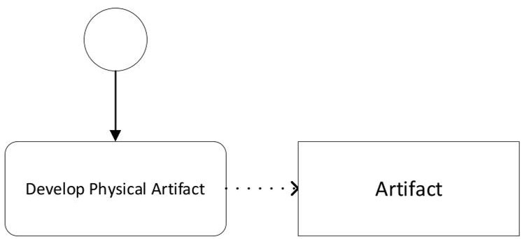

Figure 1. System development without a model.

## 2.2. Model-Based Development

History reveals that the engineering process steadily evolved and became increasingly conscious of the changing surroundings. It is difficult to pinpoint certain historical times, but the size and complexity of physical goods have outgrown the cognitive capacity of a single craftsman over time, making it extremely difficult, if not impossible, to construct a physical object made by a single person. Furthermore, when a large number of artisans were involved in the manufacturing process, communication about the manufacturing process and the end product became crucial. This approach needed to be rethought, which required a fundamental shift in engineering problem-solving. This necessitated the use of drafting or designing, in which the physical object is represented by a sketch before manufacture. Engineers could communicate about the production of a physical object through the design, and they could analyze the physical object before production and use designs as guides for production. Various models from engineering and science disciplines have been introduced to help in the design process. The provided models can be characterized based on their level of precision. The most basic model, a sketch, is a fast freehand drawing used to test and express different concepts. A sketch is beneficial for developing ideas, but not for use as a source for constructing the real object, as it lacks the necessary information to guide production. A blueprint model, on the other hand, is a detailed, accurate description that a human engineer can use to create a physical product. With scientific information, engineering became more conscious, allowing for larger artifacts to be produced, resulting in more advancements in science and engineering. This process in which a design model is used before production is illustrated in Figure 2.

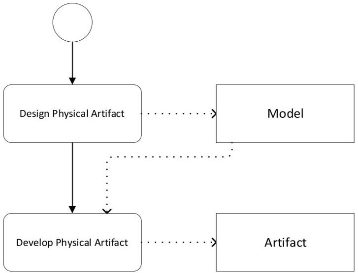

Figure 2. System development with a design model.

When using models for developing systems, currently a distinction is made between document-based and model-based development [7-9]. Document-based development refers to the use of models that are frequently scattered throughout multiple documents, such as informal drawings, natural text, and spreadsheets. The document-based approach to product development suffers from inaccuracy, inconsistencies between artifacts, and

<!-- PDF_PAGE: 4 -->

problems with storing and reusing information. A more precise approach of using models is adopted in model-based systems engineering (MBSE), which is defined as the formalized application of modeling to support system requirements, design, analysis, verification, and validation activities, beginning in the conceptual design phase and continuing through the development and later lifecycle phases [8]. The MBSE approach is a shift from the traditional document-based approach that focuses on the documentation of the system. By adopting precise models based on formal approaches, MBSE aims at enhancing product quality, easier reuse of the system modeling artifacts, and improved communications among the systems development team.

Engineering can be considered a problem-solving activity where, based on the stakeholder needs, an artifact needs to be produced. However, for complex artifacts, this problem-solving process is not conducted in one step but divided into multiple intermediate steps, as it is defined by the engineering lifecycle. The systems development lifecycle (SDLC) defines a process for planning, creating, testing, and deploying an information system. Various different activities are distinguished, including requirement analysis, design, development and testing, implementation, documentation, and evaluation. Throughout the lifecycle, multiple different models are defined that represent various aspects of the artifact development process. Various different lifecycle processes have been introduced to the systems development lifecycle in the literature, including the waterfall, incremental, iterative, agile, and V-model approaches. This process of the adoption of multiple models and adoption of a lifecycle process is illustrated in Figure 3.

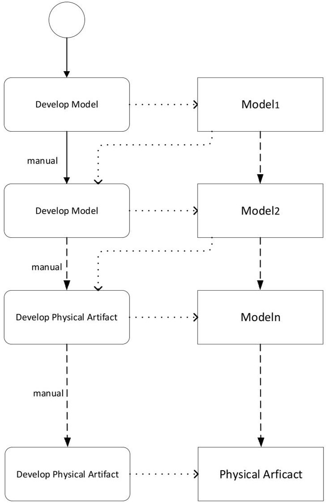

Figure 3. Adoption of models in the lifecycle-model-based system engineering.

## 2.3. Model-Driven Development

When using sketch and blueprint models, the relation to the product remains largely disconnected as there is no explicit formal link between the model and the physical object.

<!-- PDF_PAGE: 5 -->

Model-driven development models can be considered as executable [10,11]. An executable model is a precise model that a machine can interpret to automatically generate the desired physical object without the active intervention of a human engineer. Executable models help to create the formal link between the model and the physical object. If the physical object needs to be changed, the executable model can be updated, and the physical object is automatically generated. Thus, adaptations are not directly applied to the physical objects but are regulated through an automated generation process. Examples of the use of executable models are 3D printing and automated code generation, as they are used in the model-driven development paradigm. With the adoption of executable models and automated generation or regeneration, the formal link between the design model and the physical model was established, and the evolution of the physical object could be maintained. In contrast, models are only utilized as blueprints in model-based software development. The model-driven development process is shown in Figure 4. Once a model of the physical model has been provided, generators (shown by gear symbol) can be used multiple times (indicated by symbol III) to generate other models. Eventually, a final artifact can be generated.

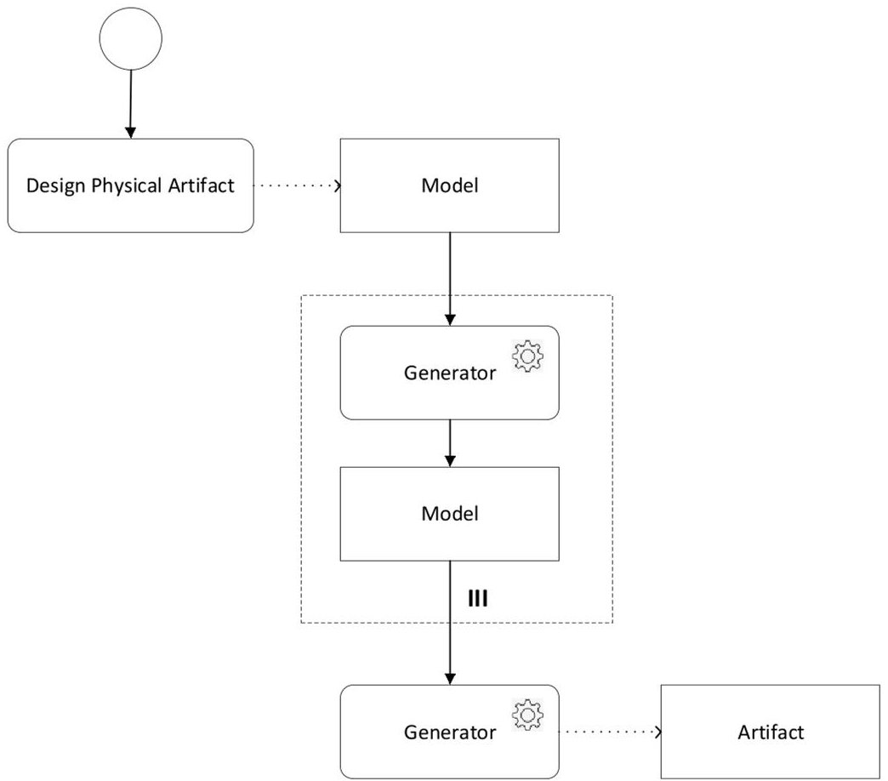

Figure 4. System development using model-driven development process.

Metamodels define the vocabulary used to express models. A model is thus said to conform to a metamodel be a metamodel instance or. A metamodel is a model that follows the rules of a meta-metamodel, which is the language used to describe metamodels. Due to the numerous levels at which models exist in model-driven development, they are typically organized in a four-layered architecture. The meta-metamodel (M3) is the top (M3) level in this architecture, and it defines the fundamental principles from which specific metamodels (M2) are generated. Normal user models are classified as M1, whereas real-world concepts are classified as M0. A metamodel contains the following components [10,11]:

- Abstract syntax: defines the key concepts of a domain and the relationships that exist between concepts;

- Concrete syntax: defines the notation for constructing and presenting models;

- Well-formedness rules (static semantics): defines additional constraints for the construction of models that are difficult to express in the abstract syntax;

<!-- PDF_PAGE: 6 -->

- Semantics: provides the meaning of the concepts, which is typically defined in natural language or in a more formal specification language.

Figure 5 summarizes the key elements of a metamodel.

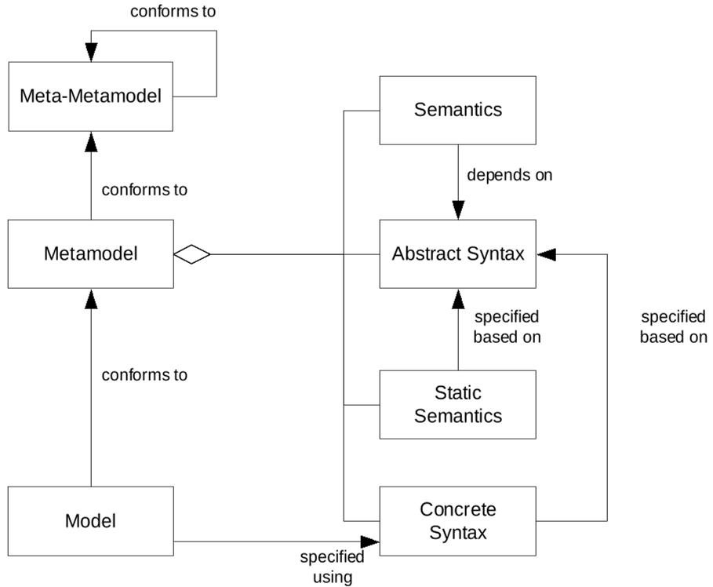

Figure 5. Conceptual model for model-driven software development-metamodeling.

As stated before, model-driven development models are generated from earlier models. Figure 6 shows the model transformation process, where a generator transforms a source model into a target model using a predefined transformation definition. Both models are consistent with their respective metamodels. A transformation is defined in terms of metamodels. A transformation engine applies the transformation definition to concrete models.

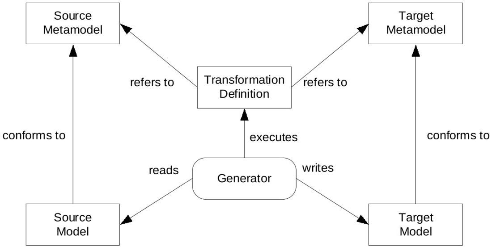

Figure 6. Conceptual model for model-driven software development-model transformations.

In general, two basic types of transformations are distinguished, including model-to-model transformation (M2M) and model-to-text transformation (M2T) [11,12]. An M2M transformation converts one model to another that adheres to the same metamodel or a different one. In an M2T transformation, a model is directly changed to text, such as code or documentation.

<!-- PDF_PAGE: 7 -->

## 3. Digital Twin—Connected Model

With model-driven development, a formal link between the model and the produced artifact is defined using generators. However, once the physical artifact (or code) is produced or (re)generated, the connection with the physical artifact is lost. How could the connection with the physical artifact be continuously retained? How could the physical artifact be followed, even after its production? The digital twin is the next stage in the evolution of product development, and in addition to a rich representation of the physical object, it also keeps the connection with the physical object. This is now possible because of advanced computational instruments, more powerful computation and communication technology, data analytics, and artificial intelligence. The digital model is no longer separate from the physical object but is now continuously connected to its physical twin, often in real-time. Thus, the relationship with the physical object is not terminated after design and production, as was the case in the blueprint or even executable model approaches, but rather retained and maintained. The type and duration of the connection would be of course different for different scenarios. A physical object that is too far or in motion will, for example, require different synchronization times. However, the overall coupling between the digital twin and the physical object will remain.

One might develop a single model (Figure 7) and set synchronization between the physical twin and the digital twin. Alternatively, the digital twin might be developed using a model-driven development approach (Figure 8). In both cases, it is important that the synchronization between the digital twin and the physical artifact is defined and retained during the operation.

An important concern for digital twins is the continuous (near) real-time synchronization of the state of the digital twin with the physical artifact. The implementation of digital twins is basically a control system activity to improve the system's intelligence and entire decision-making process. As a result, the concepts of control and smart systems appear to be critical. A model for a digital twin-based system based on the control system paradigm is shown in Figure 9.

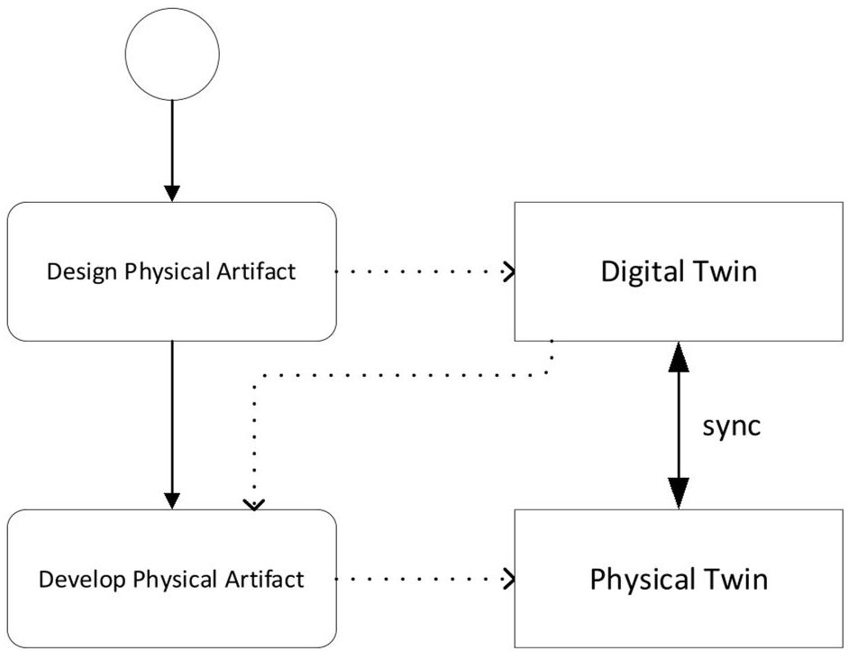

Figure 7. Digital twin system development with a design model.

<!-- PDF_PAGE: 8 -->

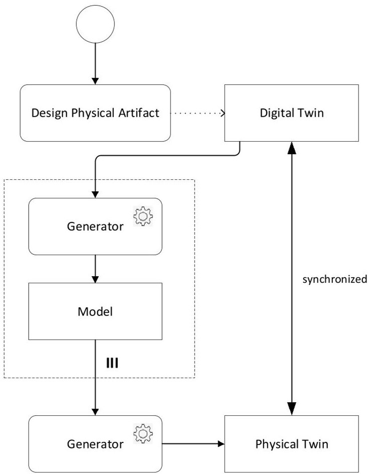

Figure 8. Digital twin development using a model-driven development process.

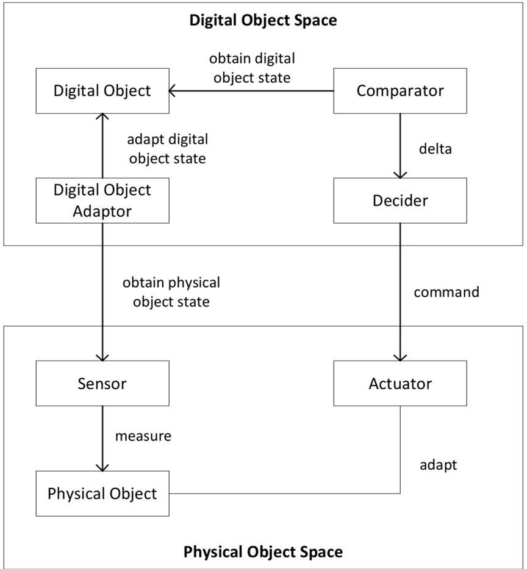

Figure 9. A conceptual model for control-based digital twins as derived from the literature (adopted from [5]).

In the figure, the digital object space contains the elements necessary to realize the digital twin, while the physical object space defines the context of the physical object. Sensors will need to be interpreted and used by the digital object adapter to update the status of the digital object to obtain the state of the physical structure. The digital twin

<!-- PDF_PAGE: 9 -->

can have different purposes, including, monitoring, control, optimization, and autonomy. Each capability requires the one that precedes it: control requires monitoring, optimization requires both control and monitoring, and autonomy requires all three. Monitoring is the observation of a system's condition, operation, and external environment utilizing sensors and external data sources. The regulation of systems by remote commands or algorithms incorporated in the device or available within the cloud is referred to as control. The data collected from the monitoring activity, together with the control capability, allows for system optimization. Optimization can be carried out utilizing specialized algorithms and analytics, which can combine monitoring data with historical data if desired. The goal of optimization is often to improve the system's quality, including its effectiveness and efficiency. Autonomy is the highest level of intelligence, integrating observation, control, and optimization to learn about one's surroundings, self-diagnose one's own goals and needs, and adapt to changing preferences. An autonomous system may interact with other systems, but it is responsible for its own activities. The comparator component in Figure 9 can examine the digital twin's status and compare it with the desired state. The result will be delivered to the decider, who can then choose an action to be executed by the actuator, which modifies the state of the physical item. This model can be adjusted in a variety of ways depending on the aims and available/required elements of the digital and physical object spaces. Table 1 illustrates a common list of the main terminology required in the construction of digital twin systems, as stated previously by Jones et al. [12].

Table 1. Key terms of digital twins (adopted from [12]).

<table border="1"><tr><td>Term</td><td>Description</td></tr><tr><td>Physical Object</td><td>A“real-world”artifact,e.g.,a vehicle,component,product,system,model.</td></tr><tr><td>Virtual Object</td><td>A computer-generated representation of the physical object.</td></tr><tr><td>Physical Environment</td><td>The measurable“real-world”environment within which the physical object exists.</td></tr><tr><td>Virtual Environment</td><td>Any number of virtual“worlds”or simulations that replicate the state of the physical environment</td></tr><tr><td>State</td><td>The current value of all parameters of either the physical or virtual object/environment.</td></tr><tr><td>Realization</td><td>The act of changing the state of the physical/virtual object/twin.</td></tr><tr><td>Metrology</td><td>The act of measuring the state of the physical/virtual object/twin.</td></tr><tr><td>Twinning</td><td>The act of synchronizing the states of the physical and virtual object/twin.</td></tr><tr><td>Twinning Rate</td><td>The rate at which twinning occurs.</td></tr><tr><td>Physical-to-Virtual Connection/Twinning</td><td>The connection from the physical to the virtual environment. Comprises physical metrology and virtual realization stages.</td></tr><tr><td>Virtual-to-Physical Connection/Twinning;</td><td>The connection from the virtual to the physical environment. Comprises virtual metrology and physical realization stages.</td></tr></table>

## 4. Artificial Twin

As discussed before, in early history, no models were used or needed, or at the most, sketch models were used for producing simple artifacts. With the need for more complex artifacts, this was followed by blueprint and generative models to guide the production process and create a link with the physical object. Thanks to the advancements in computation and artificial intelligence, a close connection with the model and the physical object can now be established, and the realization of digital twins is possible. Digital twins can be applied in many different domains, including manufacturing, healthcare, smart

<!-- PDF_PAGE: 10 -->

supply chain management, the automotive industry, and smart energy grids. Besides its application opportunities, the digital twin concept itself will be even further enhanced.

Currently, the digital twin is primarily considered as a virtual model powered by software and data. However, the model can be an actual robot that combines hardware, software, and data. In essence, this means that the digital twin's nature has changed yet again. In that scenario, it may be more appropriate to refer to it as an artificial twin or robotic twin. This allows the control relationship between the digital twin and the physical twin to be inverted, allowing the physical twin to control the artificial twin, as seen in the film Surrogates, a 2009 science fiction action film based on the 2005-2006 comic book series The Surrogates. The movie takes place in the near future, where robotic "surrogates" are widely used and enable everyone to live in idealized forms within the safety of their homes. Each human operator is digitally connected to its surrogate, which can be sent out into the real world and from a distance controlled by the connected human brain. In this way, the human operators can live their lives without limitation; they see what the connected surrogate sees and feel what the surrogate feels. Humans can become anyone they want to be from the comfort and safety of their homes, without any risk of danger. In fact, this idea of surrogates and artificial twin is not just a topic for a science fiction movie, but can already be observed in several applications such as distance surgery and robotic manufacturing.

The historical evolution of models up to the notion of digital twins and beyond is depicted in Figure 10.

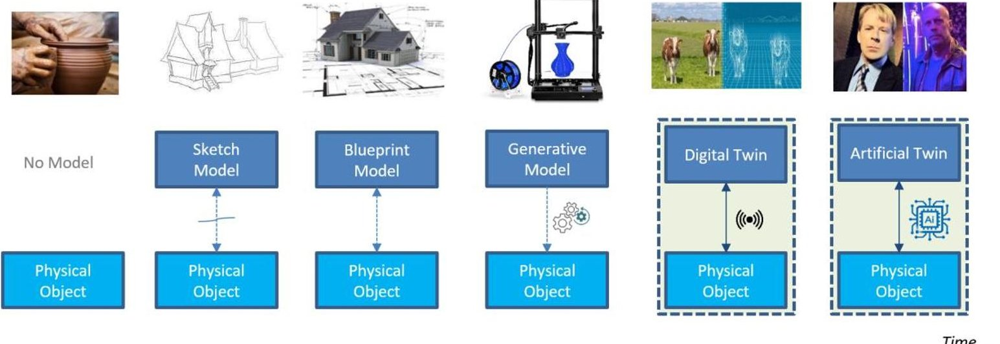

Figure 10. Evolution of modeling.

## 5. Digital Twins in Systems Engineering

The International Organization for Standardization and the International Electrotechnical Commission (ISO/IEC 42010) [8] defines a "system" as a collection of components that performs a given function or combination of functions. Systems engineering is defined as follows: "Systems engineering is defined as "an interdisciplinary approach to translating users' needs into the definition of a system, its architecture and design through an iterative process that results in an effective operational system. Systems engineering applies over the entire lifecycle, from concept development to final disposal" [9].

The system under development interacts with its surroundings, which could include other systems, users, and the natural environment. In addition, the system is made up of system elements such as hardware, software, firmware, people, information, techniques, facilities, services, and other support elements. A systems engineer is a person or function that promotes and employs the systems engineering methodology. Particularly, the systems engineer elicits and interprets customer requests into specifications that the system development team can implement. A systems engineer ensures that the system's components work together to achieve the system's goals and, ultimately, meet the needs of the customers and

<!-- PDF_PAGE: 11 -->

other stakeholders who will acquire and utilize the system. A stakeholder is an individual, group, or organization with interests or concerns about a system. A concern is described as a point of interest in the system that may be functional or related to quality issues. Architectural drivers identify the stakeholders' concerns which shape the architecture. Figure 11 shows the integration of the systems engineering concepts with the digital twin and modeling concepts.

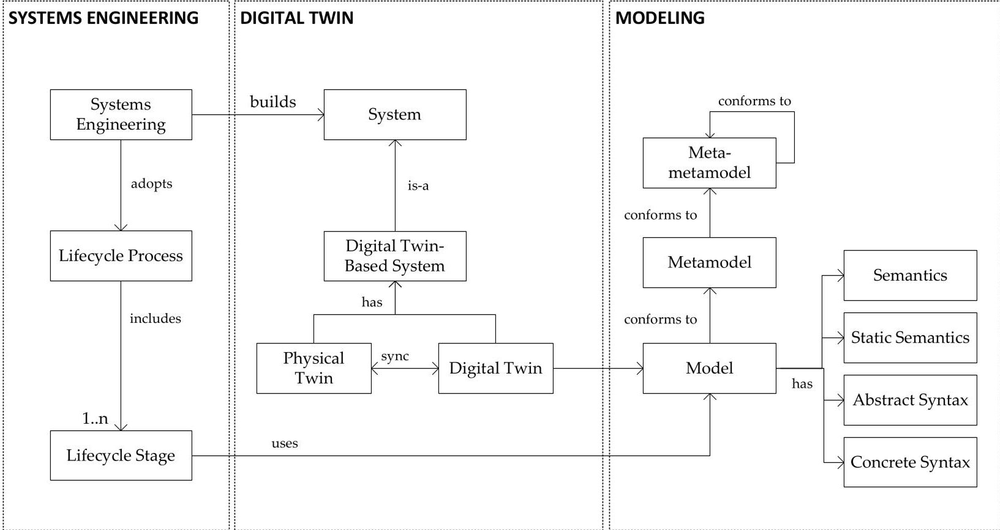

Figure 11. Metamodel representing the integration of systems engineering, digital twins, and modeling.

## 6. Discussion

With the ubiquitous and continuous connectivity, a digital twin removes fundamental constraints concerning place, time, and human observation. Physical proximity is no longer required; remote automated execution, monitoring, control, and coordination have now become possible. Furthermore, digital twins can be enriched with information that cannot be (accurately) observed by the human senses, e.g., sensor and satellite data or data from other connected systems. Advanced analytics that can use both historical data and simulated future states can be used to support smart decision-making, diagnosis, prediction, control, and maintenance processes of the physical object. The opportunities for innovation and value creation are plenty. However, even with this situation, the development and evolution of the digital twin concept have not yet ended.

Figure 12 summarizes the evolution and adoption of different types of models that culminate, as expected, into artificial twins. The arrows represent the evolution lines, which could be considered from a historical perspective, or the adoption of increased maturity within an organization or project. The more precise and connected the models are, the larger the scope of potential functionalities—and with this—the required knowledge to build these systems.

<!-- PDF_PAGE: 12 -->

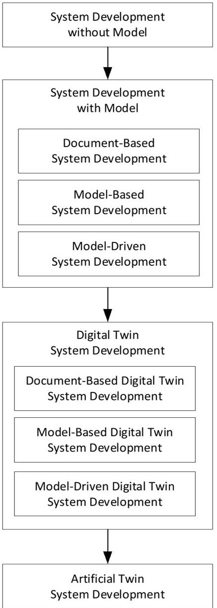

Figure 12. System development approaches.

## 7. Conclusions

In our earlier work, we have provided an ontology of digital twins [4] and presented a catalog of design patterns for digital twins. In [5], the key concepts of digital twins have been explored and defined and finally applied to industrial case studies. In the current work, we focused on conceptual characterizations of digital twin-based systems and did not focus on the formal design of digital twins. In [5], we have elaborated on the design of digital twin-based systems. In software and systems engineering, the design is supported by reusable design patterns that form solution templates to recurring problems. In [5], we provided nine different digital twin patterns that can be used to enhance the quality of the digital twin-based system design. In this article, we have discussed the rationale behind the notion of digital twins using a modeling perspective, which as such is complementary to the ontological and design patterns perspectives. For a comprehensive overview, we have adopted a historical perspective, starting from the period in which no models were used and describing the increased need for modeling and changing nature of models in the system development process. It can be concluded that modeling has always had a clear goal and that the development process can be considered as a problem-solving process. With the increased size and complexity of the problems and artifacts that need to be developed, the need for models and the nature of the models has changed accordingly. Modeling has evolved in different ways, starting with the need for more precise models in which sketch, blueprint, and executable models were distinguished. Accordingly, this first led to document-based development, followed by model-based development and modeldriven development. Although model-driven development aims at providing formal

<!-- PDF_PAGE: 13 -->

links between the models in the lifecycle through the use of model transformations, it does not focus on retaining the link with the eventually developed artifact. The digital twin-based development, as such, builds on the earlier advanced modeling approaches while adding the synchronization of the digital twin model with the physical artifact. The basic mechanism for this is realized using a control-based architecture where the control and decision-making is spread over the physical object space and digital twin space. The physical object space includes sensors and actuators for the observation and for updating the state of the physical object. The digital twin space includes the elements for interpreting the observed state, adapting the digital twin model, and accordingly adapting the physical element.

In addition to the comprehensive overview, we have provided a metamodel that integrates the systems engineering, digital twin, and modeling perspectives. The digital twin-based development approach has been also discussed using the V-model of systems engineering. The provided study aims to provide a synthesis and evolution perspective of the notion of digital twins. From our study, it follows that digital twins are not a temporary hype but a foundational paradigm that will pave the way for many different innovations in various application domains. In our future work, we plan to elaborate on the further integration of digital twins in the system development lifecycle models. Furthermore, we will analyze the application of the digital twin concept to the broader artificial twin concept that we have introduced in this article.

Funding: This research received no external funding.

Data Availability Statement: Not applicable.

Conflicts of Interest: The author declares no conflict of interest.

## References

1. Grieves, M.; Vickers, J. Digital twin: Mitigating unpredictable, undesirable emergent behavior in complex systems. In Transdisciplinary Perspectives on Complex Systems; Springer: Cham, Switzerland, 2017; pp. 85-113.

2. Fuller, A.; Fan, Z.; Day, C.; Barlow, C. Digital Twin: Enabling Technologies, Challenges and Open Research. arXiv 2020, arXiv:1911.012762020. [CrossRef]

3. Atzori, L.; Iera, A.; Morabito, G. The Internet of Things: A survey. Comput. Netw. 2010, 54, 2787-2805. [CrossRef]

4. Tekinerdogan, B.; Verdouw, C. Systems Architecture Design Pattern Catalog for Developing Digital Twins. Sensors 2020, 20, 5103. [CrossRef] [PubMed]

5. Verdouw, C.; Tekinerdogan, B.; Beulens, A.; Wolfert, S. Digital twins in smart farming. Agric. Syst. 2021, 189, 103046. [CrossRef]

6. Alexander, C. Notes on the Synthesis of Form; Harvard University Press: Cambridge, MA, USA, 1964.

7. Cloutier, R.J. (Ed.) The Guide to the Systems Engineering Body of Knowledge (SEBoK), Version 2.2; The Trustees of the Stevens Institute of Technology: Hoboken, NJ, USA, 2019; Available online: www.sebokwiki.org (accessed on 1 September 2020).

8. ISO/IEC/IEEE 15288:2015; Systems and Software Engineering—System Life Cycle Processes. ISO: Geneva, Switzerland, 2015.

9. Walden, D.D.; Roedler, G.J.; Forsberg, K.J.; Hamelin, R.D.; Shortell, T.M. (Eds.) NCOSE Systems Engineering Handbook: A Guide for System Life Cycle Processes and Activities, 4th ed.; John Wiley and Sons: Hoboken, NJ, USA, 2015.

10. Stahl, T.; Voelter, M. Model-Driven Software Development; John Wiley and Sons: Hoboken, NJ, USA, 2006.

11. Bezivin, J. On the Unification Power of Models. Softw. Syst. Model. 2005, 4, 171-188. [CrossRef]

12. Jones, D.; Snider, C.; Nassehi, A.; Yon, J.; Hicks, B. Characterising the Digital Twin: A systematic literature review. CIRP J. Manuf. Sci. Technol. 2020, 29, 36-52. [CrossRef]

Disclaimer/Publisher's Note: The statements, opinions and data contained in all publications are solely those of the individual author(s) and contributor(s) and not of MDPI and/or the editor(s). MDPI and/or the editor(s) disclaim responsibility for any injury to people or property resulting from any ideas, methods, instructions or products referred to in the content.