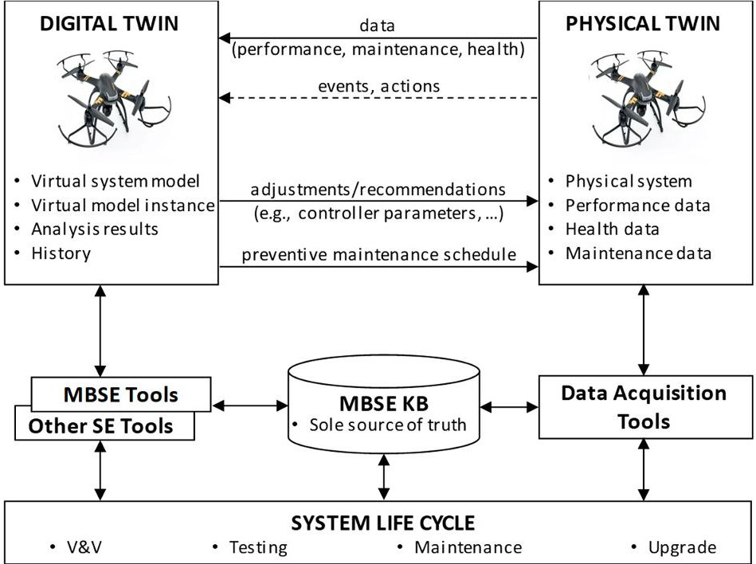
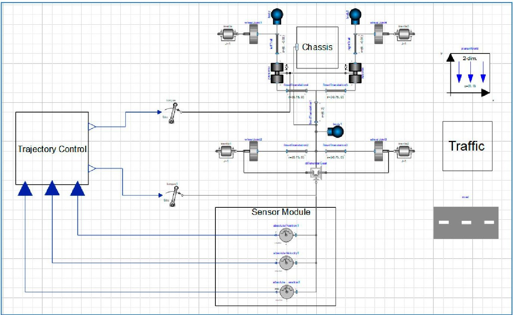
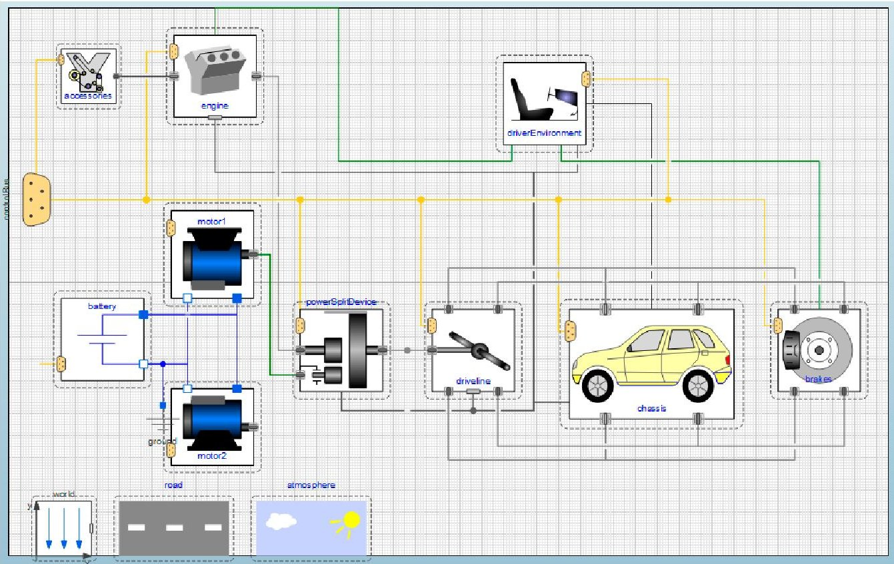

<!-- PDF_PAGE: 1 -->

Article

# Leveraging Digital Twin Technology in Model-Based Systems Engineering

Azad M. Madni $ ^{1,*} $ , Carla C. Madni $ ^{1} $ and Scott D. Lucero $ ^{2} $

$ ^{1} $ Intelligent Systems Technology, Inc., Los Angeles, CA 90066, USA; cmadni@intelsystech.com

2 Research and Engineering, Office of the USD, Washington, DC 20301-3030, USA; don.s.lucero.civ@mail.mil

* Correspondence: azad.madni@usc.edu: Tel.: +1-310-709-1680

Received: 6 November 2018; Accepted: 22 January 2019; Published: 30 January 2019

Abstract: Digital twin, a concept introduced in 2002, is becoming increasingly relevant to systems engineering and, more specifically, to model-based system engineering (MBSE). A digital twin, like a virtual prototype, is a dynamic digital representation of a physical system. However, unlike a virtual prototype, a digital twin is a virtual instance of a physical system (twin) that is continually updated with the latter's performance, maintenance, and health status data throughout the physical system's life cycle. This paper presents an overall vision and rationale for incorporating digital twin technology into MBSE. The paper discusses the benefits of integrating digital twins with system simulation and Internet of Things (IoT) in support of MBSE and provides specific examples of the use and benefits of digital twin technology in different industries. It concludes with a recommendation to make digital twin technology an integral part of MBSE methodology and experimentation testbeds.

Keywords: model-based systems engineering; digital twin; digital thread; Internet of Things; simulation; virtual prototype; Model Based Systems Engineering (MBSE) experimentation testbed

## 1. Introduction

The concept of digital twin was first introduced in 2002 by Michael Grieves at the University of Michigan [1]. Since then the concept has evolved with the advent of the Internet of Things (IoT). A digital twin is a dynamic virtual model of a system, process or service. Thus, a product, factory or a business service can have digital twins [2,3]. The vision of a digital twin calls for incorporating business, contextual and sensor data from physical systems (or processes) into the virtual system model of the digital twin to facilitate analysis, circumvent problems, and develop informed technology roadmaps. By integrating the virtual and physical worlds, the digital twin enables real-time monitoring of systems and processes and timely analysis of data to head off problems before they arise, schedule preventive maintenance to reduce/prevent downtimes, uncover new business opportunities, and plan for future upgrades and new developments. While virtual models tend to be generic representations of a system, part, or a family of parts, the digital twin represents an instance (i.e., a particular system or process). Digital twin technology has the potential to reduce the cost of system verification and testing while providing early insights into system behavior. Today, digital twin technology is an integral part of the Department of Defense's (DoD's) Digital Engineering initiative that seeks to connect systems and operations in a world of increasingly interconnected and smart physical devices [4-6].

With the advent of the Internet of Things (IoT), digital twin technology has become cost-effective to implement and is gaining increasing acceptance in the Industrial Internet of Things (IIoT) community [7], which tends to focus on large, complex, capital-intensive equipment. At the same time, the aerospace and defense industry, which continues to invest in Industry 4.0, has started to invest in digital twin technology. According to Gartner, by 2021 nearly half the major industrial companies will

<!-- PDF_PAGE: 2 -->

be leveraging digital twin technology to facilitate the assessment of system performance and technical risks, while achieving approximately 10% improvement in system effectiveness [8].

A digital twin, by definition, requires a physical twin for data acquisition and context-driven interaction. The virtual system model in the digital twin can change in real-time as the state of the physical system changes (during operation). Today, a digital twin consists of connected products, typically utilizing the IoT, and a digital thread. The digital thread provides connectivity throughout the system's lifecycle and collects data from the physical twin to update the models in the digital twin. Figure 1 presents the digital twin concept within the context of model-based systems engineering (MBSE).

Figure 1. Digital twin concept within MBSE (Model Based Systems Engineering) Framework.

As shown in this figure, the digital twin links the virtual and physical environments. The physical environment includes the physical system, onboard and external sensors, communication interfaces, and possibly other vehicles operating in an open environment with access to GPS data. Both operational and maintenance data associated with the physical system are supplied to the virtual environment to update the virtual model in the digital twin. Thus, the digital twin becomes a precise and up-to-date representation of a physical system that also reflects the operational context of the physical twin. Importantly, the relationship with the physical twin can continue even after the sale of the physical twin, thereby making it possible to track the performance and maintenance history of each physical twin over time, detect and report anomalous behavior, and recommend/ schedule maintenance.

NASA and USAF (United States Air Force) researchers describe a digital twin as an integrated multi-physics, multiscale, probabilistic simulation of an as-built vehicle or system that uses the best available physical models, sensor updates, fleet history, etc., to mirror the life of its corresponding flying twin [9]. The digital twin is ultra-realistic and may consider one or more important and interdependent vehicle systems such as airframe, propulsion and energy storage, life support, avionics and thermal protection. The extreme requirements of the digital twin necessitate the integration of design of materials and innovative material processing approaches. Manufacturing anomalies that may affect the vehicl, are also "explicitly considered, evaluated and monitored." In addition to the high-fidelity physical models of the as-built structure, the digital twin integrates sensor data from the vehicle's on-board integrated vehicle health management (IVHM) system, maintenance history and all available historical and fleet data obtained through techniques such as data mining and text mining [9]. By combining data from these different sources of information, the digital twin can continually forecast vehicle health status, the remaining useful vehicle life, and the probability

<!-- PDF_PAGE: 3 -->

of mission success. The digital twin can also be used to predict system response to safety critical events and uncover new issues before they become acute by comparing predicted and actual responses. Finally, the systems on board the digital twin are capable of mitigating damage or degradation by activating self-healing mechanisms, or by recommending changes in mission profile to decrease loads, thereby increasing both the life span and the probability of mission success [9].

The context of operation of the digital twin involves an instrumented testbed in which model-based systems engineering (MBSE) tools (e.g., system modeling and verification tools) and operational scenario simulations (e.g., discrete event simulations, agent-based simulations) are used to explore the behavior of virtual prototypes in a what-if simulation mode under the control of the experimenter. Insights from the operational environment are used to modify the system models used in the virtual prototype. Data supplied by the physical system is used by the virtual prototype to instantiate a digital twin. Subsequently, the digital twin is updated on an ongoing basis, so it faithfully mirrors the characteristics and history of the physical twin. Importantly, systems that collect and supply data from the operational environment contribute to insights needed for business intelligence (BI). For example, the DoD is presently altering its systems to comprehensively record all electronics warfare (EW) signals (data) from operational missions to analyze and better understand the operational environment and provide focused updates to our systems.

The MBSE tool suite in Figure 1 includes system modeling methods (e.g., SysML models, Design Structure Matrix, process dependency structure matrix, probabilistic models such as Partially-Observable Markov Decision Process (POMDP), discrete event simulation [10,11], agent-based simulation, model-based storytelling [12,13], an MBSE knowledge base (that constitutes the authoritative sources of truth), and systems engineering life cycle process models. The virtual system model can range from lightweight models to full-up models. The lightweight models reflect simplified structure (e.g., simplified geometry) and simplified physics (e.g., reduced order models) to reduce computational load especially in upfront engineering activities. These lightweight models allow simulations of complex systems and system-of-systems (SoS) with fidelity in the appropriate dimensions to answer questions with minimal computation costs. These models can be shared within the organization and with the supplier network thereby increasing their understanding of the system being engineered. The digital twin concept also subsumes automated and manual processes in manufacturing environments. From the physical twin, performance, maintenance, and health data can be collected and supplied to the digital twin. This data includes operational environment characteristics, engine and battery status, and other such factors. The digital twin and the physical twin can both be supported by a shared MBSE repository, which also supports SE and data collection tools. The MBSE models constitute the authoritative sources of truth. This configuration also ensures bidirectional communication between the digital twin and the physical twin.

A digital twin is different from the traditional Computer Aided Design/Computer Aided Engineering (CAD/CAE) model in the following important ways:

(a) It is a specific instance that reflects the structure, performance, health status, and mission-specific characteristics such as miles flown, malfunctions experienced, and maintenance and repair history of the physical twin;

(b) It helps determine when to schedule preventive maintenance based on knowledge of the system's maintenance history and observed system behavior;

(c) It helps in understanding how the physical twin is performing in the real world, and how it can be expected to perform with timely maintenance in the future;

(d) It allows developers to observe system performance to understand, for example, how modifications are performing, and to get a better understanding of the operational environment;

(e) It promotes traceability between life cycle phases through connectivity provided by the digital thread;

<!-- PDF_PAGE: 4 -->

(f) It facilitates refinement of assumptions with predictive analytics-data collected from the physical system and incorporated in the digital twin can be analyzed along with other information sources to make predictions about future system performance;

(g) It enables maintainers to troubleshoot malfunctioning remote equipment and perform remote maintenance;

(h) It combines data from the IoT with data from the physical system to, for example, optimize service and manufacturing processes and identify needed design improvements (e.g., improved logistics support, improved mission performance);

(i) It reflects the age of the physical system by incorporating operational and maintenance data from the physical system into its models and simulations.

This paper is organized as follows. Section 2 presents the digital twin rationale and potential uses. Section 3 presents the levels of sophistication (maturity) of a digital twin. Section 4 presents the relationship between the digital twin and MBSE, in terms of the relationship of the digital twin with simulation, machine learning, Internet of Things (IoT), and cost. Section 5 offers concluding comments on the future prospects of digital twins in advancing MBSE.

## 2. Digital Twin Rationale and Potential Uses

A digital twin is first created when the physical system can start providing data to the virtual system model to create a model instance that reflects the structural, performance, maintenance, and operational health characteristics of the physical system [11,12]. The physical system can be said to be "fit for purpose" if the digital twin's behavior is analyzed and can be appropriately adjusted for a variety of contingency situations. For example, computer simulations of the braking system of a car can be run to understand how the vehicle (model) would perform in different real-world scenarios. This approach is faster and cheaper than building multiple physical vehicles to test. However, computer simulations tend to be confined to current events and operational environments. In other words, they do not have the ability to predict vehicle responses to future/envisioned scenarios. Also, braking systems are software-intensive systems, not merely a combination of mechanical and electronic subsystems. This is where digital twin and IoT can play important roles. A digital twin uses data collected from connected sensors onboard the physical vehicle to enable virtual testing. Furthermore, with IoT-provided data (e.g., temperature, humidity), it becomes possible to reflect system performance and health status in the digital twin and use that information to make predictions about the physical twin. Equipped with such data and knowledge, the digital twin can "tell" the story (i.e., events, experiences, history) of its physical twin over the physical twin's life cycle.

Being a virtual representation, a digital twin is easier to manipulate and study in a controlled testbed environment than its physical counterpart in the operational environment. This flexibility enables cost-effective exploration of system behaviors and sensitivities to various types of system malfunctions and external disruptions. Second, data produced by the digital twin under various what-if conditions can be used to: improve future system designs; optimize maintenance cycles; surface ideas for new system applications; validate preliminary design decisions; and predict system response to different types of disruptions in the field. Specifically, the digital twin can be used to:

- Validate system model with real world data Operational environment data and the interactions of the system with that environment can be incorporated into the digital twin to validate its models and to make assessments and predictions.

- Provide decision support and alerts to users After incorporating operational, maintenance, and health data, the digital twin can be employed in a what-if analysis mode to produce tailored decision support information and alerts to operators/users of the physical system.

- Predict changes in physical system over time Simulation-based analysis of operational maintenance, and health data from the physical twin can facilitate optimization of operations (including satisfying requirements and identifying root causes), enhance contingency planning

<!-- PDF_PAGE: 5 -->

and predicting system performance. The digital twin can also be embedded in the control loop to predict changes in the physical system and adjust/modify physical system parameters to deal with contingencies.

- Discover new application opportunities and revenue streams With a digital twin, different versions of systems can be evaluated to determine which features provide the "biggest bang for the buck." Machine learning and other data science technologies can facilitate timely analysis of significant volumes of data generated, thereby providing insights into potential new uses and revenue streams.

Thus far, the initial series of digital twin initiatives have focused on complex, high-cost systems. However, today with advances in cost models for sensors, communication networks, analytics and simulation, it is possible to develop a digital twin for almost any system.

## 3. Digital Twin Levels of Sophistication (or Maturity)

Today any digital version of a system, component, or asset is called a digital twin. With this larger interpretation, there are several questions that arise including:

- Does a physical system have to exist before a digital twin is created?

- Does the physical system with onboard sensors and processor need to report performance, health, and maintenance data to the virtual system model before the latter can be called a digital twin?

- Does the definition of a digital twin have to change because any physical asset today can be made smart with the advent of the Industrial Internet of Things (IIoT)?

These questions and many more need to be answered about the digital twin and its various uses. To this end, we define four levels of a virtual representation. Each level has a specific purpose and scope and helps with decision making and answering questions throughout the system's lifecycle. Table 1 presents these different levels along with the characteristics that define each level.

Table 1. Digital twin levels.

<table border="1"><tr><td>Level</td><td>Model Sophistication</td><td>Physical Twin</td><td>Data Acquisition from Physical Twin</td><td>Machine Learning(Operator Preferences)</td><td>Machine Learning(System/Environment)</td></tr><tr><td>1Pre-Digital Twin</td><td>virtual system model with emphasis on technology/technical-risk mitigation</td><td>does not exist</td><td>Not applicable</td><td>No</td><td>No</td></tr><tr><td>2Digital Twin</td><td>virtual system model of the physical twin</td><td>exists</td><td>performance, health status, maintenance; batch updates</td><td>No</td><td>No</td></tr><tr><td>3Adaptive Digital Twin</td><td>virtual system model of the physical twin with adaptive UI</td><td>exists</td><td>performance, health status, maintenance; real-time updates</td><td>Yes</td><td>No</td></tr><tr><td>4Intelligent Digital Twin</td><td>virtual system model of the physical twin with adaptive UI and reinforcement learning</td><td>exists</td><td>performance, health status, maintenance, environment; both batch/real-time updates</td><td>Yes</td><td>Yes</td></tr></table>

## 3.1. Pre-Digital Twin

Level 1 is the traditional virtual prototype created during upfront engineering. It supports decision-making at the concept design and preliminary design. The virtual prototype is a virtual

<!-- PDF_PAGE: 6 -->

generic executable system model of the envisioned system that is typically created before the physical prototype is built. Its primary purpose is to mitigate technical risks and uncover issues in upfront engineering. We call this virtual prototype-Pre-Digital Twin. Like most model-driven approaches, virtual prototyping involves a model of the system early in the design process. However, a virtual prototype is not usually used to derive the final system. This is because a virtual prototype can be a "throwaway" prototype or a "reusable" prototype. The latter can be used to derive the final system. A virtual prototype is mostly used to validate certain key decisions about the system and mitigate specific technical risks early in the design process. Figure 2 presents an example of a Level 1 virtual representation of a car using the Planar Mechanics library provided by Modelica. This model consists of ideal wheels with dry friction contact patch rolling on a surface. It employs a simple (i.e., low fidelity) model of differential gear to distribute torque equally to the wheels, and reflects properties such as inertia, mass, fixed translation and torque to realize a basic structure of vehicle with mass properties. A PlanarWorld component is used to define gravity and global coordinates system. The sensors measure absolute position, velocity and acceleration. The trajectory control module provides torques values to the steering and differential gear mechanism. Such low fidelity models can be used, for example, in testing, planning, and decision-making algorithms related to, for example, trajectory control in autonomous vehicles performing lane changes.

Figure 2. Virtual Vehicle Model Built with Planar Mechanics Open Source Library.

## 3.2. Digital Twin

Level 2 is a digital twin in which the virtual system model is capable of incorporating performance, health and maintenance data from the physical twin. The virtual representation, an instantiation of the generic system model, receives batch updates from the physical system that it uses to support high-level decision making in conceptual design, technology specification, preliminary design and development. Data collection from the physical sensors and computational elements in the physical twin includes both health status data (e.g., battery level), mission performance data (e.g., flight hours). The data is reported back to the digital twin which updates its model including the maintenance schedule for the physical system. Since interaction with the physical system is bidirectional, there is ample opportunity for the physical twin to use knowledge acquired from one or more digital twins to improve its performance during real time operation. The digital twin at this level is used to

<!-- PDF_PAGE: 7 -->

explore the behavior of the physical twin under various what-if scenarios. Being an executable digital representation, it is easy to manipulate when exploring the behavior of the system in the controlled simulation environment of the testbed. Any deficiencies discovered are used to modify the physical twin with the changes reflected in the digital twin. Figure 3 presents an example of a Level 2 system model of a passenger car. This model is built with Vehicle Interface Library of the Modelica tool. The model has a passenger car with power split hybrid power train. The chassis model has single degree of freedom with mass-and speed-dependent drag properties. The braking subsystem which uses brake pedal position resulting from driver action to calculate brake torque. This affects the driveline. The driveline model consists of four wheels with front wheel drive and ideal differential. The power split device consists of ideal epicyclic gear without losses. An ideal battery with constant voltage source powers DC motor model with inductor, resistor and emf component connected to shaft hub. The engine model with flywheel consist of drive-by-wire accelerator, where the accelerator inputs are converted to output torque. Models of Road, environment and WorldFrame software (MathWorks, Natick, MA, USA) are used to define the inertial frame, gravity, air temperature, wind velocity, gas constant for air, and air pressure. The data used in this model is from the physical twin.

Figure 3. Digital twin model built with vehicle interfaces open source library.

## 3.3. Adaptive Digital Twin

Level 3 is the Adaptive Digital Twin. It offers an adaptive user interface (in the spirit of a smart product model) to the physical and digital twins. The adaptive user interface is sensitive to the preferences and priorities of the user/operator. A key capability at this level is the ability to learn the preferences and priorities in of human operators in different contexts [14]. These characteristics are captured using a neural network-based supervised machine learning algorithm. The models employed within this digital twin are continually updated based on the data being "pulled" from the physical twin in real-time. It can also accept information in batches after system use. This digital twin can support real-time planning and decision-making during operations, maintenance, and support.

## 3.4. Intelligent Digital Twin

Level 4 is the Intelligent Digital Twin. It has all the capabilities of a Level 3 digital twin (including supervised machine learning). In addition, it has unsupervised machine learning capability

<!-- PDF_PAGE: 8 -->

to discern objects and patterns encountered in the operational environment, and reinforcement learning of system and environment states in uncertain, partially observable environment. This digital twin at this level has a high degree of autonomy. At this level, the digital twin can analyze more granular performance, maintenance, and health data from the real-world counterpart.

## 4. Digital Twin Technology and MBSE

Digital twins can be integrated through the digital thread to MBSE tool suites, and potentially become a core element of model-based systems engineering (MBSE). In fact, MBSE can serve as the starting point for the digital thread [15-17]. Using data gathered from IoT, system simulations can be run to explore failure modes, leading to progressive design improvements over time. For example, a manufacturer can link a digital twin to its service history, manufacturing process, design history, real-time IoT data, configuration-specific simulation models, and expected failure modes using MBSE tools such as Design Failure Mode and Effects Analysis (DFMEA). The ability to compare simulation outputs with actual results can provide valuable insights about the physical twin. Using an appropriate MBSE tool, engineers can generate event-driven or agent-based simulations to explore the behavior and interactions of the digital twin, respectively. The digital twin can incorporate 3D data and simulations, along with their characterizations using methods such as response surface models. To gauge customer experience and the impact of innovation on that experience, the digital twin can be employed to simulate a plant, product or service at the right level of abstraction. For example, the DoD has a policy of barcoding line replaceable units for analysis in logistics support. The benefits of this policy would apply to digital twins.

## 4.1. Digital Twin and Simulation

Engineers can potentially use simulations linked to the digital twin to predict how the physical twin can be expected to perform in the real-world [18,19]. Contrast this with having to rely on the ideal and perceived worst-case conditions typically employed in the design process. Actual system performance data can be compared to data from the digital twin, prompting adjustment decisions that can contribute to successful mission outcomes [20]. Also, by incorporating data from the physical twin into the digital twin, engineers can improve system models, and subsequently use the results of the analysis with the digital twin to improve the operation of the physical system in the real-world.

The value added by a digital twin to its physical twin stems from its ability to optimize both physical twin operation and maintenance schedule. Simulating digital twin behavior enables the determination and adjustment of real-world system behavior. Specifically, insights gained through simulation can guide changes needed in system design and manufacturing with the digital thread providing the necessary connectivity across the system life cycle.

The fidelity of the simulation will typically vary with the purpose of the simulation and the stage in the system life cycle [18,19]. A potential benefit would be to rehearse missions in specific operational conditions (terrain, weather, etc.) using the capabilities of the digital twin. For example, in the system design phase, a relatively slow, non-real-time simulation may suffice so long as it enables exploration and investigation of multiple different use cases under real world conditions. With access to IoT data, actual operational conditions can be simulated (with high confidence) to yield insights into expected outcomes.

An important use of simulation is in the assessment of the expected operational life of the system (i.e., low long the system can be expected to be operational). In this regard, a digital twin can keep track of its mortality based on the wear and tear experienced by the physical twin. By employing simulation, the digital twin can estimate the remaining working life of the physical twin and proactively schedule maintenance. In other words, predictive maintenance can be used to estimate how long the physical system can be expected to operate normally and use that knowledge to proactively schedule and perform system shut down rather than wait for the breakdown of the physical twin which can be both expensive and potentially catastrophic.

<!-- PDF_PAGE: 9 -->

## 4.2. Digital Twin and Machine Learning

For simple applications, digital twin technology offers value without having to employ machine learning. Simple applications are characterized by a limited number of variables and an easily discoverable linear relationship between inputs and outputs. However, most real-world systems that contend with multiple data streams stand to benefit from machine learning and analytics to make sense of the data. Machine learning, in this context, implies any algorithm that is applied to a data stream to uncover/discover patterns that can be subsequently exploited in a variety of ways. For example, machine learning can automate complex analytical tasks. It can evaluate data in real-time, adjust behavior with minimal need for supervision, and increase the likelihood of desired outcomes. Machine learning can also contribute to producing actionable insights that can lead to cost savings. Smart buildings are an excellent example of applications that stand to benefit from machine learning capabilities in the digital twin [21,22]. Machine learning uses within a digital twin include: supervised learning (e.g., using neural network) of operator/user preferences and priorities in a simulation -based, controlled experimentation testbed [14]; unsupervised learning of objects and patterns using, for example, clustering techniques in virtual and real-world environments [23,24]; and reinforcement learning of system and environment states in uncertain, partially observable operational environments [25,26].

## 4.3. Digital Twin and Internet of Things (IoT)

Linking digital twins to the IoT brings the data needed to understand how the physical twin (e.g., manufacturing assembly line, autonomous vehicles network) behaves and performs in the operational environment [27-29]. Furthermore, the combination of IoT and digital twins can enhance preventive maintenance and analytics/AI (artificial intelligence)-based optimization of the physical system and operational processes. Acting as a bridge between the physical and virtual worlds, the IoT can deliver performance, maintenance and health data from the physical twin to the digital twin. Combining insights from the real-world data with predictive modeling can enhance the ability to make informed decisions that can potentially lead to the creation of effective systems, optimized production operations, and new business models. Multi-source/multi-sensor information (e.g., outside temperature, moisture content, production status of current batch) can be delivered to the digital twin along with information from traditional sensors (e.g., SCADA) to facilitate predictive modeling. Furthermore, the IoT enables much needed flexibility when it comes to system mobility, location and monetization options. Such flexibility contributes to the creation of business options such as selling a capability (i.e., product as a service) versus selling the product itself. For example, Caterpillar sells the capability to move dirt (i.e., a service) versus selling the equipment (i.e., product).

Importantly, the combination of digital twin and IoT allows an organization to gain insights into how a system/product is being used by customers. Such insights can enable customers to optimize maintenance schedule and resource utilization, proactively predict potential product failures, and avoid/reduce system downtimes. Ultimately, the digital twin is a key enabler for improving system maintenance over time based on system operation and maintenance history. The benefits of the IoT can be further amplified through the integration of the IoT with multiple digital twins, each monitored from a central location that oversees maintenance schedules and cycles. In this latter case, data ownership becomes somewhat complicated especially when equipment is rented.

While access to execution data can contribute to improving manufacturing operations, the reality is that most manufacturers tend to have limited equipment data for optimization. In contrast, suppliers typically have a multitude of interconnected equipment and devices supplying data that can be exploited. Importantly, vendors indicate that customers would be willing to share data with suppliers. If this is the case, then timely optimization is achievable. Perhaps the greatest potential benefits of the IoT is in the service area. For example, service that is continually informed about the operational state and health status of the system can be effective in ensuring cost savings and high availability.

<!-- PDF_PAGE: 10 -->

In a similar vein, predictive analytics can be employed, for example, to pre-fetch and rapidly deliver a required part to a maintenance crew.

## 4.4. Digital Twin and Cost

Cost is always an important consideration when deciding to integrate digital twins into MBSE and systems engineering processes [30]. Clearly defined scope and purpose are prerequisites to estimating the cost for implementing digital twins. While a digital twin requires a greater upfront investment, the inclusion of digital twin(s) can be expected to provide significant return on investment down the line in the systems life cycle. Based on the sophistication level, time and effort required for generating a virtual system representation, costs can vary. However, in today's world, most organizations are pursuing the creation of virtual system models anyway because of their value in reducing verification and test durations and costs. The digital twin is a logical next step in this progression. The cost of the digital twin is a function of the number of components in the system, the interfaces and dependencies among the components, the complexity of the algorithms employed to implement specific functions, and the knowledge and know-how required to build the digital twin. Importantly, architecting the digital twin for reuse can further reduce costs.

## 5. Future Prospects

In the future, digital twin technology can be expected to become a central capability in MBSE because it can enable MBSE to span the full system life cycle while at the same time helping MBSE to penetrate new markets such as manufacturing, construction and real estate. Specifically, digital twins can be exploited in upfront engineering (e.g., system conceptualization and model verification), testing (e.g., model-based system validation), system maintenance (e.g., condition-based maintenance), and smart manufacturing. On the flip side, MBSE can contribute a variety of system modeling constructs and modeling languages that digital twins can exploit in virtual system representation.

In the near-term, digital twin technology can be expected to be integrated into manufacturing and maintenance activities to enhance predictive maintenance and design [31,32]. At the same time, digital twin technology will continue to gain ground in the construction, building and real estate industries because of real-time access to system data which is essential for functions such as adaptive energy management. The latter is key to applications such as efficient energy management.

Maintenance will be a major contribution area for digital twins. For example, digital twins will help organizations transition from schedule-based to condition-based maintenance, thereby substantially reducing system maintenance costs while also enhancing system availability. In a similar vein, digital twins can be exploited in aircraft engine maintenance. Currently, aircraft engines are routinely taken apart and rebuilt based on the number of hours flown, regardless of whether most of those hours are simply cruising at altitude or performing high-G maneuvers. Digital twin technology can help us better understand maintenance needs and schedule maintenance accordingly. For example, the Nunn-McCurdy breach on the C-130 AMP, which was primarily due to "tail-number diversity" would be better understood with digital twins.

The building and real estate industries are currently poised to exploit digital twins in the different construction phases, from design to construction management to operation and ultimately demolition. The need for digital twins in the building construction and real estate industries originates from the need for increasingly sophisticated dashboard software for users to view everything they need to know about their projects and properties in a convenient form and format. However, as the real estate universe continues to digitize, and building and property data becomes increasingly more complex and abundant, there has been an exponential growth in the number of tools, data formats and data services. As a result, generating actionable information from diverse data supplied by different tools is becoming increasingly difficult. Despite this recognition, the software dashboards in current use continue to rely on traditional bar graphs and pie charts to visualize system state and status information, largely ignoring the tools and data services building owners rely on today. A next-generation dashboard tied

<!-- PDF_PAGE: 11 -->

to one or more digital twins can dramatically improve timely decision-making and plan execution on the construction projects and property maintenance. In addition, digital twins will continue to earn ROI from multiple projects and properties over their life cycle. In the initial stages, architects, planners and property managers will be able to realize gains in the planning and design stages. In the later stages, they will derive benefits from the digital twin-provided ability to streamline energy and maintenance functions.

For architects, engineers and planners, digital twin technology can become a source of sustainable competitive advantage by linking projects and properties to real-time data with user-customizable smart dashboards. Zoning, permitting, traffic and air quality data can be linked to the digital twin, and accounted for in making siting and structural component placement decisions. For example, pedestrian traffic information can be used to determine where to place an entrance to a building. Similarly, property managers interested in reducing energy consumption will be able to exploit the digital twin to rapidly determine energy use and usage profile of each tenant and use that information to optimize and dynamically adjust energy usage in the building. Real-time sensor data from throughout the building such as those connected to HVAC and lighting can make this possible [21,22]. Timely maintenance can also be expected to contribute to tenant satisfaction, while faster time-to-market will contribute to increase in sales.

For businesses and manufacturers, digital twin technology can provide a window into system performance [27-29,33-35]. For example, a digital twin can potentially help identify equipment faults and troubleshoot equipment remotely thereby alleviating a key customer concern. In addition to improving virtual system models, a digital twin can potentially improve physical system operations and sustainment. A digital twin can also help with product differentiation, product quality and add-on services. Knowing how customers are using the product post-purchase, can provide useful insights including identifying and eliminating unwanted product functionality and features, as well as unwanted components thereby saving both time and money. A digital twin can enable visualization of remote physical systems (e.g., a system engineer in Washington D.C. can use the digital twin to troubleshoot a landing gear problem of an airplane parked at a gate of Los Angeles airport). Multimodality sensors (e.g., sight, sound, vibration, altitude) can serve to deliver data from physical systems to digital twins anywhere in the world. These flexible capabilities can potentially lead to clear understanding of the state of remote systems through multi-perspective visualization [12,13].

The digital twin story is just beginning to be written with leadership provided by the U.S. Department of Defense (through its Digital Engineering initiative), the IIoT community and Industry 4.0. Digital twin technology is key to acquiring early insights into system performance and technical risks [36]. The digital thread can facilitate upstream and downstream transfer of knowledge from one program to another. Within the MBSE rubric, digital twins can become the single authoritative sources of truth about the system over its life cycle. By exploiting simulation-based modeling and data analytics, the digital twin can help quantify margins and uncertainties in cost and performance. The combination of digital connectivity provided by the digital thread and the trusted data and knowledge supplied by the digital twin can accelerate the transformation of systems engineering processes employed in MBSE [18,19].

Despite the promise of digital twin technology for MBSE, there are a few concerns that need to be resolved before wide-scale adoption of digital twin technology can be achieved. For example, being a relatively new concept, digital twin raises concerns about privacy and ownership. To many the extensive sharing of data with suppliers and potential customers is disconcerting. There are also concerns about intellectual property (IP) and legal considerations. For example, will operators want to report operational data to the manufacturer? And who owns the data provided by the digital twin? Ultimately, who reaps the benefit? And, does the operator want to share manufacturing execution data with the device manufacturer? Does the operator want to share such data with competing device manufacturers? If the operator decides not to share such data with everyone, then who owns that data?

<!-- PDF_PAGE: 12 -->

The digital engineering community is working diligently on answering these questions any more. In the meantime, digital twin technology is continuing to make impressive inroads in several industries including aerospace and defense, manufacturing, building construction and real estate.

Author Contributions: A.M.M. conceived the different levels of the digital twin; C.C.M. provided the commercial perspective including the construction and real estate perspective; S.D.L. contributed the DOD perspective; A.M.M. wrote the paper with C.C.M. serving as editor and reviewer.

Funding: This research received no external funding.

Acknowledgments: Shatad Purohit rendered the exemplar visualization screens using an off-the-shelf tool. Research is performed by ISTI in collaboration with Scott Lucero.

Conflicts of Interest: The authors declare no conflict of interest.

## References

1. Grieves, M. Digital Twin: Manufacturing Excellence through Virtual Factory Replication; A White Paper; Michael Grieves, LLC: Melbourne, FL, USA, 2014.

2. Matthews, S. Designing Better Machines: The Evolution of the Digital Twin Explained; Keynote Delivered at Hannover Messe: Hanover, Germany, 2018.

3. Marr, B. What is Digital Twin Technology—And Why is It so Important? Forbes, 6 March 2017.

4. Madni, A.M. Transdisciplinary Systems Engineering: Exploiting Convergence in a Hyper-Connected World; Foreword by Norm Augustine; Springer: Berlin, Germany, 2017.

5. West, T.D.; Pyster, A. Untangling the Digital Thread: The Challenge and Promise of Model-Based Engineering in Defense Acquisition. Insight 2015, 18, 45-55. [CrossRef]

6. Kraft, E.M. HPCMP CREATE-AV and the Air Force Digital Thread. In Proceedings of the 53rd AIAA Aerospace Sciences Meeting, Kissimmee, FL, USA, 5-9 January 2015.

7. O'Connor, C. IBM IoT Platform. Available online: https://www.ibm.com/blogs/internet-of-things/leaderiot-platforms/ (accessed on 28 January 2019).

8. Pettey, C. Prepare for the Impact of Digital Twins; Gartner: Stamford, CT, USA, 2017.

9. Glaessgen, E.H.; Stargel, D.S. The Digital Twin Paradigm for Future NASA and U.S. Air Force Vehicles. In Proceedings of the AIAA 53rd Structures, Structural Dynamics, and Materials Conference: Digital Twin Special Session, Honolulu, HI, USA, 23-26 April 2012.

10. Zeigler, B.; Muzy, A.; Kofman, E. Theory of Modeling and Simulation: Discrete Event and Iterative System Computational Foundations, 3rd ed.; Academic Press: New York, NY, USA, 2018.

11. Madni, A.M. Expanding Stakeholder Participation in Upfront System Engineering Through Storytelling in Virtual Worlds. Syst. Eng. 2015, 18, 16-27. [CrossRef]

12. Madni, A.M.; Spraragen, M.; Madni, C.C. Exploring and Assessing Complex System Behavior through Model-Driven Storytelling. In Proceedings of the IEEE Systems, Man and Cybernetics International Conference, Invited Special Session "Frontiers of Model Based Systems Engineering", San Diego, CA, USA, 5-8 October 2014.

13. Madni, A.M.; Nance, M.; Richey, M.; Hubbard, W.; Hanneman, L. Toward an Experiential Design Language: Augmenting Model-Based Systems Engineering with Technical Storytelling in Virtual Worlds. In Proceedings of the 2014 CSER, Redondo Beach, CA, USA, 21-22 March 2014.

14. Madni, A.M.; Samet, M.G.; Freedy, A. A Trainable On-Line Model of the Human Operator in Information Acquisition Tasks. IEEE Trans. Syst. Man Cybern. 1982, 12, 504-511.

15. Schluse, M.; Atorf, L.; Rossmann, J. Experimentable Digital Twins for Model-Based Systems Engineering and Simulation-Based Development. In Proceedings of the 2017 Annual IEEE International Systems Conference (SysCon), Montreal, QC, Canada, 24-27 April 2017.

16. Schluse, M.; Priggemeyer, M.; Atorf, L.; Rossmann, J. Experimentable Digital Twins—Streamlining Simulation-Based Systems Engineering for Industry 4.0. IEEE Trans. Ind. Inform. 2018, 14, 1722-1731. [CrossRef]

17. Schluse, M.; Rossman, J. From simulation to experimentable digital twins: Simulation-based development and operation of complex technical systems. In Proceedings of the 2016 IEEE International Symposium on Systems Engineering (ISSE), Edinburgh, UK, 3-5 October 2016.

<!-- PDF_PAGE: 13 -->

18. Madni, A.M.; Sievers, M. Model Based Systems Engineering: Motivation, Current Status, and Research Opportunities. Syst. Eng. 2018, 21, 172-190. [CrossRef]

19. Madni, A.M.; Sievers, M. Model-Based Systems Engineering: Motivation, Current Status, and Needed Advances. In Proceedings of the Conference on Systems Engineering Research, Redondo Beach, CA, USA, 23-25 March 2017.

20. Dahmen, U.; Rossmann, J. Simulation-based Verification with Experimentable Digital Twins in Virtual testbeds. In Tagunsband des 3. Kongresses Montage Hand habung Industrierboter; Sxhuppstuhl, T., Tracht, K., Franke, J., Eds.; Springer: Berlin/Heidelberg, Germany, 2018.

21. Cityzenith. What are Digital Twins? What the Building and Real Estate Industries Need to Know. Cityzenith, 9 October 2018.

22. Scholten, A. Smart Buildings and Their Digital Twins. Realcomm20 Advis. Newslett. 2017, 17. Available online: https://www.realcomm.com/advisory/827/2/smart-buildings-and-their-digital-twins (accessed on 28 January 2019).

23. Madni, A.M.; Sievers, M.; Erwin, D.; Madni, A.; Ordoukhanian, E.; Pouya, P. Formal Modeling of Complex Resilient Networked Systems. In Proceedings of the AIAA Science and Technology Forum, San Diego, CA, USA, 7-11 January 2019.

24. Madni, A.M.; Sievers, M.; Ordoukhanian, E.; Pouya, P.; Madni, A. Extending Formal Modeling for Resilient Systems. In Proceedings of the 2018 INCOSE International Symposium, Washington, DC, USA, 7-12 July 2018.

25. Madni, A.M. Next Generation Adaptive Cyber-Physical Systems. In Proceedings of the 21st Annual Systems Engineering Conference, Tampa, FL, USA, 22-24 October 2018.

26. Madni, A.M.; Madni, C.C.; Sievers, M. Adaptive Cyber-Physical-Human Systems. In Proceedings of the 2018 INCOSE International Symposium, Washington, DC, USA, 7-12 July 2018.

27. Uhlemann, T.H.-J.; Lehmann, C.; Steinhilper, R. The Digital Twin: Realizing the Cyber-Physical Production System for Industry 4.0. Procedia CIRP 2017, 61, 335-340. [CrossRef]

28. Kritzinger, W.; Karner, M.; Traar, G.; Henjis, J.; Sihn, W. Digital Twin in Manufacturing: A categorical literature review and classification. IFAC-PapersOnLine 2018, 51, 1016-1022. [CrossRef]

29. Haag, S.; Anderl, R. Digital Twin: Proof of Concept. Manuf. Lett. 2018, 15, 64-66. [CrossRef]

30. West, T.D.; Blackburn, M. Is Digital Thread/Digital Twin Affordable? A Systemic Assessment of the Cost of DoD's Latest Manhattan Project. Procedia Comput. Sci. 2017, 114, 47-56. [CrossRef]

31. Madni, A.M.; Sievers, M. System of Systems Integration: Key Considerations and Challenges. Syst. Eng. 2014, 17, 330-347. [CrossRef]

32. Madni, A.M.; Sievers, M. Systems Integration: Key Perspectives, Experiences, and Challenges. Syst. Eng. 2014, 17, 37-51. [CrossRef]

33. Negri, E.; Fumagalli, L.; Macchi, M. A Review of the Roles of Digital Twin in CPS-based Production Systems. Procedia Manuf. 2017, 11, 939-948. [CrossRef]

34. Uhlemann, T.H.-J.; Lehmann, C.; Freiberger, S.; Steinhilper, R. The Digital Twin: Demonstrating the Potential of Real-Time Data Acquisition in Production Systems. Procedia Manuf. 2017, 9, 113-120. [CrossRef]

35. Soderberg, R.; Warmefjord, K.; Carlson, J.S.; Lindkvist, L. Toward a Digital Twin for real-time geometry assurance in individualized production. CIRP Ann. 2017, 66, 137-140. [CrossRef]

36. Kraft, E. Challenges and Innovations in Digital Systems Engineering. In Proceedings of the NDIA 20th Annual Systems Engineering Conference, Springfield, VA, USA, 25 October 2017.

$ \textcircled{c} $ 2019 by the authors. Licensee MDPI, Basel, Switzerland. This article is an open access article distributed under the terms and conditions of the Creative Commons Attribution (CC BY) license (http://creativecommons.org/licenses/by/4.0/).