<!-- PDF_PAGE: 1 -->

CrossMark

# Demonstrating High-precision Photometry with a CubeSat: ASTERIA Observations of 55 Cancri e

Mary Knapp $ ^{1} $ , Sara Seager $ ^{2,3,4} $ , Brice-Olivier Demory $ ^{5} $ , Akshata Krishnamurthy $ ^{6} $ , Matthew W. Smith $ ^{6} $ , Christopher M. Pong $ ^{6} $ , Vanessa P. Bailey $ ^{6} $ , Amanda Donner $ ^{6} $ , Peter Di Pasquale $ ^{6} $ , Brian Campuzano $ ^{6} $ , Colin Smith $ ^{6} $ , Jason Luu $ ^{6} $ Alessandra Babuscia $ ^{6} $ , Robert L. Bocchino, Jr. $ ^{6} $ , Jessica Loveland $ ^{6} $ , Cody Colley $ ^{6} $ , Tobias Gedenk $ ^{1} $ , Tejas Kulkarni $ ^{6} $ , Kyle Hughes $ ^{6} $ Mary White $ ^{6} $ , Joel Krajewski $ ^{6} $ , and Lorraine Fesq $ ^{6} $

$ ^{1} $ MIT Haystack Observatory, 99 Millstone Road, Westford, MA 01886, USA; mknapp@mit.edu

$ ^{2} $ Department of Physics and Kavli Institute for Astrophysics and Space Research, Massachusetts Institute of Technology, 77 Massachusetts Avenue, Cambridge, MA 02139, USA

$ ^{3} $ Department of Earth, Atmospheric and Planetary Sciences, Massachusetts Institute of Technology, 77 Massachusetts Avenue, Cambridge, MA 02139, USA $ ^{4} $ Department of Aeronautics and Astronautics, Massachusetts Institute of Technology, 77 Massachusetts Avenue, Cambridge, MA 02139, USA $ ^{5} $ University of Bern, Center for Space and Habitability, Gesellschaftsstrasse 6, 3012 Bern, Switzerland $ ^{6} $ Jet Propulsion Laboratory, California Institute of Technology, 4800 Oak Grove Drive, Pasadena, CA 91109, USA Received 2018 December 18; revised 2020 April 14; accepted 2020 April 15; published 2020 June 12

## Abstract

Arcsecond Space Telescope Enabling Research In Astrophysics (ASTERIA) is a 6U CubeSat space telescope （10 cm $ \times $ 20 cm $ \times $ 30 cm, 10 kg). ASTERIA's primary mission objective was demonstrating two key technologies for reducing systematic noise in photometric observations: high-precision pointing control and high-stability thermal control. ASTERIA demonstrated 0. $ \prime\prime $ 5 rms pointing stability and $ \pm $ 10 mK thermal control of its camera payload during its primary mission, a significant improvement in pointing and thermal performance compared to other spacecraft in ASTERIA's size and mass class. ASTERIA launched in 2017 August and deployed from the International Space Station in 2017 November. During the prime mission (2017 November-2018 February) and the first extended mission that followed (2018 March-2018 May), ASTERIA conducted opportunistic science observations, which included the collection of photometric data on 55 Cancri, a nearby exoplanetary system with a super-Earth transiting planet. The 55 Cancri data were reduced using a custom pipeline to correct complementary metal-oxide semiconductor (CMOS) detector column-dependent gain variations. A Markov Chain Monte Carlo approach was used to simultaneously detrend the photometry using a simple baseline model and fit a transit model. ASTERIA made a marginal detection of the known transiting exoplanet 55 Cancri e （ $ \sim $ 2 $ R_{\oplus} $ ）, measuring a transit depth of $ 3 7 4 \pm1 7 0 $ ppm. This is the first detection of an exoplanet transit by a CubeSat. The successful detection of super-Earth 55 Cancri e demonstrates that small, inexpensive spacecraft can deliver high-precision photometric measurements.

Unified Astronomy Thesaurus concepts: Exoplanet astronomy (486); Broad band photometry (184); Space telescopes (1547); Space observatories (1543); Transit photometry (1709); Photometry (1234); Exoplanet detection methods (489); Exoplanets (498); Super Earths (1655)

## 1. Introduction

In this paper, we describe ASTERIA's photometric performance as demonstrated by observations of the transiting superEarth 55 Cancri e. Section 2 presents an overview of the ASTERIA mission. Section 3 describes the 55 Cancri data set. Section 4 describes image-processing and transit-fitting

ASTERIA, the Arcsecond Space Telescope Enabling Research In Astrophysics, is a small spacecraft designed to demonstrate enabling technologies for high-precision spacebased photometry from small platforms. Space-based photometric measurements are a powerful tool for astrophysics, but time on existing large space telescopes is scarce. Small apertures in space can outperform ground-based telescopes in some metrics, such as temporal coverage and photometric precision. SmallSats and CubeSats have the potential to increase the availability of precision space-based photometric measurements, but their ability to perform measurements precise enough to be astrophysically useful must be demonstrated before that potential can be fully realized. The ASTERIA mission was launched to provide such a demonstration by measuring the transit of small exoplanets around nearby stars.

procedures; Section 5 presents the retrieved parameters. We summarize lessons learned from this mission in Section 6.

## 1.1. Exoplanet Transit Technique

Out of the thousands of exoplanets and thousands more planet candidates known to orbit main-sequence stars, more than three-quarters of them have been discovered by the transit technique. When a planet physically blocks light from its host star as it passes across the star's disk (transit), the star-to-planet area ratio can be measured photometrically as a small drop in the host star's brightness. The power of the transit technique implemented on a space platform is threefold. First, the planet-to-star size ratio is always more favorable than the planet-to-star mass ratio or the planet-to-star flux ratio. Second, transit discovery is not dependent on color or spectra such that a broad bandpass encompassing most of the visible light range can be used, increasing signal. Third, space-based missions above the blurring effects of Earth's atmosphere can reach much higher photometric precision than ground-based telescopes. Ideal satellite orbits do not suffer from the day/night cycle that breaks up transit observations for ground-based telescopes. For a review of space- and ground-based transit surveys, see Deeg & Alonso (2018).

<!-- PDF_PAGE: 2 -->

Table 1

Space-based Astronomy Photometry-specific Missions

<table border="1"><tr><td>Mission Name</td><td>Aperture(cm)</td><td>Optimal Mag. Range(Vmag)</td><td>FOV(deg2)</td><td>Bandpass(nm)</td><td>Launch</td><td>Orbit</td><td>References</td></tr><tr><td>MOST</td><td>15</td><td></td><td>1</td><td>350-750</td><td>2003 Jun</td><td>Polar LEO</td><td>(1)</td></tr><tr><td>CoRoT</td><td>27</td><td>5.4-16</td><td>6</td><td>400-1000</td><td>2006 Dec</td><td>Polar LEO</td><td>(2)</td></tr><tr><td>Kepler/K2</td><td>95</td><td>8-16</td><td>116</td><td>420-900</td><td>2009 Mar</td><td>Earth trailing</td><td>(3),(4)</td></tr><tr><td>BRITE</td><td>3(×6)</td><td>≤4</td><td>24×24</td><td>390-460,550-700</td><td>2013,2014</td><td>Sun sync.,LEO</td><td>(5)</td></tr><tr><td>ASTERIA</td><td>6.05</td><td>&lt;6</td><td>11.2×9.6</td><td>500-900</td><td>2017 Nov</td><td>LEO</td><td>(6)</td></tr><tr><td>TESS</td><td>10(×4)</td><td>8-13(~I band)</td><td>24×24</td><td>600-1000</td><td>2018 Apr</td><td>HEO</td><td>(7)</td></tr><tr><td>CHEOPS</td><td>32</td><td>6-12</td><td>0.16</td><td>400-1000</td><td>2019</td><td>Sun sync.LEO</td><td>(8)</td></tr><tr><td>PLATO</td><td>12(×26)</td><td>4-11</td><td>1100(×26)</td><td>500-1000</td><td>2026</td><td>Sun-Earth L2</td><td>(9)</td></tr></table>

References. (1) Walker et al. (2003); (2) Auvergne et al. (2009); (3) Borucki et al. (2010); (4) Howell et al. (2014); (5) Weiss et al. (2014); (6) Smith et al. (2018); (7) Ricker et al. (2014); (8) Broeg et al. (2013); (9) Rauer et al. (2014). Note that BRITE, ASTERIA, and CHEOPS focus observations on one specific target star at a time whereas the other missions are surveys for exoplanet discovery.

## 1.2. ASTERIA in Context: Existing and Future Transit Missions

Several space-based missions have leveraged these advantages, each with a distinct parameter space in terms of star type, star magnitude (and distance), and planet period (Table 1). The pioneering Kepler Space Telescope (Borucki et al. 2010) discovered thousands of exoplanets transiting Sun-like stars around relatively faint (V=10-15) and distant stars (typically over 1000 lt-yr away). Nearly all of the Kepler planet host stars are too faint to permit follow-up measurements such as highprecision radial velocity to measure the planet mass. The MIT-led NASA Transiting Exoplanet Survey Satellite (TESS) mission (launched 2018 April, Ricker et al. 2014) is optimized for planets with orbital periods up to two weeks orbiting M-dwarf stars; TESS will survey nearly the whole sky in a series of one-month observation campaigns, with overlap and correspondingly longer temporal coverage at the ecliptic poles. The proposed ESA Planetary Transits and Oscillations of stars (PLATO) mission (Catala & Appourchaux 2011) aims to study bright (V of 4-11 mag) stars in a wide field of view (2256 square degrees), with 26 small (12 cm) telescopes mounted on the same platform. Both TESS and PLATO focus on bright stars amenable to spectroscopic follow-up observations. Accordingly, these missions use modest aperture sizes (10.5 cm for TESS, 12 cm for PLATO).

ASTERIA, with a 6 cm aperture, is analogous to a single TESS or PLATO camera. ASTERIA is a 6U CubeSat technology demonstration mission (Smith et al. 2018). It was originally conceived as a prototype for one element of a constellation of stand-alone, small, space-based telescopes (S. Seager et al. 2020, in preparation). Note that the BRight Target Explorer (BRITE) constellation (Weiss et al. 2014), while not having high-precision photometric capability, is an early example of a fleet of similar satellites for astronomy. The Fleet concept, described in Section 6.2, can be thought of as a distributed version of TESS or PLATO, where each camera is part of a free-flying spacecraft.

## 1.3. Space-based versus Ground-based Transit Photometry

ASTERIA has reached an average photometric precision of 1000 ppm on a 60 s observation of a $ V\sim 6 $ star. For comparison, we take HATNet (Bakos 2018), a collection of six ground-based telescopes with 11 cm apertures at three different geographic locations. One HATNet telescope can reach a photometric precision of $ \sim3 $ mmag $ (\sim3000 $ ppm) in a 3 minute observation for stars at the bright-star end $ (r\sim9.5) $

(Bakos 2018). ASTERIA, despite a nearly 20 times smaller collecting area, performs slightly better than HATNet. With respect to larger (>1 m) ground-based telescopes, the only published 55 Cnc e transit detection from the ground is with the 2.5 m Nordic Optical Telescope (NOT; de Mooij et al. 2014). The ALFOSC instrument on the NOT reaches a photometric precision of approximately 200 ppm in 7.5 minutes ( $ \sim $ 800 ppm in 3 minutes), comparable to ASTERIA's best on the same star (1000 ppm in 1 minute). de Mooij et al. (2014) determine a star-to-planet radius ratio of $ 0.0198_{0.0013}^{+0.0013} $ .

It may seem remarkable that a tiny space telescope such as ASTERIA has such a high photometric precision compared to ground-based telescopes. This is because ASTERIA is free from scintillation and other effects of Earth's atmosphere and is therefore at an advantage over ground-based telescopes for observations of bright stars despite its small aperture size. See Mann et al. (2011) for a detailed discussion of the challenges of reaching sub-mmag photometric precision with ground-based telescopes.

Scintillation is intensity fluctuation arising when starlight passes through regions of turbulence in Earth's upper atmosphere. Scintillation is seen by the naked eye as stars twinkling. Because scintillation is produced by high-altitude turbulence, the range of angles over which scintillation is correlated is small, so correction using comparison stars is not usually helpful (but see Kornilov 2012).

The estimated scintillation noise for a given star is described by Young (1967) and Dravins et al. (1998) in units of relative flux,

$$
\sigma_ {S} = 0. 0 9 D ^ {\frac {- 2}{3}} \chi^ {1. 7 5} \left(2 T _ {\mathrm {i n t}}\right) ^ {\frac {- 1}{2}} e ^ {\frac {- h}{h _ {0}}},
$$

where D is the diameter of the telescope in centimeters, $ \chi $ is the air mass of the observation, $ T_{\mathrm{int}} $ is the exposure time in seconds, h is the altitude of the observatory in meters, and $ h_{0}=8000 $ m is the atmospheric scale height. The constant 0.09 factor in front has units of $ \mathrm{c m}^{2 / 3} \mathrm{s}^{1 / 2} $ , such that the scintillation error is in units of relative flux. Scintillation does not depend on stellar magnitude and therefore forms a noise floor that limits telescope performance, especially for bright stars.

Using observatory site-specific atmospheric optical turbulence profiles, Osborn et al. (2015) showed that Equation (1) tends to underestimate the median scintillation noise by a mean factor of 1.5, and thus provide site-specific correction factors. Attempts to reduce scintillation noise by both scintillation noise-correction concepts (e.g., Osborn et al. 2015) and

<!-- PDF_PAGE: 3 -->

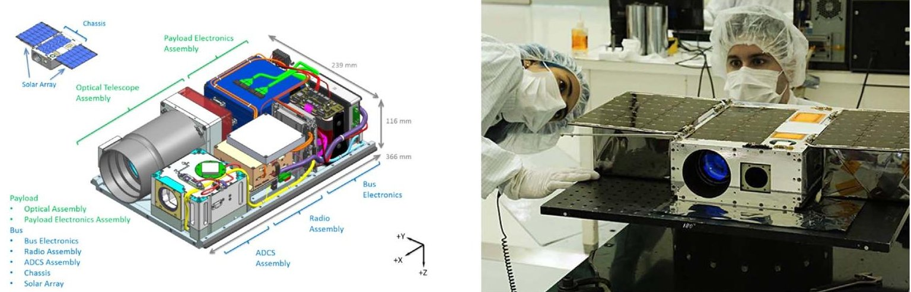

Figure 1. ASTERIA interior layout (left) and fully assembled in the lab (right). In the interior view, payload components are listed in green, bus components in blue. Inset at top left shows exterior view, including deployed solar panels. The photograph on the right shows ASTERIA with solar panels deployed shortly before delivery to the launch provider. Photo credit: NASA/JPL.

observational strategies (e.g., de Mooij et al. 2014) are ongoing. ASTERIA, free from atmospheric effects, focuses on mitigating other sources of non-Gaussian noise that limit photometric performance.

We compare ground- and space-based telescopes, assuming only photon and scintillation noise, and an air mass of 1.0 for an integration time of 100 s. ASTERIA is comparable to a $ \sim2 $ m ground-based telescope, with these idealistic parameters. Here we have estimated fractional precision due to photon noise with

$$
\sigma_ {P} = 1 / \sqrt {A t \eta \Delta \lambda \phi},
$$

where A is the collecting area in meters, t is the integration time in seconds, $ \eta $ is the throughput (here taken to be 30%) $ \Delta\lambda $ is the wavelength range (V band), and $ \phi $ is the incident photon flux for a star $ V=6 $ . The total noise in this idealized comparison is $ \sigma=\sqrt{\sigma_{S}^{2}+\sigma_{P}^{2}}. $

## 2. ASTERIA Mission

ASTERIA was designed to mitigate two key sources of systematic noise in space-based photometry: time-varying pointing errors and thermal variability. Errors in spacecraft pointing cause star centroids to drift across pixels on an array detector, inducing systematic variation in retrieved photometry due to intra and inter-pixel gain variations (Ingalls et al. 2012). Much like scintillation for ground-based telescopes, pointing error results in a magnitude-independent noise floor for space-based observations. Thermal variations in the detector, optics, and electronics also induce systematic effects in photometry, due to thermally dependent gains, mechanical expansion/contraction, and subtle changes in electronics performance. ASTERIA has its roots in the 3U CubeSat ExoplanetSat, developed by MIT in collaboration with Draper Lab (Smith et al. 2010).

ASTERIA is a 6U CubeSat with dimensions of 239 mm $ \times $ 116 mm $ \times $ 366 mm and mass of 10.2 kg (Figure 1). For a definition of the CubeSat form factor, see Heidt et al. (2000). See Smith et al. (2018) for a detailed description of ASTERIA's system and subsystem design, Bocchino et al. (2018) for a detailed description of the flight software framework, and Donner et al. (2018) for an overview of mission assurance and fault protection. ASTERIA was launched as cargo to the International Space Station (ISS) in 2017 August and deployed into space from ISS on 2017 November 20. The three-month prime mission

ended in 2018 February with the successful verification of all technology demonstration requirements. ASTERIA operations continued through several extended missions for a total of two years (eight times its nominal mission lifetime) until loss of contact in 2019 December.

## 2.1. Technology Demonstration Goals

ASTERIA was a technology demonstration mission rather than a science-driven mission, though the key technologies demonstrated were selected to enable future science missions. ASTERIA had two key technology demonstration goals:

1. Line-of-sight pointing stability of $ 5^{\prime \prime} $ rms.

2. Thermal stability of $ \pm10 $ mK rms for a single point on the focal plane.

ASTERIA achieved 0.5 rms pointing stability on orbit, an approximately 10 times better pointing performance than achieved by other spacecraft in ASTERIA's mass and size category (e.g., BRITE). Fine pointing control was achieved with a two-stage control system. The coarse attitude of the spacecraft was controlled via reaction wheels and a star tracker. Residual pointing drift is mitigated by a closed-loop control system that measures the centroids of guide stars on the payload detector and actuates a piezoelectric x-y translation stage holding the payload detector. See Pong (2018) for details of the pointing control system design and on-orbit performance.

ASTERIA achieved $ \pm 5 $ mK thermal control on orbit, measured over a 20 minute period at a single point on the back of the focal plane—approximately 100 times better than achieved by other spacecraft in ASTERIA's mass and size category. Like pointing control, thermal stability is also achieved using a two-stage system. The spacecraft payload (baffle, optics, focal plane, piezo stage, and readout electronics) is thermally isolated from the rest of the spacecraft using titanium bipod mounts and thermally insulating connectors. Thermal isolation reduces the orbital thermal variation to $ \sim 500 $ mK amplitude. A closed-loop control system raises the temperature of the focal plane to a set point slightly above the peak of orbital temperature variation using resistive heaters and holds the set temperature via feedback from high-precision thermal sensors mounted to the focal plane. See Smith et al. (2018) for thermal control design and performance.

<!-- PDF_PAGE: 4 -->

Table 2

ASTERIA Payload Specifications

<table border="1"><tr><td>Parameter</td><td>Value</td></tr><tr><td>Optics type</td><td>Refractive</td></tr><tr><td>Aperture diameter(mm)</td><td>60.7</td></tr><tr><td>Focal length(mm)</td><td>85</td></tr><tr><td>Pass band(nm)</td><td>500-900</td></tr><tr><td>Lens throughput</td><td>80%</td></tr><tr><td>Detector dimensions(pixels)</td><td>2592×2192</td></tr><tr><td>Pixel size(μm)</td><td>6.5×6.5</td></tr><tr><td>Plate scale(arcsec pixel-1)</td><td>15.8</td></tr><tr><td>Detector field of view(deg)</td><td>11.2×9.6</td></tr><tr><td>Quantum efficiency(mean across band)</td><td>42%</td></tr><tr><td>Gain(e-/ADU)</td><td>6.44</td></tr><tr><td>ADC bit depth</td><td>11</td></tr></table>

## 2.2. Payload and Camera Design

ASTERIA's payload is composed of the optical telescope assembly and the payload electronics. The optical telescope assembly includes a short baffle, a refractive optic (f/1.4, 85 mm), and the CMOS imager mounted to the piezoelectric stage. A refractive optic was chosen for ASTERIA both for its compactness and for its wide field of view. The pointing control algorithm needs several bright (V<6) guide stars to perform fine pointing adjustments, so a field of view several degrees across was required to ensure that sufficient guide stars were available on the detector for any given pointing. The telescope was deliberately defocused to oversample the pointspread function (PSF). The thermal control system is integrated with the optical telescope assembly, which is thermally isolated from the rest of the spacecraft. See Table 2 for detailed specifications of the optical system and imager.

ASTERIA used a Fairchild 5.5 megapixel CIS2521F CMOS imager as its science detector. A CMOS imager was chosen over a CCD for several reasons. The primary factor driving the detector choice is that the imager must be capable of fast readout, both to accommodate the 20 Hz fine pointing control loop and to allow unsaturated observation of very bright science targets. At the time, ASTERIA was in development; only CMOS detectors were capable of sufficiently fast readout. Additionally, the CMOS imager is designed to operate at room temperature, simplifying ASTERIA's thermal design. See Magnan (2003) for a review of CCD versus CMOS technology.

The CMOS imager is divided into a top and bottom half; each half has a separate analog amplifier for each column. The gain of each column's amplifier is slightly different and must be corrected. There are eight optically dark (physically blocked from light) and eight electrically dark (electrically tied to ground so that photon-induced electrons cannot accumulate) rows at the top and bottom edges of the detector. The electrically dark pixels are used for bias and flat calibration (Section 4.2). The detector also has 16 optically dark columns at the left and right edges of the detector for additional calibration; these are not used in the image calibration procedure.

ASTERIA's CMOS-based camera was customized to read out subarrays of the full imager. ASTERIA uses this functionality for observations in fine pointing control mode. Eight $ 6 4 \times6 4 $ pixel windows, selected and defined on the ground, are centered on bright stars and read out at 20 Hz. The fine pointing control algorithm calculates centroid positions for

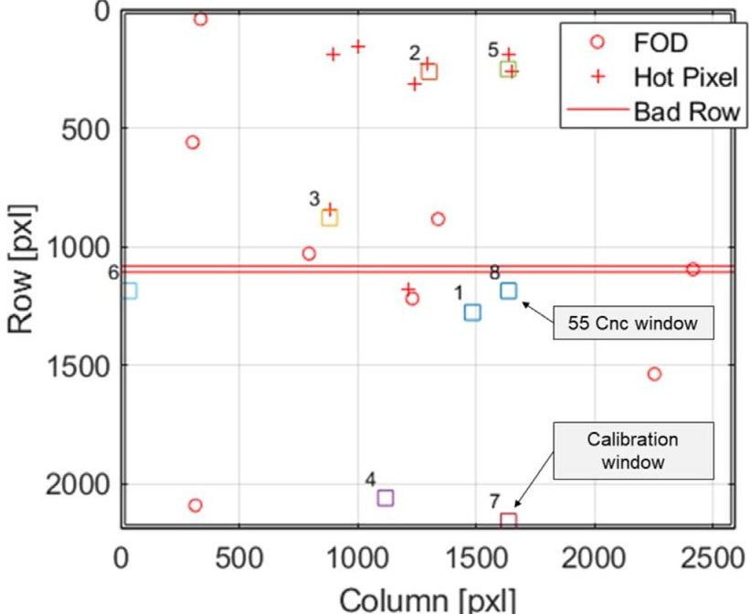

Figure 2. Detector layout and window placement for 55 Cnc observations. Window 8 contains the target star; window 7 is a calibration window placed on the optically and electrically dark pixels at the bottom of the detector (indicated by the double line border). The calibration window covers the same detector columns as the target star window. The remaining windows are used as guide stars by the fine pointing control system. The detector is $ 2 5 9 2 \times 2 1 9 2 $ pixels, corresponding to $ 1 1. 2 $ by $ 9. 6 $ on the sky.

each star and calculates the piezo stage motion needed to keep the designated target star motionless on the detector (Pong et al. 2012; Pong 2018; Smith et al. 2018). See Figure 2 for the window layout used in 55 Cnc observations. Because the fine pointing control algorithm requires updates at 20 Hz, the maximum integration time in fine pointing mode for both science targets and guide stars is 50 ms. While some CMOS imagers are capable of reading out subarrays at different integration times, ASTERIA's detector and readout electronics do not allow that mode of operation, so all windows must have the same integration time and be read out at the same time. The integration time can be set to values less than 50 ms to avoid saturation for bright targets.

The payload has the capability to sum, or coadd, many 50 ms frames together. Coadding significantly reduces data volume while increasing signal-to-noise ratio in each image. In typical operation, 1200 50 ms windowed frames, with eight $ 6 4 \times $ 64 pixel windows, are summed into a one-minute exposure for each $ 6 4 \times $ 64 window. This one-minute cadence data are downlinked to the ground for photometric analysis. No registration is performed prior to summing because the fine pointing system controls the payload pointing to $ 0. ^{\prime \prime} 5 $ rms, approximately 1/30th of the pixel width (plate scale is $ 1 5^{\prime \prime} $ pixel $ ^{-1} $ ).

## 3. Opportunistic Science Program

The ASTERIA science team selected several target stars of scientific interest that met the needs of the pointing control and thermal control technology demonstrations in order to also demonstrate ASTERIA's photometric capability. Opportunistic science observations were carried out during ASTERIA's prime mission in parallel with verification of technology demonstration goals. The demonstration of the fine pointing control system required repeated observations of star fields because guide stars are used to control the piezo stage correction of small pointing errors. The thermal control system

<!-- PDF_PAGE: 5 -->

demonstration required the camera system (piezo stage, detector, and payload electronics) to be enabled as those components produce significant thermal loads.

## 3.1. Science Targets

ASTERIA's small aperture and maximum integration time of 50 ms limit useful science observations to stars brighter than $ V=7 $ . Even brighter stars, $ V<6 $ , were required as guide stars for the fine pointing control demonstration. Two star fields, 55 Cancri and HD 219134, were selected for the technology demonstration observations because they provided a favorable set of guide stars and were scientifically interesting targets. A third field, centered on $ \alpha $ Centauri, was observed after the technology demonstration observations had concluded. Several additional fields were observed during ASTERIA's extended mission, including the eclipsing binary Algol. Results from 55 Cancri observations are described in this paper; results from HD 219134 and $ \alpha $ Centauri will be presented in future publications.

55 Cancri is a nearby Sun-like star (12.5 pc, spectral type G8 V; van Leeuwen 2007) that is host to five exoplanets, one of which, 55 Cancri e, is known to transit. 55 Cancri e is a 2 $ R_{\oplus} $ planet with an 18 hr orbital period; its transit was first detected by the Spitzer and MOST space telescopes (Demory et al. 2011; Winn et al. 2011). ASTERIA observed 55 Cancri during the prime mission and first extended mission in an effort to detect the transit of 55 Cancri e and thereby demonstrate a high level of photometric precision. 55 Cancri was the primary target star for the technology demonstration campaign. Table 3 lists all observations used to create the final lightcurve described in this paper. All images consisted of $ 1 2 0 0 \times 5 0 \mathrm{m s} $ (60 s) coadded exposures.

## 3.2. Observational Planning and Constraints

ASTERIA observations must be planned within constraints imposed by both orbital geometry and spacecraft health and safety. ASTERIA's orbit is similar to that of the ISS, nearly circular with an altitude of $ \sim 4 0 0 $ km and an orbital inclination of 51.6 to Earth's equator. Earth occupies slightly less than half of the sky visible to ASTERIA. ASTERIA passes through Earth's shadow (eclipse) for an average of 30 minutes out of its 92 minute orbit. Eclipse duration varies with solar $ \beta $ angle throughout the year, with brief periods of no eclipse and a maximum eclipse duration of 35 minutes. ASTERIA's baffle and thermal control system are designed for operation in eclipse only.

## 3.2.1. Observation Planning

ASTERIA observations are planned and sequenced for multiple spacecraft orbits. An observation is defined as the data collected during one eclipse period. There is one eclipse per spacecraft orbit, so there is a one-to-one correspondence between observations and orbits. When multiple observations/ orbits are sequenced together, the thermal control system remains active across all observation orbits (both during eclipse and the sunlight portion of the orbit). Keeping the thermal control system running reduces thermal transients, though the first one to two orbits in a sequence exhibit a moderate thermal transient as the control system settles. Temperature data from sensors on the payload and throughout the spacecraft are available in time-tagged housekeeping data that are downlinked

from the spacecraft separately from image data and later written into image FITS file headers.

The camera system is power cycled and reinitialized at the beginning of each orbit just before image data are collected and then again at the end of an orbit after image data collection has finished. Power cycling and reinitialization of the camera puts the payload in a known good state and reduces the chance of sync loss between the camera field-programmable gate array (FPGA) and the flight computer. Power cycling the camera presents an impulse to the thermal control system as the camera dissipates $ \sim2 $ W (see Smith et al. 2018, Figure 27); the overshoot and settling from this impulse are observed in the photometric data (Section 4). The camera is left on in a freerunning mode during the sunlit portion of the orbit to maintain a stable thermal environment because of the camera's large thermal dissipation. When all sequenced observations are complete, the camera and thermal control system are shut off, and the spacecraft radio is turned back on. Image files resulting from the observation are losslessly compressed on board via the standard UNIX tar and gzip algorithms, and downlinked during subsequent communication passes.

## 3.2.2. Geometric and Orbital Constraints

Four geometric conditions must be met for viable photometric observations:

1. A clear line of sight exists between ASTERIA and the target star (no obstruction by Earth, Sun, or Moon).

2. ASTERIA is in Earth eclipse (full umbral shadow).

3. The payload boresight must form an angle $ > 90^{\circ} $ with the nadir vector (pointing from the spacecraft to Earth's center).

4. The payload boresight must form an angle $ > 2 0^{\circ} $ with the vector to the Moon.

ASTERIA observes only to avoid excess stray light from the Sun. The third constraint on the boresight to nadir angle prevents observations close to the Earth limb, where stray light from the illuminated limb degrades photometric data quality. This is a more restrictive requirement than simple line of sight (constraint 1). The fourth constraint seeks to avoid excess stray light from the Moon. The geometric constraints listed here are for data quality, not spacecraft safety. Preflight analysis showed that ASTERIA can safely point anywhere in the sky, including at the Sun, though doing so will temporarily reduce the effectiveness of the payload's thermal isolation and the active thermal control system.

## 3.2.3. Operational Constraints

Additional constraints are imposed on ASTERIA photometric observations in order to ensure spacecraft safety. Balancing the power needs of spacecraft subsystems during eclipse observations is critical as all electrical power for the spacecraft is drawn from the storage batteries during eclipse. The payload and the radio may not operate at the same time because their combined power draw quickly drains the battery. Furthermore, preflight testing revealed interference between the payload and the radio, so the radio must be turned off when the

<!-- PDF_PAGE: 6 -->

Table 3

55 Cancri Observations Used in the Lightcurve Shown in Figure 7

<table border="1"><tr><td>Observation Name</td><td>First Frame(UTC)</td><td>Last Frame(UTC)</td><td>Number of 1 minuteIntegrations</td><td>Rms(ppm minute-1)</td></tr><tr><td rowspan="3">Tech Demo 14(td14)</td><td>2018 Jan 7 11:33:36.7</td><td>2018 Jan 7 11:52:36.5</td><td>20</td><td>1123</td></tr><tr><td>2018 Jan 7 13:06:39.3</td><td>2018 Jan 7 13:25:39.1</td><td>20</td><td></td></tr><tr><td>2018 Jan 7 14:28:39.5</td><td>2018 Jan 7 14:47:39.3</td><td>19</td><td></td></tr><tr><td rowspan="3">Tech Demo 16(td16)</td><td>2018 Jan 10 10:26:35.5</td><td>2018 Jan 10 10:45:35.2</td><td>20</td><td>986</td></tr><tr><td>2018 Jan 10 12:01:39.9</td><td>2018 Jan 10 12:20:39.7</td><td>19</td><td></td></tr><tr><td>2018 Jan 10 13:25:57.3</td><td>2018 Jan 10 13:44:57.1</td><td>20</td><td></td></tr><tr><td rowspan="11">Tech Demo 18(td18)</td><td>2018 Jan 12 10:10:29.5</td><td>2018 Jan 12 10:29:29.3</td><td>19</td><td>1088</td></tr><tr><td>2018 Jan 12 11:43:03.9</td><td>2018 Jan 12 12:02:03.7</td><td>20</td><td></td></tr><tr><td>2018 Jan 12 13:15:37.5</td><td>2018 Jan 12 13:34:37.3</td><td>20</td><td></td></tr><tr><td>2018 Jan 12 14:54:42.8</td><td>2018 Jan 12 15:13:42.6</td><td>20</td><td></td></tr><tr><td>2018 Jan 12 16:27:47.8</td><td>2018 Jan 12 16:46:47.6</td><td>20</td><td></td></tr><tr><td>2018 Jan 12 17:57:21.4</td><td>2018 Jan 12 18:16:21.2</td><td>20</td><td></td></tr><tr><td>2018 Jan 12 19:36:16.6</td><td>2018 Jan 12 19:55:16.4</td><td>20</td><td></td></tr><tr><td>2018 Jan 12 21:04:31.3</td><td>2018 Jan 12 21:23:31.1</td><td>19</td><td></td></tr><tr><td>2018 Jan 12 22:39:02.9</td><td>2018 Jan 12 22:57:02.7</td><td>18</td><td></td></tr><tr><td>2018 Jan 13 00:10:37.6</td><td>2018 Jan 13 00:29:37.4</td><td>20</td><td></td></tr><tr><td rowspan="4">Tech Demo 23(td23)</td><td>2018 Jan 22 06:24:41.2</td><td>2018 Jan 22 06:44:41.0</td><td>21</td><td>1016</td></tr><tr><td>2018 Jan 22 07:57:17.0</td><td>2018 Jan 22 08:17:16.7</td><td>21</td><td></td></tr><tr><td>2018 Jan 22 09:29:55.1</td><td>2018 Jan 22 09:49:54.9</td><td>21</td><td></td></tr><tr><td>2018 Jan 22 10:59:28.3</td><td>2018 Jan 22 11:19:28.1</td><td>21</td><td></td></tr><tr><td rowspan="4">Tech Demo 24(td24)</td><td>2018 Jan 22 18:44:23.7</td><td>2018 Jan 22 19:04:23.5</td><td>21</td><td>998</td></tr><tr><td>2018 Jan 22 20:15:59.5</td><td>2018 Jan 22 20:35:59.3</td><td>21</td><td></td></tr><tr><td>2018 Jan 22 21:47:35.2</td><td>2018 Jan 22 22:07:35.0</td><td>20</td><td></td></tr><tr><td>2018 Jan 22 23:16:11.0</td><td>2018 Jan 22 23:36:10.7</td><td>20</td><td></td></tr><tr><td rowspan="10">Science Observation 19(so19)</td><td>2018 Apr 13 20:44:02.5</td><td>2018 Apr 13 21:03:02.3</td><td>18</td><td>798</td></tr><tr><td>2018 Apr 13 22:16:36.3</td><td>2018 Apr 13 22:35:36.2</td><td>20</td><td></td></tr><tr><td>2018 Apr 14 12:08:49.6</td><td>2018 Apr 14 12:27:49.4</td><td>20</td><td>1193</td></tr><tr><td>2018 Apr 14 13:41:18.5</td><td>2018 Apr 14 14:00:18.3</td><td>20</td><td></td></tr><tr><td>2018 Apr 14 15:13:46.3</td><td>2018 Apr 14 15:32:46.0</td><td>20</td><td></td></tr><tr><td>2018 Apr 14 18:18:44.6</td><td>2018 Apr 14 18:37:44.4</td><td>20</td><td></td></tr><tr><td>2018 Apr 15 09:42:29.4</td><td>2018 Apr 15 10:01:29.2</td><td>20</td><td>1135</td></tr><tr><td>2018 Apr 15 12:47:29.5</td><td>2018 Apr 15 13:06:29.3</td><td>20</td><td></td></tr><tr><td>2018 Apr 16 01:07:25.4</td><td>2018 Apr 16 01:26:25.2</td><td>20</td><td>1429</td></tr><tr><td>2018 Apr 16 02:39:50.4</td><td>2018 Apr 16 02:58:50.2</td><td>20</td><td></td></tr><tr><td>2018 Apr 16 05:44:46.9</td><td>2018 Apr 16 06:03:46.7</td><td>20</td><td></td></tr><tr><td>2018 Apr 16 07:17:15.2</td><td>2018 Apr 16 07:36:15.0</td><td>20</td><td></td></tr><tr><td rowspan="4">Science Observation 20(so20)</td><td>2018 Apr 22 00:28:32.3</td><td>2018 Apr 22 00:43:32.1</td><td>16</td><td>1956</td></tr><tr><td>2018 Apr 22 02:01:01.9</td><td>2018 Apr 22 02:16:01.8</td><td>16</td><td></td></tr><tr><td>2018 Apr 22 03:33:32.6</td><td>2018 Apr 22 03:48:32.5</td><td>15</td><td></td></tr><tr><td>2018 Apr 22 05:06:02.7</td><td>2018 Apr 22 05:21:02.5</td><td>16</td><td></td></tr><tr><td rowspan="3">Science Observation 24(so24)</td><td>2018 May 12 13:29:38.9</td><td>2018 May 12 13:48:38.6</td><td>19</td><td>(not used)</td></tr><tr><td>2018 May 12 16:38:23.5</td><td>2018 May 12 16:57:23.3</td><td>20</td><td>(not used)</td></tr><tr><td>2018 May 12 18:04:49.5</td><td>2018 May 12 18:23:49.3</td><td>18</td><td>639</td></tr><tr><td rowspan="4">Science Observation 25(so25)</td><td>2018 May 13 09:32:12.7</td><td>2018 May 13 09:51:12.5</td><td>19</td><td>1031</td></tr><tr><td>2018 May 13 11:08:36.4</td><td>2018 May 13 11:27:36.2</td><td>20</td><td></td></tr><tr><td>2018 May 13 12:33:59.2</td><td>2018 May 13 12:52:59.0</td><td>19</td><td></td></tr><tr><td>2018 May 14 02:26:01.8</td><td>2018 May 14 02:45:01.6</td><td>19</td><td>637</td></tr><tr><td rowspan="3">Science Observation 26(so26)</td><td>2018 May 14 19:26:05.3</td><td>2018 May 14 19:45:05.1</td><td>20</td><td>1366</td></tr><tr><td>2018 May 14 20:58:34.1</td><td>2018 May 14 21:17:33.9</td><td>20</td><td></td></tr><tr><td>2018 May 15 00:00:25.9</td><td>2018 May 15 00:19:25.7</td><td>20</td><td></td></tr><tr><td rowspan="3">Science Observation 26(so26)</td><td>2018 May 15 12:20:22.2</td><td>2018 May 15 12:41:22.0</td><td>22</td><td>1487</td></tr><tr><td>2018 May 15 15:25:19.8</td><td>2018 May 15 15:46:19.6</td><td>20</td><td></td></tr><tr><td>2018 May 15 16:57:46.7</td><td>2018 May 15 17:18:46.4</td><td>22</td><td></td></tr><tr><td rowspan="4">Science Observation 28(so28)</td><td>2018 May 26 07:21:00.9</td><td>2018 May 26 07:35:00.7</td><td>15</td><td>(not used)</td></tr><tr><td>2018 May 26 08:53:20.2</td><td>2018 May 26 09:07:20.1</td><td>15</td><td>(not used)</td></tr><tr><td>2018 May 26 10:25:40.1</td><td>2018 May 26 09:07:20.1</td><td>15</td><td>(not used)</td></tr><tr><td>2018 May 27 09:29:45.0</td><td>2018 May 27 09:34:45.0</td><td>6</td><td>(not used)</td></tr></table>

<!-- PDF_PAGE: 7 -->

Table 3 (Continued)

<table border="1"><tr><td>Observation Name</td><td>First Frame(UTC)</td><td>Last Frame(UTC)</td><td>Number of 1 minuteIntegrations</td><td>Rms(ppm minute-1)</td></tr><tr><td></td><td>2018 May 27 12:34:25.9</td><td>2018 May 27 12:39:25.8</td><td>6</td><td>(not used)</td></tr><tr><td></td><td>2018 May 28 20:53:39.3</td><td>2018 May 28 20:58:39.2</td><td>6</td><td>810</td></tr><tr><td></td><td>2018 May 28 22:26:00.8</td><td>2018 May 28 22:31:00.7</td><td>6</td><td></td></tr><tr><td></td><td>2018 May 28 23:58:21.4</td><td>2018 May 29 00:02:21.4</td><td>5</td><td></td></tr><tr><td rowspan="9">Science Observation 30(so30)</td><td>2018 Jun 8 18:36:29.9</td><td>2018 Jun 8 18:43:29.9</td><td>8</td><td>1535</td></tr><tr><td>2018 Jun 8 20:08:52.2</td><td>2018 Jun 8 20:15:52.1</td><td>8</td><td></td></tr><tr><td>2018 Jun 8 21:42:13.2</td><td>2018 Jun 8 21:48:13.2</td><td>7</td><td></td></tr><tr><td>2018 Jun 8 23:13:35.9</td><td>2018 Jun 8 03:20:35.8</td><td>8</td><td></td></tr><tr><td>2018 Jun 10 06:00:53.8</td><td>2018 Jun 10 06:07:53.7</td><td>8</td><td>1054</td></tr><tr><td>2018 Jun 10 07:33:17.4</td><td>2018 Jun 10 07:40:17.4</td><td>8</td><td></td></tr><tr><td>2018 Jun 10 09:05:37.9</td><td>2018 Jun 10 09:12:37.8</td><td>8</td><td></td></tr><tr><td>2018 Jun 10 10:38:01.3</td><td>2018 Jun 10 10:45:01.2</td><td>8</td><td></td></tr></table>

Note. Observations designated "Tech Demo" or "td" took place during the initial phase of the mission when observations were focused on addressing ASTERIA's technology demonstration goals. After the technology demonstration objectives were completed, the naming scheme changed to "Science Observation" or "so" to indicate the change in focus from technology demonstration to collection of science data. Data will be available at https://exoplanetarchive.ipac.caltech.edu/docs/ ASTERIAMission.html after publication.

payload is on, and vice versa. Therefore, ASTERIA cannot simultaneously perform observations and communicate with the ground.

ASTERIA's fault protection system includes protection from battery undervoltage by means of a 43 minute "on-Sun timeout" (Donner et al. 2018, see Section 3.2.1). Commanded slews to point ASTERIA at a target star must be carefully timed so that the total off-Sun time, including slewing to to the target star at the beginning of an observation, eclipse time, and slewing back to a Sun-pointed attitude at the end of an observation, does not exceed 43 minutes. Practically, this means that ASTERIA typically waits until it is already in eclipse to slew to the target star, slightly reducing the available time in eclipse for observations.

The duration of observations is further limited by the size of the image memory buffer. Preallocated memory holds coadded images as they accumulate during an observation. During the prime mission, the hard-coded image memory buffer could hold up to 20 minutes of 1 minute coadded images. A flight software update at the beginning of ASTERIA's first extended mission increased the image memory buffer allocation to 24 minutes of 1 minute coadded data; a subsequent flight software update increased the capacity to 30 minutes. Images collected past the image buffer size are simply dropped and not written into memory.

The final operational constraint on observations concerns the buildup of momentum in the spacecraft. If an attitude maneuver requires the wheels to spin faster than their maximum rate, the wheels are "saturated," and they cannot respond to the requested attitude change. Torque rods are used to desaturate the reaction wheels by exerting a torque against Earth's magnetic field, allowing the reaction wheels to decrease their speed. Observations must be planned such that the momentum does not build up to the point where the reaction wheels become saturated and can no longer hold the commanded starpointed attitude. ASTERIA has a residual dipole moment, measured at 0.17 Am $ ^{2} $ preflight (Pong 2018), which interacts with Earth's magnetic field and causes momentum to build up quickly in some attitudes. A MATLAB simulation tool is used

to check the momentum buildup for each observation to ensure that the reaction wheels do not become saturated.

Predicting reaction wheel speed during observations is important for data quality as well as spacecraft safety. The speeds of the reaction wheels changes constantly to control spacecraft attitude, and sometimes the speed of one or more wheels will pass through zero, meaning the wheel slows down and reverses its spin direction. Reaction wheel zero crossings induce a transient in spacecraft pointing (see Pong 2018, Figure 29), which causes an excursion in star centroid positions on the detector. We can bias the reaction wheel speeds before an observation in order to avoid zero crossings, though the bias must be carefully chosen to avoid wheel speed saturation. During the observation planning process, we adjust the wheel speed bias iteratively and examine the resulting wheel speed and momentum predictions in order to choose a bias that avoids wheel speed zero crossings while also keeping accumulated momentum within safe limits.

## 3.2.4. South Atlantic Anomaly

The South Atlantic Anomaly, while not a direct constraint on ASTERIA operations, can cause minor excursions in photometric data. The South Atlantic Anomaly (SAA) is a region over South America and the South Atlantic ocean where Earth's radiation belts extend to low altitudes. Spacecraft in low-Earth orbit passing through the SAA experience increased energetic proton flux, which can cause single event upsets in electronics and hot pixels in array detectors. ASTERIA does operate and observe through the SAA. Data collected at 20 Hz from the pointing control system indicate that transient hot pixels appear on the detector during SAA passages (Pong 2018, Figure 25). These transient hot pixels last for one or two 50 ms frames before returning to background levels. The pointing disruptions caused by transient hot pixels are short compared to the 1 minute coadded exposures and do not affect photometric precision (Pong 2018, Figure 28). No buildup of persistent hot pixels has been observed.

<!-- PDF_PAGE: 8 -->

## 4. Photometric Data Analysis

Data from ASTERIA observations are downlinked as binary files and then translated into FITS files using custom Python software. Metadata, including spacecraft housekeeping telemetry (e.g., temperature measurements), are included in the FITS header for detrending.

The primary data reduction challenge for ASTERIA is addressing column-dependent gain variation (CDGV). CDGV is specific to CMOS detectors because each column is tied to a specific amplifier and analog-to-digital (ADC) converter. Additionally, each pixel has its own amplifier. We performed extensive characterization of the detectors in the laboratory and tested various reduction recipes on the simulated data in order to find the optimal solution for ASTERIA data, which is presented below. For details on the laboratory characterization and reduction strategies assessed, see Krishnamurthy (2020).

## 4.1. Calibration Data

Traditional calibration frames (biases, darks, flats) were not collected during ground testing because they were not required to verify ASTERIA's technology demonstration requirements. Approximations for these calibration frames were collected in flight with mixed success.

Bias (zero exposure time) and flat (uniform illumination) frames are typically used to correct for offsets and pixel-to-pixel gain variation, respectively. Dark frames are not needed for ASTERIA data reduction, due to the short 50 ms integration time. Near-zero exposure time bias frames were collected on orbit in windowed mode at the minimum integration time the detector can support (22.6 $ \mu\mathrm{s} $ ). Individual bias frames are coadded on board the spacecraft in the same manner as light images. Bias frames collected in this manner (i.e., at a different time than the light images they are used to correct) were found to be less effective than calibration windows collected simultaneously with the target star images. The calibration window was placed at the upper or lower edge of the detector to capture the electrically/optically dark pixels. The calibration window covered the same detector columns as the light image. See Figure 2, where window 7 is the calibration window for window 8.

Flat frames were approximated by using stray sunlight to illuminate the detector. The MOST space telescope used stray light illumination for on-orbit flat frames, although the stray light illumination was an unintended effect (Rowe et al. 2006), while the Hubble Space Telescope (HST) has used the illuminated Earth for flat-fielding (Holtzman et al. 1995). In order to capture stray light flats, ASTERIA was commanded to an attitude with an offset angle of $ 4 0^{\circ} $ from the Sun vector during orbit day. The spacecraft then rotated about the camera boresight vector while collecting images to smear out the stray light illumination. Flat frames were also summed on board the spacecraft to increase signal. This method produced images with 25%-50% illumination as desired, but the illumination was not uniform across the detector.

## 4.2. Data Reduction

We begin the data reduction process by manually reviewing every coadded image and discarding frames that were obtained during the orbital "sunrise" or "sunset." These frames appear either at the beginning or end of the orbit, and display significant background contamination from stray light. In a few

cases, a bug in the pointing system caused the stars to be offset from the center of their windows; these data were discarded as well.

We then proceed to bias and background correction. The median of the electrically dark bias column from the calibration window is subtracted from all pixels in the respective column in the science frame. We then subtract background/sky noise by selecting pixels in the target star window (rows 0-15) that are devoid of any stellar flux, taking the median of the pixels for each column, and subtracting that median value from every pixel in that column.

Finally, we correct for column-dependent multiplicative gain. As noted in Section 4.1, the on-sky flat-field image was not evenly illuminated in region of the detector corresponding to the 55 Cnc window and so could not be used for this purpose. Instead, for the 55 Cnc data set, we divide each pixel in a given column by the normalized median of the corresponding bias column from the calibration window.

The output of each processing step is shown in Figure 3. The target star is visually cleaner than the raw image, although there is still some residual column-dependent noise.

## 4.3. Centroiding and Aperture Photometry

In order to measure the target star x/y position on the detector, we compute the flux-weighted first moments for each pixel in the subarray window along x and y. We use the mean centroid position to determine the target center, which is used as input to the aperture photometry procedure. We compute the fluxes using an array of apertures with radii ranging from 5 to 13 pixels. Observations of 55 Cnc are complicated by the spatial proximity of 53 Cnc (about 20 pixels), which is $ \delta V=0. 2 8 $ fainter and partially blended with 55 Cnc. We compute for each aperture size the photometric precision given by the rms of the lightcurve. As the flux contamination from 53 Cnc increases with aperture size, the contribution from background noise overtakes the improvement in photometric precision. An optimal aperture with a radius of 10 pixels is obtained based on the minimization of rms. We use the CircularAperture routine from the photutils (Bradley et al. 2019) Python package to perform the photometric flux extraction from the subarray windows using a fixed hard-edged aperture with a radius of 10 pixels for all 55 Cnc data (Figure 4, left).

Visual inspection of the raw time series shows that each visit starts with a telescope-settling phase characterized by a marked increased of the PSF FWHM for all stars of $ \sim 20\% $ . This effect is likely due to the thermal control system overcompensating for the drop in thermal load when the camera briefly turns off during reinitialization before the observation begins. The lens housing temperature time series is shown in Figure 5, top right. We find, however, that the centroid positions (Figure 5, center right, bottom right) and the overall background level (Figure 5, center left) are not affected.

The proximity of 53 Cnc to 55 Cnc in ASTERIA's subarray aperture motivates us to attempt PSF fitting to extract the photometry. However, the ASTERIA PSF is field dependent; guide stars from other windows cannot serve as PSF references. Thus, the only available PSF reference for 55 Cnc was 53 Cnc. Additionally, chromatic aberrations in ASTERIA's optics broaden the PSF of the redder 53 Cnc relative to 55 Cnc. We therefore find that aperture photometry outperforms PSF fitting.

<!-- PDF_PAGE: 9 -->

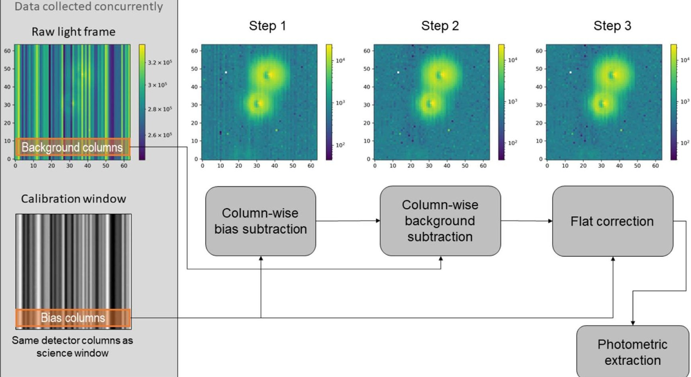

Figure 3. 55 Cnc image calibration steps. The star closest to the center of the window is 55 Cancri; the star to the upper right is 53 Cancri. The frame is composed of 1200 50 ms exposures summed on board ASTERIA. The window is $ 6 4 \times6 4 $ pixels square. See Figure 2 for the locations of the light and calibration windows on the detector.

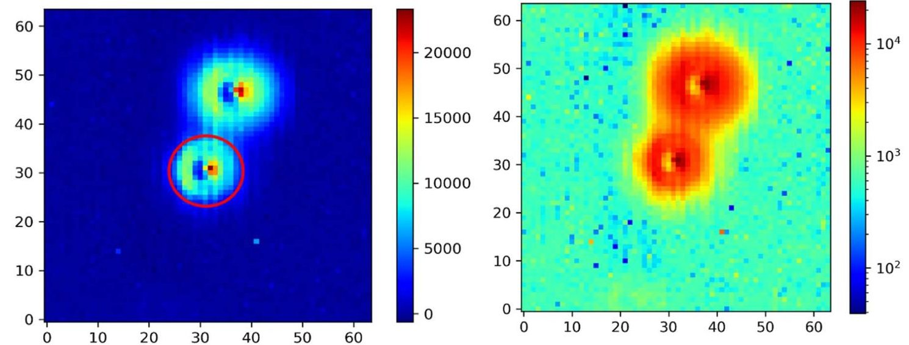

Figure 4. (Left) Stellar image after removing bias and background and correcting for flat-field variations. The red circle indicates the photometric aperture. (Right) Reduced image in log scale still showing column-dependent gain variations especially around the target. Note that 53 Cnc (upper right) looks larger despite being slightly fainter than 55 Cnc in the V band (V=6.23; Ducati 2002) because of its redder spectrum; chromatic aberration in the ASTERIA optics produces a larger PSF at longer wavelengths.

## 4.4. Data Analysis

## 4.4.1. Photometric Modeling

For lightcurve detrending, we use the Markov Chain Monte Carlo (MCMC) algorithm implementation already presented in the literature (Gillon et al. 2012). Inputs to the MCMC are the 55 Cnc photometric time series and parameters described above. We explore different functional forms of the baseline model for each lightcurve (see Table 3 for the results). These models can include a linear/quadratic trend with time, a second-order logarithmic

ramp (Knutson et al. 2007; Demory et al. 2011) usually included for telescope settling with Spitzer and HST, a polynomial of the (1) centroid position and (2) onboard temperature measured at the lens housing, as well as linear combinations of the PSF FWHM along the x- and y-axes. We employ the Bayesian Information Criterion (BIC; Schwarz 1978) to discriminate between the different baseline models. In the MCMC framework, the baseline model coefficients are determined at each step using a singular value decomposition method (Press et al. 1992). During our tests, we find that the baseline model resulting in the lower BIC

<!-- PDF_PAGE: 10 -->

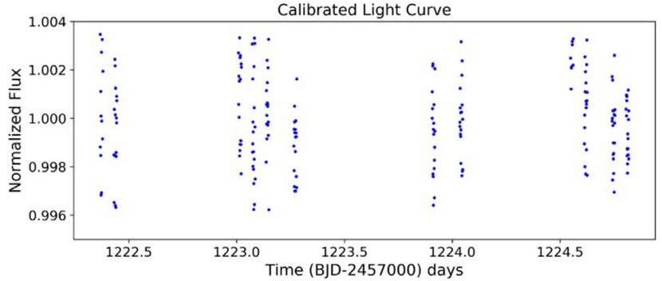

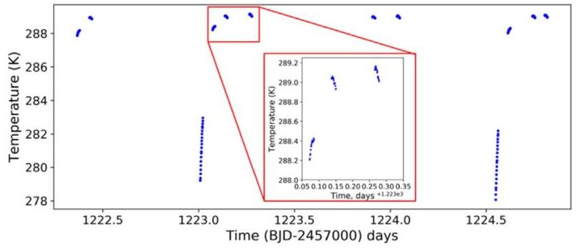

Raw lightcurve after image calibration

Lens housing temperature

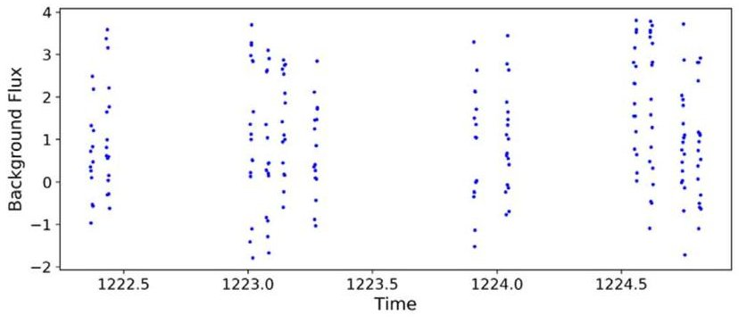

Sky background

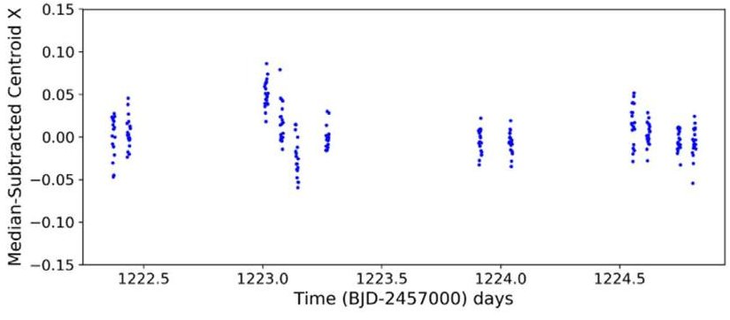

Centroid X position

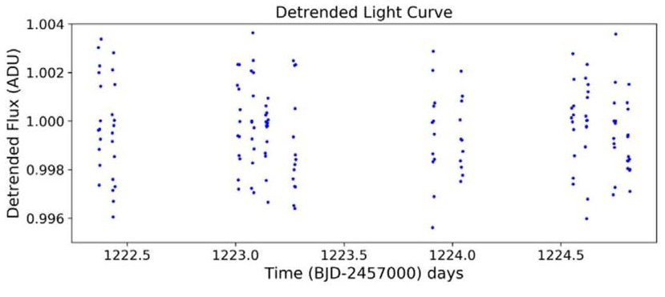

Detrended lightcurve

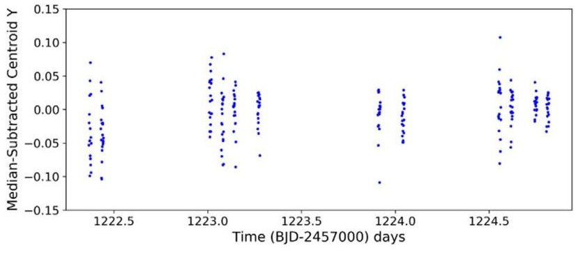

Centroid Y position

Figure 5. Initial (top left) and detrended (bottom left) lightcurves for one observation (so19). Data used for detrending, including sky background (center left), lens housing temperature (top right), and star centroid position (center, bottom right), are shown on the same time axis as the extracted photometry. A zoomed-in inset (red) in the lens housing telemetry (top right) shows the orbit-to-orbit thermal behavior of the lens housing. The lens housing is not under active thermal control like the detector. The sharp rise in temperature seen in the second and fourth clusters of orbits happens when the camera first turns on and heats the lens housing; the sharp rise in temperature is not seen in the first and third sets of orbits because the camera failed to collect data during the first orbit of each set.

(Schwarz 1978) is a combination of a second-order polynomial of the x/y centroid position and a second-order polynomial of the lens housing temperature. All results presented in this work have been obtained using this baseline model. We emphasize at this stage that these results are obtained over noncontinuous visit durations of up to 5 hr on 55 Cnc, known to be a photometrically quiet star (Fischer et al. 2007; Demory et al. 2016). We expect the baseline model to become more complex for longer visits.

## 4.4.2. Transit Fit

We fit for the baseline model described above and the 55 Cnc e transit simultaneously in a same MCMC framework. We fit for the transit center $ T_{0} $ and the transit depth. We include the limb-darkening linear combinations $ c_{1}=2 u_{1}+u_{2} $ and $ c_{2}=u_{1}-2 u_{2} $ , where $ u_{1} $ and $ u_{2} $ are the quadratic coefficients drawn from the theoretical tables of Claret & Bloemen (2011) using published stellar parameters (von Braun et al. 2011). We impose normal priors on the orbital period P, impact parameter b, and the limb-darkening parameters $ u_{1} $ and $ u_{2} $ to the values shown in Table 4. We keep the eccentricity fixed to zero

(Demory et al. 2012; Nelson et al. 2014). We execute two Markov Chains of 50,000 steps each and assess their efficient mixing and convergence using the Gelman-Rubin statistic (Gelman & Rubin 1992) by ensuring r < 1.001. Results for this MCMC fit are shown in Table 4.

## 4.4.3. Noise Properties

The detector's average gain value of 6.44 e-/ADU, combined with the ADU measured counts, translates to a photon-noise limit of about 400 ppm minute $ ^{-1} $ for 55 Cnc, depending on the visit. Our observations yield residual rms between 620 and 1450 ppm minute $ ^{-1} $ . The analysis of this noise excess shows that correlated noise contributes an average of 42% to the photometric noise budget over 15-100 minute timescales. We attribute the remaining noise to astrophysical/ instrumental noise that has not been characterized at this stage. We show in Figure 6 the behavior of the photometric rms with bin size, demonstrating the nominal contribution from correlated noise in the data.

<!-- PDF_PAGE: 11 -->

Table 4

55 Cnc e Transit Parameters

<table border="1"><tr><td>Parameter</td><td>Median and 1σ Credible Interval</td><td>Source</td></tr><tr><td>Transit depth(ppm)</td><td>374±170</td><td>This work</td></tr><tr><td>Impact parameterb</td><td>0.40±0.03</td><td>Prior(Sulis et al.2019)</td></tr><tr><td>Transit T0(BJD)</td><td>8200.43430.00260.0024</td><td>Prior(Sulis et al.2019)</td></tr><tr><td>PeriodP(days)</td><td>0.7365450±0.0000001</td><td>Prior(Sulis et al.2019)</td></tr></table>

## 5. 55 Cancri e Transit Search

The 55 Cancri e transit was chosen as a demonstration of ASTERIA's photometric capabilities because the transit ephemeris is known. We analyzed the data first using the literature values for the planet impact parameter (b), orbital period (P), and transit $ T_{0} $ as priors, and then removed the priors to determine the transit detection efficiency in a blind search.

## 5.1. Transit Search

Our photometric analysis of the 55 Cnc ASTERIA data yields a transit detection at the $ \sim 2. 2 \sigma $ level. We conducted two MCMC fits: with and without priors on $ T_{0} $ . Both fits used the priors on b and P listed in Table 4. When using the published $ T_{0} $ as a prior (Sulis et al. 2019), we find a transit depth median value of $ 3 7 4 \pm1 7 0 $ ppm (Figure 7, top). We show the probability distribution function of the retrieved transit depth in Figure 8. This is in agreement with the values published in the literature at similar wavelengths: Winn et al. (2011) found $ 3 8 0 \pm 5 2 $ ppm with MOST, de Mooij et al. (2014) $ 3 6 1 \pm 4 9 $ ppm between 457 and 671 nm, $ 3 3 1 \pm 3 6 $ ppm with HST STIS/G750L (Bourrier et al. 2018), and $ 3 4 6 \pm 1 5 $ ppm in the global analysis of MOST data (Sulis et al. 2019). Table 4 lists all the retrieved parameters for the fit with a prior on $ T_{0} $ Without a prior on $ T_{0} $ , we recover a transit depth median value of $ 6 3 7 \pm 2 3 5 $ ppm and a transit center $ T_{0}=8 2 0 0. 3 9 0_{-0. 0 1}^{+0. 0 1} $ (Figure 7 (center)). The deviations in these two parameters are allowed, because the fit prefers parameters such that there is no coverage of the ingress and egress phases of the transit, leaving the transit parameters less constrained. The resulting best-fit value for the $ T_{0} $ is off by 63 minutes compared to the most recent published ephemeris of 55 Cnc e (Sulis et al. 2019).

## 5.2. Blind Transit Search and Injection-recovery Test

We then assessed our capability to detect 55 Cnc e transit in the ASTERIA data, without any prior knowledge on the planet (Figure 7, bottom). To this end, we used our detrended data as input to the TLS code (Hippke & Heller 2019) to compute a periodogram (Figure 9). We identified the highest peak with an orbital period of 0.737 days, almost exactly the orbital period of 55 Cnc e. However, this signal has a signal detection efficiency (SDE; Kovacs et al. 2002) value of 4.9, which is not a firm detection (SDE > 7). This finding is consistent with the MCMC fits conducted above.

To assess the planet search completeness of our 55 Cnc data set, we conducted an injection-recovery test using the allesfitter code (M. Günther & T. Daylan 2020, in preparation). As the purpose of this step of the analysis was to determine the detection threshold at 55 Cnc e's ephemeris, we injected different planet sizes at the same $ T_{0} $ and period. We find that we exceed a SDE of 7 (Siverd et al. 2012) for planetary radii greater than $ 2. 6 \, R_{\oplus} $ (versus 55 Cnc e's $ \sim1. 9 \, R_{\oplus} $ ).

## 6. Summary and Discussion

The ASTERIA CubeSat observed 55 Cancri e, a known transiting super-Earth orbiting a Sun-like star. The 55 Cnc data obtained with the ASTERIA CubeSat showed a marginal ( $ \sim 2. 5 \sigma $ ) transit when fitted using priors from literature, but did not succeed in independently detecting the transit of 55 Cnc e, by a small margin. Our MCMC fits, completeness studies, and transit search demonstrate together that a signal is seen in ASTERIA data, but not at a level that is significant enough to claim independent detection without prior knowledge of the planet orbit and transit. Additional photometric data on other stars was obtained during ASTERIA's prime mission and extended missions; results will be presented in future publications using the photometric reduction framework described here.

ASTERIA demonstrated subarcsecond pointing stability and $ \pm 1 0 $ mK thermal control using passive cooling and active heating (Pong 2018; Smith et al. 2018). ASTERIA has matured these key technologies to enable high-precision photometry in a small package for future astrophysics CubeSat/SmallSat missions and demonstrated the utility of small spacecraft for cutting-edge photometric measurements above the blurring effects of Earth's atmosphere.

## 6.1. Lessons Learned

ASTERIA's design was driven by technology demonstration requirements rather than science requirements. As such, there are several modifications and improvements that would enhance the capabilities of next-generation astrophysics CubeSat missions.

## 6.1.1. Orbit-transit Phasing

ASTERIA data showed excess systematic noise at timescales similar to the spacecraft orbit (90 minutes) and the duration of eclipse (20-30 minutes). The duration of the 55 Cnc e transit (96 minutes) is similar to the duration of ASTERIA's orbit, causing "clumping" of data around the transit phase over short timescales; multiple observations of the transit did not lead to uniform filling of the lightcurve in phase space. This effect led to a bias in the retrieved transit midpoint and depth (Section 5.1). Current and future photometry missions with noncontinuous coverage may be subject to similar bias if astrophysical periods (orbit, transit) are similar to instrumental periods (spacecraft orbit, observation duty cycle).

## 6.1.2. Detector Capability

First, a detector architecture where subarrays could be read out at different rates would significantly expand the set of target stars available for observation. ASTERIA can only observe stars brighter than V=7 because there are not enough photons arriving from dimmer stars to reliably flip the first ADC bit in

<!-- PDF_PAGE: 12 -->

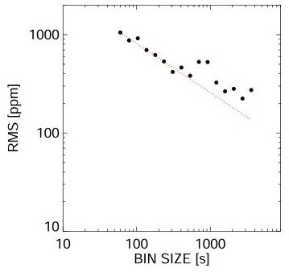

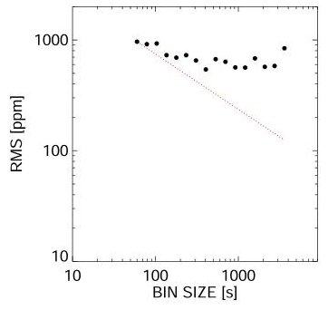

td14

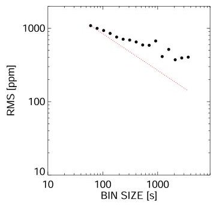

td16

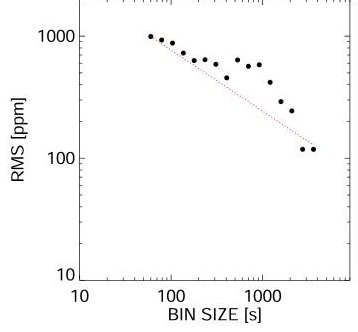

td18

td23

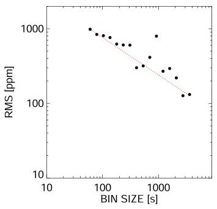

td24

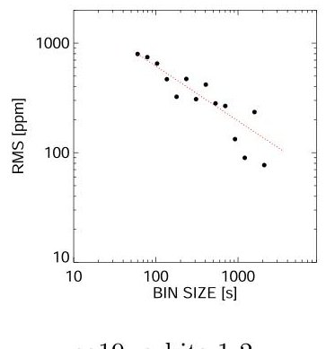

so19, orbits 1-2

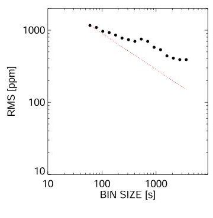

so19, orbits 3-6

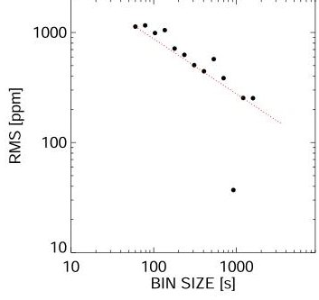

so19, orbits 7-8

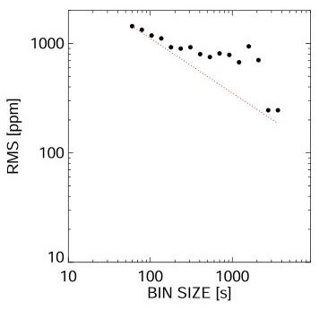

so19, orbits 9-12

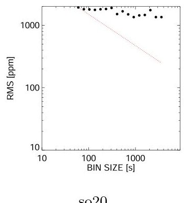

so20

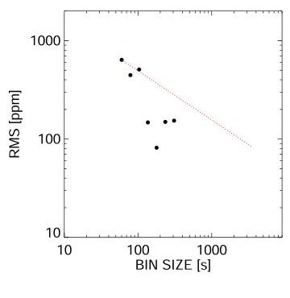

so24, orbit 3

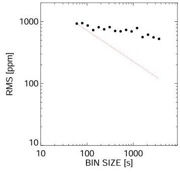

so25, orbit 1-3

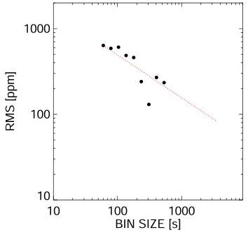

so25, orbit 4

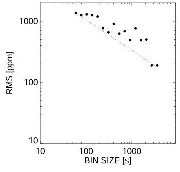

so25, orbits 5-7

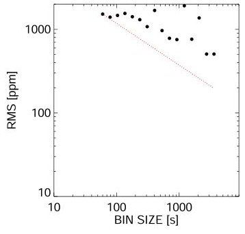

so26

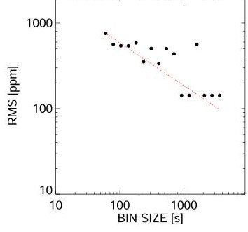

so28, orbits 6-8

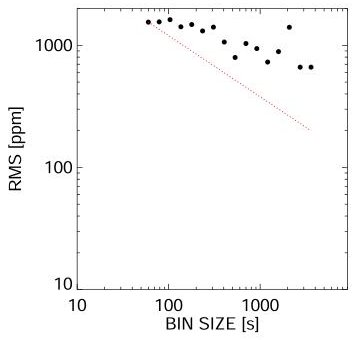

so30, orbits 1-4

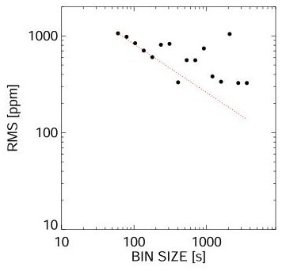

so30, orbits 5-8

Figure 6. Photometric rms vs. bin size for all data sets. Black filled circles indicate the photometric residual rms for different time bins. Each panel corresponds to an individual data set (see Table 3). The expected decrease in Poisson noise normalized to individual bin (1 minute) precision is shown as a red dotted line.

<!-- PDF_PAGE: 13 -->

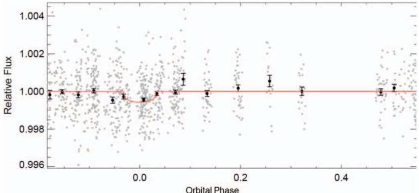

a

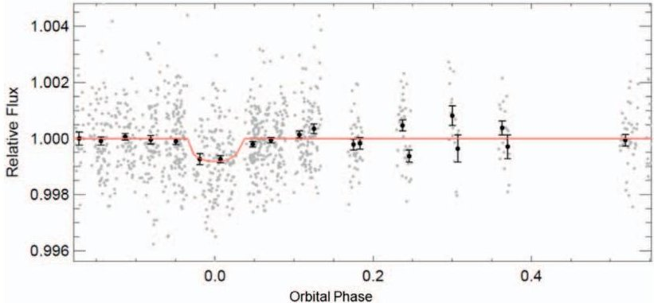

b

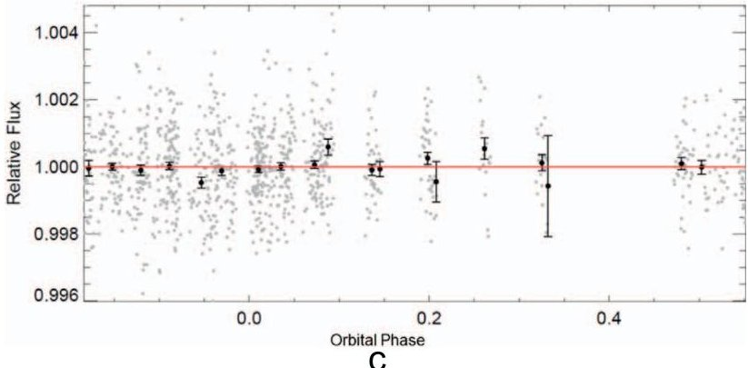

C

Figure 7. Phase-folded lightcurves for 55 Cancri e. (a) Priors for P, b, and $ T_{0} $ used; (b) priors for P, b; (c) no transit model fit; phase-folded at the literature P value.

each 50 ms exposure. If no signal is registered by the ADC, no amount of coadding will produce a usable signal. A CMOS imager and FPGA readout architecture capable of reading out guide star windows at 20 Hz for fine pointing control and science windows at a slower rate, allowing the collection of more photons per exposure, would allow a telescope with the same aperture size as ASTERIA to observe dimmer stars.

## 6.1.3. Absolute Time Tagging

Future CubeSat photometry or spectroscopy missions would also benefit from improved time tagging of photometric data. ASTERIA does not have a real-time clock or a functional GPS, so the flight computer clock resets to zero at every spacecraft reset. Absolute time tagging was not necessary for the technology demonstration goals of the mission, so ASTERIA was launched with a nonfunctional GPS unit. The flight computer boot time in UTC must be calculated after each reset by comparing the UTC send time of a command with the logged receive time of the command in flight computer time, which is recorded as seconds from boot. Uncertainty in the UTC-spacecraft clock correlation is $ \geqslant1 $ s because the ground data system records command send times with a precision of 1 s. A

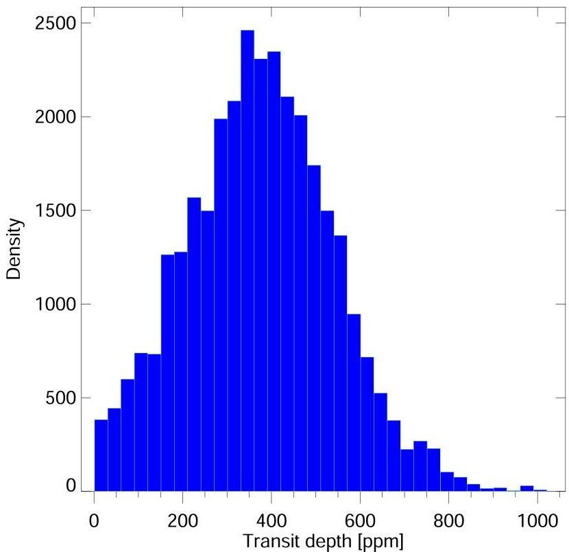

Figure 8. Posterior distribution function of the transit depth of 55 Cnc e recovered from ASTERIA photometric observations, given priors on $ T_{0} $ , b and P.

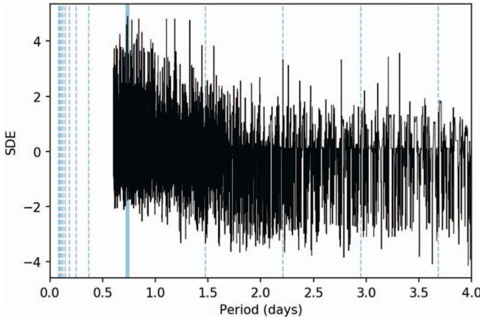

Figure 9. TLS Periodogram of the ASTERIA 55 Cnc e time series. The peak in the spectrum is marked in blue and matches 55 Cnc e's orbital period. The location of possible aliases are indicated by dashed blue vertical lines.

working GPS unit would solve this problem, as would an onboard real-time clock that does not reset when the flight computer reboots. One-second time-correlation precision is sufficient for the purposes of detecting transits with durations of many minutes to hours, but improved timing precision would open up additional applications, such as transit timing variation measurement, for future missions.

## 6.1.4. Preflight Camera Characterization

The test campaign for ASTERIA's payload was designed to ensure that it would be capable of demonstrating the key technologies of fine pointing control and thermal control. A future science-focused CubeSat photometry mission would benefit from preflight collection of bias, flat, and dark frames, and gain values, in multiple detector modes (full frame, windowed, coadded) over a range of flight-like temperatures. These calibration data could be used for reducing the

<!-- PDF_PAGE: 14 -->

photometric data rather than collecting calibration data on orbit, where illumination conditions are not as easily controlled. The volume of available calibration data would also be much larger than what can be reasonably collected and downlinked from orbit. See Krishnamurthy (2020, Chapter 5)

## 6.1.5. Orbit Selection

ASTERIA's orbit is not optimal for photometric time-series observations because there is no continuous viewing zone and the observing duty cycle is capped at $ \sim 30\% $ due to the requirement that observations take place in eclipse. A low-Earth Sun-synchronous orbit would provide a stable thermal environment, near-continuous power generation, and longer continuous viewing. The MOST space telescope (Walker et al. 2003) used such an orbit and several upcoming CubeSat and SmallSat missions will as well (SPARCS Scowen et al. 2018; Shkolnik et al. 2018, CHEOPS Broeg et al. 2013). A low-inclination orbit might be considered for future CubeSat space telescopes as well, as it provides continuous viewing of the celestial poles assuming sufficient baffling for stray light from the Sun and illuminated Earth. A low-inclination orbit also avoids SAA passages, which would be important for sensitive detectors and/or electronics.

See Smith et al. (2018) and Donner et al. (2018) for in-depth discussion of other lessons learned from ASTERIA development, integration and testing, and on-orbit operations.

## 6.2. Next Steps

Orbit decay projections show that ASTERIA will remain in orbit until at least spring 2020. Science operations ceased as of 2019 December 5 when contact with the spacecraft was lost. During its extended missions, ASTERIA also served as a testbed for new flight software and navigation techniques (Fesq et al. 2019).

The technologies and techniques ASTERIA has demonstrated are enabling for future astrophysics CubeSats and SmallSats, including the ExoplanetSat Constellation (described below). A platform like ASTERIA with very stable pointing and thermal control could support a wide range of instruments, including photometers operating outside of the visible range (UV/IR) or low-resolution spectrometers. It should be possible to scale the ASTERIA platform up in volume to a 12U+ form factor in order to increase aperture size without significantly changing the hardware and algorithms used to achieve subarcsecond pointing stability. ASTERIA was intended to be the first step toward a diverse fleet of small astrophysics missions, increasing access to space for the astrophysics community.

ASTERIA was a successful technology demonstration of a future constellation of up to dozens of satellites, dubbed the ExoplanetSat Constellation. Each satellite would share ASTERIA's precision pointing and thermal control capabilities, operate independently from the others, but may have different aperture sizes in order to reach down to fainter stars than ASTERIA's current capability. The primary motivation is the fact that if there is a transiting Earth-size planet in an Earthlike orbit about the nearest, brightest $ ( V<7 ) $ Sun-like stars, we currently have no way to discover them; current missions saturate on these bright stars. The ultimate goal for the constellation is to monitor dozens of the brightest Sun-like stars, searching for transiting Earth-size planets in Earth-like

(i.e., up to one year) orbits. Because the brightest Sun-like stars are spread all across the sky, a single telescope will not do. Instead, each satellite would monitor a single Sun-like star target of interest for as long as possible, before switching to another star, with targets only limited by the Sun, Earth, and Moon constraints. To narrow down the approximately 3000 target stars brighter than $ V=7 $ , one would have to find a way to constrain the stellar inclinations and assume the planets orbit within about $ 10^{\circ} $ of the star's equatorial plane. This would reduce the number of target stars from about 3000 to about 300 (Beatty & Seager 2010), a much more tractable number of targets. The ExoplanetSat Constellation has a unique niche in the context of existing and planned space transit surveys (Section 1), but is still in concept phase.

The authors thank the anonymous reviewer for their insightful and detailed comments, which enhanced and improved the manuscript. The authors recognize the contributions of the extended team that supported ASTERIA development, integration and test, and operations, including Len Day, Maria de Soria Santacruz-Pich, Carl Felten, Janan Ferdosi, Kristine Fong, Harrison Herzog, Jim Hofman, David Kessler, Roger Klemm, Jules Lee, Jason Munger, Lori Moore, Esha Murty, Chris Shelton, David Sternberg, Rob Sweet, Kerry Wahl, Jacqueline Weiler, Thomas Werne, Shannon Zareh, and Ansel Rothstein-Dowden. We also recognize the JPL line organization and technical mentors for the expertise they provided throughout the project.

We also wish to recognize JPL program management, especially Sarah Gavit and Pat Beauchamp, who oversaw ASTERIA within the Engineering and Science Directorate at JPL. We also thank Daniel Coulter and Leslie Livesay for their support.

Finally, we would like to thank the DSS-17 ground station team at Morehead State University (MSU) in Kentucky. We acknowledge the outstanding efforts of the student operators, technical staff, and program management at Morehead State University, including Chloe Hart, Sarah Wilczewski, Alex Roberts, Maria Lemaster, Lacy Wallace, Rebecca Mikula, Bob Kroll, Michael Combs, and Benjamin Malphrus.

We also thank Frank D. Lind and Mike Poirier of MIT Haystack observatory for their assistance in tracking ASTERIA during a communications anomaly.

Funding was provided by the JPL Phaeton program and by the Heising-Simons Foundation.

B.-O.D. acknowledges support from the Swiss National Science Foundation (PP00P2-163967).

The research was carried out in part at the Jet Propulsion Laboratory, California Institute of Technology, under a contract with the National Aeronautics and Space Administration. Government sponsorship acknowledged.

This research has made use of the NASA Exoplanet Archive which is operated by the California Institute of Technology under contract with the National Aeronautics and Space Administration under the Exoplanet Exploration Program.

Software: astropy (The Astropy Collaboration et al. 2013), astroquery (Astropy 2018), photutils (Bradley et al. 2019), pyBJD (https://github.com/tboudreaux/pyBJD), matplotlib (Hunter 2007), IDL, STK, MATLAB.

## ORCID iDs

<!-- PDF_PAGE: 15 -->

Brice-Olivier Demory https://orcid.org/0000-0002-9355-5165 Akshata Krishnamurthy https://orcid.org/0000-0002- 8781-2743

Matthew W. Smith https://orcid.org/0000-0003-0103-8820 Vanessa P. Bailey https://orcid.org/0000-0002-5407-2806

## References

Astropy 2018, astropy/astroquery: v0.3.8 release, Zenodo, doi:10.5281/ zenodo.1160627

Auvergne, M., Bodin, P., Boisnard, L., et al. 2009, A&A, 506, 411

Bakos, G. A 2018, in Handbook of Exoplanets, ed. H. Deeg & J. Belmonte (Cham: Springer), 111

Beatty, T. G., & Seager, S. 2010, ApJ, 712, 1433

Bocchino, R. L., Canham, T., Watney, G. J., Reder, L. J., & Levison, J. 2018, F Prime: An Open-Source Framework for Small-Scale Flight Software Systems, 32nd Annual AIAA/USU Conf. on Small Satellites SSC-18-XII-04, https://digitalcommons.usu.edu/cgi/viewcontent.cgi?article=4140& context=smallsat

Borucki, W. J., Koch, D., Basri, G., et al. 2010, Sci, 327, 977

Bourrier, V., Dumusque, X., Dorn, C., et al. 2018, A&A, 619, A1

Bradley, L., Sipócz, B., Robitaille, T., et al. 2019, astropy/photutils: v0.6, Zenodo, doi:10.5281/zenodo.2533376

Broeg, C., Fortier, A., Ehrenreich, D., et al. 2013, EPJWC, 47, 03005

Catala, C., & Appourchaux, T. 2011, JPhCS, 271, 012084

Claret, A., & Bloemen, S. 2011, A&A, 529, A75

de Mooij, E. J., López-Morales, M., Karjalainen, R., Hrudkova, M., & Jayawardhana, R. 2014, ApJL, 797, L21

Deeg, H. J., & Alonso, R. 2018, in Handbook of Exoplanets, ed. H. J. Deeg & J. A. Belmonte (Cham: Springer), 117

Demory, B. O., Gillon, M., de Wit, J., et al. 2016, Natur, 532, 207

Demory, B. O., Gillon, M., Deming, D., et al. 2011, A&A, 533, A114

Demory, B. O., Gillon, M., Seager, S., et al. 2012, ApJL, 751, 28

Donner, A. J.-N., di Pasquale, P., Smith, M. W., et al. 2018, ASTERIA Operations Demonstrates the Value of Combining the Mission Assurance and Fault Protection Roles on Cubesats, 69th Int. Astronautical Congress (IAC) IAC-18,B4,3,4,x46796, https://iafastro.directory/iac/ archive/browse/IAC-18/B4/3/46796/

Dravins, D., Lindegren, L., Mezey, E., & Young, A. 1998, PASP, 110, 1118 Ducati, J. R. 2002, yCat, 2237, 0

Fesq, L., Beauchamp, P., Donner, A., et al. 2019, in IEEE Aerospace Conf. Proc. (Piscataway, NJ: IEEE), 1

Fischer, D. A., Vogt, S. S., Marcy, G. W., et al. 2007, ApJ, 669, 1336

Gelman, A., & Rubin, D. B. 1992, StaSc, 7, 457

Gillon, M., Demory, B.-O., Benneke, B., et al. 2012, A&A, 539, A28

Heidt, H., Puig-Suari, J., Moor, A. S., Nakasuka, S., & Twiggs, R. J. 2000, CubeSat: A New Generation of Picosatellite for Education and Industry Low-Cost Space Experimentation, 14th Annual USU Conf. on Small

Satellites SSC00-V-5, http://digitalcommons.usu.edu/cgi/viewcontent. cgi?article=2069&context=smallsat

Hippke, M., & Heller, R. 2019, A&A, 623, A39

Holtzman, J. A., Hester, J. J., Casertano, S., et al. 1995, PASP, 107, 156

Howell, S. B., Sobeck, C., Haas, M., et al. 2014, PASP, 126, 398

Hunter, J. D. 2007, CSE, 9, 99

Ingalls, J. G., Krick, J. E., Carey, S. J., et al. 2012, Proc. SPIE, 8442, 84421Y

Knutson, H. A., Charbonneau, D., Allen, L. E., et al. 2007, Natur, 447, 183

Kornilov, V. 2012, MNRAS, 425, 1549

Kovács, G., Zucker, S., & Mazeh, T. 2002, A&A, 391, 369

Krishnamurthy, A. 2020, PhD Thesis, MIT

Mann, A. W., Gaidos, E., & Aldering, G. 2011, PASP, 123, 1273

Nelson, B. E., Ford, E. B., Wright, J. T., et al. 2014, MNRAS, 441, 442

Osborn, J., Föhring, D., Dhillon, V. S., & Wilson, R. W. 2015, MNRAS, 452, 1707

Pong, C. M. 2018, On-Orbit Performance & Operation of the Attitude & Pointing Control Subsystems on ASTERIA, Proc. 32nd Annual AIAA/ USU Conf. on Small Satellites SSC18-PI_34, https://digitalcommons.usu.edu/cgi/viewcontent.cgi?article=4173&context=smallsat

Pong, C. M., Knutson, M. W., Miller, D. W., et al. 2012, AIAA Guidance Navigation, and Control Conf. 2012 (Reston, VA: AIAA),

Press, W. H., Teukolsky, S. A., Vetterling, W. T., & Flannery, B. P. 1992, Numerical Recipes in FORTRAN. The Art of Scientific Computing (2nd ed.; Cambridge: Cambridge Univ. Press)

Rauer, H., Catala, C., Aerts, C., et al. 2014, ExA, 38, 249

Ricker, G. R., Winn, J. N., Vanderspek, R., et al. 2014, JATIS, 1, 014003

Rowe, J. F., Matthews, J. M., Seager, S., et al. 2006, ApJ, 646, 1241

Schwarz, G. 1978, AnSta, 6, 461

Scowen, P. A., Shkolnik, E., Ardila, D., et al. 2018, Proc. SPIE, 10699, 106990F

Shkolnik, E., Ardila, D., Barman, T., et al. 2018, AAS Meeting, 231, 228.04

Siverd, R. J., Beatty, T. G., Pepper, J., et al. 2012, ApJ, 761, 123

Smith, M. W., Donner, A., Knapp, M., et al. 2018, On-orbit Results and Lessons Learned from the ASTERIA Space Telescope Mission, Proc. 32nd Annual AIAA/USU Conf. on Small Satellites SSC18-I-08, https://digitalcommons.usu.edu/cgi/viewcontent.cgi?article=4067&context=smallsat

Smith, M. W., Seager, S., Pong, C. M., et al. 2010, Proc. SPIE, 7731, 773127 Sulis, S., Dragomir, D., Lendl, M., et al. 2019, A&A, 631, A129

The Astropy Collaboration, Robitaille, T. P., Tollerud, E. J., et al. 2013, A&A, 558, A33

van Leeuwen, F. 2007, A&A, 474, 653

von Braun, K., Tabetha, S. B., ten Brummelaar, T. A., et al. 2011, ApJ, 740, 49

Walker, G., Matthews, J., & Kuschnig, R. 2003, PASP, 115, 1023

Weiss, W. W., Rucinski, S. M., Moffat, A. F. J., et al. 2014, PASP, 126, 573

Winn, J. N., Matthews, J. M., Dawson, R. I., et al. 2011, ApJL, 737, L18 Young, A. T. 1967, AJ, 72, 747