<!-- PDF_PAGE: 1 -->

CrossMark

# HaloSat: A CubeSat to Study the Hot Galactic Halo

P. Kaaret $ ^{1} $ A. Zajczyk $ ^{1,2,3} $ D. M. LaRocca $ ^{1} $ R. Ringuette $ ^{1} $ J. Bluem $ ^{1} $ W. Fuelberth $ ^{1} $ H. Gulick $ ^{1} $ K. Jahoda $ ^{2} $ T. E. Johnson $ ^{2} $ D. L. Kirchner $ ^{1} $ D. Koutroumpa $ ^{4} $ K. D. Kuntz $ ^{5} $ R. McCurdy $ ^{1} $ D. M. Miles $ ^{1} $ W. T. Robison $ ^{1} $ and E. M. Silich $ ^{1} $ $ ^{1} $ Department of Physics and Astronomy, University of Iowa, Iowa City, IA 52242, USA; philip-kaaret@uiowa.edu $ ^{2} $ NASA Goddard Space Flight Center, Greenbelt, MD 20771, USA $ ^{3} $ Department of Physics, University of Maryland, Baltimore County, 1000 Hilltop Circle, Baltimore, MD 21250, USA $ ^{4} $ LATMOS/IPSL, CNRS, UVSQ Universite Paris-Saclay, UPMC Univ. Paris 06, Guyancourt, France $ ^{5} $ The Henry A. Rowland Department of Physics and Astronomy, Johns Hopkins University, Baltimore, MD 21218, USA Received 2019 August 13; revised 2019 September 2; accepted 2019 September 3; published 2019 October 22

## Abstract

HaloSat is a small satellite (CubeSat) designed to map soft X-ray oxygen line emission across the sky in order to constrain the mass and spatial distribution of hot gas in the Milky Way. The goal of HaloSat is to help determine if hot gas gravitationally bound to individual galaxies makes a significant contribution to the cosmological baryon budget. HaloSat was deployed from the International Space Station in 2018 July and began routine science operations in 2018 October. We describe the goals and design of the mission, the on-orbit performance of the science instrument, and initial observations.

Unified Astronomy Thesaurus concepts: X-ray observatories (1819); Diffuse x-ray background (384); Circumgalactic medium (1879); Hot ionized medium (752); X-ray surveys (1824); Space vehicle instruments (1548)

Supporting material: machine-readable table

## 1. Introduction

Astronomy at wavelengths that do not penetrate Earth's atmosphere requires space-borne observatories which tend to be costly, severely limiting their number. As of early 2018, there were only seven X-ray observatories in orbit as compared to the $ \sim100 $ ground-based optical telescopes with apertures of 2 m or larger. The development of the CubeSat standard (Hevner et al. 2011) decoupled the design of small satellites from specific launch opportunities and has led to a large increase in the frequency of small satellite flights including frequent launch opportunities for scientific missions (Crusan & Galica 2019). The commercialization of small satellite technologies has both increased the capabilities of small satellites and decreased their cost. Small spacecraft with the pointing accuracy, communications, and power resources needed for modest astronomical instruments can now be purchased at prices similar to that of a 1 m optical telescope. This enables low-cost, space-borne astronomical observatories.

HaloSat is the first astrophysics-focused CubeSat mission funded by NASA's Astrophysics Division. HaloSat's scientific goal is to constrain the mass and spatial distribution of hot gas associated with the Milky Way by mapping soft X-ray line emission from highly ionized oxygen in order to determine if hot halos associated with individual galaxies make a significant contribution to the cosmological baryon budget. The mission was developed on a rapid timescale, less than 2.5 yr from the start of funding to launch, and at modest cost, less than $4M. HaloSat was deployed from the International Space Station (ISS) on 2018 July 13 and began routine science operations in 2018 October.

In the following, we give an overview of the HaloSat mission including the science goals and mission design in Section 2. We describe the science instrument in Section 3 and the spacecraft and operations in Section 4. We present the onorbit performance in Section 5. We discuss initial halo observations and plans for the survey in Section 6. Some of

the text and figures in this paper have appeared previously in conference proceedings (Zajczyk et al. 2018; Kaaret et al. 2019).

## 2. Mission Overview

## 2.1. Science Goals

The Milky Way provides a local laboratory for understanding the missing baryon problem. The total mass of the Milky Way has been dynamically measured to be $ (1. 0-2. 4)\times1 0^{1 2} M_{\odot} $ (Boylan-Kolchin et al. 2013). If the cosmological baryon fraction of 15.5% (Planck Collaboration 2014) applies on the scales of individual galaxies, then the Milky Way's baryonic mass should be $ (1. 6-3. 7)\times1 0^{1 1} M_{\odot} $ . However, the observed baryonic mass in stars and disk gas is only $ 0. 7\times1 0^{1 1} M_{\odot} $ (Dame 1993; McMillan 2011). Thus, more than half the expected baryons in the Milky Way are missing.

The presence of a hot Galactic halo has long been suspected (Spitzer 1956). Absorption lines at zero redshift in the X-ray spectra of extragalactic objects firmly establish the existence of an extended distribution of hot gas, $ \sim 1 0^{6} $ K, associated with the Milky Way (Nicastro et al. 2002). Other evidence for a hot halo includes ubiquitous gas depletion in dwarf galaxies within 270 kpc of the Milky Way (Grcevich & Putnam 2009), understood as ram pressure stripping and the dispersion measures of pulsars in globular clusters and the Magellanic clouds (Zhezher et al. 2017).

X-ray absorption line measurements of the halo are feasible along only about 30 lines of sight. In contrast, X-ray emission lines can be measured in any direction and provide a means to obtain a synoptic view of the halo gas. Data from existing X-ray observatories, primarily XMM-Newton and Suzaku, have been used for emission-line measurements of the halo (Smith et al. 2007; Yoshino et al. 2009; Henley et al. 2010; Henley & Shelton 2012; Miller & Bregman 2015). However, the existing X-ray observatories are not designed for the efficient study of

<!-- PDF_PAGE: 2 -->

large-angular-scale diffuse emission and the spectra are often contaminated by heliospheric foreground emission that limits the accuracy of measurements of the halo (Slavin et al. 2013).

HaloSat's scientific goal is to constrain the mass and spatial distribution of hot gas associated with the Milky Way. We choose to do this by measuring line emission from oxygen, the most cosmologically abundant element that is not fully ionized at the temperatures present in the halo. Oxygen in the halo is highly ionized and the strongest emission is in the soft X-ray range from the OVII triplet near 574 eV and the pair of OVIII lines near 654 eV. To advance over previous studies of halo oxygen line emission, we set an observational goal of achieving a 1 $ \sigma $ statistical accuracy of $ \pm 0.5 $ LU $ \mathrm{(LU=photons\ cm^{-2}s^{-1}ster^{-1})} $ on the sum of the OVII and OVIII line emission in the 500-700 eV range for an oxygen line strength of 5 LU.

The Milky Way's halo fills the entire sky. The observational goal of HaloSat is to survey at least 75% of the sky with priority given to fields at Galactic latitudes $ |b| \geqslant 30^{\circ}. $ Modest angular resolution of $ 15^{\circ} $ or less is sufficient to map the halo emission. HaloSat uses non-imaging detectors to minimize cost and complexity, hence the angular resolution is set by the field of view (FoV). We chose a large FoV with a $ 10^{\circ} $ diameter full response dropping to zero response at a diameter of $ 14^{\circ}, $ which is consistent with the required angular resolution.

## 2.2. Mission Design

We chose to implement HaloSat as a CubeSat. The largest CubeSats being regularly flown by NASA at the time of mission formulation were in the 6U form factor with a volume of 8600 cm $ ^{3} $ . Approximately one third of the volume was allocated to the spacecraft structure and systems, leaving a volume of roughly 6000 cm $ ^{3} $ available for the science instrument. The choice of a CubeSat also limits the mission duration. The most common launch for US-based CubeSats is to the ISS and the relatively low altitude, $ \sim 4 0 0 $ km, limits the orbital lifetime. HaloSat's orbital lifetime is expected to be 2.5 yr. Furthermore, CubeSat electronics often use commercial rather than radiation-hardened electronic components to minimize cost, which can lead to premature failure in the space environment. HaloSat was designed with a baseline mission lifetime of 405 days based on the longest lifetimes achieved with similar components in previous missions.

HaloSat is designed to be sensitive to diffuse X-ray emission. The number of oxygen line photons detected from a diffuse source is $ N=fA\Omega T $ , where f is the diffuse line flux generally measured in LU, A is the detector effective area at the oxygen line, $ \Omega $ is the detector/telescope FoV, and T is the observation time. The figure of merit for observing diffuse emission is $ A\Omega $ or "grasp." Due to the CubeSat volume constraints, HaloSat uses three small detectors that view the sky through mechanical collimators with no optics. Each detector has an effective area for X-rays of 600 eV of about $ 5.1\mathrm{mm}^{2} $ . However, HaloSat's FoV is near 100 square degrees, enabling it to efficiently survey the sky. The total grasp of HaloSat at 600 eV is $ 17.6\mathrm{cm}^{2}\mathrm{deg}^{2} $ . The grasp of the Chandra X-ray Observatory at the same energy was about $ 2\times $ lower at launch, while the total grasp of the two XMM-Newton EPICMOS is about $ 4\times $ larger. Thus, a CubeSat can be competitive with major space observatories when designed for a specific goal, such as survey efficiency.

The accuracy of current emission-line measurements of the halo is limited by foreground oxygen emission produced by solar-wind charge exchange (SWCX), when energetic particles in the solar wind exchange charge with neutral atoms within the solar system (for a review see Kuntz 2019). HaloSat observes toward the anti-Sun direction during the night-time half of the 93 minute orbit of the spacecraft around Earth to minimize this foreground. This is not possible with XMM- Newton because it has a fixed solar array that restricts observations to a Sun angle range of $ 7 0^{\circ}-1 1 0^{\circ} $ . Because the solar system background presents the dominant uncertainty in current line intensity measurements, HaloSat has an additional science goal to improve our understanding of SWCX emission and conducts observations specifically devoted to this goal.

## 2.3. Solar Wind Charge Exchange Emission

SWCX emission occurs when a highly charged ion of the solar wind interacts with a neutral atom and gains an electron. The resulting ion is in an excited state and may decay by emitting an X-ray. SWCX emission is produced within Earth's magnetosheath and throughout the heliosphere. The line flux is the integral over the line of sight of the product of the ion density, the neutral density, the relative velocity between the ion and neutral, the charge exchange cross section, and the line emission probability. The magnetosheath responds rapidly to changes in the solar wind flux, so its SWCX emission is strongly time-variable. The heliospheric emission is integrated over a long line of sight, sampling about a month of solar wind conditions, and varies more slowly.

The distribution of heliospheric emission is determined by the geometry of the target gas. Neutral interstellar gas flows at $ \sim 2 5 \mathrm{k m s}^{-1} $ through the solar system. This gas, mostly hydrogen but with $ \sim 15\% $ helium, flows from the Galactic direction $ (l\sim 3^{\circ}, b\sim 16^{\circ}) $ , placing the Earth downstream of the Sun in early December. The flow of interstellar hydrogen is affected by both radiation pressure and gravity, and the hydrogen becomes strongly ionized through charge exchange with solar protons and photoionization so that the hydrogen is denser upstream of the Sun than downstream. In contrast, the interstellar helium flow is not strongly ionized but is affected mainly by gravity, which focuses the flow downstream of the Sun into the "He-focusing cone."

The heliospheric OVII and OVIII emission are calculated from the interstellar neutral H and He distributions and measurements of the solar wind provided by solar and heliospheric observatories (Koutroumpa et al. 2009). A crucial input to this modeling is knowledge of the O-He interaction cross section (Galeazzi et al. 2014). HaloSat observed along the He-focusing when the Earth passed through the He-focusing cone in 2018 December with observations made at roughly monthly intervals from two months before the passage to two months after. By correlating the observed soft X-ray emission with the He distribution along the line of sight, these HaloSat observations will provide an accurate measurement of the O-He cross section and an absolute scale for the SWCX models. These observations cannot be made by any other current observatory.

HaloSat is also carrying out a series of observations to study magnetospheric SWCX emission. A selected set of targets is observed multiple times, once near the anti-Sun direction in order to minimize magnetospheric SWCX emission and also as

<!-- PDF_PAGE: 3 -->

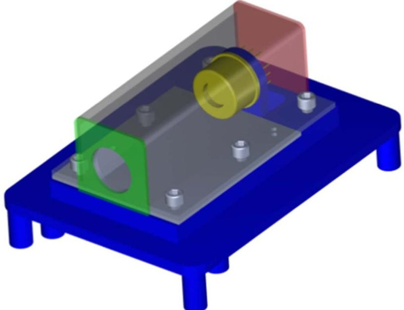

Figure 1. Schematic of an X-ray detector assembly (Zajczyk et al. 2018). The SDD is shown in gold. The copper-tungsten passive shield is shown in gray with the top part semi-transparent, the forward end cap in green with the sky aperture, and the rear end cap in red. The detector is mounted on an aluminum baseplate shown in blue with the front-end electronics (not shown) mounted on the bottom of the plate.

the target enters and exits the anti-Sun hemisphere and is viewed through the flanks of the magnetosheath. These flank observations should have significant magnetospheric SWCX emission. By measuring the difference between the anti-Sun versus the flank observations, we will be able to characterize the magnetospheric SWCX emission and its dependence on the solar wind and viewing angle through the magnetosphere.

Optimizing the epoch of each halo observation should significantly reduce the SWCX contribution for HaloSat observations of the halo. The dedicated heliospheric and magnetospheric SWCX observations should improve the accuracy with which we can model the remaining SWCX emission and, thus, improve the accuracy of HaloSat measurements of the Milky Way's halo.

## 3. Science Instrument

The science instrument of HaloSat consists of three identical detector units each containing an X-ray detector assembly and signal processing electronics (Zajczyk et al. 2018). The X-ray detectors are silicon drift detectors (SDDs) from Amptek, Inc. Each SDD has an active area of $ 1 7 \mathrm{~ m m}^{2} $ and is in a sealed package along with a multilayer collimator and a thermoelectric cooler package viewing the sky through a $ \mathrm{S i}_{3} \mathrm{N}_{4} $ window covered with a thin layer of aluminum. The SDD is cooled to $ - 3 0^{\circ} \mathrm{C} $ during operation, but the window remains at ambient temperature which should help reduce the buildup of contaminants. The SDD provides no imaging capability.

Each detector is mounted in a compartment inside the instrument chassis made of aluminum. To minimize background from charged particle interactions and the diffuse X-ray background, each SDD is surrounded by a shield made of 1.2 mm thick copper-tungsten metal matrix composite electroplated with a 2.5 $ \mu $ m layer of nickel and an outer 1.3 $ \mu $ m layer of gold; see Figure 1. The shield has a circular aperture through which the SDD views the sky; see Figure 2. There is a 0.78 mm thick aluminum washer at the front of each detector compartment with a circular aperture that defines the FoV. The

full-response radius was measured in ground testing to be $ 5^{\circ} . 0 2 $ and the zero-response radius to be $ 7^{\circ} . 0 3 $ with a linear decrease between. The response-weighted effective FoV is 0.0350 sr.

Each X-ray creates a charge pulse. Pulses triggering a lower level discriminator are digitized and the pulse height and time of arrival, with a resolution of 0.05 s, are recorded by a dataprocessing unit (DPU) which is a field-programmable gate array programmed with a microprocessor core. We refer to the detector units using numbers encoded into their DPUs which are 14, 54, and 38 as viewed from left to right in Figure 2.

The X-ray energy to pulse height conversion was measured during ground calibration with the detectors illuminated by an X-ray beam with fluorescence emission at the F K $ \alpha $ line (676.8 eV) from a Teflon target along with lines from Al, Si, Cr, and Fe, and by a $ ^{55} $ Fe radioactive source (Zajczyk et al. 2018). Measurements were made at instrument temperatures ranging from $ -25^{\circ} \mathrm{C} $ to $ +40^{\circ} \mathrm{C} $ . The pulse height to X-ray energy conversion is linear with a non-zero offset. The offset is a linear function of temperature while the slope is a quadratic function of temperature. The energy scale shifts are up to $ \sim 15 $ eV across the range from $ -25^{\circ} \mathrm{C} $ to $ +40^{\circ} \mathrm{C} $ . Details of the ground calibration are presented in A. Zajczyk et al. (2019, in preparation). The energy resolution averaging over all temperatures was measured to be $ 88.3\pm 3.5 $ $ 84.3\pm 2.8 $ , and $ 82.0\pm 1.4 $ eV (FHWM) at the F K $ \alpha $ line and $ 138.5\pm 2.1 $ $ 136.5\pm 0.8 $ , and $ 137.3\pm 1.9 $ eV (FWHM) at the Mn K $ \alpha $ line (the intensity-weighted average of the $ \mathrm{K}\alpha_{1} $ and $ \mathrm{K}\alpha_{2} $ lines is 5895.0 eV) for DPUs 14, 54, and 38, respectively.

Detector response matrices were prepared using software that models the response of silicon detectors (Scholze & Procop 2009). The software was modified for the SDDs used for NASA's Neutron star Interior Composition Explorer (NICER) instrument (Gendreau et al. 2016) and kindly provided to us by Dr. Jack Steiner of MIT. The NICER SDDs are identical to those on HaloSat except for the use of a thinner window. We adjusted the relevant detector parameters using the ground calibration data and information on the windows supplied by Amptek, Inc., and HS-Foils, Oy. The effective area of a single HaloSat SDD is shown in Figure 3. The response files are compatible with the Xspec spectral fitting software (Arnaud 1996) which is commonly used in X-ray astronomy to enable use of HaloSat data by the astronomical community.

## 4. Spacecraft and Operations

To minimize development costs and enhance the probability of mission success by the use of flight-proven components, we choose to use a commercial CubeSat "bus" provided by Blue Canyon Technologies, Inc., (BCT) to provide attitude control, command and data handling, and a power system. Power is provided by a deployable solar array that charges the on-board batteries during the day side of the spacecraft orbit. The spacecraft can be slewed at a $ 2^{\circ} $ per second rate and has a pointing accuracy of $ \pm0. 0 0 2 $ （ $ 1 \sigma $ ）(Hegel 2016). An on-board CADET radio is used to down-link telemetry to and receive commands from a radio ground station at NASA's Wallops Flight Facility. A GlobalStar radio provides occasional housekeeping information.

BCT performs mission operations based on observation plans generated at the University of Iowa. All the instrument telemetry (which includes X-ray event data, instrument housekeeping data, and spacecraft attitude and orbit information) is captured in a database and processed into a set of Flexible Image Transport System (FITS) format files including spectra

<!-- PDF_PAGE: 4 -->

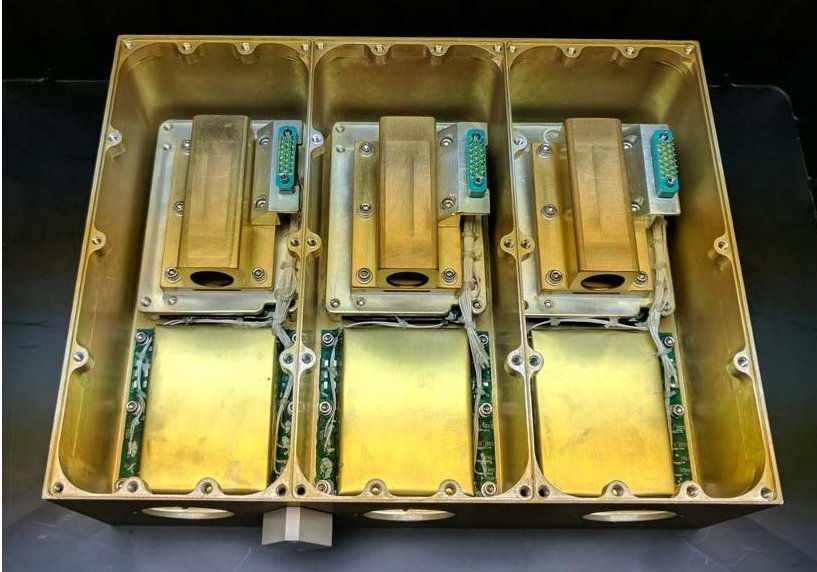

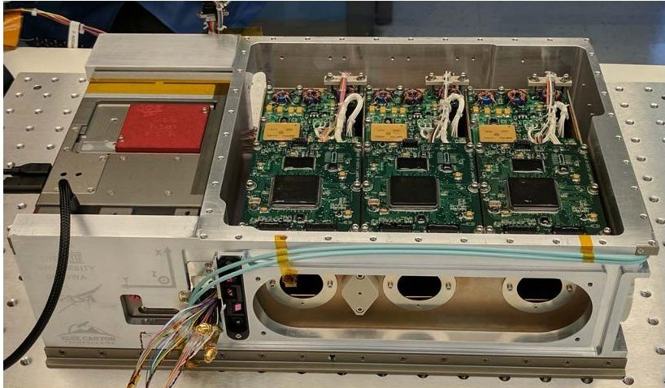

Figure 2. Top: three flight detectors mounted in the instrument chassis. The passive shields are visible toward the back; the detectors are inside. The brass housings toward the front are high-voltage power supplies. The X-ray apertures are at the front. Bottom: science instrument mounted in the flight bus chassis. Printed circuit boards for analog electronics and the data-processing units are on the top of instrument chassis with the alignment washers and a cover over a flat mirror used for optical alignment at the front. The instrument cover and solar array are not attached.

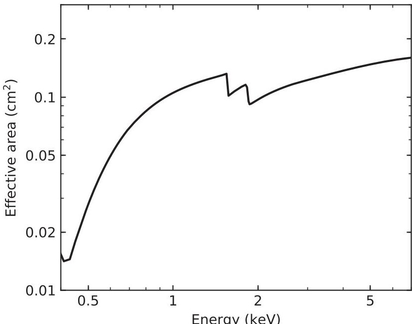

Figure 3. Effective area vs. energy of a single HaloSat SDD.

and event lists for each target. The FITS files will be archived at the High Energy Astrophysics Science Archive Research Center and made publicly available within five months after mission completion.

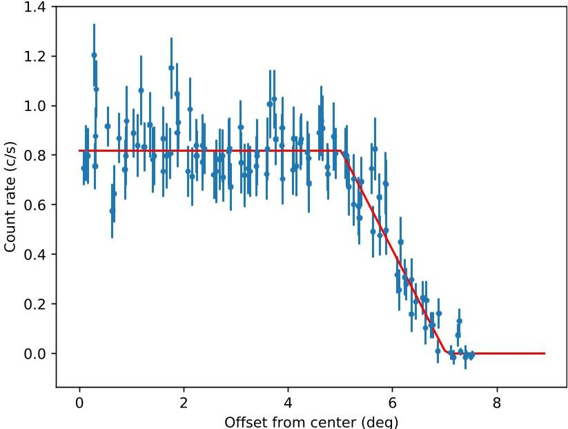

Figure 4. X-ray count rate vs. pointing offset from the Crab for DPU 54.

Table 1 Pointing Offsets

<table border="1"><tr><td>DPU</td><td>X(deg)</td><td>Y(deg)</td></tr><tr><td>14</td><td>-0.11</td><td>0.18</td></tr><tr><td>54</td><td>-0.01</td><td>0.15</td></tr><tr><td>38</td><td>-0.05</td><td>0.10</td></tr></table>

## 5. On-orbit Performance

The first observations with HaloSat were done to measure the instrument pointing and FoV and to verify the spectral response and effective area.

## 5.1. Pointing and Field of View

The Crab is a pulsar wind nebula powered by a young pulsar with a spin period of about 33 ms. The Crab has been used as a calibration target since the early days of X-ray astronomy (Toor & Seward 1974). We used the Crab to measure the alignment between the boresights of the X-ray instruments and the coordinate system defined by the star trackers on the spacecraft bus.

We performed a series of slew maneuvers in which the science instrument was pointed toward the Crab and then the pointing was gradually offset while the spacecraft roll angle was held fixed. Eight different maneuvers were performed corresponding to eight different roll angles at equal intervals in the spacecraft frame. The X-ray count rate versus offset data were fit to a model matching the FoV measured on the ground with the center being a fit parameter. Good fits were obtained, see Figure 4, verifying the ground FoV measurements. We found an offset of about 1.0 in the spacecraft Y direction from the nominal pre-flight instrument boresight. This correction was applied to the pointing of observations obtained after 2018 December 1.

After the correction, another pointing test was performed and the best fit FoV center was found to be consistent with the expected position within $ \pm 0^{\circ}.11 $ in the spacecraft X direction and $ \pm 0^{\circ}.18 $ in the spacecraft Y direction for all DPUs; see Table 1. The count rate for DPU 54 versus radial offset from the best-fit center for the best-fit model is shown in Figure 4 and the pointing offsets for each detector are presented in

<!-- PDF_PAGE: 5 -->

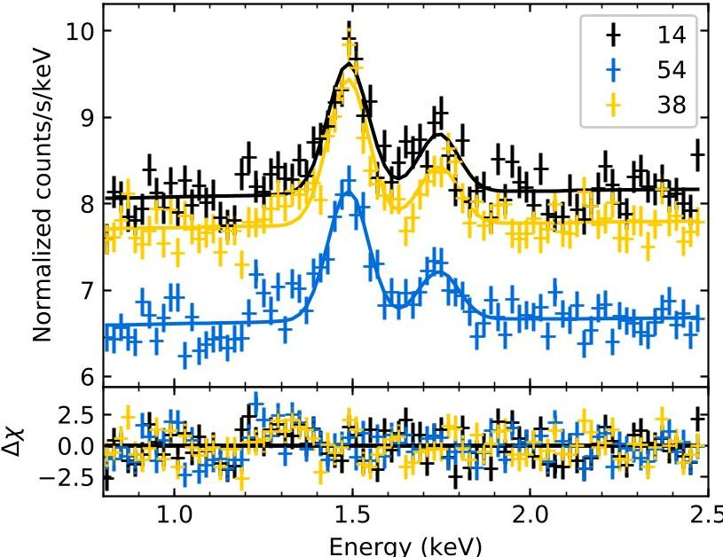

Figure 5. X-ray spectra of the dark Earth. Data from all three detectors are shown as indicated by the DPU numbers in the legend. Emission lines are visible from neutral Al at 1.49 keV and neutral Si at 1.74 keV.

Table 1. The uncertainties on the offsets are $ \pm 0. 0 5 $ （ $ 1 \sigma $ ）. We conclude that the pointing of the X-ray boresight of HaloSat is accurate to within $ \pm 0. 2 3 $ , which is a small fraction of the FoV. The X-ray pointing uncertainty is dominated by the accuracy to which we are able to measure the relative alignment between the X-ray detectors and the spacecraft reference frame. The median offset between the commanded target position during observations and the spacecraft pointing measured by the attitude control system is $ 0. 0 0 0 7 $ .

## 5.2. Spectral Response

To check the on-orbit X-ray energy scale calibration, we examined spectra obtained while observing the dark side of the Earth and while observing the supernova remnant (SNR) Cassiopeia A.

The dark Earth observations show instrumental lines from aluminum and silicon likely due to fluorescence by energetic particles. Data were processed using the temperature-dependent ground energy calibration and filtered to maximize the significance of these lines. The resulting spectra were fit with a model consisting of two Gaussians and a power law; see Figure 5. With the line centroid energies fixed to the average of the laboratory values of the $ K\alpha_{1}, $ $ K\alpha_{2}, $ and $ K\beta $ lines weighted by their relative strengths (1.4875 keV for Al and 1.7425 keV for Si), we obtained a good fit with $ \chi^{2}/\mathrm{DoF}=337.7/239. $ Allowing the line centroid energies to vary did not produce a significant improvement in the fit with an F-test probability of 0.35. The line centroid error ranges include the weighted laboratory values and the best-fit centroids for the Al line are all within 3 eV of the laboratory value.

Cas A has strong emission lines from heavy elements in its X-ray spectrum. X-ray emission lines from Mg, Si, S, and Ar were first detected with the solid-state spectrometer on Einstein (Becker et al. 1979) and first mapped with ASCA (Holt et al. 1994). Cas A has been used to calibrate the energy scale of previous X-ray instruments (Jahoda et al. 2006).

The HaloSat field centered on Cas A includes another SNR, CTB 109, and several point sources, but the emission is dominated by Cas A. We extracted spectra of the Cas A for all three DPUs; see Figure 6, and fit them in the 1.0-3.5 keV range

with a model consisting of a power law and nine Gaussians for the astrophysical emission and a power law with photon index fixed to 0.65 for the instrumental background that was not modified by the response matrix. The parameters of the astrophysical model were set equal for the different detectors while the normalization of the instrumental background was allowed to vary between detectors. Line energies were extracted from the AtomDB database of atomic transitions and centroids for blends were calculated from their relative intensities and are given in Table 2.

The continuum X-ray spectrum of Cas A is typically described as the sum of two thermal plasma components and a power law, but a single power law produces an adequate fit over the limited energy band used in the fit with $ \chi^{2} / \mathrm{D o F}=4 3 8. 3 1 / 3 5 8 $ . The best-fit equivalent widths (EWs) for the detected lines are presented in Table 2. The line widths are consistent with the energy resolution measured during the ground calibration. Allowing the slope or the intercept of the channel to energy conversion to vary did not significantly improve the fit with F-test probabilities of 0.20 and 0.16, respectively. The best-fit response slopes differ by less than 0.2% from the ground calibration while the best-fit intercepts differ by less than 5 eV.

## 5.3. Effective Area

We used the Crab to check the effective area of HaloSat. The Crab is often used as a "standard candle" in X-ray astronomy (Toor & Seward 1974; Jahoda et al. 2006; Madsen et al. 2015). However, it does exhibit variability of up to 7% in the 10-100 keV band on long timescales (Wilson-Hodge et al. 2011).

We extracted Crab spectra for each detector, see Figure 7, and applied the temperature-dependent energy calibration and response matrices discussed previously. We modeled the Crab spectrum as an absorbed power law with the TBabs model in Xspec to describe the interstellar absorption (Wilms et al. 2000). The same absorption column density, $ N_{H} $ , and power-law photon index, $ \Gamma $ , were used for all detectors, but the normalization was allowed to vary between the detectors. We included a power law with photon index and normalization fixed to the values found by Cappelluti et al. (2017) to model the cosmic X-ray background (CXB) subject to absorption with the TBabs model with the column density fixed to the average Galactic absorption within a $ 5^{\circ} $ radius of the line of sight (HI4PI Collaboration et al. 2016). We added a power law not modified by the response matrix to model the instrumental background. The instrumental background photon index was fixed to 0.65 and the normalization was allowed to vary between the detectors. We fitted the spectra in the 0.4-7 keV band.

We obtained a good fit with $ \chi^{2} / \mathrm{DoF}=1 1 2 2 7. 5 / 9 7 9 $ for $ N_{H}=(3. 5 4 \pm 0. 1 3) \times1 0^{2 1} \mathrm{c m}^{-2} $ and $ \Gamma=2. 1 2 \pm 0. 0 3 $ （90% confidence). The photon index is consistent with those measured for the Crab with XMM-Newton, the proportional counter array (PCA) on the Rossi X-ray Timing Explorer (Kirsch et al. 2005), and NuSTAR (Madsen et al. 2017), see Table 3. We note that the photon index depends on the energy band used for the fitting. If we use a softer band, we find a harder photon index, consistent with the values reported for instruments sensitive in softer bands such as the Low Energy Concentrator Spectrometer on BeppoSAX and the Position Sensitive Proportional Counter on ROSAT (Kirsch et al. 2005). This suggests that a single power law does not provide an adequate representation of the spectrum of the Crab pulsar plus

<!-- PDF_PAGE: 6 -->

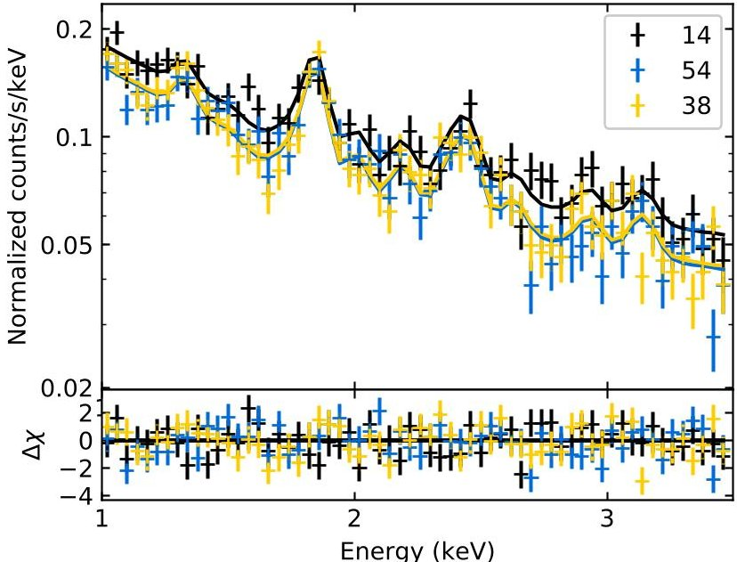

Figure 6. X-ray spectra of the Cas A field in the 1-3.5 keV band. Data from all three detectors are shown as indicated by the legend. Prominent emission lines are visible from Si XIII at 1.86 keV and S XV at 2.45 keV. Table 2 shows the lines used in fitting the spectra.

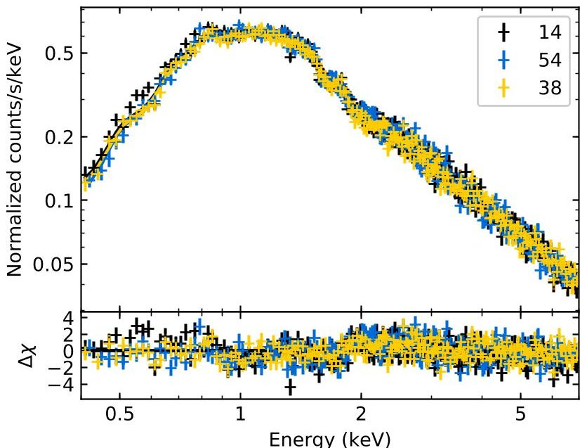

Figure 7. X-ray spectra of the Crab in the 0.5-7 keV band. Data from all three detectors are shown as indicated by the legend.

Table 2

X-Ray Lines from Cas A

<table border="1"><tr><td>Line</td><td>Energy(keV)</td><td>EW(keV)</td></tr><tr><td>Mg Heα</td><td>1.3375</td><td>0.04</td></tr><tr><td>Si Heα</td><td>1.8558</td><td>0.40</td></tr><tr><td>Si Lyα</td><td>2.0053</td><td>0.13</td></tr><tr><td>Si Heβ</td><td>2.1830</td><td>0.13</td></tr><tr><td>Si Lyβ</td><td>2.3770</td><td>0.06</td></tr><tr><td>S Heα</td><td>2.4510</td><td>0.17</td></tr><tr><td>S Lyα</td><td>2.6220</td><td>0.09</td></tr><tr><td>S Heβ</td><td>2.9218</td><td>0.09</td></tr><tr><td>Ar Heα</td><td>3.1400</td><td>0.13</td></tr></table>

nebula at low energies, consistent with the observations that the pulsed flux is harder than the nebular emission.

The science of HaloSat is focused on emission in the 0.5-2 keV band. The Crab flux in that band depends on all of the model parameters, so we prefer to directly compare

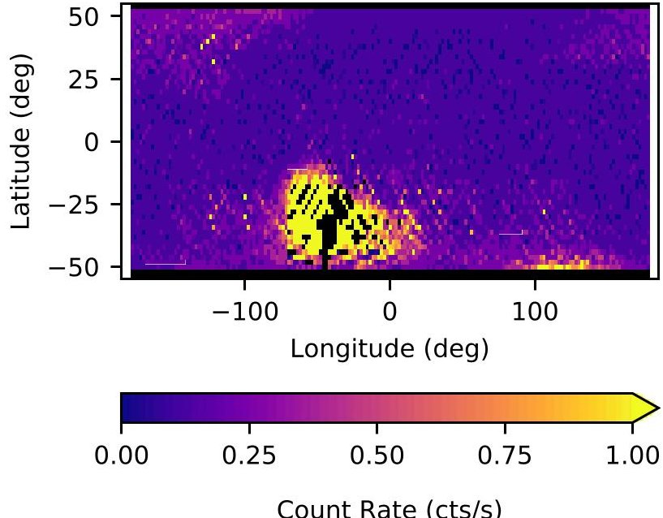

Count Rate (cts/s)

Figure 8. Median count rate before background filtering vs. orbital position for DPU 38 in the energy band 0.4-3 keV. The South Atlantic Anomaly is prominent and high-background regions at high latitudes are visible.

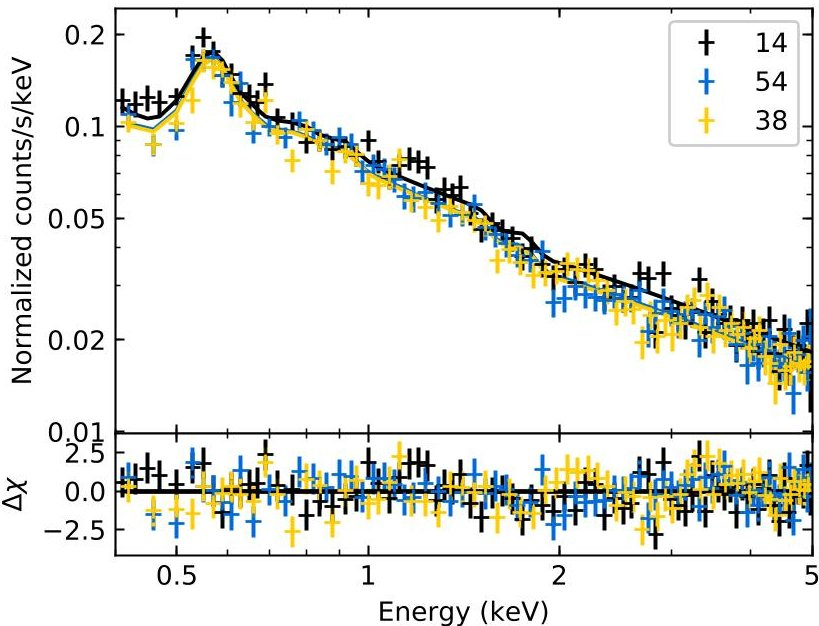

Figure 9. X-ray spectra of a halo field. Data from all three detectors are shown as indicated by the legend.

Table 3

Crab Flux from Various Instruments

<table border="1"><tr><td>Instrument</td><td>Norm</td><td>$\Gamma$</td><td>$N_{H}$</td><td>Flux</td></tr><tr><td>Historical</td><td>9.7±1.0</td><td>2.100±0.030</td><td>3.54</td><td>11.0</td></tr><tr><td>RXTE/PCA</td><td>11.02±0.04</td><td>2.120±0.002</td><td>3.54</td><td>12.4</td></tr><tr><td>NuSTAR</td><td>9.71±0.16</td><td>2.106±0.006</td><td>3.54</td><td>11.0</td></tr><tr><td>HaloSat</td><td>10.20±0.17</td><td>2.12±0.03</td><td>3.54±0.13</td><td>11.5</td></tr></table>

Note. Normalization is in units of photons $ \mathrm{k e V}^{-1} \mathrm{c m}^{-2} \mathrm{s}^{-1} $ at 1 keV and $ N_{H} $ is in units of $ 10^{21} \mathrm{c m}^{-2} $ . Flux is in the 0.5-2 keV band in units of $ (10^{-9} \mathrm{e r g} \mathrm{c m}^{-2} \mathrm{s}^{-1}) $ . References are: Toor & Seward (1974) for the historical instruments, Kirsch et al. (2005) for the PCA, and Madsen et al. (2017) for NuSTAR.

observed fluxes rather than only the power-law normalization. The HaloSat fluxes from the Crab in the 0.5-2 keV band in units of $ 1 0^{-9} $ erg $ \mathrm{c m}^{-2} \mathrm{s}^{-1} $ are $ 1 1. 5 4 \pm0. 2 0 $ for DPU 14, $ 1 1. 7 4 \pm0. 2 1 $ for DPU 54, and $ 1 1. 2 7 \pm0. 2 0 $ for DPU 38 (uncertainties are 90% confidence). The fluxes are consistent

<!-- PDF_PAGE: 7 -->

Table 4 Halo Spectrum Model Parameters

<table border="1"><tr><td>Parameter</td><td>(229.25,67.50)</td><td>(165.59,61.92)</td></tr><tr><td>Exposure(ks)</td><td>42.6,42.2,41.9</td><td>44.4,44.0,42.7</td></tr><tr><td>O VII flux(LU)</td><td>5.14±0.39</td><td>4.33±0.35</td></tr><tr><td>O VIII flux(LU)</td><td>0.94±0.20</td><td>0.90±0.18</td></tr><tr><td>$N_{H}(10^{20}cm^{-2})$</td><td>1.41</td><td>1.13</td></tr><tr><td>Halo kT(keV)</td><td>0.178±0.007</td><td>0.189±0.010</td></tr><tr><td>Halo EM(10^{-3}cm^{-6}pc)</td><td>25.8±4.3</td><td>19.8±3.8</td></tr><tr><td>LB kT(keV)</td><td>0.097</td><td>0.097</td></tr><tr><td>LB EM</td><td>4.14</td><td>4.70</td></tr><tr><td>CXB $\Gamma$</td><td>1.45</td><td>1.45</td></tr><tr><td>CXB norm</td><td>10.3±0.7</td><td>9.3±0.6</td></tr><tr><td>$\chi^{2}/DoF$</td><td>776.1/679</td><td>799.64/679</td></tr></table>

Note. Uncertainties are $ 1 \sigma $ confidence. Quantities without uncertainties are held fixed. The exposures are after background and data quality screening for DPU 14, 54, and 38. The CXB normalization is at 1 keV with units of keV $ \mathrm{c m}^{-2} \mathrm{s}^{-1} \mathrm{s r}^{-1} \mathrm{k e V}^{-1}. $

Table 5

Table 5 HaloSat Targets

<table border="1"><tr><td>ID</td><td>Name</td><td>Type</td><td>R.A.</td><td>Decl.</td><td>l</td><td>b</td></tr><tr><td>1</td><td>Cygnus Loop</td><td>C</td><td>312.75</td><td>30.67</td><td>73.98</td><td>-8.56</td></tr><tr><td>2</td><td>Sco X-1</td><td>C</td><td>244.98</td><td>-15.64</td><td>359.09</td><td>23.78</td></tr><tr><td>3</td><td>Crab</td><td>C</td><td>83.63</td><td>22.01</td><td>184.56</td><td>-5.78</td></tr><tr><td>8</td><td>LMC</td><td>S</td><td>78.83</td><td>-67.78</td><td>278.32</td><td>-34.00</td></tr><tr><td>9</td><td>Pup A offset</td><td>S</td><td>118.07</td><td>-39.33</td><td>254.27</td><td>-6.22</td></tr><tr><td>10</td><td>Tycho SNR</td><td>S</td><td>5.79</td><td>64.66</td><td>119.91</td><td>1.95</td></tr><tr><td>66</td><td>HSWCX1</td><td>X</td><td>73.27</td><td>17.51</td><td>182.73</td><td>-16.37</td></tr><tr><td>67</td><td>HSWCX2</td><td>X</td><td>101.92</td><td>-61.29</td><td>271.21</td><td>-24.01</td></tr><tr><td>68</td><td>MSWCX1</td><td>X</td><td>15.46</td><td>18.24</td><td>126.40</td><td>-44.56</td></tr><tr><td>80</td><td>HALO J1807+699</td><td>H</td><td>271.83</td><td>69.98</td><td>100.31</td><td>29.12</td></tr><tr><td>81</td><td>HALO J0011+119</td><td>H</td><td>2.86</td><td>11.94</td><td>107.69</td><td>-49.75</td></tr><tr><td>82</td><td>HALO J0021-440</td><td>H</td><td>5.45</td><td>-44.07</td><td>320.42</td><td>-72.04</td></tr><tr><td>83</td><td>HALO J0021-255</td><td>H</td><td>5.44</td><td>-25.57</td><td>44.48</td><td>-83.17</td></tr><tr><td></td><td>...</td><td></td><td></td><td></td><td></td><td></td></tr></table>

Note. Type: C = Calibration, S = Secondary science, X = Solar wind charge exchange, H = Halo. R.A. and decl. are J2000 coordinates. l and b are Galactic coordinates.

(This table is available in its entirety in machine-readable form.)

within the statistical error. The CXB contributes 4% of the total counts in the 0.5-2 keV band while the instrumental background contributes 8%-10% depending on the detector. Thus, uncertainty in modeling the instrumental background may contribute up to a few percent uncertainty in measuring the Crab flux.

We compare the HaloSat Crab flux in the 0.5-2 keV band with that calculated from the spectral parameters, $ \Gamma $ and normalization, measured with other instruments in Table 3. Madsen et al. (2017) recently measured the absolute flux of the Crab using a NuSTAR observation in which the detectors were illuminated directly without the X-rays passing through the optics. This greatly simplifies the instrument response. They found that the true Crab flux in the 3-7 keV band is $ \sim 12\% $ higher than their previous choice for the Crab normalization based on results from contemporary missions with X-ray

optics. This motivates our choice of collimated instruments for comparison. Because those measurements do not extend to the soft band needed to accurately measure the absorption, we use the absorption measured by HaloSat. We find that the Crab flux as measured by HaloSat agrees within 8% with that inferred from the PCA spectral parameters and within 5% with that inferred from the NuSTAR parameters and the average of historical spectral parameters in Toor & Seward (1974). Due to the uncertainty in extrapolating these measurements to the soft X-ray band and the simplicity of the response of HaloSat, we choose not to make any adjustments to the effective area of HaloSat.

Most of the previously published results on Milky Way halo emission use XMM-Newton which has two imaging instruments, the EPIC-MOS and the EPIC-pn. Unfortunately, the MOS suffers from pileup during observations of the Crab and the only Crab normalizations reported are for the EPIC-pn. Using the parameters of the Crab spectrum measured by Kirsch et al. (2005) for the EPIC-pn using Wilms abundances and Verner cross-sections, we find an absorbed flux of $ (9.185\pm0.042)\times10^{-9}\mathrm{erg}\mathrm{cm}^{-2}\mathrm{s}^{-1} $ in the 0.5-2 keV band. Cross-calibrating the MOS and pn, Mateos et al. (2009) found that the MOS registers higher flux than the pn with the ratio being energy dependent. Averaging their values for the ratio of pn versus MOS1 and MOS2 in the 0.5-1 and 1-2 keV energy bands, we find a correction factor for the 0.5-2 keV band of 8.4%. Comparing their NuSTAR absolute Crab flux measurement with the EPIC-MOS in the 3-7 keV band, Madsen et al. (2017) found that the MOS flux was 11.6% lower. Combining these two factors, we conclude that the Crab pn flux should be corrected by a factor of 1.21, bringing the flux to $ 11.1\times10^{-9}\mathrm{erg}\mathrm{cm}^{-2}\mathrm{s}^{-1}. $ This is about 4% lower than the HaloSat Crab flux. This is reasonable agreement given the uncertainties.

## 5.4. Background

HaloSat was deployed from the ISS and has an orbital inclination of 51.6 which brings the spacecraft into regions of high background at the high- and low-latitude regions of the orbit as well as in the South Atlantic Anomaly (SAA), see Figure 8. The SAA covers a well defined region and has a consistently high particle background. Instrument event processing is automatically turned off upon entrance to the SAA and resumed upon exit. The background at all latitudes is time variable. Data are collected in these regions and filters are applied in the data analysis to select times when the instrumental background is low. Optimization of the filtering algorithms and background modeling is currently underway.

We note that the orbital inclination of the ISS is not optimal for HaloSat because of the high instrumental background experienced mostly at high latitudes. Development of the capability for routine small satellite launches at lower inclinations of $ 3 0^{\circ} $ or less would benefit future high-energy astrophysics small satellite missions by providing lower instrumental background and increased observational efficiency.

## 6. Initial Halo Observations

To make a useful contribution to the study of the hot halo of the Milky Way, HaloSat must achieve its design sensitivity for oxygen line emission and it must survey a large fraction of the high Galactic latitude sky. Figure 9 shows a spectrum obtained

<!-- PDF_PAGE: 8 -->

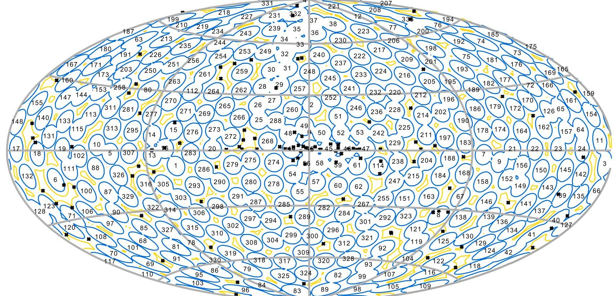

Figure 10. HaloSat targets in Galactic coordinates. The Galactic center is at the center of the image, longitude increases to the left, and latitude increases toward the top. The blue contours show the $ 1 0^{\circ} $ diameter full-response field of view for each target and the yellow contours show the $ 1 4^{\circ} $ diameter zero response. The black Xs show bright X-ray sources.

for a high Galactic latitude field at $ l=1 6 5^{\circ} 5 9 $ $ b=6 1^{\circ} 9 2). $ We also analyzed data for a second field at $ (2 2 9^{\circ} 2 5, 6 7^{\circ} 5 0) $ The temperature-dependent energy calibration described above was applied.

Following Henley & Shelton (2012), we fit the data with a model consisting of Gaussians with centroids fixed at 568.4 eV and 653.7 eV for the OVII and OVIII line emission and an absorbed thermal plasma model (APEC) for emission from the halo and an unabsorbed APEC model for emission from the Local Bubble (LB). We fixed the temperature and emission measure for the LB APEC model using the results from Liu et al. (2017). We removed the oxygen line emission from the APEC models following the procedure of Lei et al. (2009), but only removing lines in the energy range from 0.484 to 0.744 eV, which covers that modeled with the two Gaussians. We included a power law with photon index fixed to 1.45 to model the CXB (Cappelluti et al. 2017). The halo APEC component and the CXB power-law component were subject to absorption with the TBabs model with the column density fixed to the average Galactic absorption within a $ 5^{\circ} $ radius of the line of sight (HI4PI Collaboration et al. 2016). We added a power law not modified by the response matrix to model the instrumental background. The instrumental background photon index was fixed to 0.65 and the normalization was allowed to vary between the detectors. We used the C-statistic to perform fitting and the $ \chi^{2} $ -statistic to evaluate the quality of fit. Fitting was over the 0.4-5 keV band.

The fit parameters are shown in Table 4. The statistical accuracy on the OVII flux meets our observational goal. The OVII flux for the field at $ ( l=1 6 5^{\circ} . 5 9, b=6 1^{\circ} . 9 2) $ is lower than the fluxes measured by Henley & Shelton (2012) using XMM-Newton for lines of sight within the HaloSat field which range from $ 5. 3 4 \pm0. 4 4 $ LU to $ 8. 4 7 \pm0. 2 4 $ LU. The flux for the field at $ ( l=2 3 0^{\circ} . 1, b=6 6^{\circ} . 2) $ is slightly higher than the

fluxes of $ 3. 5 4 \pm0. 3 6 $ LU and $ 3. 1 6 \pm0. 2 8 $ LU from Henley & Shelton (2012) in the same field. The CXB normalizations are in reasonable agreement with that of Cappelluti et al. (2017).

In order to measure the properties of the halo, we must conduct similar observations over a large fraction of the sky. Our goal is to survey the entire sky, although the fields with $ | b | > 3 0^{\circ} $ will be most useful in constraining the properties of the halo. The size of the FoV determines the number of targets needed to cover the sky. We selected 333 targets to tile the sky including targets selected for instrument calibration, SWCX studies, and secondary science on bright, extended soft X-ray sources. The positions of the halo targets were chosen to minimize overlap and avoid bright X-ray sources in the ROSAT, Uhuru, and MAXI catalogs, particularly those with low-energy line features. The targets are presented in Table 5 and shown in Galactic coordinates in Figure 10.

## 7. Conclusions

The initial results presented here demonstrate that HaloSat should help advance our understanding of the hot halo of the Milky Way and provide a unique data set for the study of SWCX emission. Thus, CubeSats can be effective vehicles for astrophysics research even within their limited mass, power, and volume constraints, and can be constructed and operated at modest cost by exploiting the commercialization of small satellite technologies. The success of HaloSat should encourage construction of more CubeSats for astrophysics.

We acknowledge support from NASA grant NNX15AU57G and the prompt and courteous referee. We thank Steve Schneider for leading the bus work, Tracy Behrens for her tireless work in assembling the HaloSat electronics, Luis Santos for system engineering, Keith White for mechanical design and drawing, Chris Esser for spacecraft mechanical design, Tom Golden and

<!-- PDF_PAGE: 9 -->

Doug Laczkowksi for mission operations, Rich Dvorsky for mechanical and polymerics advice, and Jeff Dolan for advice about connectors and electronics.

We are grateful to Brian Busch, Larry Detweiler, and Matt Miller for machining parts, Kayla Racinowski for help with polymerics, Jim Phillips for help with inductor cores, Jesse Haworth for HVPS testing and designing the logo, Riley Wearmouth for early mechanical designs, Mike Matthews for work on the concept of operations and communications, Brenda Dingwall for program management, Calvin Whitaker and Tyler Roth for system administration, Tim Cameron for building the HVPS, and John Hudeck for seeing us through instrument vibration testing and for mentoring Keith White.

Our reviewers, Dave Sheppard, Scott Porter, Kevin Black, and Jasper Halekas, provided an invaluable service. Kristen Hanslik, Charles Dumont, Karl Hansen, Bruce Patterson, Natali Vannoy, Jake Beckner, David Hall, Jesse Ellison, and Matt Pallas did a great job seeing us through integration and testing, as did Scott Inlow on thermal modeling, Matt Baumgart and Bryan Rogler on GNC engineering, Nick Monahan, Austin Bullard, and Jeff Adams on mission operations, Rebecca Walter on RF engineering, and Steve Bundick and Matt Schneider on communications testing.

We could not talk to HaloSat without the WFF UHF Ground Station Team and their continuing support. We thank Devon Sanders, Ned Riedel, Allen Crane, Larry Madison, and Kyle McLean for their work on alignment, Dan Evans and Mike Garcia for help from above, and Tristan Prejean, Conor Brown, and many others at Nanoracks for getting HaloSat into orbit. We probably would not have been selected without the work of Ben Cervantes, Will Mast, Scott Schaire, Ryoichi Hasebe, Brad Hood, Sally Smith, and Brooks Flaherty on the Mission Planning Laboratory run for the proposal.

Facility: HaloSat.

Software: XSPEC (Arnaud 1996), astropy (Astropy Collaboration et al. 2013).

## ORCID iDs

P. Kaaret https://orcid.org/0000-0002-3638-0637

E. M. Silich https://orcid.org/0000-0002-1616-5649

## References

Arnaud, K. A. 1996, in ASP Conf. 101, Astronomical Data Analysis Software and Systems V (San Francisco, CA: ASP), 17

Aschenbach, B., Egger, R., & Trümper, J. 1995, Natur, 373, 587

Astropy Collaboration, Robitaille, T. P., Tollerud, E. J., et al. 2013, A&A, 558, A33

Becker, R. H., Holt, S. S., Smith, B. W., et al. 1979, ApJL, 234, L73

Boylan-Kolchin, M., Bullock, J. S., Sohn, S. T., et al. 2013, ApJ, 768, 140

Cappelluti, N., Li, Y., Ricarte, A., et al. 2017, ApJ, 837, 19

Cen, R., & Ostriker, J. P. 1999, ApJ, 514, 1

Crusan, J., & Galica, C. 2019, AcAau, 157, 51

Dame, T. M. 1993, in AIP Conf. Ser. 278, Back to the Galaxy (Melville, NY: AIP), 267

Galeazzi, M., Chiao, M., Collier, M. R., et al. 2014, Natur, 512, 171

Gendreau, K. C., Arzoumanian, Z., Adkins, P. W., et al. 2016, Proc. SPIE, 9905, 99051H

Grcevich, J., & Putnam, M. E. 2009, ApJ, 696, 385

Gupta, A., Mathur, S., Krongold, Y., Nicastro, F., & Galeazzi, M. 2012, ApJL 756, L8

Hegel, D. 2016, in 30th Annual AIAA/USU Conf. on Small Satellites, SSC16- X-7, https://digitalcommons.usu.edu/smallsat/2016/TS10AdvTech2/5/

Henley, D. B., & Shelton, R. L. 2012, ApJS, 202, 14

Henley, D. B., Shelton, R. L., Kwak, K., Joung, M. R., & Mac Low, M.-M. 2010, ApJ, 723, 935

Hevner, R., Holemans, W., Puig-Suari, J., & Twiggs, R. 2011, Proc. AIAA/ USU Conf. on Small Satellites, From 0 to $ 7.5 \mathrm{~km} \mathrm{~s}^{-1} $ , SSC11-II-3, https:// digitalcommons.usu.edu/smallsat/2011/all2011/15/

HI4PI Collaboration, Ben Bekhti, N., Flöer, L., et al. 2016, A&A, 594, A116

Holt, S. S., Gotthelf, E. V., Tsunemi, H., & Negoro, H. 1994, PASJ, 46, L151

Ikule, K., Mordwauger, C. R., Reddy, H. 2006, PASJ, 163, 401

Jahoda, K., Markwardt, C. B., Radeva, Y., et al. 2006, ApJS, 163, 40

Kaaret, P., Zajczyk, A., LaRocca, D., et al. 2019, in Proc. AIAA/USU Conf. on Small Satellites, Year in Review I, SSC19-III-05, https:// digitalcommons.usu.edu/smallsat/2019/all2019/277/

Kirsch, M. G., Briel, U. G., Burrows, D., et al. 2005, Proc. SPIE, 5898, 22

Koutroumpa, D., Collier, M. R., Kuntz, K. D., et al. 2009, ApJ, 697, 1214

Kuntz, K. D. 2019, A&ARv, 27, 1

Lei, S., Shelton, R. L., & Henley, D. B. 2009, ApJ, 699, 1891

Liu, W., Chiao, M., Collier, M. R., et al. 2017, ApJ, 834, 33

Madsen, K. K., Forster, K., Grefenstette, B. W., Harrion, F. A., & Stern, D. 2017, ApJ, 841, 56

Madsen, K. K., Harrison, F. A., Markwardt, C. B., et al. 2015, ApJS, 220, 8

Mateos, S., Saxton, R. D., read, A. M., & Sumbay, S. 2009, A&A, 496, 879

McMillan, P. J. 2011, MNRAS, 414, 2446

Miller, M. J., & Bregman, J. N. 2015, ApJ, 800, 14

Moretti, A., Pagani, C., Cusumano, G., et al. 2009, A&A, 493, 501

Nicastro, F., Zezas, A., Drake, J., et al. 2002, ApJ, 573, 157

Planck Collaboration 2014, A&A, 571, A16

Revnivtsev, M., Gilfanov, M., Jahoda, K., & Sunyaev, R. 2005, A&A, 444, 381

Scholze, F., & Procop, M. 2009, XRS, 38, 312

Shull, J. M., Smith, B. D., & Danforth, C. W. 2012, ApJ, 759, 23

Slavin, J., Wargelin, B. J., & Koutroumpa, D. 2013, ApJ, 779, 13

Smith, R. K., Bautz, M. W., Edgar, R. J., et al. 2007, PASJ, 59, 141

Snowden, S. L., Egger, R., Freyberg, M. J., et al. 1997, ApJ, 485, 125

Toor, A., & Seward, F. D. 1974, AJ, 79, 995

Weisskopf, M. C., Guainazzi, M., Jahoda, K., et al. 2010, ApJ, 713, 912

Wilms, J., Allen, A., & McCray, R. 2000, ApJ, 542, 914

Wilson-Hodge, C. A., Cherry, M. L., Case, G. L., et al. 2011, ApJL, 727, L40

Yoshino, T., Mitsuda, K., Yamasaki, N. Y., et al. 2009, PASJ, 61, 805

Zajczyk, A., Kaaret, P., Kirchner, D. L., et al. 2018, in Proc. AIAA/USU Conf. on Small Satellites, Upcoming Missions, SSC18-WKIX-01, https:// digitalcommons.usu.edu/smallsat/2018/all2018/471/

Zhezher, Ya. V., Nugaev, E. Ya., & Rubtsov, G. I. 2017, AstL, 42, 173