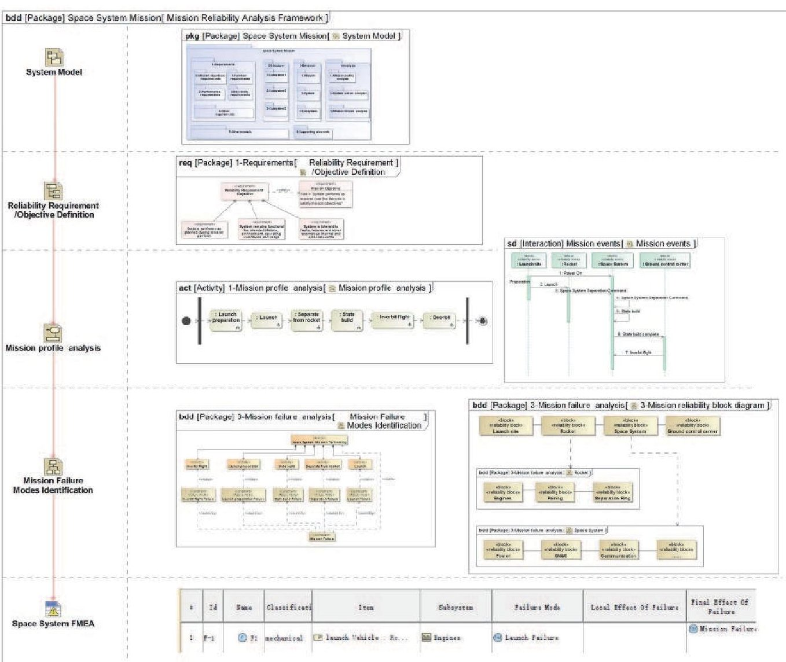
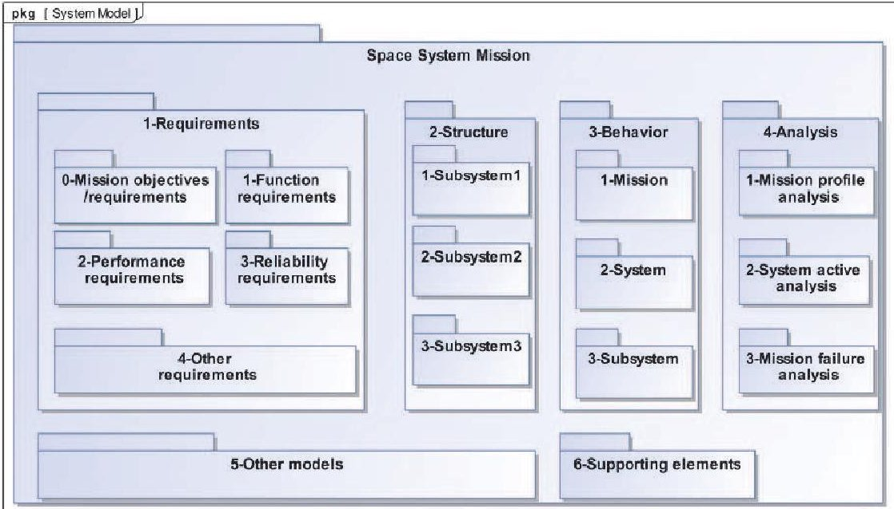
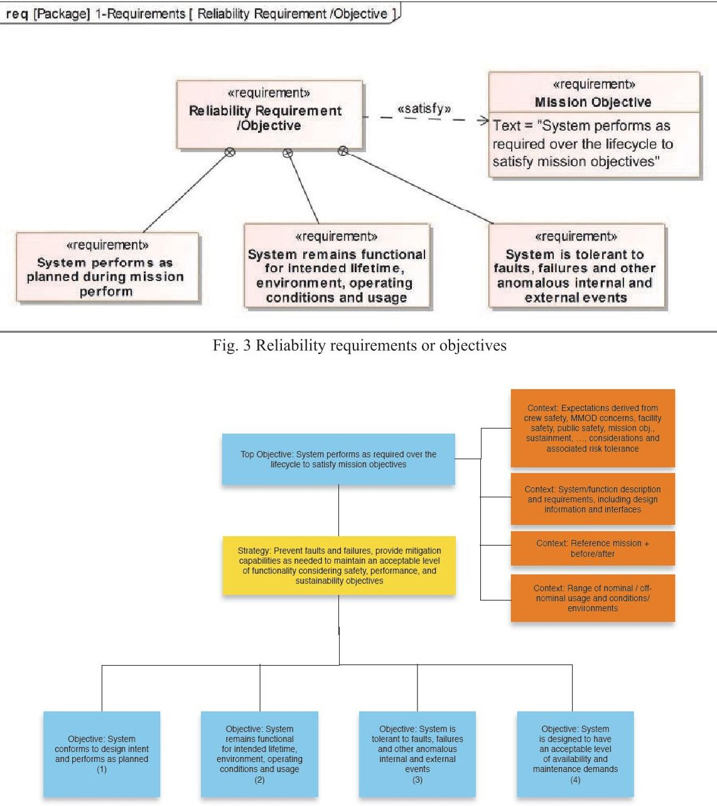
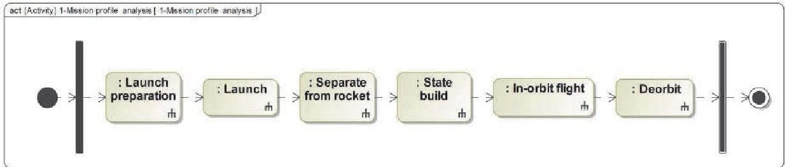
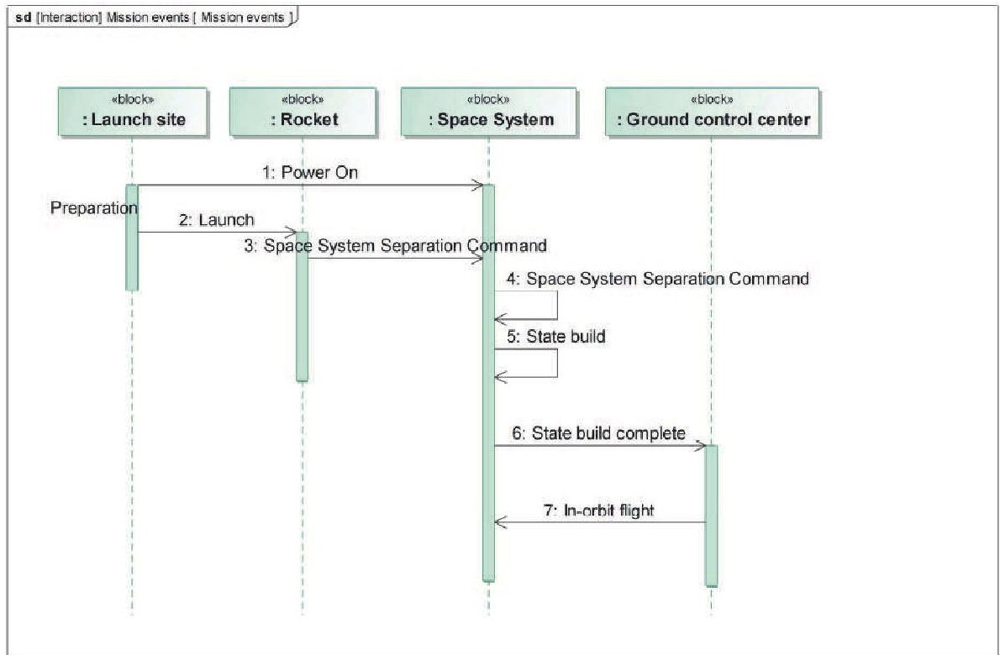
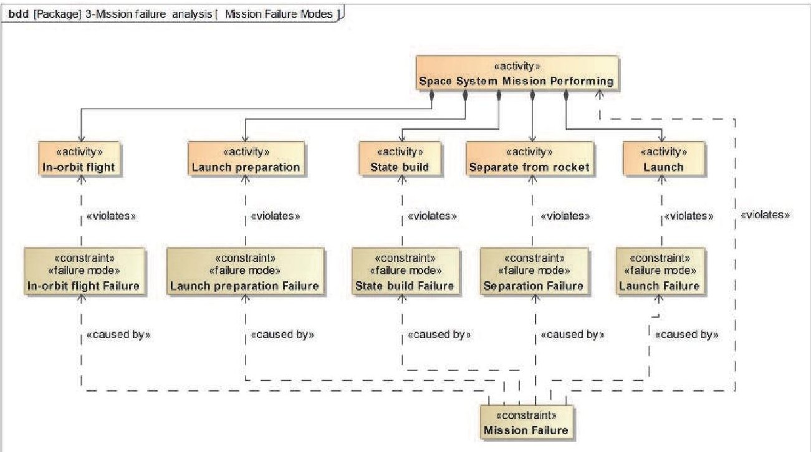
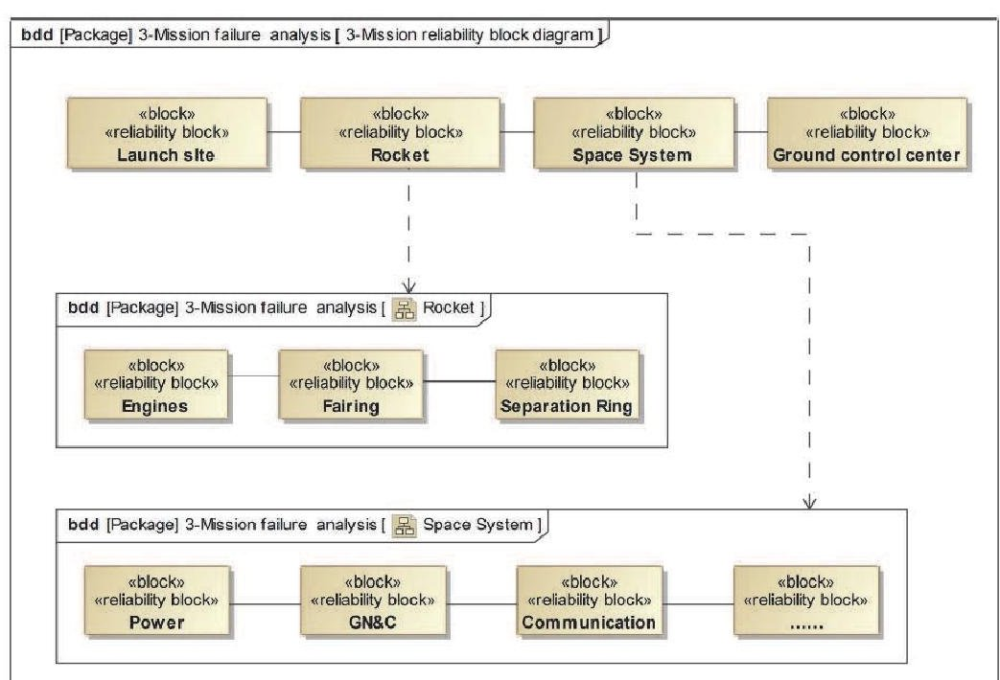
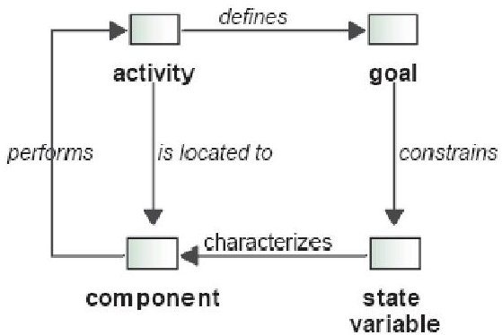
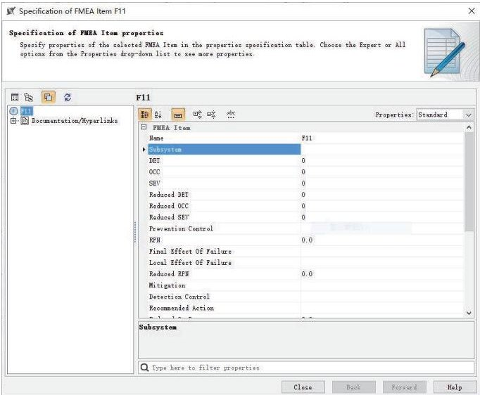

<!-- PDF_PAGE: 1 -->

# Research on Model Based Method of Reliability Analysis for Space System

Sha QIN, Liming REN, Fengxi CHEN, Wei ZHANG, Xiaopeng LI, Libing ZHAO, Ding LIU and Xiaodong SHI

China Astronautics Standards Institute, Beijing, China.

E-mail: qinsha199052@163.com

As the space system becomes more complex and its mission risk becomes higher, the reliability analysis is also challenging. Model-based approach is currently one of the key approaches to cope with this challenge. This paper makes a model-based reliability analysis method study, which based on the system model established by the MBSE method, and a reliability analysis framework of the space system is built by using SysML with including system model, reliability objectives or requirements, mission profile, reliability model, failure modes and other FMEA elements at mission level. According to analysis procedures, the mission failure modes, causes and effects etc. will be identified, a FMEA item and table will be generated by further analysis. The model-based method of reliability analysis has a significant effect on improving analysis efficiency, reducing human error, maintaining integrity and consistency with design data, and reducing the reliability analysis complexity.

Keywords: MBSE, space system, reliability analysis, FMEA, model, failure.

## 1. Introduction

Traditional system engineering is called "TextBased Systems Engineering" (TSE). Under this mode, the output of system engineering activities is mainly a series of natural language-based or called text-based documents (such as feasibility reports, design reports, analysis reports, test reports, etc.). The information required for the design, analysis, testing, evaluation, etc. of the system is scattered in many documents, and mainly transmitted in the form of documents, which resulting in problems such as data integrity and consistency, human error and low communication efficiency [CHEN (2016)].

Model-Based Systems Engineering (MBSE) is "the formalized application of modeling to support system requirements, design, analysis verification and validation activities beginning in the conceptual design phase and continuing throughout development and later life cycle phases" [INCOSE (2007)] which regarded as a revolution of system engineering, the transformation and future of systems engineering, and have been widely used in various fields.

NASA has successfully applied the MBSE method to practical projects such as the Orion spacecraft, Europa mission, Mars 2020, and Space Launch System (SLS) etc. [Bayer (2012), JIANG (2017), SHAO (2015)]. Dr. John Evans of NASA Office of Safety and Mission Assurance (OSMA) and Dr. Steve Cornford and Dr. Martin Feather of Jet Propulsion Laboratory (JPL) believe that MBSE is applied to project planning and design increasing with NASA performing more challenging and complex exploration mission, the application of MBSE as a new method in safety and mission assurance (SMA)

should be studied to make a complement of the SMA method. They call it Model-Based Mission Assurance (MBMA) [OSMA (2015)]. MBMA uses the system model created by MBSE to perform a variety of mission assurance analyses early in the stages of design, which reducing the cost of system design changes, and improving efficiency, analysis flexibility, and cost-effectiveness.

NASA OSMA created the MBMA program in 2018 to further promotes MBMA research and application in MBSE framework, and to improve integration of assurance considerations in MBSE. MBMA is "NASA's assurance future" [Evans et al. (2016), OSMA (2018)].

As the space system becomes more complex and its mission risk becomes higher, the reliability analysis is also challenging. Modelbased approach is currently one of the key approaches to cope with this challenging conducted reliability-related research based on SysML or MBSE model [David (2009), Hecht (2014), Mhenni (2014)].

Section 2 presents the model-based reliability analysis framework for space system and its elements. The Section 3 introduces the process of using SysML to implement reliability analysis (FMEA) in the model-based reliability analysis framework. Chapter 4 is the conclusion.

## 2. Model-Based Reliability Analysis Framework

This paper built a model-based reliability analysis framework by system model language (SysML) based on system model, which built by MBSE method, to analysis the potential mission

<!-- PDF_PAGE: 2 -->

failure. The framework of model-based reliability analysis is shown in Fig.1.

Fig. 1 The model-based reliability analysis framework

The elements of framework in Fig.1 include system model, reliability objective or failure criteria, mission profile, reliability model, failure modes and other FMEA elements at mission level.

## 2.1 System Model

A typical space system model built by SysML is shown in Fig. 2, which including models of requirements, structure, behavior, analysis etc. Each sub-model (package) is linked to detailed models.

<!-- PDF_PAGE: 3 -->

Fig. 2 System model composition

## 2.2 Reliability Requirements or Objectives Definition

Reliability requirements or objectives build a baseline and further define the failure criteria to identify and analysis the failure modes, which defined the system is failure or not during performing mission.

## 2.3 Mission Profile Analysis

The mission profile of space system is described by activity diagram (act), and system's detailed activities can be modeled by sequence diagram (sd) to list mission events.

The mission profile and system activities and events lay a foundation for reliability analysis.

## 2.4 Failure Modes Identification

This element represents failure modes identified by analysis work in this framework.

Mission activities and corresponding failures diagram are built to analysis the mission failure modes, as well as the mission reliability block diagram.

The effects include local and final effects of failure, and other elements of FMEA item, such as severity of the effect (SEV), occurrence

(OCC), prevention control and detection control etc., can be obtained by further analysis.

## 2.5 FMEA Table Generation

The FMEA items e.g., rows of FMEA table can be created by failure mode, effect, cause and other elements of FMEA item identified before which generates a FMEA table.

## 3. Analysis Procedures

## 3.1 System Model Refining

The system model built by SysML under MBSE framework need to add or refine some system model elements to meet the reliability analysis work, such as Reliability Requirements or Objectives further failure criteria, as shown in Fig. 3.

It is recommended to use NASA objectivebased hierarchy method to construct reliability objectives, as shown in Fig. 4 [OSMA (2014a, 2014b)]. The top-level objective includes top objective, context, strategy, and sub-objectives. The objective-based approach has good compatibility with MBSE [Groen et al. (2015), Izygon et al. (2016)].

<!-- PDF_PAGE: 4 -->

Fig. 4 Reliability and maintainability objectives hierarchy of NASA

## 3.2 Mission Profile Analysis

The space system mission profile should be analysis to establish the foundation for failure mode identifying. The activities and events of mission profile are described by SysML activity diagrams and sequence diagram, as shown in Fig. 5 and Fig. 6.

## 3.3 Failure Modes Identification

Mission activities and corresponding failures diagram are built to analysis the mission failure

modes, as well as the mission reliability block diagram, as shown in Fig. 7 and Fig. 8.

Off-nominal Ontology is a method which can use to analysis and identify the subsystem and components potential failure modes [John et al. (2012)]. As shown in Fig. 9, the four concepts of off-nominal ontology are activity, component, goal, and state variable, of which definition and relations are detailed in John et al. (2012). Hecht et al. (2014) proposed a method of constructing fault management meta-model to identify failure modes.

<!-- PDF_PAGE: 5 -->

Fig. 5 Mission profile

Fig. 6 Main mission events

Fig. 7 Mission failure analysis

<!-- PDF_PAGE: 6 -->

Fig. 8 A simplification of mission reliability block diagram

Fig.9 Off-nominal ontology concepts and relationships

## 3.4 FMEA table generation

The Safety and Reliability Analyzer plug-in of MagicDraw/Cameo System Modeler is used to establish each failure mode of the system and the FMEA related elements it contains, such as severity of the effect (SEV), occurrence (OCC), prevention control and detection control etc., as shown in Fig. 10. An FMEA table generated by this framework is shown in Fig. 11.

FMEA table generation steps through Safety and Reliability Analyzer can be referred to [No Magic (2018)]. The advantage of generating FMEA under reliability analysis framework

based MBSE method is that the elements of FMEA can be directly selected from the previously established models, and links are established between them, which greatly improves the efficiency and is very convenient to change.

Fig. 10 An FMEA item properties

<table border="1"><tr><td>#</td><td>Id</td><td>Name</td><td>Classificati</td><td>Item</td><td>Subsystem</td><td>Failure Mode</td><td>Local Effect Of Failure</td><td>Final Effect Of Failure</td></tr><tr><td>1</td><td>F-1</td><td>F1</td><td>mechanical</td><td>launch Vehicle:Ro...</td><td>Engines</td><td>Launch Failure</td><td></td><td>Mission Failure</td></tr></table>

Fig. 11 FMEA table

<!-- PDF_PAGE: 7 -->

## 4. Conclusion

With more and more applications of MBSE in space system engineering, it is one of the key approaches to cope with the challenge of increasing reliability design and analysis difficulty under MBSE framework. In this paper, we built a reliability analysis framework based on the system model using SysML for space system, and introduced the elements and analysis procedures of framework. This method has a significant effect on improving analysis efficiency, reducing human error, maintaining integrity and consistency with design data, and reducing the reliability analysis complexity. This paper also provides a reference for management, test and verification, safety and other professionals to work around the same system model of MBSE.

## Acknowledgement

The authors would like to acknowledge the following tool vendor for the use of the software: No Magic MagicDraw/Cameo System Modeler, and Sanford Friedenthal's book: Architecting Spacecraft with SysML: A Model-based Systems Engineering Approach.

## References

Bayer, T. J., C. Seung, and B. Cole, et al. (2012). Model based systems engineering on the europa mission concept study[C]. Aerospace Conference, IEEE: 1-18.

CHEN, Hongtao, DENG Yuchen, and YUAN Jianhua, et al.(2016). Basic principles of model-based systems engineering [J]. China Aerospace, 18-23.

David, P., V. Idasiak, F. Kratz (2009). Improving reliability studies with SysML, Reliability and Maintainability Symposium.

Evans, J., S. Cornford, and M. S. Feather (2016). Model based mission assurance: NASA's assurance future[C]. Reliability and Maintainability Symposium (RAMS), 2016 Annual. IEEE, 1-7.

Friedenthal, S., A. Moore, and R. Steiner (2008). OMG systems modeling language (OMG SysML $ ^{\mathrm{TM}} $ ) tutorial [C]. INCOSE International Symposium. 1731-1862.

Groen, F. J., J W Evans, and A. J. Hall (2015). A vision for spaceflight reliability: NASA's objectives based strategy [C]. Reliability and Maintainability Symposium (RAMS), 2015 Annual. IEEE, 1-6.

Hecht, M., E. Dimpfl, and J. Pinchak (2014). Automated generation of failure modes and effects analysis from sysml models, 2014 IEEE International Symposium on Software

Reliability Engineering Workshops (ISSREW). IEEE.

Hecht, M., E. Dimpfl, and J. Pinchak (2014). Automated generation of failure modes and effects analysis from SysML ,odels, 2014 IEEE International Symposium on Software Reliability Engineering Workshops (ISSREW). IEEE.

INCOSE (2007). Systems engineering vision 2020[R]. INCOSE-TP-2004-004-02, http://www. incose. org/ProductsPubs/pdf/SEVision2020_200710 03 v2 03. pdf.

Izygon, M., H. Wagner, and S. Okon, et al. (2016). Facilitating R&M in spaceflight systems with MBSE[C]. Reliability and Maintainability Symposium (RAMS), 2016 Annual. IEEE, 1-6.

JIANG, Xiaoyong, GE Xingtao, and SHEN Yiben et al. (2017). Research and thinking on the model-based system engineering development for the implementation of large complex satellites [J]. Aerospace Manufacturing Technology.

John, C. D., D. Kenneth, and M. Ingham (2012). Modeling off-nominal behavior in SysML [C]. AIAA Infotech at Aerospace Conference and Exhibit.

Mcvittie, T., O. V., Sindiy, and K. Simpson (2012). Model-based system engineering of the Orion flight test 1 end-to-end information system[C]. Aerospace Conference, 2012 IEEE, 1-11.

Mhenni, F., N. Nguyen, and J-Y. Choley (2014). Automatic fault tree generation from SysML system models, IEEE/ASME Int. Conf. on Advanced Intelligent Mechatronics.

No Magic, Inc (2018). Cameo Safety and Reliability Analyzer User Guide.

OSMA (2014a). OSMA introduces new objectives-based strategies. https://sma.nasa.gov/news/articles/newsitem/ 2014/12/04/osma-introduces-new-objectivesbased-strategies.

OSMA (2014b). Reliability and maintainability objectives hierarchy. https://sma.nasa.gov/docs/default-source/News-Documents/r-amp-m-hierarchy.pdf?sfvrsn=da0919f8 4.

OSMA (2015). Is model-based mission assurance the future of NASA SMA? [EB/OL]. https://sma.nasa.gov/news/articles/newsitem/ 2015/11/09 /is-model-based-mission assurance-the-future-of-nasa-sma.

OSMA (2018). OSMA creates MBMA program to improve integration of assurance considerations in MBSE[EB/OL] https://sma.nasa.gov/news/articles/newsitem/ 2018/06/27/osma-creates-mbma-program-to-

<!-- PDF_PAGE: 8 -->

improve-integration-of-assurance considerations-in-mbse.

SHAO Jian (2015). Space mission analysis and design method based on MBSE [D]. Harbin Institute of Technology.