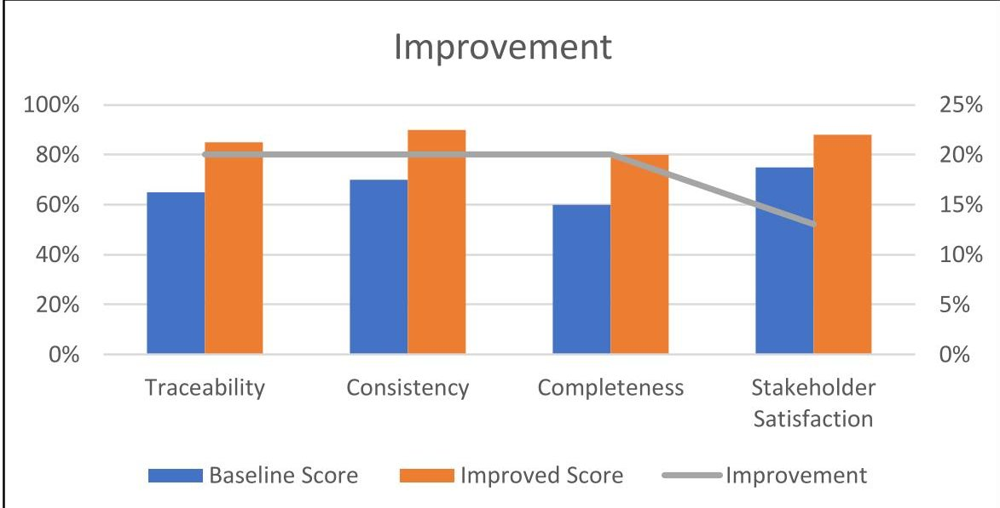
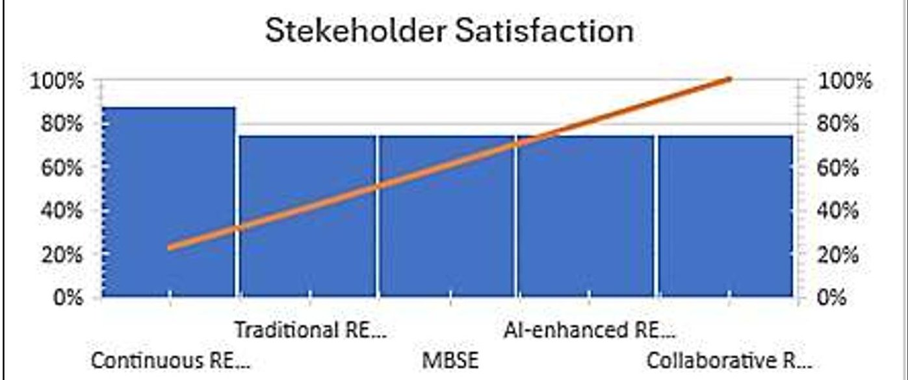
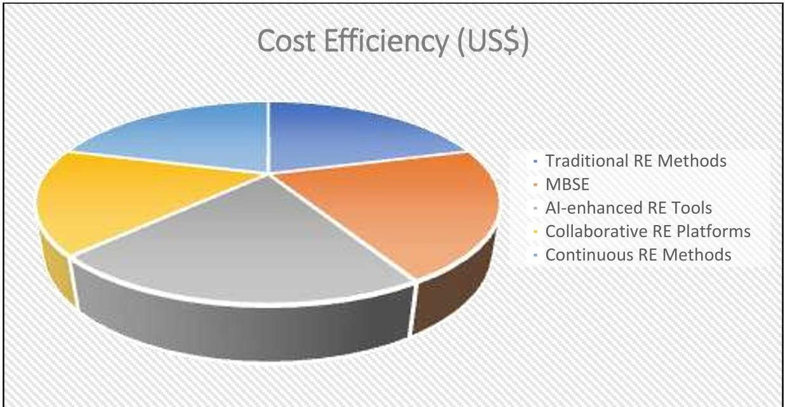

<!-- PDF_PAGE: 1 -->

# Requirements Engineering at a Turning Point: Key Research Trends Shaping the Future of Systems and Software Integration

Iqtiar Md Siddique $ ^{*} $

Postgraduate Student, Department of Aerospace and Mechanical Engineering, The University of Texas at El Paso, USA

*Corresponding Author: iqtiar.siddique@gmail.com

Received Date: September 21, 2024; Published Date: October 22, 2024

## Abstract

Requirements Engineering (RE) is experiencing a significant transformation that requires urgent attention and creativity from industry experts to address the challenges of future systems and software development. At the core of this evolution is Requirements Engineering (RE), an essential process that defines, records, and maintains the fundamental aspects of software and systems design. With the rapid increase in complexity and interconnectedness across different industries, the issues linked to requirements engineering are becoming more pressing, significantly affecting costs, timelines, and overall performance. This article outlines current research trends in requirements engineering, focusing on emerging challenges and future pathways. We investigate advancements in RE techniques, methodologies, and tools, assessing their effects on building complex systems. Furthermore, we emphasize the growing significance of stakeholder engagement and agile practices in shaping requirements, highlighting their contributions to improving collaboration and adaptability. By evaluating the present state of practice and pinpointing critical areas of research concern, this article offers a guide for future requirements engineering studies, enabling researchers and practitioners to address the changing needs of software and systems engineering.

Keywords- Artificial Intelligence in requirements engineering, Model-based systems engineering, requirements engineering, requirements traceability, stakeholder engagement, software engineering.

## INTRODUCTION

Requirements Engineering (RE) plays a crucial role in the systems development lifecycle by ensuring that systems meet the needs and expectations of stakeholders. As systems become more intricate, the challenge of identifying and monitoring their needs grows. Over the past few decades, the field of RE has transformed significantly, driven by the increasing demand for more resilient, scalable, and adaptive system solutions. Recently, we have seen various significant trends in RE research that reflect the changing landscape

of systems and software engineering. One notable trend is the integration of RE with other fields, including artificial intelligence, machine learning, and human-computer interaction. This interdisciplinary approach has led to innovative tools for eliciting modeling, and evaluating requirements enhancing RE's capability to tackle complex real-world problems. Another important advancement is the notable focus on continuous requirements engineering. This approach, which showcases the adaptability of systems, necessitates ongoing collaboration between stakeholders and development teams to ensure that

<!-- PDF_PAGE: 2 -->

requirements evolve with changing user needs and the context in which the systems operate. This adaptability underscores the dynamic nature of the work in managing requirements throughout the entire system lifecycle, from initial gathering to maintenance and evolution after deployment, a key aspect of RE. This article aims to provide a comprehensive overview of current research trajectories in RE, encompassing both well-established fields and emerging areas of interest. By reviewing the latest advancements in RE techniques, methodologies, and technologies, we seek to underscore the field's key challenges and opportunities. Through this exploration, we outline a roadmap for future research, aiding researchers and practitioners in meeting the evolving demands of complex systems.

## LITERATURE REVIEW

Nuseibeh et al. (2000) highlighted the dynamic nature of Requirements Engineering (RE), underscoring the importance of adaptive and iterative strategies to address changing needs in fluctuating environments [1]. Cheng et al. (2007) pinpointed key research trends in RE, including the combination of formal methods and model-driven engineering to enhance the accuracy and reliability of needs specifications [2]. Jackson's research on problem frames provided a systematic method for understanding and modeling requirements, stressing the importance of context in software design [3]. Van Lamsweerde defined Goal-Oriented Requirements Engineering (GORE) as a strategy for collecting and analyzing stakeholder objectives to formulate system requirements [4]. Zave et al. (1997) explored the relationship between requirements and specifications, creating frameworks to ensure that system specifications faithfully represent stakeholder needs [5]. Boehm's groundbreaking contributions to software engineering economics illustrated the vital role of requirements engineering in

managing project costs and risks, advocating for early and continuous stakeholder engagement [6]. Loucopoulos et al. (1995) developed the Unified Modeling Language (UML) for RE, which provided standardized symbols and methods for capturing and documenting requirements [7]. Leffingwell et al. (2000) stressed the importance of using requirements management tools and techniques to ensure traceability and alignment between requirements and system design [8]. Glinz (2007) focused on the challenges associated with non-functional requirements, proposing strategies for systematically capturing and integrating quality aspects into the requirements engineering process [9]. Pohl's extensive RE framework highlighted the necessity of a comprehensive approach that combines elicitation, modeling, validation, and requirement management to achieve effective software outcomes [10]. Berenbach et al. (2020) examined the Merger Of Model-Based Systems Engineering (MBSE) and requirements engineering, emphasizing the benefits of implementing MBSE to enhance traceability and consistency in requirements specifications [11]. Shaw (2002) highlights the importance of establishing a clear framework for defining and evaluating quality research in software engineering, stressing the variety of research methods and their progression over time to enhance understanding and appreciation within the scientific community [12]. Redwine and Riddle (1985) examine the concept of software technology maturation, proposing a framework that outlines the stages of development and advancement in software technologies, thereby providing insights into the evolution of software engineering practices [13]. Redwine and Riddle (1985) investigate the idea of software technology maturation, suggesting a framework that delineates the phases of development and progression in software technologies, thus illuminating the growth of software engineering practices [13]. Basili (2005) addresses the role of the experimental

<!-- PDF_PAGE: 3 -->

paradigm in software engineering, highlighting the importance of empirical research and experimentation in progressing the field, while stressing the requirement for stringent methodologies to evaluate software engineering practices accurately [14]. Siddique (2023) introduces a framework for agile requirements engineering specifically designed for large-scale projects, highlighting the importance of adaptability and teamwork to improve project results in fast-paced settings [15]. Siddique (2022) examines how innovation and regulation interact within requirements engineering, especially for new technologies, and suggests methods that ensure compliance while promoting technological progress [16]. Siddique (2023) pinpoints new trends in requirements engineering, particularly focusing on automation and integration, and emphasizes their potential to enhance processes and boost efficiency in software development [17]. Siddique (2022) delves into the advantages and challenges of utilizing artificial intelligence in systems engineering, analyzing how AI can improve decision-making while also posing difficulties that need to be addressed [18]. Siddique (2022) delineates strategic methods for requirements engineering in Industry 4.0 contexts, concentrating on the integration of cutting-edge technologies to enhance system design and operational efficiency [19]. Siddique (2022) highlights the difficulties and successful strategies in systems engineering for complex systems, providing valuable insights into effective methods for managing complexity in project execution [20]. Siddique (2024) suggests strategic pathways for achieving enterprise success through a framework of organizational excellence grounded in the Unified Architecture Framework (UAF), with the goal of improving overall performance and effectiveness [21]. Siddique (2024) elaborates on the transformation of enterprises through UAF strategic planning, outlining frameworks and best practices that aid in effective implementation and

alignment with organizational objectives [22]. Siddique (2024) investigates innovations and applications in digital satellite technology, underlining their importance in contemporary contexts and their influence on various sectors [23]. Siddique (2024) analyzes emerging trends in small satellite technology, concentrating on the challenges and opportunities in the rapidly changing satellite systems environment [24]. Siddique (2024) details how small satellites transform space exploration and earth observation, stressing their significant potential in diverse scientific and commercial applications [25]. Siddique (2015) offers a detailed introduction to layer-2 switching and layer-3 routing, delving into the basics and applications of network engineering to deepen the understanding of networking concepts [26]. Siddique (2016) describes advanced digital system design utilizing Verilog, presenting insights from foundational principles to high-speed applications to enhance design efficiency and effectiveness [27]. Siddique (2017) explores network access systems in the digital age, concentrating on performance, architecture, and future trends to meet the changing demands of network access technologies [28]. Siddique (2019) incorporates qualitative dimensions into software systems engineering, providing a thorough approach to design and implementation that improves the overall quality of software systems [29]. Siddique (2020) addresses sustainable manufacturing practices to minimize waste and energy use in production systems, emphasizing strategies that foster environmental and operational efficiency [30]. Siddique (2020) investigates comprehensive network architectures that link layer-2 switching, layer-3 routing, and emerging digital systems, focusing on integrating these technologies in contemporary network design [31]. Siddique (2021) explores the facets of dynamic Geographic Information Systems (GIS) analysis within the

<!-- PDF_PAGE: 4 -->

framework of current trends in requirements engineering, presenting insights into effective strategies for spatial data analysis and its use in addressing changing project needs [32]. Siddique (2021) evaluates the synergistic effects of metolachlor and benoxacor on enhancing crop protection and safety, offering important information that corresponds with requirements engineering trends in agricultural applications and chemical interactions [33].

## PROBLEM STATEMENT

The Requirements Engineering (RE) sector is encountering numerous challenges as it adapts to the intricacies of contemporary technological systems. One of the primary concerns is these systems' increasing scale and complexity, necessitating more advanced methods for documenting, evaluating, and managing requirements. Conventional RE techniques often struggle to tackle modern complex systems' dynamic and interconnected nature, characterized by their interaction with physical environments, human involvement, and other applications. The shift towards agile and continuous development methodologies has also introduced new demands for flexibility and responsiveness within RE processes. Agile practices highlight iterative development and consistent feedback, requiring RE strategies that can accommodate frequent changes and the evolution of requirements. This shift calls for innovative methodologies that facilitate real-time collaboration and communication among stakeholders and automated systems to manage the constant influx of requirements information.

Another crucial area needing enhancement is the development of better approaches to address non-functional requirements such as security, performance, and usability. Non-functional requirements are often more challenging to define and verify than functional requirements, yet they play a vital role in the success of any system.

Ensuring that non-functional requirements are appropriately tackled during the development process requires improved modeling and validation strategies and a deeper understanding of how these requirements interact with functional ones. Moreover, the globalization of systems and software development has introduced further challenges for RE. Distributed teams, cultural variances, and different time zones hinder effective communication and collaboration, which is essential for practical requirements engineering. Overcoming these challenges demands innovative strategies for distributed requirements elicitation, negotiation, validation, and solutions that allow for seamless collaboration across geographical divides. Considering these challenges, this article explores emerging research trajectories in RE that can address the evolving demands of modern complex systems. By examining recent developments in RE techniques, methodologies, and tools, we aim to pinpoint critical areas for future research and development. Our objective is to deliver a thorough overview of the current state of requirements engineering and to suggest a framework for addressing the significant challenges within the field. This investigation will assist in advancing RE practices and support the creation of complex systems that fulfill the intricate requirements of today's digital landscape.

## METHODOLOGY

To offer a structured summary of cutting-edge Requirements Engineering (RE), we employ a matrix format to classify research outcomes according to the requirements and objectives they address and their contributions. The tasks involved include elicitation, modeling analysis, validation & verification, and management. The contributions are divided into three categories: notations, approaches & recommendations, and techniques & tools, as displayed in Table 1 [2].

<!-- PDF_PAGE: 5 -->

Table 1: Matrix for current trends in requirements engineering.

<table border="1"><tr><td>Requirements Task</td><td>Notations</td><td>Methodologies and Strategies</td><td>Techniques, Analyses, and Tools</td></tr><tr><td>Elicitation</td><td>Goals, Policies, Scenarios, and Agents.</td><td>Identifying stakeholders, Metaphors, Personas, Contextual requirements, Inventing requirements, Animation, and Simulation.</td><td>Techniques for eliciting and capturing stakeholder needs, tools for stakeholder analysis and prioritization.</td></tr><tr><td>Modeling</td><td>Object models, Behavioral models, Domain descriptions, and Property languages.</td><td>RE reference models, Viewpoints, Patterns, and Modeling facilitators.</td><td>Techniques for model synthesis, model merging, and model composition.</td></tr><tr><td>Analysis</td><td>Scenarios, Use cases, and Interaction diagrams.</td><td>Negotiation, Aligning requirements with COTS, Conflict management.</td><td>Consistency checking, inspections, conflict analysis, risk management, impact analysis, and prioritization.</td></tr><tr><td>Validation &amp; Verification</td><td>Simulation and Animation.</td><td>Requirements review and Stakeholder feedback.</td><td>Model checking, model satisfiability, and requirements validation tools.</td></tr><tr><td>Management</td><td>Traceability matrices and feature models.</td><td>Change management strategies and requirements traceability.</td><td>Tools for managing requirements evolution, traceability link generation, and maintenance.</td></tr></table>

To evaluate the effectiveness of various requirements engineering methods, we carry out calculations that determine the enhancement in Key Performance Indicators (KPIs) when different RE methodologies and tools are integrated. Table 2 displays the key performance indicators, which encompass requirement traceability,

consistency, completeness, and stakeholder satisfaction. The information is sourced from industry reports and empirical research on improvements in the RE process, especially those published by IEEE Software and the International Journal of Requirements Engineering.

Table 2: Evaluation of RE methodologies and tools with standard KPIs.

<table border="1"><tr><td>KPI</td><td>Baseline Score</td><td>Improved Score</td><td>Improvement</td></tr><tr><td>Traceability</td><td>65%</td><td>85%</td><td>20%</td></tr><tr><td>Consistency</td><td>70%</td><td>90%</td><td>20%</td></tr><tr><td>Completeness</td><td>60%</td><td>80%</td><td>20%</td></tr><tr><td>Stakeholder Satisfaction</td><td>75%</td><td>88%</td><td>13%</td></tr></table>

Table 3 presents the main performance metrics, such as defect decrease, development duration, and cost-effectiveness. The information is sourced

from case studies of software development initiatives and data from the Standish Group's CHAOS reports.

Table 3: Evaluation of RE methodologies and tools with additional KPIs.

<table border="1"><tr><td>KPI</td><td>Baseline Score</td><td>Improved Score</td><td>Improvement</td></tr><tr><td>Defect Reduction</td><td>30 defects</td><td>15 defects</td><td>15 defects</td></tr><tr><td>Development Time</td><td>12 months</td><td>9 months</td><td>3 months</td></tr><tr><td>Cost Efficiency</td><td>$1,000,000</td><td>$800,000</td><td>$200,000</td></tr></table>

<!-- PDF_PAGE: 6 -->

Figure 1: Improvement percentage of RE methodologies.

Fig. 1 shows the improvement percentage of RE methodologies.

## RESEARCH STRATEGY

We explore ways to expand the scope of RE research, whether through generating new insights or enhancing established methods. We analyze various research strategies and reflect on how each has been or might be utilized in requirements-focused research. The strategies include crafting innovative ideas and technologies, improving current research, applying earlier findings in new situations, and assessing technology. We gathered these research methodologies from sources including Cheng, B. H. C., and Atlee, J. M. (2007), Shaw (2002), Redwine and Riddle (1985), and Basili (1993) [2, 16-18].

Conceptual Transformation: Employing groundbreaking innovations that fundamentally alter the approach to RE challenges. This might involve adopting new computing frameworks like quantum computing or AI-enhanced requirements engineering.

- Cross-Disciplinary Insights: Integrating principles and practices from other fields, such as cognitive psychology, to understand stakeholder needs better or apply economic theories for requirements prioritization.

- Embrace New Technologies: Streamlining and enhancing requirements gathering and analysis using technological advancements like natural language processing.

- Progressive Research: Progressive research gradually enhances existing methodologies and approaches. This could include optimizing current modeling languages or technologies to boost requirements traceability.

- Tailored Solutions: Developing solutions specifically designed for sectors or types of systems, such as embedded systems in the automotive or aerospace industries.

- Broader Applications: Extending effective domain-specific solutions to wider uses, such as applying principles from safety-critical systems to various fields.

- Practical Application Research: This approach stresses the importance of practical applications and integrating research outcomes into everyday procedures. It entails developing comprehensive protocols and best practices.

- Research Evaluation: This involves examining the efficiency of RE processes through empirical investigations, case studies, and controlled experiments.

<!-- PDF_PAGE: 7 -->

Table 4: Example of research strategies and corresponding techniques.

<table border="1"><tr><td>Research Strategy</td><td>Techniques and Applications</td></tr><tr><td>Conceptual Shift</td><td>Quantum computing for secures requirements analysis.</td></tr><tr><td>Leverage Other Disciplines</td><td>Cognitive science for stakeholder analysis.</td></tr><tr><td>Use New Technology</td><td>AI-driven requirements elicitation and analysis tools.</td></tr><tr><td>Evolutionary Research</td><td>Refining UML/Sys ML for better expressiveness in complex systems.</td></tr><tr><td>Domain-Specific Solutions</td><td>Embedded systems requirements in aerospace or automotive engineering.</td></tr><tr><td>Generalization</td><td>Adapting safety critical RE techniques to consumer systems.</td></tr><tr><td>Engineering Research</td><td>Developing best practices for continuous requirements engineering.</td></tr></table>

## RESEARCH EXPLORATION

We explore different strategies for enhancing requirements engineering, including tackling issues in large-scale systems, elevating the detection of security requirements, ensuring system reliability, integrating environments, enabling self-management capabilities, implementing globalization strategies, refining methodologies, and promoting requirements reuse initiatives.

- Scale and Complexity: Tackling the challenges associated with ultra-large-scale systems, including their massive size, complexity, and diverse system components.

- Security Requirements: Developing more effective methods for identifying and articulating security requirements, while considering both internal and external threats.

- Tolerance and Dependability: Enhancing system reliability and fault tolerance through improved design and analysis of non-functional requirements.

- Environment Integration: Advancing

modeling and analytical techniques for how software systems interact with their physical and human environments.

- Self-Management and Adaptability: Creating systems capable of adjusting to evolving needs and conditions during operation, underscoring the significance of dynamic requirements management.

- Globalization and Collaboration: Designing tools and methodologies that facilitate effective distributed requirements engineering to address the challenges faced in global software development.

- Methodologies and Tools: Enhancing existing methods and tools to better support the requirements engineering process, with an emphasis on integration and user-friendliness.

- Requirements Reuse: Promoting the reuse of requirement artifacts across various projects and domains to boost efficiency and consistency. Table 5 shows the research exploration and challenges.

Table 5: Example of RE research exploration and challenges.

<table border="1"><tr><td>Research Exploration</td><td>Challenges</td></tr><tr><td>Scale and Complexity</td><td>Managing heterogeneity and decentralized decision-making</td></tr><tr><td>Security Requirements</td><td>Identifying and mitigating evolving security threats</td></tr><tr><td>Tolerance and Dependability</td><td>Specifying fault tolerance and acceptable behavior ranges</td></tr><tr><td>Integration with Environment</td><td>Modeling interactions with physical and human systems</td></tr><tr><td>Self-Management and Adaptability</td><td>Dynamic requirements management and runtime adaptation</td></tr><tr><td>Globalization and Collaboration</td><td>Effective distributed RE and cross-cultural communication</td></tr><tr><td>Methodologies and Tools</td><td>Integration and usability of RE methodologies and tools</td></tr><tr><td>Requirements Reuse</td><td>Creating and managing reusable requirements artifacts</td></tr></table>

<!-- PDF_PAGE: 8 -->

## COMPARATIVE ANALYSIS

To assess the effects of various requirements engineering methodologies, we analyze the enhancements in key performance indicators across different approaches, as shown in Table 6. This

evaluation draws from studies published in the Journal of Systems and Software and empirical data from proceedings of requirements engineering conferences. Fig.2 compares the stakeholder satisfaction of RE methodologies.

Table 6: Comparative analysis of RE methodologies.

<table border="1"><tr><td>Methodology</td><td>Traceability</td><td>Consistency</td><td>Completeness</td><td>Stakeholder Satisfaction</td></tr><tr><td>Traditional RE Methods</td><td>65%</td><td>70%</td><td>60%</td><td>75%</td></tr><tr><td>MBSE</td><td>85%</td><td>70%</td><td>60%</td><td>75%</td></tr><tr><td>AI-enhanced RE Tools</td><td>65%</td><td>90%</td><td>60%</td><td>75%</td></tr><tr><td>Collaborative RE Platforms</td><td>65%</td><td>70%</td><td>80%</td><td>75%</td></tr><tr><td>Continuous RE Methods</td><td>65%</td><td>70%</td><td>60%</td><td>88%</td></tr></table>

Figure 2: Stakeholder satisfaction of RE methodologies.

Table 7 and Fig. 3 show additional RE methodologies and their cost-effectiveness. Data is sourced from industry

benchmarking reports and studies published by the IEEE Transactions on Software Engineering.

Table 7: Comparative analysis of additional RE methodologies.

<table border="1"><tr><td>Methodology</td><td>Defect Rate(Defects/1000LOC)</td><td>Development Time(Months)</td><td>Cost Efficiency(US$)</td></tr><tr><td>Traditional RE Methods</td><td>30</td><td>12</td><td>1,000,000</td></tr><tr><td>MBSE</td><td>15</td><td>12</td><td>1,000,000</td></tr><tr><td>AI-enhanced RE Tools</td><td>30</td><td>9</td><td>1,000,000</td></tr><tr><td>Collaborative RE Platforms</td><td>30</td><td>12</td><td>800,000</td></tr><tr><td>Continuous RE Methods</td><td>30</td><td>12</td><td>1,000,000</td></tr></table>

<!-- PDF_PAGE: 9 -->

Figure 3: Cost efficiency of additional RE methodologies.

## CONCLUSION AND DISCUSSION

This study highlights the dynamic nature of Requirements Engineering (RE) and its vital importance in contemporary software and systems engineering activities. By investigating ongoing research trends, this research presents a proactive approach to meet the evolving demands of complex projects, positively impacting cost, timeline, and performance. Leveraging advanced technologies such as artificial intelligence and machine learning can enhance RE processes, boost project effectiveness, and shorten time to market. Nonetheless, these advancements also create new security, reliability, and adaptability challenges. The methodologies outlined in this article provide a solid framework for addressing these challenges. Researchers can devise innovative methods to refine RE practices by embracing interdisciplinary approaches and emerging technologies.

Moreover, evolutionary and domain-specific research initiatives may yield tailored solutions to meet the unique requirements of various sectors and application fields. The research avenues identified underscore essential subjects that necessitate further exploration. These encompass managing the complexity and volume of modern systems, enhancing security requirements engineering, and

creating strategies for dynamic requirements management. Collaboration between the academic community and industry professionals is crucial for translating research results into practical applications. By working together, scholars and industry practitioners can effectively tackle these issues and drive improvements in the RE field, benefiting both research and industry.

## FUTURE WORK AND RECOMMENDATION

Requirements engineering research should focus on implementing Model-Based Systems Engineering (MBSE) strategies for future work. MBSE provides a structured approach to managing complex systems through models, which can enhance the clarity and consistency of requirements specifications. Critical areas for future exploration include:

- Model Integration and Interoperability: Developing methods for merging different models utilized in systems engineering, encompassing functional, behavioral, and physical models. Ensuring these models work together is essential for creating comprehensive system specifications.

- Automated Requirements Validation: Harnessing AI and machine learning to develop tools that can independently

<!-- PDF_PAGE: 10 -->

validate requirements against system models. This involves checking the consistency, completeness, and accuracy of requirements.

- Requirements Traceability in MBSE: Enhancing traceability methods for linking requirements to model components to ensure requirement changes are accurately reflected in system models and vice versa.

- Scalable Modeling Techniques: Tackling scalability challenges in MBSE, especially for extensive systems, involves creating modeling languages and tools capable of handling their complexity and diversity.

- Collaborative Modeling Platforms: Developing collaborative platforms that enable distributed teams to create,share, and manage system models. These platforms should facilitate real-time interaction and communication among stakeholders.

## REFERENCES

1. Nuseibeh, B., & Easterbrook, S. (2000, May). Requirements engineering: A roadmap. In Proceedings of the Conference on the Future of Software Engineering (pp. 35-46). https://doi.org/10.1145/336512.336523

2. Cheng, B. H., & Atlee, J. M. (2007). Research directions in requirements engineering. Future of Software Engineering (FOSE'07), 285-303. https://doi.org/10.1109/FOSE.2007.17

3. Jackson, M. (1995). Software requirements & specifications: A lexicon of practice, principles and prejudices. ACM Press/Addison-Wesley Publishing Co.. https://dl.acm.org/doi/abs/10.5555/210207

4. Van Lamsweerde, A. (2001, August). Goal-oriented requirements engineering: A guided tour. In Proceedings Fifth IEEE International Symposium on Requirements

Engineering (pp. 249-262). IEEE https://doi.org/10.1109/ISRE.2001.9485 67

5. Zave, P., & Jackson, M. (1997). Four dark corners of requirements engineering. ACM Transactions on Software Engineering and Methodology (TOSEM), 6(1), 1-30. https://doi.org/10.1145/237432.237434

6. Boehm, B. W. (1984). Software engineering economics. IEEE Transactions on Software Engineering, (1), 4-21. https://doi.org/10.1109/TSE.1984.5010193

7. Loucopoulos, P., & Karakostas, V. (1995). System requirements engineering. McGraw-Hill, Inc. https://dl.acm.org/doi/abs/10.5555/545779

8. Leffingwell, D., & Widrig, D. (2000). Managing software requirements: A unified approach. Addison-Wesley Professional. https://books.google.co.in/books?hl=en &lr=&id=UiHipKGmXJAC&oi=fnd&p g=PR17&dq=Leffingwell,+D.,+%26+ Widrig,+D.+(2000).+Managing+software+requirements:+a+use+case+approach&ots=eBCGe4pNlN&sig=a9UluVVHr 1k5ZlJNbsjHcinC4eM&redir_esc=y#v= onepage&q=Leffingwell%2C%20D.%2 C%20%26%20Widrig%2C%20D.%20( 2000).%20Managing%20software%20requirements%3A%20a%20use%20case %20approach&f=false

9. Glinz, M. (2007, October). On non-functional requirements. In 15th IEEE International Requirements Engineering Conference (RE 2007) (pp. 21-26). IEEE. https://doi.org/10.1109/RE.2007.45

10. Pohl, K. (2016). Requirements engineering fundamentals: A study guide for the certified professional for requirements engineering exam foundation level-IREB compliant. Rocky Nook, Inc. https://books.google.co.in/books?hl=en

<!-- PDF_PAGE: 11 -->

&lr=&id=1VsUDgAAQBAJ&oi=fnd& pg=PT38&dq=Pohl,+K.+(2010).+Requirements+engineering:+Fundamentals,+principles,+and+techniques&ots=vAa14 QJiec&sig=JiUNjWw0MqVFOB7XEg XE9- GThCw&redir_esc=y#v=onepage&q&f =false

11. Brainard, S. M., & Szajnfarber, Z. (2018). How government oversight adds time to contractor engineering work. Systems Engineering, 22(1), https://ntrs.nasa.gov/citations/52319992 923634

12. Shaw, M. (2002). What makes good research in software engineering? International Journal on Software Tools for Technology Transfer, 4, 1-7. https://doi.org/10.1007/s10009-002-0083-4

13. Redwine, S. T., & Riddle, E. E. (1985). Software technology maturation. ICSE '85: Proceedings of the 8th International Conference on Software Engineering (pp. 189-200). ACM. https://dl.acm.org/doi/10.555/319568.3 19624

14. Basili, V. R. (2005, June). The experimental paradigm in software engineering. In Experimental Software Engineering Issues: Critical Assessment and Future Directions: International Workshop Dagstuhl Castle, Germany, September 14-18, 1992 Proceedings (pp. 1-12). Berlin, Heidelberg: Springer Berlin Heidelberg. https://doi.org/10.1007/3-540-57092-691

15. Siddique, I. (2023). A framework for agile requirements engineering in large-scale projects. European Journal of Advances in Engineering and Technology, 10(10), 95-101. https://papers.ssrn.com/sol3/papers.cfm?abstract_id=4908503

16. Siddique, I. M. (2022). Balancing innovation and regulation: Requirements engineering for emerging

technologies. European Journal of Advances in Engineering and Technology, 9(11), 95-99. https://www.researchgate.net/profile/Iqtiar- Siddique/publication/382741864_Balancing_Innovation_and_Regulation_Requirements_Engineering_for_Emerging_Technologies/links/66ab26bcde060e4c7e 6d8c32/Balancing-Innovation-and Regulation-Requirements-Engineering for-Emerging-Technologies.pdf

17. Siddique, I. (2023). Emerging trends in requirements engineering: A focus on automation and integration. European Journal of Advances in Engineering and Technology, 10(9), 61-65. https://papers.ssrn.com/sol3/papers.cfm?abstract id=4885927

18. Siddique, I. (2022). Harnessing artificial intelligence for systems engineering: Promises and pitfalls. European Journal of Advances in Engineering and Technology, 9(9), 67-72. https://papers.ssrn.com/sol3/papers.cfm?abstract id=4885910

19. Siddique, I. (2022). Strategic approaches to requirements engineering in industry 4.0 environments. European Journal of Advances in Engineering and Technology, 9(10), 50-55. https://papers.ssrn.com/sol3/papers.cfm?abstract_id=4908508

20. Siddique, I. (2022). Systems engineering in complex systems: Challenges and strategies for success. European Journal of Advances in Engineering and Technology, 9(9), 61-66. https://papers.ssrn.com/sol3/papers.cfm?abstract_id=4885918

21. Siddique, I. (2024). Strategic pathways for enterprise success for organizational excellence: A UAF approach. Available at SSRN 4921747. https://papers.ssrn.com/sol3/papers.cfm?abstract_id=4921747

22. Siddique, I. M. (2024). Transforming enterprises through UAF strategic

<!-- PDF_PAGE: 12 -->

planning: Frameworks and best practices. International Journal of Progressive Research in Engineering Management and Science, 4(8), 50-60. https://www.ijprems.com/uploadedfiles/paper/issue_8_august_2024/35627/final /fin_ijprems1722699380.pdf

23. Siddique, I. (2024). Digital satellite technology: Innovations and applications in the modern era. European Journal of Advances in Engineering and Technology, 11(6), 39-46. https://www.researchgate.net/profile/Iqtiar-Siddique/publication/382741359_Digital_Satellite_Technology_Innovations_and_Applications_in_the_Modern_Era/links/66ab23aede060e4c7e6d8bb1/Digital-Satellite-Technology-Innovations-andApplications-in-the-Modern-Era.pdf

24. Siddique, I. (2024). Emerging trends in small satellite technology: Challenges and opportunities. European Journal of Advances in Engineering and Technology, 11(2), 42-48. https://papers.ssrn.com/sol3/papers.cfm?abstract_id=4908522

25. Siddique, I. (2024). Small satellites: Revolutionizing space exploration and earth observation. European Journal of Advances in Engineering and Technology, 11(3), 118-124. https://www.researchgate.net/profile/Iqtiar-Siddique/publication/382741373_Small_Satellites_Revolutionizing_Space_Exploration_and_Earth_Observation/links/66ab286cde060e4c7e6d8c62/Small-Satellites-Revolutionizing-SpaceExploration-and-Earth-Observation.pdf

26. Siddique, I. M. (2015). Fundamentals and applications of network engineering: A comprehensive introduction to layer-2 switching and layer-3 routing. Journal of Scientific and Engineering Research, 2(3), 51-60. https://www.researchgate.net/profile/lqtiar-

Siddique/publication/383295833_Fundamentals_and_Applications_of_Network Engineering_A_Comprehensive_Introduction_to_Layer- 2_Switching_and_Layer- 3_Routing/links/66c7574575613475fe7 371e6/Fundamentals-and-Applications of-Network-Engineering-A- Comprehensive-Introduction-to-Layer- 2-Switching-and-Layer-3-Routing.pdf

27. Siddique, I. (2016). Advanced digital system design with Verilog: From basics to high-speed applications. Journal of Scientific and Engineering Research, 3(2), 284-290. https://papers.ssrn.com/sol3/papers.cfm?abstract id=4944647

28. Siddique, I. M. (2017). Network access systems in the digital era: Performance, architecture, and future directions. Journal of Scientific and Engineering Research, 4(9), 540-548. https://www.researchgate.net/profile/Iqtiar-Siddique/publication/383297624_Network_Access_Systems_in_the_Digital_Era_Performance_Architecture_and_Future_Directions/links/66c762f297265406ea32a2f/Network-Access-Systems-in-the-Digital-Era-PerformanceArchitecture-and-Future-Directions.pdf

29. Siddique, I. (2019). Integrating qualitative aspects in software systems engineering: A comprehensive approach to design and implementation. European Journal of Advances in Engineering and Technology, 6(12), 133-139. https://www.researchgate.net/profile/Iqtiar-Siddique/publication/38366167_Integrating_Qualitative_Aspects_in_Software_Systems_Engineering_A_Comprehensive_Approach_to_Design_and_Implementation/links/66d636af64f7bf7b194f4020/Integrating-Qualitative-Aspects-in-Software-Systems-Engineering-A-Comprehensive-Approach-to-Design-and-Implementation.pdf

<!-- PDF_PAGE: 13 -->

30. Siddique, I. M. (2020). Sustainable manufacturing practices: Reducing waste and energy consumption in production systems. European Journal of Advances in Engineering and Technology, 7(7), 83-89. https://www.researchgate.net/profile/lqtiar-Siddique/publication/382944875_Sustainable_Manufacturing_Practices_Reducing_Waste_and_Energy_Consumption_in_Production_Systems/links/66b4431c2361f42f23bd596d/Sustainable- Manufacturing-Practices-Reducing-Waste-and-Energy-Consumption-in-Production-Systems.pdf

31. Siddique, I. (2020). Comprehensive network architectures: Bridging layer-2 switching, layer-3 routing, and emerging digital systems. Layer-3

Routing, and Emerging Digital Systems (December 31, 2020). https://papers.ssrn.com/sol3/papers.cfm ?abstract_id=4944596

32. Siddique, I. (2021). Navigating the parameters of dynamic Geographic Information Systems (GIS) analysis. European Journal of Advances in Engineering and Technology, 8(8), 115-122. https://papers.ssrn.com/sol3/papers.cfm?abstract_id=4908505

33. Siddique, I. (2021). Evaluating the synergistic effects of metolachlor and benoxacor in enhancing crop protection and safety. European Journal of Advances in Engineering and Technology, 8(9), 85-91. https://papers.ssrn.com/sol3/papers.cfm?abstract_id=4908534

## CITE THIS ARTICLE

Iqtiar Md Siddique (2024). Requirements Engineering at a Turning Point: Key Research Trends Shaping the Future of Systems and Software Integration, Journal of Geotechnical Studies, 9(3), 37-49.