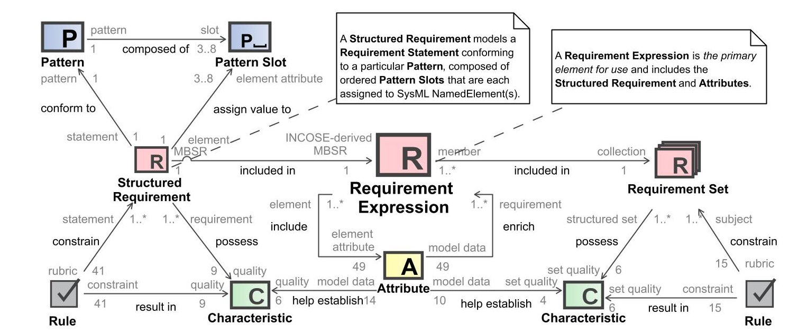
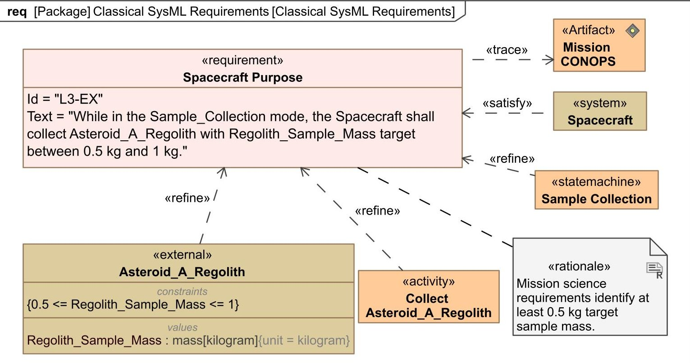
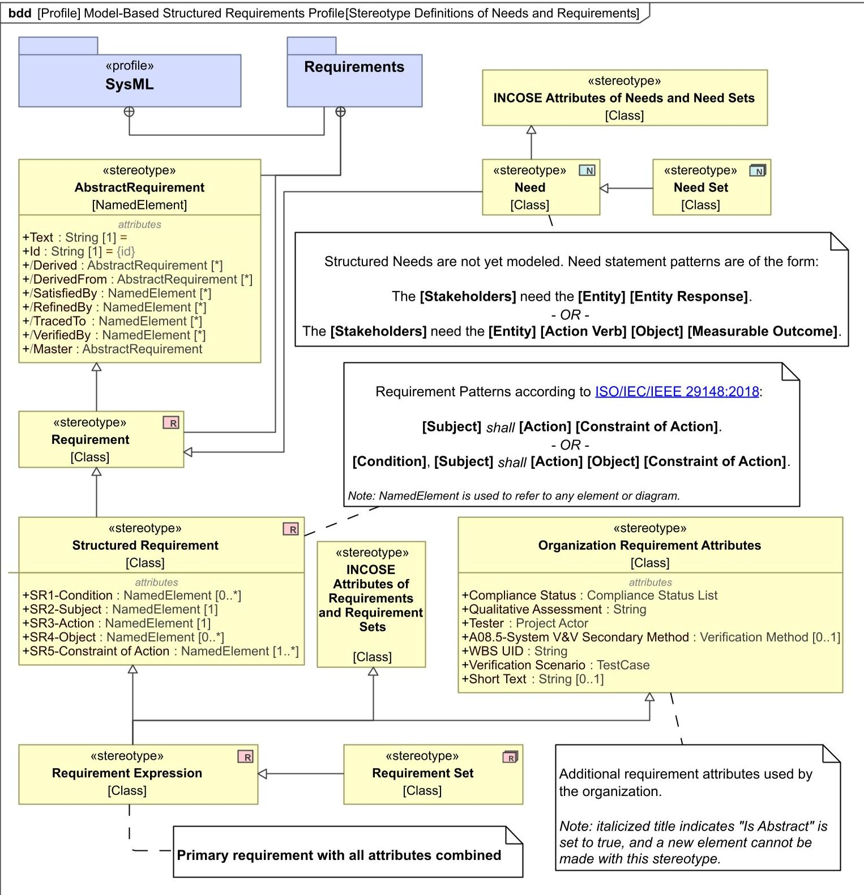
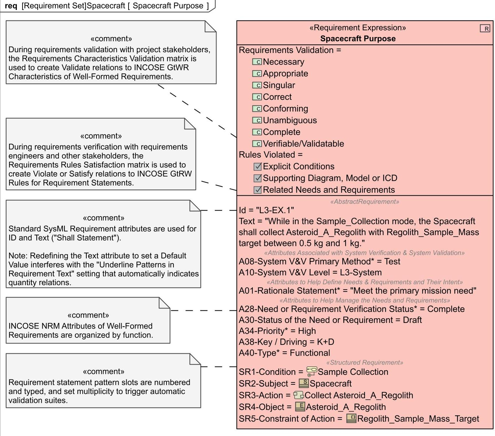
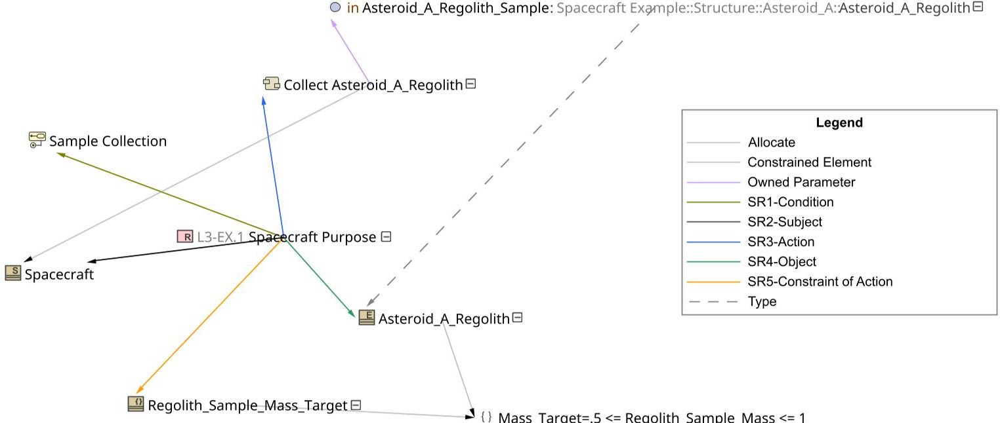
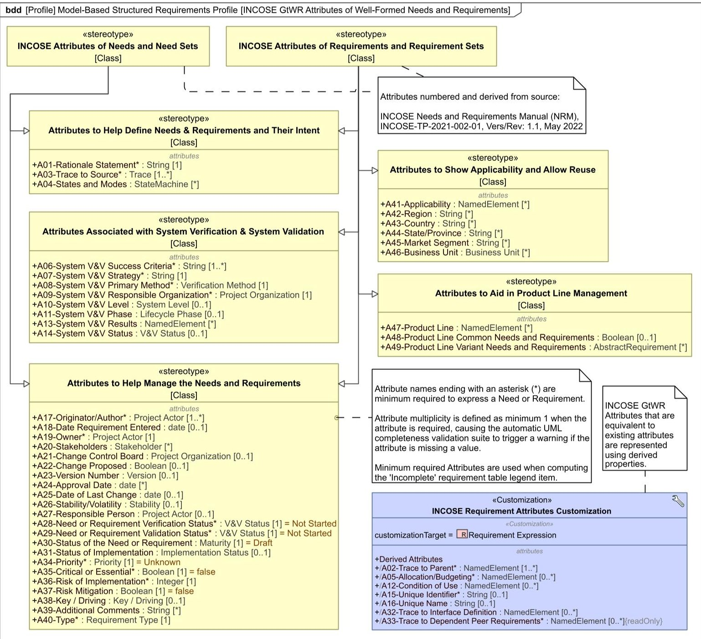
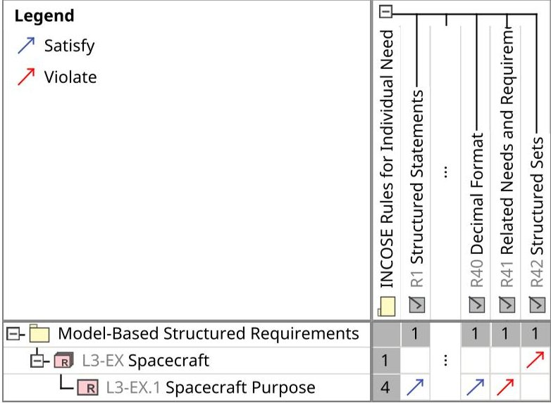

<!-- PDF_PAGE: 1 -->

<div align="center">

# DIGITAL REQUIREMENTS ENGINEERING WITH AN INCOSE-DERIVED SYSML META-MODEL

</div>

A PREPRINT

James S. Wheaton Department of Systems Engineering Colorado State University Fort Collins, Colorado, USA james.wheaton@colostate.edu

Daniel R. Herber Department of Systems Engineering Colorado State University Fort Collins, Colorado, USA daniel.herber@colostate.edu

October 30,2024

## ABSTRACT

Traditional requirements engineering tools do not readily access the SysML-defined system architecture model, often resulting in ad-hoc duplication of model elements that lacks the connectivity and expressive detail possible in a SysML-defined model. Further integration of requirements engineering activities with MBSE contributes to the Authoritative Source of Truth while facilitating deep access to system architecture model elements for V&V activities. We explore the application of MBSE to requirements engineering by extending the Model-Based Structured Requirement SysML Profile to comply with the INCOSE Guide to Writing Requirements while conforming to the ISO/IEC/IEEE 29148 standard requirement statement patterns. Rules, Characteristics, and Attributes were defined in SysML according to the Guide to facilitate requirements definition, verification & validation. The resulting SysML Profile was applied in two system architecture models at NASA Jet Propulsion Laboratory, allowing us to assess its applicability and value in real-world project environments. Initial results indicate that INCOSE-derived Model-Based Structured Requirements may rapidly improve requirement expression quality while complementing the NASA Systems Engineering Handbook checklist and guidance, but typical requirement management activities still have challenges related to automation and support in the system architecture modeling software.

Keywords digital engineering (DE); model-based systems engineering (MBSE); model-based structured requirement (MBSR); requirements engineering; verification & validation (V&V); INCOSE; NASA

## 1 Introduction

As engineered systems grow in complexity, the demand for more cost-effective system development programs grows in turn. A critical point of leverage in reducing system development costs is by improving Requirements Engineering (RE) processes and the quality of its outputs [Hirshorn et al., 2017]. Digital Engineering (DE) promises to improve quality and reduce costs through increased access and connectivity of digital artifacts in a central data store called the Authoritative Source of Truth (ASoT) [Noguchi et al., 2020]. Model-Based Systems Engineering (MBSE) improves upon Document-Centric Systems Engineering (DCSE) by incorporating formal digital models throughout systems engineering processes and products, by leveraging those digital system models to precisely represent design values and relationships, and by computing model validity based on modeling language and design rules. MBSE practice develops Digital RE (DRE) as a response to increasing the system architecture model connectivity toward complete traceability of stakeholder needs and system requirements in support of DE goals.

The effectiveness of MBSE compared to DCSE is now well-studied in the literature [Rogers III and Mitchell, 2021, Younse et al., 2021, Madni and Purohit, 2019, Carroll and Malins, 2016] making it the most important systems engineering practice toward achieving DE goals in the organization. As a motivating example, the NASA-ESA Mars Sample Return mission is "an ambitious and complex space system engineering endeavor" [Sundararajan, 2022] with

<!-- PDF_PAGE: 2 -->

multiple interfacing space systems necessary to coordinate the safe return of Martian gas and solid core samples for further study on Earth. The MSR mission has recently undergone its second Independent Review Board assessment that includes a probable program life cycle cost estimate of US$8-11 billion, "strong irrefutable evidence" that strong systems engineering (SE) is a crucial factor for mission success, and recommendations to refactor the program architecture to control costs [Figueroa et al., 2023]. Strong SE is now model-based, and DRE supports the effectiveness of SE by improving the quality of requirements early on through the application of model-based rules and through precise definition of model traceability; and it helps reduce costs through model-based generation of stakeholder-tailored views and through reduced rework due to inadequate requirements expression. DRE is not a substitute for good RE practice, but rather it is a vision for a model-based and digitally-augmented RE discipline still maturing from its DCSE roots.

## 1.1 Digital Engineering

Recognition of the current and potential impact of digital models, including those used in MBSE, has led to the development by the US Department of Defense of a strategy for taking greater advantage of digital models to transform the system development process. DE is "an integrated digital approach that uses authoritative sources of system data and models as a continuum across disciplines to support lifecycle activities from concept through disposal" [Office of the Deputy Assistant Secretary of Defense for Systems Engineering, 2018]. As an engineering leader, NASA has invited the future of digital workflows by publishing a Digital Transformation strategy [Marlowe et al., 2022], MBSE strategy [Weiland, 2021], and DE Acquisition Framework Handbook [Office of the NASA Chief Engineer, 2020]. DE is not a new discipline of engineering but rather an intentional transformation of how an organization integrates and performs its engineering activities to achieve higher quality and efficiency [Noguchi et al., 2020].

One of the DE goals is to provide an enduring ASoT of the system to improve communication and decision-making. The system architecture model is one component of the ASoT, typically integrated in a centralized repository, and the system requirements may be created in the architecture model or synchronized with the model from a Requirement Management Tool (RMT). DRE further integrates requirements with the ASoT, enabling formal verification and validation (V&V) activities that may be automated to improve model confidence and ease stakeholder reviews [Duprez et al., 2023].

## 1.2 Requirements Engineering

RE is a subset of systems engineering that encompasses requirements development and requirements management. The ISO/IEC/IEEE 29148:2018 standard defines requirements engineering as "an interdisciplinary function that mediates between the domains of the acquirer and supplier or developer to establish and maintain the requirements to be met by the system, software or service of interest. Requirements engineering is concerned with discovering, eliciting, developing, analyzing, verifying (including verification methods and strategy), validating, communicating, documenting and managing requirements" [ISO/IEC/IEEE, 2018]. The range of RE activities necessitates the use of metadata to organize information about each requirement, emphasizing that the familiar "shall" statement is only one attribute of a well-managed and model-connected requirement.

The INCOSE Guide to Writing Requirements (GtWR) provides a current perspective of well-formed requirements, and it defines a requirement statement as "the result of a formal transformation of one or more sources, needs, or higher-level requirements into an agreed-to obligation for an entity to perform some function or possess some quality within specified constraints with acceptable risk" [Wheatcraft and Ryan, 2023]. The GtWR emphasizes that the requirement statement forms the basis of contractual language, and then presents a rules-based structured format for facilitating that communication. It defines a requirement expression as the requirement statement and its attributes. The GtWR recommends a data-centric practice using a RMT, as opposed to spreadsheets or documents, to model and present requirement expressions using diagrams and tables for stakeholder-tailored views.

Systems engineering handbooks provide another important reference for requirements engineering activities, complementing the detailed guides, manuals, and standards cited above. The INCOSE Systems Engineering Handbook Fifth Edition provides updated Sections 2.3.5.2 and 2.3.5.3 that incorporate the latest INCOSE guides and manuals on needs and requirements engineering [INCOSE, 2023]. The NASA Systems Engineering Handbook [Hirshorn et al., 2017] describes the traditional NASA requirements definition and management processes in Sections 4.2 and 6.2, respectively, emphasizing bidirectional traceability, and including a checklist in Appendix C and an informal set of characteristics similar to those defined in the latest INCOSE GtWR. The INCOSE GtWR and NASA sets of characteristics are compared in Sec. 3 and found to be complementary.

## 1.3 Systems Modeling Language

The Systems Modeling Language (SysML) by the Object Management Group (OMG) [OMG, 2022] is a standard language for modeling system architectures which provides the capability to model the solution space as structure,

<!-- PDF_PAGE: 3 -->

<div align="center">

profile [Profile] Model-Based Structured Requirements Profile[Meta-model of Requirements Terms]

</div>





<div align="center">

Figure 1: Meta-model of INCOSE-derived MBSR Terms.

</div>

behavior, rules and requirements as digital model elements in a directional graph constrained by SysML semantics. SysML version 1.7 is expected to be the final version in the 1.x series as the standards development effort shifts to the new version 2. SysML provides rudimentary facilities for modeling system requirements, including the primary attributes: ID, name, and text; and the relationships: derive, refine, satisfy, verify, and trace (which is discouraged in favor of the more precise relationships). Requirement type and rationale are not attributes provided by the SysML standard but are customizations of the SysML Profile often provided by systems architecture modeling tools. According to the standard, SysML Requirements may be shown in a Requirements Diagram, or placed on other SysML diagrams to highlight relationships for certain stakeholder views; requirements tables and matrices are non-normative.

Today RE is often practiced with the help of an RMT which stores the requirements in a database and provides structured access to them for management activities. Since this RE practice uses digital models in a computer database, it may be considered MBSE or DE. However, the threat remains of duplicative system model elements interfering with traceability due to the RMT lacking the SysML meta-model used to define the system architecture. Controlled import/export or RMT data connector synchronization cycles alleviate this problem but may cause issues due to the non-standard interfaces between tools [Wheaton and Herber, 2024]. Although SysML v2 has addressed this issue by standardizing the API providing access to the system architecture model, it will be years before it sees widespread adoption inside DE organizations [Bajaj et al., 2022]. SysML v2 improves upon v1 by modeling requirements as constraints that must be satisfied by the system-of-interest, and it uses the consistent distinction between a requirement definition and requirement usage to aid in reuse [OMG, 2024].

Due to the perceived inadequate facilities for modeling and managing requirements, SysML has not been favored by requirements engineers [Wheatcraft and Ryan, 2023]. Its apparent advantages with respect to its graphical syntax (diagrams) have not been enough to satisfy the critical need of managing possibly thousands of requirements. However, SysML makes it possible to extend the language through Stereotypes, thus availing the systems engineer with meta-modeling capabilities to define custom elements and to use them as just another SysML element. This meta-modeling capability is what enables the Model-Based Structured Requirement (MBSR) approach described in this paper.

## 1.4 Overview

This paper presents an extension to the MBSR approach developed by Herber and Eftekhari-Shahroudi [2023] and Herber et al. [2022] that incorporates the INCOSE GtWR ontology and the ISO/IEC/IEEE [2018] standard pattern for requirement statements (Fig. 1) using a notional space flight system to demonstrate the use of the SysML Profile. The rest of the paper is organized as follows: Sec. 2 describes how the INCOSE-derived MBSR meta-model is defined and used; Sec. 3 discusses the benefits and challenges of this approach; Sec. 4 compares MBSR to other model-based requirements methods; Sec. 5 discusses some limitations of this current research and identifies areas for future work; and Sec. 6 concludes and reflects on the utility of MBSR in the context of DRE.

<!-- PDF_PAGE: 4 -->

## 2 INCOSE-derived Model-Based Structured Requirement

A strong SE practice is a countervailing force against cost overruns and system development project cancellations, and it is bolstered by a strong embedded RE practice from the beginning of the project. Where there were undefined, unsupported, or undisciplined RE processes in an organization, tailored guidance from INCOSE should fill the knowledge gap. Developing successful complex systems requires participation from diverse sets of stakeholders and organizations, leading to the development of Simplified Technical English [AeroSpace and Defence Industries Association of Europe, 2021] to reduce language ambiguity and confusion. Unlike the situation in the late 20th century when software development projects turned into production messes and accumulated technical debt, practitioners today may now benefit from advancements in RE to minimize ambiguity, reduce technical debt, formalize V&V processes, and produce consistently high-quality design output specifications [Wheatcraft et al., 2022, Avdeenko and Pustovalova, 2016].

This section of the paper describes classical standard SysML requirements modeling and performs a gap analysis (Sec. 2.1), structured requirements and its related work (Sec. 2.2), and INCOSE GtWR-derived meta-model extensions to MBSR from Herber and Eftekhari-Shahroudi [2023] (Sec. 2.3).

## 2.1 Classical SysML Requirements Modeling

Classical SysML represents a requirement as an "indivisible entity" [Dick et al., 2017] that enriches and is enriched by other system architecture model elements through the use of typed relationships. According to the SysML standard specification, "a requirement is defined as a stereotype of UML Class subject to a set of constraints" and includes "properties to specify its unique identifier and text requirement," noting that "additional properties ... can be specified by the user" [OMG, 2022]. The 'name', 'id', and 'text' properties of SysML requirements are defined as a simple string of characters, lacking any other structure, manipulable only by standard string processing functions of popular programming languages if available. Traceability relationships include containment, and subtypes of the UML Dependency relationship, as follows:

Containment specifies the Owner of the requirement in the model containment hierarchy, graphically represented by a circle with two perpendicular lines crossed at the Owner end of the connector.

Derive specifies a type of Trace that relates a derived requirement to its source requirement at the arrowhead-end of the dashed line.

Refine specifies a directed relationship used "to describe how a model element or set of elements can be used to further refine a requirement" [OMG, 2022].

Satisfy specifies a type of Trace that "describes how a design or implementation model satisfies one or more requirements" [OMG, 2022].

Verify specifies a type of Trace that relates a test case or other model element to a requirement to identify a verification activity that checks that the system element meets its traced requirements and constraints.

Copy specifies a type of Trace that creates a read-only copy of the requirement ID and textual statement on the requirement element at the non-arrowhead end of the dashed line.

Trace is a general-purpose relationship between a requirement and any other model element; its use with more specific traceability relationships listed above is discouraged due its ambiguity [OMG, 2022].

Classical SysML-based requirements popularized the idea of "cohabitation" where requirements and system model elements exist and are linked together in the same model [Bernard, 2012] (Fig. 2). Practicing DRE with this MBSE approach leads to the notion that requirements engineers and system architects should work in integrated teams rather than organizational silos and separate software tools [Wheatcraft et al., 2022]. However, due to the lack of requirements management facilities such as software-defined workflows, audit logs, and change management boilerplate, managing requirements in SysML is considered inferior compared to a purpose-built RMT [Wheatcraft and Ryan, 2023].

In order for system architects to access the system requirements and add traceability relationships to the model, data connectors with RMTs or import/export/sync with Excel spreadsheets are used. Synchronization between tools mitigates the change management issues but due to differing data schema and meta-models, important information enriching the requirement expressions may not be available. Synchronized requirement tables will automatically highlight requirements that have changed, but the implication is that organizational silos are loosely cooperating in this manner, with the RMT owning the requirement ASoT and the SysML tool working with copies of that data.

DRE has outgrown classical SysML requirements due to their lack of precision, leading practitioners and tool vendors to extend standard SysML in various ways to satisfy MBSE objectives [OMG, 2022]. The Trace and Copy relationships

<!-- PDF_PAGE: 5 -->





<div align="center">

Figure 2: Classical SysML requirements modeling using standard relationships to system model elements.

</div>

are discouraged, leading to confusion about their use, although this may be mitigated by hiding them in the SysML tool's user perspective. The Verify relationship perpetuates the conflation of system V&V with requirements V&V ("verifying a requirement"), a distinction made clear in the INCOSE GtWR. The non-normative extensions, such as the additional requirement stereotypes and risk kinds in OMG [2022], may confuse practitioners due to the 'one size fits all' approach, and interface requirements, in particular, are rejected by the GtWR. Although SysML provides the basic utilities for complex system requirements analysis, the implementation of such analyses can take considerable effort, favoring organizations with mature model libraries. In summary, classical SysML requirements lack modeling precision without significant extensions, and introduce ambiguity and confusion in modeling constructs that contradict the latest RE guidance from INCOSE and ISO/IEC/IEEE.

## 2.2 Structured Requirement

The INCOSE GtWR and Needs and Requirements Manual (NRM) advocates for "structured, natural language" that treats the familiar 'shall' statement not as an "atomic entity" but as a "grammatical structure appropriate for communicating needs and requirements" [Wheatcraft et al., 2022]. In fact, rule number one (R1) in GtWR is "Structured Statement" which contributes to the quality characteristics: (C3) unambiguous, (C4) complete, (C5) singular, (C7) verifiable, and (C9) conforming (refer to Table 1 and the GtWR Summary Sheet). This INCOSE guidance builds upon a history of success using structured language for textual requirements [Gilb, 2004, Mavin and Wilkinson, 2010, Dick et al., 2017, Carson, 2015, 2021].

Requirement statements with uniform structure are shown to improve quality and have been adopted and recommended by ISO/IEC/IEEE [2018] and INCOSE [2023]. Textual "shall" statements with parts in a standard order are easier to write, parse, and verify due to the regular structure that guards against ambiguity and complex grammar. A structured requirement defines a pattern of the requirement statement using placeholders to clearly identify the critical features of the requirement. They have been called template requirements or "statement-level templates" [Wheatcraft and Ryan, 2023], structured requirements [Carson, 2015], requirement structures [Mavin and Wilkinson, 2010], or "boilerplates" [Hull et al., 2011], but the GtWR uses the term 'requirement pattern' to avoid confusion with other common uses of the word 'template'. A requirement pattern is "represented by a series of building blocks (also called pattern slots) including all the elements envisioned to represent a well-formed, singular, and complete requirement" [Wheatcraft and Ryan, 2023]. We present the following review of structured requirements using recommended patterns from Carson [2015] and ISO/IEC/IEEE [2018].

<!-- PDF_PAGE: 6 -->

Carson-style Requirement Pattern:

The [Who] shall [What] [How Well] under [Condition].

[Who] Singular subject of the requirement referring to an entity or agent that provides a capability or performs a function.

[What] Singular action-verb performed by the [Who], referring to required functionality or quality characteristic.

[How Well] Comparison factor(s) specified by constraints on the [What] which places feasible limits on the required functionality or quality characteristic, and which are used to verify the [What].

[Condition] " [M]easurable qualitative or quantitative terms specified by characteristics such as an operational scenario, environmental condition, or a cause that is stipulated for a requirement" [Herber et al., 2022].

Carson-style Structured Requirement Example:

The [Spacecraft] shall [collect Asteroid_A_Regolith] [with Regolith_Sample_Mass target between 0.5 kg and 1 kg] under [Sample_Collection mode].

The Carson requirement pattern is flexible for use with functional requirements and quality requirements, and the pattern slot names may suit stakeholders who are not as comfortable with SE jargon. Standardizing with this requirement pattern across requirement sets in a project will significantly reduce the ambiguity compared to unstructured requirements. The ISO/IEC/IEEE [2018] standard pattern provides different names for the pattern slots and adds one for [Object] but is otherwise similar to the Carson-style requirement pattern. The standard presents two patterns with an implied "shall after the [Subject]:

ISO/IEC/IEEE 29148:2018 Requirement Pattern:

[Subject] shall [Action] [Constraint of Action].

OR

[Condition], [Subject] shall [Action] [Object] [Constraint of Action].

[Condition] " [M]easurable qualitative or quantitative attributes that are stipulated for a requirement, . . . and provide attributes that permit a requirement to be formulated and stated in a manner that can be validated and verified" [ISO/IEC/IEEE, 2018].

[Subject] Singular system element in the same system hierarchy level as the requirement that provides a capability or performs a function.

[Action] Singular action-verb performed by the [Subject], referring to required functionality or quality characteristic. [Object] The entity being acted upon by the [Subject]; an element of the system or system environment.

[Constraint of Action] The "measurable outcome" [Wheatcraft and Ryan, 2023] that "restrict[s] the design solution or implementation of the systems engineering process" [ISO/IEC/IEEE, 2018] by applying feasible limits on the [Action] performed by the [Subject] on the [Object] under the stated [Condition].

ISO-standard Structured Requirement Example:

[While in the Sample_Collection mode], the [Spacecraft] shall [collect] [Asteroid_A_Regolith] [with Regolith_Sample_Mass target between 0.5 kg and 1 kg].

Many patterns are possible depending on the domain and should be prescribed by the practicing organization (see Appendix C of GtWR for more examples). Here the Subject refers to the part of the system corresponding to the same level as the requirement. The 'shall' keyword has been inserted above to clarify the pattern and to emphasize that "requirements are mandatory binding provisions and use 'shall'" [ISO/IEC/IEEE, 2018]. The Action signifies that the Subject does something — 'shall not' is forbidden (R16 in GtWR) and that the statement is written in the active voice (R2 in GtWR), avoiding superfluous and possibly confusing verbiage such as "be capable of" (R10 in GtWR). This pattern makes clear that every requirement must have a verifiable Constraint. Although every requirement has an associated condition of when it is active, the first pattern may be used in the high-level functional requirements when the Condition is "ubiquitous" [Wheatcraft and Ryan, 2023]. The latter pattern may be used as a default value for a redefined 'Text' SysML Property. MBSE practice encourages the use of these pattern slots to reference system model elements, not just defined terms in a project glossary, while RE practice as discussed in the GtWR emphasizes the important role of textual requirement statements especially in the presence of system model views used to enhance stakeholder understanding.

<!-- PDF_PAGE: 7 -->

```xml

<Model_Based_Structured_Requirements_Profile:Requirement_Expression

xmi:id='_2022x_2_46d01c0_1707158979643_806727_21479_'

base_Class='_2022x_2_46d01c0_1707158979643_806727_21479'

Id='L3-EX.1'

Text='While in the Sample_Collection mode, the Spacecraft

    shall collect Asteroid_A_Regolith with Regolith_Sample_Mass

    target between 0.5 kg and 1 kg.'

SR1_Condition='_2022x_2_46d01c0_1707158979575_932108_21295'

SR2_Subject='_2022x_2_46d01c0_1707158979604_996809_21373'

SR3_Action='_2022x_2_46d01c0_1707158979574_907885_21293'

SR4_Object='_2022x_2_46d01c0_1707158979726_396359_21900'

SR5_Constraint_of_Action='_2022x_2_46d01c0_1707158979579_344791_21322'

A01_Rationale_Statement_='Meet the primary mission need'

A08_System_V_V_Primary_Method_='Test'

A10_System_V_V_Level='L3-System'

A28_Need_or_Requirement_Verification_Status_='Complete'

A30_Status_of_the_Need_or_Requirement='Draft'

A34_Priority_='High'

A38_Key__Driving='K+D'

A40_Type_='Functional' />

```

<div align="center">

Figure 3: UML 2.5 XMI definition of the example MBSR shown in Fig. 5 (newlines added & attributes reordered for readability).

</div>

## 2.3 Model-Based Structured Requirement

MBSR is an adaptation of structured requirements to the MBSE paradigm developed by Herber and Eftekhari-Shahroudi [2023] and Herber et al. [2022], building on the pattern concept by making the pattern slots into SysML Properties of a Structured Requirement-stereotyped element (Fig. 4). Thus corresponding model elements and even diagrams may slot-in as model-based supplements to the textual "shall" statement in alignment with the Information-based Needs and Requirements Definition and Management meta-model adopted by the GtWR [Wheatcraft et al., 2019, 2022] (Figs. 5, 6, and 7). This meta-modeling method is well-supported by SysML Profiles and the OMG [2022] specification which describes how SysML requirements can be extended to define requirement types and Property-Based Requirements (Sec. 4.2). MBSR goes "beyond treating a requirement expression as an indivisible entity and allows the terms inside the requirement statement to be referenced" [Dick et al., 2017] as made clear by the unique identifiers in Fig. 3.

Earlier meta-models of MBSR [Herber et al., 2022] limited the attribute types to corresponding SysML types such as Block for the Subject pattern slot, but this approach was later found to be too restrictive and the standard SysML metamodel decision to use NamedElement was adopted [Herber and Eftekhari-Shahroudi, 2023]. The MBSR meta-model works by using Generalization relationships with the existing SysML Requirement, taking advantage of the standard syntax and semantics of SysML Requirements while separating concerns of the Structured Requirement pattern slots, INCOSE GtWR-derived Attributes, and an organization's conventional requirement attributes. Organization attributes are customizable and might include a secondary V&V method, unique identifier of the associated Work Breakdown Structure unit, or a 'short text' which provides an informal requirement statement in layman's terms (Fig. 5). Other organization attributes may be required for compliance, for syncing with the RMT in use, and for ontological coherence with the ASoT.

The MBSR extensions presented in this paper (Fig. 4) explore the utility of adding the 49 Attributes and 42 Rules described in the INCOSE GtWR with appropriate SysML standard and custom types defined (Figs. 1, 4, and 8). Figure 1 shows a revised meta-model based on the GtWR that clearly relates these DRE terms to each other while respecting their given definitions. The "Requirement Statement" term is replaced with the MBSR "Structured Requirement" and relates Patterns and Pattern Slots; and the "Requirement Expression" is emphasized as the primary element for use so as not to confuse it with the standard SysML Requirement (Sec. 2.1) in the tool interface. A "Requirement Set" contains Requirement Expressions and potentially Requirement Sets, and is a subclass of Requirement Expression rather than a SysML Package to maintain uniform application of the GtWR ontology in the SysML Profile. UML-based multiplicity and roles were used on directed associations to reflect the cross-reference matrices in the GtWR.

The Attributes are grouped according to their purpose and numbered to maintain order and to aid in searching; some Attributes are marked with an ending asterisk (*) to indicate membership in the minimum set of Attributes according to the GtWR. Notably, some Attributes are already defined elsewhere, such as A15 (Unique Identifier) and A16 (Unique Name), and are modeled using Customization derived properties that query the standard SysML properties for completeness of the INCOSE-derived MBSR profile. A Requirement Set (historically called requirement modules or composite requirements) is defined to distinguish from an individual Requirement Expression as in the GtWR, and provides additional querying, filtering, and meta-modeling capabilities for isolating Sets. Likewise, Needs and Need Sets are defined and inherit some of the same Attributes, with a different icon to visually distinguish them from requirements, potentially addressing a major concern with standard SysML voiced in the GtWR. Value Types such as Enumerations (e.g. Verification Method) and organization-related Stereotypes (e.g. Project Actor, Business Unit)

<!-- PDF_PAGE: 8 -->





<div align="center">

Figure 4: SysML Stereotype definitions for Requirement Expression and Requirement Set. Refer to Fig. 8 for further detail on the INCOSE GtWR Attributes.

</div>

<!-- PDF_PAGE: 9 -->





<div align="center">

Figure 5: Single example MBSR with INCOSE GtWR Attributes, Characteristics, and Rules.

</div>

with the Class meta-class were created and selected based on the Attribute definitions and guidance in the NRM. These Value Types and set of minimum viable Attributes should be harmonized with the organization's conventions, e.g. requirement types, statuses, and risks (Fig. 8).

Attributes help establish Characteristics, of which there are exactly 9 for Needs and Requirements, and 6 for Need Sets and Requirement Sets (Table 1). When a Requirement Expression or Requirement Set is verified and validated, a SysML 《satisfy》 relationship is added from each requirement to the respective Characteristic, providing model data and metrics of their well-formedness. Like Attributes, Rules help establish Characteristics of a well-formed Requirement Expression or Requirement Set, and during requirements V&V activities, a《satisfy》 or new《Violate》 relationship is likewise created for metrics and feedback (Fig. 9). The Rules and Characteristics linked to each requirement may be shown in requirement tables (Fig. 6) and displayed in custom reports.

A metric suite is provided in the MBSR Profile to demonstrate how validation-based metric definitions and custom scripting can be used to compute completeness metrics on an MBSR set [Herber et al., 2022, The Authors, 2024]. The metric suite works by referencing validation rules that check if each MBSR Pattern Slot is filled. The metric table using it shows how many MBSRs are in a given Package at a certain date and time, how many set a value for each Pattern Slot, and what percentage of the MBSRs complete the requirement Pattern. The intended usage is as follows:

1. Create a new metric table under a suitably named Package.

<!-- PDF_PAGE: 10 -->

<table border="1"><tr><td>#</td><td>Id</td><td>Name</td><td>Text</td><td>A02-Trace to Parent*</td><td>SR1-Condition</td><td>SR2-Subject</td><td>SR3-Action</td><td>SR4-Object</td><td>SR5-Constraint of Action</td><td>Requirements Validation</td><td>Rules Violated</td></tr><tr><td>1</td><td>L3-EX</td><td>Spacecraft</td><td></td><td>N1 Mission Need</td><td></td><td></td><td></td><td></td><td></td><td></td><td>R42 Structured Sets</td></tr><tr><td>2</td><td></td><td>Orphan Requirement</td><td></td><td></td><td></td><td></td><td></td><td></td><td></td><td></td><td></td></tr><tr><td>3</td><td></td><td>Withdrawn Requirement</td><td></td><td></td><td></td><td></td><td></td><td></td><td></td><td></td><td></td></tr><tr><td>4</td><td>L3-EX.1</td><td>Spacecraft Purpose</td><td>While in the Sample_Collection mode,the Spacecraft shall collect Asteroid_A_Regolith with Regolith_Sample_Mass target between 0.5kg and 1kg.</td><td>N1.1 Sample Collection</td><td>Sample Collection</td><td>Spacecraft</td><td>Collect Asteroid_A_Regolith(context Spacecraft)</td><td>Asteroid_A_Regolith</td><td>Regolith_Sample_Mass_Target</td><td>C1 NecessaryC2 AppropriateC5 SingularC8 CorrectC9 ConformingC3 UnambiguousC4 CompleteC7 Verifiable/Validatable</td><td>R27 Explicit ConditionsR23 SupportingDiagram,Model or ICDR41 Related Needs and Requirements</td></tr><tr><td>5</td><td>L3-EX.2</td><td>Imaging</td><td>While in the Target_Imaging_Range,the Spacecraft shall capture images of the Asteroid_A while preserving the High_Dynamic_Range.</td><td>N1.2 Target Imaging</td><td>TBD State</td><td>Spacecraft</td><td>TBD Activity</td><td>Asteroid_A</td><td></td><td></td><td></td></tr><tr><td>6</td><td>L3-EX.3</td><td>Return to Earth</td><td>When the Sample_Collection_Activity completes,the Spacecraft shall return to the Earth_Landing_Site within 3 years.</td><td>N1.3 Return Safely</td><td>TBD State</td><td>Spacecraft</td><td>TBD Activity</td><td>TBD Object</td><td></td><td></td><td></td></tr><tr><td>7</td><td>L3-EX.4</td><td>New Requirement</td><td>[Condition],[Subject] shall [Action][Object][Constraint of Action].</td><td></td><td>TBD State</td><td>Spacecraft</td><td>TBD Activity</td><td>TBD Object</td><td></td><td></td><td></td></tr></table>

<div align="center">

Figure 6: INCOSE-derived MBSRs in a requirement table with model-based legend highlighting.

</div>





<div align="center">

Figure 7: Relation Map of example MBSR and related system architecture SysML elements.

</div>

2. Set the "Metric Suite" under "Criteria" to "MBSR Completeness" from the MBSR Profile.

3. Click "Calculate Metrics" and select "Add New Metric with Different Parameters".

4. Ensure that "Scope" and "Type" columns are shown by selecting them from the "Columns" dropdown menu.

5. Set the Scope value of the new metric instance to the Package containing MBSRs.

6. Set the Type value to the "Structured Requirement" from the MBSR Profile.

7. Click "Calculate Metrics" and select "Recalculate".

8. Export the metric table to CSV or XLSX for downstream workflows, or

9. Query the metric table elements from report templates to generate custom reports.

The MBSR Completeness metric suite may be used in concert with traceability metric suites to create requirement metrics dashboards. Computing metrics in this way can be more effective than checking every requirement in a matrix, and it provides timestamped data that may be used for burndown charts or compliance audits. See Sec. 5 for a discussion of future work on MBSR metrics.

## 3 Discussion of Benefits and Challenges

This MBSR SysML Profile [The Authors, 2024] was used to develop over 300 requirements and 50 requirement sets at NASA Jet Propulsion Laboratory (JPL) for the Mars Returned Sample Handling project currently in Pre-Phase A.

<!-- PDF_PAGE: 11 -->





<div align="center">

Figure 8: Model-based INCOSE GtWR Attributes of Well-Formed Needs and Requirements. Refer to Fig. 4 for further relationship definitions.

</div>

<!-- PDF_PAGE: 12 -->

<div align="center">

Table 1: INCOSE Characteristics of well-formed sets and individual needs and requirements [Wheatcraft and Ryan, 2023] with mapping to NASA and ISO guidance [Hirshorn et al., 2017, ISO/IEC/IEEE, 2018].

</div>

<table border="1"><tr><td>ID</td><td>Name</td><td>Applicability</td><td>Derivation</td><td>NASA?</td><td>ISO?</td></tr><tr><td>C1</td><td>Necessary</td><td>Needs&amp;Requirements</td><td>Formal Transformation</td><td>√</td><td>√</td></tr><tr><td>C2</td><td>Appropriate</td><td>Needs&amp;Requirements</td><td>Formal Transformation</td><td>√</td><td>√</td></tr><tr><td>C3</td><td>Unambiguous</td><td>Needs&amp;Requirements</td><td>Agreed-to Obligation</td><td>√</td><td>√</td></tr><tr><td>C4</td><td>Complete</td><td>Needs&amp;Requirements</td><td>Agreed-to Obligation</td><td>√</td><td>√</td></tr><tr><td>C5</td><td>Singular</td><td>Needs&amp;Requirements</td><td>Formal Transformation</td><td>√</td><td>√</td></tr><tr><td>C6</td><td>Feasible</td><td>Needs&amp;Requirements</td><td>Agreed-to Obligation</td><td>√</td><td>√</td></tr><tr><td>C7</td><td>Verifiable</td><td>Needs&amp;Requirements</td><td>Agreed-to Obligation</td><td>√</td><td>√</td></tr><tr><td>C8</td><td>Correct</td><td>Needs&amp;Requirements</td><td>Formal Transformation</td><td>√</td><td>√</td></tr><tr><td>C9</td><td>Conforming</td><td>Needs&amp;Requirements</td><td>Formal Transformation</td><td>√</td><td>√</td></tr><tr><td>C10</td><td>Complete</td><td>Need Sets&amp;Requirement Sets</td><td>Formal Transformation</td><td>√</td><td>√</td></tr><tr><td>C11</td><td>Consistent</td><td>Need Sets&amp;Requirement Sets</td><td>Formal Transformation</td><td>√</td><td>√</td></tr><tr><td>C12</td><td>Feasible</td><td>Need Sets&amp;Requirement Sets</td><td>Agreed-to Obligation</td><td>√</td><td>√</td></tr><tr><td>C13</td><td>Comprehensible</td><td>Need Sets&amp;Requirement Sets</td><td>Agreed-to Obligation</td><td>√</td><td>√</td></tr><tr><td>C14</td><td>Able to be validated</td><td>Need Sets&amp;Requirement Sets</td><td>Agreed-to Obligation</td><td>√</td><td>√</td></tr><tr><td>C15</td><td>Correct</td><td>Need Sets&amp;Requirement Sets</td><td>Formal Transformation</td><td>√</td><td></td></tr></table>





<div align="center">

Figure 9: A Requirements Satisfaction Matrix of INCOSE GtWR Rules (abbreviated), with Violate relationships shown in red.

</div>

Drafts of requirements were received from the subsystem engineering leads, imported into No Magic Cameo Systems Modeler 2022x [No Magic, 2023], with given information such as rationale, verification method, verification approach, and additional comments added to the respective GtWR-derived Attributes. Matrix diagrams were created, as in Fig. 9, to aid in the revision of the requirement statements, providing visual feedback as a kind of checklist, and data for metrics used to triage requirements for later revision. All Rules, Attributes, and Characteristics contained the corresponding documentation from GtWR to further assist the usage of the Profile with tooltips. To model Defined Terms as described in GtWR, Cameo Systems Modeler Glossary Tables were filled with Terms and synonyms—often acronyms—active hyperlinks to the definition source, and SysML Allocate relationships to system model elements and diagrams, providing automatic underlining of Defined Terms used consistently throughout requirements statements. In addition, other meta-model elements were added to the Profile to capture the broader range of related information: Goal, Assumption, Project Actor / Role / Organization, Requirement Types relevant to NASA / JPL.

The immediate advantage of this MBSR approach was the ability to keep architecture modeling activities confined to a single tool, and without the loss of expressiveness that would normally result from using classical SysML Requirements. Report templates were created using the full MBSR expression, and according to stakeholder expectations for engineering reviews. The system architecture model and cohabitated requirements were exported to targeted

<!-- PDF_PAGE: 13 -->

<div align="center">

Table 2: Benefits and perceived impacts of INCOSE-derived MBSR using No Magic Cameo Systems Modeler 2022x. Scale: High, Medium, Low.

</div>

<table border="1"><tr><td>Observed Benefit</td><td>Impact</td></tr><tr><td>Access to the full system architecture model supports creation of the ASoT with rich traceability</td><td>●</td></tr><tr><td>Combined use of a singular tool is cost-effective</td><td>●</td></tr><tr><td>Consistent use of requirement statement patterns aids V&amp;V of system elements</td><td>●</td></tr><tr><td>Glossary terms are underlined throughout the model, with multiple definitions visible in the tooltip</td><td>●</td></tr><tr><td>Requirements are exportable in custom Word/Excel/PowerPoint model-based reports</td><td>●</td></tr><tr><td>SysML meta-modeling capabilities support extensive customization</td><td>●</td></tr><tr><td>Full ISO 80000 units of measure and MARTE real-time SysML Profiles are available to extend and use</td><td>●</td></tr><tr><td>TBX summary table is easily made with scope, and TB[CDRN] regular expression as a filter on all fields</td><td>●</td></tr><tr><td>Custom-query Relation Map diagrams expose MBSR relationships tailored to stakeholder concerns</td><td>●</td></tr><tr><td>Requirement IDs are customizable, with predictable increments, and may be typed-in directly in diagrams</td><td>●</td></tr><tr><td>Collaboration plugin supports simultaneous team use with change control and precise feedback capability</td><td>●</td></tr><tr><td>Any Attribute is displayable and sortable in a table</td><td>●</td></tr><tr><td>Matrices with embedded tooltip documentation and double-click entries supports efficient workflows</td><td>●</td></tr><tr><td>Custom legend items adorn tables and diagrams using custom scripts or Structured Expressions</td><td>●</td></tr><tr><td>Requirement tables may be imported/synchronized with Excel spreadsheets or use data connectors</td><td>●</td></tr><tr><td>MBSR Attributes are quickly searchable/filterable by number, e.g. “A28” or “SR”</td><td>●</td></tr><tr><td>Only used Attributes appear on symbols by default</td><td>●</td></tr><tr><td>Derived Properties defined by custom scripts or Structured Expressions enhance model-based definition</td><td>●</td></tr><tr><td>UML 2.5 XMI exports are complete with model element reference identifiers</td><td></td></tr><tr><td>Copy/paste of values into multiple table cells simultaneously works in the simple case</td><td></td></tr></table>

stakeholder views, including custom PowerPoint templates for an architecture overview and a Requirement Set formal review, an internal website (Web Report), and Excel spreadsheets (adding relevant table columns as needed). While this targeted approach of INCOSE-derived MBSR usage received overwhelmingly positive feedback from the team, it came with its own challenges that became evident as limitations of the tool were encountered.

## 3.1 Observed Benefits

Observed benefits during the NASA/ESA/JPL joint Mars Sample Return project included: improved requirement statement quality due to the use of a common requirement Pattern, Rules, and accompanying Attributes; increased accuracy and assurance of model views using generated custom reports; access to system model elements for increased traceability and specificity; and model-assisted traceability views of Key Driving Requirements across multiple levels of the system hierarchy. Table 2 provides a more complete list with perceived impact on the project indicated.

## 3.2 Observed Challenges

Applying INCOSE-derived MBSR to a real project met with real challenges, primarily that the SysML tool in use is slow to generate reports, render views of model data and adorning legend items, and save model updates, causing significantly delayed cycle times during MBSR meta-modeling and modeling of the system. Other challenges of this approach relate to the SysML tool's lack of RMT facilities that would automate some model updates and provide high assurance of their correctness. In this case, only one engineer was developing the requirements at the time, and formal change management had not been activated during this technology development phase. A more detailed list of the observed challenges and perceived impacts on the project are sorted in Table 3.

## 3.3 Applicability to Standard Guidance

This INCOSE-derived MBSR Profile supports the requirements engineering practices according to the NASA SE Handbook guidelines and Appendix C checklist [Hirshorn et al., 2017]. Although the NASA SE Handbook does not present clearly defined characteristics, the glossary entry and Appendix C checklist contains language that may be mapped to all of the INCOSE GtWR Characteristics (refer to Table 1): (C1) 'necessary ... to meet mission and system goals and objectives'; (C2) 'compliance'; (C3) 'unambiguous in meaning' and 'complies with the project's template and style rules'; (C4) 'completeness'; (C5) 'not redundant'; (C6) 'feasible to obtain'; (C7) 'verifiability/testability'; (C8)

<!-- PDF_PAGE: 14 -->

<div align="center">

Table 3: Challenges and perceived impacts of INCOSE-derived MBSR using No Magic Cameo Systems Modeler 2022x. Scale: High, Medium, Low.

</div>

<table border="1"><tr><td>Observed Challenge</td><td>Impact</td></tr><tr><td>Careless mistakes made in the Shared Profile may destroy system model information</td><td>●</td></tr><tr><td>Custom report templates are time-consuming and error-prone to create</td><td>●</td></tr><tr><td>Reports are slow to generate, increasing cycle times</td><td>●</td></tr><tr><td>Writing custom scripts is challenging due to often inadequate documentation</td><td>●</td></tr><tr><td>Requirements management Attributes such as‘Date of Last Change’and‘Version Number’require manual entry workflows</td><td>●</td></tr><tr><td>Newly filled Attributes will appear in all affected diagrams,mangling diagrams unless compartments are manually suppressed</td><td>●</td></tr><tr><td>Glossary terms sometimes do not underline,are never underlined in the Web Report,or the tooltip does not reliably appear</td><td>●</td></tr><tr><td>Redefining《AbstractRequirement》Text attribute breaks automatic underlining of quantity relations</td><td>●</td></tr><tr><td>Table adorning/loading can be slow</td><td>●</td></tr><tr><td>Legends cannot adorn table cells,only table rows</td><td>●</td></tr><tr><td>ReqIF exports require manual attribute mapping,and do not include referenced system model elements</td><td>●</td></tr><tr><td>Requirement IDs are tedious to set/increase/decrease with Element Numbering dialogs</td><td>●</td></tr><tr><td>Attributes with multiplicity?1 fails to copy/paste;paste chooses the first element with that name,not the same exact element copied</td><td>●</td></tr><tr><td>Requirement IDs may conflict and can lose their order</td><td>○</td></tr><tr><td>Attributes appear under multiple groups in table column selection dialog</td><td>○</td></tr><tr><td>SysML Properties may only have one(1)Owner,preventing reuse in organization-defined Attribute Sets</td><td>○</td></tr><tr><td>Table scrolling performs sequential loading,temporarily revealing blank rows in large requirement tables</td><td>○</td></tr><tr><td>Glossary term allocations to model elements may be duplicative of MBSR attribute values</td><td>○</td></tr></table>

'correct'; (C9) 'clear' and 'clarity'; (C10) 'completeness'; (C11) 'consistency' and 'not in conflict with one another'; (C12) 'technically feasible'; (C13) 'clarity' and 'adequately related with respect to terms used'; (C14) 'can be validated'; and (C15) 'correctness' and 'completeness'. By contrast, the ISO/IEC/IEEE [2018] standard provides definitions for 14 out of the 15 Characteristics and clearly categorizes them for individual requirements and for requirement sets. MBSR supports the bidirectional traceability and the creation of NASA-requested artifacts such as the Requirements Allocation Sheet, TBX report, and Requirements Verification and Validation Matrices. Further discussion of the relationships among the NASA SE Handbook, the ISO 29148:2018 standard, and the INCOSE GtWR may be found in the ontology section of the NRM. While the NASA SE Handbook and INCOSE GtWR (and related guides and manuals) are complementary, the GtWR provided enumerated and defined precision amenable to SysML meta-modeling and reuse in the system architecture model.

## 4 Related Work

Salado [2023] presents three approaches to model-based requirements found in the literature: 1) dedicated classes and flagged models, 2) math- and property-based models of requirements, and 3) semantic extensions to model the problem space. The relationship of MBSR to template-based textual requirements is discussed in Sec. 2.2 and standard SysML textual requirements ("dedicated classes") are discussed in Sec. 1.3. This section provides a brief overview of related model-based approaches while noting similarities and differences with MBSR as presented in this paper.

## 4.1 System Models as Requirements

Wach and Salado [2022] presents a model-based method for capturing requirements using standard SysML elements and diagrams other than the textual-based SysML《AbstractRequirement》。As discussed in their paper, this method unnecessarily constrains the solution space and is therefore considered poor requirements engineering practice. Flagged models as requirements will be unfamiliar to stakeholders and may cause significant confusion compared to "shall" statements [Wheatcraft et al., 2022]. MBSR extends the use of textual statements with deeper connectivity to the system model compared to standard SysML, without relying on SysML diagrams to model the problem space. Statement patterns are used in MBSR both to assist readability and to facilitate model definition and traceability. While SysML

<!-- PDF_PAGE: 15 -->

elements are used in MBSR slots, they may remain placeholders until design activities commence and more details of the solution space are known.

## 4.2 Mathematical Models of Requirements

Wymorian theory of requirements is based in set theory [Wymore, 1993] and is not directly applicable to SysML models. This formulation of the problem space enables mathematical queries to assist in requirements V&V and may in particular assess completeness of a requirement set. The basic modeling construct is called a system design requirement and is defined as a sextuple including: 1) input/output requirement, 2) technology requirement, 3) performance requirement, 4) cost requirement, 5) trade-off requirement, and 6) system test requirement. Compared to Wymorian theory of requirements, MBSR is more relevant to modern MBSE practice because of its integration with SysML models. Integration of this alternative MBSE theory with SysML remains an open area of research [Wach and Salado, 2019], and SysML v2 may provide new research opportunities due to its strong semantic foundations compared to v1.

Property-Based Requirements (PBRs) are another mathematical formulation of system requirements based on a semilattice [Micouin, 2008, Bernard, 2012]. This formulation may be applied to other modeling languages such as AADL, Modelica, and VHDL-AMS, but Micouin [2008] focuses the presentation on SysML. Like MBSR, PBR extends the standard SysML requirement element by creating a PBRequirement stereotype, and like MBSR, the PBRequirement stereotype provides four primary attributes representing 1) Condition, 2) Carrier, 3) Property, and 4) Domain [Micouin, 2008]. What is considered a well-formed PBR refers to its completion of these attributes to form a mathematical constraint, which in light of Wheatcraft and Ryan [2023] is insufficient for mature requirements engineering practice. PBR does not distinguish between stakeholder needs and system requirements, whereas INCOSE-derived MBSR support for needs and need sets is in development. Composite requirements, hierarchical nesting of requirements, and automated identification of dependencies are features of PBR that MBSR supports using SysML (e.g. Fig. 7). OMG [2022] presents PBR as a non-normative extension with examples in Annex E, but this formulation differs from Micouin [2008] in that it focuses on "quantitative specification of numerical parameters, relationships, equations and/or constraints." PBRs, as presented in the SysML v1.7 specification Annex E.8, may be adapted to the MBSR Profile to provide formal verification capabilities especially suited for numerical- and logic-focused requirements while benefitting from the INCOSE GtWR ontology and rules. Lu et al. [2008] presents another property-based formulation of requirements using a custom object-oriented modeling tool, and discusses similar benefits to MBSR, such as enhanced traceability, consistency, completeness, maintainability, and integration with artifact and report generation.

Ontology-based requirements engineering is an active area of MBSE research with promising results that may contribute to the ASoT with reusable ontology-defined terms [Avdeenko and Pustovalova, 2016, Yang et al., 2019, Lorch et al., 2024]. An ontology-based requirement may be composed of slots referring to Pattern Slots of the Requirement Statement, and the Attributes contributing to the complete Requirement Expression. Through establishing ontology relationships and axioms, model-based requirements V&V may be assisted with tool automation ensuring (C10) completeness, (C11) consistency, (C15) correctness, (C13) "unambiguity", and (C14) "traceability" [Avdeenko and Pustovalova, 2016]. While the INCOSE-derived MBSR Profile may appear to implement an ontology, it lacks the formal semantics defined by ontology languages such as the Web Ontology Language (OWL) [World Wide Web Consortium, 2012]. Therefore, the MBSR Profile is not currently capable of being exported to a standard ontology format, although a mapping from the meta-model to an ontology may be technically feasible. Integration with ontology tools may enhance the reasoning capability of a SysML model, but at the cost of tooling complexity, which MBSR attempts to avoid.

## 4.3 Semantic Extensions to Model the Problem Space

Alternatively, semantic extensions to SysML may be employed to model the problem space, known as True Model-Based Requirements (TMBR) [Salado and Wach, 2019]. TMBR derives from the Wymorian theory of requirements (Sec. 4.2) and so "attempts to model any type of requirement as a set of (or sets) of required input/output transformations" [Salado, 2023]. TMBR is not intended for modeling stakeholder needs [Salado, 2023], compared to INCOSE-derived MBSR, which includes Needs and Need Sets in its meta-model. The set theory foundations of TMBR prevent "formal flaws in problem formulation, such as enforcing design solutions or leaving the requirement unbounded" [Salado, 2023], corresponding to Characteristics (C15) Correct, (C12) Feasible and (C14) Able to be validated. Due to the reuse of SysML features to model the problem space, stakeholders may find TMBR difficult to understand compared to traditional requirement statements [Salado and Shadab, 2024]. TMBR and MBSR are similar in that they use SysML as the primary modeling language and make use of SysML attributes with defined quantities and constraints.

<!-- PDF_PAGE: 16 -->

## 5 Limitations and Future Work

Limitations of the present work are primarily due to scoping and available SysML v1 tool capabilities. Although experimental design as done by Salado and Shadab [2024] to compare this MBSR approach with other tool-enabled requirements engineering methods was not conducted, qualitative validation of this MBSR approach was conducted in the context of two real-world system development projects at NASA Jet Propulsion Laboratory by the first author. Producing experimental evidence of the MBSR contribution toward satisfying the 15 Characteristics of Well-formed Requirements and Sets of Requirements (Table 1) is left as future work; readers are encouraged to refer to Wheatcraft and Ryan [2023] and accompanying manuals available for free to INCOSE members. Contractual agreements currently limit the exposure of proprietary information such as the roughly 500 MBSRs written, so a minimal example of an asteroid sample collection spacecraft was used for demonstration. Although included in the MBSR Profile and linked to the applicable INCOSE GtWR Attribute sets, Needs and Need Sets were not used and evaluated in the projects, and their model-based patterns are currently undefined. We provide the MBSR SysML Profile in an open-source online repository [The Authors, 2024] so other organizations and researchers may adapt it and run experiments to further the systems engineering community's understanding of the effectiveness of this approach.

Future work will continue to explore the feasibility and effectiveness of INCOSE-derived MBSR. Some INCOSE GtWR Rules, such as those disallowing certain words and phrases, may be automatically checked using simple string matching, achieving similar capability to existing requirements quality management tools. Such a capability may be encoded in automated validation suites using custom scripts similar to the ones we wrote for metrics and legends, although the potential performance impact is a concern addressable by future research. Macros may be created that employ automated validation suite results to add and remove Satisfy and Violate relationships for Rules amenable to automation. Automatically-generated requirement statements, as proposed by Herber et al. [2022], are provided as a read-only derived attribute, but future work is needed to make this 'Derived Text' attribute more readable while not interfering with model element naming conventions: such as by adding a stereotype to MBSR-linked elements that provides text attributes for defining the requirement statement fragment depending on its intended pattern slot. The Condition pattern slot may be further decomposed following Mavin and Wilkinson [2010], which categorizes conditions into event-driven, unwanted behavior, state-driven, and optional feature; or it may be decomposed according to a hierarchical ontology as shown in Carson [2015] and the GtWR Appendix C. The capacity of an ASoT with MBSRs to answer targeted mission programmatic questions is an area of future research that depends on the high maturity of both the system architecture model and requirements engineering organizational processes.

The revised semantics in SysML v2 present an opportunity to adapt the MBSR Profile to the new language and to research the change impact and potential benefits. SysML v2 uniformly applies the modeling language design pattern of definition and usage to requirements; it defines requirements necessarily as constraints with boolean satisfiability; stakeholder concerns are more explicitly modeled compared to SysML v1; and metadata elements are used instead of stereotypes. SysML v2 also provides a standardized API for accessing the system architecture model which may ease future research in integrating MBSR with NLP-based and formal requirements engineering tools. This shift toward more model-based requirements presents new opportunities to enrich the ASoT with metadata and automated model validation derived from the INCOSE GtWR.

## 6 Conclusions

This paper presented an extension of prior MBSR research using the latest INCOSE Guide to Writing Requirements and relates it an emerging DRE paradigm. Over 300 requirements were written and revised with project stakeholder feedback to test the effectiveness of this approach in improving quality and connectedness contributing to a valuable ASoT. The experience gained through this NASA JPL system development project was shared in brief while presenting a minimal example in the space flight domain. The benefits and challenges listed in subsections 3.1 and 3.2 are gathered through experience, and while the benefits are likely transferable to other tools, the challenges may be ameliorated by improved software performance and enhanced model-based workflows for DRE activities.

By encoding the primary object classes (Fig. 1) from the INCOSE GtWR into the systems architecture modeling tool, rapid improvement in real-world requirements quality was achieved by a systems engineering student intern over a period of 6 months. The INCOSE-derived SysML meta-model embedded in this MBSR Profile supports a DE approach to requirements engineering and system development that may reduce costs and improve quality if deployed at scale. SysML-based architecture modeling tools may facilitate the MBSR approach by supporting requirements management needs such as automatic timestamps, organization-defined collaborative workflows, extensible and rigorous requirement identifier definition, text values with embeddable model elements, and enhanced speed of the software. The authors believe that MBSRs have the potential to leverage SysML strengths in the transition to DE while effectively satisfying stakeholder needs, but further testing, feedback, and experimentation are needed to further validate this claim.

<!-- PDF_PAGE: 17 -->

## Acknowledgements

The first author would like to thank Paulo J. Younse for his mentorship.

## Conflict of Interest

All authors declare that they have no conflicts of interest.

## Supporting Information

Access the open-source SysML Profiles and example MBSR models on GitHub [The Authors, 2024].

## References

S. R. Hirshorn, L. D. Voss, and L. K. Bromley. NASA Systems Engineering Handbook. Technical Report NASA/SP 20166105 Rev 2, National Aeronautics and Space Administration, 2017.

Ryan A Noguchi, Marilee J Wheaton, and James N Martin. Digital engineering strategy to enable enterprise systems engineering. In INCOSE International Symposium, volume 30, pages 1727-1741. Wiley Online Library, 2020. doi: 10.1002/j.2334-5837.2020.00815.x.

Edward B. Rogers III and Steven W. Mitchell. Mbse delivers significant return on investment in evolutionary development of complex sos. Systems Engineering, 24(6):385-408, 2021. doi: 10.1002/sys.21592.

Paulo J. Younse, Jessica E. Cameron, and Thomas H. Bradley. Comparative analysis of a model-based systems engineering approach to a traditional systems engineering approach for architecting a robotic space system through knowledge categorization. Systems Engineering, 24(3):177-199, 2021. doi: 10.1002/sys.21573.

Azad M. Madni and Shatad Purohit. Economic analysis of model-based systems engineering. Systems, 7(1), 2019. ISSN 2079-8954. doi: 10.3390/systems7010012.

Edward Ralph Carroll and Robert Joseph Malins. Systematic Literature Review: How is Model-Based Systems Engineering Justified? Technical Report SAND-2016-2607, Sandia National Lab, 3 2016.

Venkatesan Sundararajan. Understanding NASA-ESA Mars Sample Return (MSR) Campaign Concept by Model-Based Systems Engineering (MBSE) Design and Analysis. In AIAA SCITECH 2022 Forum, page 2134, 2022.

Orlando Figueroa, Shea Kearns, Nathan Boll, and Jeffrey Elbel. Mars Sample (MSR) Independent Review Board-2 Final Report, 2023. URL https://www.nasa.gov/wp-content/uploads/2023/09/ msr-irb-report-final-copy-v3.pdf. Accessed: November 13, 2023.

Office of the Deputy Assistant Secretary of Defense for Systems Engineering. Department of Defense Digital Engineering Strategy. Technical report, US Department of Defense, United States of America, 2018.

J. M. Marlowe, C. L. Haymes, and P. L. Murphy. NASA Enterprise Digital Transformation Initiative Strategic Framework & Implementation Approach. Technical Report NASA/TM-20220018538, National Aeronautics and Space Administration, 2022.

K. J. Weiland. Future Model-Based Systems Engineering Vision and Strategy Bridge for NASA. Technical Report NASA/TM-20210014025, National Aeronautics and Space Administration, 2021.

Office of the NASA Chief Engineer. NASA Digital Engineering Acquisition Framework Handbook. Technical Report NASA-HDBK-1004, National Aeronautics and Space Administration, 2020.

Jean Duprez, Pascal Paper, Amine Fraj, Laurent Royer, and Becky Petteys. An Approach to Integrated Digital Requirements Engineering. In INCOSE International Symposium, volume 33, pages 133-149. Wiley Online Library, 2023. doi: 10.1002/iis2.13013.

ISO/IEC/IEEE. ISO/IEC/IEEE international standard - systems and software engineering - life cycle processes - requirements engineering. ISO/IEC/IEEE 29148:2018(E), 2(29148):1-104, 2018. doi: 10.1109/IEEESTD.2018.8559686.

Lou Wheatcraft and Michael Ryan. Guide to Writing Requirements. Technical Report INCOSE-TP-2010-006-04 International Council on Systems Engineering, 2023.

INCOSE, editor. INCOSE Systems Engineering Handbook. Number INCOSE-TP-2003-002-005 in Technical Reports. John Wiley & Sons, Fifth edition, 2023. ISBN 9781119814290.

<!-- PDF_PAGE: 18 -->

OMG. OMG SysML version 1.7 Beta 1. Technical Report formal/2022-08-02, Object Management Group, 2022. URL https://www.omg.org/spec/SysML/1.7/Beta1. Accessed: February 20, 2024.

James S Wheaton and Daniel R Herber. Seamless digital engineering: a grand challenge driven by needs. In AIAA 2024 Science and Technology Forum and Exposition, Orlando, FL, USA, 1 2024. doi: 10.2514/6.2024-1053.

Manas Bajaj, Sanford Friedenthal, and Ed Seidewitz. Systems modeling language (sysml v2) support for digital engineering. INSIGHT, 25(1):19-24, 2022. doi: 10.1002/inst.12367.

OMG. OMG SysML version 2.0 Beta 2, Specification - Language. Technical Report ptc/24-02-03, Object Management Group, 2024. URL https://www.omg.org/spec/SysML. Accessed: July 16, 2024.

Daniel R. Herber and Kamran Eftekhari-Shahroudi. Building a requirements digital thread from concept to testing using model-based structured requirements applied to thrust reverser actuation system development. In Recent Advances in Aerospace Actuation Systems and Components, Toulouse, France, 2023.

Daniel R Herber, Jayesh B Narsinghani, and Kamran Eftekhari-Shahroudi. Model-Based Structured Requirements in SysML. In 2022 IEEE International Systems Conference (SysCon), pages 1-8. IEEE, 2022. doi: 10.1109/SysCon53536.2022.9773813.

AeroSpace and Defence Industries Association of Europe. Simplified Technical English: International specification for the preparation of technical documentation in a controlled language. Technical Report ASD-STE100, 4 2021.

Lou Wheatcraft, Tami Katz, Michael Ryan, and Raymond B. Wolfgang. Needs and Requirements Manual. Technical Report INCOSE-TP-2021-002-01, International Council on Systems Engineering, 2022.

Tatiana V. Avdeenko and Natalia V. Pustovalova. The ontology-based approach to support the requirements engineering process. In 2016 13th International Scientific-Technical Conference on Actual Problems of Electronics Instrument Engineering (APEIE), volume 02, pages 513-518, Oct 2016. doi: 10.1109/APEIE.2016.7806406.

Jeremy Dick, Lou Wheatcraft, David Long, Mike Ryan, Juan Llorens, Rick Zinni, Carl Svensson, and Swedish Defense Materiel. Integrating requirement expressions with system models. University of Warwick, Coventry, England, United Kingdom, 11 2017.

Yves Bernard. Requirements management within a full model-based engineering approach. Systems Engineering, 15 (2):119-139, 2012. doi: 10.1002/sys.20198.

Tom Gilb. The Use of Planguage to Improve Requirement Specifications. In INCOSE International Symposium volume 14, pages 1604-1614. Wiley Online Library, 6 2004. doi: 10.1002/j.2334-5837.2004.tb00598.x.

Alistair Mavin and Philip Wilkinson. Big EARS (the Return of "Easy Approach to Requirements Engineering'"). In 2010 18th IEEE International Requirements Engineering Conference, pages 277-282. IEEE, 2010. doi: 10.1109/RE.2010.39.

Ronald S Carson. Implementing structured requirements to improve requirements quality. In INCOSE International Symposium, volume 25, pages 54-67. Wiley Online Library, 2015. doi: 10.1002/j.2334-5837.2015.00048.x.

Ronald Carson. Developing complete and validated requirements, 6 2021.

E. Hull, K. Jackson, and J. Dick. Requirements Engineering. Springer London, 2011. ISBN 9781849964050.

Lou Wheatcraft, Mike Ryan, Juan Llorens, and Jeremy Dick. The Need for an Information-based Approach for Requirement Development and Management. In INCOSE International Symposium, volume 29, pages 1140-1157, 7 2019. doi: 10.1002/j.2334-5837.2019.00658.x.

The Authors. Model-based Structured Requirements, 2024. URL https://github.com/danielrherber/ model-based-structured-requirements. Accessed: June 12, 2024.

No Magic. Cameo Systems Modeler 2022x, 2023. URL https://docs.nomagic.com/display/CSM2022xR2/ 2022x+Refresh2+Version+News. Accessed: November 13, 2023.

Alejandro Salado. Model-Based Requirements. In Handbook of Model-Based Systems Engineering, pages 349-377. Springer, 2023. doi: 10.1007/978-3-030-93582-519.

Paul Wach and Alejandro Salado. The need for semantic extension of SysML to model the problem space. In Recent Trends and Advances in Model Based Systems Engineering, pages 279-289. Springer, 2022. doi: 10.1007/978-3-030-82083-1'24.

A. Wayne Wymore. Model-Based Systems Engineering. Systems Engineering. Taylor & Francis, 1993. ISBN 9780849380129.

Paul Wach and Alejandro Salado. Can Wymore's mathematical framework underpin SysML? An initial investigation of state machines. Procedia Computer Science, 153:242-249, 2019. doi: 10.1016/j.procs.2019.05.076.

<!-- PDF_PAGE: 19 -->

Patrice Micouin. Toward a property based requirements theory: System requirements structured as a semilattice. Systems Engineering, 11(3):235-245, 2008. doi: 10.1002/sys.20097.

Chih-Wei Lu, Chih-Hung Chang, William C Chu, Ya-Wen Cheng, and Hsin-Chien Chang. A requirement tool to support model-based requirement engineering. In 2008 32nd Annual IEEE International Computer Software and Applications Conference, pages 712-717. IEEE, 2008. doi: 10.1109/COMPSAC.2008.232.

Lan Yang, Kathryn Cormican, and Ming Yu. Ontology-based systems engineering: A state-of-the-art review. Computers in Industry, 111:148-171, 2019. ISSN 0166-3615. doi: 10.1016/j.compind.2019.05.003.

Robert Lorch, Baoluo Meng, Kit Siu, Abha Moitra, Michael Durling, Saswata Paul, Sarat Chandra Varanasi, and Craig Mcmillan. Formal Methods in Requirements Engineering: Survey and Future Directions. In Proceedings of the 2024 IEEE/ACM 12th International Conference on Formal Methods in Software Engineering (FormaliSE), pages 88-99, 2024. doi: 10.1145/3644033.3644373.

World Wide Web Consortium. OWL 2 Web Ontology Language Document Overview (Second Edition), 12 2012. URL https://www.w3.org/TR/owl2-overview/. Accessed: June 20, 2024.

Alejandro Salado and Paul Wach. Constructing true model-based requirements in SysML. Systems, 7(2):19, 2019. doi: 10.3390/systems7020019.

Alejandro Salado and Niloofar Shadab. A comparative experiment between textual requirements and model-based requirements on proxies for contractual safety. Systems Engineering, 27(3):556-569, 2024. doi: 10.1002/sys.21738.