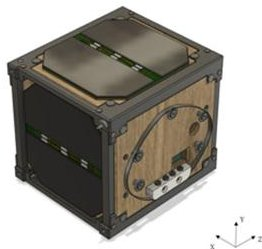
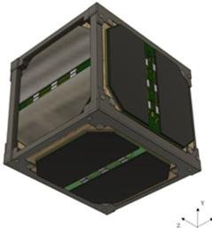
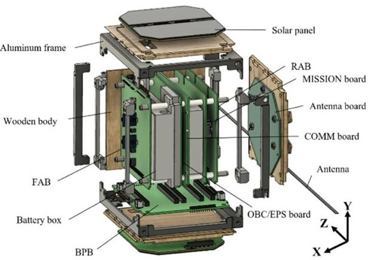
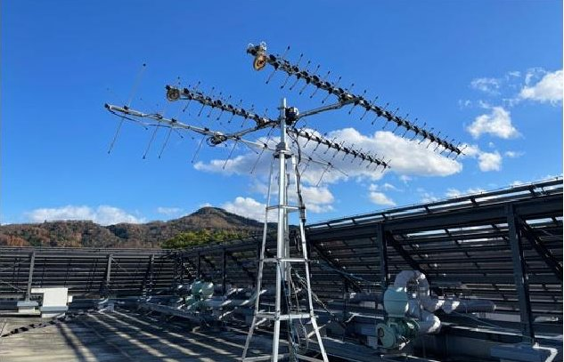
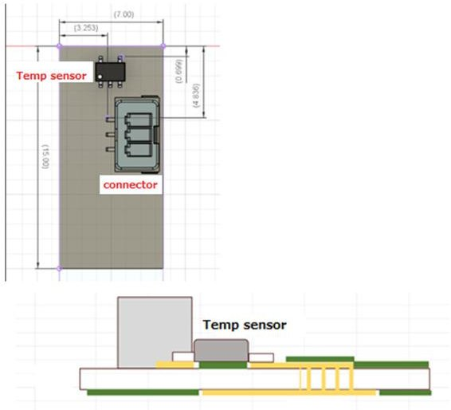
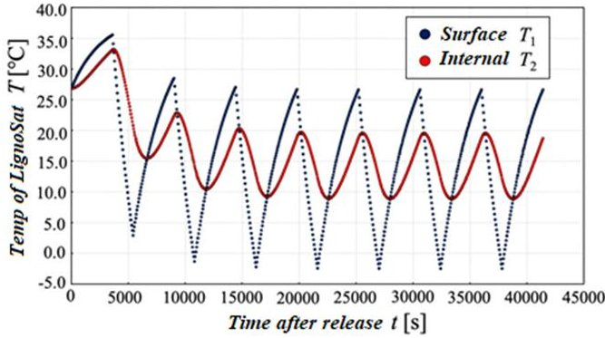
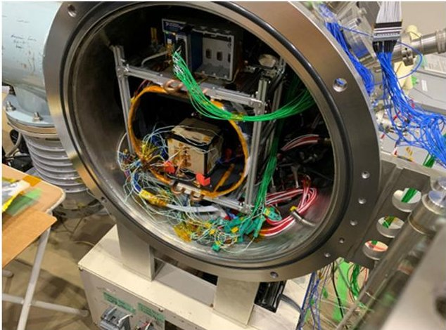
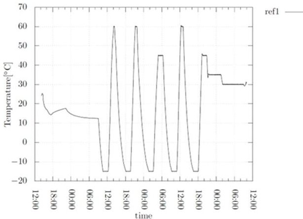
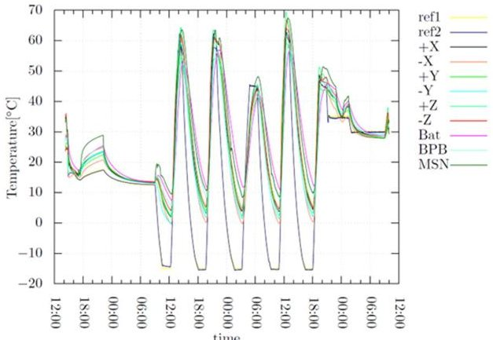
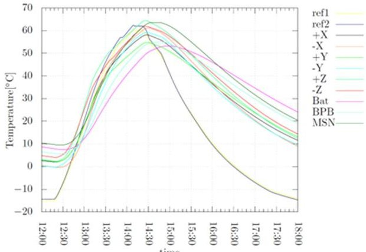

<!-- PDF_PAGE: 1 -->

# Development of a Wooden CubeSat-LignoSat

By Hiroto KISHI, $ ^{1)} $ Sakutaro NOGI, $ ^{1)} $ Yuki KIKUKAWA, $ ^{1)} $ Shunta TAKAHASHI, $ ^{1)} $ Haru MUKUMOTO, $ ^{1)} $ Go ADO, $ ^{1)} $ Tomokazu KIYOTA, $ ^{3)} $ Kazuki KUWABARA, $ ^{1)} $ Ryuki HOSHIKAWA, $ ^{1)} $ Takahiro NOMA, $ ^{1)} $ Yusei FUKUO, $ ^{3)} $ Koki IKEDA, $ ^{1)} $ Haruki TORITANI, $ ^{1)} $ Taichi ONISHI, $ ^{1)} $ Ryosuke TSUTSUI, $ ^{1)} $ Godai TOYONISHI, $ ^{1)} $ Shunya ITO, $ ^{1)} $ Haruto YAMAMOTO, $ ^{1)} $ Ichi HOSOTSUJI, $ ^{1)} $ Saori ENDO, $ ^{1)} $ Takumi NAKAMURA, $ ^{1)} $ Hiroto KIMURA, $ ^{1)} $ Masaji ISHIHARA, $ ^{1)} $ Masashi NAKAMURA, $ ^{1)} $ Koji MURATA, $ ^{1)} $ Kenji KARIYA, $ ^{2)} $ Morio TSUCHIYA, $ ^{2)} $ Kenji MIKI, $ ^{1)} $ and Takao DOI $ ^{1)} $

$ ^{1} $Kyoto University, Kyoto, Japan

$ ^{2} $SUMITOMO FORESTRY Co., Ltd., Tokyo, Japan $ ^{3} $The Graduate University for Advanced Studies, SOKENDAI, Kanagawa, Japan

(Received September 10th, 2023)

Kyoto University is now developing "LignoSat," a 1-U-sized wooden satellite to investigate the possibility of using wood in space. Demonstrating the reliability of wood as a spacecraft's structural material may lead to the creation of a new "Space Wood Industry" in the future. The main missions of LignoSat are to investigate the effects of the space environment on the micro-structure of wood. The characteristics of LignoSat were investigated by a numerical simulation as well as vacuum and vacuum-thermal tests, the results of which show that LignoSat has a thermal stability inside the wooden structure to perform nominal operations.

Key Words : CubeSat, LignoSat, Space Development, Wooden Materials, Carbon-Free

## 1. Introduction

Kyoto University has been interested in the potential utilization of wood in space and has been conducting basic research to verify the usefulness of wood as a sustainable space resource $ ^{1),2} $ . For example, a long-term vacuum exposure of wood has been conducted using various species of wood, and it has been reported that the basic physical properties of wood do not change even in a vacuum environment $ ^{1)}。 $

In 2020, the Forestry Agency in Japan published its "Green Strategy for Carbon Neutrality," which states that expanding the use of wood with low energy consumption during manufacturing is the key to the 2050 goal of zero $ \mathrm{CO}_{2} $ emissions from fossil fuels in the agriculture, forestry, and fishing industries. This trend cannot be ignored in the manufacture of spacecraft and the establishment of space bases necessary for human advancement into space. The convenience and practicality of wood is attracting more and more attention as we aim to create a sustainable society in space in the future.

We have designed and developed a 1U CubeSat made of wood, called LignoSat, in order to explore the possibility of using wood in space $ ^{2)} $ . LignoSat is designed to be almost entirely made of wood for its structure. A preliminary study has confirmed that such a wooden structure will be able to function well as a satellite structure system in a space environment. The demonstration of the reliability of wood as a structural material by operating a wooden satellite will not only lead to the advocacy of the use of wood as a space material but also may lead to the development of new business opportunities for the wood industry. In addition, exploring the possibility of using wood in space can lead to the realization of carbon neutrality in modern society.

Recently, Ferreira et al.3) pointed out that 1) large

constellations of small satellites have significantly increased, 2) such satellites burn up at the end of service life during reentry and generate aluminum oxides, and 3) aluminum oxides are known catalysts for chlorine activation that depletes ozone in the stratosphere. In addition, Ferreira et al. also used atomic scale molecular dynamics simulation to estimate how many aluminum oxide particles were injected into the mesosphere in recent satellite reentries, and warned they could remain in the atmosphere for decades and cause severe ozone depletion.

On the other hand, since wood is mainly composed of natural polymers with carbon, hydrogen, and oxygen as the main constituent elements, a wooden structure can cause sufficient combustion reactions during atmospheric re-entry and suppress the generation of harmful fine particles, and thus, reduce the environmental burden in the upper-middle atmosphere and the oceans as well as in outer space.

We believe that this project is of great significance because it will be able to raise the issue of adverse effects on the natural environment caused by space development such as an increase in the number of metallic satellites re-entering the Earth's atmosphere.

This paper describes the basic design specifications of LignoSat, the results of various preliminary tests conducted by our research team, and future prospects for LignoSat.

## 2. Mission Definition

LignoSat is an engineering test satellite and will have five missions in total. The first four missions aim to investigate the effects of the complex environment in space on wood as a space structural material. It will explore the possibility of using wood in space based on engineering aspects by capturing changes in the physical properties of wood in space over time and in situ.

<!-- PDF_PAGE: 2 -->

LignoSat will also operate on an amateur radio frequency band (UHF band) for intercommunication between the satellite and ground stations. The fifth mission will provide a unique two way communication service for amateur radio operators around the world. The five missions can be summarized as follows:

(1) Measurement of the strain inside a wooden structure over time using biaxial strain gauges. The changes in the physical properties of wood in the space environment will be tracked in real time.

(2) Multi-point temperature measurement inside the wooden structure using temperature sensors. By measuring the internal temperature of the wooden structure, the thermal insulation characteristics of wood in space will be evaluated, and the correlation between the temperature changes and the physical properties of the wooden structure will be investigated.

(3) Geomagnetic field measurement inside the satellite using a geomagnetic sensor. By demonstrating that wood is permeable to the magnetic fields, we will investigate the feasibility of installing an attitude control system such as magnetic torquers inside the wooden structure.

(5) Amateur two-way radio communication. Receive and process packets from amateur radio operators and retransmit the call signs of the amateur operators using Morse code (Continuous Wave: CW). Thus, it will realize two-way communication in a single frequency band.

(4) Analysis of the effects of cosmic radiation on the internal systems of LignoSat by measuring the number of Single-Event Upsets (SEUs) generated in the computer memories. By measuring SEUs, we will investigate the resistivity of wooden structures against cosmic radiation.

The success of the LignoSat mission will be indicated by the following:

[Minimum Success]

LignoSat is released from the International Space Station (ISS), and the CW signals (housekeeping data) from LignoSat are received at ground stations.

[Full Success]

The CW and FM packet signals from LignoSat are received for six months to gain knowledge of the internal temperature and distortion characteristics of wood as well as the geomagnetic characteristics inside the wooden structure of LignoSat. The successful intercommunication with amateur radio operators is achieved in various countries.

[Extra Success]

We can receive CW and FM packet communication signals from LignoSat for more than six months and have communication with amateur radio operators continuously.

## 3. LignoSat Systems

## 3.1. Hardware design

LignoSat is a 1U CubeSat, consisting of six Honoki (Magnolia obovata) panels assembled into a box-like structure using aluminum frames to sandwich the wooden structure. The basic characteristics of LignoSat are summarized in Table $ 1^{4} $

Table 1. Characteristics of LignoSat.

<table border="1"><tr><td>Items</td><td>Description</td></tr><tr><td>Operation Period</td><td>6 months or longer</td></tr><tr><td>Orbit</td><td>ISS orbit(400km above the ground)</td></tr><tr><td>Size</td><td>1U(100mm×100mm×113.5mm)</td></tr><tr><td>Mass</td><td>1.33kg or less</td></tr><tr><td>Battery</td><td>Ni-MH(3S2P)</td></tr><tr><td>Communication Frequency</td><td>Uplink/Downlink:UHF</td></tr><tr><td>Power Generation</td><td>1400mW</td></tr></table>

The wooden panels are joined to each other without using any adhesives or bolts, but instead, by using a traditional Japanese method called "tome-gata kakizukuri dovetail joints," and are strong enough to support the satellite structure. Using the aluminum frames surrounding the wooden structure can prevent dimensional changes of the satellite due to changes in the moisture content of the wood and to meet the requirements specified by the JEM Accommodation Handbook $ ^{5)} $ . One (-X) of the six wooden panels has a dipole antenna, and the solar panels are attached to the remaining five panels.

Inside the wooden structure, five electronic boards perform housekeeping and mission operations. The Front Access Board (FAB) controls the power system as well as monitors the operation of the entire satellite power system. The On-Board Computer Board (OBC/EPS) handles data processing and power distribution and serves the data acquisition of all the mission data. The Communication Board transmits and receives a UHF radio wave between the ground stations and LignoSat and serves the fifthmission. These three boards are similar to those of the Kyushu Institute of Technology's BIRDS satellites $ ^{6} $ . The Mission Board receives the data from two strain sensors attached to the wooden panels (-X and -Z) and serves in the first mission. The Rear Access Board (RAB) measures the temperature of the same internal surfaces on which the strain sensors are attached and the geomagnetic field is measured by a geomagnetic sensor. Hence, RAB serves in the second and third missions. RAB also has an internal memory of 1Gb and serves in the fourth mission. These five electronic boards are electrically connected by a Backplane Board (BPB) at the bottom of LignoSat.

Figs. 1 and 2 show the external and internal views of LignoSat, respectively.

X Y Z

Y

X

Z

Fig.1. External View of LignoSat.

<!-- PDF_PAGE: 3 -->

Fig. 2. Internal View of LignoSat.

## 3.2. Software Design

The bus-system of LignoSat is based on the BIRDS-Bus Platform developed by the Kyushu Institute of Technology $ ^{7)} $ The Data obtained by the various sensors are transmitted to the ground station through processing by several PIC microcontrollers. The communication with the ground station is performed in the UHF frequency band in the amateur-radio frequency range, and the housekeeping data such as the voltage and temperature of the solar panels and batteries as well as the mission data, are downlinked with the FM packet and the CW communications. In addition, uplink commands are sent to LignoSat via the FM packet communication, and they control the various operational modes of LignoSat.

## 3.3. Development of the ground station

An amateur radio station with a UHF/VHF amateur band was opened on the premises of Kyoto University in 2020. Fig. 3 shows the current antenna system. The station is equipped with an ICOM IC-9100 radio and a computer system which is capable of tracking satellites and the International Space Station.

Fig. 3. Antenna System at Kyoto University.

## 4. Mission Design of LignoSat

The main mission goal of LignoSat is to prove that wood can be used in space. The following first four missions were designed to collect the characteristics of wood in space to achieve the mission goal. The fifth mission is to provide a two-way communication service for amateur radio operators around the world.

## 4.1. Strain measurement

The first mission is to measure changes in the physical properties of wood in the space environment by measuring the strain and temperature on the interior surfaces of the wooden panels using the biaxial strain gauges $ ^{8)} $ . The aim is to capture the micro-deformation of wooden structures in space in situ caused by passing through the day and night portions of the orbit. By comparing the results of numerical simulations, it is expected to clarify the effects of a space environment on the microstructure of wood.

## 4.2. Temperature measurement

As the second mission of LignoSat, multi-point temperature measurements inside the satellite structure using temperature sensors will also be conducted. Eleven temperature sensors will be used to measure the spatial distribution of temperature inside LignoSat as well as track its temporal changes in orbit in real time.

Since the physico-chemical properties of materials generally depend on temperature, it is essential to measure the surface temperature of the wooden panels (-X and -Z), to which have the strain gauges are attached. To measure the surface temperature of wood consistently, a temperature sensor needs to be bonded to the wood firmly. However, it is difficult to do so because of the following problems: (1) the surface area of the temperature sensor is small, (2) it is difficult to secure sufficient bonding strength, and (3) the adhesive directly applied to the temperature sensor may reduce the accuracy of the temperature measurement. In order to solve these problems, we designed a small electronic board with a temperature sensor called the Temperature Sensor Board (TSB) shown in Fig. 4. A deep thermal contact with the wooden surface can be made by using a thin copper plate, which is then connected to the top copper plate with thermal vias. A temperature sensor is then soldered to the top copper plate. The Temperature Sensor Board is physically connected to the wooden panel using spacerated adhesive and can then be used to measure the surface temperature of the wooden panel accurately. RTV-S 691 is used for adhesion, and the thickness of the adhesive is sufficiently thin (<1 mm) and has a thermal conductivity of 1.42 W/m-K $ ^{9} $ , which is more than 6 times that of wood, so it should not affect temperature measurements.

<!-- PDF_PAGE: 4 -->

Fig. 4. Temperature Sensor Board (TSB), Top View (top), and Cross View (bottom).

## 4.3. Thermal analysis by numerical simulation

In order to estimate the surface and internal temperatures of LignoSat in orbit, we carried out a numerical simulation using a 1D thermal model of LignoSat. In this model, we took into account the following five types of heat exchanges between LignoSat and the space environment: (1) heat input from sunlight, (2) heat input from the reflection of sunlight from the Earth, (3) heat input from the infrared radiation from the Earth, (4) heat radiation from LignoSat to space, and (5) radiative heat exchange within LignoSat. The set of thermal equations were then numerically integrated by the fourth-order Runge-Kutta method.

The results of the numerical simulation are shown in Fig. 5. It shows that the surface and internal temperatures of LignoSat reach a steady state at about 15,000 seconds after the ejection from the ISS, and that the ranges of variation of the surface and internal temperatures are approximately -3 to $ 2 7^{\circ} \mathrm{C} $ and 9 to $ 2 0^{\circ} \mathrm{C} $ , respectively. These results indicate that the temperature of LignoSat in orbit is expected to be within the rated range of the usable temperature of each electronic component.

Fig. 5. Estimated Temperature Variation of LignoSat in Orbit.

## 4.4. Geomagnetic measurement

The third mission of LignoSat is to collect geomagnetic data necessary for designing future wooden satellites which are capable of attitude control using magnetic torquers. Since wood is visible to electromagnetic waves, we would also like to install communication antennas such as patch antennas inside the satellite in the future. By doing this, we will be able to

simplify the satellite system design and avoid installing the antenna deployment mechanisms.

The magnetic sensor is attached to the RAB and has been tested to be able to provide reliable geomagnetic data. We conducted a verification test of the magnetic sensor by comparing the sensor data in our laboratory with the geomagnetic values provided by the Geospatial Information Authority of Japan (GSI). We also conducted a calibration test of the magnetic sensor by using a Helmholtz coil at the Kyushu Institute of Technology. It confirmed that the magnetic sensor measures the Earth's geomagnetic field to about 99% in accuracy.

## 4.5. Measurement of a Single Event Upset (SEU)

The fourth mission is to analyze the effects of cosmic radiation on the internal systems of LignoSat by counting the number of Single-Event Upsets (SEUs) that occur in the flash memory on RAB. The SEU measurement will be used to investigate the characteristics of wooden and metal structures with respect to resistivity against cosmic rays.

## 4.6. Amateur radio operation

LignoSat will conduct the fifth mission to provide a two-way communication service to amateur radio operators around the world. LignoSat will extract the call sign of each radio station from the uplinked packet data and return it with a UHF CW downlink, including an additional message.

A CW (Morse code) downlink and an FM packet downlink are widely used as separate uplink/downlink methods, but this time, LignoSat adopted a method that receives an FM packet uplink and instantly returns it on a CW downlink, and this method has never been used by other satellites in the past. Since it has been discontinued and is now used only for amateur radio, we believe that the LignoSat method is useful for preserving CW communication, which is the origin of wireless communication, into the future.

## 5. Various Functional Tests

The objectives of various functional tests were to examine whether LignoSat would function in space as it was designed. We first conducted a Vacuum Environmental Test (VET), and then, a Thermal Vacuum Test (TVT), since TVT simulates more closely the environment of space than VET.

## 5.1. Vacuum Environmental Test (VET)

We conducted the VET to confirm that LignoSat can operate in a vacuum condition before conducting the TVT. We placed LignoSat in a vacuum chamber with a low pressure environment of $ 1 0^{\wedge}(- 3) $ Pa for about 59 hours. The Main PIC communicated with the communication PIC and also with the mission PIC every 90 seconds to acquire housekeeping (HK) data (voltage, current, and temperature data). In this test, the following four items were evaluated:

(1) Communication between the Main PIC and five other PICs (FAB, Communication, Mission, RAB, and Reset): The HK

<!-- PDF_PAGE: 5 -->

data were received successfully, and it was confirmed that the data transfer operation in a vacuum condition was performed normally.

(2) Operation of LignoSat by using the onboard battery system: LignoSat operated for about 1.5 hours continuously.

(3) Acquisition of strain data from the mission board: We expected stable continuous strain values but obtained only intermittent data. We will need to further improve the data acquisition system from the strain gauges.

(4) Temperature data from the TSB: The TSB temperature was found to be the same as the room temperature during the test.

## 5.2. Thermal Vacuum Test (TVT)

After the VET, we conducted a TVT to investigate the thermal characteristics of LignoSat in a thermal vacuum environment (Fig. 6) to determine if LignoSat can function properly in a vacuum and at low and high temperatures. The objective of the TVT was to confirm that the temperatures of the components should be ranged in their operational temperature limit. The results of the TVT are summarized as follows:

(1) Communication between the Main PIC and five other PICs: The HK data were received successfully, and it was confirmed that the data transfer operation in a thermal vacuum condition was performed normally.

(2) Operation of LignoSat by using the onboard battery system: LignoSat operated continuously for about 6.5 hours under one thermal cycle without packet communication.

(3) Acquisition of strain data from the mission board: We expected stable continuous strain values but obtained intermittent data with a lot of noise components. We are currently investigating how to improve the strain measurement. (4) Temperature data from the TSB: The TSB temperature could successfully track the temperature changes during the TVT.

Fig. 6. TVT Configuration.

Fig. 7. Temperature Control during TVT.

The Thermal condition during the TVT is shown in Fig. 7. We applied five cycles in which the low temperature phase at $ 1 5^{\circ} \mathrm{C} $ continued for one and a half hours, and the high temperature phase at $ + 6 0^{\circ} \mathrm{C} $ or $ + 4 5^{\circ} \mathrm{C} $ lasted for about 0.5 hours. The heater was turned off during the high temperature phase when the battery temperature approached $ + 5 0^{\circ} \mathrm{C} $ Fig. 8 shows the internal temperature of LignoSat. It is clear that the internal temperature was stable at around $ 0^{\circ} \mathrm{C} $ confirming that wood has a high thermal insulation property and that its wooden structure tends to hold the heat generated by PCBs inside LignoSat. This trend is also shown in Fig. 9, in which the internal temperature of LignoSat is shown during the high temperature phase. The temperature of the internal PCBs gradually decrease when the heater was turned off.

Fig. 8. Thermal response inside LignoSat.

Fig.9. Thermal Response inside LignoSat in the High Temperature Phase.

<!-- PDF_PAGE: 6 -->

Since all the temperatures of the components ranged in their operational temperature limit, the test results satisfy the objective.

## 6. Current Development Status of LignoSat

The current development status of LignoSat is summarized as follows:

## (1) Command and Data Handling (CDH) System

The VET and TVT for LignoSat EM were successfully conducted. During the tests, we confirmed that the data from the Electric Power System and the mission board were successfully processed by the Main PIC. We are going to start designing the FM system.

## (2) Communication System

One of the goals of LignoSat is to provide radio service to amateur radio operators by using only one frequency for two way communication. Kyoto University has completed constructing the Yagi-antenna system for UHF communication with LignoSat and has confirmed its ability to communicate with amateur radio satellites.

## (3) Electric Power System (EPS)

We confirmed that the battery system and the power generation of the solar panel worked as planned on LignoSat. Solar panels are attached to the PCBs, and the PCBs are attached to their corresponding wooden panels using spacerated adhesive. We conducted the adhesion tests $ ^{10} $ to confirm that the solar panels and PCBs were firmly attached to the wooden panels.

## (4) Mission System

LignoSat will measure the strain and temperature of wooden panels in space in order to investigate the effects of the space environment on the micro-structure of the wood. We have developed the TSB to measure the surface temperature of the wooden panels accurately. We have found the strain measurement system needs to be further improved in order to reduce the recorded noise level and reliability.

## (5) Structure

Since LignoSat has a wooden structure, the internal temperature tends to vary only across a small temperature range due to the fact that wood has a high thermal insulation property. It will ease the operation of the electronic boards of LignoSat.

## 7. Conclusions

Kyoto University has been developing the world's first wooden CubeSat called LignoSat since 2019. Currently, we are conducting various testing to confirm the performance and characteristics of the Engineering Model (EM) of LignoSat. The results of the VET and TVT show that the performance of the EM is almost equal to the design specifications.

We are now going to start designing the Flight Model (FM) of LignoSat, aiming to launch it into space in 2024.

## Acknowledgement

We would like to thank Kyushu Institute of Technology for their support in the development of LignoSat.

## References

1) Miki, K., Murata, K., et al.: Basic Research on Utility of Wood Resources in Space, 34th Symposium on Aerospace Structure and Materials; Proceedings, SA6000137022, 2018.

2) Sotsuka, M., Miki, K., et al.: Concept Design of Wooden CubeSat, 63rd Space Sciences and Technology Conference 1C15, 2022 (in Japanese)., JSASS-2019-4161, 2019.

3) Ferreira, J. P., Huang, Z., Nomura, K., Wang, J.: Potential ozone depletion from satellite demise during atmospheric reentry in the era of mega-constellations, Advancing earth and space sciences, 10.1029/2024GL109280, 2024.

4) Kyushu Institute of Technology, BIRDS PLATFORM ICD, Rev. F, 2021 (in Japanese).

5) The JEM Accommodation Handbook, JX-ESPC-101132-E

6) BIRDS Program Digital Textbook CubeSTD-2019-001F

7) Fukuo, Y, Sotsuka, M., et al.: Basic Design of Wooden CubeSat "LignoSat", 66th Space Sciences and Technology Conference 1C15, 2022 (in Japanese).

8) Tsutsui, R., Sotsuka, M., et al.: Current Status and Prospects of Mission System Development of Wooden CubeSat "LignoSat", 66th Space Sciences and Technology Conference 1C15, 2022 (in Japanese).

9) [Skład Techniczny Sp. z o.o., 2024]

10) Endo, S., et al.,: The Utilization of Wood for a CubeSat Structure, $ 3 4^{th} $ ISTS, June 2023.