<!-- PDF_PAGE: 1 -->

# Nanosatellites and Applications to Commercial and Scientific Missions

Adriano Camps

## Abstract

In the past two decades, a silent revolution has taken place in the space domain, leading to what today is known as "New Space." We have passed from a selected group of countries, space agencies, and big industries building, launching, and operating satellites and other spacecrafts, of a scenario in which many universities and research institutes can do it. The key of this was the definition of the "CubeSat" standard, back to 1999. In 2013, it all took off on the commercial Earth Observation sector with the first launches from two companies that are now running 100+ CubeSat constellations for optical imaging or weather prediction, with very low revisit times. Today, the same revolution is taking place in the fields of Telecommunications, and Astronomical Scientific missions. In this chapter, the evolution of the space sector is briefly revised until the arrival of the CubeSats. Then, the CubeSat intrinsic limitations are discussed as they are key to understand the development and current situation of the CubeSat sector. NASA and ESA strategies are also presented. The chapter concludes with a summary of the technology roadmap to enable the next generation of CubeSat-based missions, including satellite constellations or federations, formation flying, synthetic apertures...

Keywords: satellites, CubeSats, mission, earth observation, astronomy, planetary exploration, enabling technologies

## 1. Introduction

## 1.1 From the sputnik to the CubeSats

At the beginning of the space age, all satellites were "small." Sputnik 1 was the first artificial Earth satellite (Figure 1a) [1]. It was launched by the Soviet Union from Baikonur Cosmodrome on October 4, 1957, into an elliptical low Earth orbit (LEO) with an inclination of $ 6 5^{\circ} $ . Sputnik 1 was a 58-cm-diameter metal sphere, weighing approximately 84 kg, with four radio antennas transmitting at 20.005 and 40.002 MHz. Tracking and studying Sputnik 1 signals from Earth provided valuable information on upper atmosphere density, and the propagation of radio signals provided information on the ionosphere. Sputnik did not have solar panels, so the mission ended after 3 weeks when batteries died.

<!-- PDF_PAGE: 2 -->

Explorer 1 was the first US satellite (Figure 1b) [2], and the third one after Sputnik 1 and 2. It was launched from Cape Canaveral, Florida, on January 31, 1958. Explorer 1 was 205 cm tall and 15 cm in diameter, weighing nearly 14 kg. It was the first spacecraft to detect the Van Allen radiation belts. Explorer 1 did not have solar panels either, so after 4 months the mission ended when batteries were exhausted.

Vanguard 1 was the fourth artificial Earth satellite (Figure 1c) [3]. It was launched by the USA from Cape Canaveral on March 17, 1958, into a 654 by 3969 km elliptical orbit with an inclination of $ 3 4. 2 5^{\circ} $ . Vanguard 1 was a 16.5-cm-diameter aluminum sphere, weighing just 1.47 kg, and it was the first satellite with six solar cells powering two beacons at 108 and 108.03 MHz, which were used to measure the total electron content.

During the first two decades of the space age, each satellite had its own design. They were the art pieces of the space craftsmen. Standard spacecraft busses were practically unknown until the end of the 1970s. In the early 1980s, microsatellites emerged and adopted a radically different design approach to reduce costs, focusing on available and existing technologies and using properly qualified commercial off-the-shelf (COTS) components.

For many years, satellite mass increased as illustrated in Table 1. However, except for some military, astronomy, and specific communication applications, it seems that the era of massive satellites is over.

The "small satellite mission philosophy" represents a design-to-cost approach, with strict cost and schedule constraints, often combined with a single mission objective in order to reduce complexity. Figure 2 from [14] summarizes the standardized definition of satellites according to their weight: picosatellites (0.1-1 kg), nanosatellites (1-10 kg), microsatellites (10-100 kg), and mini-satellites or small/ medium satellites (100-1000 kg).

In the field of Earth observation (EO), this has led to smaller target-focused missions which, with reduced spacecraft and launch costs (shared rides), are enabling massive (>100) satellite constellations of nano- and microsatellites with reduced revisit times, unthinkable just a few years ago.

In the field of satellite communications, there are plans as well to deploy massive constellations of LEO satellites to provide worldwide Internet coverage, IoT services, and machine-to-machine (M2M) communications.

It is anticipated that enhanced inter-satellite communication capabilities (LEO-ground,LEO-LEO,LEO-MEO,and LEO-GEO) will also improve the performance of EO systems [15]. All this is leading to the evolution of the space segment from monolithic to distributed and federated satellite systems [16], aiming at establishing win-win collaborations between satellites to improve their mission performance by using the unused onboard resources.

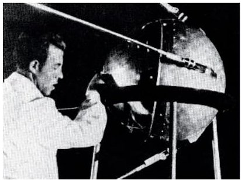

a)

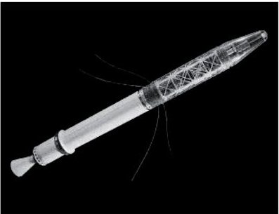

b)

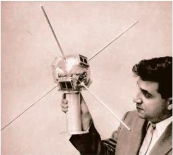

Figure 1. Pictures of (a) sputnik 1 [4], (b) explorer 1 [5], and (c) vanguard 1 [6].

c)

<!-- PDF_PAGE: 3 -->

Nanosatellites and Applications to Commercial and Scientific Missions DOI: http://dx.doi.org/10.5772/intechopen.90039

<table border="1"><tr><td>Spacecraft</td><td>Agency application</td><td>Mass</td><td>Duration</td></tr><tr><td>KH-11 Kennen(a.k.a. CRYSTAL,EECS,1010)[7]</td><td>US NRO/optical imaging</td><td>19,600kg</td><td>1976-present</td></tr><tr><td>Proton[8]</td><td>USSR/astronomy</td><td>17,000kg</td><td>1965-1969</td></tr><tr><td>Compton Gamma Ray Obs.[9]</td><td>US NASA/astronomy</td><td>16,329kg</td><td>1991-2000</td></tr><tr><td>Lacrosse[10]</td><td>US NRO/SAR</td><td>14,500-16,000kg</td><td>1988-2005</td></tr><tr><td>Hubble Space Telescope[11]</td><td>US NASA/astronomy</td><td>11,110kg</td><td>1990-present</td></tr><tr><td>ENVISAT[12]</td><td>ESA/Earth observation</td><td>8211kg</td><td>2002-2012</td></tr><tr><td>Telstar19V[13]</td><td>Canada/communications</td><td>7075kg</td><td>2018-present</td></tr></table>

Table 1. Heaviest spacecrafts (excluding space stations and manned orbiters).

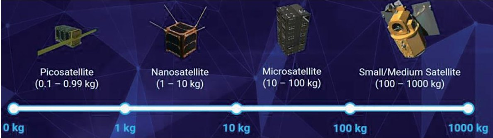

Figure 2. Satellite classification [14].

## 1.2 The CubeSat standard

Theсо-called CubeSat standard was conceived in 1999 by Profs. Jordi Puig-Suari of California Polytechnic State University (CalPoly) and Bob Twiggs of Stanford University to allow graduate students to conceive, design, implement, test, and operate in space a complete spacecraft in a "reasonable" amount of time (i.e., the duration of their studies). CubeSats are small satellite multiples of 1 U (1 U: 10 cm x 10 cm x 11.35 cm, weighing less than 1.33 kg), including all the basic subsystems as large satellites but using COTS components. The CubeSat "standard" only defines the mechanical external interfaces, i.e., those referring to the orbital deployer. Originally, it was never meant to be a standard, however, because of its simplicity, it soon became a "de facto" standard. As Prof. Twiggs said in an interview to Spaceflight Now in 2014: "It all started as a university education program satellite. It was kind of funny. I didn't think that people would criticize it as much as they did, but we got a lot of feedback (...). Another thing that was kind of funny we had no interest from NASA or any of the military organizations. It just wasn't anything they were interested in, so it was all funded without any funding from those aerospace organizations." The first six CubeSats were launched on a Russian Eurockot on June 30th, 2003. Then, after more than a decade in which the concept silently matured in university labs, space agencies got interested and showed that CubeSat-based mission reliability could be improved by proper engineering. In 2013, it all took off on the commercial Earth Observation sector with the first launches from two companies that are now running 100+ CubeSats constellations for optical imaging or weather prediction, with very low revisit times. Today, many of the initial CubeSat limitations (most notably size, available power, and down-link bandwidth) are being overcome, and the same revolution is starting to take place in the fields of telecommunications, and astronomical scientific missions.

<!-- PDF_PAGE: 4 -->

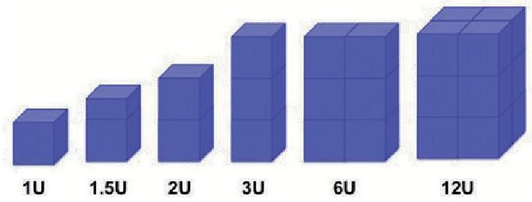

Figure 3. CubeSat form factors from 1 U to 12 U [20].

The current CubeSat Design Specification defines the envelopes for 1 U, 1.5 U, 2 U, 3 U and 3 U+ , and 6 U form factors (see, e.g., CubeSat Design Specification Rev. 13 or 6 U CubeSat Design Specification in [17], Figure 3), and the standardization of 12 U and 16 U is in progress, although some companies have produced standards up to 27 U [18]. On the other side, smaller picosatellites, the so-called PocketQubes, about 1/8 the size of a CubeSat, have also been standardized [19].

Probably, what has had the most significant impact in the popularization of the CubeSat standard has been the capability to separate the interface between the spacecraft and the poly-picosatellite orbital deployer (P-POD) and between the dispenser and the rocket itself. There are two different classes of PODs. The first type is the classical one with four rails in the corners [17], and the second one is with tables [18]. Note however that modern deployers from ISIS and NanoRacks allow larger deployables, wider solar panels, and thinner rails as compared to original P-POD, e.g., increased extruded height up to 9 mm and up to 2 kg per 1 U.

As of June 2019, 64 countries have launched nanosatellites or CubeSats. The total number of nanosatellites launched is 1186, from which 1088 are CubeSats. Most of them (273) have been launched from the International Space Station at $ \sim 4 0 0 $ km orbital height with an inclination of $ 5 1. 6^{\circ} $ and the rest at low Earth orbits (LEO) typically at 500 km sun-synchronous orbit (SSO) with an inclination of $ 9 7. 5^{\circ} $ (217 CubeSats) and 580 km height with $ 9 7. 8^{\circ} $ inclination (80 CubeSats). So far, only two (MarCO-1 and MarCO-2) have performed interplanetary missions.

## 1.3 Current status

Figure 4 shows the number of nanosatellites launched per year (a) and organization, either companies, universities, space agencies, etc., or (b) form factor from picosats, 0.25 up to 16 U.

As it can be appreciated, until 2013 most CubeSats were launched by universities and research institutes, and most of them were 1 U or 2 U. However, in 2013 the first 3 U CubeSats from the Planet Labs Inc. [22] and Spire Global Inc. [23] were launched. That was the beginning of today's revolution in EO, and—as of June 10, 2019—these two companies had launched the largest commercial constellations ever with 355 and 103 CubeSats, respectively. The following ones have launched at most seven CubeSats. Therefore, 3 U CubeSats are dominating the scene, and they will over the next decade, followed by far by the 1 U, 2 U, and 6 U form factors (Figure 5). However, it is expected that the next wave of growth will be based on 6 U and 12 U CubeSats, which offer the right balance between very capable payloads and limited manufacturing and launch costs.

Table 2 (extracted from the database in [21]) shows the main companies that have launched CubeSats, the number of launched and planned CubeSats, the year of the first launch, the form factor, the application field, and some technical details. The rows marked in light blue correspond to EO optical imaging, in light green to EO

<!-- PDF_PAGE: 5 -->

Nanosatellite launches by organisations

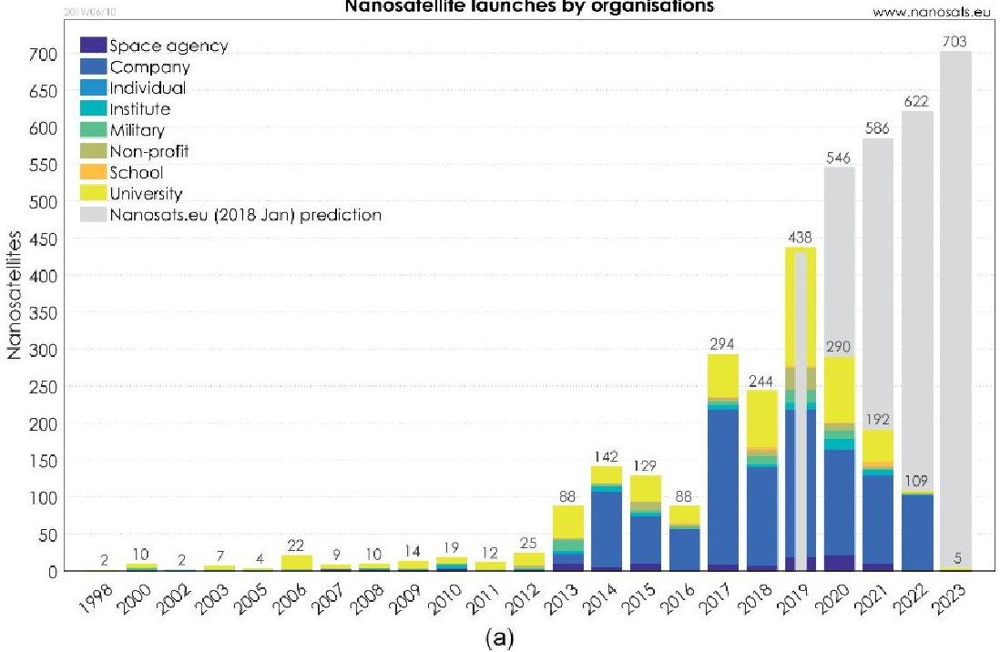

Nanosatellite launches by types

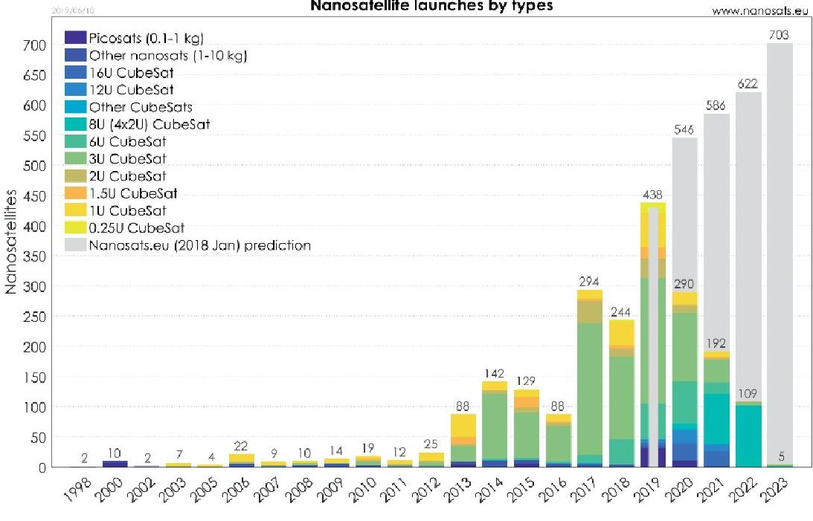

(b)

Figure 4.

The number of nanosatellites launched per year and (a) organization or (b) form factor [21].

passive microwaves applications, in dark green to EO active microwaves applications, and in light orange typically to IoT and M2M communications. In the next sections, we will focus on the EO applications but keeping in mind that future advances in satellite communication networks will also improve the performance of EO systems and enable new ones as well as distributed ones (e.g., large synthetic apertures).

The interested reader is encouraged to consult [21] for the most updated information as these numbers can change rapidly. Note that the number of CubeSats that can be launched in a single rocket can be very high. The current record is held by the Indian rocket PSLV-C37 that, on February 15, 2017, launched Cartosat-2D and 103 CubeSats, from which 88 are from the Planet Labs Inc. and 8 are from the Spire Global Inc. The interested reader is invited to see the deployment of these satellites from the onboard camera at [24].

<!-- PDF_PAGE: 6 -->

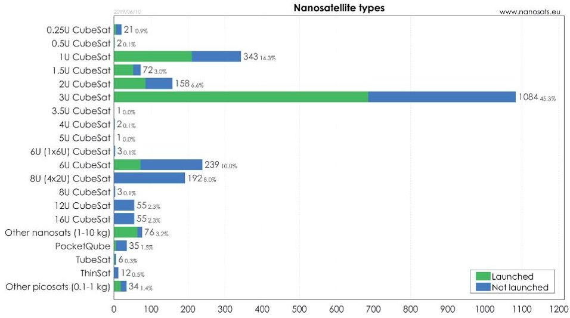

Figure 5. The number of CubeSats by form factor [21].

<table border="1"><tr><td>Organization</td><td>Launched/planned size</td><td>First launch</td><td>Form factor</td><td>Field</td><td>Technical and comments</td></tr><tr><td>Planet Labs</td><td>355/150</td><td>2013</td><td>3U</td><td>Earth observation</td><td>29MP sensor taking images with3.7m ground resolution and swath of24.6km×16.4km from475km altitude</td></tr><tr><td>Spire</td><td>103/150</td><td>2013</td><td>3U</td><td>Weather,AIS,ADS-B,earthquake</td><td>Measure change inGPS signal after passing atmosphere to calculate precise profiles for temperature,pressure,and humidity.Investigating earthquake(ELF)detection</td></tr><tr><td>AprizeSat</td><td>12/12</td><td>2002</td><td>Microsat</td><td>IoT/M2M</td><td>Low-cost satellite data services for monitoring the fuel level and oil and gas pipelines and mobile tracking of shipping containers,railcars,and trailers</td></tr><tr><td>GeoOptics</td><td>7/N/A</td><td>2017</td><td>6U</td><td>Weather</td><td>UsingGPS radio occultation forweather data</td></tr><tr><td>Swarm Technologies</td><td>7/150</td><td>2018</td><td>0.25U,1U</td><td>IoT/M2M</td><td>World&#x27;s smallest two-way communication satellites</td></tr><tr><td>Commsat</td><td>7/72</td><td>2018</td><td>Microsat,6U,3U</td><td>IoT/M2M,AIS</td><td>Ladybeetle1is100kgand3CubeSatsof6Uand3of3U.Plans4morein2019andcomplete72satellitesin2022</td></tr><tr><td>Astro Digital</td><td>6/25</td><td>2014</td><td>6U,16U</td><td>Earth observation</td><td>6Uhas22mresolutioninRGBandNIR.16Uhas2.5mresolutioninRGB,rededge,andNIRwith70MP sensor</td></tr><tr><td>Fleet Space</td><td>4/100</td><td>2018</td><td>3U,12U,1.5U</td><td>IoT/M2M</td><td>Main constellation potentiallywith12UCubeSats</td></tr><tr><td>Sky and Space Global</td><td>3/200</td><td>2017</td><td>8U,6U,3U</td><td>IoT/M2M</td><td>Communication service(voice,data,andM2M).Plans to useinter-satellitelinks</td></tr></table>

<!-- PDF_PAGE: 7 -->

Nanosatellites and Applications to Commercial and Scientific Missions DOI: http://dx.doi.org/10.5772/intechopen.90039

<table border="1"><tr><td>Organization</td><td>Launched/planned size</td><td>First launch</td><td>Form factor</td><td>Field</td><td>Technical and comments</td></tr><tr><td>NanoAvionics</td><td>2/72</td><td>2017</td><td>6U,12U</td><td>IoT/M2M</td><td>Global IoT constellation-as-a-service system aimed at IoT/M2M communication providers</td></tr><tr><td>Helios Wire</td><td>2/30</td><td>2017</td><td>6U,16U</td><td>IoT/M2M</td><td>Uses 30MHz of S-band spectrum to receive tiny data packages from billions of sensors</td></tr><tr><td>Kepler Communications</td><td>2/140</td><td>2018</td><td>3U,6U</td><td>IoT/M2M,Internet</td><td>IoT/M2M data communication network.Monthly fee based on the data amount.Hope to achieve rates of1-40Mbps</td></tr><tr><td>Analytical Space</td><td>1/N/A</td><td>2018</td><td>6U</td><td>IoT/M2M,orbital data relay, optical comms.</td><td>In-orbit relays receiving radio and downlink to ground with laser communication enabling more data downlink from satellites</td></tr><tr><td>Hiber</td><td>2/48</td><td>2018</td><td>6U</td><td>IoT/M2M</td><td>Sends small packets of data(140 characters, accompanied by time stamp, identifier,and location)</td></tr><tr><td>Guodian Gaoke</td><td>2/38</td><td>2018</td><td>6U</td><td>IoT/M2M</td><td>Reliable and economical satellite IoT services and industry solutions for our customers</td></tr><tr><td>Astrocast</td><td>2/80</td><td>2018</td><td>3U</td><td>IoT/M2M</td><td>Targeting L-band.Intersatellite links.NanoSpace propulsion.Further 80 satellites in orbit by2022</td></tr><tr><td>AISTech</td><td>2/150</td><td>2018</td><td>2U,6U</td><td>IoT/M2M,ADS-B,AIS,IR imaging</td><td>Two-way comms.,thermal imaging to detect forest fires,aviation tracking(ADS-B)</td></tr><tr><td>ICEYE</td><td>2/18</td><td>2018</td><td>Microsat</td><td>SAR</td><td>21-launch agreement withVector Space Systems.10-platform agreement withYork Space Systems</td></tr><tr><td>Harris Corp.</td><td>1/12</td><td>2018</td><td>6U</td><td>Weather</td><td>Immediate access to 3D wind data sets from Harris-owned HyperCubes</td></tr><tr><td>SIRION</td><td>1/N/A</td><td>2018</td><td>CubeSat</td><td>IoT/M2M</td><td>IoT/M2M constellation.Partnered closely with Helios Wire.Sharing spectrum and satellites</td></tr><tr><td>Reaktor Space</td><td>1/36</td><td>2018</td><td>6U,2U</td><td>Earth observation,hyperspectral</td><td>Hyperspectral constellation for smart agriculture with100&#x27;s of spectral bands and20m resolution</td></tr><tr><td>Myriota</td><td>1/50</td><td>2018</td><td>CubeSat</td><td>IoT/M2M</td><td>Run unique,patented software which provides reliable,direct-to-satelliteInternet of Things(IoT) connectivity</td></tr></table>

<!-- PDF_PAGE: 8 -->

<table border="1"><tr><td>Organization</td><td>Launched/planned size</td><td>First launch</td><td>Form factor</td><td>Field</td><td>Technical and comments</td></tr><tr><td>LaserFleet</td><td>1/192</td><td>2018</td><td>CubeSat</td><td>Internet, optical comms.</td><td>Provide reliable 1 Gbps communication rates to aircraft at altitude. Higher effective data rate at a lower cost than the best-in-class Ku/Ka/V</td></tr><tr><td>ADASpace</td><td>1/192</td><td>2018</td><td>Microsat CubeSat</td><td>Earth observation</td><td>Establish a global, minute-level updated Earth image data network consisting of 192 satellites</td></tr><tr><td>Orbital Micro Systems</td><td>1/40</td><td>2019</td><td>3U</td><td>Weather</td><td>Weather constellation utilizes microwave technology to capture temperature and moisture measurements, refreshed and delivered every 15 minutes</td></tr><tr><td>Lacuna Space</td><td>1/32</td><td>2019</td><td>3U, 6U</td><td>IoT/M2M</td><td>IoT/M2M constellation. Selected Open Cosmos to build 3U demonstrator</td></tr></table>

Blue for constellations for optical EO, light green for passive microwave EO, dark green for active microwave EO, and orange for IoT and M2M communications.

The main existing and planned CubeSats and microsat commercial constellations.

## 2. Science opportunities

As illustrated in Table 2, by 2010 the maturity achieved by CubeSats and dispensers/launchers, on one side, and by some EO technologies (high-resolution multispectral imagery and GNSS-RO), on the other side, made possible that a number of companies developed applications based on commercial constellations. Today, thanks to an intense technology R&D, the situation is completely different.

The reasons for this have been threefold. On one side, due to their small size, it has been difficult to include deployable solar panels so as to increase the electrical power generated, and, on the other side, it has been difficult to include large antenna reflectors and to transmit enough RF power so as to have a satisfactory space-to-Earth link budget. The third reason was the poor pointing accuracy that now has significantly improved thanks to miniaturized star trackers and reaction wheels. So far, these reasons have kept active optical (LIDAR) and active microwave sensors (RADAR) away from CubeSats, although it has to be stated that synthetic aperture radars (SAR) have been recently boarded in microsatellite platforms successfully (ICEYE, Table 2).

For spaceborne EO applications, frequency bands are restricted to those in which the atmosphere exhibits a high transmissivity, that is, the microwave and millimeter-wave parts of the radio spectrum and the long-wave infrared (LWIR), near infrared (NIR), and visible (VIS) parts of the spectrum, as illustrated in Figure 6.

For astronomical observations, ground-based observations are also limited to Earth's atmospheric windows in the radio and optical parts of the spectrum (Figure 6). Therefore, to explore the remaining parts of the EM spectrum, spacebased observatories are required.

<!-- PDF_PAGE: 9 -->

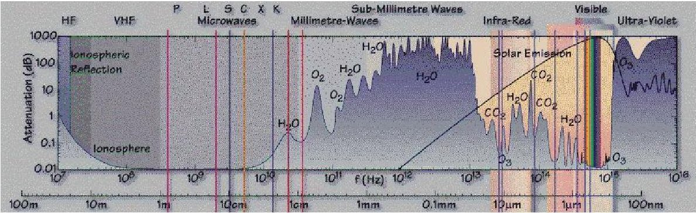

Figure 6.

Electromagnetic spectrum with different bands indicated [25].

In any case, either for EO or astronomical observations, the lower cost of individual CubeSat-based missions allows having more units, which reduces the revisit time at a given cost. This offers a number of new science opportunities [26]:

- Earth science:

- Multipoint high temporal resolution of Earth processes

Mitigation of data gaps

O Continuous monitoring

- Astrophysics:

- Space telescopes allow access to energies across the whole electromagnetic spectrum avoiding large gaps in the radio, far IR, and the entire high-energy range (UV to $ \gamma $-rays).

- Feasibility to conduct time domain programs, which are very challenging with flagship missions such as the Hubble Space Telescope and James Webb Space Telescope.

- Heliophysics, e.g., measurement of plasma processes in the magnetosphere ionosphere system.

- Planetary science: in situ investigation of planetary surfaces or atmospheres.

- Astronomy and astrophysics: low-frequency radio science and the search for extrasolar planets.

- Biological and physical sciences, e.g., survival and adaptation of organisms to space

## 2.1 NASA science and technology strategy using CubeSats

Since the CubeSat standard was proposed in 1999, it took about a decade for NASA to start the Educational Launch of Nanosatellites (ELaNa) initiative in 2010. Partnerships were established with universities in the USA to design and launch CubeSats through NASA's CubeSat Launch Initiative (CSLI). Since then, 85 CubeSat missions have flown on 25 ELaNa calls, and 34 more CubeSats are manifested in 4 more calls. While it provides NASA with valuable opportunities to test emerging technologies that may be useful in future space missions, university students get involved in all phases of the mission, from the instrument and satellite design to its launch and monitoring.

<!-- PDF_PAGE: 10 -->

As early as 2012, NASA's Science Mission Directorate (SMD) technology programs began to accommodate the use of CubeSats for validation of new science instruments and strategically promoted the use of small spacecraft to advance its science portfolio.

On one side, the Earth Science Technology Office (ESTO), which is responsible for identifying and developing technologies in support of future Earth Science Division missions, manages three major observation technology programs that solicit new awards on a 2-3-year selection cycle, as shown in Table 3 [27].

And on the other side, following the outcomes of [28] in 2014, the Planetary Science Division (PSD) has also made significant strides toward accommodating small satellites for exploration of the solar system and for astrophysics research. Table 4 [27] summarizes the three main planetary science technology programs.

The result of these continued investments is summarized in Table 5, where a number of EO techniques that were infeasible in 2012 [29] were all feasible 5 years later [30], many of them demonstrated by CubeSat missions, some of them commercial, and some even operational constellations. CubeSat-based astronomy missions will be discussed later.

Figure 7 illustrates some of these NASA CubeSat-based EO missions. They follow the 3 U or 6 U form factor and include deployable solar panels for higher electrical power generation capabilities. RainCube (Figure 7c) also includes a 0.5-m-diameter deployable Ka band that stows in 1.5 U. This antenna has a gain of 42.6 dBi, and it was optimized for the radar frequency of 35.75 GHz. References are provided for more information on the cited missions.

<table border="1"><tr><td>Earth science program</td><td>Approx. funding</td><td>Description</td></tr><tr><td>Instrument Incubator (IIP)</td><td>$28 M/year</td><td>Nurtures the development and assessment of innovative remote sensing concepts in ground, aircraft, or engineering model demonstrations (early to mid-stage development)</td></tr><tr><td>Advanced Components (ACT)</td><td>$5 M/year</td><td>Enables the research, development, and demonstration of component- and subsystem-level technologies to reduce the risk, cost, size, mass, and development time of missions and infrastructure</td></tr><tr><td>In-Space Validation of Earth Science Technologies (InVEST)</td><td>$5 M/year</td><td>Advances the readiness of existing Earth science-related technology and reduces risks to future missions through space flight validation using CubeSats</td></tr></table>

Table 3.

Earth science technology programs relevant to small satellites [27].

<table border="1"><tr><td>Planetary science program</td><td>Approx. funding</td><td>Description</td></tr><tr><td>Planetary Instrument Concepts for the Advancement of Solar System Observations(PICASSO)</td><td>$4 M/year</td><td>Supports the development of spacecraft-based instrument components and systems that show promise for future planetary missions.The program supports early-stage technologies</td></tr><tr><td>Maturation of Instruments for Solar System Exploration(MatISSE)</td><td>$6 M/year</td><td>Supports the advanced development of spacecraft-based instruments that may be proposed for future planetary missions that are at the middle stages of technology readiness</td></tr><tr><td>Development and Advancement of Lunar Instruments(DALI)</td><td>$5 M/year</td><td>Supports the development of science instruments for small lunar landers and orbital assets that are at the middle stages of technology readiness</td></tr></table>

Planetary science technology programs relevant to small satellites [27].

<!-- PDF_PAGE: 11 -->

Nanosatellites and Applications to Commercial and Scientific Missions DOI: http://dx.doi.org/10.5772/intechopen.90039

<table border="1"><tr><td>Technology</td><td>2012 technology review by Selva and Krejci</td><td>2017 technology review by Freeman et al.</td><td>Justification</td></tr><tr><td>Atmospheric chemistry instruments</td><td>Problematic</td><td>Feasible</td><td>PICASSO, IR sounders</td></tr><tr><td>Atmospheric temperature and humidity sounders</td><td>Feasible</td><td>Feasible</td><td>—</td></tr><tr><td>Cloud profile and rain radars</td><td>Infeasible</td><td>Feasible</td><td>JPL RainCube demo</td></tr><tr><td>Earth radiation budget radiometers</td><td>Feasible</td><td>Feasible</td><td>SERB, RAVAN</td></tr><tr><td>Gravity instruments</td><td>Feasible</td><td>Feasible</td><td>No demo mission</td></tr><tr><td>Hi-res optical imagers</td><td>Infeasible</td><td>Feasible</td><td>Planet Labs.</td></tr><tr><td>Imaging microwave radars</td><td>Infeasible</td><td>Problematic</td><td>Ka-Band 12 U design</td></tr><tr><td>Imaging multispectral radiometers(Vis/IR)</td><td>Problematic</td><td>Feasible</td><td>AstroDigital</td></tr><tr><td>Imaging multispectral radiometers(μW)</td><td>Problematic</td><td>Feasible</td><td>TEMPEST</td></tr><tr><td>Lidars</td><td>Infeasible</td><td>Problematic</td><td>DIAL laser occultation</td></tr><tr><td>Lightning imagers</td><td>Feasible</td><td>Feasible</td><td>—</td></tr><tr><td>Magnetic field</td><td>Feasible</td><td>Feasible</td><td>InSPIRE</td></tr><tr><td>Multiple direction/polarization radiometers</td><td>Problematic</td><td>Feasible</td><td>HARP Polarimeter</td></tr><tr><td>Ocean color instruments</td><td>Feasible</td><td>Feasible</td><td>SeaHawk</td></tr><tr><td>Precision orbit</td><td>Feasible</td><td>Feasible</td><td>CanX-4 and CanX-5</td></tr><tr><td>Radar altimeters</td><td>Infeasible</td><td>Feasible</td><td>Bistatic LEO-GEO/MEO</td></tr><tr><td>Scatterometers</td><td>Infeasible</td><td>Feasible</td><td>CYGNSS(GNSS-R)</td></tr></table>

In red: commercial companies.

Table 5. EO technologies for CubeSat-based missions [29, 30].

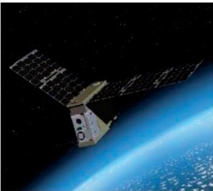

a)

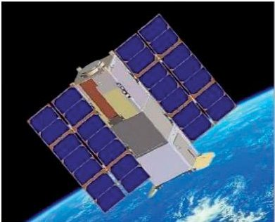

b)

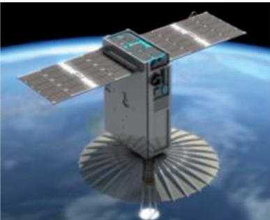

c)

Figure 7. Artist's view of (a) TEMPEST [31], (b) RAVAN [32], and (c) RainCube missions [33].

## 2.2 ESA science and technology strategy using CubeSats

On the educational side, the ESA launched in February 2008 the first Call for CubeSat Proposals to universities in ESA member and cooperating states. Seven student-built CubeSats were launched onboard the Vega maiden flight on February 13, 2012. Since then, 12 more CubeSats have been enrolled in the first and second editions of the "Fly Your Satellite!" program.

Since 2013, the ESA has invested more than 16 M€ as part of the General Support Technology Program (GSTP) FLY Element [34], in 12 CubeSat IOD missions [35, 36]. As part of ESA's Systems Department Project Office of the Systems

<!-- PDF_PAGE: 12 -->

Department, Directorate of Technical and Engineering Quality, in April 2019, the CubeSat Systems Unit was created.

In addition to the work conducted by this unit, there are a number of other CubeSat-related initiatives in ESA:

- The Directorate of Telecommunications and Integrated Applications is developing a pioneer series of CubeSat missions, to test novel telecommunication technologies.

- The Directorate of Operations has OPS-SAT [37] ready to fly, an IOD test-bed for innovative mission control software.

- The Directorate of Human and Robotic Exploration is considering a CubeSat mission to test out a key capability for Mars sample return optical detection and navigation to a sample container from the orbit.

- The Science Directorate is also adapting some CubeSat technologies for operation in the deep space environment as well as studying the potential use of CubeSats in support of planetary science missions.

- The Directorate of Earth Observation will fly FSSCat [38, 39], a double 6 U CubeSat mission for tandem observation of the polar regions and for soil moisture mapping using the FMPL-3 (UPC, ES), a combined L-band microwave radiometer and GNSS-Reflectometer using a software-defined radio, and HyperScout-2 (Cosine, NL), a VNIR and TIR hyperspectral imager enhanced with artificial intelligence for cloud detection (PhiSat-1).

The first ESA CubeSat projects are listed in Table 6. In addition to these missions, numerous studies have focused on the applications of CubeSat missions and

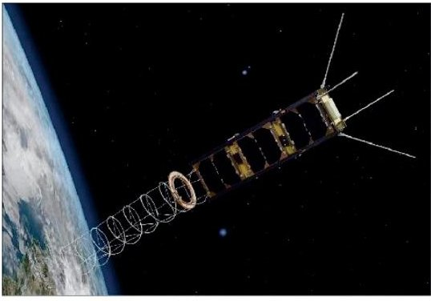

a)

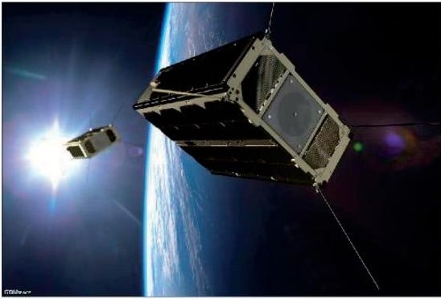

b)

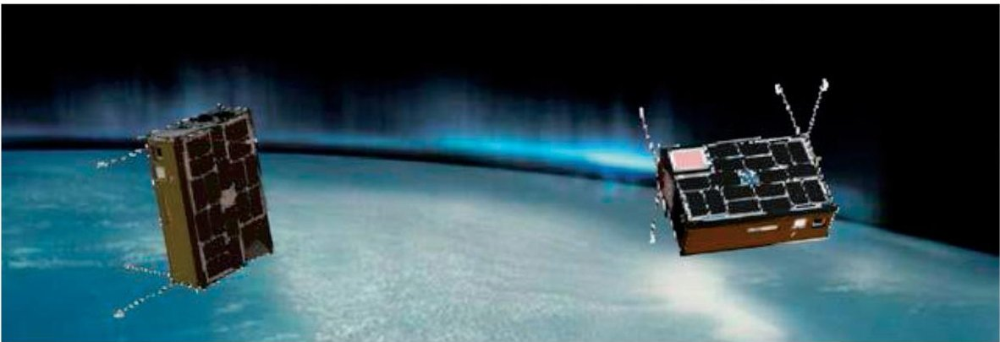

c)

Figure 8. Artist's view of (a) GOMX-3 [35] and (b) GOMX-4 [36] nanosatellites in space (credits GomSpace) and (c) FSSCat mission [38, 39].

<!-- PDF_PAGE: 13 -->

miniaturized payloads, including remote sensing with cooperative nanosatellites, asteroid impact missions, lunar CubeSats, astrobiology/astrochemistry experiment CubeSats, asteroid observer missions, etc.

<table border="1"><tr><td>Organization</td><td>Mission</td><td>Launch</td><td>Form factor</td><td>Field</td><td>Technical and comments</td></tr><tr><td>GomSpace(DK)</td><td>GOMX-3</td><td>2015</td><td>3U</td><td>Tech demo</td><td>ADS-B,GEO Satcom signal monitoring,X-band transmitter(Figure8a)</td></tr><tr><td>GomSpace(DK)</td><td>GOMX-4B</td><td>2018</td><td>2×6U</td><td>Tech demo Earth observation</td><td>Inter-satellite link and propulsion while in tandem withGOMX-4A(GomSpace,Ministry of Defense,DK),star trackerHyperScout compact hyperspectral VNIR imager(Cosine,NL)(Figure8b)</td></tr><tr><td>VKI(BE)</td><td>Qarman</td><td>2019</td><td>3U</td><td>Tech demo</td><td>Demonstrates reentry technologies,novel heatshield materials,new passive aerodynamic drag stabilization system,and telemetry transmission during reentry via data relay satellites in low Earth orbit</td></tr><tr><td>RMI(BE)KU Leuven(BE)</td><td>SIMBA</td><td>2019</td><td>3U</td><td>Earth observation</td><td>Total solar irradiance and Earth radiation budget</td></tr><tr><td>BIRA-IASB(BE)VTT(FI)Clyde Space(UK)</td><td>PICASSO</td><td>2019</td><td>3U</td><td>Atmosphere and ionosphere</td><td>Stratospheric ozone distribution,mesospheric temperature profile,and ionospheric electron density</td></tr><tr><td>C3S and MTAEK(HU)ICL(UK)Astronika(PO)</td><td>RadCube</td><td>2019</td><td>3U</td><td>Tech demo Space weather</td><td>3U platformIn situ space radiation and magnetic field in LEO</td></tr><tr><td>RUAG(AU)TU Graz(AU)SeibersdorfLabor GmbH(AU)</td><td>PRETTY</td><td>—</td><td>3U</td><td>Earth observation</td><td>GNSS-R at low grazing angles,radiation dosimeter</td></tr><tr><td>ESA</td><td>OPS-SAT</td><td>2019</td><td>3U</td><td>Tech demo</td><td>Experimentation with onboard and ground software by offering a safe and reconfigurable environment</td></tr><tr><td>UPC(ES)Golbriak(EE)Deimos Eng(PT)Tyvak Intl.(IT)Cosine(NL)</td><td>FSSCat</td><td>2019</td><td>2×6U</td><td>Tech demo Earth observation</td><td>RF and O-ISL,federated satellite experiment3Cat-5/A:Microwave radiometer and GNSS-R(UPC,ES)3Cat-5/B:HyperScout-2VNIR+TIR hyperspectral imager(Cosine,NL)(Figure8c)</td></tr></table>

In blue from the CubeSat Systems Unit, Directorate of Technical and Engineering Quality; in orange from the Directorate of Operations; and in green from the Directorate of Earth Observation (2017 ESA S^3 Challenge, Copernicus Masters Competition).

Table 6. The first ESA CubeSat-based missions.

<!-- PDF_PAGE: 14 -->

## 3. Astronomy and interplanetary missions using CubeSats

As highlighted in Sections 1.3 and 2.1, the majority of the CubeSats orbiting today are devoted to Earth observation, notably from two commercial companies followed by communications. In the coming years, these two categories will still dominate. Although the largest increase will occur in communication satellites, the growth in scientific (non-EO) missions will not be negligible (from 10 to 20% Figure 9) considering that the predicted number of satellites to be launched is going to multiply by more than a factor of 3 (see Figure 4).

In particular, until 2017 there were only 5 astronomy missions, and in the field interplanetary missions, until 2018 only 14 nano-/microsatellites had been launched to destinations outside the LEO. Beyond-the-Earth orbit is the domain of civil agencies who, for the sake of reliability, have been historically reluctant to invest in small satellites. However, things may be changing, since only in 2018 four nano-/microsatellites made their way beyond the Earth orbit, which is more than those in the previous 5 years all together, and 35 more are expected to be launched in the coming 5 years. Naturally, most of them target the moon, but a non-negligible fraction will be devoted to interplanetary missions (Figure 10).

As in other fields, at the beginning all the astronomy or heliophysics missions were conducted by universities, and it was not until 2017 that the first NASA JPL mission (ASTERIA) was launched. Achieving state-of-the-art astronomy with CubeSats has become possible due to advances in precision pointing, communications technology, and deployables, among others (Tables 5.1 and 5.2 of [40]). Table 7, distilled from [21], shows the main astronomy and beyond-the-Earth past and planned missions. It also shows that the majority of these missions are based on the 6 U form factor, which is the smallest one capable to accommodate all the advanced attitude determination and control systems (ADCS), larger deployable solar panels and antennas, as well as telescope optics. It is also remarkable that so far there are no funded CubeSat missions in the far IR because the thermal stability and detector cooling require cryo-coolers for CubeSats that have yet to be developed for astrophysics due to power and space limitations [41].

It is worth noting that the large number of CubeSats to be launched to the Moon in 2020 corresponds to the Artemis-1 mission (Figure 11), formerly known as Exploration Mission-1. The first mission for NASA's Orion rocket and the European Service Module will send the spacecraft beyond the moon and back. Thirteen low-cost CubeSat missions were competitively selected as secondary payloads on the Artemis-1 test flight, all of them having the 6 U form factor. The selected CubeSats are Lunar Flashlight, Lunar South Pole, Near-Earth Asteroid Scout,

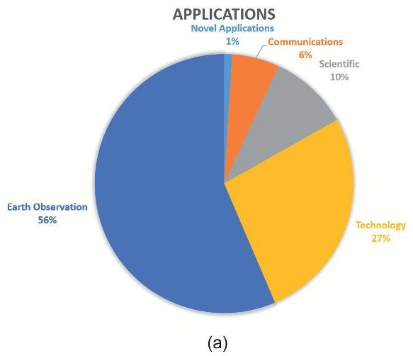

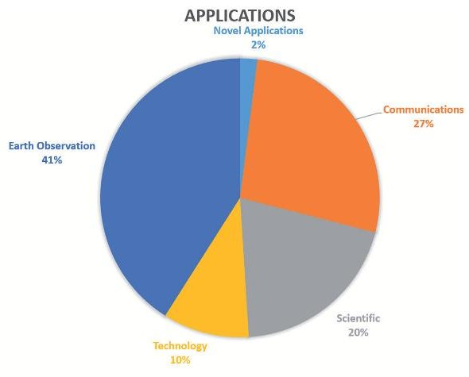

Figure 9. Satellite application trends (1-50 kg): (a) 2014-2018 and (b) 2019-2023 (adapted from [14]).

<!-- PDF_PAGE: 15 -->

Nanosatellites and Applications to Commercial and Scientific Missions DOI: http://dx.doi.org/10.5772/intechopen.90039

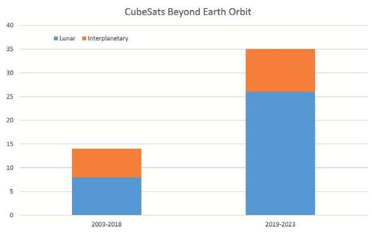

Figure 10. CubeSats launched beyond the earth orbit: 14 from 2003 to 2018 and 35 planed from 2019 to 2023 (adapted from [14]).

<table border="1"><tr><td>Organization</td><td>Mission</td><td>Launch</td><td>Form factor</td><td>Technical and comments</td></tr><tr><td>Morehead State University Kentucky Space</td><td>CXBN</td><td>2012</td><td>2U</td><td>Cosmic X-ray background(CXRB)在30-50keV range</td></tr><tr><td>University of Colorado</td><td>CSSWE</td><td>2012</td><td>3U</td><td>Measures the directional differential flux of solar energetic protons(SEPs)和Earth&#x27;s radiation belt electrons</td></tr><tr><td>Austria Canada Poland</td><td>BRITE</td><td>20132014</td><td>8U(2×2×2)</td><td>BRITE Target ExplorerConstellation:BRITE-Toronto,BRITE-Heweliusz,UniBRITE,BRITE-Austria,BRITE-Lem,BRITE-MontrealConducts photometric observations of some of the brightest stars in the sky to examine their variability.Observations will have a precision at least10x better than achievable from ground-based observations</td></tr><tr><td>University of Colorado at Boulder</td><td>MinXSS</td><td>2015</td><td>3U</td><td>Provides spectral observations of the solar X-rays near the maximum of solar cycle24from0.6keV(20Å)to25keV(0.5Å)</td></tr><tr><td>JPL(USA)MIT(USA)</td><td>ASTERIA</td><td>2017</td><td>6U</td><td>Detects exoplanetary transits across bright starsPointing accuracy of±0.003°(1σ)for2axesand±0.007°(1σ)for the third axis,with0.5&quot;rms over20min,pointing repeatability of0.001&quot;rms from orbit to orbit±0.01K level temperature stability of the imaging detector</td></tr><tr><td>ERC,CNRS,ESEP Lab,PSL Université Paris,Fondation MERAC,CNES,CCERES and Obs. de Paris-LESIA</td><td>PicSat</td><td>2018</td><td>3U</td><td>To observe in visible light the potential transit of thedirectly imaged giant planetβPictoris b and perhaps even its moons and debris</td></tr></table>

<!-- PDF_PAGE: 16 -->

<table border="1"><tr><td>Organization</td><td>Mission</td><td>Launch</td><td>Form factor</td><td>Technical and comments</td></tr><tr><td>University of Iowa</td><td>HaloSat</td><td>2018</td><td>6U</td><td>Measurement of soft X-ray emission from the hot halo of the Milky Way galaxy to resolve the missing baryon problem.Measure O VII and O VIII line emission in 400 fields(FOV~10°) over 90% of the sky.Study of solar wind charge exchange emission to remove uncertainty on the oxygen line emission measurementsFirst NASA-funded astronomy mission</td></tr><tr><td>Spacety(China)</td><td>Tongchuan-1</td><td>2018</td><td>6U</td><td>Detects signals from gamma-ray bursts, to identify and locate the electromagnetic counterparts to gravitational waves</td></tr><tr><td>University of Colorado Boulder</td><td>MinXSS-2</td><td>2018</td><td>3U</td><td>As MinXSS</td></tr><tr><td>University of Colorado</td><td>CSIM</td><td>2018</td><td>6U</td><td>Observes the solar spectral irradiance</td></tr><tr><td>DARPA</td><td>SHFT-1</td><td>2018</td><td>3U</td><td>Collects radio-frequency signals in the HF(5-30MHz)band to study the galactic background emissions,the HF signals from Jupiter,and the signals from terrestrial transmitters after having passed through the Earth&#x27;s ionosphere</td></tr><tr><td>NASA</td><td>MarCO-1/MarCO-2</td><td>2018</td><td>6U</td><td>Data relay to send data back to Earth during InSight&#x27;s entry,descent and landing operations at Mars. Technology capability demonstration of communications relay system</td></tr><tr><td>University of Hawaii at Manoa</td><td>NEUTRON-1</td><td>2019*</td><td>3U</td><td>Measures low-energy neutron flux in LEO environment</td></tr><tr><td>Boston University</td><td>CuPID</td><td>2019*</td><td>6U</td><td>Miniaturized soft X-ray imaging telescope</td></tr><tr><td>University of Colorado Boulder</td><td>CUTE</td><td>2020</td><td>6U</td><td>To conduct a survey of exoplanet transit spectroscopy in the near UV of a dozen short-period,large planets orbiting F,G,and K stars to constrain stellar variability and measure mass loss ratesSecond NASA-funded astronomy mission</td></tr><tr><td>Isaware(FI)</td><td>XFM Cube</td><td>2020</td><td>3U</td><td>Measuring X-ray fluxes</td></tr><tr><td>Lockheed Martin</td><td>LunIR</td><td>2020</td><td>6U</td><td>Lunar flyby to collect spectroscopy and thermography(MWIR sensor)for surface characterization,remote sensing,and site selection</td></tr><tr><td>Arizona State University</td><td>LunaH-Map</td><td>2020</td><td>6U</td><td>High-resolution mapping of hydrogen content of the entire south pole of the moon,including permanently shadowed regions up to a meter</td></tr></table>

<!-- PDF_PAGE: 17 -->

Nanosatellites and Applications to Commercial and Scientific Missions DOI: http://dx.doi.org/10.5772/intechopen.90039

<table border="1"><tr><td>Organization</td><td>Mission</td><td>Launch</td><td>Form factor</td><td>Technical and comments</td></tr><tr><td>NASA JPL</td><td>Lunar Flashlight</td><td>2020</td><td>6U</td><td>Illuminates with lasers in four different bands the permanently shadowed regions and detect water ice absorption bands in the near-infrared</td></tr><tr><td>Morehead State University</td><td>Lunar IceCube</td><td>2020</td><td>6U</td><td>Prospects for water ice and other lunar volatiles as a function of time of day, latitude, and regolith composition/mineralogy from a low-perigee lunar orbit flying only 100km(62 miles) above the lunar surface</td></tr><tr><td>Arizona State University(USA)</td><td>SPARCS</td><td>2021</td><td>6U</td><td>Monitoring in the far(153-171nm)和 nearUV(258-308nm) of low-mass stars(0.2-0.6MO);the most dominant hosts of exoplanetsEach star observed for at least one stellar rotation(4-45days)Third NASA-funded astronomy mission</td></tr><tr><td>NASA&#x27;s Goddard Space Flight Center</td><td>BurstCube</td><td>2021</td><td>6U</td><td>Detection of gamma ray transients in the10-1000keV energy range. Valuable capability to catch the predicted counterparts of gravitational wave sourcesFourth NASA-funded astronomy mission</td></tr><tr><td>ESA Luxembourg Space Agency(LU)GomSpace(DK)</td><td>M-ARGO</td><td>2023</td><td>12U</td><td>Demonstrating asteroid rendezvous and identifying in situ resources with multispectral imager and laser altimeter</td></tr><tr><td>ESA</td><td>HERA CUBESAT</td><td>N/A</td><td>2x6U</td><td>Observing asteroid and deflection assessment</td></tr></table>

Table 7.

Non-comprehensive list of astronomy and beyond-the-earth CubeSat-based missions.

BioSentinel (carrying the first living creatures into deep space since 1972), SkyFire, Lunar IceCube, CubeSat for Solar Particles (CuSP), Lunar Polar Hydrogen Mapper (LunaH-Map), EQUULEUS, OMOTENASHI, ArgoMoon, Cislunar Explorers, Earth Escape Explorer （CU-E $ ^{3} $ ）, and Team Miles.

Talking about interplanetary missions, on May 5, 2018, NASA launched a stationary lander called InSight to Mars. InSight landed on Mars on November 26, 2018. Riding along with InSight were two CubeSats—the first of this kind of spacecraft ever to fly to deep space [42]. Both MarCO-A and MarCO-B succeeded in a flyby of Mars, relaying data to Earth from InSight as it landed on Mars. Figure 12 shows an artist view of the MarCOs with the reflectarray used for communication purposes.

In addition to the "classical" astronomy, lunar and Martian missions cited above, CubeSats are nowadays finding their way to other bodies of the solar system, and there are proposals [43] to send them to Venus (CUVE mission), Deimos and Phobos asteroids (PRISM and PROME missions), comets (PrOVE mission), or Jupiter (ExCSITE mission, [44]). Figure 13 from [44] illustrates the LEO and beyond-LEO CubeSat exploration initiatives.

<!-- PDF_PAGE: 18 -->

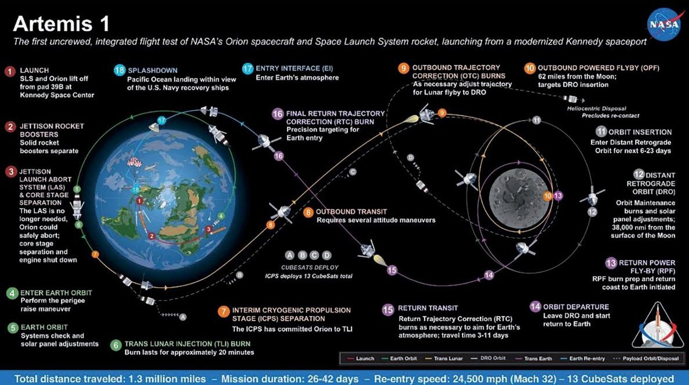

Figure 11. Overview of the mission plan for Artemis-1: CubeSats will be deployed at steps A, B, C, and D [https://www. nasa.gov/image-feature/artemis-1-map].

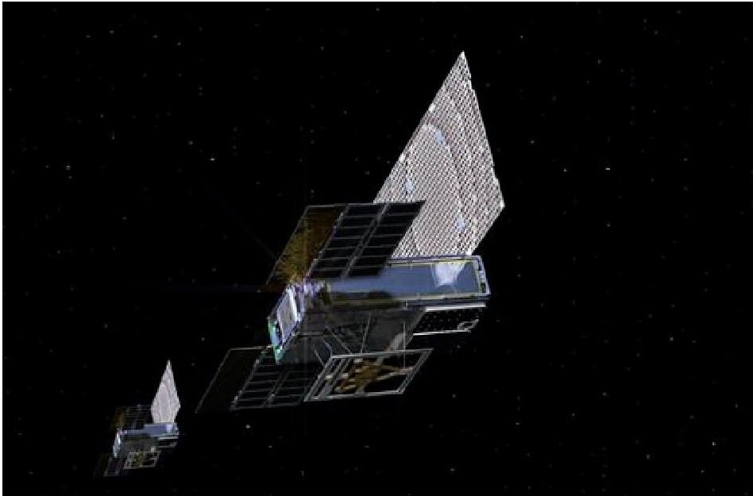

Figure 12. Artist view of MarCO-A and MarCO-B [42].

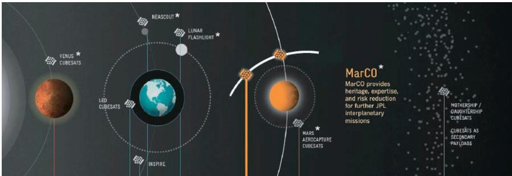

Figure 13. Solar system exploration with CubeSats and nanosats [44].

<!-- PDF_PAGE: 19 -->

## 4. Conclusions and way forward

Since its conception in 1999, CubeSats have produced a "disruptive innovation": from simple applications at the bottom of a market (mostly educational), they have relentlessly moved up, eventually displacing established medium-size competing satellites. However, CubeSats cannot displace all the large space missions as physics laws cannot be changed, i.e., large apertures and focal lengths are required to collect faint signals and achieve large angular resolution. However, CubeSats are finding their own niche in many Earth observation, astronomical, and communications applications where short revisit times or even continuous monitoring is required.

Early CubeSats typically had short lifetimes once in orbit (a few months), but with increased ground testing and added redundancies, lifetimes have grown significantly, up to 4-5 years in some cases.

Despite all these outstanding improvements, in order to exploit the full potential of CubeSats, many technologies still need to be developed. Table 8 summarizes the enabling technologies required for different science applications, indicating in red the most challenging technologies and applications, notably increased communications performance, reliability, thermal stability, and calibration accuracy, to form constellations or formation flying satellite topologies to create large interferometers and distributed apertures.

<table border="1"><tr><td>Science discipline</td><td>Enabling technology</td><td>Example application</td></tr><tr><td rowspan="4">Solar and space physics</td><td>Propulsion</td><td>Constellation deployment and maintenance, formation flying</td></tr><tr><td>Sub-arcsecond attitude control</td><td>High-resolution solar imaging</td></tr><tr><td>Communications</td><td>Missions beyond low Earth orbit</td></tr><tr><td>Miniature field and plasma sensors</td><td>In situ measurements of upper atmosphere plasmas</td></tr><tr><td rowspan="3">Earth science</td><td>Propulsion</td><td>Constellations for high-temporal resolution observations and orbit maintenance</td></tr><tr><td>Miniaturized sensors</td><td>Stable, repeatable, and calibrated datasets</td></tr><tr><td>Communications</td><td>High data rates</td></tr><tr><td rowspan="6">Planetary science</td><td>Propulsion</td><td>Orbit insertion</td></tr><tr><td>Comms&amp;Comms Infrastructure</td><td>Direct/indirect to Earth communications</td></tr><tr><td>Radiation-tolerant electronics</td><td>Enhanced reliability in planetary magnetospheres, long flights</td></tr><tr><td rowspan="2">Deployables</td><td>Deployable solar panel enhanced power generation</td></tr><tr><td>Deployable mirrors and antennas</td></tr><tr><td rowspan="5">Astronomy and astrophysics</td><td>Propulsion</td><td>Constellations for interferometry, distributed apertures</td></tr><tr><td>Sub-arcsecond attitude control</td><td>High-resolution imaging</td></tr><tr><td>Communications</td><td>High data rate</td></tr><tr><td>Deployables</td><td>Increased aperture and thermal control</td></tr><tr><td>Miniaturized sensors</td><td>UV and X-ray imaging</td></tr><tr><td>Physical and biological</td><td>Thermal control</td><td>Stable payload environment</td></tr></table>

CubeSat-enabling technologies and potential applications for each science discipline (adapted from [40]).

<!-- PDF_PAGE: 20 -->

In the field of Earth observation, future developments in nanosat sensors will likely occur:

- In the field of passive microwave sensors:

- Miniature microwave and millimeter-wave radiometers for weather applications, such as the MiniRad which is onboard the Global Environmental Monitoring System (GEMS) constellation from Orbital Micro Systems [45], or

- GNSS-R instruments with real-time processing for target detection/identification [46] or—as larger downlink bandwidths are available—with raw data acquisition and on-ground processing to optimize the processing according to the target, as planned in FMPL-3, the evolution of the FMPL-2 on board FSSCat [38, 39].

- In the field of passive VNIR/TIR hyperspectral imagers, imagers will include a larger number of bands but will include advanced image compression algorithms to minimize the amount of information to be downloaded and will incorporate artificial intelligence to download only the information extracted instead of the raw data.

Also, both their calibration will have to be refined so as to improve the quality of the scientific data.

Due to power and antenna size requirements, active microwave sensors (e.g., radar altimeters and SARs) will likely remain in domain of mini- and microsats (< 100 kg, e.g., ICEYE constellation [47]), and it is unlikely that active optical sensor technology (i.e., lidars) develops in small satellites in the midterm.

In the field of astronomy, and in particular heliophysics, NASA has also been taking the lead. In 2017 NASA selected nine proposals under its Heliophysics Small Explorers Program [48]: (1) the Mechanisms of Energetic Mass Ejection Explorer (MEME-X), (2) the Focusing Optics X-ray Solar Imager (FOXSI), (3) the Multi-Slit Solar Explorer (MUSE), (4) the Tandem Reconnection and Cusp Electrodynamics Reconnaissance Satellites (TRACERS), (5) the Polarimeter to Unify the Corona and Heliosphere (PUNCH), (6) the Atmospheric Waves Experiment (AWE), (7) the US Contributions to the THOR mission (THOR-US), (8) the Coronal Spectrographic Imager in the Extreme ultraviolet (COSIE), and (9) the Sun Radio Interferometer Space Experiment (SunRISE) mission concept, which is a space-based sparse array, composed of formation flying of six SmallSats designed to localize the radio emission associated with coronal mass ejections (CMEs) from the sun [49].

More recently, in August 2019, NASA selected two proposals to demonstrate SmallSat technologies to study interplanetary space [50]：(1) Science-Enabling Technologies for Heliophysics (SETH) will demonstrate two technologies, an optical communications technology and experiment to detect solar energetic neutral atoms as well as an array of waves and other particles that erupt from our sun, and (2) Solar Cruiser, which will deploy a nearly 18,000 square foot solar sail and a coronagraph instrument that would enable simultaneous measurements of the sun's magnetic field structure and velocity of coronal mass ejections or CMEs.

As a final thought, quoting Prof. Puig-Suari, "Before cubesats, we were so conservative nobody was willing to try anything out of the ordinary. When we did, we discovered some of the things everybody said would not work, did work. The fundamental change was that there was a mechanism to go try to those things. Some will work and some will not, but it allows us to try them and that was very

<!-- PDF_PAGE: 21 -->

infrequent before cubesats arrived. That was really important. That was the big change." And this is just the beginning of a new way to do Earth observation, astronomy, and satellite communications much more, in a different and more efficient way than it was done in the past decades. What will the future bring? Nobody knows, but certainly the future is being shaped today with these novel technologies and only our imagination will set the limits.

## Acknowledgements

This work has been supported by an ICREA Academia award from the Generalitat de Catalunya to Prof. A. Camps. The author wants to express his gratitude to Profs. A. Golkar (Skoltech, Moscow, Russia) and H. Park (Universitat Politiccnica de Catalunya, Barcelona, Spain) for the revision of this chapter and useful comments.

## Author details

Adriano Camps $ ^{1,2} $

1 CommSensLab "María de Maeztu" Unit, Department of Signal Theory and Communications, Universitat Politècnica de Catalunya UPC-Barcelona Tech, Barcelona, Spain

2 Institut d'Estudis Espacials de Catalunya, IEEC/CTE-UPC, Barcelona, Spain

*Address all correspondence to: camps@tsc.upc.edu

## IntechOpen

© 2019 The Author(s). Licensee IntechOpen. This chapter is distributed under the terms of the Creative Commons Attribution License (http://creativecommons.org/licenses/ by/3.0), which permits unrestricted use, distribution, and reproduction in any medium, provided the original work is properly cited.

<!-- PDF_PAGE: 22 -->

## References

[1] Sputnik-1 NSSDCA/COSPAR ID 1957-001B. Available from: https:// nssdc.gsfc.nasa.gov/nmc/spacecraft/ display.action?id=1957-001B [Accessed: 31 August 2019]

[2] Explorer-1 NSSDCA/COSPAR ID: 1958-001A. Available from: https:// nssdc.gsfc.nasa.gov/nmc/spacecraft/ display.action?id=1958-001A [Accessed: 31 August 2019]

[3] Vanguard-1 NSSDCA/COSPAR ID: 1958-002B. Available from: https:// nssdc.gsfc.nasa.gov/nmc/spacecraft/ display.action?id=1958-002B [Accessed: 31 August 2019]

[4] What was Sputnik One?. Available from: https://www.universetoday. com/78110/sputnik-one/ [Accessed: 31 August 2019]

[5] Explorer/Early Satellites. Available from: https://www.nasa.gov/mission_ pages/explorer/explorer.html [Accessed: 31 August 2019]

[6] The first satellite to have solar electric power and the oldest man made object still in orbit. Available from: https://twitter. com/delgeo1/status/975032039840903168 [Accessed: 31 August 2019]

[7] NRO. Develop Acquire Launch Operate (NRO Brochure). 22 March 2016. Archived from the original (PDF) on 26 January 2017. Retrieved 24 April 2016. Available from: https://web. archive.org/web/20170126092253/http:// www.nro.gov/about/nro/NRObrochure. pdf [Accessed: 31 August 2019]

[8] Proton-1 NSSDCA/COSPAR ID: 1965-054A. Available from: https:// nssdc.gsfc.nasa.gov/nmc/spacecraft/ display.action?id=1965-054A [Accessed: 31 August 2019]

[9] Compton Gamma-Ray Observatory NSSDCA/COSPAR ID:

1991-027B. Available from: https:// nssdc.gsfc.nasa.gov/nmc/spacecraft/ display.action?id=1991-027B [Accessed: 31 August 2019]

[10] Lacrosse/Onyx: Radar Imaging Reconnaissance Satellite. Available from: https://www.globalsecurity.org/ space/systems/lacrosse.htm [Accessed: 31 August 2019]

[11] Hubble Space Telescope (HST) NSSDCA/COSPAR ID: 1990- 037B. Available from: https://nssdc. gsfc.nasa.gov/nmc/spacecraft/display. action?id=1990-037B [Accessed: 31 August 2019]

[12] ENVISAT Mission Summary. Available from: https://earth.esa.int/web/guest/missions/esa-eo-missions/envisat/mission-summary [Accessed: 31 August 2019]

[13] Telstar 19 Vantage. Available from: https://www.telesat.com/our-fleet/ Telstar-19-VANTAGE [Accessed: 31 August 2019]

[14] Spaceworks Enterprises Inc. Nano/ Microsatellite market forecast, 9th ed. 2019. Available from: https://www. spaceworks.aero/wp-content/uploads/ Nano-Microsatellite-Market-Forecast 9th-Edition-2019.pdf [Accessed: 31 August 2019]

[15] Ruiz-De-Azua JA, Camps A, Calveras Augé A. Benefits of using mobile ad-hoc network protocols in federated satellite systems for polar satellite missions. IEEE Access. 2018;6:56356-56367. DOI: 10.1109/ ACCESS.2018.2871516

[16] Golkar A, Cruz IL. The federated satellite systems paradigm: Concept and business case evaluation. Acta Astronautica. 2015;111:230-248. DOI: 10.1016/j.actaastro.2015.02.009

<!-- PDF_PAGE: 23 -->

[17] CubeSat Developer Resources. Available from: http://www.cubesat.org/ resources/ [Accessed: 31 August 2019]

[18] Planetary Systems Corporation. "PAYLOAD SPECIFICATION FOR 3U, 6U, 12U AND 27U." Available from: http://www.planetarysystemscorp.com/web/wp-content/uploads/2016/08/ 2002367D-Payload-Spec-for-3U-6U- 12U-27U.pdf [Accessed: 31 August 2019]

[19] Alba Orbital, TUDelft, and Gauss Team. The PocketQube Standard. Issue 1, 7th of June, 2018. Available from: https:// dataverse.nl/api/access/datafile/11680 [Accessed: 31 August 2019]

[20] NASA. What are SmallSats and CubeSats? Available from: https://www. nasa.gov/content/what-are-smallsats and-cubesats [Accessed: 31 August 2019]

[21] Nanosats database. Available from: www.nanosats.eu [Accessed: 31 August 2019]

[22] Planet Labs Inc. website. Available from: https://www.planet.com/ [Accessed: 31 August 2019]

[23] Spire Global Inc. website. Available from: https://www.spire.com/en [Accessed: 31 August 2019]

[24] ISRO PSLV-C37 onboard camera view of 104 satellites deployment Available from: https://www.youtube. com/watch?v=c0BpjPUT5FE [Accessed: 31 August 2019]

[25] Electromagnetic spectrum with different bands indicated. Available from: http://www.altimetry.info/ radar-altimetry-tutorial/how-altimetry works/frequencies-used-their-impacts/ [Accessed: 31 August 2019]

[26] Alkalai L, Norton C, Freeman A. CubeSats and small satellites as a vehicle for space innovation and exploration of space beyond earth orbit. In:

4thIAA Conference on University Satellite Missions and CubeSat Workshop -Rome, December 4-7. 2018. Available from: https://www. gaussteam.com/wordpress/wp-content/ uploads/2018/02/20171204_Leon- Alkalai-1.pdf [Accessed: 31 August 2019]

[27] Seablom MS, Tan FW, Norton CD, Baker CE, Millar PS, Mercer CR, et al. Advancing technology for NASA science with small spacecraft. In: Proceedings of the 2019 IEEE International Geoscience and Remote Sensing Symposium, Yokohama, Japan, July 28-August 2. 2019

[28] Keck Institute for Space Studies. Small Satellites: A Revolution in Space Studies. Pasadena, CA: California Institute of Technology; July 2014. Available from: http://kiss.caltech.edu/final_reports/SmallSat_final_report.pdf [Accessed: 31 August 2019]

[29] Selva D, Krejci D. A survey and assessment of the capabilities of Cubesats for earth observation. Acta Astronautica. 2012;74:50-58

[30] Freeman T. Deep Space cubesats and nanosats at JPL. May 2017. Available from: https://icubesat.files.wordpress. com/2017/05/2017-a-1-1-201705300833 deep-space.pdf [Accessed: 31 August 2019]

[31] TEMPEST-D (Temporal Experiment for Storms and Tropical Systems Technology - Demonstration). Available from: https://directory.eoportal.org/web/eoportal/satellite-missions/t/ tempest-d [Accessed: 31 August 2019]

[32] RAVAN (Radiometer Assessment using Vertically Aligned Nanotubes) Pathfinder Mission. Available from: https://directory.eoportal.org/web/eoportal/satellite-missions/r/ravan [Accessed: 31 August 2019]

[33] RaInCube (Radar In a CubeSat). A precipitation profiling mission. Available from: https://directory.

<!-- PDF_PAGE: 24 -->

eoportal.org/web/eoportal/satellitemissions/r/raincube [Accessed: 31 August 2019]

[34] ESA's 'Cubesat central' for smaller missions into space. Available from: http://www.spacedaily.com/reports/ ESAs_Cubesat_central_for_smaller missions_into_space_999.html [Accessed: 31 August 2019]

[35] GOMX-3 (GomSpace Express-3). Available from: https://directory.eoportal org/web/eoportal/satellite-missions/g/ gomx-3 [Accessed: 31 August 2019]

[36] GomX-4 (GomSpace Express-4) Mission. Available from: https:// directory.eoportal.org/web/eoportal/ satellite-missions/g/gomx-4 [Accessed: 31 August 2019]

[37] OPS-SAT (Operations nanoSatellite). Available from: https:// directory.eoportal.org/web/eoportal/ satellite-missions/o/ops-sat [Accessed: 31 August 2019]

[38] Camps A et al. FSSCat, the 2017 Copernicus masters "ESA sentinel small satellite challenge" winner: A federated polar and soil moisture tandem Mission based on 6U Cubesats. In: IGARSS 2018- 2018 IEEE International Geoscience and Remote Sensing Symposium, Valencia. 2018. pp. 8285-8287. DOI: 10.1109/ IGARSS.2018.8518405

[39] Camps A et al. FSSCat: A Cubesatbased tandem mission for earth observation of the polar regions. In: ESA Living Planet Symposium, 13-17 May 2019, Milano, Italy. 2019. Available from: https://lps19.esa.int/NikalWebsitePortal/living-planet-symposium-2019/lps19/ Agenda/AgendaItemDetail?id=9da26b75- 2380-43a9-a1c4-d9adb53b76a1 [Accessed: 31 August 2019]

[40] Achieving Science with CubeSats: Thinking inside the Box. National Academies; 2016. Available from: https://www.nap.edu/catalog/23503/

achieving-sciencewith-cubesats thinking-inside-the-box [Accessed: 31 August 2019]

[41] Shkolnik E. On the verge of an astronomy CubeSat revolution. Nature Astronomy. 2018;2:374-378 Available from: https://www.nature.com/ articles/s41550-018-0438-8 [Accessed: 31 August 2019]

[42] Mars Cube One (MarCO). Mission Overview. Available from: https://www. jpl.nasa.gov/cubesat/missions/marco. php [Accessed: 31 August 2019]

[43] NASA Planetary Missions and Concepts. Available from: https:// cubesats.gsfc.nasa.gov/missions.html [Accessed: 31 August 2019]

[44] Freeman A. Deep space NanoSats—Positioned for exponential growth. In: Proceedings of the 4S Symposium, Valletta, Malta, May 30-June 6. 2016. Available from: https://trs.jpl.nasa.gov/bitstream/ handle/2014/46097/CL%2316-1703. pdf?sequence=1&isAllowed=y [Accessed: 31 August 2019]

[45] Orbital Micro Systems Achieves Earth Observation Breakthroughs Available from: https://www. globenewswire.com/news-release/2019/08/19/1903620/0/en/ Orbital-Micro-Systems-Achieves-Earth-Observation-Breakthroughs.html [Accessed: 31 August 2019]

[46] Di Simone A, Park H, Riccio D, Camps A. Sea target detection using spaceborne GNSS-R delay-Doppler maps: Theory and experimental proof of concept using TDS-1 data. IEEE Journal of Selected Topics in Applied Earth Observations and Remote Sensing. 2017;10(9). DOI: 10.1109/JSTARS.2017.270535

[47] Iceye SAR Satellite Constellation Available at: https://www.iceye.com/. Last visited October 6, 2019

<!-- PDF_PAGE: 25 -->

Nanosatellites and Applications to Commercial and Scientific Missions DOI: http://dx.doi.org/10.5772/intechopen.90039

[48] NASA Selects Proposals to Study Sun, Space Environment. Available from: https://www.jpl.nasa.gov/news/news.php?feature=6912 [Accessed: 31 August 2019]

[49] Alibay F, Hegedus AM, Kasper JC, Lazio TJW, Neilsen T. SunRISE status: Concept development update. 2018 IEEE Aerospace Conference, Big Sky, MT. 2018. pp. 1-11. DOI: 10.1109/AERO. 2018.8396371

[50] NASA selects proposals to demonstrate smallSat technologies to study interplanetary space. Available at: https://phys.org/news/2019-08-nasa-smallsat-technologies-interplanetary-space.html. Last visited: October 7, 2019