<!-- PDF_PAGE: 1 -->


<div align="center">

# Development of High-Performance Compact On-Board Computer for Micro/Nano-Satellites with Software Resource Sharing Framework

</div>

Tomohiro Narumi, Shinji Takano & Shinichi Kimura

To cite this article: Tomohiro Narumi, Shinji Takano & Shinichi Kimura (2017) Development of High-Performance Compact On-Board Computer for Micro/Nano-Satellites with Software Resource Sharing Framework, SICE Journal of Control, Measurement, and System Integration, 10:1, 10-15, DOI: 10.9746/jcmsi.10.10

To link to this article: https://doi.org/10.9746/jcmsi.10.10


Published online: 18 Jan 2021.


Submit your article to this journal


Article views: 389


View related articles


View Crossmark data


ng articles: 2 View citing articles

<!-- PDF_PAGE: 2 -->

<div align="center">

# Development of High-Performance Compact On-Board Computer for Micro/Nano-Satellites with Software Resource Sharing Framework

</div>

Tomohiro NARUMI $ ^{*} $ , Shinji TAKANO $ ^{**} $ , and Shinichi KIMURA $ ^{***} $

Abstract: Due to advances in mission complexity and increased requirements for autonomous control of small satellites, high-level computing performance of on-board computers, as well as the necessary software implementation to maintain essential functionality, is more frequently required for small satellites. To satisfy these requirements, we developed a high-performance and compact on-board computer for micro and nano-satellites using commercial off-the-shelf (COTS) components including a structure to increase the reliability by sharing software to enhance reusability. The capability of small satellites can be dramatically improved by having common standards for high computing performance and a low-cost platform for the on-board computers. Additionally, the mission potential of small satellites can then be expanded. When the same platform is utilized recursively, the reliability of the platform will increase through repeated verification. In this paper, we describe the concept of a high-performance, low-cost on-board computer system using COTS devices, the sharing of software resources, and a practical on-orbit evaluation of the system.

Key Words: satellites, on-board computer, software sharing, COTS devices.

## 1. Introduction

Small satellites are widely used for various applications due to their lower development costs and shorter assembly periods than large satellites. Orbital rendezvous missions [1],[2] or Earth observation missions using satellite constellations consisting of small satellites have been already proposed [3],[4]. Additionally, rapid advancement of technical missions that employ small satellites is expected, such as autonomous analysis of observation data and recovery of a malfunctioning satellite by image navigation in orbit to reduce space debris in near future. With the sophistication and miniaturization of small satellite equipment, the complexity of a mission using small satellites can also be enhanced by conducting intricate technical experiments. Thus, it is necessary to perform advanced computational processing on small satellites, for instance, the in-situ image processing or autonomous rendezvous by a small satellite [5]. Due to the advances in the complexity of missions and requirements for autonomous control of small satellites, a high level of computing performance as well as the necessary software implementation is required of the computers to ensure functionalities such as image processing and autonomous rendezvous control capabilities.

In general, the resources of small satellites, such as the computing budget and power, are strictly limited. Additionally, the resources are mostly used for processing critical calculations to check the satellite health or provide fundamental control of the satellite for its survival. On the other hand, onboard equipment including a computer, must be sustainable in

a high-radiation space environment [6]-[8]. Therefore, low-performance, one-chip microcomputers, such as the PIC and H8, tend to be adopted as the on-board computers for small satellites. For instance, the ultra-small satellite XI, which was developed by the University of Tokyo, includes the essential technology for a small satellite system [9] using a PIC microcontroller as its on-board computer (OBC). The nano satellite CUTE-I developed by Tokyo Institute of Technology verifies communication, sensing, and demonstration of the deployment mechanism [10] using an H8 OBC. However, the calculation capabilities of these 8-bit one-chip microcomputers are quite limited for complicated missions.

Moreover, the on-board computers for the small satellites tend to be developed only for the individual missions of each organization. In addition to the above-mentioned XI series and CUTE-I, the RISING-2 was developed by Tohoku University and Hokkaido University and has been loaded with an antifused field programmable gate array (FPGA) [11]. The CubeSat RAIKO, which was developed by Tohoku University and Wakayama University, adapted the Virtex-4 as its OBC [12].

Such individualized computer development can be a harmful barrier towards improving reliability. The capability of small satellites is able to be dramatically improved and their mission potential expanded if we can develop a platform consisting of a high-performance, on-board computer that is low-cost, and compact with a software framework that improves reusability. If the same platform is used recursively, the reliability of the platform is expected to increase through repeated verification. Additionally, by sharing community software resources, satellite development will become more efficient as constructive technology and software resource exchange is carried out between developers using the on-board computer.

To meet these goals, the on-board computer for micro and nano-satellites using commercial off-the-shelf (COTS) components [13] including a satellite software framework that improves reusability [14] was developed. Additionally, the com-

<!-- PDF_PAGE: 3 -->

puter also has a structure for increasing the reliability by sharing software. In this paper, overview of the platform consisting of this on-board computer and satellite software framework then describe the attempts towards sharing software resources and the on-board computer circuit board are provided. Finally, an on-orbit evaluation of the system is shown.

## 2. Concept

We focused on the Renesas Electronics SH-4 processor as the central processing unit (CPU) for this on-board computer. The SH-4 processor has high level of calculation capabilities. The SH-4 also includes sufficient memory capacity to support image processing applications. It became possible to reduce the development time and cost by adopting the SH-4 as the main processor since it is a widely used COTS device. Moreover, by using COTS software and hardware resources, improvements in productivity and reliability were expected. In addition, Linux operating system is installed on the board taking advantage of the 32-bit CPU. This approach lets us reduce the development burden as well as allows us to utilize the multitasking capabilities and software resources for the Linux environment (e.g. GNU scientific library, OpenCV). Using SH-4 and Linux technologies combined, the low-cost OBC circuit board with a high level of calculation performance was developed, which was named the "BoCCHAN-1 OBC". Developers will then be able to feed the results from use in various environments back into the system architecture, thereby improving the reliability of the onboard computer. Furthermore, the cost, size, and power consumption is sufficiently low. That is, general 1 kg to 50 kg satellites have 2 W to 50 W electrogenic capability, and their sizes are 10 cm to 50 cm. In order to install the OBC to all small satellites, even to educational demonstration satellite, the power consumption and the size had to be suppressed to satisfied performance.

In order to improve the reusability of satellite software, it is necessary to divide the functions of the satellite into modular partitions within the software. "HODOYOSHI SDK" software framework that can be combined to select modularized satellite functions as "plug-in software"[15],[16] was developed. "HODOYOSHI" means "Reasonably Reliable Systems", which aims to accelerate the technology development and practical utilization of low-cost micro/nano-satellites and new on-orbit devices thereof. Recently RT middleware (e.g. TOPPERS) or ROS(Robot Operating System) are widely used as software platform in robotics field, however, it is not easy to operate ROS on micro-computer which requires comparatively high-performance processor although that has various packages. To the contrary, RT middleware do not have sufficient packages, hence individual coding is necessary. HODOYOSHI SDK has satellite-dedicated functions which are optimized and covered necessary library, therefore it is sufficiently run on micro-computer and facilitates development of software. BoCCHAN-1 OBC has been developed for loading this software framework. The HODOYOSHI SDK can be constructed in combination with a Graphical User Interface (GUI) on the control software modules such as to provide telemetry commands, sensors, and actuators that are necessary for small/educational satellites. Developers may use the control software modules to achieve operation results that are then shared by the community. Thus, satellite software with a high


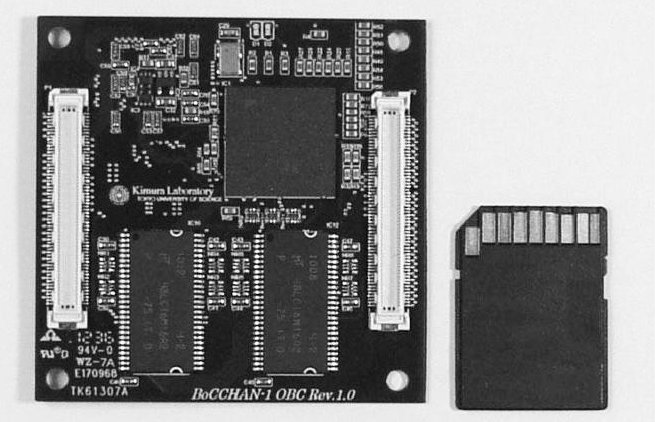


<div align="center">

Fig.1 BoCCHAN-1 OBC.

</div>


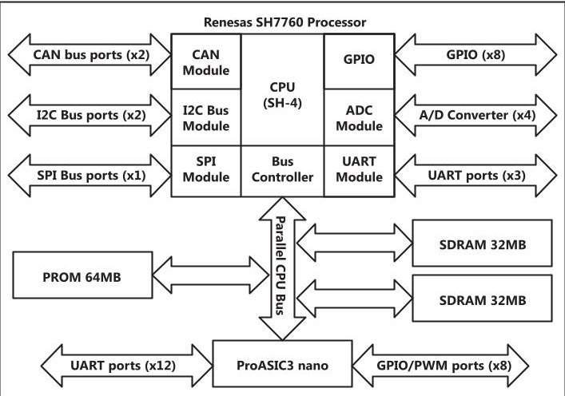


<div align="center">

Fig. 2 Block diagram of the OBC circuit board.

</div>

reliability can be developed. Additionally, it is possible to improve the reliability of the software module itself by using it in various environments.

This approach will then allow satellite software developers to concentrate on developing control software for the satellite itself by adopting this software framework. This system has the potential to be a powerful piece of educational equipment, because perfect software compatibility is achieved using the HODOYOSHI SDK software framework that is compatible with the SOI-SoC (Silicon- On-Insulator, System-on-a-Chip) OBC as utilized by the HODOYOSHI satellites (Japan-oriented micro satellite series for demonstrating "Reasonable Reliable Systems Engineering"). A high level of technology is necessary for the development of small satellites for educational purposes today. However, the difficulty is reduced by using the proposed on-board computer system, and allow more people to participate in satellite project.

## 3. OBC Architecture

Figure 1 shows the picture of the on-board computer while Fig.2 illustrates the block diagram of the computer. In this section, the computer board and the main devices are described. Satellite developers can easily obtain this device at low cost since it is based on widely used COTS components. The CPU component of the device is built using the Renesas 32-bit SH-4 core architecture. The SH-4 core is a superscalar architecture and has a five-stage pipeline. Concerning required performance for nano/micro satellites, it is sufficient if attitude determination and control which comparatively need a large amount of calculation, such as inverse kinematics of space robotics or Kalman filtering of attitude determination, can be computed at 100 Hz

<!-- PDF_PAGE: 4 -->


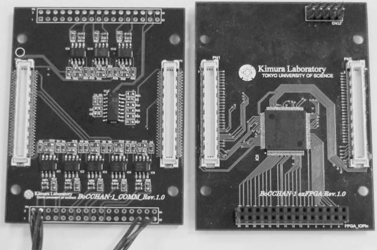


<div align="center">

Fig.3 Extension board.

</div>

frequency with housekeeping and uplink/downlink. This device performs 360 MIPS and 1.4 GFLOPS at 200 MHz, and satisfies the above requirement whereas conventional H8 or PIC are roughly 10 MIPS. In addition, this device has a memory management unit. It is possible to use the external memory space of 448 MB. The internal modules of the device consist of threeport serial communication interfaces with FIFO, two-port I2C bus, one-port serial peripheral interface bus, two-port control area network bus, and a 10-bit analog-to-digital converter with four channels. The two synchronous DRAM devices on the board are the Micron MT48LC series. These devices are each connected to the CPU by a 16-bit parallel data bus.

The memory devices and the CPU on the board are connected by a 32-bit parallel bus. The one set of programmable memory on the board is the NOR Flash Memory, Spansion S29GL-P series. The chip is connected to the CPU by a 16-bit parallel data bus. Linux and a boot loader have been written into the flash memory. The CPU loads these programs from the programmable memory and executes the startup routine when power is turned on. Programmable memory can be written by using dedicated software and a driver while running Linux, which eliminates the need to prepare a special debugger or a programmer unit. Developers only need to prepare a host computer, a development environment on the virtual OS (Ubuntu 11.01), a USB UART interface cable, powered by a 3.3 V direct current circuit to program this on-board computer.

Satellites are equipped with various sensors to determine the status of the satellite by monitoring operational parameters such as temperature, voltage, current, and satellite position/attitude. As previously mentioned, the CPU device has many external interfaces. A small satellite requires more interfaces to connect these sensors, such as 10-port, RS422 serial interfaces, SpaceWire, and other interfaces that are not supported by the CPU. In order to solve this problem, this board is equipped with the Microsemi ProASIC3 nano to extend these interfaces. The ProASIC3 nano is a Flash ROM FPGA that supports 250,000 gates. The 8-bit parallel data bus connects the FPGA to the CPU. 12-port serial communication interface and 8-port digital I/O interface with a pulse-width modulation circuit within the device are implemented. In addition, the board can be connected to an extension board with connectors for a base board as shown in Fig. 3. It is known that general high-performance micro-computer or FPGA tolerate radiation less well due to their small manufacturing process, whereas SH-4 and ProASIC3 have radiation resistances despite their performances by experiments. That is one of the most important reason why we

<div align="center">

Table 1 Specifications for the OBC board.

</div>

<table border="1"><tr><td>Processor</td><td>Renesas Electronics SH7760 Processor:200MHz360MIPS/1.4GFLOPS</td></tr><tr><td>Memory</td><td>MicronMT48LC SeriesSDRSDRAM:64MB(32MB×2)</td></tr><tr><td>PROM</td><td>SpansionS29GL SeriesNORFlash memory:64MB</td></tr><tr><td>Interfaces</td><td>UART:15 portsI2C:2 portsSPI:1 portControlAreaNetwork:2 portsA/DConverter:4 channelsPulse Counter:3 channelsDigitalI/Oport:8 portsPWM:Max4 ports</td></tr><tr><td>Size</td><td>60mm×60mm×5mm</td></tr><tr><td>Power supply</td><td>Input power:3.3VDCPower consumption:1.5W</td></tr></table>

adopt the devices.

Through this extension board, various data can be transferred using the processor bus that is faster than the serial interface. Attaching an expansion board extends the capacity of the SDRAM or Flash memory of the on-board computer. Several interfaces and the external storage area using NAND Flash memory with an additional FPGA can be expanded. Micro SD card driver on the board for developers that was formatted for a FAT32 file system are provided, which is useful for programming this OBC. In addition, it is necessary to qualify performance in radiation conditions, hence the radiation tolerance performances were qualified using a proton beam generated by a cyclotron. In the qualification test, we successfully qualified the main processing unit and found an unexpected phenomenon on the memory device. In spite of these high-level capabilities, power consumption of the OBC board was approximately 1.5 W. Additionally, the dimensions of the board are 60 mm $ \times $ 60 mm.

It is possible to use this on-board computer not only for small satellites but also for CANSAT that is educational satellite. Developers can then feed the usage results back into various environments to improve the reliability of the on-board computer. When considering satellite development for educational purposes, students can follow the steps to develop a miniaturized demonstration CANSAT satellite such as a 10kg class CubeSat or a 50kg class small satellite. They can use this computer board for CANSAT and CubeSat and mount the SOI-SoC OBC on the small satellite. The architecture of this board is the same as the SOI-SoC OBC that was loaded the HODOYOSHI satellite. As a result, the technical barrier decreases when moving to the development of a higher level satellite making it is possible to easily advance to developing a sophisticated satellite. The specifications for this on-board computer are listed in Table 1. On-orbit utilization proof experiments for this computer board in HODOYOSHI-3 were provided in 2014. Detailed experimental results are shown in chapter 6.

## 4. Software Framework

In this chapter, the software used for the system is described. Figure 4 shows the macroscopic software structure of the onboard computer. Linux with a memory management unit as the operating system are installed. Developers can easily imple-

<!-- PDF_PAGE: 5 -->

ment the Linux multitasking features as well as use legacy applications. Constraints from using Linux for the CPUs without memory management unit is not a consideration.

Interface software with an external interface for the processor and FPGA is implemented at the driver/middleware level. This board has several drivers for the external interfaces that is developed for Linux. These drivers can be easily installed and uninstalled in this system because they were developed as removable kernel modules within Linux.

At the application level, developers implement the on-board software using the interface provided by the driver or operating system call. For example, sending and receiving data from sensors and actuators, processing data, telemetry and command processing, and satellite control calculation are possible by using the on-board software. The application level software is a very important part of the system that is directly related to the operation and mission of the satellite. Therefore, high reliability of the software is required to ensure the function of the satellite. Attempting to repeatedly operate software in various environments is a robust method to improve the software reliability. However, developers had to customize the software at the application level for each satellite since operational systems and missions are different for each satellite. Accordingly, it was difficult to reuse the satellite software so far. On the other hand, elements of the satellite software could be commonly used in different satellites.

Therefore, the software framework HODOYOSHI SDK for on-board computers to be used in small satellites were developed. These common elements of the on-board software were modularized for each function within this software framework. Developers only combine these modules necessary to implement the satellite software on the HODOYOSHI SDK. Developers can customize the on-board software to suit specific satellite requirements and for reuse with some of the modules that have been successful by employing the software framework. Thus, developers can develop the on-board software that balances high reliability and productivity. In addition, there was a barrier to reusing satellite software because many on-board computers in small satellites have different CPUs, interfaces, and development environments. The HODOYOSHI SDK enveloped operating system (OS) and middleware are different for each satellite. A standard interface structure to handle the interface section of the HODOYOSHI SDK and drivers for different operating systems are supplied. As a result, complete software compatible with the SOI-SoC OBC that utilized a HODOYOSHI satellite and this on-board computer board were achieved. This means that it is possible to reuse sharing software assets on CANSAT, CubeSat, and 50 kg class small satellites.

## 5. Sharing Software Resources

Figure 5 shows the basic structure of the software framework. The main software is divided into the interface software module, the AOCS (Attitude and Orbit Control System) software module and the telemetry command processing software module. Developers are able to construct interface software between the on-board equipment and the on-board computer using an interface software module and then exchange sensor and actuator data with the AOCS software modules. The AOCS software module processes the data received from the interface


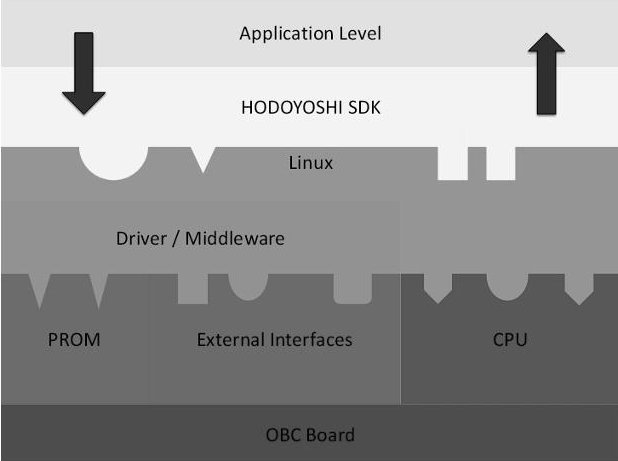


<div align="center">

Fig.4 Software structure.

</div>


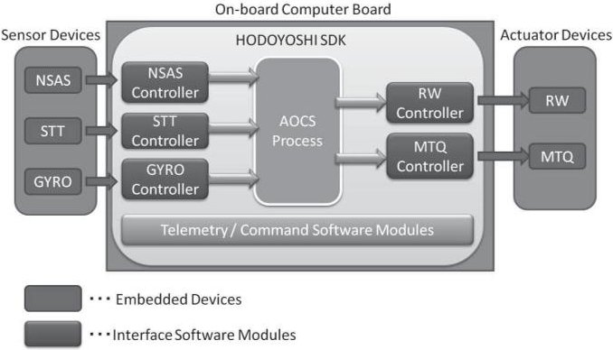


<div align="center">

Fig. 5 Software framework.

</div>


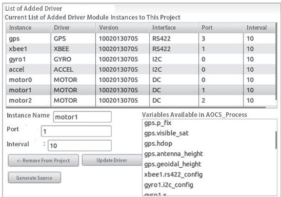


<div align="center">

Fig. 6 Source code generator for telemetry and command.

</div>

software module from the sensors on satellites. This module then transmits commands to the interface software module for the actuators. Telemetry and command processing software module parses the command frame, performs error checking, and generation of the telemetry frame. Developers can automatically generate source code and telemetry documentation through the development environment (Fig. 6).

These software modules can be shared by users allowing developers to employ software modules to match the features of the satellite. The development environment generates source code that is required to implement these software modules automatically. Therefore, satellite developers can concentrate on developing satellite control software such as attitude and orbit control system modules. Specifically, the tools that are Eclipsebased integrated development environment were developed as shown in Fig. 7.

The Eclipse environment makes it possible to add and remove interface modules on the GUI. Furthermore, it can automatically generate source code related to the interface module. The amount of source code that developers must write is then reduced, thus saving labor and time necessary to implement the

<!-- PDF_PAGE: 6 -->


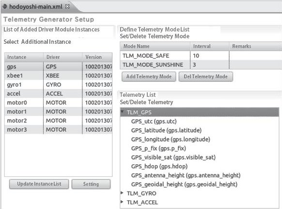


<div align="center">

Fig. 7 Interface modules tool for adding/removing.

</div>


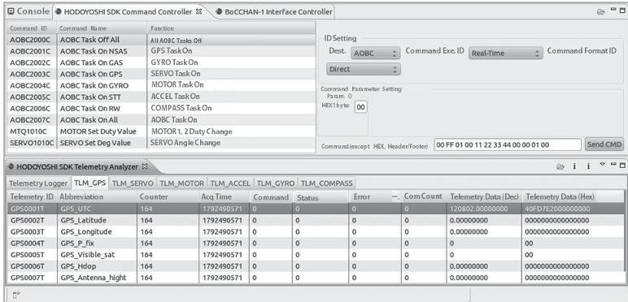


<div align="center">

Fig. 8 Telemetry and command analyzer.

</div>


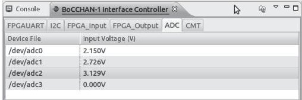


<div align="center">

Fig.9 Interface control software.

</div>


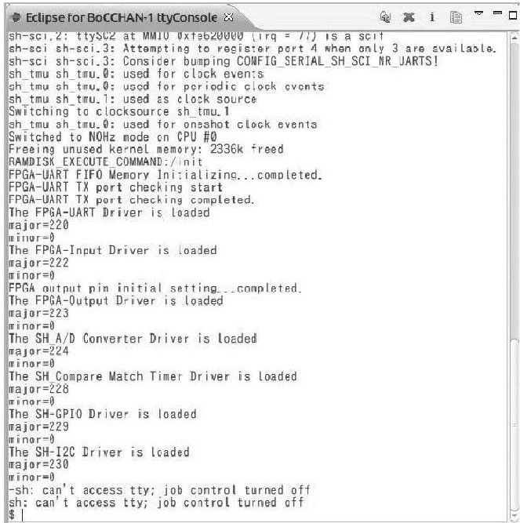


<div align="center">

Fig. 10 Serial console display software.

</div>

software. In addition, the incidence of human error is decreased permitting smooth software development. Moreover, the integrated development environment tools that support developing software were developed. Figure 8 shows an automatic source code generating system [17] using a common system definition document for installing telemetry and command to satellite operating system, and analyzing system in receiving telemetry from the satellite. Figure 9 shows a software to operate values in terms of each interface directly for debugging, and Fig.10

shows a software for real-time monitoring status of the satellite.

HODOYOSHI SDK for satellite developers is publicly available on a website, and users always can download softwares and development environment from the website. Users can also provide own modules, requirements or troubles to the administrator of the software framework, and the reports are immediately reflected. Source code generation is just one of the functions of sharing resources.

## 6. On-Orbit Evaluation

BoCCHAN-1 OBC module (DEMO) was installed for onorbit experiments on HODOYOSHI-3 satellite, which was launched in June 2014. Before the assembly, environmental tests on the OBC circuit board module (Fig.11) were conducted for enduring thermal, vacuum, radiation, vibration that would be experienced during actual operation. Although the tests were done under harder environment than anticipated, it was proved that it had enough performance to meet the demand.


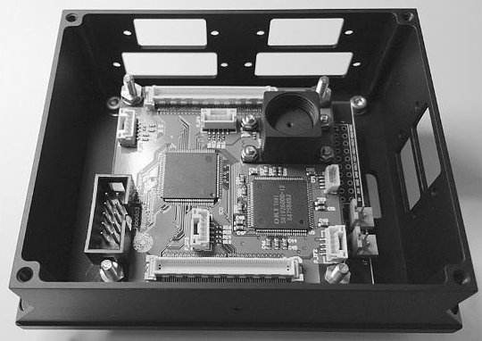


<div align="center">

Fig. 11 DEMO experimental module.

</div>

The purposes of the on-orbit experiments were: 1) demonstration and evaluation of the on-board computer; 2) demonstration and evaluation of characteristics of the novel ionic liquidbased lithium-ion battery (IL-LIB) cell [18]; 3) evaluation of the power line communication experiment; and 4) evaluation of a small camera system. These experimental units were able to be independently developed since each unit was connected to the BoCCHAN-1 OBC by the standard bus. After the launch, initial checkouts were conducted where it was determined that all of the units performed normal operations satisfactorily. In terms of memory scanning of OBC, no single event upset was found in 100 KByte $ \times $ 34 sessions when scanning for approximately 36 seconds. DEMO keeps functioning normally for over 1 year from the launch.

In terms of development period of demonstration instruments installed in HODOYOSHI-3, it was achieved to reduce the development period to half a year utilizing the shared resources. It is dramatic short-term compared to conventional satellite module development which needs several years or dozen years.

## 7. Conclusion

In this paper, we proposed the platform consisting of a highperformance, compact, and low-cost on-board computer for small satellites using COTS devices and a satellite software framework with high reliability. In addition, we realized the attempts of sharing software resources in the community by using this platform. Developers can now implement satellite software easily by adopting this platform. Also, it is possible that

<!-- PDF_PAGE: 7 -->

more people can participate in satellite development. For future work, increasing of the distribution of the on-board computer board and software framework and proceed with functional improvements for this platform are intended. The OBC is slated to be installed as main OBC and attitude OBC to a satellite that will be launched in near future.

## Acknowledgments

This research was supported by the Japan Society for the Promotion of Science (JSPS) through the Funding Program for World-Leading Innovative R&D on Science and Technology (FIRST Program), which was initiated by the Council for Science and Technology Policy (CSTP).

## References

[1] S. Kimura, H. Yamamoto, Y. Nagai, T. Kashitani, K. Masuda, and N. Abe: Experimental concept on technologies for in-orbit maintenance using a small twin-sat, Proceedings of 55th International Astronautical Congress, IAC-04-U.4.05, 2004.

[2] L. Dell'Elce and G. Kerschen: Propellantless rendezvous of QB50 nanosatellites, Proceedings of 63rd International Astronautical Congress, IAC-12.C1.3.12, 2012.

[3] E. Gill, J. Guo, J. Bouwmeester, and B. Zandbergen: DELFFI: Formation flying within the QB50 constellation of nanosatellites, Proceedings of 63rd International Astronautical Congress, IAC-12.B4.7B.5, 2012.

[4] S. Khan and K. Remeikis: A CubeSat network for aerosol monitoring, Proceedings of 4th UN/Japan Nano-Satellite Symposium, NSS-04-0301, 2012.

[5] S. Kenyon, C.P. Bridges, J. Barrera-Ars, L. Pryce, C. Underwood, and D. Liddle: STRAND-2: Kinecting two Cubesats in flight, Proceedings of 63rd International Astronautical Congress, IAC-12.B4.6B.3, 2012.

[6] S. Kimura, H. Mineno, H. Yamamoto, Y. Nagai, H. Kamimura, S. Kawamoto, F. Terui, S. Nishida, S. Nakasuka, S. Ukawa, H. Hashimoto, N. Takahashi, and K. Yoshihara: Preliminary experiments on technologies for satellite orbital maintenance using Micro-LabSat 1, Advanced Robotics, Vol. 18, No. 2, pp. 117-138, 2004.

[7] S. Kimura, H. Yamamoto, Y. Nagai, M. Akioka, H. Hashimoto, N. Takahashi, M. Kato, and K. Yoshihara: Single-event performance of COTS-based MPU under flare and non-flare conditions, IEEE Transactions on Aerospace and Electronic Systems, Vol. 41, No. 2, pp. 599-607, 2005.

[8] S. Kimura, A. Miyasaka, R. Funase, H. Sawada, N. Sakamoto, and N. Miyashita: High-performance image acquisition & processing unit fabricated using COTS technologies, IEEE Aerospace and Electronics Systems Magazine, Vol. 26, No. 3, pp. 19-25, 2011.

[9] Y. Tsuda, N. Sako, T. Eishima, T. Ito, Y. Arikawa, N. Miyamura, A. Tanaka, and S. Nakasuka: University of Tokyo's CubeSat Project: Its educational and technological significance, Proceedings of The 15th Annual AIAA/USU Conference on Small Satellites, SSC01-VIIIb-7, 2001.

[10] K. Nakaya, K. Konoue, H. Sawada, K. Ui, H. Okada, N. Miyashita, M. Iai, T. Urabe, N. Yamaguchi, M. Kashiwa, K. Omagari, I. Morita, and S. Matunaga: Tokyo Tech CubeSat: CUTE-I: Design & development of flight model and future plan, Proceedings of AIAA 21st International Communications Satellite Systems Conference and Exhibit, AIAA 2003-2388, 2003.

[11] Y. Sakamoto, T. Kuwahara, Y. Tomioka, K. Fukuda, K. Yoshida, and Y. Takahashi: Development of microsatellite RISING-2 for cumulonimbus and sprite observation by multispectrum telescope system, Proceedings of 2nd Nano-Satellite Symposium, P-3, 2011.

[12] H. Yagisawa, Y. Sakamoto, Y. Tanabe, N. Sugimura, T. Kuwahara, and K. Yoshida: System description and result of ground test for CubeSat RAIKO, Proceedings of 4th UN/Japan Nano-Satellite Symposium, NSS-04-0310, 2012.

[13] S. Takano and S. Kimura: A high-performance, compact, onboard computer for small satellites using COTS device, Proceedings of 4th UN/Japan Nano-Satellite Symposium, NSS-04-0115, 2012.

[14] S. Kobayashi and S. Kimura: Software development system for on-board computers of small satellites, Proceedings of 4th UN/Japan Nano-Satellite Symposium, NSS-04-0101, 2012.

[15] T. Kamijo, Y. Aoki, S. Kobayashi, and S. Kimura: A class-structured software development platform for on-board computers of small satellites, Proceedings of International Symposium on Artificial Intelligence, Robotics and Automation in Space, 2012.

[16] S. Kobayashi, J. Takisawa, S. Nakasuka, and S. Kimura: Software development framework for small satellite on-board computers, Proceedings of 29th International Symposium on Space Technology and Science, 2013-f-07, 2013.

[17] L.H. Tran Ngoc, S. Kobayashi, J. Takisawa, S. Nakasuka, and S. Kimura: Automatic document base program code generation system, Proceedings of 29th International Symposium on Space Technology and Science, 2013-f-09, 2013.

[18] M. Yamagata, K. Tanaka, Y. Tsuruda, Y. Sone, S. Fukuda, S. Nakasuka, M. Kono, and M. Ishikawa: The first lithiumion battery with ionic liquid electrolyte demonstrated in extreme environment of space, Electrochemistry, Vol. 83, No. 10, pp. 918-924, 2015.

```markdown

```

Tomohiro NARUMI (Member)


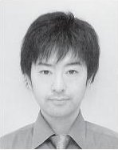


He received his B.S., M.S., and Ph.D. degrees from Kyushu University, Japan, in 2003, 2005, and 2008, respectively. In 2012, he joined Tokyo University of Science, where he is currently an Associate Professor of the Department of Electrical Engineering. His research interests include space systems engineering. He is a member of AIAA and JSASS.

## Shinji TAKANO


He received his B.S. and M.S. degrees from Tokyo University of Science, Japan, in 2012 and 2014, respectively. He is currently an engineer at Alpine Electronics Inc. His research interests include systems engineering and electrical engineering.

## Shinichi KIMURA (Member)


He received his B.S., M.S., and Ph.D. degrees from the University of Tokyo, Japan, in 1988, 1990, and 1993, respectively. He is currently a Professor at Tokyo University of Science. His research interests include space robotics and space systems engineering. He is a member of IEEE, RSJ, AIAA, and JSASS.

```markdown

```