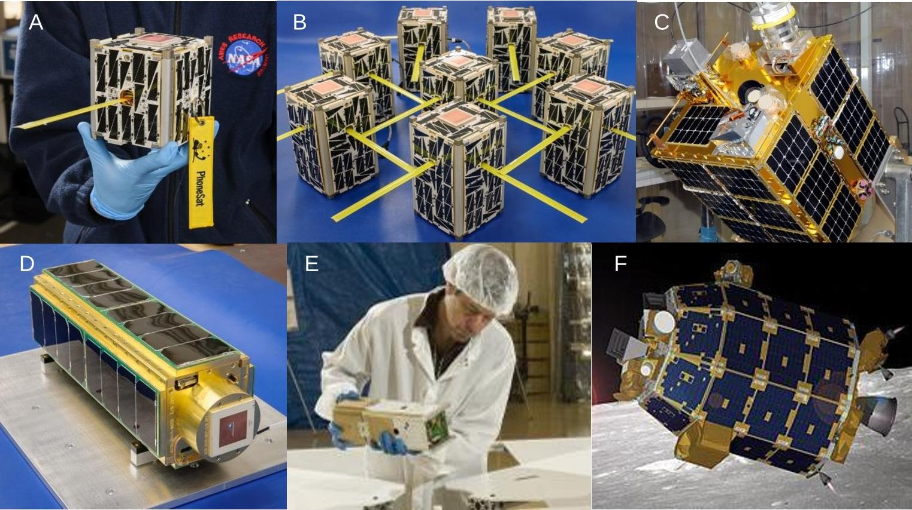
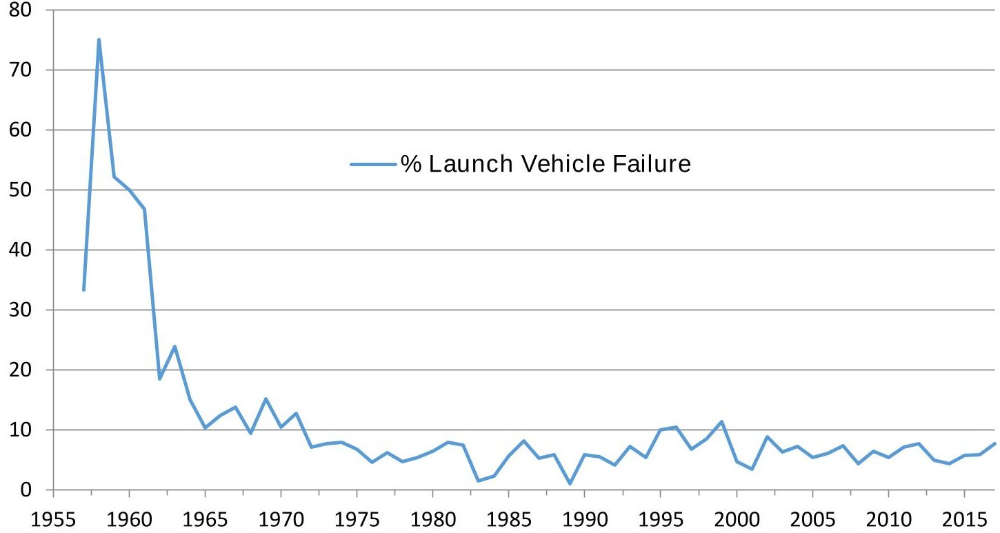
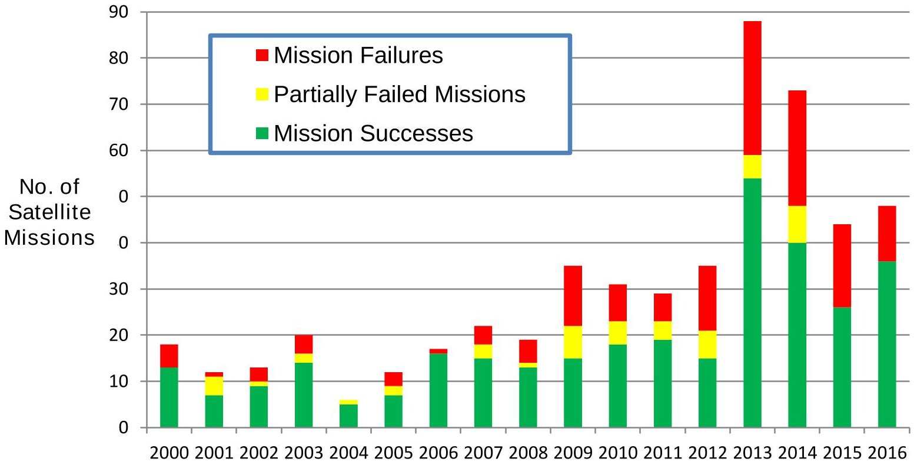
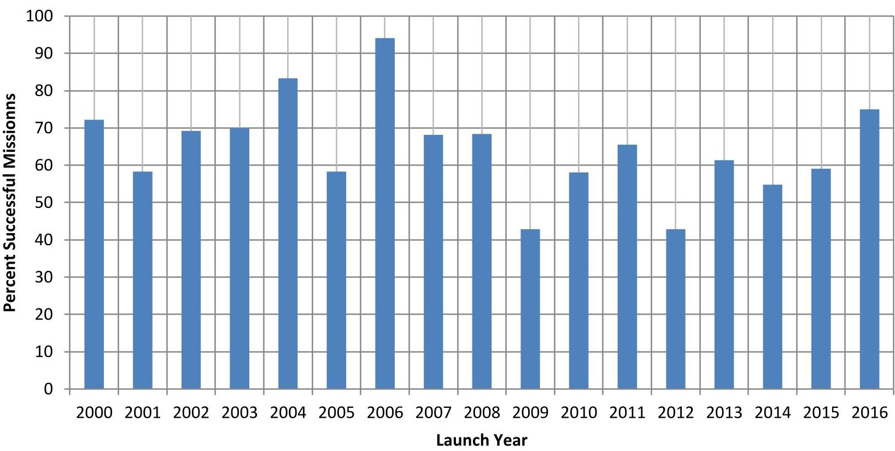
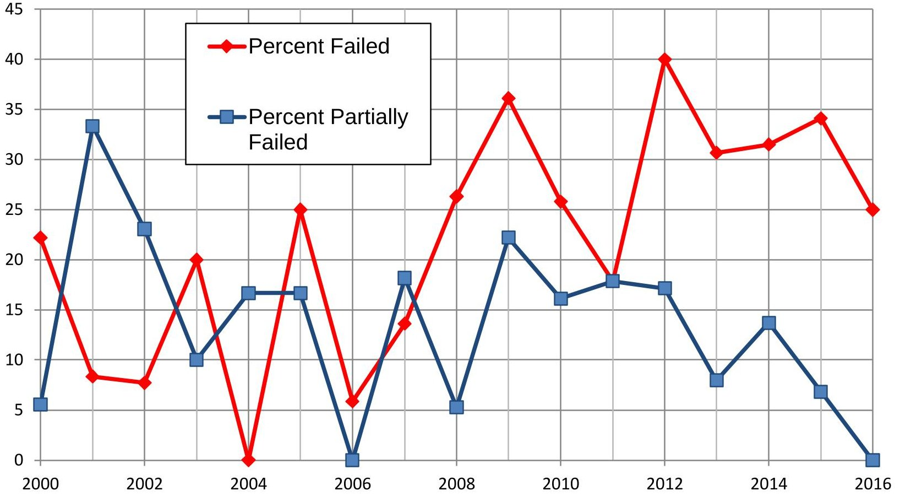

<!-- PDF_PAGE: 1 -->

NASA/TM----2018----220034

# Small-Satellite Mission Failure Rates

Stephen A. Jacklin

NASA Ames Research Center, Moffett Field, CA

<!-- PDF_PAGE: 2 -->

# NASA STI Program ... in Profile

Since its founding, NASA has been dedicated to the advancement of aeronautics and space science. The NASA scientific and technical information (STI) program plays a key part in helping NASA maintain this important role.

The NASA STI program operates under the auspices of the Agency Chief Information Officer. It collects, organizes, provides for archiving, and disseminates NASA's STI. The NASA STI program provides access to the NTRS Registered and its public interface, the NASA Technical Reports Server, thus providing one of the largest collections of aeronautical and space science STI in the world. Results are published in both nonNASA channels and by NASA in the NASA STI Report Series, which includes the following report types:

- TECHNICAL PUBLICATION. Reports of completed research or a major significant phase of research that present the results of NASA Programs and include extensive data or theoretical analysis. Includes compilations of significant scientific and technical data and information deemed to be of continuing reference value. NASA counterpart of peer-reviewed formal professional papers but has less stringent limitations on manuscript length and extent of graphic presentations.

- TECHNICAL MEMORANDUM. Scientific and technical findings that are preliminary or of specialized interest, e.g., quick release reports, working papers, and bibliographies that contain minimal annotation. Does not contain extensive analysis.

- CONFERENCE PUBLICATION. Collected papers from scientific and technical conferences, symposia, seminars, or other meetings sponsored or co-sponsored by NASA.

- CONTRACTOR REPORT. Scientific and technical findings by NASA-sponsored contractors and grantees.

- SPECIAL PUBLICATION. Scientific, technical, or historical information from NASA programs, projects, and missions, often concerned with subjects having substantial public interest.

- TECHNICAL TRANSLATION. English-language translations of foreign scientific and technical material pertinent to NASA's mission.

Specialized services also include organizing and publishing research results, distributing specialized research announcements and feeds, providing information desk and personal search support, and enabling data exchange services.

For more information about the NASA STI program, see the following:

- Access the NASA STI program home page at http://www.sti.nasa.gov

- E-mail your question to help@sti.nasa.gov

- Phone the NASA STI Information Desk at 757-864-9658

- Write to:

NASA STI Information Desk

Mail Stop 148

NASA Langley Research Center

Hampton, VA 23681-2199

<!-- PDF_PAGE: 3 -->

NASA/TM----2018----220034

# Small-Satellite Mission Failure Rates

Stephen A. Jacklin

NASA Ames Research Center, Moffett Field, CA

National Aeronautics and Space Administration

<!-- PDF_PAGE: 4 -->

# This report is available in electronic form at

https://ti.arc.nasa.gov/publications/

## Abstract

The purpose of this report is to determine the failure rate of small-satellite missions launched between the years 2000 and 2016. This analysis considers the rates of both partial and total mission failure, as well as the failures attributable to failure of the launch vehicle.

This study observed that between the years of 2000 to 2016, 41.3% of all small satellites launched failed or partially failed. Of these small satellite missions, 24.2% were total mission failures, another 11% were partial mission failures, and 6.1% were launch vehicle failures. The small satellite failure data reveals an increase in the failure rate as the yearly launch rate has increased. The period 2000 to 2008 averaged 15 launches per year, during which 28.6% of the small satellite missions failed or partially failed. The period from 2009 to 2016 averaged 48 launches per year, during which 42.6% of the small satellite missions failed or partially failed. The launch vehicle failure rate for both periods was the same at around 6.1%. The implication is that for modern small satellite missions, almost one out of every two small satellite missions will result in either a total or a partial mission failure. Counting the partial mission successes as "successful missions" reduces the failure rate, but only to 38.2% for the period 2009 to 2016.

Appendix A provides a list of the small satellite missions that failed or partially failed during the years 2000 to 2016. The causes of failures are identified when known. Appendix B provides a list of the successful small satellites launched between 2000 and 2016.

<!-- PDF_PAGE: 5 -->

## Contents

Abstract...2

List of Figures ...4

List of Tables ...4

Introduction ...5

What is a “Small” Satellite? ...5

Launch Vehicle Failure Rates ...7

Small Satellite Mission Failure Rates ...9

Discussion ...13

Conclusion ...14

References ...16

Appendix A: Small Satellite Missions That Partially or Totally Failed ...18

Appendix B: Successful Small Satellite Missions ...43

<!-- PDF_PAGE: 6 -->

## List of Figures

Figure 1 Various NASA small satellites. 6

Figure 2 Percent of launch vehicle failures from 1957 to 2017. 9

Figure 3 Number of successful, partially failed, and failed small satellite missions. 11

Figure 4 Percent of small satellite missions that are fully successful. 12

Figure 5 Percent of small satellite missions failed or partially failed. 13

## List of Tables

Table 1 Small Satellite Mass Ranges...6

Table 2 Number of Space Launch Vehicle Failures...8

Table 3 Number of Successful and Failed or Partially Failed Small Satellite Missions...11

Table 4: Small satellite missions excluded from the failure rate analysis...15

<!-- PDF_PAGE: 7 -->

# Introduction

The launch rate of small satellites has grown exponentially in recent years. SpaceWorks estimates that up to 2,600 small satellites (in the mass range 1-50 kg) will be launched over the next 5 years. $ ^{1} $ The launching of hundreds of small satellites per year has primarily resulted from launch providers allowing small satellites to be carried into space by riding in the empty space of the separation rings of rockets carrying larger spacecraft. A key enabler of this approach has been the instantiation of the NASA CubeSat Initiative which calls for providers of NASA launch platforms to take small satellites into space if excess mass is available. $ ^{2} $ In addition, several countries have elected to fill entire launch vehicles with small satellites as the primary cargo. In November of 2013, the Russian Dnepr launch vehicle carried 32 small satellites into low-earth orbit, which was a record number at the time. $ ^{3} $ This record was broken in February of 2017 when India launched a record 104 satellites from a single launch vehicle, the Polar Satellite Launch Vehicle (PSLV-C37). $ ^{4} $

Small satellites are being launched for a variety of reasons. The most common rationale for launching small satellites is for educational purposes. The primary benefit is to provide college (and sometimes high school) students with quick access to space, thereby allowing students to have hands-on space science engineering experience prior to employment in the aerospace industry. Other common rationales for launching small satellites are: a) to monitor terrestrial weather, b) to evaluate sensors and hardware for future small and large satellite missions, c) to test satellite propulsion concepts, d) to test autonomous operational concepts, e) to make continuous observation of a small area on earth, f) to test satellite-ground communications concepts, g) to track ships and aircraft using ADS-B signals, h) to investigate the composition of Earth's upper atmosphere, ionosphere, and magnetosphere, i) to perform space science work such as looking for water or other chemical compounds on asteroids or planets, and j) to conduct astronomy. $ ^{5} $ How many of these missions prove successful in an interesting question.

The subject of this report is to present a look at the failure rate of small satellites. This report addresses two types of small satellite mission failure: complete failure and partial failure. Satellites which are electrically dead on placement into orbit are easy to classify as mission failures. Similarly, satellites which operate as expected and fulfill all planned mission objectives are easy to classify as mission successes. However, some satellites experience the failure of certain components that make achievement of all mission objectives impossible. However, these are classified as partial mission failures if a significant mission objective was accomplished. In addition to the small satellite themselves, this report also determines the failure rate of the launch vehicles used to take the satellites to orbit.

This report is organized as follows. First, a definition of what constitutes a small satellite is provided to indicate the boundary between small and large. The next section provides a look at the launch vehicle failure rate. This is followed by a presentation of the total and partial small satellite failure data, and, lastly, a discussion section. Appendix A lists the small satellites which failed or partially failed. Appendix B lists the successful small satellite missions.

## What is a "Small" Satellite?

Satellites can be called small for a number of reasons, and, to some extent, the classification is a matter of definition. The word "small" usually refers to the low physical mass and small size of the satellite. However, small may also encompass other considerations such as low cost or short development time. The NASA Office of Small Satellite Missions defines small satellites to be those satellites between 1-200 kg (2 and 440 lbs ). $ ^{6} $ Reference 7 presents a list of recently conducted small satellite missions sponsored by NASA. Some examples of small satellites developed by NASA are shown in Fig. 1. The consensus of the literature reviewed appears to support the size classification scheme shown in Table 1.

<!-- PDF_PAGE: 8 -->

Figure 1 Various NASA small satellites. A) PhoneSat 2.0 [1U, 1.4 kg], B) EDSN Cluster [1.5U x 8, 1.7 kg], C) FASTSAT [180 kg], D) SporeSat [3U, 5.5 kg], E) Nanosail D [3U, 4 kg], and F) LADEE [383 kg]. (Image credits: NASA)

The most common small satellite type is the nanosatellite, having a mass between 1 and 10 kg (2.2-22 lbs.). A 1U nanosatellite is generally called a CubeSat. A CubeSat has a 10 cm cube form factor and a mass of up to 1.33 kg (2.9 lbs). This design standard was set forth by the Cal Poly-Stanford CubeSat Program in 1999. $ ^{8} $ Nanosatellites may have multiple increments of this form factor. A 2U satellite is twice as big as a 1U satellite. However, other sizes of nanosatellites are sometimes called CubeSats too. The NASA Ames CubeSat Project generally develops 1U, 2U, and 3U nanosatellites, which are the most common sizes, but has also contemplated building 6U, and even up to 24U "CubeSats". $ ^{9} $ Though small, nanosatellites usually have transmitters, receivers, antennae, solar cells, and carry dozens of microprocessors. $ ^{10} $

Going smaller than nanosatellites are picosatellites and femtosatellites. Picosatellites seldom have propulsion systems, but many have attitude control systems in the form of either miniature gyroscopes or coils of thin wire whose magnetic fields produce torque by coupling with Earth's magnetic field. The use of swarms of up to 1,000 picosatellites has been proposed to investigate the asteroid belt where satellite mor-

Table 1 Small Satellite Mass Ranges

<table border="1"><tr><td>Type</td><td>Mass Range</td></tr><tr><td>Femtosatellite</td><td>Less than 100g</td></tr><tr><td>Picosatellite</td><td>100g to1kg</td></tr><tr><td>Nanosatellite(CubeSat)</td><td>1kg to10kg</td></tr><tr><td>Microsatellite</td><td>10kg to100kg</td></tr><tr><td>Minisatellite</td><td>100kg to500kg</td></tr></table>

<!-- PDF_PAGE: 9 -->

tality would be high. $ ^{11} $ Femtosatellites are the smallest satellites and are sometimes referred to as "satellites on chips" because they are essentially silicon chips deployed into the space environment. Femtosatellites usually do not have any means of attitude control or propulsion, but do have transmitters to transmit observation data to the ground or to a larger spacecraft. $ ^{12} $

Small satellites larger than the nanosatellite class are referred to as either microsatellites or minisatellites. Minisatellites range in size from approximately 100 kg to 500 kg in mass. Even though microsatellites and minisatellites may be small compared to 7,000 kg communication satellites, they are not generally low cost. One reason for this is that satellites near the 500 kg mass size generally require a separate launch vehicle, and thereby carry substantial costs associated with having a large share of the cost of a launch vehicle. The whole philosophy of using small satellites (cheap and frequent access to space) generally requires that small satellites be carried to space as ride-along (light) cargo on larger spacecrafts to keep costs low.

## Launch Vehicle Failure Rates

Carrying aloft many small satellites on a single launch vehicle reduces costs, but it carries with it a considerable common point of failure. If the launch vehicle fails, all satellites aboard the vehicle are lost. In 2014, the failure of an Antares 130 launch vehicle caused the loss of 29 small satellites on the CRS Orb-3 Cygnus mission. $ ^{13} $ In 2015, the failure of a Falcon 9 launch vehicle caused the loss of 8 small satellites $ ^{14} $ and the failure of a new launch vehicle, the Super-Strypi, produced the loss of 12 small satellites, eight of which were NASA Ames' EDSN satellite cluster. $ ^{15} $ Other countries have had their share of launch vehicle losses as well.

Table 2 presents the number of launches and the number of launch failures of all space vehicles launched between 1957 and 2017. The data was compiled from References 16,17,and 18. The list includes all rocket launches, US space shuttle missions, Russian manned missions, and all foreign launches to the extent made public.

The data shown in Table 2 was used to create a plot of percent vehicle losses as a function of year (Fig. 2). Of the 17 USA launches made in 1958, 13 failed, bringing the 1958 world launch vehicle failure rate to an all-time high of 75%. Of course, within a period of 10 years from the first satellite rocket vehicle launch in 1957, the launch vehicle failure rate was brought down to about 10-15%. This happened even though the number of vehicle launches increased greatly during that time. In 1965, the all-time high launch rate of 175 launches (for a single year) was achieved with only 18 launch vehicle failures, or about a 10% failure rate. Interestingly, review the failure rate for subsequent decades does not show much improvement. From 1975 to 2017, the average failure rate is 6.1%. From 2000 to 2017, the average failure rate is also 6.1%, indicating that the launch vehicle failure rate doesn't seem to be improving with increases in launch vehicle technology. One possible explanation for this outcome is that the introduction of new launch vehicles also restarts the learning curve for those platforms. In any event, it seems reasonable to conclude that about 6 percent of all satellites (large and small) will be lost due to failures of the launch vehicles.

<!-- PDF_PAGE: 10 -->

Table 2 Number of Space Launch Vehicle Failures.

<table border="1"><tr><td>Year</td><td>Number of launches</td><td>Number of Failures</td></tr><tr><td>1957</td><td>3</td><td>1</td></tr><tr><td>1958</td><td>28</td><td>21</td></tr><tr><td>1959</td><td>23</td><td>12</td></tr><tr><td>1960</td><td>38</td><td>19</td></tr><tr><td>1961</td><td>47</td><td>22</td></tr><tr><td>1962</td><td>81</td><td>15</td></tr><tr><td>1963</td><td>71</td><td>17</td></tr><tr><td>1964</td><td>100</td><td>15</td></tr><tr><td>1965</td><td>175</td><td>18</td></tr><tr><td>1966</td><td>170</td><td>21</td></tr><tr><td>1967</td><td>138</td><td>19</td></tr><tr><td>1968</td><td>128</td><td>12</td></tr><tr><td>1969</td><td>125</td><td>19</td></tr><tr><td>1970</td><td>124</td><td>13</td></tr><tr><td>1971</td><td>134</td><td>17</td></tr><tr><td>1972</td><td>113</td><td>8</td></tr><tr><td>1973</td><td>117</td><td>9</td></tr><tr><td>1974</td><td>113</td><td>9</td></tr><tr><td>1975</td><td>132</td><td>9</td></tr><tr><td>1976</td><td>131</td><td>6</td></tr><tr><td>1977</td><td>130</td><td>8</td></tr><tr><td>1978</td><td>128</td><td>6</td></tr><tr><td>1979</td><td>111</td><td>6</td></tr><tr><td>1980</td><td>109</td><td>7</td></tr><tr><td>1981</td><td>126</td><td>10</td></tr><tr><td>1982</td><td>134</td><td>10</td></tr><tr><td>1983</td><td>129</td><td>2</td></tr><tr><td>1984</td><td>129</td><td>3</td></tr><tr><td>1985</td><td>125</td><td>7</td></tr><tr><td>1986</td><td>110</td><td>9</td></tr><tr><td>1987</td><td>114</td><td>6</td></tr></table>

<table border="1"><tr><td>Year</td><td>Number of launches</td><td>Number of Failures</td></tr><tr><td>1988</td><td>121</td><td>7</td></tr><tr><td>1989</td><td>102</td><td>1</td></tr><tr><td>1990</td><td>121</td><td>7</td></tr><tr><td>1991</td><td>91</td><td>5</td></tr><tr><td>1992</td><td>97</td><td>4</td></tr><tr><td>1993</td><td>83</td><td>6</td></tr><tr><td>1994</td><td>93</td><td>5</td></tr><tr><td>1995</td><td>80</td><td>8</td></tr><tr><td>1996</td><td>77</td><td>8</td></tr><tr><td>1997</td><td>89</td><td>6</td></tr><tr><td>1998</td><td>82</td><td>7</td></tr><tr><td>1999</td><td>79</td><td>9</td></tr><tr><td>2000</td><td>84</td><td>4</td></tr><tr><td>2001</td><td>59</td><td>2</td></tr><tr><td>2002</td><td>45</td><td>4</td></tr><tr><td>2003</td><td>64</td><td>4</td></tr><tr><td>2004</td><td>55</td><td>4</td></tr><tr><td>2005</td><td>55</td><td>3</td></tr><tr><td>2006</td><td>66</td><td>4</td></tr><tr><td>2007</td><td>68</td><td>5</td></tr><tr><td>2008</td><td>69</td><td>3</td></tr><tr><td>2009</td><td>78</td><td>5</td></tr><tr><td>2010</td><td>74</td><td>4</td></tr><tr><td>2011</td><td>84</td><td>6</td></tr><tr><td>2012</td><td>78</td><td>6</td></tr><tr><td>2013</td><td>81</td><td>4</td></tr><tr><td>2014</td><td>92</td><td>4</td></tr><tr><td>2015</td><td>87</td><td>5</td></tr><tr><td>2016</td><td>86</td><td>5</td></tr><tr><td>2017</td><td>91</td><td>7</td></tr></table>

<!-- PDF_PAGE: 11 -->

% Launch Vehicle Failure

Figure 2 Percent of launch vehicle failures from 1957 to 2017.

## Small Satellite Mission Failure Rates

Small satellites have many possible points of failure. Small satellites typically have dozens of microprocessors and related electronic circuitry. These components are used to control power management, solar cell operation, attitude control, telemetry, antennae pointing, propulsion systems, star trackers, sun sensors, earth sensors, cameras, and telescopes. A malfunction in any one of these systems can cause a small satellite to fail or partially fail so that only part of the mission can be completed. Considering the fact that most small satellites do not use radiation hardened electronic components, small satellite failure is not a rare occurrence.

The determination of the small satellite failure rate is not as straightforward as the launch vehicle failure rate. Whereas launch failures (even from non-free countries) are difficult to hide, small satellite mission failure can be kept more private. For one thing, many organizations who desire to report mission successes through the publication of papers, don't often treat mission failures in same way. Educational institutions in particular have a tendency to declare inoperative satellites to be successful because they served to educate the students who built them. While that is a legitimate point of view, it obscures the answer to the question of how many small satellites fail to achieve their intended mission objectives.

This report seeks to answer the question "What percentage of small satellites actually achieve their mission, or at least partially achieve their intended mission?". To answer this question, it is necessary to consider the scope of the small satellite mission. A small satellite mission could be to emit a beacon signal once placed into orbit, just like the first Sputnik satellite. If sending the beacon signal is the only mission objective, then once that is done, it is a mission success. However, another small satellite may be launched with the intent of emitting a beacon signal, but then also taking pictures of the Earth. If that satellite emits a beacon signal but then cannot take a picture of Earth because of a failed attitude control system, then that mission is partly a failure. Or it might be the case that the mission statement called for the small satellite to take pictures of

<!-- PDF_PAGE: 12 -->

Earth for six months, but the satellite stopped taking pictures of Earth after only one week. Early failure is still a failure since part of the mission requirements didn't get fulfilled. To address this classification problem, this report has created two failure classifications.

The first category is called Mission Failure. These are the small satellites that failed to operate altogether or completed very little of their stated mission objectives. Educational satellites that achieve successful orbit but fail to transmit any signals are considered to be in this category. Even though the mission to "teach students lessons about small satellites" may have been achieved, the satellites are electrically dead. Similarly, satellites which only emit a beacon signal are considered mission failures unless that happened to be the only mission objective. (Several small satellites actually did have emitting a beacon signal as their only mission objective.) Satellites are classified as successful missions as long as they transmitted the data for the intended life of their missions.

The second category is called Partial Mission Failure. Small satellites experiencing component failures that prevent some objectives from being achieved are in this category. Small satellites that fail to operate after having operated successfully for a short period are in this category. For example, a satellite may begin successful operations but then experience a failure of the power system after only a few hours or days. Whether or not that represents a mission failure or a partial mission failure depends on what objectives the satellite was able to achieve before it stopped working. Some small satellites accomplish all or most of their mission objectives in a few days of operation, even though the life of the satellite was expected to be much longer. Those missions are still classified as successful missions.

The number of small satellite failures was determined from public sources indicating satellite failure, and at times, a lack of publications indicating success. References 16, 17, and 18 identified many small satellites as either having succeeded or failed, and in the case of failure, sometimes provided the reason for the failure or partial failure. These references were used to develop the small satellite data base for this report. Many times, however, these references identified a small satellite as having been launched, but provided no status on the success or failure of the mission. In such cases, the author queried the internet to find publications or news articles indicating mission success or presenting data from the mission. In many instances, such articles were found and the small satellites were labeled as successes. But, if no post-launch publications or news articles could be found, the small satellite mission was presumed to be a mission failure. The rationale is that most research organizations and universities have a strong desire to publish the results through one or more scientific publications or news releases when a small satellite mission is successful. The lack of publications to announce the success of a mission is therefore a strong indicator of mission failure. Nevertheless, the author realizes that this characterization may not always hold true for every instance since a news article or paper describing the success may have been overlooked.

Appendix A presents the small satellites having known complete or partial mission failures from 2000 to 2016. The causes of the failures and partial failures are listed if known. This analysis considered only small satellites launched between 2000 and 2016. It was felt that going further back than 2000 would tend to obscure the failure rate of modern small satellites, while including missions launched in 2017 and 2018 would allow insufficient time to for the reporting of mission success.

Appendix B provides a list of the small satellites launched between 2000 and 2016 that were known to be fully successful. Although the list of successful missions is thought to be fairly comprehensive, it is possible that some small satellites may have been missed. Except for maiden flights, small satellite clones of the same type are not included in Appendix B. Organizations that launch many of the same exact satellite design could not be included in the analysis for several reasons. These reasons are presented in the discussion section together with a listing of the small satellites not considered in the failure rate computation.

<!-- PDF_PAGE: 13 -->

Table 3 presents the total number of small satellites launched in a year and, of those launches, lists the number of successful, failed, and partially failed missions. The same data is presented graphically in Fig. 3, where the total height of the bar indicates the total number of small satellites launched in a year.

Table 3 Number of Successful and Failed or Partially Failed Small Satellite Missions

<table border="1"><tr><td>Year</td><td>Number of Small Satellites Launched</td><td>Mission Successes</td><td>Partially Failed Mission</td><td>Mission Failures</td></tr><tr><td>2000</td><td>18</td><td>13</td><td>0</td><td>5</td></tr><tr><td>2001</td><td>12</td><td>7</td><td>4</td><td>1</td></tr><tr><td>2002</td><td>13</td><td>9</td><td>1</td><td>3</td></tr><tr><td>2003</td><td>20</td><td>14</td><td>2</td><td>4</td></tr><tr><td>2004</td><td>6</td><td>5</td><td>1</td><td>0</td></tr><tr><td>2005</td><td>12</td><td>7</td><td>2</td><td>3</td></tr><tr><td>2006</td><td>17</td><td>16</td><td>0</td><td>1</td></tr><tr><td>2007</td><td>22</td><td>15</td><td>3</td><td>4</td></tr><tr><td>2008</td><td>19</td><td>13</td><td>1</td><td>5</td></tr><tr><td>2009</td><td>35</td><td>15</td><td>7</td><td>13</td></tr><tr><td>2010</td><td>31</td><td>18</td><td>5</td><td>8</td></tr><tr><td>2011</td><td>29</td><td>19</td><td>4</td><td>6</td></tr><tr><td>2012</td><td>35</td><td>15</td><td>6</td><td>14</td></tr><tr><td>2013</td><td>88</td><td>54</td><td>5</td><td>29</td></tr><tr><td>2014</td><td>73</td><td>40</td><td>8</td><td>25</td></tr><tr><td>2015</td><td>44</td><td>26</td><td>0</td><td>18</td></tr><tr><td>2016</td><td>48</td><td>36</td><td>0</td><td>12</td></tr></table>

Figure 3 Number of successful, partially failed, and failed small satellite missions.

<!-- PDF_PAGE: 14 -->

Figure 4 presents a plot of the percent of small satellite missions that ended in mission success. The first observation is that there is a high degree of scatter in the data. Whereas a nearly 95% mission success rate was seen in 2006, the success rate dwindled to a little over 40% for years 2009 and 2012. There is also evidence of a slight downward trend in the success rate. From 2000 to 2008, the average mission success rate was about 71%. From 2009 to 2016, the average mission success rate dropped to 57%. Even so, the sheer number of successful missions has increased in recent years because the number of launches has increased. Whereas from 2000 to 2008 the average yearly launch rate was about 15 launches per year, from 2009 to 2016 the average yearly launch rate increased to 48, more than a three-fold increase.

Percent Fully Successful Missions

Figure 4 Percent of small satellite missions that were fully successful.

<!-- PDF_PAGE: 15 -->

Figure 5 Percent of small satellite missions failed or partially failed.

Figure 5 presents the percent of small satellite missions that either totally failed or partially failed to complete their mission objectives. Because there is a considerable amount of scatter in the data, the data points have been connected by lines to help distinguish the failure and partial failure data. This data shows that in recent years, the percent of partial mission failures has decreased, but the percent of total mission failures has increased.

## Discussion

This study set out to determine the number of small satellite missions that end in mission failure or partial mission failure. The number of small satellite missions that ended in failure or partial failure was approximately 35% averaged over years 2000 to 2016. However, for the time period between year 2009 and year 2016, it was shown that this failure rate increased to 43% These failure rates apply to the small satellites successfully placed into orbit. If the launch vehicle failure rate is included (6.1%) , the total failure rate increases to 41% from 2000 to 2016, and to 49% averaged over the period from 2009 to 2016. This means that about 1 out of every 2 small satellite missions can be expected to end in failure or partial mission failure if the data from the last few years is considered to be more indicative of current performance.

The 43% failure rate of small satellites can be mitigated by subtracting out the partial mission failures. On average, about 10.5% of the missions between years 2009 to 2016 ended in partial mission success (or partial mission failure). If partial success is counted as mission success, then one could say the small satellite failure rate is not 43% (or 49% with launch vehicle failures included), but rather it is more like 33% (39% including launch vehicle failures). So it may be fairer to conclude that 39% of small satellite endeavors are total mission failures, while another 10% are only partially successful. This agrees fairly well with the 40% failure rate of university small satellites determined by Swartwout and Jayne. $ ^{19} $

<!-- PDF_PAGE: 16 -->

The observation that the rate of total mission failure appears to have increased in recent years seemed counter-intuitive, since increased experience with launching small satellites together with improved small satellite electronics would have been expected to produce a decrease in the mission failure rate. Yet, after the data was run through a t-test, it clearly showed with 95% confidence that the claim was true $ ( p<0.05) $ $ ^{20} $ One reason for this outcome might be that the mission objectives of small satellites has become progressively more challenging. Whereas early missions were successful on sending out a beacon signal or making cell phone components operate in space, modern missions aim to explore how space radiation effects biological spores or attempts to rendezvous two or more satellites. The more challenging missions carry with them a greater potential for mission failure. Another reason could be that as the small satellite software complexity has increased, the methods used to perform verification and validation of the small satellite software has not increased commensurately.

The analysis of the small satellite failure rate of this report was based primarily on unique small satellite missions, not industrial endeavors to launch many small satellites of the same design. This is because military organizations, and Earth observation businesses (e.g., Planet Lab and Exact View), rarely report if a particular satellite has failed. Therefore, there is no way to include their success and failure rate in this report. Table 4 presents a list of the small satellite missions that were excluded from the analysis because their rate of mission success was unknown. One exception is that the analysis of this report (and Appendices A and B) do include the maiden voyages of small satellites launched from organizations like Planet Labs because the success or failure of those missions was a matter of public record. Also excluded from this report were small inert masses and spheres launched as radar reflective targets, since there is basically nothing that can go wrong with these "satellites" other than failure of the launch vehicle.

Even without knowing the mission failure rate of firms launching many of the same types of satellites, it stands to reason that their mission failure rate should become lower as the first small satellites launched find all the bugs in hardware and in software. For this reason, including their failure statistics with the non-commercial small satellite developers could be mixing data from two groups that should be kept separate. For the purposes of this report, it is sufficient to state that this report presents the mission failure rates for non-clone, unique small satellites launched by universities, research organizations, and companies launching one-of-a-kind small satellites. The mission failure rate of small satellites clones launched industry and military agencies is left to those organizations to publish.

## Conclusion

This study observed that between the years of 2000 to 2016, 41.3% of all small satellites launched experienced total or partial mission failure. Of these, 6.1% were launch vehicle failures, 11% were partial mission failures, and 24.2% were total mission failures.

The small satellite failure data showed an increase in the failure rate with increased yearly launch rate. The period 2000 to 2008 averaged 15 launches per year, for which an average of 28.6% of the small satellite missions failed or partially failed. The period from 2009 to 2016 averaged 48 launches per year, for which an average of 42.6% of the small satellite missions failed or partially failed. The launch vehicle failure rate for both periods adds another 6.1% to each period. This means that in recent years, nearly one in two small satellites launched results in either total or partial mission failure. If the partial mission failures are counted as successful, the failure rate is reduced, but only to 38.2% for the period 2009 to 2016.

Appendix A provides a list of the small satellite missions that failed and partially failed during the years 2000 to 2016. Causes of failures are included when known. Appendix B provides a list of the successful small satellites launched between 2000 and 2016.

<!-- PDF_PAGE: 17 -->

Table 4: Small satellite missions excluded from the failure rate analysis

<table border="1"><tr><td>Year</td><td>Small satellites with unpublished mission failure rate data</td><td>Total Satellites Excluded from Failure Rate Analysis</td></tr><tr><td>2000</td><td>Globalstar(4)</td><td>4</td></tr><tr><td>2001</td><td>Gonets(3), Strela-3(3)</td><td>6</td></tr><tr><td>2002</td><td>Strela-3(2)</td><td>2</td></tr><tr><td>2003</td><td>Strela-3(2)</td><td>2</td></tr><tr><td>2004</td><td>SaudiComsat(2),ExactView(2),Strela-3(2),Essaim(4)</td><td>10</td></tr><tr><td>2005</td><td>---</td><td>0</td></tr><tr><td>2006</td><td>---</td><td>0</td></tr><tr><td>2007</td><td>SaudiComsat(5),Globalstar(8)</td><td>13</td></tr><tr><td>2008</td><td>Strela-3(3),Orbcomm(6)</td><td>9</td></tr><tr><td>2009</td><td>Strela-3(2),Strela-3M(1),ExactView(2)</td><td>5</td></tr><tr><td>2010</td><td>Gonets-M2(1),Strela-3(1),Strela-3M(1)</td><td>3</td></tr><tr><td>2011</td><td>ExactView(2),ELISA(4)</td><td>6</td></tr><tr><td>2012</td><td>Gonets-M(2),Strela-3(1),ExactView(1)</td><td>4</td></tr><tr><td>2013</td><td>Gonets-M(3),ExactView(2),Strela-3M(3)</td><td>8</td></tr><tr><td>2014</td><td>Flock-1(28),Strela-3M(3),Kosmos(2),ExactView(2),Flock-1c(11),Gonets-M(3),Flock-1b(28),Orbcomm(6)</td><td>83</td></tr><tr><td>2015</td><td>Flock-1d(2),Gonets-M(3),Flock-1e(14),Flock-2b(14),Strela-3M(3),Lemur-2(4),Flock-2e(12),Orbcomm(11)</td><td>63</td></tr><tr><td>2016</td><td>Flock-2e&#x27;(20),Lemur-2(16),Flock-2p(12),SkySat(4)</td><td>52</td></tr></table>

<!-- PDF_PAGE: 18 -->

[1] C. Williams, B. Doncaster, and J. Shulman, "2018 Nano / Microsatellite Market Forecast, 8th Edition", SpaceWorks Enterprises, Inc., January 2018. http://www.spaceworkscommercial.com/wp-content/uploads/2018/04/Nano-Microsatellite-Market Forecast-8th-Edition-2018.pdf

[2] G. L. Skrobot and R. Coelho, "ELaNa-Educational Launch of Nanosatellite Providing Routine RideShare Opportunities," Proceedings of the AIAA/USU Conference on Small Satellites, SSC12-V-5, Aug 13, 2012. http://digitalcommons.usu.edu/cgi/viewcontent.cgi?article=1048&context=smallsat

[3] W. Graham, "Russian Dnepr Conducts Record Breaking 32 Satellite Haul," NASA SpaceFlight.com, November 21, 2013. https://www.nasaspaceflight.com/2013/11/russian-dnepr-record-breaking-32-satellite-haul/

[4] J. Menon, "India Launches Record 104 Satellites On One Mission," Aviation Week, February 22, 2017. http://aviationweek.com/commercializing-space/india-launches-record-104- satellites-one-mission

[5] S. A. Jacklin, "Small Satellite Software Architecture, Verification, and Validation," NASA/TM-2018-219769, to be published October, 2018. http://

[6] S. Loff, "Small Satellite Missions," NASA, Aug. 3, 2017. http://www.nasa.gov/mission_pages/smallsats/

[7] L. Hall, "NASA Small Spacecraft Technology Program," NASA http://www.nasa.gov/directorates/spacetech/small_spacecraft Aug. 4, 2017.

[8] R. Munakata, "CubeSat Design Specification Rev. 12," California Polytechnic State University, Aug 1, 2009. http://www.srI.utu.fi/AuxDOC/tke/radmon/CubeSat_standard.pdf

[9] E. Agasid and M. Sorgenfrie, discussion at NASA Ames Research Center, June 2013.

[10] C. Frost, E. Agasid, R. Shimmin, et. al., "Small Spacecraft Technology State of the Art," NASA Ames Research Center, Mission Design Division, NASA/TP-2015-216648/REV1, December 2015. https://www.nasa.gov/sites/default/files/atoms/files/small_spacecraft_technology_state_of the art 2015 tagged.pdf

[11] C. A. Rouff, M. G. Hinchey, J. L. Rash, and W. Truszkowski, "Verifying Future Swarm-Based Missions," SpaceOps 2006 Conference, June 16-23, 2006. http://arc.aiaa.org/doi/pdf/10.2514/6.2006-5555

[12] S. W. Janson and D. J. Barnhart, "The Next Little Thing: Femtosatellites," Proceedings of the AIAA/USU Conference on Small Satellites, SSC13-VI-3, Aug 12-15, 2013. http://digitalcommons.usu.edu/cgi/viewcontent.cgi?article=2950&context=smallsat

[13] W. Graham and C. Bergin "Orbital's Antares fails seconds after launch," NASAspaceflight.com, October 28, 2014. https://www.nasaspaceflight.com/2014/10/antares-fails-shortly-after-launch/

[14] C. Bergin, "SpaceX Falcon 9 failure investigation focuses on COPV struts," NASAspaceflight.com, July 20, 2015. https://www.nasaspaceflight.com/2015/07/spacex-falcon-9-failure-investigation-focuses-update/

[15] S. Clark, "Air Force declares failure on Super Strypi test launch," Spaceflight Now, November 4, 2015. http://spaceflightnow.com/2015/11/04/air-force-declares-failure-on super-strypi-test-launch/

<!-- PDF_PAGE: 19 -->

[16] EO Portal, https://directory.eoportal.org/web/eoportal/satellite-missions

[17] Gunter's Space Page, http://www.skyrocket.de/space/index.html

[18] "List of CubeSats", Wikipedia, https://en.wikipedia.org/wiki/List_of_CubeSats#List_of_launched_CubeSats

[19] Swartwout, M. and Jayne, C., "University Class Spacecraft by the Numbers: Succes, Failure, Debris (But Mostly Success)," 30th Annual Proceedings of the AIAA/USU Conference on Small Satellites, SSC16-XIII-1, Aug 8-13, 2016. http://digitalcommons.usu.edu/smallsat/2016/TS13Education/1

[20] A. Agogino, discussion of application of t-test, NASA Ames Research Center, October 2018.

<!-- PDF_PAGE: 20 -->

Appendix A: Small Satellite Missions That Partially or Totally Failed

<table border="1"><tr><td>Year</td><td>Mass</td><td>Small Satellite</td><td>Partial Mission Failure</td><td>Total Mission Failure</td></tr><tr><td>2000</td><td>.5kg</td><td>Artemis Picosats: Thelma-0.5kg, Louise-0.5kg,and JAK-0.2kgSanta Clara University, USA</td><td></td><td>Launched from OPAL mother satellite,but no signals received for any of these satellites.</td></tr><tr><td>2000</td><td>5.9kg</td><td>ASUSat-1Arizona State University</td><td></td><td>A problem with the power system prevented solar arrays from charging the batteries.Satellite lost power 15 hours after deployment in orbit.</td></tr><tr><td>2000</td><td>52kg</td><td>FalconSat-1US Air Force Academy</td><td></td><td>The FalconSat-1 spacecraft failed on-orbit soon after deployment because the power system was unable to charge the batteries.</td></tr><tr><td>2000</td><td>0.24kg</td><td>StenSatLaunched from OPAL satellite.</td><td></td><td>Successfully released from OPAL but no signals were received.</td></tr><tr><td>2000</td><td>12kg</td><td>UniSat-1University of Rome</td><td></td><td>Presumed mission failure.Many papers written in years preceding launch,but no papers or articles were written post launch.</td></tr><tr><td>2001</td><td>92kg</td><td>BIRDDLR</td><td>Failure of 3 of 4 reaction wheels occurred,plus failure of the gyroscope.New control software was uploaded to use magnetic torque coil control as a back-up to enable the mission to continue with suboptimal direction control.Solar panels not always aligned to sun,leading to incomplete charging of power system.</td><td></td></tr><tr><td>2001</td><td>20.5kg</td><td>Kolibri-2000Moscow State University and Australia Knox and Ravenswood Schools</td><td>Successfully launched into orbit and contact maintained with ground station for 711 Earth orbits.Carried a fluxgate magnetometer and particle analyzer but insufficient</td><td></td></tr></table>

<!-- PDF_PAGE: 21 -->

<table border="1"><tr><td>Year</td><td>Mass</td><td>Small Satellite</td><td>Partial Mission Failure</td><td>Total Mission Failure</td></tr><tr><td></td><td></td><td></td><td>amount of data collected to be useful for analysis.</td><td></td></tr><tr><td>2001</td><td>47kg</td><td>Maroc-TubsatCRTS,TU-Berlin</td><td>Satellite reported to operate nominally,yet frequently in hibernation mode.</td><td></td></tr><tr><td>2001</td><td>250kg</td><td>OdinSpace agencies of Sweden,Canada,France,and Finlandas partners</td><td>Odin lost control of one reaction wheel mid-mission,but a redundant wheel allowed mission to continue without loss of performance.</td><td></td></tr><tr><td>2001</td><td>52kg</td><td>SimpleSatNASA Goddard</td><td></td><td>After deployment,no contact could be established.Suspected transmitter failure.</td></tr><tr><td>2002</td><td>89kg</td><td>DASHISAS&amp;NASDA,Japan</td><td></td><td>Satellite likely did not separate from main satellite after launch. No was contact established.</td></tr><tr><td>2002</td><td>1.5kg</td><td>MEPSI 1A and 1BThe Aerospace Corporation</td><td></td><td>Successful launched tethered pair of satellites from ISS,but presumed mission failure as no papers or articles were written post launch.</td></tr><tr><td>2002</td><td>12kg</td><td>UniSat-2University of Rome</td><td></td><td>Presumed mission failure.Many papers written in years preceding launch,but no papers or articles were written post launch.</td></tr><tr><td>2002</td><td>33kg</td><td>VEP 3NASDA,Japan</td><td>Did not deploy a small satellite it carried.</td><td></td></tr><tr><td>2003</td><td>1kg</td><td>AAU-CubeSat-1Aalborg University,Denmark</td><td></td><td>Satellite deployed into orbit,but no signals were received.</td></tr><tr><td>2003</td><td>1kg</td><td>CanX-1University of Toronto,Canada</td><td></td><td>Satellite deployed into orbit,but no signals were received.</td></tr><tr><td>2003</td><td>1U</td><td>DTUSat 1Denmark Technical University</td><td></td><td>Successfully launched,but two-way contact with the satellite was never established.</td></tr></table>

<!-- PDF_PAGE: 22 -->

<table border="1"><tr><td>Year</td><td>Mass</td><td>Small Satellite</td><td>Partial Mission Failure</td><td>Total Mission Failure</td></tr><tr><td>2003</td><td>66kg</td><td>MIMOSA
Academy of Sciences of the Czech Republic</td><td>Never became fully functional due to accelerometer proof mass being able to move freely in only two axes.</td><td></td></tr><tr><td>2003</td><td>3U</td><td>QuakeSat, 3U CubeSat, Stanford University</td><td>6 months into launch, both batteries were lost, allowing the mission to continue on solar power only. Loss of batteries thought due to high battery temperatures(120 degrees Fahrenheit) which may have caused the electrolyte to bake out since the batteries were not sealed beyond the normal factory packaging.</td><td></td></tr><tr><td>2003</td><td>1kg</td><td>XI-4
University of Tokyo</td><td></td><td>Presumed mission failure.Many papers written in years preceding launch, but no papers or articles were written post launch.</td></tr><tr><td>2004</td><td>12kg</td><td>UniSat-3
University of Rome</td><td>Magnetometer had a z-axis failure the first year in orbit.</td><td></td></tr><tr><td>2005</td><td>360kg</td><td>DART
NASA-Orbital Sciences Corporation</td><td>Objective to rendezvous with target satellite was successful, but DART actually hit the satellite and then placed itself in retirement phase before completing all mission operations.</td><td></td></tr><tr><td>2005</td><td>50kg(est.)</td><td>Mozhayets 5
Mozhaisky military academy</td><td></td><td>Failed to separate from launch vehicle.</td></tr><tr><td>2005</td><td>1kg</td><td>Ncube 2
Norwegian Student Satellite Project</td><td></td><td>Launched on the SSETI-Express satellite, but was most likely not deployed.</td></tr><tr><td>2005</td><td>1U</td><td>UWE-1
University of Würzburg and Fachhochschule Weingarten, Germany</td><td>Successful mission at first, but contact with satellite lost after two weeks.</td><td></td></tr><tr><td>2005</td><td>1kg</td><td>XI-5</td><td></td><td>Presumed mission failure.Many papers written in years</td></tr></table>

<!-- PDF_PAGE: 23 -->

<table border="1"><tr><td>Year</td><td>Mass</td><td>Small Satellite</td><td>Partial Mission Failure</td><td>Total Mission Failure</td></tr><tr><td></td><td></td><td>University of Tokyo</td><td></td><td>preceding launch, but no papers or articles were written post launch.</td></tr><tr><td>2006</td><td>85kg</td><td>COMPASS-2 Russian Academy of Sciences Note: COMPASS-2 launched before COMPASS-1 because two satellite makers chose the same acronym.</td><td></td><td>The COMPASS-2 spacecraft lost communication after launch due to a stabilization problem. The spacecraft did not respond to ground commands for six months. Although communications with the satellite were restored, a failure with the power system allowed only a very limited amount of data to be transmitted.</td></tr><tr><td>2007</td><td>1kg</td><td>AeroCube-2 The Aerospace Corporation</td><td>Almost immediate failure after launch due to failure of solar power system. However, the camera was able to take the first picture of another satellite.</td><td></td></tr><tr><td>2007</td><td>1kg</td><td>CAPE1 University of Louisiana</td><td></td><td>Presumed mission failure. Many papers written in years preceding launch, but no papers or articles were written post launch.</td></tr><tr><td>2007</td><td>163kg</td><td>CFESat Los Alamos National Laboratory</td><td>Overall, a successful mission, but there were some problems. Only one of three antennae masts inflated correctly. Attitude instability and underperformance of power system. Numerous computer crashes loss of attitude control allowed camera to operate only in daylight.</td><td></td></tr><tr><td>2007</td><td>1kg</td><td>CP3 Cal Poly Picosatellite Project</td><td></td><td>Satellite deployed into orbit, but no signals were received.</td></tr><tr><td>2007</td><td>160kg</td><td>EgyptSat1</td><td>After 3 years of successful operation, the S-band control communication link was lost,</td><td></td></tr></table>

<!-- PDF_PAGE: 24 -->

<table border="1"><tr><td>Year</td><td>Mass</td><td>Small Satellite</td><td>Partial Mission Failure</td><td>Total Mission Failure</td></tr><tr><td></td><td></td><td>National Authority for Remote Sensing and Space Sciences, Egypt</td><td>ending operations of a planned 5-year mission.</td><td></td></tr><tr><td>2007</td><td>1U</td><td>Libertad 1
Universidad Sergio Arboleda, Columbia</td><td></td><td>Satellite deployed into orbit, but no signals were received.</td></tr><tr><td>2007</td><td>1U x 3</td><td>MAST
Tethers Unlimited and Stanford University</td><td></td><td>Sought to deploy a 1,000m tether, but deployed only 1m before“Ted”satellite lost battery power.
Communication with only one satellite was achieved.</td></tr><tr><td>2008</td><td>1kg</td><td>AAU-CubeSat-2
Aalborg University, Denmark</td><td></td><td>Operating system malfunction. Rebooted 10-14 times daily caused by timing errors on the bus. Flight plan erased and de-tumbling inactivated with every reboot. Some data received showing tumbling above 2Hz.</td></tr><tr><td>2008</td><td>1kg</td><td>COMPASS-1
University of Applied Science at Aachen, Germany.</td><td></td><td>Initial problems with signal transmission and reception. Hard reset put satellite into emergency mode for several days, causing heater to fail. Images from camera of poor quality due to faulty exposure. GPS receiver failure due to improper antenna installation.</td></tr><tr><td>2008</td><td>2kg</td><td>CUTE-1.7+APD
Tokyo Tech Engineering Satellite</td><td></td><td>Failures in the communication system after launch made it impossible to conduct any experiments. A single event latch-up(SEL) is suspected as the cause.</td></tr><tr><td>2008</td><td>3kg</td><td>Delfi-C3
Delft University of Technology, The Netherlands.</td><td>The radio transponder failed after 9 months. One of two sun sensors failed, but one was enough for mission success.
The CDHS design has an inherent flaw that often prevented data transmission</td><td></td></tr></table>

<!-- PDF_PAGE: 25 -->

<table border="1"><tr><td>Year</td><td>Mass</td><td>Small Satellite</td><td>Partial Mission Failure</td><td>Total Mission Failure</td></tr><tr><td></td><td></td><td></td><td>on the bus, leading to either insertion of zero&#x27;s in the telemetry data, arbitrary switch off of subsystems, a reset of the computer or even a fall back to a very limited back-up mode.</td><td></td></tr><tr><td>2008</td><td>115kg</td><td>Orbcomm 1-5(5 satellites)OHB-System,PO Polyot,and Orbital Sciences Corp</td><td></td><td>All satellites had problems with their reaction wheels.Some had initial problems with on-board computer software.Eventually,all satellites failed.</td></tr><tr><td>2008</td><td>6.5kg</td><td>PSSCTThe Aerospace Corporation</td><td></td><td>Loss of spin stabilization caused by eddy currents in aluminum hull prevented desired solar cell performance data to be obtained.</td></tr><tr><td>2009</td><td>1kg</td><td>AeroCube-3The Aerospace Corporation</td><td>After 205 days on orbit,the satellite radio could not acknowledge that the ground station was talking to it and could not accept commands.A balloon meant to test as de-orbiting device was ejected but did not inflate.</td><td></td></tr><tr><td>2009</td><td>3.5kg</td><td>AggieSat2Texas A&amp;M University</td><td></td><td>Launched from shuttle,but failed to separate from BEVO1 satellite.</td></tr><tr><td>2009</td><td>50kg</td><td>ANDE2(AA,PA)NASA,JSC</td><td>Although the two satellites were successfully placed into orbit and temperature measurements were obtained,no papers reporting results of planned density of LEO atmosphere have been published.</td><td></td></tr><tr><td>2009</td><td>3.5kg</td><td>BEVO1Texas A&amp;M University</td><td></td><td>Launched from shuttle,but failed to separate from AggieSat2 satellite.</td></tr><tr><td>2009</td><td>6kg</td><td>BLITS</td><td></td><td>Hit by debris from Chinese missile test.</td></tr></table>

<!-- PDF_PAGE: 26 -->

<table border="1"><tr><td>Year</td><td>Mass</td><td>Small Satellite</td><td>Partial Mission Failure</td><td>Total Mission Failure</td></tr><tr><td></td><td></td><td>Federal State Unitary Enterprise-Institute for Precision Engineering,R&amp;D center,Moscow,Russia</td><td></td><td></td></tr><tr><td>2009</td><td>1kg</td><td>CP6Cal Poly Picosatellite Project</td><td></td><td>Presumed mission failure.Many papers written in years preceding launch,but no papers or articles were written post launch.</td></tr><tr><td>2009</td><td>1U</td><td>HawkSat1Hawk Institute for Space Sciences(HISS)</td><td></td><td>Satellite deployed into orbit,but no signals were received.</td></tr><tr><td>2009</td><td>1U</td><td>ITU-pSat1Istanbul Technical University(ITU)</td><td></td><td>Satellite deployed into orbit,but on-board modem failed after launch.Therefore only beacon signal could be sent.No data received from on-board camera.</td></tr><tr><td>2009</td><td>20kg</td><td>Kagayaki(SORUNSAT1)Sorun Corporation,Japan</td><td></td><td>Satellite deployed into orbit,but no signals were received.</td></tr><tr><td>2009</td><td>3kg</td><td>KKS1Tokyo Metropolitan College of Industrial Technology</td><td></td><td>Laser ignition of microthrusters could not be executed due to undisclosed problems with the satellite.</td></tr><tr><td>2009</td><td>100kg</td><td>SDS-1JAXA</td><td>All objectives of the mission were demonstrated,but radio frequency interference in critical phases caused some loss of satellite control.</td><td></td></tr><tr><td>2009</td><td>50kg</td><td>SpriteSat(Rising)Tohoku University of Sendai,Japan</td><td></td><td>Several problems prevented operation.The battery charging system allowed the temperature of the battery to reach critical levels.The boom obscured the solar panels causing temporary low voltages,which in turn caused the main controller logic to malfunction.The uplink radio and the signal modulation to the downlink radio were disabled as a result.</td></tr></table>

<!-- PDF_PAGE: 27 -->

<table border="1"><tr><td>Year</td><td>Mass</td><td>Small Satellite</td><td>Partial Mission Failure</td><td>Total Mission Failure</td></tr><tr><td>2009</td><td>4.2kg3.8kg</td><td>STARS1Kagawa University andTakamatsu National College of Technology, Japan.</td><td></td><td>Deployment of tetherbetween mother anddaughter satellites of only20cm of possible350m.</td></tr><tr><td>2009</td><td>160kg</td><td>Sterkh1 and2PO Polyot, Russia</td><td></td><td>Sterkh1 suffered a failure ofthe flight control system thatprevented it from aligning thesolar cells.Sterkh2 suffereda deployment failure of itsstabilization boom.</td></tr><tr><td>2009</td><td>82kg</td><td>SumbandilaSatUniversity of Stellenbosch, South Africa</td><td>The satellite suffered apermanent loss of theZ-axisreaction wheel early duringcommissioning.However,thecontrol algorithmswereadapted to allow forcontrolled imaging with theremaining two wheels.Also,due to a power systemanomaly,one of the two,three-colorCCD controlboards was lost.After22months of operation,SumbandilaSat stoppedworking due to a solar storm.</td><td></td></tr><tr><td>2009</td><td>1U</td><td>SwissCubeSwiss Federal Institute ofTechnology,Sweden</td><td>Over time,the computer databus hung,but it was possibleto reset the system bydraining the batteries,thisallowing the mission tocontinue.</td><td></td></tr><tr><td>2009</td><td>30kg</td><td>Tatiana-2National Cheng KungUniversity,Taiwan,andMoscow State University,Russia</td><td>Ceased operation after3months of successfuloperation due to failure ofattitude control system.</td><td></td></tr><tr><td>2009</td><td>35kg</td><td>UGATUSATUfimskiy GosudarstvenniyAviatsionniy TekhnicheskiyUniversitet</td><td></td><td>Presumed mission failure.Many papers written inyearspreceding launch,but nopapers or articleswerewritten post launch.</td></tr><tr><td>2009</td><td>98kg</td><td>Universitetsky2</td><td>After three months ofsuccessful operation,anattitude control problem</td><td></td></tr></table>

<!-- PDF_PAGE: 28 -->

<table border="1"><tr><td>Year</td><td>Mass</td><td>Small Satellite</td><td>Partial Mission Failure</td><td>Total Mission Failure</td></tr><tr><td></td><td></td><td>Moscow State University</td><td>ended the intended 1-year mission. Still, a successful mission overall.</td><td></td></tr><tr><td>2009</td><td>1U</td><td>UWE-2University of Würzburg and FachhochschuleWeingarten, Germany</td><td></td><td>Satellite deployed into orbit, but no signals were received.</td></tr><tr><td>2010</td><td>1.2kg</td><td>Waseda-SAT2Waseda University, Japan</td><td></td><td>Contact with the satellite was not established after launch.</td></tr><tr><td>2010</td><td>3U</td><td>Colony-1NRO</td><td>Mission life only 30 days due to deployment in lower orbit than planned.</td><td></td></tr><tr><td>2010</td><td>180kg</td><td>FalconSat-5US Air Force Academy</td><td></td><td>Mission could not be completed due to failure of electrical power system.</td></tr><tr><td>2010</td><td>15kg</td><td>FASTRAC 1 and 2University of Texas</td><td>The two satellites were commanded to separate on March 14, but did not separate until March 21.Relative navigation objective not achieved due to failure of a microcontroller on one satellite. Otherwise, a successful mission.</td><td></td></tr><tr><td>2010</td><td>1.5kg</td><td>HayatoKagoshima University, Japan</td><td></td><td>Satellite deployed into orbit, but no signals were received.</td></tr><tr><td>2010</td><td>1U</td><td>KSATKagoshima University, Japan</td><td></td><td>Contact with the satellite was not established after launch.</td></tr><tr><td>2010</td><td>3U</td><td>Mayflower-CaerusNorthrop Grumman and the University of Southern California</td><td></td><td>Satellite deployed into orbit, but no signals were received.</td></tr><tr><td>2010</td><td>1kg</td><td>Negai-StarSoka University</td><td></td><td>The mission was to make the satellite into a visible shooting star. No reports of</td></tr></table>

<!-- PDF_PAGE: 29 -->

<table border="1"><tr><td>Year</td><td>Mass</td><td>Small Satellite</td><td>Partial Mission Failure</td><td>Total Mission Failure</td></tr><tr><td></td><td></td><td></td><td></td><td>anyone seeing this shooting star were reported.</td></tr><tr><td>2010</td><td>480kg</td><td>Planet C
JAXA</td><td>Satellite failed to enter orbit around Venus the first attempt due to engine fuel problems. Attempts to enter in 2015 using RCS thrusters was successful, but orbit not optimal.</td><td></td></tr><tr><td>2010</td><td>3kg</td><td>RAX-1
University of Michigan</td><td>The RAX-1 electrical power system created electromagnetic interference at the same frequency as the UHF communication when the solar panels were illuminated. The mission ended prematurely after more than 60 days of operation due to the problem with the solar panels.</td><td></td></tr><tr><td>2010</td><td>1kg</td><td>STUDSat
Indian Engineering Colleges of Hyderabad and Bangalore</td><td></td><td>Successfully deployed into orbit, but no signals were received.</td></tr><tr><td>2010</td><td>1kg</td><td>TISat 1
SUPSI-DTI
Switzerland</td><td>Successfully placed into orbit for several years. However, no data appears to have been received from the Atomic Oxygen Measurement (AOM) apparatus. Beacon transmissions received with the help of ham radio operators.</td><td></td></tr><tr><td>2010</td><td>20kg</td><td>UNITEC-1
University Space Engineering Consortium, Japan</td><td></td><td>Contact lost shortly after launch, but received intermittently later, then finally lost.</td></tr><tr><td>2011</td><td>1kg</td><td>E1P-2/HRBE
Montana State University</td><td>Two of the three satellites thought to be accidentally conjined by their antennae. Some objectives of mission were accomplished.</td><td></td></tr><tr><td>2011</td><td>10kg</td><td>EDUSAT</td><td></td><td>Presumed mission failure. Many papers written in years</td></tr></table>

<!-- PDF_PAGE: 30 -->

<table border="1"><tr><td>Year</td><td>Mass</td><td>Small Satellite</td><td>Partial Mission Failure</td><td>Total Mission Failure</td></tr><tr><td></td><td></td><td>GAUSS, Rome</td><td></td><td>preceding launch, but no papers or articles were written post launch.</td></tr><tr><td>2011</td><td>1U</td><td>Explorer-1 PrimeMontana State University</td><td></td><td>Satellite thought to be magnetically conjined to other small satellite on deployment.</td></tr><tr><td>2011</td><td>52kg</td><td>FalconSat-4US Air Force Academy</td><td></td><td>Initial contact lost for several weeks. After a year and a half, the satellite was stabilized with gravity boom.Magnetorquers and magnetometers interfered with each other. Payload inoperative. Non-working sun sensors. Improper time-stamping of telemetry data.</td></tr><tr><td>2011</td><td>4kg</td><td>JugnuIndian Institute of Technology</td><td></td><td>Presumed mission failure.Many papers written in years preceding launch, but no papers or articles were written post launch.</td></tr><tr><td>2011</td><td>1kg</td><td>M3/M-CubedUniversity of Michigan</td><td></td><td>There was no separation between the two CubeSats MCubed and HRBE (Hiscock Radiation Belt Explorer) after on-orbit deployment.The single permanent magnet of the CubeSat used as a passive earth-alignment control system likely stuck the satellite together.</td></tr><tr><td>2011</td><td>3.7kg</td><td>PSSCT-2The Aerospace Corporation</td><td>Troubleshooting RF-interference problems with the satellite&#x27;s secondary radio system and testing attitude control algorithms on-orbit with a single ground station consumed most of the mission time.The communication link was degraded by terrestrial radio frequency interference and non-optimum satellite orientation,making in-flight re-programming difficult.Three solid rocket motors</td><td></td></tr></table>

<!-- PDF_PAGE: 31 -->

<table border="1"><tr><td>Year</td><td>Mass</td><td>Small Satellite</td><td>Partial Mission Failure</td><td>Total Mission Failure</td></tr><tr><td></td><td></td><td></td><td>carried on the satellite failed to ignite.</td><td></td></tr><tr><td>2011</td><td>3U</td><td>RAX-2University of Michigan</td><td>SD card used by main computer failed during mission. MHX and UHF radios also failed near the end of the mission.</td><td></td></tr><tr><td>2011</td><td>169kg</td><td>Sich2Yuzhnoye,NKAU</td><td>Battery failure caused satellite to stop operating after 1 year of planned 5 year remote Earth sensing mission.</td><td></td></tr><tr><td>2011</td><td>11kg</td><td>SRMSATSRM University,India</td><td></td><td>Probable mission failure. Successfully placed into orbit to monitor greenhouse gases,but, complaints found on web asking why no data was made available.</td></tr><tr><td>2012</td><td>1kg</td><td>AeroCube-4AThe Aerospace Corporation</td><td></td><td>Despite having reaction wheels and torque coils,the satellite could not be made to stop tumbling. Contact lost after wing-close command issued.(Note:AeroCubes4B and4C launched with4A were successful.)</td></tr><tr><td>2012</td><td>12kg</td><td>ALMASat-1University of Bologna,Italy</td><td></td><td>A few days into operation,contact lost due to suspected power failure.</td></tr><tr><td>2012</td><td>3U</td><td>CINEMA-1University of California,Berkeley,Imperial College London,Kyung HeeUniversity,and NASA Ames Research Center.</td><td>Command uplink issue caused by interference between the UHF receiver onboard and other spacecraft systems.Partially solved by increasing the antenna gain used on the ground station.Also experienced lockup of the primary data storage SD card.</td><td></td></tr><tr><td>2012</td><td>1kg</td><td>CP5Cal Poly Picosatellite Project</td><td></td><td>Presumed mission failure.Many papers written in years preceding launch,but no papers or articles were written post launch.</td></tr><tr><td>2012</td><td>3U</td><td>CSSWE</td><td>Communication with the satellite was lost 6 months</td><td></td></tr></table>

<!-- PDF_PAGE: 32 -->

<table border="1"><tr><td>Year</td><td>Mass</td><td>Small Satellite</td><td>Partial Mission Failure</td><td>Total Mission Failure</td></tr><tr><td></td><td></td><td>University of Colorado,Boulder,CO</td><td>after commissioning due to a latch up event in the radio.Fortunately,a battery draining anomaly3 months later caused the entire system to power cycle.This cleared the latch up in the radio and communications were reestablished.</td><td></td></tr><tr><td>2012</td><td>2.6kg</td><td>CXBNMorehead State University,KY</td><td></td><td>The SNR(Signal-to-Noise Ratio) was too low on most passes to allow the project to download a significant amount of data.</td></tr><tr><td>2012</td><td>1U</td><td>E-ST@RPolitecnico di Torino,Italy</td><td></td><td>Mission terminated by unexpected,uncontrollable tumbling of the satellite.</td></tr><tr><td>2012</td><td>1kg</td><td>F-1FPT Technology Research Institute,Hanoi,Vietnam</td><td></td><td>Successfully deployed from the ISS,but no signal were received.</td></tr><tr><td>2012</td><td>1.3kg</td><td>GOLIATBucharest University andBucharest PolytechnicUniversity sponsored by theRomanian Space Agency(ROSA).</td><td></td><td>The satellite could not be stabilized in orbit.</td></tr><tr><td>2012</td><td>7.1kg</td><td>HORYU-2Kyushu Institute ofTechnology(KIT),Fukuoka,Japan</td><td>The HORYU-2 nanosatellite suffered an anomaly due to a single event latchup event for one month,during which no experimentation could be done.It is believed a single event latch-up(SEL) due to radiation was the most probable cause for both microprocessors.</td><td></td></tr><tr><td>2012</td><td>160kg30kg</td><td>HummerSat1 and1ASAST,China</td><td></td><td>Intended to demonstrate formation flying,but daughter satellite did not deploy from mother satellite.</td></tr><tr><td>2012</td><td>15kg</td><td>PROITERES</td><td></td><td>Could not respond to any ground commands due to a</td></tr></table>

<!-- PDF_PAGE: 33 -->

<table border="1"><tr><td>Year</td><td>Mass</td><td>Small Satellite</td><td>Partial Mission Failure</td><td>Total Mission Failure</td></tr><tr><td></td><td></td><td>Osaka Institute of Technology, Japan</td><td></td><td>design error in the flight computer boot loop.</td></tr><tr><td>2012</td><td>1U</td><td>PW-Sat Warsaw University of Technology</td><td>The PW-Sat CubeSat&#x27;s power consumption was higher than expected. Mission turned silent on Dec.23,2012 due to power budget problems after a few months of operation.</td><td></td></tr><tr><td>2012</td><td>30kg</td><td>ROBUSTA CNES</td><td></td><td>The Robusta satellite emitted a weak signal at the beginning of the mission,then failed.A fabrication defect prevented the CubeSat&#x27;s batteries from being charged.</td></tr><tr><td>2012</td><td>4kg</td><td>STARE-A Lawrence Livermore National Laboratory</td><td></td><td>Communication issues prevented any operations to be performed.</td></tr><tr><td>2012</td><td>120kg</td><td>TET-1 DLR</td><td>The temperature within the satellite was higher than predicted,causing the battery voltage to be slightly exceeded.Re-orienting the attitude of the satellite remedied this problem.</td><td></td></tr><tr><td>2012</td><td>1U</td><td>UniCubeSat-GG University of Rome</td><td></td><td>After launch,the CubeSat began tumbling very rapidly,preventing communications from being established.</td></tr><tr><td>2012</td><td>1U</td><td>WE WISH Meisei Electric Co.,Japan</td><td></td><td>Successfully deployed from the ISS,but no signal were received.</td></tr><tr><td>2012</td><td>1U</td><td>Xatcobeo University of Vigo and the National Institute for Aerospace Technology, Madrid,Spain.</td><td>Operations were disturbed by unexpected tumbling.</td><td></td></tr><tr><td>2012</td><td>156kg</td><td>Zond-PP Lavochkin Roskosmos,Russia</td><td></td><td>Mission loss due to undisclosed software failure in orbit.</td></tr></table>

<!-- PDF_PAGE: 34 -->

<table border="1"><tr><td>Year</td><td>Mass</td><td>Small Satellite</td><td>Partial Mission Failure</td><td>Total Mission Failure</td></tr><tr><td>2013</td><td>1kg</td><td>ArduSat1 and X</td><td></td><td>Primary mission was to provide a bank of Arduino processors on which students could run code. No reports of any student doing this are found in the literature nor on the Arduino web page.</td></tr><tr><td>2013</td><td>1kg</td><td>BeeSat-3Technical University, Berlin</td><td></td><td>Satellite deployed into orbit, but no signals were received.</td></tr><tr><td>2013</td><td>1kg</td><td>Black Knight1(BK1)West Point MilitaryAcademy</td><td></td><td>Satellite deployed into orbit, but no signals were received.</td></tr><tr><td>2013</td><td>1kg</td><td>CAPE2University of Louisiana</td><td></td><td>Presumed mission failure.Many papers written in years preceding launch, but no papers or articles were written post launch.</td></tr><tr><td>2013</td><td>1U</td><td>ChargerSat-1University of Alabama</td><td></td><td>Satellite deployed into orbit, but no signals were received.</td></tr><tr><td>2013</td><td>3U</td><td>CINEMA-2University of California,Berkeley, Imperial CollegeLondon, Kyung HeeUniversity,and NASA AmesResearch Center.</td><td></td><td>Satellite deployed into orbit, but no signals were received.</td></tr><tr><td>2013</td><td>3U</td><td>CINEMA-3University of California,Berkeley, Imperial CollegeLondon, Kyung HeeUniversity,and NASA AmesResearch Center.</td><td></td><td>Satellite deployed into orbit, but no signals were received.</td></tr><tr><td>2013</td><td>2kg</td><td>Cubebug-1</td><td></td><td>Presumed mission failure.May have been hit by space debris from Soviet rocket booster. No papers or articles were written post launch.</td></tr><tr><td>2013</td><td>25kg</td><td>CUSat(Nanosat4)Cornell University</td><td></td><td>As a package of two, identical satellites launched together, one was supposed to inspect the other in orbit. One</td></tr></table>

<!-- PDF_PAGE: 35 -->

<table border="1"><tr><td>Year</td><td>Mass</td><td>Small Satellite</td><td>Partial Mission Failure</td><td>Total Mission Failure</td></tr><tr><td></td><td></td><td></td><td></td><td>satellite was damaged during testing. Test plan for remaining satellite re-scoped, but no mission results reported.</td></tr><tr><td>2013</td><td>1.3U</td><td>COPPER
Space Systems Research Laboratory</td><td></td><td>Satellite deployed into orbit, but no signals were received.</td></tr><tr><td>2013</td><td>50kg</td><td>DANDE
University of Colorado, Boulder</td><td></td><td>Communication was lost after two months before drag experiment could be completed.</td></tr><tr><td>2013</td><td>5.8kg</td><td>DOVE-1, DOVE-2
Planet Labs</td><td>DOVE-1 mission ended after six days due to deploying in too low an orbit.</td><td></td></tr><tr><td>2013</td><td>1kg</td><td>DragonSat 1
Drexel University and US Naval Academy</td><td></td><td>Satellite deployed into orbit, but no signals were received.</td></tr><tr><td>2013</td><td>1U</td><td>ESTCube-1
University of Tartu, Estonia</td><td></td><td>The primary mission was to deploy a tether to see if it would act as a space sail when charged. The team was able to successfully control the attitude of the satellite, but before the tether could be deployed, problems with solar panel degradation and electromagnetic disturbances inside the satellite prevented the tether from being extended.</td></tr><tr><td>2013</td><td>2U</td><td>GOMX-1
Aalborg University, Denmark</td><td>The satellite residual dipole moment was much higher than anticipated and caused 3-axis control mode problems. The satellite could only achieve two-axis stabilization, meaning that the antenna did not always point downward. Magnetization of the helix antenna was likely root cause.</td><td></td></tr></table>

<!-- PDF_PAGE: 36 -->

<table border="1"><tr><td>Year</td><td>Mass</td><td>Small Satellite</td><td>Partial Mission Failure</td><td>Total Mission Failure</td></tr><tr><td>2013</td><td>1U</td><td>HiNCube
Høgskolen i Narvik(HiN)</td><td></td><td>Satellite deployed into orbit, but no signals were received.</td></tr><tr><td>2013</td><td>3.5kg</td><td>Ho’oponopono2
University of Hawaii and USAF</td><td></td><td>Satellite deployed into orbit, but no signals were received.</td></tr><tr><td>2013</td><td>1U</td><td>ICube-1
Institute of Space Technology, Islamabad, Pakistan.</td><td></td><td>Satellite deployed into orbit, but no signals were received.</td></tr><tr><td>2013</td><td>1U</td><td>KySat-2
Kentucky Space Consortium</td><td>Two months after deployment, KySat-2 encountered a radiation-induced latchup that drained the batteries. The loss of power caused a reset of the C&DH and radio every hour. This ended the nominal operation of the satellite.</td><td></td></tr><tr><td>2013</td><td>1U</td><td>NEE-01 Pegasus
Ecuadorian Civilian Space Agency</td><td></td><td>Experienced uncontrolled rotation due to the collision with debris in orbit. The satellite could not point its antenna correctly, making the signal undecipherable.</td></tr><tr><td>2013</td><td>72kg</td><td>NEOS Sat
CSA</td><td>Computer algorithms controlling the fine pointing of the cameras to find space debris had problems. The uploading of software fixes were not successful.</td><td></td></tr><tr><td>2013</td><td>1kg</td><td>NPS-SCAT
Naval Postgraduate School</td><td></td><td>Presumed mission failure. Many papers written in years preceding launch, but no papers or articles were written post launch.</td></tr><tr><td>2013</td><td>4kg</td><td>ORSES
US Army SMDC</td><td></td><td>Satellite deployed successfully, but general system failures prevented operational success.</td></tr><tr><td>2013</td><td>1U</td><td>OSS1</td><td></td><td>Satellite deployed into orbit, but no signals were received.</td></tr></table>

<!-- PDF_PAGE: 37 -->

<table border="1"><tr><td>Year</td><td>Mass</td><td>Small Satellite</td><td>Partial Mission Failure</td><td>Total Mission Failure</td></tr><tr><td></td><td></td><td>Open Source Satellite Initiative, South Korea</td><td></td><td></td></tr><tr><td>2013</td><td>1U</td><td>PicoDragon Vietnam National Satellite Center</td><td></td><td>Presumed mission failure.Many papers written in years preceding launch, but no papers or articles were written post launch.</td></tr><tr><td>2013</td><td>3U</td><td>SENSE SV-1US Air Force</td><td></td><td>Bi-fold solar array failed to completely deploy after launch.Vehicle somewhat stabilized after six months, but continued to tumble.</td></tr><tr><td>2013</td><td>3U</td><td>SENSE SV-2US Air Force</td><td></td><td>Bi-fold and tri-fold solar arrays failed to deploy as planned 30 minutes after launch.Spacecraft tumbling due to control system unable to control the partially deployed configuration.</td></tr><tr><td>2013</td><td>1kg</td><td>SOMPTechniche Universitat Dresden</td><td></td><td>Placed into orbit, but there are no reports about the satellites ability to measure oxygen in the upper atmosphere.</td></tr><tr><td>2013</td><td>4kg</td><td>STARE-BLawrence Livermore National Laboratory</td><td></td><td>Successfully deployed into orbit, but no signals were received.</td></tr><tr><td>2013</td><td>3U</td><td>STRaND-1Surrey Satellite Technology Limited and the University of Surrey Space Centre, UK.</td><td>A geomagnetic storm cause the satellite to stop operation27 days into the mission.</td><td></td></tr><tr><td>2013</td><td>1U</td><td>SwampSatUniversity of Florida</td><td></td><td>Satellite deployed into orbit, but no signals were received.</td></tr><tr><td>2013</td><td>1U</td><td>TJ3SatThomas Jefferson High School, Alexandria, Virginia</td><td></td><td>Satellite deployed into orbit, but no signals were received.</td></tr></table>

<!-- PDF_PAGE: 38 -->

<table border="1"><tr><td>Year</td><td>Mass</td><td>Small Satellite</td><td>Partial Mission Failure</td><td>Total Mission Failure</td></tr><tr><td>2013</td><td>1U</td><td>Trailblazer 1(SPA-1 Trailblazer)COSMIAC at University of New Mexico</td><td></td><td>Satellite deployed into orbit, but no signals were received.</td></tr><tr><td>2013</td><td>3U</td><td>TurkSat-3USatIstanbul Technical University, Turkey</td><td></td><td>TurkSat-3USAT transmitted signals for one day, and then turned silent.</td></tr><tr><td>2014</td><td>59kg</td><td>PROCYONJAXA, Japan</td><td>Planned asteroid flyby missions could not be performed due to partial failure of ion thrusters.</td><td></td></tr><tr><td>2014</td><td>4kg</td><td>ALL-STAR/THEIAColorado Space Grant Consortium(CoSGC) and Lockheed Martin</td><td></td><td>Satellite deployed into orbit, but no signals were received.</td></tr><tr><td>2014</td><td>2kg</td><td>ArduSat2NanoSatisfi Inc.</td><td></td><td>Deployed from space shuttle successfully, but no signals were received.</td></tr><tr><td>2014</td><td>10kg</td><td>BRITE-CA2(CanX3F)University of Toronto, Canada</td><td></td><td>Failed to separate from the Dnepr launch vehicle.</td></tr><tr><td>2014</td><td>1U</td><td>CHASQUI-1SWSU, Peru</td><td></td><td>Satellite deployed into orbit from ISS, but no signals were received.</td></tr><tr><td>2014</td><td>50kg</td><td>ChubuSat1Nagoya University consortium, Japan</td><td></td><td>Although satellite was launched into orbit and beacon signal was received, the satellite could not be commanded to take any pictures of Earth or space debris as intended.</td></tr><tr><td>2014</td><td>27kg</td><td>DX1Dauria Aerospace</td><td></td><td>Presumed mission failure.Many papers written in years preceding launch, but no papers or articles were written post launch.</td></tr><tr><td>2014</td><td>110kg</td><td>Flying Laptop</td><td></td><td>Satellite placed into orbit, but no data received.</td></tr></table>

<!-- PDF_PAGE: 39 -->

<table border="1"><tr><td>Year</td><td>Mass</td><td>Small Satellite</td><td>Partial Mission Failure</td><td>Total Mission Failure</td></tr><tr><td></td><td></td><td>Institute of Space Systems(IRS)，University of Stuttgart</td><td></td><td></td></tr><tr><td>2014</td><td>1.5U</td><td>Invader(ArtSat1)Tama Art University</td><td></td><td>Presumed mission failure.Many papers written in years preceding launch，but no papers or articles were written post launch.</td></tr><tr><td>2014</td><td>1U</td><td>ITF1University of Tsukuba，Japan</td><td></td><td>Satellite deployed into orbit，but no signals were received.</td></tr><tr><td>2014</td><td>3U+104sprites</td><td>KickSatCornell University</td><td></td><td>The 104 Sprite femtosatellites were not released due to the release timer being accidentally reset by the watchdog processor.</td></tr><tr><td>2014</td><td>1.5kg</td><td>KSAT2</td><td></td><td>Presumed mission failure.Many papers written in years preceding launch，but no papers or articles were written post launch.</td></tr><tr><td>2014</td><td>3U</td><td>LambdaSatLambda Student Team at San Jose State University</td><td></td><td>Satellite deployed into orbit，but no signals were received.</td></tr><tr><td>2014</td><td>1U</td><td>Lituanica-Sat1Innovative Engineering Projects，Jonava，Lithuania</td><td>Satellite released from ISS and began to experience battery power loss due to negative power budget.EPS prevented critical failure.Camera took some pictures of Earth.</td><td></td></tr><tr><td>2014</td><td>3U</td><td>MicroMAS-1Massachusetts Institute of Technology/Lincoln Laboratory</td><td></td><td>Deployed from ISS but a transmitter fault prevented any data from being downloaded.</td></tr><tr><td>2014</td><td>1U</td><td>NanoSatC-Br1CRS/CCR/INPE-MCT，Brazil</td><td>Experienced low voltage problems 3 months into mission.Battery failed after 5 months，but four months of useful data obtained.</td><td></td></tr><tr><td>2014</td><td>1.4kg</td><td>OPUSATOsaka Prefecture University</td><td></td><td>Presumed mission failure.No papers describing test data published after launch.</td></tr></table>

<!-- PDF_PAGE: 40 -->

<table border="1"><tr><td>Year</td><td>Mass</td><td>Small Satellite</td><td>Partial Mission Failure</td><td>Total Mission Failure</td></tr><tr><td>2014</td><td>2kg</td><td>PACE
National Cheng Kung University</td><td></td><td>Satellite deployed into orbit, but no signals were received.</td></tr><tr><td>2014</td><td>1U</td><td>PhoneSat 2.4
NASA Ames Research Center</td><td>Solar flares cause software to reset multiple times and eventually to fail.</td><td></td></tr><tr><td>2014</td><td>1U</td><td>PhoneSat 2.5
NASA Ames Research Center</td><td></td><td>Placed into orbit on Minotaur rocket, but no reported results or publications.</td></tr><tr><td>2014</td><td>250kg</td><td>Relek
Lavochkin (Russia)</td><td>Although planned to have a 3-year life, the satellite ceased communication with the ground station after 5 months.</td><td></td></tr><tr><td>2014</td><td>15kg</td><td>Shin’en
Kagoshima University</td><td></td><td>Presumed mission failure. Many papers written in years preceding launch, but no papers or articles were written post launch.</td></tr><tr><td>2014</td><td>35kg</td><td>ShindaiSat
Shinshu University, Japan</td><td>Infrequent operation of the optical transmitter impaired demonstration of the technology.</td><td></td></tr><tr><td>2014</td><td>1U</td><td>SkyCube
Southern Stars Group LLC</td><td></td><td>Successfully deployed from ISS, but no signals were received.</td></tr><tr><td>2014</td><td>5kg</td><td>SporeSat
NASA Ames Research Center</td><td></td><td>Placed into orbit but no data collected due to possible failure of life support systems.</td></tr><tr><td>2014</td><td>7.1kg</td><td>SPROUT
Nihon University, Japan</td><td></td><td>No data received.</td></tr><tr><td>2014</td><td>5kg
4kg</td><td>STARS 2
Kagawa University and Takamatsu National College of Technology, Japan.</td><td>Mother-daughter tethered satellite experiment conducted before daughter and mother satellites became unstable due to electrical power shortage caused by solar paddle extension failure.</td><td></td></tr><tr><td>2014</td><td>20kg</td><td>TeikyoSat-3</td><td></td><td>No signals received from spacecraft.</td></tr></table>

<!-- PDF_PAGE: 41 -->

<table border="1"><tr><td>Year</td><td>Mass</td><td>Small Satellite</td><td>Partial Mission Failure</td><td>Total Mission Failure</td></tr><tr><td></td><td></td><td>Teikyo University, Tochigi, Japan</td><td></td><td></td></tr><tr><td>2014</td><td>3kg</td><td>TigriSatLa Sapienza University of Rome</td><td></td><td>Presumed mission failure.Many papers written in years preceding launch, but no papers or articles were written post launch.</td></tr><tr><td>2014</td><td>49kg</td><td>TSUBAMETokyo Institute of Technology, Japan</td><td></td><td>Stopped receiving uplink commands during the initial checkout phase.Failed communication circuit suspected.</td></tr><tr><td>2014</td><td>1U</td><td>UAPSat1Universidad Alas Peruanas, Peru</td><td></td><td>Deployed from nanorack deployer on ISS, but no signal received.</td></tr><tr><td>2014</td><td>4.3kg</td><td>VELOX-1,VELOX P3Nanyang Technological University, Singapore</td><td>Ground contact established successfully.The satellite was detumbled was placed in sun pointing mode.All deployment mechanisms successfully activated including the solar panels, antennas,and optics.However intersatellite communication and Earth observation not successful.</td><td></td></tr><tr><td>2014</td><td>2kg</td><td>ANTELSatFING,Uruguay</td><td></td><td>Presumed mission failure.Many papers written in years preceding launch, but no papers or articles were written post launch.</td></tr><tr><td>2015</td><td>1.5kg</td><td>AeroCube-5The Aerospace Corporation</td><td></td><td>Presumed mission failure.Many papers written in years preceding launch, but no papers or articles were written post launch.</td></tr><tr><td>2015</td><td>1kg</td><td>AESP-14ITA,INPE Brazil</td><td></td><td>Satellite deployed from ISS,but no signals were received.</td></tr><tr><td>2015</td><td>1kg</td><td>ARC1University of Alaska,Fairbanks</td><td></td><td>Satellite deployed into orbit,but no signals were received.</td></tr></table>

<!-- PDF_PAGE: 42 -->

<table border="1"><tr><td>Year</td><td>Mass</td><td>Small Satellite</td><td>Partial Mission Failure</td><td>Total Mission Failure</td></tr><tr><td>2015</td><td>4kg</td><td>Arkyd3
Planetary Resources</td><td></td><td>Presumed mission failure.
Successfully launched from ISS, but no papers or articles were written post launch.</td></tr><tr><td>2015</td><td>1.9kg</td><td>BRICSat-P
US Naval Academy and George Washington University</td><td></td><td>Issues with the power system prevented consistent communication from being established.</td></tr><tr><td>2015</td><td>3U</td><td>CADRE
University of Michigan and NRL</td><td></td><td>Successfully deployed from ISS, but no signals were received.</td></tr><tr><td>2015</td><td>447kg</td><td>DMC3 3A and 3C
Surrey Satellite Technology Ltd.</td><td></td><td>Images of Earth could not be captured due to downlink failure on both of these satellites.</td></tr><tr><td>2015</td><td>3U</td><td>DOS(DeOrbitSail)
UK, USA, France, Germany, South Africa, Greece, Turkey, The Netherlands</td><td></td><td>High initial spin rate made satellite difficult to detumble, but eventually brought under control.
Despite many attempts, the de-orbit sail could not be deployed.</td></tr><tr><td>2015</td><td>3U</td><td>ExoCube
California Polytechnic University</td><td></td><td>Satellite transmitter power too low to be useful. Antenna failed to deploy.</td></tr><tr><td>2015</td><td>5kg</td><td>LMRSTSat
Jet Propulsion Lab</td><td></td><td>Satellite deployed into orbit, but no signals were received.</td></tr><tr><td>2015</td><td>3kg</td><td>OCSD-A(AeroCube 7)
The Aerospace Corporation</td><td></td><td>Attitude control failure.
Software upload to the attitude control processor rendered inoperative, which also controlled the downlink processor. Could not recover.</td></tr><tr><td>2015</td><td>1kg</td><td>PropCube 1 and 3
Naval Postgrad School</td><td></td><td>Presumed mission failure.
Many papers written in years preceding launch, but no papers or articles were written post launch.</td></tr><tr><td>2015</td><td>4kg</td><td>S-CUBE(S3)</td><td></td><td>Presumed mission failure.
Many papers written in years</td></tr></table>

<!-- PDF_PAGE: 43 -->

<table border="1"><tr><td>Year</td><td>Mass</td><td>Small Satellite</td><td>Partial Mission Failure</td><td>Total Mission Failure</td></tr><tr><td></td><td></td><td>PERC/Chitech, Tohoku University, Japan</td><td></td><td>preceding launch, but no papers or articles were written post launch.</td></tr><tr><td>2015</td><td>4kg</td><td>SERPENS Brazilian University Consortium</td><td></td><td>Probable mission failure. Satellite built and placed into orbit from ISS. Beacon received, but no technical papers describing data obtained can be found.</td></tr><tr><td>2015</td><td>2kg</td><td>SINOD-D 1,2,3 SRI International</td><td></td><td>Presumed mission failure. Many papers written in years preceding launch, but no papers or articles were written post launch.</td></tr><tr><td>2015</td><td>5kg</td><td>SNaP 3 Alice unit US Army SMDC</td><td></td><td>Alice cubesat failed to send telemetry data during the checkout period and could not be used. (Other two satellites successful and are listed in Appendix B.</td></tr><tr><td>2015</td><td>1kg</td><td>STMSat 1 St Thomas More Cathedral School</td><td></td><td>Successfully deployed into orbit, but no signals were received.</td></tr><tr><td>2015</td><td>5kg</td><td>USS Langley US Naval Academy</td><td></td><td>Presumed mission failure. Many papers written in years preceding launch, but no papers or articles were written post launch.</td></tr><tr><td>2016</td><td>4kg</td><td>AI Sat 1N Algerian Space Agency and the UK Space Agency</td><td></td><td>Presumed mission failure. Many papers written in years preceding launch, but no papers or articles were written post launch.</td></tr><tr><td>2016</td><td>7kg</td><td>3 CAT 2 Universidad Politecnica de Cataluna (UPC), Spain</td><td></td><td>Presumed mission failure. Many papers written in years preceding launch, but no papers or articles were written post launch.</td></tr><tr><td>2016</td><td>4kg</td><td>EGG University of Tokyo</td><td></td><td>Presumed mission failure. Many papers written in years preceding launch, but no</td></tr></table>

<!-- PDF_PAGE: 44 -->

<table border="1"><tr><td>Year</td><td>Mass</td><td>Small Satellite</td><td>Partial Mission Failure</td><td>Total Mission Failure</td></tr><tr><td></td><td></td><td></td><td></td><td>papers or articles were written post launch.</td></tr><tr><td>2016</td><td>1U</td><td>E-ST@R2Politecnico di Torino, Italy</td><td></td><td>Satellite deployed into orbit, but no signals were received.</td></tr><tr><td>2016</td><td>3U</td><td>HARPNASA/ESTO</td><td></td><td>Presumed mission failure.Many papers written in years preceding launch, but no papers or articles were written post launch.</td></tr><tr><td>2016</td><td>4kg</td><td>Lemur-213SPIRE (USA)</td><td></td><td>Failed to deploy.</td></tr><tr><td>2016</td><td>0.75kg</td><td>OSNSATInterorbital Systems, California</td><td></td><td>Successfully launched from the ISS, but no papers or articles were written post launch.</td></tr><tr><td>2016</td><td>5kg</td><td>PISatIndian Space Research Organization</td><td></td><td>Presumed mission failure.Many papers written in years preceding launch, but no papers or articles were written post launch.</td></tr><tr><td>2016</td><td>10kg</td><td>PrathamDept of Aerospace, IITBombay</td><td></td><td>Ground station could not receive satellite downlink, thereby preventing any measurement data from being acquired.</td></tr><tr><td>2016</td><td>1.5kg</td><td>SathyabamaSatSathyabama University, Chennai, India</td><td></td><td>Presumed mission failure.Many papers written in years preceding launch, but no papers or articles were written post launch.</td></tr><tr><td>2016</td><td>1kg</td><td>SWAYAMCollege of Engineering, Pune and Indian Space Research Organization (ISRO)</td><td></td><td>Presumed mission failure.Many papers written in years preceding launch, but no papers or articles were written post launch.</td></tr><tr><td>2016</td><td>5kg</td><td>Waseda-SAT3Waseda University, Japan</td><td></td><td>Waseda-SAT3 never transmitted any signals.</td></tr></table>

<!-- PDF_PAGE: 45 -->

Appendix B: Successful Small Satellite Missions

<table border="1"><tr><td>Year</td><td>The successful small satellite missions counted were:</td><td>Total Successful Small Satellites</td></tr><tr><td>2000</td><td>JAWSAT, Mightysat-2, MITA, Munin, OPAL, PICOSAT1.0, SaudiSat1A and 1B, SAC-C, SNAP-1, Tsinghua-1, TSX-5, TiungSAT</td><td>13</td></tr><tr><td>2001</td><td>BIRD, Kompass, Odin, PICOsat9,RROBA-1,SAPPHIRE,Starshine3</td><td>7</td></tr><tr><td>2002</td><td>AISat-1,FedSat,GRACE1,GRACE2,MicroLabSat1,RHESSI,RUBIN2, SaudiSat1c,WEOS</td><td>9</td></tr><tr><td>2003</td><td>BILSAT-1,BNSCSat1,CHIPSat,CUTE-1,DSP-1,MOST,NigeriaSat-1, OrbView3,QuakeSat1,SciSat1,SORCE,SMART1,STSAT1,XSS10</td><td>14</td></tr><tr><td>2004</td><td>AMSAT Echo,DEMETER,DSP-2,PARASOL, SaudiSat-2</td><td>5</td></tr><tr><td>2005</td><td>HAMSAT,INDEX,SloshSat,SSETI-Express,TOPSAT1,UWE-1,XSS-11</td><td>7</td></tr><tr><td>2006</td><td>ST5(3 satellites),EROSB,FORMOSAT3(6 satellites),GeneSat1,HIT-SAT1,MEPSI2A and2B,RAFT1,TacSat2</td><td>16</td></tr><tr><td>2007</td><td>AGILE,AIM,CP4,CSTB1,FalconSat3,LAPAN-TUBSAT,MidSTAR1,NEXTSat/CSC, SaudiSat3,STPSat1,THEMIS(5 satellites)</td><td>15</td></tr><tr><td>2008</td><td>C/NOFS,CanX-2,CanX-6,IMS-1,IBEX,RapidEye1-5(5 satellites),SEEDS-2,TECSAR1,Yubileiny</td><td>13</td></tr><tr><td>2009</td><td>ANUSat,BeeSat-1,Deimos-1,DubaiSat1,Nanosat01,PharmaSat1,PRISM,PROBA-2,RazakSat,RISAT2,SDS-1,SOHLA1,SPIRALEA&amp;B,TacSat3,UK-DMC-2</td><td>16</td></tr><tr><td>2010</td><td>AISat2A,DCAM1&amp;2,FASTSAT,IKAROS,NanoSailD2,O/OREOS,Perseus0-3(4 satellites),Picard,PRISMA-Main,PRISMA-Target,QbX1,QbX2,SMDC-ONE1,STPSat-2</td><td>18</td></tr><tr><td>2011</td><td>AubieSat-1,Chibis-M,DICE-1,DICE-2,EV-5,EV-6,GRAIL-A,GRAIL-B,NigeriaSat-2,NigeriaSat-X,ORS-1,PSSCT-2,RASAT,RAX-2,SSOT,TacSat-4,VesselSat-1,X-Sat,YouthSat</td><td>19</td></tr><tr><td>2012</td><td>Aeneas,AeroCube4B,AeroCube4C,CSSWE,EV-1,FitSat-1,Gokturk-2,MaSat-1,NuSTAR,RAIKO,SDS-4,TechEdSat,TET1,SMDC-ONE2.1,SMDC-ONE2.2</td><td>15</td></tr><tr><td>2013</td><td>AAUSat3,ADS-B,Aist-1,BeeSat2,BeeSat3,BRITE,CubeBug2,Delfi-n3xt,Dove-1,Dove-2,3and4,DubaiSat,ESTCube-1,EV5R,EV12,FIREBIRD-1,Firefly,FUNCube-1,GOMX-1,IPEX,IRIS,MCUBED-2,NEOSSat,NEE-02,OPTOS,ORSTech1&amp;2,ORSTech3,PhoneSat-1,PhoneSat-2,POPACS,PROBA-V,Prometheus(8 satellites),Sapphire,SARAL,SkySat1,STPSat-3,</td><td>54</td></tr></table>

<!-- PDF_PAGE: 46 -->

<table border="1"><tr><td></td><td>SWARM, TechEdSat-3p, Triton 1, UniSat 5, VELOX-PII, Vermont Lunar CubeSat, VNREDSat-1, WNISAT, ZACube-1</td><td></td></tr><tr><td>2014</td><td>AeroCube 6A &amp; 6B, AISat-1, AISat-2, AISsat 2, ALOS-2, ASNARO, BRITE-CA 1, BugSat 1, CanX-4, CanX-5, Deimos-2, DESPATCH, Duchifat 1, EV-11, EV-13, GEARRS 1, Hodoyoshi 1, KazEOSat 2, Lemur 1, LitSat-1, OCO-2, Perseus-M 1&amp;2, PolyITAN-1, POPSAT-HIP1, QB50P1, QB50P2, QSat-EOS, Rising-2, SaudiSat 4, SkySat 2, SOCRATES, SpinSat, TechDemoSat-1, TechEdSat-4, TSat, Ukube-1, UNIFORM-1, UniSat 6</td><td>40</td></tr><tr><td>2015</td><td>AAUSAT-5, Athenoxat-1, BisonSat, Carbonite-1, DMC 3B, EV-9, Firebird FU3, Firebird FU4, Fox 1A, Galassia, GEARRS2, GOMX-3, GRIFEX, Kent Ridge 1, LAPAN-A2, LightSail-A, MinXSS-1, MMS, NODES 1 and 2, PSAT A, Snap 3 Eddie and Jimi satellites, TeLEOS-1, VELOX-II, VELOX-C1</td><td>26</td></tr><tr><td>2016</td><td>AAUSAT-4, AISat 2, BeeSat 4, BIROS, Blacksky, CanX-7, ChubuSat2, ChubuSat-3, Diwata-1, CYGNSS(8 satellites), GHGSat-D, HORYU-4, ERG, FireBird 2, Freedom, ITF-2, LAPAN-A3, M3MSat, MicroSCOPE, NuSat 1, NuSat 2, peruSAT-1, Prometheus 2, QUESS, RAVAN, SamSat, SCATSat-1, TechEdSat-5, Tancredo-1</td><td>36</td></tr></table>