<!-- PDF_PAGE: 1 -->

# 1U CubeSat Platform Design

Nickolay Zosimovych

Intelligent Manufacturing Key Laboratory of Ministry of Education, Shantou University, Shantou, China

Abstract This paper surveys and estimates the potential of one-unit CubeSat platform and reflects about design a more suitable platform for future CubeSats. During CubeSat platform development, the concept of the design process is formulated and standard physical relationships are proposed to find number of optimal design solution in terms of basic limitations and features compatibility. Specifically, new modular structure is proposed in order to allows flexible subsystems settlement. A design analysis is also presented concerning the CubeSat platform manufacturing technique. A CubeSat structure has been realized by using a rapid prototyping technique. Such choice allows to optimize a CubeSat design, manufacture, and assembly.

Keywords CubeSat, Platform, Structure, Lightweight, Design, Prototyping, Commercial of-the-shelf (COTS)

## 1. Introduction

The size and cost of modern spacecraft vary depending on the application. Some of them can be hold in one hand, whereas others, like Hubble, are as large as a lorry. All small satellites class focus on device with the mass less than 180 kilograms and approximately the dimension of a large kitchen fridge [1]. Small satellites, such as CubeSats, are gradually being used to implement operations conservatively permitted to greater satellite systems.

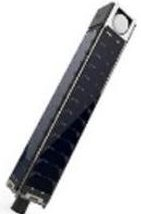

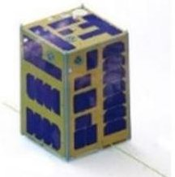

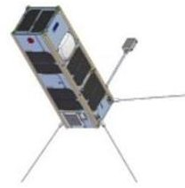

Figure 1. Different CubeSat examples

Modern CubeSats are a special class of nanosatellite. The size of one-unit (1U) CubeSat is 10 cm x 10 cm x 11 cm. CubeSats can be composed as made in several combinations of the 1U to form up to 6U (Fig.1), or even more. Universities, governments and manufacturers are progressively turning to CubeSats as ready-to-build systems able to deliver low-cost and rapid entree to space aimed at research and development along with operative missions such as earth observations, deep space and asteroid captures. Nevertheless, the market of components and hardware for

small satellites, mainly CubeSats, still drops small of providing the essential capabilities required by continually growing mission tasks. Diverse CubeSat components are commercially available as off-the-shelf standard components delivered by a restricted quantity of suppliers. A way to overcome this issue is to improve the capacity to adapt each micro-satellite. With the adoption of advanced manufacturing (3D-printing) techniques such as additive manufacturing, some mission specific capabilities can be effortlessly fabricated into a system that commercial off-the-shelf components may not be able to provide, in terms of affordable optimized method [2].

The concept of modern SmallSats has many possible characteristics. Such characteristics can vary depending on the mission type, the quantity of satellites to be deployed, and many other aspects related to design, fabrication, testing, and launching a given satellite. CubeSats (from one to six units in size) can be realized at low cost by means of specific kits which can be acquired on-line, and commercial off-the-shelf components that even have not been spaceflight eligible before [3]. This is typical of CubeSats design as university student or even high school student projects, but may also be the case for start-up and New Space companies, who wish to deploy structures at the appropriately low costs - basically shifting testing in qualification and operations phase in space [4].

In the case of companies that are deploying hundreds, or possibly even thousands of satellites in large-sized constellations, the objective is to achieve financial advantage through mass production, minimizing testing and validation, adopting of innovative manufacturing techniques such as additive manufacturing [5].

The remainder of this paper describes the following research objectives: 1. Survey and estimation of the potential of 1U CubeSat platform potential, reflecting how to design

<!-- PDF_PAGE: 2 -->

more suitable platform for future CubeSats. 2. During CubeSat platform development, formulating concept of the design process and propose standard physical relationships due to find optimal design solution. 3. Study CubeSat modular structure which allows to get flexible subsystems settlement.

## 2. Concept of the Design Process

In terms of knowledge of manufacturing works in the process of CubeSats expansion, design and calculation stages, growth of logic and electric diagrams and improvement computation plans, modeling and analyses have to carried out. The design and the modeling processes include the following stages [1]:

1) design and strength inspection and calculations;

2) mass and momentum of inertia calculations,

3) define location centre of mass and the main inertia axes;

4) thermal calculations;

5) calculations of internal and external disturbing moments CubeSat prompting;

6) gas setting calculations for hermetic sections;

7) estimation of possibility of meteorite effect and erosion of external surfaces;

8) estimation of radiation exposure for devices, glass, coatings and structural non-metallic elements;

9) dynamic analysis purposed to control necessities or to check the structure stiffness and action of the orientation system;

10) ballistic design;

11) power supply system calculations, orientation system and other system designs.

The principal focus of this research paper is the CubeSat centre of mass movement stabilization system in the lateral plane applied during the trajectory correction phases. Additionally, a high-thrust sustained propulsion system can be used only if by opposing or linearly moving combustion chamber shall be using in the correction stage to control CubeSat motions [4].

Considering the design process in terms of the product development stages [5,6], such process should cover of the technical specification related to CubeSat, development of draft proposal, conceptual and its technical design. It is obvious that in the process of CubeSat design the basic parameters of systems, trajectory characteristics, operation program and the structure design should be putting into account [1].

## 3. Physical Relationships during Design Process

The study of physical affiliations in the design process is essential to finding optimum design and compatibility of

elementary characteristics of CubeSat. The initial task is to be resolving during the development of any mission [7,8]. Taking into consideration small cost of contemporary CubeSats and the existing approaches of test and control it is hard to imagine that the parameters of any systems could be incompatible in CubeSat, or even could not deliver for the action of its devices [9-11].

The second of the tasks set is examine for optimal combinations of parameters and characteristics. It is more difficult than the initial one and it is not always resolving. This is mostly because of complication of these studies [12-15]. In the simplest occasion, the trajectory and the orbit active launch vehicle shall be set. It should be defining the CubeSat total mass $ M_{0} $ to be injecting on the stated trajectory. In this case the scientific equipment's mass $ M_{Sc} $ will be

$$
M _ {\mathrm {S C}} = M _ {0} - M _ {\mathrm {S S}},
$$

where $ M_{SS} $ - the entire mass of the facility systems, frame and on-board cables network, required to confirm the CubeSat mission.

Hence, in the simplest case, when set the flight mission, or slightly trajectory varying of, or the launcher is choosing, the assignment of optimum design is decreasing of the total mass of service systems, including frame and the on-board cable network. In this circumstance the CubeSat original mass can be seeing as assessment design.

If the value $ M_{SS} $ in equation (1) cannot be considered a self-regulating value, sometimes that expression can be presented as [16]:

$$
\mathrm {M} _ {\mathrm {S c}} + \mathrm {f} _ {\mathrm {S S}} \mathrm {M} _ {\mathrm {S c}} = \mathrm {M} _ {0} - \mathrm {M} _ {\mathrm {S c}} ^ {0},
$$

instead of the stated expression, where $ M_{Sc}^{0} $ - the total mass of the CubeSat service systems and the frame self-governing of the weight of the scientific equipment; $ f_{SS} M_{Sc} $ - is an extra service systems weight and the CubeSat frame, needed for operation of the scientific kit depending on its own weight, configuration and mission task.

If the expression $ f_{\mathrm{SS}} M_{\mathrm{Sc}} $ is simple enough, the appearance (2) can be solving relative to the value $ M_{\mathrm{Sc}} $ . In this case from equation (2) possible find the next expression [1]:

$$
\mathrm {M} _ {\mathrm {S C}} = \mathrm {F} \left(\mathrm {M} _ {0}, \mathrm {M} _ {\mathrm {S S}} ^ {0}\right).
$$

In this case, possible find the maximum value $ M_{Sc} $ directly.

If moving to the minimum of the value $ M_{SS}^{0} $ in the expression (3), i.e. neglect the scientific equipment mass, it also can be estimated, like the service systems that ignored during the design process, and can afford a minor value $ f_{SS} M_{Sc} $ than the picked one [16].

In case of probability of a CubeSat perfect operation within a specified time $ t_{0} $ as B, it can be rewriting in next

<!-- PDF_PAGE: 3 -->

form [1]:

$$
B = B \left[ \left(C _ {m, n}\right), \left(T _ {i}\right), \left(P _ {j}\right), t _ {0} \right],
$$

where $ \left( C_{m,n} \right) $ - the restricted set of basic system parameters; m - the system number; n - a parameter number; $ \left( T_{i} \right) $ - parameters set defining the CubeSat trajectory; $ \left( P_{j} \right) $ - parameter set shaping the action mission.

The probability of SmallSats perfect operation shall be defining by the reliability of its separate structures. We shall letter that the minimum amount of CubeSats matches to the minimum cost of the problem solving or the minimum time to complete the total mission. These expressions will include some constants, and so our equations and inequalities shall be writing as follows [1]:

$$
\Phi_ {\mathrm {r}} \left[ \left(\mathrm {C} _ {\mathrm {m}, \mathrm {n}}\right), \left(\mathrm {T} _ {\mathrm {i}}\right), \left(\mathrm {P} _ {\mathrm {j}}\right) \right] \left\{ \begin{array}{l} = 0, \\ \geq 0, \end{array} \right.
$$

where n=1,2,..., $ N_{m} $ ; $ N_{m} $ - the number of basic parameters of the m-th system; m=1,2,..., M; M-a number of on-board systems; i=1,2,..., I; r=1,2,..., R; j=1,2,..., J.

If all the terms (5) are equations and $ R<N_{\Sigma} $ , then the job of looking for optimal parameter values is restricting to finding a constrained extremum of the many variables function. The relations of form (5) are at once the restriction equations [17].

The task of rational design is to create a project of a CubeSat for which the rate of the selected criterion is adjacent to the maximum or minimum value. In that case, different configuration diagrams, different orientation patterns and different methods of creating control and corrective forces, etc. should be considering [17]. Depending on the design solution versions the purposes could be change. Thus, the rational design shall be keeping to the study of the function in the restriction equations (5) for diverse versions of the newly designed CubeSat [1].

## 4. CubeSat Structure Design and Modelling

The structural design process is an iterative engineering process. The process books for the coming essential variations growing from the interaction among the subsystems [18].

In Fig. 2 showed a comparatively old CubeSat example [19]. It is the structure of the metal shell of an entire, only a square opening in the top, which is using to put circuit board and the load into the CubeSat, meanwhile the side covers with a little humble flat solar panels, used to convert and store solar energy into electricity supplied to the CubeSat. Its total mass up to 1 kg, but its metal shell takes up a lot of weight, which means it cannot carry a many of payload. It is clearly that designer want to require a bigger payload. Such design turns counter to our goals, so this is inefficient option.

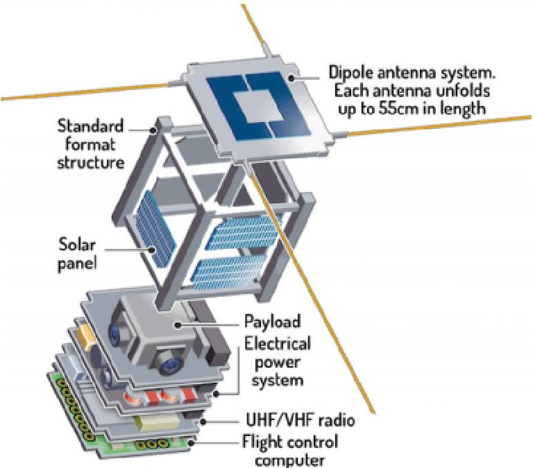

Figure 2. Example of CubeSat structure [19]

Fig. 3 shows us a much more progressive design option [20]. That structure's side panel can be separating from base detachable, and that method has the following advantages:

1. The removable side panels for maximum accessibility, means that we can located internal circuit board and satellite payload a bit easily.

2. Owing to the side panels and the base is not a whole, we can use different materials. For example, the base which with the high strength requirement, it is possible use a metal or a composite material; and for side panels part which strength condition is not high enough, designer can use some lightweight materials (aluminium or plastic) to achieve the purpose of saving weight.

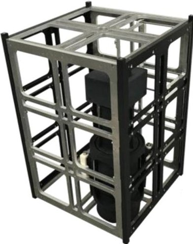

Figure 3. Example of CubeSat structure with removable side panels [20]

One of the aims of this publication is to improve a main structure for CubeSat satellites. The proposed structure offers the much-needed flexibility for the satellite designers during the design process, manufacturing and test cycle. Definitely, the structure permits for the designers to conversion the subsystems position or complete design alterations to the subsystems minus the important and the essential the main structure re-design. Proposed new

<!-- PDF_PAGE: 4 -->

modular structure (Fig. 4) is also in according to the standards that are determined by Cal Poly State University and consequently brings one-to-one compatibility with launch pods [19].

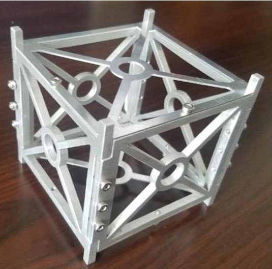

Figure 4. Example of 1U CubeSat platform structure conceptual design

One of the designed structures (which is merely 92 grams) was made up as a frame structure in which the columns in the corners are designed to carry main loads. The structural columns are intended as a rack system and subsystem boards. Moreover, the number of fasteners used in the design is almost 60% less in contrast to commercially offered structures [21].

In such proposition, we can design even multy-unit CubeSat systems, where 1U bus system can be put into upper side of the structure as a unit block, and the rest of the CubeSat can be used for higher payloads such as camera, antenna deployable mechanism and magnetometer booms. Additionally, side solar panels are embedded into the main structure in order to create additional area for deployable solar panels in case of extra energy necessity [21].

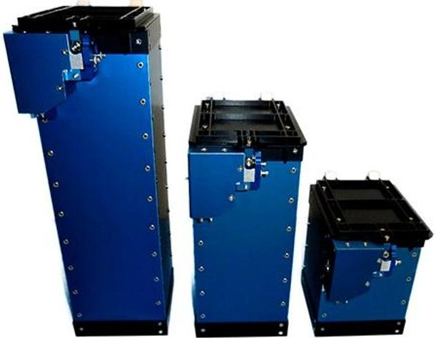

Figure 5. ISIS ISIPOD 3-Unit CubeSat deployed [23]

One of the proposed structural design included side faces with pocked milled out [22]. Although that reduces the structural mass, it did not allow flexibility within the system design. For the unspecified payload, it is crucial that the design can be modified easily to account for changes in payload and batteries. Additionally, in that case initial design was changed to have solid side faces. That allowed the

design to be more flexible, and the new design has also speed up and simplified the manufacturing process, because the pockets no longer needed to be milled out. This had the advantage of growing the natural frequency since the solid faces significantly increased the stiffness of the structure (Fig. 5). But this is unusual design example.

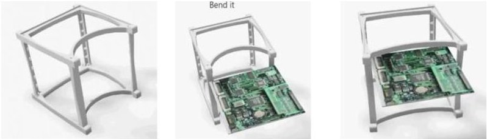

Figure 6. Innovative CubeSat A2 2015 structure [24]

After study several 1U CubeSat structures platforms, was chosen the following basic structural design (Fig. 6). This structure consisting of two identical top and bottom plates, four equal sides, and eight identical bases. Such of design would greatly simplify the manufacturing process of the structure [24].

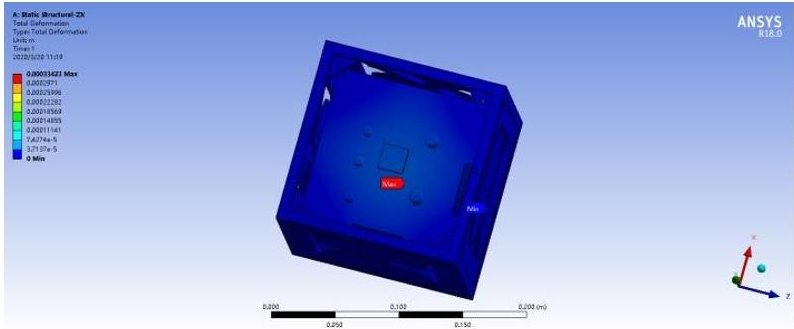

Figure 7. 1U CubeSat platform design analysis

Additionally, a typical CubeSat device will be launched by means of various launching rocket boosters. To succeed for acceptance, the CubeSat structure must not fail beneath definite static and dynamic loading that will be planned grounded on the launching environments (Fig. 7). The launching booster sets out arbitrary excitation, and for escaping routing this energy into forceful structural resonance, the first frequency of free vibration must be beyond 70-90 Hz.

## 5. CubeSat Platform Manufacturing Technique Analysis

One of the reasons for CubeSats is capitalize on the commercial of-the-shelf (COTS) components that can be used to this type of satellite manufacture. This means that preferably the CubeSat designers are construct least probable quantity of parts. This impression reinforced by assuming that some parts of appropriate feature can be achieving at costs fewer that their internal manufactured equivalents, even if those COTS components are not enough fitting [25].

Therefore, here have been serious efforts to list CubeSat's state-of-the-art components [26] and report the estimated progress of knowledge relevant to CubeSats platforms design and manufacturing [27]. The choice of criteria for

<!-- PDF_PAGE: 5 -->

such COTS components must depend on flight tradition and the outcomes of a detailed confirmation and validation processes. Concerning the first reason, the extra flight times that a module can prove lacking a failure, the further reliable it is. Element suppliers do not typically offer complete reliability data, but they fix deliver the quantity of positive missions. Such a quantity can be cast-off as an alternative amount to the component reliability, particularly considering the great degree of CubeSat newborn death. A statistical study and a reliability valuation platform model for CubeSats are show in publication [28]. Without respect to the second reason, the design and manufacturing group may rise the components reliability by testing them in appropriate surroundings at the initial stages of the process development. For this persistence, the hardware-in-the-loop simulation techniques consumption for mentioned group of satellites suggested in the next publications [29,30]. In such imitations, prototyped components can be combined with other components, and tested in contrast to their specifications over some error injection. During advanced steps, a completely integrated system could be validating in a related style. must be beyond 70-90 Hz.

## 6. Results and Discussion

The estimated structures been realized by using a rapid prototyping technique. That choice allows designer to optimize a CubeSat design, manufacture, and assembly.

Grounded on the selected materials and the connecting fastens of both the plastic (ABS) CubeSat platform (Fig. 8), as well as the CubeSat kit reference construction (Fig. 9) made of aluminium, the masses of the structures were calculated and estimated. Results show that reference aluminium structure has a mass of 158 g, however the composite one has an entire mass of 105 g. That means that the composite structure, despite the point that no cuts have been made yet, is nearly 30% less than the aluminium one.

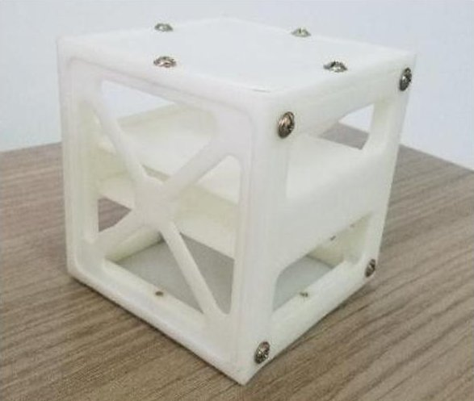

Figure 8. Plastic (ABS) 1U-CubeSat platform

The plastic 1U-CubeSat results to slightly lower first eigen-frequency, as showed in [15], something that is directly related to the assembly of the composite panels that form the CubeSat platform.

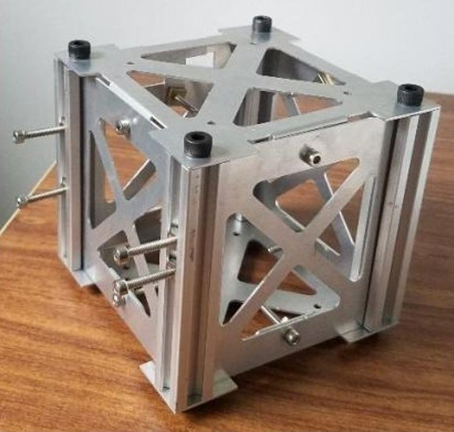

Figure 9. CubeSat kit reference construction

As mentioned in publication [21] that the resulted eigen-frequency values are great, but then at the level of the current study no core components such as electronic boards, power units, sensors and cameras, were presented at the experimental construction. When those components would have been added, a substantial reduction of the natural frequencies is expected.

Nevertheless, for the requirements of comparative assessment among the CubeSat kit reference construction and the plastic one the decided outcomes offer a strong background for evaluation.

The benefits of proposed manufacturing technique are the possibility to produce precise compound forms, which would be costly or difficult to reach with out-of-date fabrication methods, small manufacturing time and low charges, as showed in [15]. Moreover, this material has a density lower than aluminium (ABS: 1.05 g/cm $ ^{3} $ ; aluminium: 2.7 g/cm $ ^{3} $ ). This permits possible mass savings. Furthermore, that technique changes the common impression of major and minor configuration, since the complete part is made at the similar time, hence decreasing the amount of parts and the necessity technological operations like fastening and sticking, similarly increasing the reliability of the construction. This make simpler as well the assembling stage too.

Modern CubeSat manufacturing techniques typically take out material from a metallic base. At the same time, rapid prototyping, on the contrary, extends material [31].

1) using of screws, a bit extended to be bolted in possible pleases to access both sides of the screw;

A drawback is the unfeasibility of gaining threaded holes. In this case, a couple of solutions to that problem was set up:

2) in conditions where the 1st operation is not possible the formation of bags in which slight aluminium pull-outs are in order to afford the appropriate lock.

The radiation influence on ABS is considerably small, as mentioned at [32], and it marks that the entire dose demanded that must simple harms on structure is on the order of 109 rad (SI). That is exceptionally higher than any LEO satellite tests during providing annual orbital missions

<!-- PDF_PAGE: 6 -->

(worse than 107 at 2000 km altitude [15]). Regarding the straight solar light, it should be considered that the construction is practically fully protected by solar cells, which protect the main fragments of the ABS structure.

A numerical analysis of CubeSat has been approved to confirm the structure. A numerical model representing the satellite immobile to the interface by means of the four side pillars, as typical for P-Pod for CubeSat launch [33].

The laboratories CubeSat vibration tests analysis showed that the CubeSat structure is accomplished to supporting the stress practiced throughout the launch, lacking damage and conforming with the necessities forced by the Ukrainian rocket Dnipro, especially the stiffness conditions.

## 7. Conclusions

This publication reviews CubeSat technology delivers samples of their scientific impact and defines the design and the manufacturing of a 1U-CubeSat platform. Typical CubeSat design process is contained of choice of its trajectory, determination of components and key parameters, systems, development of external and internal designs, and determination of their main features. Proposed paper will emphasis on estimating a concept and physical relations in the design process, and on the rational design algorithm version. In terms of specialization of engineering works throughout SmallSats class development, was formulated concept of the design process and established physical affairs to find some optimal design solution, compatibility of basic parameters and their characteristics.

One of the first goal of this study was to design, analysis, and manufacturing technique for 1U CubeSat structures. After study several 1U CubeSat structures platforms, was proposed the basic structural design. That means that preferably the CubeSat platform designers are construct least probable quantity of parts.

Except 1U-CubeSat structure was presented the design philosophy to be used in the future mission. In the direction of this end, the designed structure affords the desired flexibility to support settlements.

In this search, the use of plastic materials, like ABS, was investigated in the design of 1U-CubeSat platform structures. As a result, experimental 1U-CubeSat platform has been developed, designed for student education, low cost realization and some applied research. The system contains ground-breaking solutions, possibly improving the general performance, and flexibility.

## REFERENCES

[1] Zosimovych N., Chen Z., 2018, CubeSat Design and Manufacturing Technique Analysis. IOSR Journ. of Eng. (IOSRJEN), Vol. 8, 9:01-06.

[2] Marshall W.M., Zemba M., Shaemelya C., Wicker R.,

Espalin D., McDonald E., Keif C., 2020, Using Additive Manufacturing to Print a CubeSat Propulsion System. American Inst. of Aeronautics and Astronautics. [Online]. Available: https://ntrs.nasa.gov/search.jsp?R=201500212762 020-01-17T23:27:43+00:00Z.

[3] Madry S., Martinez P., Laufer R, 2018, Innovative Design, Manufacturing and Testing of Small Satellites. Springer Praxis Books 166.

[4] Kitts C., Hines J., Agasid E., Ricco A., Yost B., Ronzano K., Puig-Suar J., 2006, The Gene-Sat-1 microsatellite mission: A challenge in small satellite design. Proc of the 20th Annual Amer. Inst. Aeronautics and Astronautics, Utah State Univer. Conf. Small Satellites 1-6.

[5] Reising S.C., Gaier T.C., Kummerow C.D., Chandrasekar V., Brown S.T., Pad-Manabhan S., Lim B.H., Van den Heever S.C., L'Ecuyer T.S., Ruf C.S., Haddad Z.S., Luo Z.J. Munchak S.J., Berg G., Koch T.C., Boukabara S.A., 2015, Overview of Temporal Experiment for Storms and Tropical Systems (TEMPEST) CubeSat constellation mission. Proc. IEEE Microwave Theory and Tech Society Int. Microwave Symp. Digest 1-4.

[6] Taraba M., Rayburn C., Tsuda A., MacGillivray C., 2009, Boeing's CubeSat TestBed 1 attitude determination design and on-orbit experience. Proc. 23rd Annual Amer. Inst. Aeronautics and Astronautics / Utah State Univer. Conf. Small Satellites 1-9.

[7] Rahmat-Samii Y., Manohar V., Kovitz J.M., 2017, For Satellites, Think Small, Dream Big: A review of recent antenna developments for CubeSats. Applied IEEE Antennas and Propagation Magazine. 59:2.

[8] Mehrparvar A., 2017, CubeSat Design Specification. The CubeSat Program, CalPoly SLO. Retrieved March, 25.

[9] AeroCube 6A, 6B (CubeRad A, B), 2015, [Online]. Available: www.space.skyrocket.de (Retrieved 2015-10-18).

[10] Mehrparvar A., 2014, CubeSat Design Specification. MarCO: Planetary CubeSats Become Real. [Online]. Available: www.planetary.org (Retrieved 2016-02-23).

[11] Clark S., 2016, Launch of NASA's next Mars mission delayed until at least 2018. Spaceflight Now. (Retrieved 2016-02-23).

[12] CubeSat, 2015, Space. Skyrocket.de (Retrieved 2015-10-18).

[13] Athirah N., Mohd A., Ku H., Amin NAM, Majid MSA, 2017, Stress and Thermal Analysis of CubeSat Structure. Applied Mech. and Materials. 554:426-430. Doi: 10.4028. [Online]. Available: www.scientific.net/amm.554.426.

[14] Woellert K., Ehrenfreund P., Ricco A.J., Hertzfeld P., 2011 Cubesats: Cost-effective science and technology platforms for emerging and developing nations. Applied Science Direct. 47:663.

[15] Piattoni J., Candini G.P., Pezzi G., Santoni F., Piergentili F., 2012, Plastic CubeSat: An innovative and low-cost way to perform applied space research and hands-on education. Applied Elsevier 81:420.

[16] Zosimovych N., 2014, Functional Simulation of the Integrated Onboard System for a Commercial Launch Vehicle. Int. Ref. Journ. of Eng. and Sc. (IRJES), 3: 11: 92-106.

<!-- PDF_PAGE: 7 -->

[17] Zosimovych N., Zosimovych D., 2016, Simulation of the Dynamic Characteristics of Launch Vehicle Stabilization During Longitudinal Oscillations. IOSR Journ. of Eng. (IOSRJEN), 6(1): 1-9.

[18] Diana A., Benjamin J., Guillaume R., 2006, Design of a Swiss Cube Structure and Configuration, LMAF, EPFL, Lausanne, Switzerland.

[19] A Basic Guide to Nanosatellites. [Online]. Available: https://alen.space/basic-guide-nanosatellites/.

[20] 12-Unit CubeSat structure. [Online]. Available: https://www.isispace.nl/product/12-unit-cubesat-structure/.

[21] Cihan M., Cetin A., Inalhan G., 2011, Design and analysis of an innovative modular cubesat structure for ITU-pSAT II DOI: 10.1109/RAST.2011.5966885 Source: IEEE Xplore. [Online]. Available: https://www.researchgate.net/publication/224250493.

[22] Osdol TCV, Dorsey C, Hedlung J, Hoye T, Jacobs O (2013) Design, fabrication, and analysis of a 3U CubeSat platform. Engineering Senior Theses, Santa Clara Univer., 2013: 6: 15. [Online]. Available: https://scholarcommons.scu.edu/mech_senior/13/.

[23] ISIS ISIPOD 3-Unit CubeSat deployer. [Online]. Available: https://www.cubesatshop.com/product/3-unit-cubesat-deploy er/.

[24] Innovative CubeSat A2 2015 best idea. 2015. [Online]. Available: https://www.youtube.com/watch?v=eRaRSaU1wsc.

[25] Nieto-Peroy C., Emami M.R., 2019, CubeSat Mission: From Design to Operation, Appl. Sci. 2019: 9: 3110. [Online]. Available: www.mdpi.com.

[26] NASA, 2019, State of the Art of Small Spacecraft Technology. [Online]. Available: https://sst-soa.arc.nasa.gov/.

[27] National Academies of Sciences, Engineering and Medicine, 2016, Achieving Science with CubeSats: Thinking Inside the Box. National Academies of Sciences, Engineering, and Medicine: Washington, DC, USA.

[28] Langer M., Weisgerber M., Bouwmeester J., Hoehn A., 2017, A reliability estimation tool for reducing infant mortality in CubeSat missions. In Proc. of the IEEE Aerospace Conf., Big Sky, MT, USA, 4-11 March.

[29] Nieto-Peroy C., Emami M.R., 2018, Integrated Design and Simulation Environment for Space-qualified Onboard Computers. In Proc. of the Space Eng. and Concurrent Eng. for Space Applications Conf., Glasgow, UK, 26-28 Sept.

[30] Batista G. CL., Weller C.A., Martins E., Mattiello-Francisco F., 2018, Towards increasing nanosatellite subsystem robustness. Acta Astronaut. 156: 187: 196.

[31] Cihan M., Cetin A., Inalhan G., 2011, Design and analysis of an innovative modular cubesat structure for ITU-pSAT II. [Online]. Available: https://www.researchgate.net/publication/224250493.

[32] NASA Space Vehicle Design Criteria (Structure), 1970, NASA SP-8053, June.

[33] Puig-Suari J., Turner C., Twiggs R.J., 2002, CubeSat: the development and launch support infrastructure for eighteen different satellite customers on one launch, in: Proc. of the 15th Annual/USU Conf. on Small Satellites, Aug., Logan, UT.