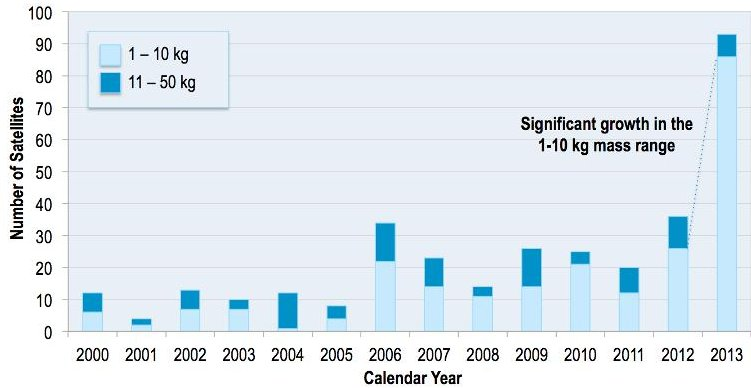
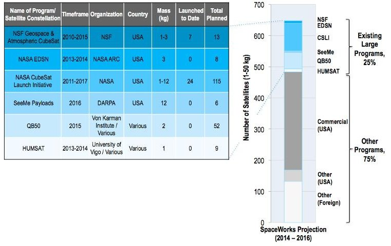
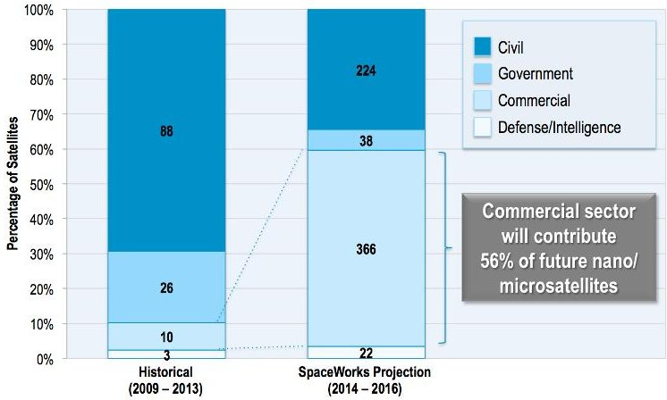
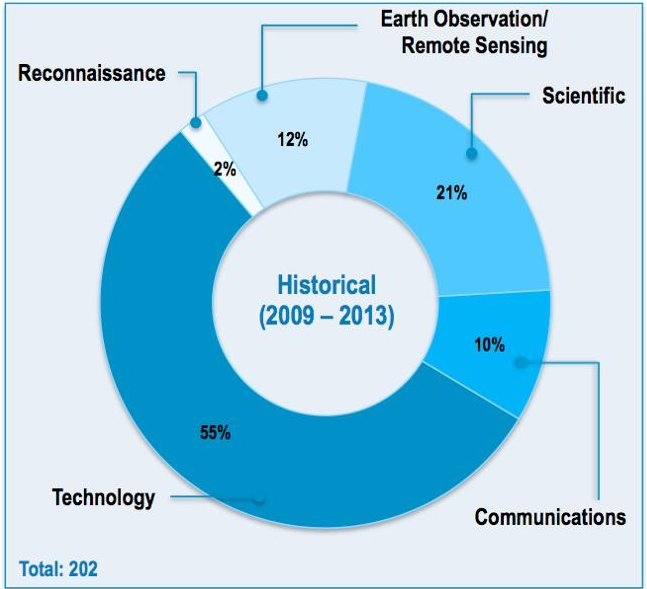
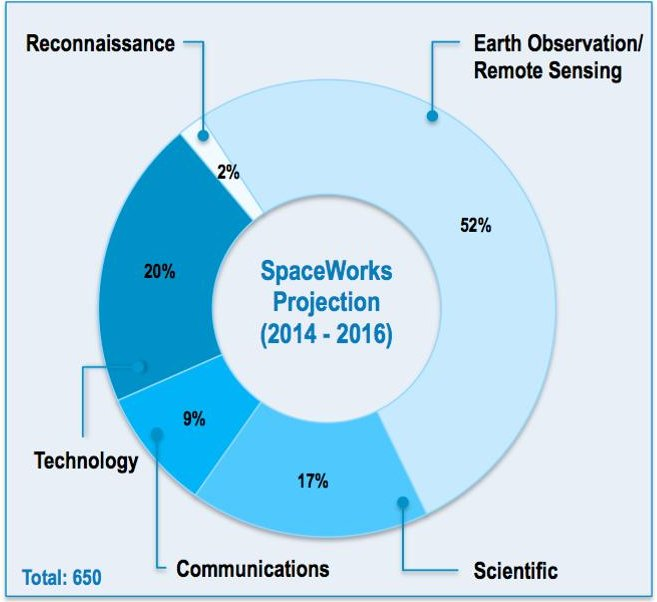
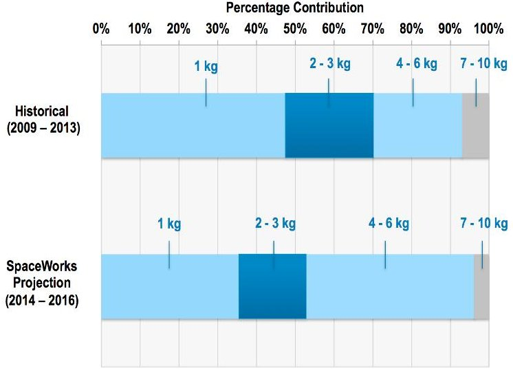
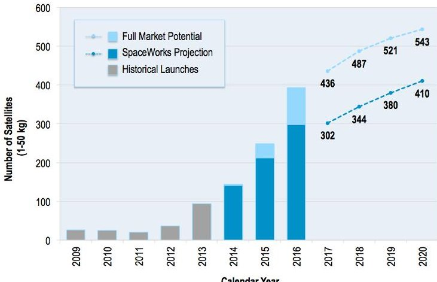

<!-- PDF_PAGE: 1 -->

# SpaceWorks' 2014 Nano/Microsatellite Market Assessment

Elizabeth Buchen

Director, Engineering Economics Group, SpaceWorks Enterprises, Inc. 1040 Crown Pointe Parkway, Suite 950, Atlanta, GA 30338; 770.379.8006 elizabeth.buchen@sei.aero

## ABSTRACT

Since 2008, SpaceWorks has actively monitored global nano/microsatellite activities, and annually publishes a summary update as a free service to the small satellite development and launch communities. SpaceWorks' 2014 projection of the 1-50 kg satellite market reflects a significant increase from last year's projection, with 2-3 times higher quantities of nano/microsatellites needing a launch from 2017 to 2020, driven largely by the advent and continued growth of commercial players. $ ^{1} $ This paper presents detailed observations and projections for the nano/microsatellite market based on over 650 satellites with masses between 1 and 50 kilograms in development over the next three years (2014 to 2016). The data source for this assessment is a subset of the SpaceWorks Satellite Launch Demand Database (LDDB), an extensive collection of all known historical missions, announced future satellite projects, and estimated future commercial missions. Analysis of development trends by sector show that the civil sector (including academic) remains strong, and the commercial sector is growing significantly and will likely continue to make large contributions to the global nano/microsatellite market. Analysis of trends by purpose suggests that while Earth observation and remote sensing remain the most widely used applications in the near future, applications for nano/microsatellites are diversifying.

## INTRODUCTION

In 1999, California Polytechnic State University and Stanford University developed the CubeSat to give universities more opportunities to become more involved in the space industry. Since then, the small satellite industry continues to expand domestically and internationally. While academia continues to heavily participate to the global small satellite market, the commercial sector's contributions are becoming more significant, with numerous start-up companies offering space-based solutions to issues on Earth.

Since 2011, SpaceWorks has produced an annual nano/microsatellite (1-50 kg) market projection. Last year, the projection estimated 93 nano/microsatellites would launch globally in 2013; 92 nano/microsatellites actually launched, an increase of 269% over the satellites launched in 2012. Likewise, with a 330% increase in attempted nanosatellite (1-10 kg) deliveries compared to 2012, 2013 was a remarkable year for the nanosatellite market (see Figure 1).

In January of this year, SpaceWorks released its annual update to the projection, the focus of this paper, which reflects a significant increase in the quantity of future nano/microsatellites needing a launch. Particularly in the 2017-2020 timeframe, this year's projection presents a two to three times increase over the 2013 projection. $ ^{1} $ With continued support from academia and the flurry of commercial activity, SpaceWorks believes

the 1-50 kg satellite market is real and will continue to flourish.

Figure 1: Historical Nano/Microsatellites Launched from 2000 to 2013

## Definitions and Terminology

Throughout this paper, the term "nano/microsatellite" is used on numerous occasions, and the author's use of this term refers to satellites with a total mass between 1 and 50 kg. Nanosatellites are generally defined to be those whose total mass is between 1 and 10 kg and microsatellites include those whose total mass lies between 11 and 100 kg. This study limits the upper end of microsatellite mass to 50 kg given the relative large amount of satellite development activity in the 1-50 kg range by comparison to the 50-100 kg range (see Table 1). The mass ranges indicated here refer to the satellite's gross mass, which may or may not include

<!-- PDF_PAGE: 2 -->

propellant, depending on whether the particular satellite has propulsion.

Table 1: Mass Ranges by Satellite Class

<table border="1"><tr><td>Satellite Class</td><td>Mass Range</td></tr><tr><td>Femtosatellite</td><td>10-100g</td></tr><tr><td>Picosatellite</td><td>&lt;1kg</td></tr><tr><td>Nanosatellite</td><td>1-10kg</td></tr><tr><td>Scope of this study</td><td>1-50kg</td></tr><tr><td>Microsatellite</td><td>10-100kg</td></tr><tr><td>Small Satellite</td><td>100-500kg</td></tr></table>

## SpaceWorks Launch Demand Database (LDDB)

The data source for this study is the SpaceWorks Satellite Launch Demand Database (LDDB). The LDDB is an extensive database of all known historical (2000-2013) and future (2014+) satellite projects with masses between 0 kg and 10,000+ kg. As of January 2014, the LDDB contained 650 future (2014-2016) nano/microsatellites. Future satellites in the LDDB include publicly announced nano/microsatellite projects and programs and quantitative and qualitative adjustments to account for the expected sustainment of current projects and programs (e.g. follow-on to NASA's EDSN and CubeSat Launch Initiative programs), as well as the continued emergence and growth of numerous existing commercial companies.

In addition to the satellite's mass, the LDDB contains other types of information about the satellite: satellite owner/operator, country of owner/operator, contractor sector (civil, government, military, commercial), application (Earth observation/remote sensing technology, science, communications, reconnaissance), orbital parameters (apogee, perigee, eccentricity, inclination, period), launch year, launch date, launch location, and launch vehicle.

## FUTURE NANO/MICROSATELLITE MARKET TRENDS

## Future Large Programs for Nano/Microsatellites

Government programs such as NASA's CubeSat Launch Initiative (CSLI), the Educational Launch of Nanosatellites (ELaNa), and the Edison Demonstration of Smallsat Networks (EDSN) have undergirded the nano/microsatellite market in addition to efforts from DARPA, NSF, ESA, and others. Particularly in the realm of academia, these programs are providing funding for space missions that was previously not available.

Figure 2 gives a breakdown of all large programs for future nano/microsatellites. From 2014-2016, existing large programs comprise only 25% of all future nano/microsatellites (compared to 65% in 2013) due to increased worldwide activity in the civil and commercial sectors.

The breakdown assumes two NSF Geospace & Atmospheric CubeSat satellites will be selected in 2014. The NASA CSLI total includes the sixteen missions chosen in February 2014 (in response to the August 2013 Announcement of Opportunity) and the timeframe listed is based on when the already selected CubeSats are scheduled to launch. Note the QB50 satellite total includes both precursor satellites, (QB50P1 and QB50P2) in addition to the network of 50 CubeSats.

All NSF satellites thus far have launched through the NASA CSLI. In the table, these historical NSF satellites are included in both the count of number launched for NSF and the count for CSLI (double counted in this sense). The bar graph of future launches shows only those NSF satellites that are expected, but currently not manifested (thus they are appropriately single counted for future launches).

Figure 2: Large Program Breakdown for Future Nano/Microsatellites

## Nano/Microsatellite Trends by Sector

Traditionally, nanosatellites have been predominantly developed and built by academic institutions. As shown in Figure 3, the civil sector remains strong from 2014- 2016, supplying over one third of future nano/microsatellites, but it will see reductions compared to 2009-2013 when the sector contributed 63%. The commercial industry's mounting influence is evident, with the sector providing over half of all future nano/microsatellites.

<!-- PDF_PAGE: 3 -->

Figure 3: Historical (2009-2013) and Future (2014- 2016) Nano/Microsatellite Trends by Sector

By some traditional definitions of space industrial sectors, non-defense government space activities are a subsector of the civil sector. Note that here non-defense government activities are placed in a separate sector. "Government" refers to those nano/microsatellite development efforts that occur within/by the government agency or organization (e.g. NASA, JAXA). "Civil" refers to all other non-defense development activities (e.g. universities, federally funded research institutions), though the funding source may be a government agency.

## Nano/Microsatellite Trends by Purpose

Five categories have been established to describe the general purpose of nano/microsatellite missions. These categories are: technology (missions focused on developing and demonstrating new technology), communications, Earth observation/remote sensing, science (missions focused on collecting space-based data), and reconnaissance.

Figure 4 illustrates the historical (2009-2013) trends in nano/microsatellite applications. Satellites in this mass range predominantly focused on technology development and demonstration, driven by the widespread use of CubeSats in academic settings. In many of these cases, the primary goal of the mission is learning the process of designing and producing a spacecraft, rather than collecting data or performing specific experiments.

Future nano/microsatellite applications, as shown in Figure 5, starkly contrast with historical trends. Where previously nano/microsatellite missions focused on developing or demonstrating innovative technologies, future nano/microsatellites will execute missions typically reserved for larger spacecraft. This is particularly true of Earth observation/remote sensing missions, which will comprise over half the market by 2016, compared to only 12% from 2009-2013. This

dynamic growth is due to the arrival of commercial satellite developers who plan to use small satellites to provide novel and innovative space-based solutions for on-Earth applications.

Figure 4: Historical Nano/Microsatellite Trends by Purpose (2009-2013)

Figure 5: Future Nano/Microsatellite Trends by Purpose (2014-2016)

## Nano/Microsatellite Size Trends

The nanosatellite mass class largely consists of spacecraft that utilize the CubeSat standard, a modular architecture that defines 1U as a 10cm cube with a mass of approximately 1 kg. The CubeSat's modular nature has enabled many space-related development activities and can be credited with the growth and transformation of the nanosatellite market. Given the significance of the CubeSat standard in defining the market, it is important to monitor developments and changes in the CubeSat architecture as the market continues to evolve.

<!-- PDF_PAGE: 4 -->

Figure 6 illustrates the historical and projected mass distribution of spacecraft in the nanosatellite mass class. While still immensely popular, the use of single unit CubeSat missions, which supplied nearly half of historical nanosatellite missions, will diminish compared to larger, more capable CubeSats. In recent years, 6U and 12U CubeSats are not uncommon, as satellite applications continue to diversify. Although the volume of these CubeSats remain within the standard CubeSat form factor, many future missions are becoming more technically advanced, increasing the average mass per CubeSat unit. Traditionally, a 3U CubeSat would be limited to 4 kg, but future missions with the 3U form factor have masses ranging up to 6kg. The 4-6 kg mass range accounts for over 40% of the future nanosatellite market, with larger, more advanced 3U CubeSats making up the majority of satellites in this range.

Figure 6: Historical (2009-2013) and Future (2014-2016) Nanosatellite Size Trends

SPACEWORKS' 2014 NANO/MICROSATELLITE GLOBAL LAUNCH DEMAND PROJECTION

## Methodology and Assumptions

SpaceWorks considers two different projections in the 2014 Nano/Microsatellite Market Assessment market assessment: the Full Market Potential and the SpaceWorks Projection. The Full Market Potential dataset contains all currently known past and future nano/microsatellites from the SpaceWorks LDDB, with the addition of an inflation factor to account for known unknowns plus assumed sustainment of certain current projects and programs (e.g. follow-on to NASA Ames EDSN, CSLI, DARPA SeeMe) and the growth of numerous new and existing commercial companies. In contrast to this, the SpaceWorks Projection dataset reflects SpaceWorks' expert interpretation on the likely market outcome. However, neither projection places

value judgment on whether satellite developers will successfully meet their announced launch date or not.

SpaceWorks has projected global launch demand in the nano/microsatellite market according to a Gompertz logistic curve "best fit" regression from 2014 to the year 2020 with a market saturation point (asymptote for the number of satellites) set at 525 nano/microsatellites in a year for the SpaceWorks Projection dataset and 580 for the Full Market Potential dataset.

The SpaceWorks Projection and Full Market Potential datasets include some known nano/microsatellite programs for which a specific launch date has not been announced. The satellites belonging to these programs are distributed across the period (date range) for launches according to the announced program objectives.

## Nano/Microsatellite Projection Results

The results of the 2014 Nano/Microsatellite Market Assessment are shown in Figure 7. Projections based on announced and future plans of developers and programs indicate between 2,000 and 2,750 nano/microsatellites will require a launch from 2014 through 2020.

Figure 7: Nano/Microsatellite Launch History and Projection

Based on the announced launch data alone, 2014 will see a 52% increase in nano/microsatellites launched compared to 2013. Commercial companies will contribute over one-fourth of all nano/microsatellites launched in 2014, a significant increase from 2013, where the commercial sector contributed only 11%. The continued emergence and growth of commercial companies, some of which are included in Table 2, will result in an even greater increase in 2015, with the sector contributing 60% of all nano/microsatellites launched. Many companies have publicly revealed their near-term intentions regarding future launches of nano/microsatellites and the satellites' wide spectrum of revenue generating applications. Other companies have

<!-- PDF_PAGE: 5 -->

been more reserved, revealing only small details of their plans. Despite uncertainty regarding individual companies' intentions, compelling evidence suggests the commercial sector will have a meaningful and enduring impact on the nano/microsatellite industry.

Table 2: Notable Commercial Companies in the Nano/Microsatellite Industry

<table border="1"><tr><td>Commercial Company</td><td>Satellite Class</td><td>Satellite Application</td></tr><tr><td>Dauria Aerospace</td><td>Nano</td><td>110010100101</td></tr><tr><td>Deep Space Industries</td><td>Nano</td><td></td></tr><tr><td>GeoOptics, Inc.</td><td>Micro</td><td>110010100101</td></tr><tr><td>ISIS</td><td>Nano/Micro</td><td></td></tr><tr><td>Outnet (MDIF)</td><td>Nano</td><td>110010100101</td></tr><tr><td>NanoSatisfi</td><td>Nano</td><td>110010100101</td></tr><tr><td>Planet Labs</td><td>Nano</td><td>110010100101</td></tr><tr><td>Planetary Resources, Inc.</td><td>Nano/Micro</td><td></td></tr><tr><td>SpaceQuest, Ltd.</td><td>Micro</td><td></td></tr></table>

Earth Obs./ Remote Sensing 1100 1010 0101 Data Collection Asteroid Exploration Ship Tracking

## SUMMARY

The nano/microsatellite market is growing tremendously with the continued use of the CubeSat standard, microelectronics and other technology equipment, government programs, and furthering of applications. From 2009-2013, the nano/microsatellite market displayed average growth of 37.2% per year. SpaceWorks' Projection dataset shows average growth of 23.8% per year over the next 6 years (2014-2020), with 2,000-2,750 nano/microsatellites requiring a launch.

While 1U (1 kg) CubeSats are still widely used, particularly in academia, 40% of future nanosatellites (1-10 kg) are in the newly popular and increasingly sophisticated 3U form factor (4-6 kg). Applications for nano/microsatellites are diversifying, with increased use in the future for Earth observation and remote sensing missions. The civil sector remains strong, but the eruption of commercial companies and start-up activities will continue to influence the nano/microsatellite market; future launches suggest this trend will continue.

## Acknowledgments

The author gratefully thanks her colleagues at SpaceWorks Enterprises for their assistance and review throughout this effort. Special thanks are due to Dr.

John Olds, Dr. John Bradford, Mr. Dominic DePasquale, Mr. Jon Wallace, Mr. Mark Elwood and Mr. Adam Snow (SpaceWorks Engineering graduate student intern).

## References

1. DePasquale, D., "Nano/Microsatellite Market Assessment," SpaceWorks Annual Nano/Microsatellite Market Assessment, February 2013.