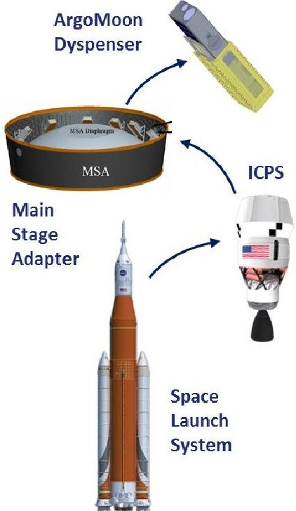
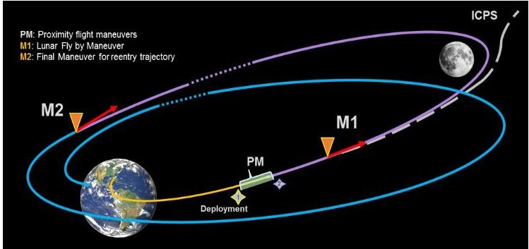
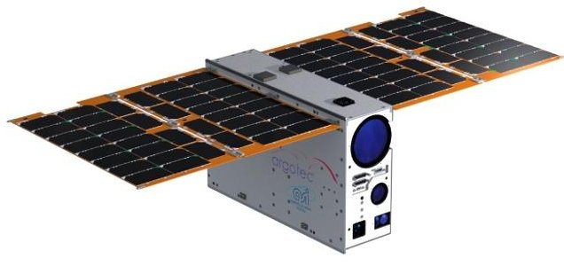
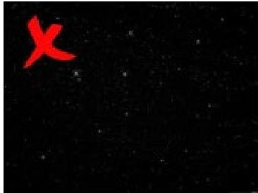
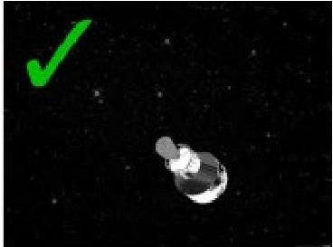

<!-- PDF_PAGE: 1 -->

# ArgoMoon: Italian CubeSat technology to record the maiden flight of SLS towards the Moon

Simone Simonetti, Valerio Di Tana Argotec Via Cervino 52, 10155, Turin, Italy; +39 011 765 0567 simone.simonetti@argotecgroup.com

Gabriele Mascetti, Simone Pirrotta, Edmondo Scorzafava Italian Space Agency (ASI)

Via del Politecnico, 00133 Rome, Italy; +39 06 85671

gabriele.mascetti@asi.it

## ABSTRACT

The ArgoMoon Nanosatellite, developed by the Italian company Argotec for the Italian Space Agency, will be launched in 2021, during the maiden flight of the NASA Space Launch System (SLS) named Artemis-1 mission. ArgoMoon will be the first microsatellite to be released by the Interim Cryogenic Propulsion Stage (ICPS) and it will acquire significant pictures of ICPS itself. It will perform proximity flight around the secondary stage of the launcher by means of autonomous imaging and tracking subsystems, thus allowing the CubeSat to remain close to the target, in order to capture high resolution pictures with technical and outreach purposes. After this first phase, orbital manoeuvers will move the satellite in a geocentric highly elliptic orbit, whose apogee is high enough to allow flybys and imaging of the Moon and the surrounding environment. This second part of the mission will last six months prior to the CubeSat disposal in a heliocentric orbit. ArgoMoon mission will allow testing the platform in the severe environment of Deep Space, imposing severe propulsive maneuvers and long-distance communications. The technical solutions to meet challenging requirements and mission objectives have been implemented by Argotec in a robust CubeSat platform.

## INTRODUCTION

The journey into the Deep Space is pioneered by Space Agencies through the development of new technologies and capabilities, trying to allow exploration across multiple solar system destination, such as the Moon, asteroids and Mars.

In the human exploration framework, the Artemis-1 mission foresees the first use of NASA Space Launch System (SLS) to insert the Orion unmanned capsule into an orbit around the Moon. During its trip, the secondary stage of SLS, i.e. Interim Cryogenic Propulsion Stage (ICPS), will host thirteen different secondary payloads, aiming at increasing the development and the use of CubeSats for Deep Space applications.

ArgoMoon is one of these payloads, a 6U CubeSat designed and integrated by the Italian Company Argotec and coordinated by the Italian Space Agency (ASI). Together with the other secondary payloads, ArgoMoon will be one of the first CubeSats to fly in Deep Space.

The primary goal of the ArgoMoon mission is to acquire detailed pictures of the SLS secondary propulsion stage during its travel towards the Moon. Such pictures will be collected by ArgoMoon during a proximity maneuvering phase, which will also allow

validating the target tracking and pointing algorithm developed by Argotec.

After this first mission phase, orbital maneuvers will move the satellite in a geocentric highly elliptic orbit, whose apogee is so high to allow flybys and imaging of the Moon and surrounding environment.

Due to the highly demanding mission environment, a tailored design process was required, since several key subsystems have been developed and customized by Argotec, to increase their technical performance and reliability qualifying the satellite for the operations from lunar orbit.

In the following sections, a brief introduction about the NASA Artemis-1 Mission and a technical description of the ArgoMoon Platform is provided.

## SLS AND ORION MISSION

The SLS is the new launch vehicle developed by NASA, after the Space Shuttle retirement, devoted to Deep Space exploration missions.

Artemis-1 mission will represent the maiden flight for the SLS, that will allow the Orion capsule to fly an unmanned mission towards the Moon, where it will perform several maneuvers to test flight capabilities before performing an Earth controlled re-entry, where the capsule will be recovered after splashdown in the Pacific Ocean.

34th Annual Small Satellite Conference

<!-- PDF_PAGE: 2 -->

The SLS is composed of two main solid propulsion stages attached to the main liquid stage propelled by $ \mathrm{L O X / L H_{2}} $ engines derived from the Space Shuttle Program.

NASA has offered the chance to thirteen different satellites to participate to Artemis-1 mission as secondary payloads of the mission, to increase the use of CubeSat for Deep Space applications.

The CubeSats will be deployed from the SLS second stage, called ICPS, that will provide the final thrust to launch Orion towards the Moon. After the detachment of Orion, ICSP will follow a high elliptical orbit that will bring the stage into a disposal heliocentric path.

The described trajectory is an incredible opportunity for the secondary payloads to perform a Deep Space mission.

## ARGOMOON MISSION

## Mission Overview

ArgoMoon is a mission of the Italian Space Agency (ASI), based on a 6U CubeSat developed and integrated by Argotec. The main mission objective is to acquire significant pictures of the ICPS stage and to validate the developed technologies for Deep Space.

Figure 1 ArgoMoon Position inside SLS

The ArgoMoon mission is subdivided into two main phases, whose mission profile is reported in Figure 2.

During the first one, within the first hours after the satellite's deployment, ArgoMoon will acquire pictures of ICPS, performing autonomously the maneuvers necessary to remain close to the target. This phase will be extremely demanding for the satellite and ArgoMoon will perform a series of complex operations in order to autonomously reconstruct its attitude, to stop its drifting from the ICPS and to point the cameras towards the target. Moreover, ICPS will be identified through the on-board implemented image recognition algorithm.

The set of breaking maneuvers performed with the satellite's thrusters has been optimized to allow a close passage of the satellite around the ICPS, to acquire high-detailed and high-resolution of the target to accomplish the mission objectives. These operations will be constrained by several margins required by NASA to address safety operations around ICPS since a minimum distance to avoid the collision is required.

During the second mission phase, the satellite will perform few orbital maneuvers to reach an elliptic geocentric orbit characterized by a very high apogee (i.e. 500,000 km), during which it will perform several Moon fly-bys while shooting the Earth, the Moon and testing attitude algorithms on-orbit. The first fly-by of the Moon has been optimized by the means of a genetic algorithm in order to maximize the mission results and guarantee a safe satellite's disposal.

During the six months mission, ArgoMoon will perform seven lunar close encounters at an altitude below 60,000 km, allowing the acquisition of detailed images of the Moon.

Finally, thanks to the last performed Moon fly-bys, ArgoMoon will be position on a disposal heliocentric trajectory.

Figure 2 ArgoMoon Mission Profile

<!-- PDF_PAGE: 3 -->

## Platform Overview

ArgoMoon is a 6U CubeSat with a weight of approximately 14 kg, shown in Figure 3. It is equipped with the following subsystems:

- Payload Subsystem (PL), composed of two operationally independent optics that allow to maximize the tracking performance and to acquire detailed pictures;

- Rangefinder (RF), that is able to control the distance between the satellite and the target to maintain the required safety margins;

- Electrical Power Subsystem (EPS), that is a customized technology to manage the power produced by the Solar Panel Array (SPA) and stored in the battery (BAT);

- Structure Subsystem (SS), that provides the necessary physical support to place the hardware and to withstand all the loads that ArgoMoon will experience during the mission (e.g. launch, deployment, operational mechanical loads);

- Micro Propulsion Subsystem (MiPS), that allows to modify the satellite's orbit and to desaturate the reaction wheels required for attitude control;

Attitude Determination and Control Subsystem (ADCS), composed of a star tracker, two sun sensors and a set of reaction wheel used to control the spacecraft's attitude and to allot high pointing performance;

- Telemetry and Telecommunication Subsystem (TMTC), that codes the data through the onboard radio and then transmit telemetry and data through different antennas positioned both on the top and the bottom of the satellite;

- On-Board Computer & Data Handling (OBC&DH), which is a customized technology able to control and monitor the subsystems' activities, hosting and operations the image recognition algorithm.

In the following paragraphs, more detailed information on each subsystem is provided.

Figure 3 ArgoMoon Satellite External View

## Platform Description

All the aforementioned subsystems are designed to withstand the thermal, radiation and operational loads typically experienced in Deep Space.

The Payload Subsystem is composed of two different optical cameras, with narrow (i.e. $ 2. 5^{\circ} $) and wide (i.e. $ 4 0^{\circ} $) Field of View (FOV), allowing to maximize the performance in tracking the target area (e.g. ICPS, Moon, Earth) and to acquire high detailed scientific pictures.

While the wide FoV camera is able to capture a bigger section of the sky to rapidly scan the space around the satellite looking for the target, the narrow FoV payload works like a telescope, being able to acquire detailed pictures of the target with different resolutions according to the distance. Considering the ICPS dimensions of around 5 meters diameter, the photos resolution is 1 px/cm from a distance of 100 meters, 1 px/dm from 1000 meters and so on, reducing with the distance.

Both the two payloads operate in a proper spectrum due to the lens coating that filters the undesired frequencies and are equipped with a high-speed CMOS image sensor with a resolution of 4096x3072 pixels.

The RF can be considered a part of the PL Subsystem, is essential to evaluate the distance of the satellite from the target to respect the safety limits imposed by NASA In this regard, it is established a forbidden area below 100 meters from ICPS.

The EPS is one of the customized subsystems embarked on ArgoMoon and it has been designed to guarantee certain flexibility as a general-purpose power distribution subsystem. It is able to manage the amount of power coming from the SPA and BAT with high efficiency. In order to avoid overcurrent and overvoltage, the distribution bus is continuously monitored to eventually disconnect the line in case of a fault to prevent permanent damage. Moreover, the

<!-- PDF_PAGE: 4 -->

power line from the external connector to the BAT and the EPS is protected and monitored to avoid any safety hazard during ground, launch of flight conditions. An additional level of safety is guaranteed by release switches used to prevent premature activation of the satellite when stowed in ICPS.

The ArgoMoon structure was designed to minimize mass and maximize usable volume while offering the highest possible reliability. The structure has been entirely designed and developed in-house by Argotec to guarantee the protection needed against the Deep Space environment. The structure and the rear side of the SPA are covered with a particular paint, allowing to radiate heat into Deep Space and to keep the internal satellite's temperature under control without any active components. Moreover, due to the high temperature reached by the MiPS during the manoeuvers, MLI insulators are installed to maintain the thermal balance of the satellite.

The MiPS is able to provide almost 100 mN of thrust with a specific impulse of 190s, allowing to perform the breaking manoeuver and all the attitude corrections during the mission. The MiPs is also equipped with 4 micro nozzles to control the attitude and desaturate the reaction wheels used for fine pointing during scientific phases.

The ADCS is a COTS equipped with a high precision star tracker and gyros that combined guarantee a pointing accuracy better than $ 0. 0 1^{\circ} $

The TMTC Subsystems include an X-Band transponder, in charge of handling both downlink and uplink communications, connected to four X-Band antennas. The radio has been specifically developed for CubeSats applications and it is compatible with the DSN services, allowing stable transmission performances and advanced ranging functionalities necessary for accurate Deep Space navigation.

The OBC&DH has been customized and designed with a very flexible architecture, to meet the needs of a broad variety of mission scenarios. It is based on two main components, which are a Field Programmable Gate Array (FPGA), that hosts the interfaces with all the subsystems, and a CPU connected to the FPGA, capable of supporting the inputs elaboration from the satellite and providing instructions to the subsystems.

While the CPU is a dual-core processor with a long and proven flight heritage in high-reliability space applications, the FPGA integrates a fourth-generation flash-based FPGA fabric and high-performance interfaces. It maintains the resistance to radiation-induced configuration upsets in the harshest radiation

environments such as space flight (i.e. geocentric orbits like LEO, MEO, GEO, HEO and Deep Space ones) since they are hardened by design against radiation-induced SEUs.

Moreover, the OBC board also provides different types of integrated memory, that are a NAND memory with high-density data storage for images and mission telemetry, Electrically Erasable Programmable ReadOnly Memory (EEPROM) to store flight software and status data and a Synchronous Dynamic RAM (SDRAM) memory to allocate code and data at runtime.

## Imaging System Algorithm

Given the mission objectives and the presence of optical payloads, the Imaging System (IS) Algorithm implemented in the satellite's OBC represents a key component of ArgoMoon, aimed at processing, tracking and identifying the targets in the cameras' FoV of the cameras.

The IS is aimed at processing the picture acquired with the vision unit of the PL, to recognize multiple objects (e.g. Earth, Moon, Sun, ICPS) in the cameras' FoV and to support autonomously proximity flight around ICPS. Its identification will make it possible to track and maintain it in the center of the FoV, allowing ArgoMoon to acquire detailed pictures in accordance with the mission goals.

The IS is composed of a series of cascading algorithms that, despite being extremely different from each other, cooperate to acquire the consciousness of the framed objects. The algorithms can be subdivided into three sets:

- IS1, that gives a visual confirmation of the objects in view and performs a rough target pointing;

- IS2, that allows a fine pointing and Multiple Target Identification (MTI);

- IS3, that confirms the target (Figure 4).

Figure 4 IS3: Target Confirmation

<!-- PDF_PAGE: 5 -->

IS1 merges the shooting information commanded to the OBC with the pictures' metadata giving confirmation the target is in view and providing to the On-board Software (OSW) the feedback on the presence of objects in the camera's FoV. The latter is performed by comparing the luminance channel with respect to a threshold evaluated from the OBC.

Once the object is confirmed to be in view and its rough position has been estimated, each photograph is filtered and analyzed to detect the target center of and the associated dispersion and IS2 is able to ensure the level of pointing required by the mission (i.e. $ 0. 0 1^{\circ} $ with respect to the target). Inside IS2, Multi-Target Identification (MTI) algorithm allows ArgoMoon to identify multiple targets, label them and calculate their estimated centers of areas and dispersion. After the identification, different solutions can be applied to select the proper target: since the dimensions of the ICPS are much smaller than those of the other objects in the camera's FoV, the first object to be pointed is the one with the lowest number of pixels in the FoV. If the object is not recognized as the ICPS, the OBC commands the ADCS to point the second object with the lowest number of pixels, and so on.

For all the IS strategies, once the target is detected, the target pointing vector is computed and sent to the ADCS via the OBC&DH-ADCS link in the shape of a quaternion. The photograph information will be combined with the output of a predictor algorithm, that considers the satellite's motion during the shooting. This will produce a rotation of the satellite until the target is in the central position of the camera; confirmation will be provided by IS2 run on a newly acquired picture.

## FUTURE APPLICATIONS

The ArgoMoon platform design has been developed and optimized in order to be flexible and modular, to perform different missions and accomplish several mission objectives. Moreover, its design has combined cost-effectiveness, reliability and performances in a compact platform, allowing flexibility and thus being able to perform different kinds of missions according to the objective.

Moreover, Argomoon is based on the Argotec Hawk-6 Platform, to be qualified in flight for Earth and Deep Space applications.

The core of the platform is the on-board avionics equipped with rad-hard and high reliable electronic components typically adopting a larger scale satellite design. The PCDU provides a variety of secondary voltage feedings to the hosted subsystems, ensuring the

EPS to be reconfigurable in case of a change in the platform subsystems. The EPS includes a Li-ion battery and solar panel wings, whose size can be easily extended according to the mission power needs, by enlarging the platform size factor. The OBC&DH design provides a wide range of data interfaces to be connected with different payloads and the COMMS design is provided with an X-Band transponder connected to four patch antennas, two RX and two TX to ensure redundancy.

The platform, compliant with most of the ECSS standards, is easily scalable for different size factors from 6 to 28U CubeSat, being adaptable for future missions.

The suitability for deep space flight is beneficial for exploration scenarios, with the possibility to integrate different type of payloads depending on the specific scientific investigation or commercial application required. Besides, the compact design and cost-effectiveness allow the platform concept to be scalable for application in deep space infrastructures and constellations.

In this regard, the satellite modular architecture will allow several applications with no deep design modification and the possible embarking of different payloads. Moreover, thanks to the rad-hard design, the platform is able to withstand hostile environments for a long period of time, being thus suitable for similar Deep Space missions.

The flexibility and high reliability of the ArgoMoon design is the next step of CubeSat application. Thanks to this modularity, a CubeSat platform such as ArgoMoon can be considered as a multipurpose and scalable platform, able to cover different scientific and commercial missions depending on the installed payload and thanks to the multiple mechanical and electrical interfaces the avionics unit can manage.

## CONCLUSIONS

Under the coordination of ASI, Argotec has developed a reliable, flexible and scalable CubeSat platform.

The ArgoMoon program is currently in an advanced stage: ArgoMoon design has been finalized and the Flight Model is now under testing at the system level.

ArgoMoon mission will actively contribute to Artemis1 by imaging the ICPS after the passivation and the other secondary payloads' deployment, performing an autonomous 6 months mission for technological validation and Moon observation purposes.

<!-- PDF_PAGE: 6 -->

Despite its small size, ArgoMoon will be the first Italian asset operating in Deep Space, being an important milestone in the national scenario.

The results of this mission will represent a landmark and a guideline for the future of space exploration based on small satellite platforms in Deep Space.

## References

2. Dr. Alessandro Lamberti, Federica Cona, Daniele Di Paola, Valerio Di Tana, Luca Facciolati, Andrea Filosa, Anna Frosi, Dr. Claudio Galbiati, Enrico Garante, Filomena Iorizzo, Joshua Lee Hall, Silvio Patruno, Riccardo Rinaldi "ARGOMOON: A NANO-EYEWITNESS FOR SPACE EXPLORATION", 67th International Astronautical Congress (IAC)