<!-- PDF_PAGE: 1 -->

Article

# The $ ^{3} $Cat-4 Spacecraft Thermal Analysis and Thermal Vacuum Test Campaign Results

Jeimmy Nataly Buitrago-Leiva $ ^{1,*} $ , Ines Terraza-Palanca $ ^{1} $ , Luis Contreras-Benito $ ^{1,3} $ , Lara Fernandez $ ^{1,2,3} $ Guillem Gracia-Sola $ ^{1} $ , Cristina del Castillo Sancho $ ^{4} $ , Lily Ha $ ^{4} $ , David Palma $ ^{4} $ , Malgorzata Solyga $ ^{4} $ and Adriano Camps $ ^{1,3,5} $

1 CommSensLab-UPC, Department of Signal Theory and Communications, Universitat Politecnica de Catalunya, Carrer de Jordi Girona 31, 08034 Barcelona, Spain; ines@terraza.nom.es (I.T.-P.); luis.juan.contreras@upc.edu (L.C.-B.); lara.fernandez.c@upc.edu (L.F.); guillem.gracia.sola@upc.edu (G.G.-S.); adriano.jose.camps@upc.edu (A.C.)

$ ^{2} $ Department of Network Engineering, UPC BarcelonaTech, Carrer de Jordi Girona 31, 08034 Barcelona, Spain $ ^{3} $ Institut d'Estudis Espacials de Catalunya IEEC, Parc Mediterrani de la Tecnologia (PMT) Campus del Baix Llobregat, UPC, Castelldefels, 08860 Barcelona, Spain

4 European Space Agency, Keplerlaan 1, P.O. Box 299, NL-2200 AG Noordwijk, The Netherlands; cristina.del.castillo.sancho@ext.esa.int (C.d.C.S.); lily.ha@ext.esa.int (L.H.); david.palma@esa.int (D.P.); malgorzata.solyga@esa.int (M.S.)

Citation: Buitrago-Leiva, J.; Terraza- Palanca, I.; Contreras-Benito, L.; Fernandez, L.; Gracia-Sola, G.; Del Castillo Sancho, C.; Ha, L.; Palma, D.; Solyga, M. and Camps, A. The $ ^{3} $ Cat-4 Spacecraft Thermal Analysis and Thermal Vacuum Test Campaign Results. Aerospace 2024, 11, 805. https://doi.org/10.3390/ aerospace11100805

5 College of Engineering, United Arab Emirates University, Al Ain P.O. Box 15551, United Arab Emirates

* Correspondence: jeimmy.nataly.buitrago@upc.edu

Academic Editors: Paolo Marzioli and Necmi Cihan Örger

Copyright: 2024 by the authors. Licensee MDPI, Basel, Switzerland. This article is an open access article distributed under the terms and conditions of the Creative Commons Attribution (CC BY) license (https:// creativecommons.org/licenses/by/ 4.0/).

Received: 14 August 2024

Revised: 9 September 2024

Accepted: 16 September 2024

Published: 30 September 2024

Abstract: $ ^{3} $Cat-4 is the fourth member of the CubeSat series of UPC's NanoSat Lab, and it was selected by the ESA Academy's Fly Your Satellite! program in 2017. This mission aims at demonstrating the capabilities of nano-satellites, and in particular those based in the 1-Unit CubeSat standard, for challenging Earth Observation (EO) using Global Navigation Satellite System - Reflectometry (GNSS-R) and L - band microwave radiometry, as well as for Automatic Identification Systems (AIS). The following study presents the results of the thermal analysis carried out for this mission, evaluating different scenarios, including the most critical cases at both high and low temperatures. The results consider different albedos and orbital parameters in order to establish the optimal temperatures to achieve the best mission performance within the nominal temperatures, and in all operational modes of the satellite. Simulation results are included considering the thermal performance of other materials, such as Kapton, as well as the redesign of the optical properties of the satellite's solar panels. The correlation with the thermal model and the TVAC test campaign was conducted at the ESA ESEC-GALAXIA facilities in Belgium.

Keywords: CubeSat; thermal analysis; TVAC; deployment systems

## 1. Introduction

The $ ^{3} $Cat-4 (Figure 1) is the fourth mission in the CubeSat series developed by the Universitat Politècnica de Catalunya (UPC) NanoSat Lab, aiming at demonstrating the capabilities of nanosatellites, particularly those adhering to the 1-unit CubeSat standard, for Earth observation (EO) applications. These applications include Global Navigation Satellite System Reflectometry (GNSS-R), L-band microwave radiometry, and Automatic Identification Systems (AIS).

The mission has three key objectives. Firstly, it serves as an educational platform involving graduate and undergraduate students who have actively contributed to the development, implementation, and validation of the subsystems, as well as conducting mission analysis and test campaigns. Secondly, it serves as a technology demonstration, featuring the Flexible Microwave Payload (FMPL-1), which integrates three EO instruments in a single one, and showcases the feasibility of the deployment of the payload antenna. Lastly, the mission facilitates scientific experiments, including assessing GNSS-R

<!-- PDF_PAGE: 2 -->

observables' sensitivity at different frequency bands, evaluating ionospheric corrections' impact, exploring GNSS-R applications for soil moisture and vegetation biomass inference, investigating Radio-Frequency Interference (RFI) detection and mitigation techniques, and creating RFI maps. Accepted into the European Space Agency (ESA) Academy's "Fly Your Satellite!" program, the $ ^{3} $Cat-4 mission represents an exciting opportunity for advancement in space education, training, research and technology development [1].

CubeSat is the generic name for a type of nanosatellite, which in its elementary form （1U=1 unit) has the shape of a 10 cm side cube, which weighs less than 2 kg [2], and are typically constructed with commercial off-the-shelf (COTS) components making it possible to design and produce satellites at a low cost [3]. The original objective of the CubeSat standard was to enable university students to design, build, test, and operate an artificial satellite in space during their University studies [4], thanks to the simplification of the satellite structure and its interface with the deployer.

This paper focuses on the thermal design, thermal modeling, and thermal testing of the $ ^{3} $Cat-4 CubeSat. Proper thermal design is crucial to ensuring that the subsystems operate within their designated temperature ranges throughout all mission phases. The $ ^{3} $Cat-4 mission includes significant scientific and technological objectives, but the feasibility of these goals relies heavily on thermal management, which ensures optimal hardware operation in the harsh space environment.

To address the thermal control challenges, the Thermal Desktop software (Version 6.3.0.3) was employed for the simulations, and a thermal control system (TCS) was designed in compliance with the "Space Engineering: Thermal Control General Requirements standards. Validation tests were conducted through a thermal vacuum chamber (TVAC) campaign, with the test results correlated to the pre-developed thermal model.

This paper is organized as follows: Section 1 provides a description of the $ ^{3} $Cat-4 mission. Section 2 contains the structure of the Analysis assumptions. Section 3 explains the thermal scenarios and modeling. Section 4 includes the results of the simulations performed. Section 5 contains the TVAC Test Campaign results with correlations to the Thermal model. Finally, Section 6 summarizes the conclusions.

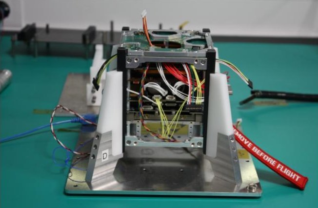

Figure 1. Image of $ ^{3} $Cat-4 during its integration [1].

## 1.1. Definition and Structure of $ ^{3} $Cat-4

CubeSats, as any other satellites, have common subsystems for their proper operation. Additionally, each one has its own payloads according to their mission. A brief introduction to each subsystem of $ ^{3} $Cat-4 (Figure 2a) is presented to understand the overall composition of the satellite, and the heat transfer between all its parts.

1. Zenith Antenna Deployment System (ZADS): The ZADS is a COTS component from ISISPACE equipped with a UHF and a VHF deployable antennas. Located on the top face, the VHF antenna is used for the AIS payload. The UHF antenna is used for communications with the ground station [5].

2. Communications and Attitude Determination and Control System (COMMS & ADCS board): The COMMS subsystem has been fully designed and manufactured by students from the NanoSat Lab [6]. It provides direct uplink and downlink communi-

<!-- PDF_PAGE: 3 -->

cations between the CubeSat and the Earth Ground Station. On the other hand, the ADCS provides the required pointing for the payloads and antennas of the satellite during critical spacecraft operations [7], which are crucial for mission success. To perform these functions, three different type of sensors are integrated: magnetometers, photodiodes (located in the SPs), and gyroscopes.

3. Electrical and Power Subsystem (EPS): The EPS is responsible for supplying power to the satellite, and to obtain the energy from the solar cells. It consists of two batteries that store enough energy to operate the spacecraft during the eclipse periods. The batteries are charged when the satellite receives sunlight through solar panels mounted on the sides of the CubeSat.

4. On-Board Computer (OBC): The OBC provides the processing capability, and it is connected to all subsystems, including the EPS to switch on/off the power supply of each subsystem, as needed.

5. Flexible Microwave Payload 1 (FMPL-1): The FMPL-1 is the payload, and it has been designed and manufactured by UPC NanoSat Lab students [8]. It combines three experiments in a single board using an RTL-based Software Defined Radio (SDR) module, providing flexibility to adapt software algorithms, and receive signals in different frequency bands. These include an AIS receiver, an L-band radiometer, and a GNSS-R. The FMPL-1 provides the scientific value of the mission.

6. Nadir Antenna Deployment System (NADS): The NADS is a 50 cm long deployable L-band helix antenna [9], with a gain of 13.5 dB at 1575.42 MHz [10]. It has also been fully designed and manufactured by the UPC NanoSat Lab students.

7. 1U CubeSat structure: CubeSat mechanical structure from ISISPACE [11], properly modified to accommodate the 3 kill- switches required (usually located on the +X, -X, and +Y or -Y faces, keeping it powered off while in the dispenser, see Figure 2b).

8. Solar Panels (SPs): Composed of six faces: upper Solar Panels (SP +Z) and lateral Solar Panels (SPs $ \pm $ X and $ \pm $ Y).

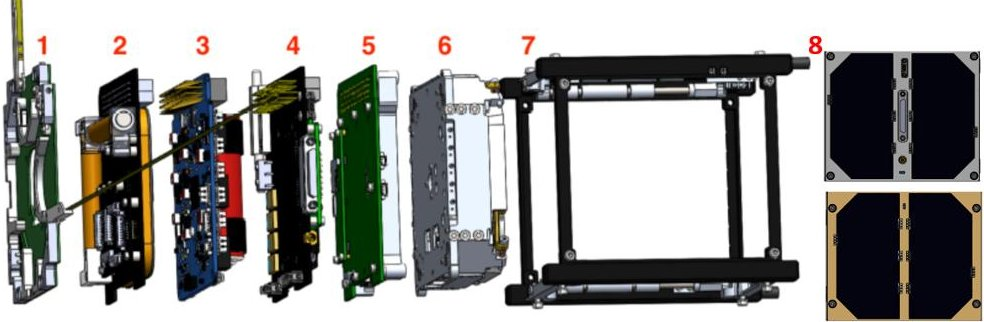

(a) $ ^{3} $Cat-4 subsystems [1].

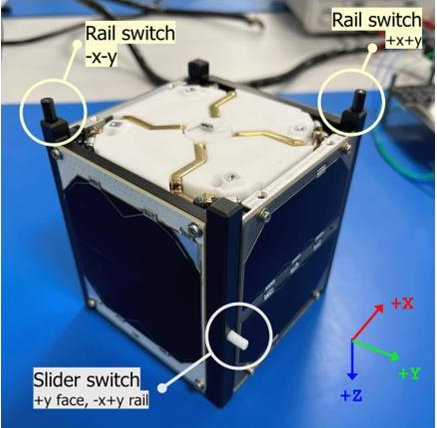

(b) $ ^{3} $Cat-4 deployment switch locations.

Figure 2. Internal stack of $ ^{3} $Cat-4: 1—ZADS, 2—COMMS & ADCS board, 3—EPS, 4—OBC, 5—FMPL 1, 6—NADS, 7—Structure with deployment switches (kill switches) and 8—Solar Panels.

<!-- PDF_PAGE: 4 -->

In the thermal analysis, adherence to specific technical requirements is crucial. The TCS must guarantee the proper functionality of each hardware component within its operational temperature range throughout all mission phases, extending until the conclusion of the operating life span. Additionally, the design of the TCS should align with the guidelines outlined in "Space engineering: Thermal control general requirements." [12]. These provisions are essential to ensure optimal performance and longevity of the hardware across the entirety of the mission (approximately 2 to 4 years).

## 1.2. Power Consumption and Modes

The average power consumption of each satellite operating mode, and the satellite attitude state in which it can be are summarized in Table 1.

For the satellite attitude, the following states have been considered:

- Nadir Pointing (NP): Satellite -Z face pointing towards the center of the Earth. Desired (ideal) attitude of the spacecraft achieved by the ADCS during its operation.

- Random Rotation (RR): Satellite randomly rotating around its three axes (e.g., the tumbling immediate after the deployment).

Likewise, the following modes of operation have also been considered [13]:

- Standby (Sb): Period before the satellite is turned on. All subsystems are inactive.

- Released (R): After the standby period, the satellite is turned on, with the EPS and OBC as the only active subsystems.

- Pre-detumbling (PD): Once the UHF/AIS antennas have been deployed, the EPS, OBC, COMMS and AOCS (only determination for telemetry) are active. The COMMS subsystem is transmitting data with a ratio of 5% of the orbit time.

- Detumbling (D): Same as pre-detumbling state, with the magnetorquers operating.

- Detumbled (Dd): Once the satellite is detumbled, the AOCS is keeping the desired attitude and waiting for the NADS deployment command. The COMMS subsystem is transmitting data with a ratio of 5% of the orbit time.

- Nominal (N): Satellite is fully operative. The payload is executed 2 times per orbit. The COMMS subsystem is transmitting data with a ratio of 10% of the orbit time.

- Sun Safe (SS): If battery levels become critical, the satellite enters in this mode. From the power budget point of view, this mode is identically to the detumbled mode.

- Survival (S): After an unexpected anomaly, the satellite enters in this mode. The payload is disabled, the AOCS is keeping the desired attitude and COMMS is transmitting data with a ratio of 10% of the orbit time.

- Satellite Off (OFF): Satellite turned off during its operation due to unexpected events. All subsystems are inactive.

Table 1. Table with the sum of all the power of the power budget and then divided by the consumption of each subsystem.

<table border="1"><tr><td>Satellite Operating Mode</td><td>Mean Power Consumption(mW)</td><td>Attitude State in Which It Can Occur</td><td colspan="2">NADS Configuration</td><td colspan="6">Consumptions(mW)</td></tr><tr><td colspan="12">Commissioning phase</td></tr><tr><td></td><td></td><td></td><td></td><td></td><td>EPS</td><td>OBC</td><td>COMMS</td><td>FMPL-1</td><td>ADCS</td><td>ZADS</td><td>NADS</td></tr><tr><td>Standby(Sb)</td><td>0</td><td>RR</td><td>Stowed</td><td>0</td><td>0</td><td>0</td><td>0</td><td>0</td><td>0</td><td>0</td><td>0</td></tr><tr><td>Released(R)</td><td>798</td><td>RR</td><td>Stowed</td><td>160</td><td>194</td><td>0</td><td>0</td><td>0</td><td>13.2</td><td>26.4</td><td></td></tr><tr><td>Pre-Detumbling(PD)</td><td>518</td><td>RR</td><td>Stowed</td><td>160</td><td>194</td><td>259</td><td>0</td><td>12.2</td><td>0</td><td>26.4</td><td></td></tr><tr><td>Detumbling(D)</td><td>325</td><td>RR</td><td>Stowed</td><td>160</td><td>194</td><td>259</td><td>0</td><td>188</td><td>0</td><td>26.4</td><td></td></tr><tr><td>Detumbled(Dd)</td><td>542</td><td>RR,NP</td><td>Stowed</td><td>160</td><td>194</td><td>259</td><td>0</td><td>215</td><td>0</td><td>26.4</td><td></td></tr><tr><td colspan="12">Operational phase</td></tr><tr><td>Sun Safe(SS)</td><td>542</td><td>NP</td><td>Deployed</td><td>160</td><td>194</td><td>259</td><td>0</td><td>215</td><td>0</td><td>26.4</td><td></td></tr><tr><td>Nominal(N)</td><td>419</td><td>NP</td><td>Deployed</td><td>160</td><td>194</td><td>358</td><td>15.3</td><td>215</td><td>0</td><td>26.4</td><td></td></tr><tr><td>Survival(S)</td><td>435</td><td>NP</td><td>Deployed</td><td>160</td><td>194</td><td>358</td><td>0</td><td>215</td><td>0</td><td>26.4</td><td></td></tr><tr><td>Satellite Off(OFF)</td><td>0</td><td>NP</td><td>Deployed</td><td>0</td><td>0</td><td>0</td><td>0</td><td>0</td><td>0</td><td>0</td><td></td></tr></table>

<!-- PDF_PAGE: 5 -->

In this thermal analysis, only the most extreme hot and cold cases have been studied to include all possible scenarios in between.

## 2. Analysis Assumptions

The $ ^{3} $Cat-4 Thermal Analysis aims to verify that all the spacecraft components operate within their operational temperature range throughout all mission phases. To develop an accurate model, the following approach has been proposed. First, an isothermal solid cube was used as the base model in the design created using the Thermal Desktop software (Version 6.3.0.3). Subsequently, models incorporating thermal radiation as the primary mode of heat transfer were utilized to provide more precise results. Finally, models incorporating both conduction and radiation as the primary modes of heat transfer were employed to adequately characterize the spacecraft, and verify the thermal requirements of each component.

The main objective of the isothermal analyses is to identify a passive thermal control method that ensures the spacecraft's temperature remains within the desired range. An additional objective is to estimate the spacecraft's behavior in space conditions in order to gather information for the TVAC test. In this case, considering the limitations imposed by the manufacturer, the following technique involves the use of various materials on the spacecraft's surface.

Regarding the radiation analysis, the objective was to validate the thermal model of the spacecraft. The analyses presented in this study demonstrate the completed development stage of the "radiation model" for $ ^{3} $Cat-4. These analyses have provided valuable insights into the current state of the model, and the performance has been verified under various heating conditions.

The results presented in this work consider the margins for the qualification operational temperature ranges shown in Table 2, and the acceptance and design temperature ranges in operating mode shown in Table 3 and Figure 3. The predicted temperature range, i.e., the temperature range obtained by analyses (calculated temperature range), increased by the thermal uncertainty margin, must be within the design temperature range under all circumstances [14].

Table 2. Thermal margin values [15].

<table border="1"><tr><td>Thermal Margin</td><td>Description</td><td>Value</td></tr><tr><td>Uncertainty</td><td>Margin of safety applied to all calculated temperatures in order to account for inaccurate physical, environmental and modeling parameters.</td><td>±10℃</td></tr><tr><td>Acceptance</td><td>Is a contingency to account for unpredictable TCS-related events</td><td>±5℃</td></tr><tr><td>Qualification</td><td>Is a contingency to account for unexpected events. These temperature ranges are directly extracted from the manufacturer datasheets and are not the design temperature ranges. All systems where the manufacturer is not specified are custom made. Temperature ranges have been obtained from the most limiting temperatures of the used components.</td><td>±5℃</td></tr></table>

<!-- PDF_PAGE: 6 -->

Table 3. Acceptance and design temperature ranges of all satellite subsystems in operating mode.

<table border="1"><tr><td rowspan="2">Subsystem</td><td colspan="2">Acceptance Temperature Range(℃)</td><td colspan="2">Design Temperature Range(℃)</td></tr><tr><td>Min</td><td>Max</td><td>Min</td><td>Max</td></tr><tr><td>ZADS</td><td>-15</td><td>55</td><td>-10</td><td>50</td></tr><tr><td>ZADS(ISIS)</td><td>-15</td><td>55</td><td>-10</td><td>50</td></tr><tr><td>COMMS/AOCS</td><td>-30</td><td>70</td><td>-25</td><td>65</td></tr><tr><td>COMMS</td><td>-35</td><td>80</td><td>-30</td><td>75</td></tr><tr><td>AOCS</td><td>-30</td><td>70</td><td>-25</td><td>65</td></tr><tr><td>OBC+IB</td><td>-25</td><td>75</td><td>-20</td><td>70</td></tr><tr><td>OBC+IB Motherboard</td><td>-25</td><td>75</td><td>-20</td><td>70</td></tr><tr><td>Nanomind A3200</td><td>-25</td><td>75</td><td>-20</td><td>70</td></tr><tr><td>EPS</td><td>0</td><td>40</td><td>10</td><td>35</td></tr><tr><td>EPS board(GomSpace)</td><td>-35</td><td>80</td><td>-30</td><td>75</td></tr><tr><td>EPS battery cells(GomSpace)</td><td>5</td><td>40</td><td>10</td><td>35</td></tr><tr><td>Payload(FMP)</td><td>-20</td><td>80</td><td>-15</td><td>75</td></tr><tr><td>Mainboard</td><td>-20</td><td>80</td><td>-15</td><td>75</td></tr><tr><td>Daughterboard</td><td>-20</td><td>80</td><td>-15</td><td>75</td></tr><tr><td>NADS</td><td>-35</td><td>80</td><td>-30</td><td>75</td></tr><tr><td>NADS Mainboard</td><td>-35</td><td>80</td><td>-30</td><td>75</td></tr><tr><td>Gravity boom</td><td>-68</td><td>116</td><td>-63</td><td>111</td></tr><tr><td>L-Band Helix Antenna</td><td>n/a</td><td>116</td><td>n/a</td><td>111</td></tr><tr><td>Fabric sheath(Precision Coating)</td><td>-68</td><td>275</td><td>-63</td><td>280</td></tr><tr><td>Counterweight</td><td>-195</td><td>255</td><td>-190</td><td>250</td></tr><tr><td>Upper Solar Panel(SP+Z)</td><td>-35</td><td>80</td><td>-30</td><td>75</td></tr><tr><td>Up-looking GPS antenna</td><td>-35</td><td>80</td><td>-30</td><td>75</td></tr><tr><td>Solar Cell</td><td>n/a</td><td>145</td><td>n/a</td><td>140</td></tr><tr><td>Photodiode</td><td>-35</td><td>120</td><td>-30</td><td>115</td></tr><tr><td>Temperature sensor</td><td>-50</td><td>120</td><td>-45</td><td>115</td></tr><tr><td>Lateral Solar Panels(SPs±Xand±Y)</td><td>-35</td><td>120</td><td>-30</td><td>115</td></tr><tr><td>Solar Cell</td><td>n/a</td><td>145</td><td>n/a</td><td>140</td></tr><tr><td>Photodiode</td><td>-35</td><td>120</td><td>-30</td><td>115</td></tr><tr><td>Temperature sensor</td><td>-50</td><td>120</td><td>-45</td><td>115</td></tr></table>

Note: n/a means not applicable. General subsystems are highlighted in bold.

<!-- PDF_PAGE: 7 -->

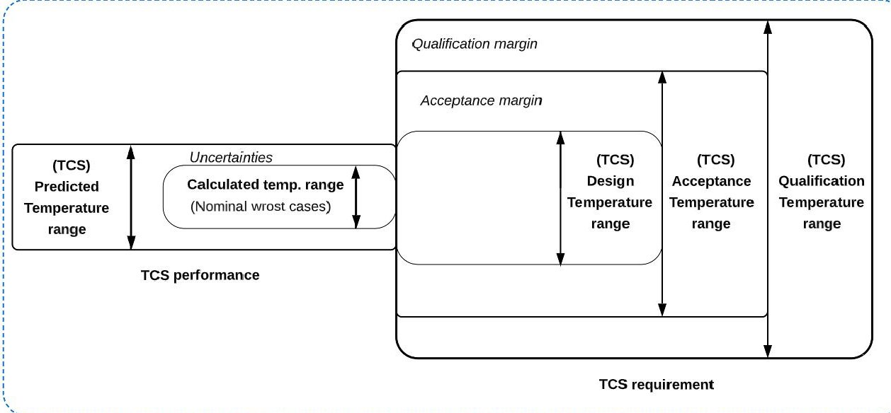

Figure 3. Temperature definitions for the TCS [13].

## 3. Scenarios and Modelling

## 3.1. Hot and Cold Worst scenarios

## 3.1.1. External Heating Environment

$ ^{3} $Cat-4 satellite is expected to be launched aboard the maiden flight of the Ariane 6 launcher to achieve a Low Earth Orbit (LEO) [16]. Table 4 (right column) presents the orbital parameters for the most challenging external heating environment, as analyzed in this study (unless stated otherwise).

Table 4. Orbital parameters comparison.

<table border="1"><tr><td>Parameter</td><td>Vega Rocket</td><td>Ariane 6</td></tr><tr><td>Semi-Major Axis(Km)</td><td>6928-7028km</td><td>6958km</td></tr><tr><td>Perigee height</td><td>550-650km</td><td>580km</td></tr><tr><td>Eccentricity</td><td>$\sim0$</td><td>$\sim0$</td></tr><tr><td>Inclination(deg)</td><td>97.95°</td><td>62.0°</td></tr><tr><td>Argument of Perigee(deg)</td><td>Free</td><td>Free</td></tr><tr><td>RAAN</td><td>157.5°</td><td>Free</td></tr><tr><td>Estimated launch date</td><td>2021-Q4</td><td>2024-Q3</td></tr></table>

The beta angle of the orbit, which represents the angle between the orbiting object and the Sun, has been utilized to determine the hot and cold scenarios by indicating the effective solar incidence at specific times. Although the beta angle is not strictly constant and can vary throughout the year due to factors such as the solar analemma [17], for the purposes of this analysis, it was assumed to remain relatively stable within a short time frame. These variations, while minor, can influence the presence and duration of shadows during an orbit. Consequently, orbits with minimal or absent eclipses and those with prolonged eclipse durations define the extreme conditions for the hottest and coldest scenarios.

Extreme hot and cold heating environments have been defined to encompass all possible scenarios in between. Table 5 provides a summary of the design hot and cold environments, with extreme and less pessimistic values taken from Thermal design & verification, ESA-TEC-MTT ECSS-E-ST-10-04C Rev. 1 Space Engineering (Space Environment) [18], and Spacecraft Thermal Control Handbook: Fundamental Technologies [19] respectively.

<!-- PDF_PAGE: 8 -->

Table 5. Design of hot and cold external heating environments.

<table border="1"><tr><td>Heating Environment</td><td>Solar Flux(W/m)</td><td>Earth Albedo Factor</td><td>Earth IR(W/m)</td><td>Orbit $\beta$ Angle(°)</td></tr><tr><td>Hot Case</td><td>1428</td><td>0.4</td><td>260</td><td>85.5</td></tr><tr><td>Cold Case</td><td>1316</td><td>0.2</td><td>240</td><td>0</td></tr><tr><td>Extreme Hot Case</td><td>1428</td><td>0.8</td><td>261</td><td>85.5</td></tr><tr><td>Extreme Cold Case</td><td>1316</td><td>0.05</td><td>189</td><td>0</td></tr></table>

Note: The blue and red colors scale in the table indicates temperature: darker blue and red represent colder values, while lighter blue and red indicate less cold results.

The maximum and minimum solar flux values in this table correspond to the winter and summer solstices, respectively. In terms of Earth's albedo, the extreme values shown in the table represent the fraction of incident sunlight reflected by clouds (maximum albedo), and by an ocean or forest (minimum albedo). For Earth's infrared (IR) emitted radiation, the extreme cases consider the Earth as a black body at 260 K and 240 K for maximum and minimum values, respectively.

The perigee height is also analyzed from a thermal perspective, and the most restrictive altitude of 650 km (adapted for the Ariane 6 launch) is considered. This choice was made in response to the consideration of envelope launchers and keeping other options open. The decision to retain the old altitude from the Vega rocket was intentional, as it provides a more conservative approach, ensuring that the thermal analysis encompasses a broader range of potential scenarios. Higher altitudes generally correspond to greater distances from Earth and cooler conditions, making this height the most limiting factor for this orbit. Additionally, satellites at higher altitudes spend less time in Earth's shadow (eclipse).

The duration of the eclipses can significantly impact the satellite's maximum and minimum temperatures during an orbit. For the orbit inclination presented in Table 4, the most extreme cases, specifically the shortest and longest eclipse times, have been considered. To determine these cases, the orbit beta angle $ (\beta) $ has been defined as the minimum angle between the orbit plane, and the solar vector. Lower $ \beta $ angles correspond to longer eclipses, resulting in colder conditions.

The calculation procedure outlined in NMEA (National Marine Electronics Association) AIVDM message format [20] (for AIS data packets), has been followed to obtain the expected orbit $ \beta $ - angle during the launch year. For the cold case, the beta angle is $ 0^{\circ} $ , as the longest eclipse occurs when the orbit plane aligns with the Sun vector. Conversely, for the hot case, the shortest eclipse occurs when the $ \beta $ angle is closest to $ \pm 90^{\circ} $ , indicating no eclipse and maximal solar incidence. Applying the same procedure, the expected maximum beta angle is $ 85.5^{\circ} $ .

The extreme values shown in Table 5 are unlikely to occur and are meant only to represent the hottest and coldest possible thermal environments the spacecraft could face. For the analysis, however, the more realistic, non-extreme parameters listed in the table were used.

## 3.1.2. Orbit Configuration

Owing to the change in the launch date for the $ ^{3} $Cat-4 mission, and some changes in the spacecraft (S/C) architecture, different aspects of the thermal model had to be updated and are listed below, considering the new parameters for launch with the Ariane 6 rocket.

The values for previous launch (in the Vega rocket) and the current launch (Ariane 6 rocket) are compared in Table 4.

Other aspects were considered, such as the time step at which the orbit is divided. The orbital period is 5776 s, but it was not feasible to simulate every second. Therefore, various parameters needed to be adjusted to determine the time step for the orbit. Given that the simulation covered 7 complete orbits, a balance between resolution and optimal execution time was achieved.

The initial simulations took 10 days due to the excessively small subdivisions of each complete rotation and the overly precise thermal balance between the nodes of each

<!-- PDF_PAGE: 9 -->

subsystem block. After several weeks of testing and adjustments, optimal results were obtained with an error of less than 0.01%, reducing the simulation time to just 30 min.

Some of the parameters that had to be controlled are the follows:

- Temperature convergence criteria: this parameter is vital to ensure that the simulation accurately reflects how temperature stabilizes in different components of the spacecraft.

- Maximum extrapolation of time stop: Controlling time extrapolation is important to ensure that the simulation remains within realistic limits. Too broad a time extrapolation could lead to unrealistic or irrelevant results, while too narrow could miss out on important details about the system's long-term behavior.

- System energy balance criteria: This parameter ensures that energy within the system (spacecraft) is maintained in a state of equilibrium. It is crucial for simulating how the spacecraft manages its energy under different conditions.

- Max diffusion temperature change: Refers to the maximum variation in temperature across the satellite's components. Controlling this parameter is crucial for understanding how heat is distributed throughout the spacecraft, ensuring that temperature-sensitive systems remain within safe operating limits, and allowing for proper thermal protection planning.

## 3.1.3. Satellite Internal Heat Dissipation and Attitude

The average power consumption of each satellite operating mode, and the corresponding satellite attitude states were summarized in Table 1.

Having defined the hot and cold satellite internal heat dissipation and attitude cases (Table 1) the worst hot and cold cases are summarized in Table 6.

Table 6. Cases, modes, and rotations.

<table border="1"><tr><td>Case</td><td>Mode</td><td>Rotation(°/s)</td></tr><tr><td>Worst Cold/Cold Case</td><td>Released and Stowed</td><td>10/30/60 All Axis</td></tr><tr><td>Worst Hot/Hot Case</td><td>Pre-detumbling and Stowed</td><td>10/30/60 All Axis</td></tr><tr><td>Worst Cold/Cold Case</td><td>Sun safe and Deployed</td><td>0 All Axis/2.5 Z axis/6 Z axis</td></tr><tr><td>Worst Hot/Hot Case</td><td>Nominal and Deployed</td><td>0 All Axis/2.5 Z axis/6 Z axis</td></tr><tr><td>Worst Hot/Hot Case</td><td>Detumbling and Deployed</td><td>0 All Axis/2.5 Z axis/6 Z axis</td></tr></table>

Note: The blue and red colors scale in the table indicates temperature: lighter blue and red indicate less cold results.

As it can be seen in Table 1, the most restrictive consumption, leading to higher temperatures, is the Nominal Mode, while the most restrictive for low temperatures is the Released mode. When carrying out the simulations, two different models will be considered: the stowed model when the NADS is not deployed, and the deployed model when the NADS is already deployed. This is because in both configurations, the satellite will have different restrictive modes, and the degrees of rotation in each mode will also have to be taken into account. For example, the Nominal Mode is only applicable to the deployed model, since this type of operation is carried out with the NADS deployed. Similarly, the Released mode only applies to the stowed model. Additionally, based on the rotations stipulated in the ADCS simulations (which evaluate the rotations of each configuration in orbit), 30 different simulations are obtained, which will have to be performed for both configurations, rotations in all axes, or only for the Z-axis, and restrictive modes.

## 3.2. Thermal Desktop Model and Setup

## 3.2.1. Material Properties and Contacts

To perform the thermal analysis, it is crucial to examine the type of contact, percentage of heat transferred, and properties of the materials of each satellite subsystem. Table 7 presents the various optical and thermal properties of the materials used to develop the spacecraft's thermal model. It is important to note that some components exhibit properties

<!-- PDF_PAGE: 10 -->

of multiple materials; for example, the side frames combine the optical characteristics of Black Anodized Aluminum with the thermal properties of Aluminum 6082. This occurs because different optical coatings are applied to protect components from the harsh space environment. Table 7 summarizes the relevant material properties, which have been sourced from [19,21], and the MatWeb online database [22].

Table 7. Material properties.

<table border="1"><tr><td>Material</td><td>Component(s)</td><td>Solar Absortivity($\alpha_{s}$)</td><td>IR Emissivity($\varepsilon_{IR}$)</td><td>Conductivity($k$)[W/m·K]</td><td>Specific heat($c_{p}$)[J/kg·K]</td><td>Density($\rho$)[kg/m3]</td></tr><tr><td></td><td></td><td></td><td></td><td>0.81(in plane)</td><td></td><td></td></tr><tr><td>FR-4</td><td>PCBs</td><td>0.12</td><td>0.94</td><td>0.29(cross plane)</td><td>1200</td><td>1900</td></tr><tr><td>Copper</td><td>PCB CopperSide Frames,Ribs and BracketsMagnetorquer ZOBC shield</td><td>-</td><td>-</td><td>398</td><td>386</td><td>8930</td></tr><tr><td>Aluminum 6082</td><td>Threaded spacers</td><td>-</td><td>-</td><td>170</td><td>900</td><td>2700</td></tr><tr><td>Aluminum ASTM B211</td><td>Threaded spacers</td><td>-</td><td>-</td><td>234</td><td>900</td><td>2700</td></tr><tr><td>Stainless SteelA2-70</td><td>Threaded barsZADS component</td><td>-</td><td>-</td><td>16.2</td><td>500</td><td>8000</td></tr><tr><td>Aluminium 1050A</td><td>Cylindric spacersZADS component</td><td>-</td><td>-</td><td>230</td><td>900</td><td>2700</td></tr><tr><td>Alodine onAluminum 6061-T6</td><td>Cylindric spacersThreaded spacersRibs and Brackets</td><td>0.33</td><td>0.07</td><td>-</td><td>-</td><td>-</td></tr><tr><td>Aluminium 7075</td><td>NADS caseFMP shield</td><td>-</td><td>-</td><td>130</td><td>870</td><td>3000</td></tr><tr><td>Black AnodizedAluminum</td><td>Side FramesMagnetorquer Z</td><td>0.88</td><td>0.88</td><td>-</td><td>-</td><td>-</td></tr></table>

Table 8 presents a summary of the different types of contact considered in the thermal simulation, and Figure 4 shows some examples of some satellite components in the CAD model in the thermal desktop software.

Table 8. Summary of the different contacts between subsystems.

<table border="1"><tr><td>Contact from</td><td>Contact with</td><td>Type of Contact</td><td>Material</td></tr><tr><td>COMMS microchip</td><td>COMMS/ADCS board</td><td>Perfect contact</td><td>Tin</td></tr><tr><td>ADCS microchip</td><td>COMMS/ADCS board</td><td>Perfect contact</td><td>Tin</td></tr><tr><td>Magnetorquer holders</td><td>COMMS/ADCS board</td><td>Screwing</td><td>Aluminum</td></tr><tr><td>Z Magnetorquer</td><td>COMMS/ADCS board</td><td>Screwing</td><td>Aluminum</td></tr><tr><td>EPS Batteries</td><td>EPS board</td><td>Perfect contact</td><td>Epoxi</td></tr><tr><td>EPS Batteries</td><td>Battery holders</td><td>Perfect contact</td><td>Epoxi</td></tr><tr><td>EPS Batteries</td><td>Heater(resistor)</td><td>Perfect contact</td><td>Epoxi</td></tr><tr><td>EPS microchip</td><td>EPS board</td><td>Perfect contact</td><td>Tin</td></tr><tr><td>OBC microchip</td><td>OBC inner layer</td><td>Perfect contact</td><td>Tin</td></tr><tr><td>OBC inner layer</td><td>OBC outer layer</td><td>Perfect contact</td><td>Tin</td></tr><tr><td>Deployment switch</td><td>OBC+IB</td><td>Perfect contact</td><td>Tin</td></tr><tr><td>FMP cond. board</td><td>FMP shield</td><td>Screwing</td><td>Aluminum</td></tr><tr><td>FMP acq. board</td><td>FMP shield</td><td>Screwing</td><td>Aluminum</td></tr><tr><td>Spacer EPS</td><td>OBC+IB</td><td>Union Point</td><td>Aluminum</td></tr><tr><td>Spacer EPS</td><td>COMMS/ADCS board</td><td>Union Point</td><td>Aluminum</td></tr><tr><td>Spacer OBC+IB</td><td>FMP board</td><td>Union Point</td><td>Aluminum</td></tr><tr><td>Spacer NADS</td><td>FMP board</td><td>Union Point</td><td>Aluminum</td></tr><tr><td>Spacer NADS</td><td>Lower Ribs</td><td>Union Point</td><td>Aluminum</td></tr><tr><td>Spacer ZADS</td><td>Upper Ribs</td><td>Union Point</td><td>Aluminum</td></tr><tr><td>NADS shield</td><td>NADS shield</td><td>Screwing</td><td>Aluminum</td></tr><tr><td>NADS antenna board</td><td>NADS deployment board</td><td>Screwing</td><td>Aluminum</td></tr><tr><td>NADS deployment board</td><td>NADS shield</td><td>Screwing</td><td>Aluminum</td></tr></table>

Note: Regarding the term "Perfect Contact", The antenna wire is soldered with tin to the antenna board, ensuring a perfect contact both electrically and mechanically. Additionally, the connections to the batteries are made using epoxy adhesive, which also provides a perfect contact. These solutions allow for robust, high-quality connections between the components, ensuring optimal system performance.

<!-- PDF_PAGE: 11 -->

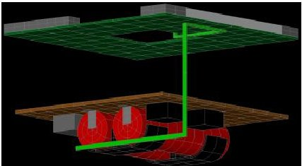

(a) Connection model of the batteries (in red color) with ZADS (in green color).

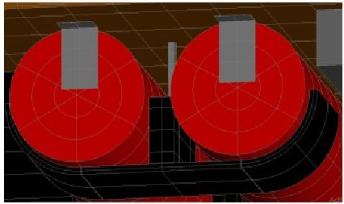

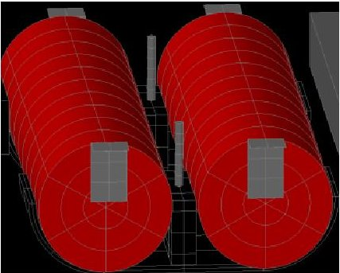

(b) Bolts and "L joins" of the batteries.

(c) "L joins" in the batteries.

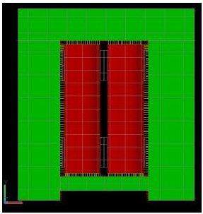

(d) Top view of the union between batteries and interface.

Figure 4. Examples of contact between components.

The model includes the conduction between the junctions of the subsystems, taking into account two main types of thermal contact: the PCBs with the spacers, referred to as Al-Al unions, and the surfaces of the CubeSat. All contacts within the spacecraft are considered to be either Al-Al bolted solids, or Al-Al junction points.

Due to the difficulty to obtain an accurate value through a joint test, the applied values are calculated through various experimental tests. For an initial estimation of thermal conductivity, the material of the contacting surfaces has been assumed to be aluminum.

An explanation of the thermal contact estimation, based on the conductance of the two types of contacts present in the model, is provided below.

- Al-Al junction point: The conductivity of this type of junction varies depending on factors such as the applied contact pressure, surface roughness, and others. Several experiments have been conducted to accurately determine this value [19]. To calculate the conductance between the spacers and the PCB, it is necessary to calculate the contact pressure between the components. The threaded rod and spacer materials are stainless steel and aluminum, respectively. The torsion of the junction between them ranges from 0.96 Nm to a maximum of 1.28 Nm. From this, it is possible to obtain the axial force using the Equation (1) [23]:

$$
F _ {\mathrm {a x}} = \frac {\tau}{0 . 1 6 P + 0 . 5 8 \mu d _ {2} + \mu_ {b} r _ {m}}.
$$

The parameters in Equation (1) refer to distances based on the dimensions of the spacer $ ( P,d_{2},r_{m} ) $ , where $ F_{\mathrm{a x}} $ represents the axial force of the bolt, P denotes the thread pitch, $ d_{2} $ is the mean diameter, and $ r_{m} $ is the mean radius of the contact area beneath the head. Regarding with the friction coefficients $ (\mu ,\mu_{b}) $ $ \mu $ signifies the coefficient of friction within the threads, and $ \mu_{b} $ stands for the coefficient of friction between the bolt head and the component's surface [23].

The apparent pressure at the contact between the PCBs and the spacers can be obtained using the axial force and the contact area (Equation (2)):

$$
P = \frac {F _ {\mathrm {a x}}}{A}.
$$

The contact area is the area of the spacer, and it is calculated to be 24.07 mm $ ^{2} $ . The resulting pressures at the contact range between 34.2 MPa and 45.62 MPa.

<!-- PDF_PAGE: 12 -->

The elevated pressure near the bolt, which diminishes with increasing distance from the bolt, explains the apparent discrepancy. Furthermore, the pressure calculation is confined to the spacer's area, which is relatively small. Therefore, the thermal conductance in this contact is assumed to be at its maximum, estimated to be $ 1 0^{5} \mathrm{~ W / (m^{2} K)} $

- Bolted junction: In the case of this junction, expressions from [24] have been used. As indicated in the document, the temperature difference at the interface of both surfaces is uniformly distributed in the conducted tests, and the value of the thermal contact conductance represents an average value. The estimation of the thermal contact conductance is done using the Equations (3) and (4), depending on the number of turns, for this study is defined by the letter (N):

$$
h _ {c} = 4. 0 1 + 0. 3 1 \tau^ {1. 3 3} p e r N = 4,
$$

and

$$
h _ {c} = 1 5. 1 0 + 0. 3 5 \tau^ {2. 0 3} p e r N = 8.
$$

From the data, with a torque ranging from 0.78 Nm and 1.31 Nm, the conductance values listed in Table 9 are obtained.

Table 9. Table with the conductance values of the screwed contact or Al-Al snail union.

<table border="1"><tr><td rowspan="2">Number of Turns</td><td colspan="2">Torque[Nm]</td><td colspan="3">Conductance[kW/m2/K]</td><td rowspan="2">Observations</td></tr><tr><td>Min</td><td>Max</td><td>Min</td><td>Max</td><td>Average</td></tr><tr><td>1 to 4</td><td>0.78</td><td>1.31</td><td>4.23</td><td>4.45</td><td>4.34</td><td>N=4</td></tr><tr><td rowspan="3">5 to 7</td><td>0.78</td><td>1.31</td><td>4.23</td><td>4.45</td><td>4.34</td><td>N=4</td></tr><tr><td>0.78</td><td>1.31</td><td>15.31</td><td>15.71</td><td>15.51</td><td>N=8</td></tr><tr><td></td><td></td><td></td><td></td><td>9.93</td><td>Average</td></tr><tr><td>8 or more</td><td>0.78</td><td>1.31</td><td>15.31</td><td>15.71</td><td>15.51</td><td>N=8</td></tr></table>

## 3.2.2. CAD Model

In the planning and development of the CubeSat, the "Isothermal model" was initially used, which was designed under the conditions expected for a launch using the Vega rocket. Although effective at the time, this model required significant updates due to two main factors: the change in orbit resulting from the decision to launch the CubeSat with the Ariane rocket instead of Vega, and the need to adjust the properties of the materials used in the CubeSat's structure and components.

The new "detailed model" represents this comprehensive update. Modifications include changes in the mass distribution among the CubeSat's subsystems, the addition of new components such as the NADS power board, and the use of new materials like stainless steel A2-70 for the spacers. Additionally, the materials list has been refined, incorporating more precise thermal and optical properties for the new components.

This update is essential to ensure the accuracy and reliability of the thermal model especially considering the new operational conditions in the modified orbit.

The Mass Budget analyzes the distribution of mass among the CubeSat's subsystems and components, focusing on material types and estimated weights. Key assumptions for developing the mass budget include neglecting the mass of wires and applying one of three methods for determining component mass: direct measurement with a calibrated scale, using SolidWorks for estimation, or relying on manufacturer datasheets for externally sourced parts. Uniform mass distribution is assumed for measured subsystems, and various margin percentages are applied depending on the likelihood of mass changes and the reliability of the data source (see Table A1).

Special margins are applied to specific components such as PCBs (25%) ,sheaths (25%) ,and the Gravity Boom (20%) ,reflecting the possibility of design changes or material uncertainties. Components like the solar panels, although similar to PCBs, receive a lower

<!-- PDF_PAGE: 13 -->

margin (10%) due to their unlikely alteration. Additionally, complex subsystems like ZADS are assigned a 1% margin overall, despite individual parts having a 20% margin, as the system has been measured in the NanoSat Lab. Harnessing receives the highest margin (50%) due to the difficulty in predicting its final mass.

Considering the thermal CAD model, a review and update were conducted using the thermal simulation software (Thermal Desktop). The following modifications have been implemented (see Figure 5):

1. Addition and modification of S/C components

- NADS Power board

- Material of Spacers: Stainless Steel A2-70

2. Refinement of the materials list, including the thermal and optical properties of the materials used in the added components (Table A1).

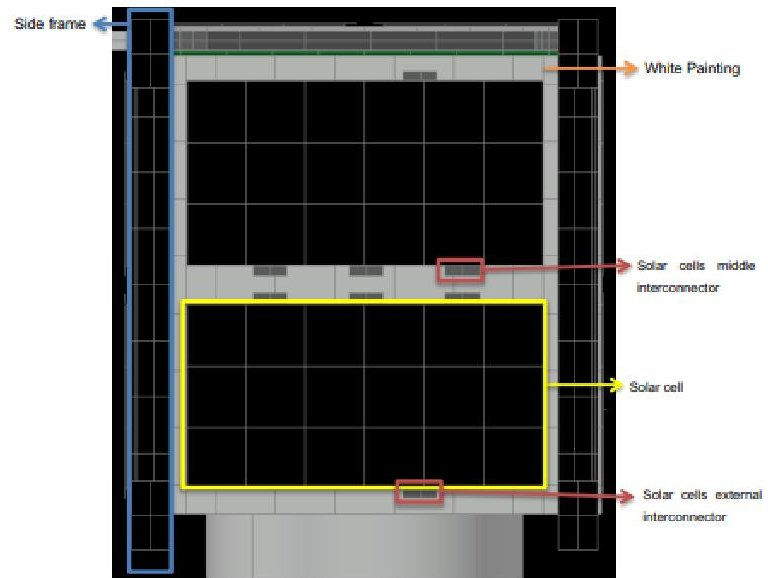

(a) Lateral face layout $ (-\mathrm{X}/+\mathrm{Y}/-\mathrm{Y} $ faces).

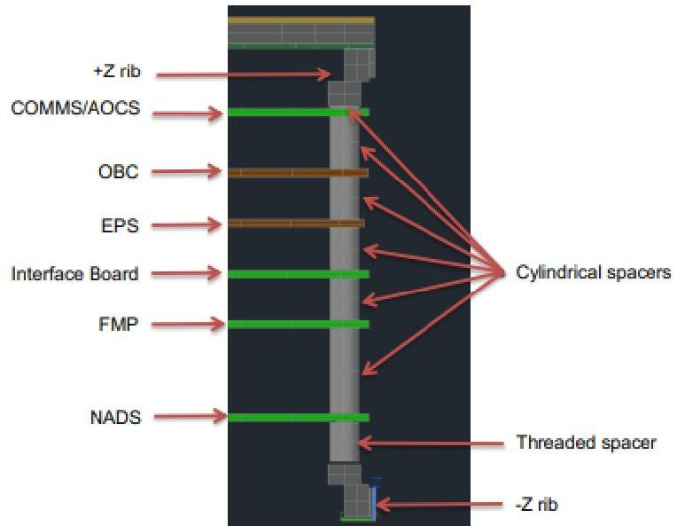

(b) Connections between spacers and PCBs.

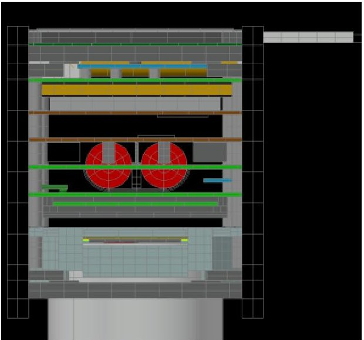

(c) View of the internal subsystems in deployed configuration.

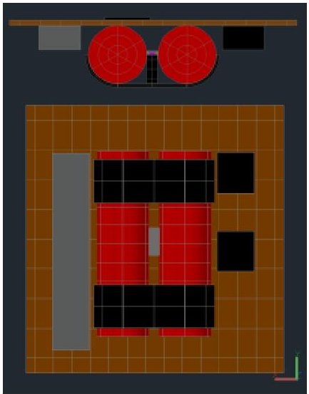

(d) EPS subsystem thermal model.

Figure 5. Some examples of the components of the detailed thermal model. Note: In (d) The red components are the batteries, the black and grey bricks the electrical components. The battery holders in black are between both batteries.

## 3.2.3. Passive Thermal Control (Battery Heaters Inactive)

Through the thermal model and simulations conducted in various modes (see example in Figure 6), it was identified that in some cases, the EPS batteries did not remain within their specified design temperature range, as outlined in Table 10.

<!-- PDF_PAGE: 14 -->

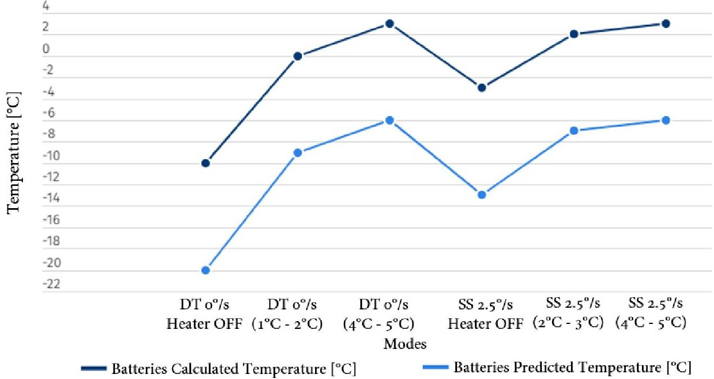

Figure 6. Comparison of results in Cold case, minimum temperature in Detumbling (DT) and Sun Safe (Mode) with heater OFF and hysteresis temperature [13].

Table 10. Temperature values obtained for the EPS batteries in the non-compliant cases.

<table border="1"><tr><td rowspan="2">Mode</td><td colspan="2">Batteries Calculated Temperature(℃)</td><td colspan="2">Batteries Predicted Temperature(℃)</td></tr><tr><td>Min</td><td>Max</td><td>Min</td><td>Max</td></tr><tr><td>Detumbling0°/sZaxis</td><td>-10.28</td><td>23.86</td><td>-20.28</td><td>33.86</td></tr><tr><td>Detumbling1.5°/sZaxis</td><td>-3.49</td><td>25.39</td><td>-13.49</td><td>35.39</td></tr><tr><td>Detumbling3.5°/sZaxis</td><td>-3.63</td><td>25.46</td><td>-13.63</td><td>35.46</td></tr><tr><td>SunSafe0°/sZaxis</td><td>-9.81</td><td>21.95</td><td>-19.81</td><td>31.95</td></tr><tr><td>SunSafe2.5°/sZaxis</td><td>-5.05</td><td>22.06</td><td>-15.05</td><td>32.06</td></tr><tr><td>SunSafe6°/sZaxis</td><td>-2.81</td><td>23.47</td><td>-12.81</td><td>33.47</td></tr></table>

Note: The blue color scale in the table indicates temperature: darker blue represents colder values, while lighter blue indicates less cold results.

For the Detumbling and Sun Safe modes, it is anticipated that the temperature may drop below the operational range for charging, necessitating the activation of the battery heater to maintain the batteries within their rated temperatures. It is important to note that the analysis has been conducted based on the most restrictive scenario, which applies to the battery's charging operational temperature range of 0 $ ^{\circ} \mathrm{C} $ to 45 $ ^{\circ} \mathrm{C} $ . While the discharge temperature range is broader, extending from $ - 2 0 \, ^{\circ} \mathrm{C} $ to $ 6 0 \, ^{\circ} \mathrm{C} $ , the charging range is more limiting and thus considered the critical case for thermal control. The thermal model, including its associated uncertainties, ensures that the predicted values remain within these design limits.

## 3.2.4. Comparison of Isothermal and Detailed Models

To verify that the enhancements in the detailed model did not lead to significant deviations from the isothermal model analysis, we compared the results of both versions. The temperature differences were used as the reference for comparison. The same SSO orbit was used in both cases (for this analysis, the Sun Safe mode with $ 2. 5^{\circ} / \mathrm{s} $ rotation around the Z axis was simulated). The comparison revealed that the maximum change in temperature between the isothermal model and the detailed model is approximately $ 6^{\circ} \mathrm{C}. $ This relatively small difference provides credibility to the detailed model, indicating that the enhancements made to improve accuracy did not result in drastic changes to the overall thermal behavior predicted by the simpler isothermal model. It is worth noting that this comparison was particularly important for subsystems or components that were not modified in the transition from the isothermal to the detailed model, as it helps ensuring consistency in the thermal analysis across model iterations. Table 11 shows the different

<!-- PDF_PAGE: 15 -->

results obtained on scales from red (greater range of difference between values) to green (smaller range of difference between values).

Table 11. Simulation in sun-safe mode in deployed configuration, with $ 2. 5^{\circ} / \mathrm{s} $ Z axis rotation and heater not active.

<table border="1"><tr><td rowspan="2">Name</td><td colspan="2">New Model</td><td colspan="2">Old Model</td><td colspan="2">Difference</td></tr><tr><td>Min(℃)</td><td>Max(℃)</td><td>Min(℃)</td><td>Max(℃)</td><td>Min(℃)</td><td>Max(℃)</td></tr><tr><td>COMMS_AOCS</td><td>-18.3</td><td>15.22</td><td>-15.23</td><td>18.18</td><td>3.07</td><td>2.96</td></tr><tr><td>COMMS_AOCS_ELEC</td><td>-16.08</td><td>14.68</td><td>-10.64</td><td>13.3</td><td>5.44</td><td>1.38</td></tr><tr><td>EPS</td><td>-8.8</td><td>11.7</td><td>-7.48</td><td>14.9</td><td>1.32</td><td>3.20</td></tr><tr><td>EPS_BATTERIES</td><td>-5.11</td><td>10.54</td><td>-1.63</td><td>13.26</td><td>3.48</td><td>2.72</td></tr><tr><td>EPS_ELEC</td><td>-5.31</td><td>12.16</td><td>-2.07</td><td>15.36</td><td>3.24</td><td>3.19</td></tr><tr><td>EPS_UNION</td><td>-5.12</td><td>10.69</td><td>-1.65</td><td>13.41</td><td>3.48</td><td>2.72</td></tr><tr><td>MOTHERBOARD</td><td>-7.11</td><td>16.84</td><td>-5.85</td><td>14.37</td><td>1.26</td><td>2.47</td></tr><tr><td>NADS</td><td>-8.98</td><td>11.32</td><td>-11.06</td><td>15.44</td><td>2.07</td><td>4.13</td></tr><tr><td>NADS_ANT</td><td>-33.81</td><td>10.56</td><td>-33.28</td><td>14.53</td><td>0.53</td><td>3.97</td></tr><tr><td>NADS_GB</td><td>-57.67</td><td>-38.4</td><td>-57.86</td><td>-38.25</td><td>0.19</td><td>0.15</td></tr><tr><td>NADS_POWER</td><td>-4.21</td><td>9.8</td><td>N/A</td><td>N/A</td><td>N/A</td><td>N/A</td></tr><tr><td>NADS_SHEATH</td><td>-92.91</td><td>43.89</td><td>-93.56</td><td>44</td><td>0.66</td><td>0.11</td></tr><tr><td>PAYLOAD</td><td>-5.16</td><td>8.78</td><td>-9.94</td><td>14.91</td><td>4.78</td><td>6.14</td></tr><tr><td>PAYLOAD_ELEC</td><td>-4.05</td><td>7.85</td><td>-5.94</td><td>12.97</td><td>1.90</td><td>5.13</td></tr><tr><td>SOLAR_PANELS_LATERAL</td><td>-20.97</td><td>32.22</td><td>-16.74</td><td>31.54</td><td>4.23</td><td>0.69</td></tr><tr><td>SOLAR_PANEL_Z_UP</td><td>-21.88</td><td>20.45</td><td>-17.63</td><td>20.84</td><td>4.26</td><td>0.39</td></tr><tr><td>SPACE</td><td>-270.4</td><td>-270.4</td><td>-270.4</td><td>-270.4</td><td>0.00</td><td>0.00</td></tr><tr><td>STRUCTURE</td><td>-13.07</td><td>14.66</td><td>-12.03</td><td>16.52</td><td>1.04</td><td>1.87</td></tr><tr><td>STRUCTURE_RIBS</td><td>-20.35</td><td>23.2</td><td>-16.1</td><td>21.29</td><td>4.25</td><td>1.91</td></tr><tr><td>STRUCTURE_SIDE_FRAMES</td><td>-20.74</td><td>21.14</td><td>-16.55</td><td>19.74</td><td>4.20</td><td>1.40</td></tr><tr><td>STRUCTURE_SPACERS</td><td>-21</td><td>20.88</td><td>-15.89</td><td>17.78</td><td>5.11</td><td>3.10</td></tr><tr><td>STRUCTURE_SPACERS_DAUGHTERS</td><td>-18.97</td><td>15.63</td><td>-15.42</td><td>17.25</td><td>3.56</td><td>1.61</td></tr><tr><td>ZADS</td><td>-20.82</td><td>18.41</td><td>-16.61</td><td>18.69</td><td>4.21</td><td>0.28</td></tr><tr><td>ZADS_COMPS</td><td>-92.75</td><td>66.83</td><td>-93.05</td><td>67.12</td><td>0.30</td><td>0.29</td></tr><tr><td>ZZ_HEATER</td><td>-4.99</td><td>10.4</td><td>-1.47</td><td>13.16</td><td>3.52</td><td>2.76</td></tr></table>

Note: N/A means not applicable. The color scale from red to green shows the differences between models, with dark green indicating minimal variation and red representing greater discrepancies from the initial model.

## 4. Simulation Results

## 4.1. Heater Duty Cycle Analysis Results

The power budget is a critical factor in determining the maximum duty cycle of the EPS heater for each mode. This analysis focused on the most restrictive mode (detumbling) and considered the impact of different heater duty cycles on the overall power consumption. The heater consists of a 2.9 W resistor placed between the batteries, activated to maintain the battery temperature within an appropriate range. Section 6.6 of ECSS-E-HB-31-03A [15], the uncertainty of the measurement was applied to determine the appropriate uncertainty on the heater-controlled items, allowing for a more precise analysis. The trade-off study revealed that the maximum feasible duty cycle for the heater is 11% in the detumbling mode (Table 12), which maintains a small positive power budget margin. This result balances the need for thermal control with the stringent power limitations of the spacecraft.

Table 12. Spacecraft power consumptions and unused power in detumbling mode.

<table border="1"><tr><td>Duty Cycle</td><td>7%</td><td>11%</td><td>12%</td></tr><tr><td>Mean Power EPS[W]</td><td>0.364</td><td>0.481</td><td>0.510</td></tr><tr><td>Total Power Consumption[W]</td><td>1.08</td><td>1.19</td><td>1.22</td></tr><tr><td>Available Budget</td><td>0.126</td><td>0.00946</td><td>-0.0197</td></tr></table>

For detailed thermal analysis, two critical cases were identified:

- Cold case: Sun Safe Mode with $ 2. 5^{\circ} $ /s rotation around the Z-axis (Table 13).

- Hot case: Nominal Mode with $ 2. 5^{\circ} $ /s rotation around the Z-axis (Table 14).

<!-- PDF_PAGE: 16 -->

Table 13. Obtained temperatures and corresponding heater duty cycle, cold case.

<table border="1"><tr><td colspan="7">SunSafe Mode with 2.5°/s Rotation around the Z-Axis</td></tr><tr><td rowspan="2">Heater Hysteresis Temp. (℃)</td><td rowspan="2">Solar Panel Config.</td><td colspan="2">Batteries Calculated Temp. (℃)</td><td colspan="2">Batteries Predicted Temp. (℃) (±10℃)</td><td rowspan="2">Duty Cycle(%)</td></tr><tr><td>Min</td><td>Max</td><td>Min</td><td>Max</td></tr><tr><td>9 to 10</td><td>2X White</td><td>8.36</td><td>22.77</td><td>-1.64</td><td>32.77</td><td>29.90%</td></tr><tr><td>9 to 10</td><td>-X Gold+X White</td><td>8.50</td><td>23.23</td><td>-1.50</td><td>33.23</td><td>26.20%</td></tr><tr><td>9 to 10</td><td>2X Gold</td><td>8.63</td><td>23.59</td><td>-1.37</td><td>33.59</td><td>21.90%</td></tr><tr><td>9 to 10</td><td>-X Gold&amp;X Kapton</td><td>8.61</td><td>23.60</td><td>-1.39</td><td>33.60</td><td>22.80%</td></tr><tr><td>9 to 10</td><td>2X Kapton</td><td>8.62</td><td>23.60</td><td>-1.38</td><td>33.60</td><td>22.35%</td></tr><tr><td>8 to 9</td><td>2X White</td><td>7.43</td><td>22.76</td><td>-2.57</td><td>32.76</td><td>28.50%</td></tr><tr><td>8 to 9</td><td>-X Gold+X White</td><td>7.57</td><td>23.21</td><td>-2.43</td><td>33.21</td><td>23.70%</td></tr><tr><td>8 to 9</td><td>2X Gold</td><td>7.70</td><td>23.57</td><td>-2.30</td><td>33.57</td><td>19.50%</td></tr><tr><td>8 to 9</td><td>-X Gold&amp;X Kapton</td><td>7.69</td><td>23.59</td><td>-2.31</td><td>33.59</td><td>20.36%</td></tr><tr><td>8 to 9</td><td>2X Kapton</td><td>7.65</td><td>23.46</td><td>-2.35</td><td>33.46</td><td>21.19%</td></tr><tr><td>7 to 8</td><td>2X White</td><td>6.50</td><td>22.76</td><td>-3.50</td><td>32.76</td><td>26.10%</td></tr><tr><td>7 to 8</td><td>-X Gold+X White</td><td>6.65</td><td>23.23</td><td>-3.35</td><td>33.23</td><td>21.30%</td></tr><tr><td>7 to 8</td><td>2X Gold</td><td>6.79</td><td>23.6</td><td>-3.21</td><td>33.60</td><td>16.70%</td></tr><tr><td>7 to 8</td><td>-X Gold&amp;X Kapton</td><td>6.77</td><td>23.60</td><td>-3.23</td><td>33.60</td><td>17.65%</td></tr><tr><td>7 to 8</td><td>2X Kapton</td><td>6.74</td><td>23.48</td><td>-3.26</td><td>33.48</td><td>18.55%</td></tr><tr><td>6 to 7</td><td>2X White</td><td>5.57</td><td>22.76</td><td>-4.43</td><td>32.76</td><td>23.70%</td></tr><tr><td>6 to 7</td><td>-X Gold+X White</td><td>5.73</td><td>23.23</td><td>-4.27</td><td>33.23</td><td>18.70%</td></tr><tr><td>6 to 7</td><td>2X Gold</td><td>5.86</td><td>23.57</td><td>-4.14</td><td>33.57</td><td>14.30%</td></tr><tr><td>6 to 7</td><td>-X Gold&amp;X Kapton</td><td>5.85</td><td>23.62</td><td>-4.15</td><td>33.62</td><td>14.84%</td></tr><tr><td>6 to 7</td><td>2X Kapton</td><td>5.81</td><td>23.47</td><td>-4.19</td><td>33.47</td><td>15.95%</td></tr><tr><td>No Heaters</td><td>2X White</td><td>-5.05</td><td>22.76</td><td>-15.05</td><td>32.76</td><td>0.00%</td></tr><tr><td>No Heaters</td><td>-X Gold+X White</td><td>-3.06</td><td>23.22</td><td>-13.06</td><td>33.22</td><td>0.00%</td></tr><tr><td>No Heaters</td><td>2X Gold</td><td>-1.34</td><td>23.57</td><td>-11.34</td><td>33.57</td><td>0.00%</td></tr><tr><td>No Heaters</td><td>-X Gold&amp;X Kapton</td><td>-1.43</td><td>23.61</td><td>-11.43</td><td>33.61</td><td>0.00%</td></tr><tr><td>No Heaters</td><td>2X Kapton</td><td>-1.94</td><td>23.47</td><td>-11.94</td><td>33.47</td><td>0.00%</td></tr></table>

Note: The color scale shows temperature: dark blue/cold, light blue/less cold, dark red/warm, light red/less warm. Green means nominal values.

Table 14. Obtained temperatures and corresponding heater duty cycle, hot case.

<table border="1"><tr><td colspan="5">Nominal Mode with 2.5°/s Rotation around the Z-Axis</td></tr><tr><td></td><td colspan="2">Batteries CalculatedTemp. (℃)</td><td colspan="2">Batteries PredictedTemp. (℃)</td></tr><tr><td></td><td>Min</td><td>Max</td><td>Min</td><td>Max</td></tr><tr><td>2X White</td><td>20.00</td><td>36.80</td><td>10.00</td><td>46.80</td></tr><tr><td>-X Gold+X White</td><td>20.00</td><td>35.06</td><td>10.00</td><td>45.06</td></tr><tr><td>2X Gold</td><td>20.00</td><td>41.17</td><td>10.00</td><td>51.17</td></tr><tr><td>-X Gold&amp;+X Kapton</td><td>20.00</td><td>40.46</td><td>10.00</td><td>50.46</td></tr><tr><td>2X Kapton</td><td>20.00</td><td>40.82</td><td>10.00</td><td>50.82</td></tr></table>

Note: The red color scale in the table indicates temperature: darker red represents hotter values, while lighter red indicates cooler results.

These cases formed the basis for the thermal design strategy, ensuring the spacecraft can maintain appropriate temperatures across its operational envelope while adhering to power constraints. Figure 6 illustrates the thermal simulations performed under different operational conditions in the cold case, which represents the lowest temperature scenarios, highlighting the temperature variations experienced by the EPS batteries. The figure shows the temperature profile during detumbling mode with a $ 0^{\circ} / \mathrm{s} $ spin, where the heater is off, set to turn on at $ 1^{\circ} \mathrm{C} $ and off at $ 2^{\circ} \mathrm{C} $ , and depicts the conditions under the same mode but with the heater set to turn on at $ 4^{\circ} \mathrm{C} $ and off at $ 5^{\circ} \mathrm{C} $ . Similar cases are shown for the sun-safe mode. These visual results clearly demonstrate that in the first mode, detumbling with the heater off, the battery temperatures approach the design limits. However, with the heater

<!-- PDF_PAGE: 17 -->

set to turn on at 4 $ ^{\circ} \mathrm{C} $ and off at 5 $ ^{\circ} \mathrm{C} $ , the minimum temperature remains above 2 $ ^{\circ} \mathrm{C} $ with a duty cycle of 18%. In the sun-safe mode, a significant improvement in battery temperature limits is observed when the heater is set to turn on between 4 $ ^{\circ} \mathrm{C} $ and 5 $ ^{\circ} \mathrm{C} $ .

## 4.2. Analysis of Solar Panel Colors and Surface Finishes

The outcomes of this study necessitate exploring alternative strategies to elevate the spacecraft's temperature, particularly in scenarios where modifications to operational procedures are not feasible.

Based on previous experiences [25], the use of golden solar panels typically results in higher temperatures. Therefore, it was suggested to simulate the spacecraft with a change in the X direction Solar Panels, which are currently white, to a gold finish.

However, this meant to remanufacture the Solar Panel PCBs, which -in addition- posed schedule limitations, and constraints due to the availability and lead times of the solar cells. For this reason instead, it was proposed to cover the X direction SPs with a layer of Kapton [26].

This modelling is presented in the thermal analysis workflow (Figure 7):

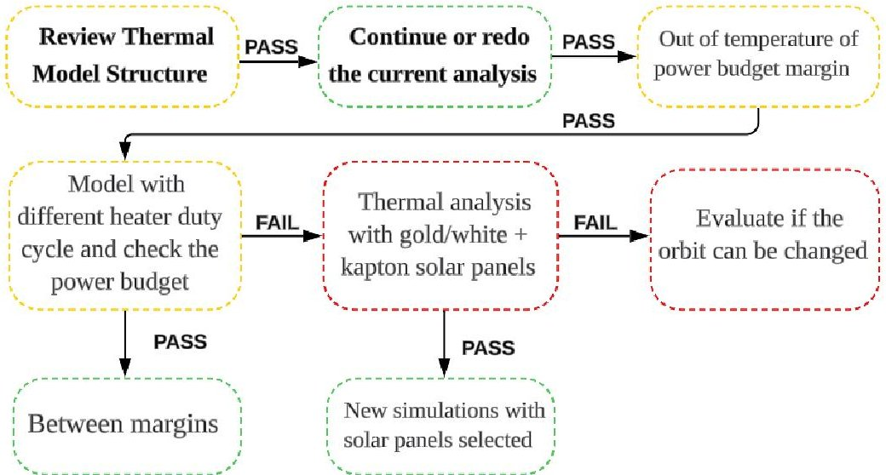

Figure 7. Thermal design proposal workflow.

In this situation, it can be observed that one is dealing with a controlled heater scenario. It can be assumed that lower temperatures will not occur as the heater will be activated earlier. To address this situation, two approaches are possible:

1. Reduce modeling uncertainty: Since the batteries are actively controlled, the modeling uncertainty can be decreased to, e.g, $ 5^{\circ} \mathrm{C} $ , taking into account possible temperature sensor measurement uncertainty. By doing so, the results will be acceptable. Additionally, it should be noted that the heater duty cycle is below 30%, allowing for a more intensive use of the heater if necessary.

2. Apply the maximum heater power: Alternatively, the heater can be treated as any other unit by applying maximum heater power and incorporating a $ 1 0 \, \mathrm{^o C} $ uncertainty.

## 4.3. Final Simulation Results

The comprehensive simulations conducted to evaluate the spacecraft's operability under extreme thermal conditions have provided crucial insights, particularly regarding the EPS batteries. In the coldest scenarios, the batteries were found to be substantially below their minimum design temperature for charging, with a deviation of up to 26 $ ^{\circ} \mathrm{C} $ from the design threshold. Conversely, in the hottest scenarios, temperatures exceeded the maximum design limit by 5.5 $ ^{\circ} \mathrm{C} $ . To counter these extremes, the EPS heater needs to be operational across all scenarios, with its duty cycle varying between 6 to 30%, influenced by the satellite mode and rotation (see Table A2).

<!-- PDF_PAGE: 18 -->

The NADS system sheath case, another component under scrutiny, is expected to operate below its designated temperature range. Remarkably, it showed no material degradation even at $ - 1 0 0 \mathrm {^ \circ C} $ , validating its use in such extreme conditions [9,10].

In scenarios involving the satellite in stowed and detumbling configurations, lower temperatures are anticipated due to reduced power dissipation and diminished solar flux exposure. These colder conditions are manageable by slightly increasing the heater's duty cycles, approximately by 10%. Since these configurations are transient, lasting a few days at most, emphasis should be placed on adjustments for the nominal modes.

Regarding the hot case scenarios, the thermal management strategy has been effective, requiring no significant additional actions. The strategic application of gold paint on most satellite surfaces and white AZ-2000-IECW paint on the $ + X / - X $ faces sufficiently prevents overheating. A golden coating was chosen for certain spacecraft surfaces based on the thermal analysis results. These analyses showed that, to improve temperature control in the most critical scenarios, a golden layer must be applied to the empty spaces on the spacecraft's faces. The use of gold is justified due to its optical properties, which allow for better thermal management. The isothermal simulations demonstrated that the combination of a golden coating and black paint is the best option for maintaining temperatures within operational ranges under different modes, considering that, the optical properties of the satellite are:

- Upper solar panel: Gold area averaged optical with $ \alpha=0. 6 7 6 $ (Solar), and $ \varepsilon=0. 5 7 0 $ (IR).

- Lateral solar panels: Gold area averaged optical with Solar $ \alpha=0. 7 0 5 $ (Solar) and $ \varepsilon=0. 6 1 6 $ (IR).

- Inner surfaces: Black paint with $ \alpha=0.960 $ (Solar) and $ \varepsilon=0.870 $ (IR).

In extreme cases without rotation, the maximum temperature surpasses the design limits by only 5.4 $ ^{\circ} \mathrm{C} $ , a scenario deemed improbable based on ADCS simulations.

Overall, the thermal management approach is advantageous, primarily in preventing component overheating, which poses a greater risk than overcooling. The satellite's design, which lacks active cooling mechanisms and depends on subsystem shutdown for temperature control, aligns poorly with continuous operational needs. Consequently, the recalibration of the heater's ON/OFF margins, ensuring the satellite maintains a positive power budget even in the coldest projected scenarios. This approach balances the need to avoid battery overcooling with the imperative to maintain satellite functionality and power efficiency. For the current power budget, the heater ON/OFF temperature that allows generating power for all the cold scenarios is 4 to 5 $ ^{\circ} \mathrm{C} $ (Table A2). With this heater activation temperature, the minimum predicted battery temperature is around $ 0^{\circ} \mathrm{C} $ . As an example of the visual results from the thermal analysis conducted using Thermal Desktop software, Figure 8 illustrates the temperature changes observed in the model during an orbital simulation in both deployed and nominal modes.

<!-- PDF_PAGE: 19 -->

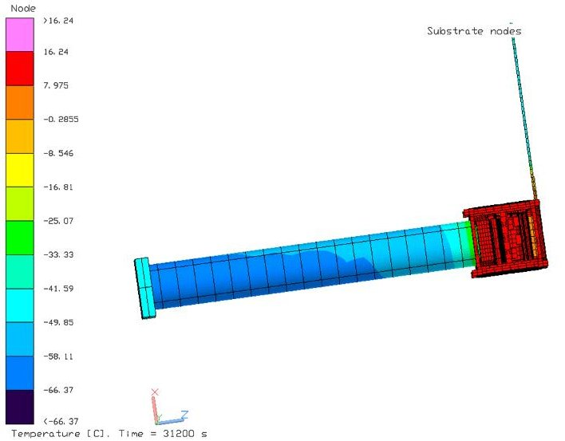

(a) Max Temp: 15.84 $ ^{\circ} \mathrm{C} $ , Min Temp: $ - 6 6. 3 7 \, \mathrm{^o C} $ at 31,200 s.

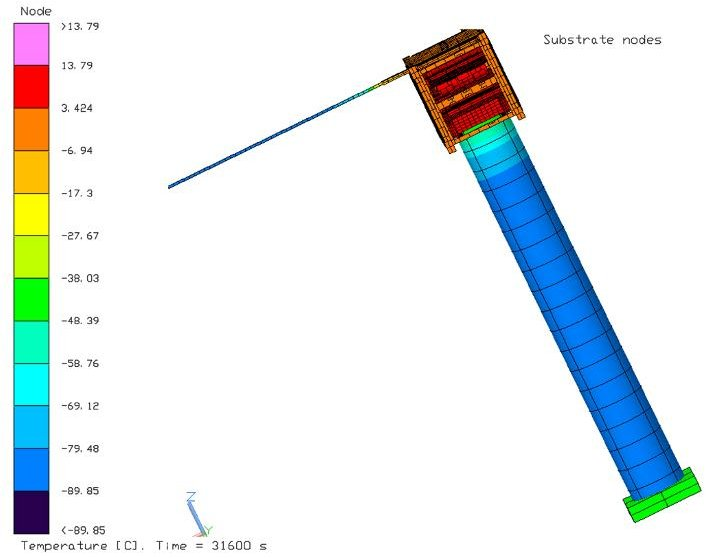

(b) Max Temp: $ 1 3. 7 8 \mathrm{~} ^ {\circ} \mathrm{C} $ , Min Temp: $ - 8 9. 8 4 \mathrm{~} ^ {\circ} \mathrm{C} $ at 31,600 s.

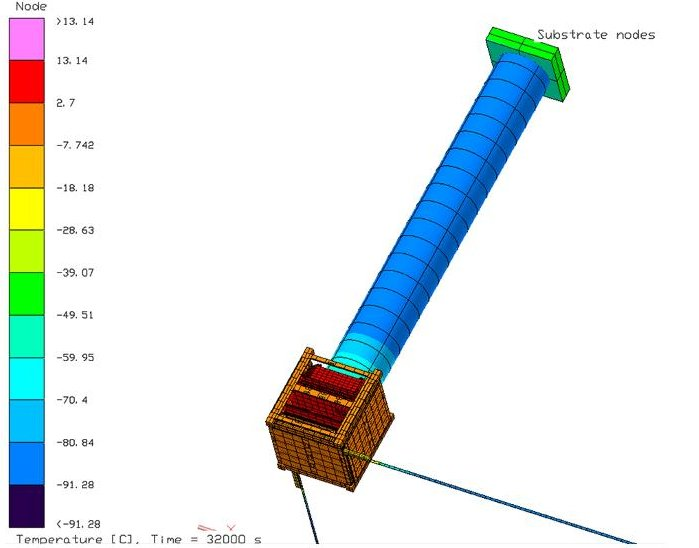

(c) Max Temp: 11.00 $ ^{\circ} \mathrm{C} $ , Min Temp: $ - 89.49 \,^{\circ} \mathrm{C} $ at 3200 s.

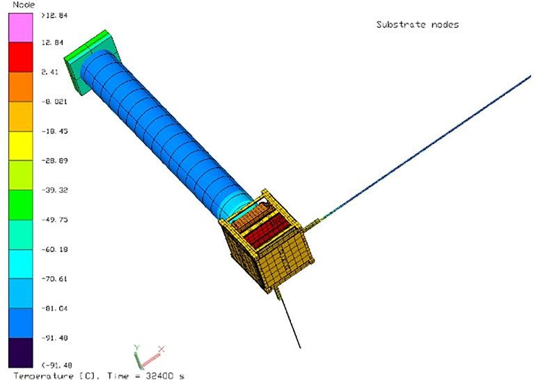

(d) Max Temp: 12.07 $ ^{\circ} \mathrm{C} $ , Min Temp: $ - 9 0. 5 8 \mathrm{~} ^ {\circ} \mathrm{C} $ at 32,400 s.

Figure 8. Results during the Thermal Simulation: (a-d) illustrate the variations in temperature throughout the orbital position, represented by different colors and rotation respectively. The screenshot captures one of the last orbits in the Cold Case, Nominal mode $ 2. 5^{\circ} $ /s, with a hysteresis temperature with heater OFF.

## 5. Thermal Vacuum Test Campaign 5.1. Test Overview

Once the simulation/modelling results were validated, the $ ^{3} $Cat-4 environmental test campaign in the thermal-vacuum chamber at the CubeSat Support Facilities (CSF) at ESEC-GALAXIA facilities (Belgium) was prepared. The entire procedure for this test is documented in the " $ ^{3} $Cat-4 Test Specifications and Test Procedures Full Assembly Verification Environmental Test Campaign - Thermal and Vacuum Testing" [27], prepared by $ ^{3} $Cat-4 team with the support of ESA ESTEC Thermal Control Section (TEC-MTT) for use with CubeSat Systems, which combines a tailored version of the ECSS standards with lessons learned from past CubeSat projects.

All the test descriptions include the requirements that have to be verified in order to determine if the test results are satisfactory. It also outlined the test specifications and requirements that define the conditions under which the test should be conducted and a detailed schedule of the test organization [27].

The TVAC test consists of putting the satellite under thermal stress, in both operative and non-operative hot and cold temperatures. During and after the test, its expected functionalities are checked to assess if the temperature variation inflicted damage or malfunction in the system. The main objective of the thermal vacuum testing is to study the impact of the temperature ranges with which the $ ^{3} $Cat-4 nanosatellite will confront in

<!-- PDF_PAGE: 20 -->

its operation, in both hot and cold cases. To test the temperature ranges, two different types of thermal cycles are applied to the spacecraft [27].

## 5.2. TVAC Test Campaign Flowgraph

The test sequence is intended as a task list to be followed during the execution of the tests (Figure 9).

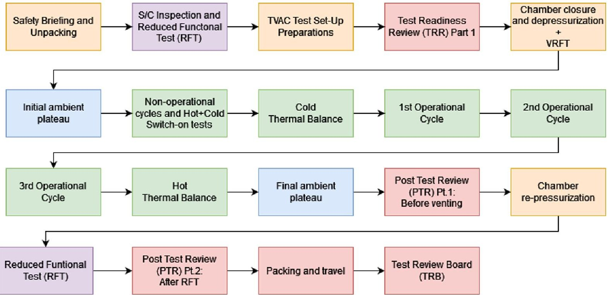

Figure 9. Test campaign flowchart [27].

Regarding the setup facilities, each test description provided a comprehensive list of the Mechanical and Electrical Ground Support Equipment (MEGSE and EGSE), as well as the tools required to perform the test. In addition, a detailed step-by-step process was stated to ensure the complete execution of each test.

The initial stage consists of performing a set of tests to ensure the health of the satellite, and also provide a baseline to refer to during the TVAC testing. During this phase, the spacecraft is unpacked and prepared for functional testing within a cleanroom environment, ensuring readiness for the initial Reduced Functional Test (RFT). The test organization involved the mission team, including the test supervisor, hardware and software responsible individuals, facility operators, and necessary ESA Academy staff. The stage lasts for 3 h and consists of two phases: equipment and personnel arrival at the testing facilities, followed by spacecraft unpacking and hardware setup for functional testing. Figure 10 shows the spacecraft is positioned in the vertical MGSE for this test.

<!-- PDF_PAGE: 21 -->

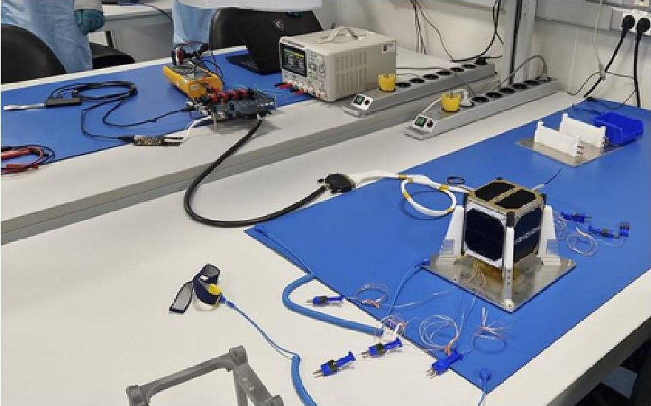

Figure 10. Set-up for the first health check, with the blue non-vacuum-compliant TC connectors [27].

## 5.3. DUT Thermocouple (TC) Placement

The Thermal Reference Point (TRP) is a parameter utilized during the TVAC test campaign. It serves as a reference for controlling the temperature during the test execution, as it provides essential data to regulate the spacecraft's temperature. The position of the thermocouples (TC) is determined based on the TRP location, and such as it is less influenced by heating parts such as the heaters placed on the batteries. It has the fastest response to the change in temperatures and allows the operator to control the environment in a safer manner.

The rest of the TCs have to be placed near the spots where it is easy to analyse the thermal behaviour of the subsystems and parts. It is also crucial to monitor the temperature of the batteries in the EPS, as it is the most sensitive component regarding to temperature. According to this, the TC placement is as follows:

- TC-1 (TRP): Positioned on the satellite's structure.

- TC-2/4: Positioned in the EPS (at the batteries and the $ - X $ side).

- TC-3: Positioned in the FMP (Overo, side -X).

- TC-5: Positioned in COMMS-ADCS, close to the COMMS-MCU (side -Y).

- TC-6: Positioned in the Interface Board (side -X).

- TC-7: Positioned on the satellite's structure. In case TC-1 fails, this one will control the temperature (TRP).

- TC-8: Positioned in the OBC Shield (side +Y).

- TC-9: Positioned in the ZADS (side +Z).

- TC-10: Positioned in the -X Solar Panel.

- TC-11: Positioned in the -Y Solar Panel.

- TC-12: Positioned in the NADS RF board.

Figure 11 illustrates the placement of each thermocouple used to monitor the temperatures of various subsystems during testing. The TCs were securely attached at the designated points using a self-adhesive Kapton tape [26], specifically selected for its thermal resistance properties (Figure 12). To further ensure stability and prevent any movement that could result in inaccurate readings, additional Kapton tape was applied as strain relief, keeping the TCs firmly in place even during spacecraft handling. The thermocouple cables were neatly grouped and secured with Kapton tape to avoid interference with other components and were positioned behind the shroud to reduce exposure. This approach ensured that the TCs remained stable, preventing poor connections that could compromise the accuracy of the temperature measurements.

<!-- PDF_PAGE: 22 -->

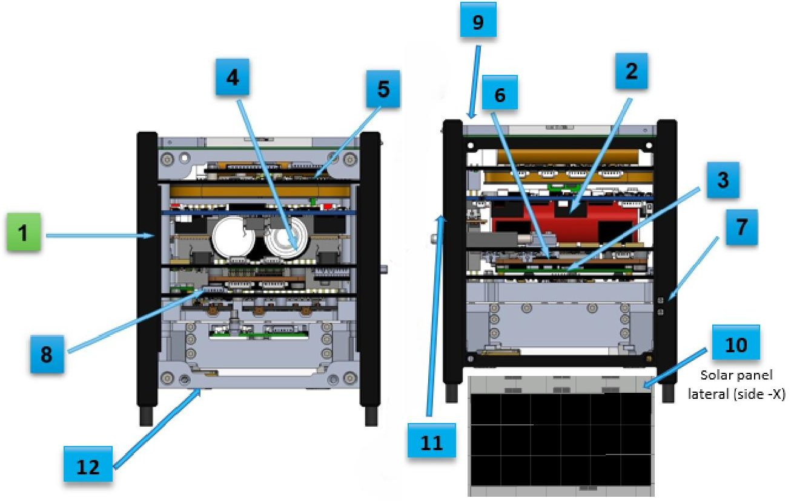

(b) Lateral view of the satellite.

(a) Front view of the satellite. the satellite. Figure 11. TRP (green) and TC (blue) placement over $ ^{3} $Cat-4.

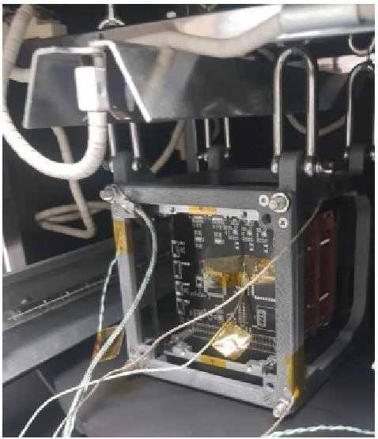

(a) TCs positions within TVAC.

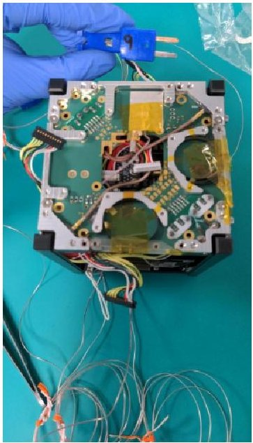

(b) TC positions top view.

Figure 12. TCs locations.

## 5.4. Test Levels and Test Parameters

## 5.4.1. Bake-Out

The bake-out test, conducted as the first phase of the TVAC testing (Figure 13), lasted 25 h at 50 $ ^{\circ} \mathrm{C} $ , with a 4-hour hot non-operational cycle. This test served both as an acceptance test and a design evaluation, aimed at verifying the outgassing properties of certain materials, particularly the thermocouple connectors made of unknown plastic. To ensure proper evaluation, the temperature was gradually increased to 57 $ ^{\circ} \mathrm{C} $ and maintained for over 24 h before being lowered for further operational testing, including thermal balance tests and full operational cycles.

The bake-out verified material suitability, with no anomalies observed during the subsequent health check. It is recommended, however, to conduct bake-outs at the board

<!-- PDF_PAGE: 23 -->

or subsystem level before full CubeSat integration, especially when material outgassing properties are uncertain or may exceed the limits.

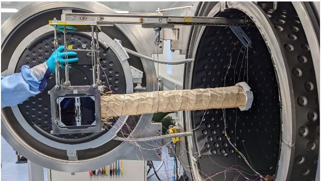

Figure 13. Thermal vacuum test campaign. ESA's facilities of ESEC, Belgium.

## 5.4.2. Test Levels and Conditions

In order to safely conduct the test, it is necessary to establish the temperature ranges. This information has been extracted from Tables 15 and 16, which are included in the $ ^{3} $Cat-4 Thermal Analysis Report [13].

Table 15. Worst hot case with satellite in nadir pointing, nominal mode, and deployed config. in $ 2. 5^{\circ} / \mathrm{s} $ Z-spin scenario.

<table border="1"><tr><td rowspan="2">Subsystems</td><td colspan="2">Design Temperature Operational Range(℃)</td><td colspan="2">Calculated Temperatures(℃)</td><td colspan="2">Predicted Temperatures(℃)</td></tr><tr><td>Min</td><td>Max</td><td>Min</td><td>Max</td><td>Min(-10)</td><td>Max(+10)</td></tr><tr><td colspan="7">Operational Subsystems</td></tr><tr><td>COMMS/AOCS</td><td>-25</td><td>65</td><td>16.70</td><td>31.32</td><td>6.70</td><td>41.32</td></tr><tr><td>EPS board</td><td>-30</td><td>75</td><td>20.36</td><td>33.48</td><td>10.36</td><td>43.48</td></tr><tr><td>EPS batteries(charge)</td><td>0</td><td>45</td><td>21.43</td><td>32.52</td><td>11.43</td><td>42.52</td></tr><tr><td>EPS batteries(discharge)</td><td>-20</td><td>60</td><td>21.43</td><td>32.52</td><td>11.43</td><td>42.52</td></tr><tr><td>OBC+IB</td><td>-20</td><td>70</td><td>20.68</td><td>35.89</td><td>10.68</td><td>45.89</td></tr><tr><td>NADS mainboard</td><td>-30</td><td>75</td><td>20.18</td><td>31.63</td><td>10.18</td><td>41.63</td></tr><tr><td>Upper SP(+Z)</td><td>-30</td><td>115</td><td>12.95</td><td>29.56</td><td>2.95</td><td>39.56</td></tr><tr><td>Upper SP(+Z) antenna</td><td>-30</td><td>115</td><td>12.95</td><td>29.56</td><td>2.95</td><td>39.56</td></tr><tr><td>Lateral SP(±X±Y)</td><td>-30</td><td>115</td><td>16.07</td><td>36.13</td><td>6.07</td><td>46.13</td></tr><tr><td>ZADS</td><td>-40</td><td>75</td><td>16.64</td><td>30.69</td><td>6.64</td><td>40.69</td></tr><tr><td>FMP mainboard</td><td>-15</td><td>75</td><td>20.88</td><td>32.31</td><td>10.88</td><td>42.31</td></tr><tr><td>FMP daughterboard</td><td>-15</td><td>75</td><td>21.22</td><td>32.03</td><td>1.22</td><td>42.03</td></tr><tr><td colspan="7">Non-operational Subsystems</td></tr><tr><td>NADS antenna</td><td>N/A</td><td>111</td><td>5.16</td><td>31.10</td><td>-5.16</td><td>41.10</td></tr><tr><td>NADS counterweight</td><td>-190</td><td>250</td><td>-37.01</td><td>-34.72</td><td>-47.01</td><td>-24.72</td></tr><tr><td>NADS sheat</td><td>-73</td><td>260</td><td>-31.91</td><td>41.98</td><td>-41.91</td><td>51.98</td></tr><tr><td>Structure frame</td><td>N/A</td><td>N/A</td><td>27.01</td><td>32.68</td><td>17.01</td><td>43.19</td></tr></table>

Note: N/A means not applicable. The 'Batteries Calculated Temp' refers to the simulation results, while 'Batteries Predicted Temp' denotes the margin of 10 degrees between the minimum and maximum temperatures obtained from the simulation (Calculated Temp.).

<!-- PDF_PAGE: 24 -->

Table 16. Worst cold case with satellite in nadir pointing, sun-safe mode, and deployed config. in $ 6^{\circ} / \mathrm{s} $ Z-spin scenario, with battery heaters activated.

<table border="1"><tr><td rowspan="2">Subsystems</td><td colspan="2">Design Temperature Operational Range(℃)</td><td colspan="2">Calculated Temperatures(℃)</td><td colspan="2">Predicted Temperatures(℃)</td></tr><tr><td>Min</td><td>Max</td><td>Min</td><td>Max</td><td>Min(-10)</td><td>Max(+10)</td></tr><tr><td colspan="7">Operational Subsystems</td></tr><tr><td>COMMS/AOCS</td><td>-25</td><td>65</td><td>-5.04</td><td>28.92</td><td>-15.04</td><td>38.92</td></tr><tr><td>EPS board</td><td>-30</td><td>75</td><td>4.64</td><td>28.62</td><td>-5.36</td><td>38.62</td></tr><tr><td>EPS batteries(charge)</td><td>0</td><td>45</td><td>11.04</td><td>27.63</td><td>1.04</td><td>37.63</td></tr><tr><td>EPS batteries(discharge)</td><td>-20</td><td>60</td><td>11.04</td><td>27.63</td><td>1.04</td><td>37.63</td></tr><tr><td>OBC+IB</td><td>-20</td><td>70</td><td>6.99</td><td>29.29</td><td>-3.01</td><td>39.29</td></tr><tr><td>NADS mainboard</td><td>-30</td><td>75</td><td>5.02</td><td>26.44</td><td>-4.98</td><td>36.44</td></tr><tr><td>Upper SP(+Z)</td><td>-30</td><td>115</td><td>-9.01</td><td>30.78</td><td>-19.01</td><td>40.78</td></tr><tr><td>Upper SP(+Z) antenna</td><td>-30</td><td>115</td><td>-9.01</td><td>30.78</td><td>-19.01</td><td>40.78</td></tr><tr><td>Lateral SP(±X±Y)</td><td>-30</td><td>115</td><td>-8.09</td><td>31.28</td><td>-18.09</td><td>41.28</td></tr><tr><td>ZADS</td><td>-40</td><td>75</td><td>-7.50</td><td>29.18</td><td>-17.50</td><td>39.18</td></tr><tr><td>FMP mainboard</td><td>-15</td><td>75</td><td>8.97</td><td>26.40</td><td>-1.03</td><td>36.40</td></tr><tr><td>FMP daughterboard</td><td>-15</td><td>75</td><td>10.02</td><td>26.04</td><td>0.02</td><td>36.04</td></tr><tr><td colspan="7">Non-operational Subsystems</td></tr><tr><td>NADS antenna</td><td>N/A</td><td>111</td><td>-20.61</td><td>26.11</td><td>-30.61</td><td>36.11</td></tr><tr><td>NADS counterweight</td><td>-190</td><td>250</td><td>-49.16</td><td>25.00</td><td>-59.16</td><td>35.00</td></tr><tr><td>NADS sheat</td><td>-73</td><td>260</td><td>90C5F6-90.59</td><td>36.90</td><td>90C5F6-100.59</td><td>46.90</td></tr><tr><td>Structure frame</td><td>N/A</td><td>N/A</td><td>-7.88</td><td>28.90</td><td>-17.88</td><td>38.90</td></tr></table>

Note: N/A means not applicable.

Furthermore, the temperature rate of change is determined based on the thermal analyses, considering the worst-case scenario with the highest thermal gradients. The temperature rate of change is set at 0.0042 $ ^{\circ} \mathrm{C} / \mathrm{s} $ , which complies with the facility's specifications.

The dwell time criteria is set to a minimum of 2 h. This conservative value allows sufficient time for all internal components to stabilize at the required temperature. For ambient, operational, and non-operational cycles, the stability criteria for all subsystems is a maximum rate of change of $ 1 \mathrm{~^\circ C / h} $ . During the thermal balance test, the criteria is $ 0.5 \mathrm{~^\circ C / 4} \mathrm{~h}. $

Table 15 shows the results of the analysis from the worst hot case thermal simulation performed assuming the satellite was in Nadir Pointing, Nominal Mode, Deployed NADS configuration and with a $ 2. 5^{\circ} $ /s spin around the Z axis.

- The predicted temperatures are within the subsystem operational margins.

- The maximum temperature value selected for the operational subsystem will be determined with the operational temperature of the batteries in charge mode i.e., $ 4 5 \mathrm {^\circ C}. $

The TRP is placed on top of the structure's rails, and the difference in temperature between the batteries and the structure is almost $ + 1 \mathrm{~^\circ C} $ $ (4 2. 5 \mathrm{~^\circ C} $ at the batteries and $ 4 3. 2 \mathrm{~^\circ C} $ at the structure), as per the current thermal simulations. However, although this is the expected behaviour in flight, during TVAC testing all of the sides of the S/C will be at similar environmental conditions, thus this gradient may be lower and/or negligible. For this reason, it is not considered for the Test Specification value. Therefore, the maximum operational temperature will be $ 4 5 \mathrm{~^\circ C} $ $ [ - 0 \mathrm{~^\circ C} /+ 4 \mathrm{~^\circ C} ] $

A thermal gradient may exist between the batteries and the external TRP. For this reason, especially in hot cases, the maximum operational temperature may be revised during the test, with close inspection when performing the first ambient plateau after TVAC closure. The TRP temperature can be modified to ensure that the batteries do not

<!-- PDF_PAGE: 25 -->

exceed their maximum temperature rating of 45 $ ^{\circ} \mathrm{C} $ . It is important to note that, as the batteries will not be charged at the maximum operational temperature, there is an extra safety margin for them, as the discharge temperature rate goes up to $ 60^{\circ} \mathrm{C} $

On the other hand, the results from the analysis of the worst cold case scenario are listed. This scenario involves the satellite in Nadir Pointing, Sun Safe Mode, and Deployed NADS configuration, with a 6°/s spin around the Z axis.

- Table 16 is used to establish the minimum temperature value for the test.

- In this case, the minimum value is given by the Upper SP (+Z) antenna, which is $ - 1 9 \, ^ {\circ} \mathrm{C} $ . This value is close to the expected measurement on the TRP (Structure), calculated as $ - 1 7 \, ^ {\circ} \mathrm{C} $ . The temperature difference is small, so the actual gradient might need to be assessed during the thermal balance test.

- Although the battery has heaters that activate above 0 $ ^{\circ} \mathrm{C} $ (hysteresis temperatures of $ 4^{\circ} \mathrm{C} $ and $ 5^{\circ} \mathrm{C} $ ), it has been decided to not bring the battery temperature below $ 10^{\circ} \mathrm{C} $ during its operation (though the minimum operational temperature, in discharge mode, is $ 20^{\circ} \mathrm{C} $ ).

The non-operational temperatures are chosen considering the operational temperature of the batteries in discharge. The maximum non-operational temperature, $ T_{max}^{non-OP} $ , is defined as $ +60^{\circ} \mathrm{C} \left[ -0^{\circ} \mathrm{C} / +4^{\circ} \mathrm{C} \right] $ . The minimum non-operational temperature, $ T_{min}^{non-OP} $ , is defined as $ -20^{\circ} \mathrm{C} \left[ -4^{\circ} \mathrm{C} / +0^{\circ} \mathrm{C} \right] $ .

For the thermal balance test levels, an extra 5 $ ^{\circ} \mathrm{C} $ margin is added to $ T_{max}^{OP} $ and $ T_{min}^{OP} $ in order to avoid unnecessary risks bringing the subsystems close to their operational limits. $ T_{max}^{TBal} $ and $ T_{min}^{TBal} $ are defined as $ + 4 0 \mathrm{~^\circ C} $ $ [ - 0 \mathrm{~^\circ C} / + 4 \mathrm{~^\circ C} ] $ and $ 5 \mathrm{~^\circ C} $ $ [ - 4 \mathrm{~^\circ C} / + 0 \mathrm{~^\circ C} ] $ , respectively. Table 17 below shows the complete picture of which subsystems will be powered and not powered, in both hot and cold worst cases:

Table 17. Subsystem status for worst hot and cold cases.

<table border="1"><tr><td>Subsystem</td><td>Status in Cold Cases</td><td>Status in Hot Case</td></tr><tr><td>EPS</td><td>ON</td><td>ON</td></tr><tr><td>COMMS</td><td>ON(telemetry each 60s)</td><td>ON(telemetry each 30s)</td></tr><tr><td>OBC</td><td>ON</td><td>ON</td></tr><tr><td>ADCS</td><td>ON(no actuation,only telemetry)</td><td>ON(nadir-pointing actuation)</td></tr><tr><td>FMP</td><td>OFF</td><td>ON</td></tr><tr><td>ZADS</td><td>ON</td><td>ON</td></tr><tr><td>NADS</td><td>ON</td><td>ON</td></tr></table>

At the beginning of the test campaign, in order to compare the data obtained from the thermal simulations, a thermal balance plateau is added with the intention to stabilize the temperature within a variation of $ 0. 5 \, \mathrm{^\circ C} / 4 \mathrm{~ h} $ . In Table 18, the limiting operational and non-operational temperatures are stated, being the TRP (defined previously) the point where the temperature will be measured. Note that the $ [ - 4 \, \mathrm{^\circ C} / + 4 \, \mathrm{^\circ C} ] $ margin is not applied in the values.

Table 18. Operational and non-operational temperature limits.

<table border="1"><tr><td>Parameter</td><td>Description</td><td>Value</td></tr><tr><td>Tmax, NON-OP</td><td>Maximum non-operational acceptance temperature</td><td>For this test, it is+60℃</td></tr><tr><td>Tmax, OP</td><td>Maximum operational acceptance temperature</td><td>For this test, it is+45℃</td></tr><tr><td>Tmax, hot switch-on</td><td>Maximum switch on temperature</td><td>For this test, it is+45℃</td></tr><tr><td>Tamb</td><td>Ambient temperature</td><td>+22℃</td></tr><tr><td>Tmin, OP</td><td>Minimum operational acceptance temperature</td><td>For this test, it is-10℃</td></tr><tr><td>Tmin, switch-on</td><td>Minimum switch on temperature</td><td>For this test, it is-10℃</td></tr><tr><td>Tmin, NON-OP</td><td>Minimum non-operational acceptance temperature</td><td>For this test, it is-20℃</td></tr><tr><td>Tmax, TBal</td><td>Maximum thermal balance temperature</td><td>For this test, it is+40℃</td></tr><tr><td>Tmin, TBal</td><td>Minimum thermal balance temperature</td><td>For this test, it is-5℃</td></tr></table>

<!-- PDF_PAGE: 26 -->

Figure 14 shows the TVAC test sequence diagram, the description of the test diagram is presented in the Table 19.

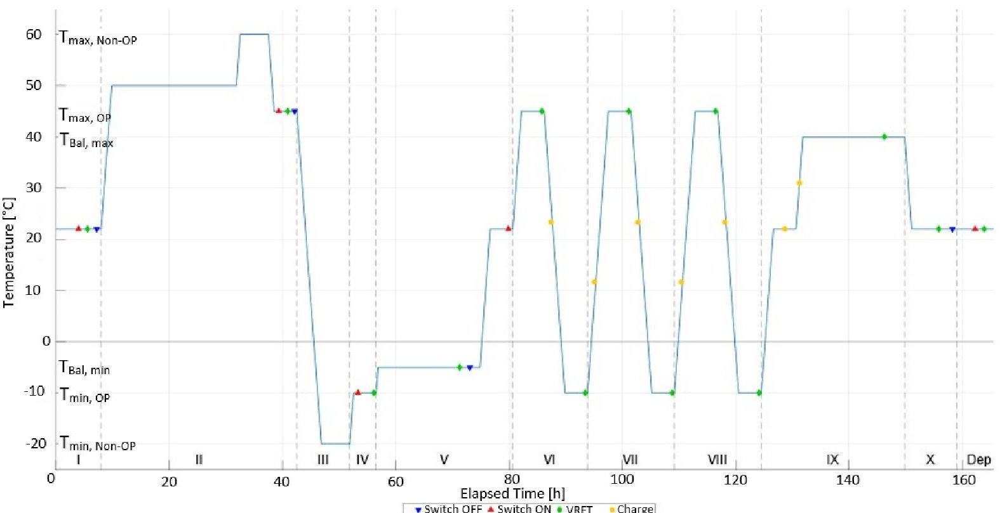

Figure 14. TVAC test sequence diagram.

Table 19. Test Diagram Description.

<table border="1"><tr><td></td><td>Test Phase Title</td><td>Test Phase Description</td><td>Test Phase Duration</td></tr><tr><td>I</td><td>Initial ambient plateau</td><td>Initial ambient plateau with the intention to stabilize temperature in between 0.5K during 4h.</td><td>4h</td></tr><tr><td>II</td><td>Hot non-op test phase/Bake-out/hot switch on</td><td>Bake-out of 20h at 50℃.Expose the CubeSat to the hot non-operational temperature,which is 60℃[-0℃/+4℃].Hot switch-on with VRFT at the hot operational temperature of 45℃[-0℃/+4℃].</td><td>34h</td></tr><tr><td>III</td><td>Cold non-op test phase</td><td>Expose the CubeSat to the cold non-operational temperature,which is-20℃[-4℃/+0℃].</td><td>9h</td></tr><tr><td>IV</td><td>Cold switch-on phase</td><td>Increase temperature to cold switch-on operational temperature(-10℃[-4℃/+0℃])and switch-on CubeSat.Monitor heater cycling and perform functional test.Possibility to stop test here if failure is encountered.</td><td>5h</td></tr><tr><td>V</td><td>Cold thermal balance</td><td>Thermal balance performed at a temperature of-5℃.</td><td>24h</td></tr><tr><td>VI</td><td>Operational Cycle1</td><td>Cycle within hot and cold operational temperature range,performing charge tests while slope up and slope down between temperature ranges from-10℃[-4℃/+0℃]to45℃[-0℃/+4℃].</td><td>14h</td></tr><tr><td>VII</td><td>Operational Cycle2</td><td>Cycle within hot and cold operational temperature range,performing charge tests while slope up and slope down between temperature ranges,from-10℃[-4℃/+0℃]to45℃[-0℃/+4℃].</td><td>15h30min</td></tr><tr><td>VIII</td><td>Operational Cycle3</td><td>Cycle within hot and cold operational temperature range,performing charge tests while slope up and slope down between temperature ranges from-10℃[-4℃/+0℃]to45℃[0℃/+4℃].</td><td>15h30min</td></tr><tr><td>IX</td><td>Hot thermal balance</td><td>Thermal balance performed at a temperature of40℃.</td><td>25h30min</td></tr><tr><td>X</td><td>Return to ambient temperature and switch-off.</td><td>Ramp down from hot TBal after the last VRFT to ambient temperature,S/C switch-off after stabilisation at ambient temperature.</td><td>9h</td></tr><tr><td>Dep</td><td>Depressurization</td><td>After return to ambient pressure,a VRFT is performed.</td><td></td></tr></table>

## 5.5. Test Campaign Results

In preparation for the TVAC Test Campaign, the System Level Environmental Test Campaign was conducted, encompassing the successful completion of both the Mission and Vibrations Tests. These tests have effectively ensured the spacecraft's preparedness for its designated mission. Furthermore, the thermal behavior of the spacecraft was thoroughly validated by exposing its components and subsystems to the predicted in-orbit environment. The test setup employed a fully radiative configuration, incorporating a PA12 isolating basket and suspension through Dyneema wires, as shown in Figure 15b.

<!-- PDF_PAGE: 27 -->

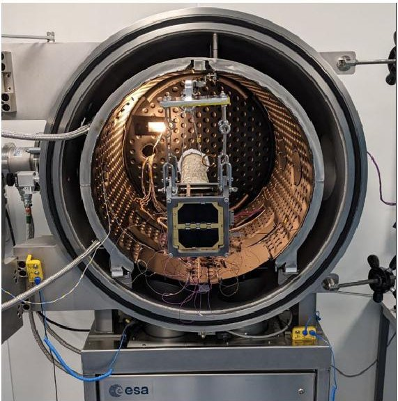

(a) Front view.

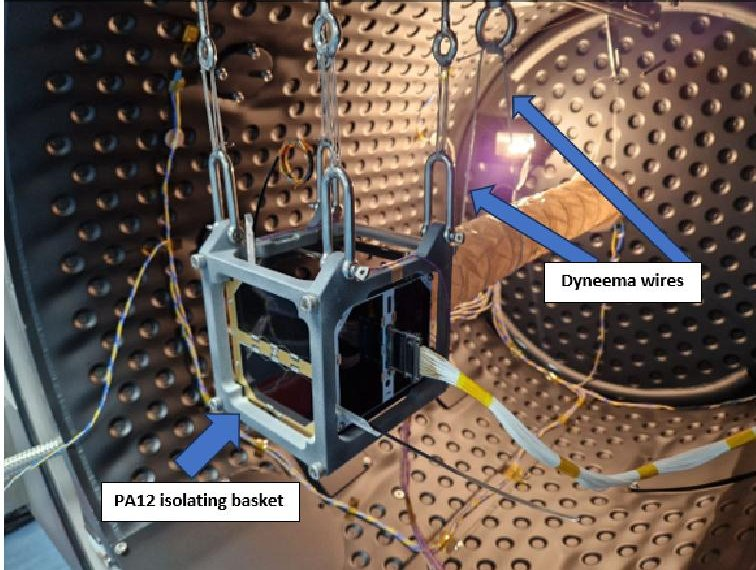

(b) Satellite inside the TVAC.

Figure 15. Thermal test.

Temperature levels (Table 20) were carefully controlled within specified ranges, adhering to the operating parameters of the batteries:

- Charge: $ 0^{\circ} \mathrm{C} $ to $ 4 5^{\circ} \mathrm{C} $

- Discharge: $ - 2 0 \mathrm {^ \circ C} $ to $ 6 0 \mathrm {^ \circ C} $

The TVAC tests utilized the most limiting temperatures of the batteries during charging to establish the maximum and minimum temperature levels achieved. For cold operational cycles, $ - 2 0 \mathrm {^ \circ C} $ was selected, ensuring that the heaters prevent the batteries from being charged by the EPS.

Furthermore, in line with operational safety protocols, the ZADS was manually disconnected by the external Electrical Ground Support Equipment when temperatures drop below $ - 2 0 \mathrm {^o C} $ . This temperature threshold aligns with its Operational Qualification Temperature [11].

Table 20. Temperature levels.

<table border="1"><tr><td>Parameter</td><td>Value</td><td>Location</td></tr><tr><td>Maximum non-operational acceptance temperature</td><td>60℃</td><td>TRP</td></tr><tr><td>Maximum operational acceptance temperature</td><td>45℃</td><td>Batteries</td></tr><tr><td>Maximum switch on temperature</td><td>45℃</td><td>Batteries</td></tr><tr><td>Ambient temperature</td><td>22℃</td><td>TRP</td></tr><tr><td>Minimum operational acceptance temperature</td><td>-18℃</td><td>Batteries</td></tr><tr><td>Minimum switch on temperature</td><td>-18℃</td><td>Batteries</td></tr><tr><td>Minimum non-operational acceptance temperature</td><td>-20℃</td><td>TRP</td></tr><tr><td>Maximum thermal balance temperature</td><td>43℃</td><td>Batteries</td></tr><tr><td>Minimum thermal balance temperature</td><td>0℃</td><td>TRP</td></tr></table>

## 5.5.1. Test Execution

The hot thermal balance test (Figure 16) was conducted following the third hot operational cycle to streamline the testing process and save time. It used several configurations, each based on varying levels of power dissipation:

- Configuration 1—Full Hot Configuration: S/C in Nominal Mode and FMP on, which includes the Magnetorquers actuating and the Deploys PoL cycling on and off to retrieve the housekeeping data.

- Configuration 2—Full Hot Configuration: Hot Configuration with No Magnetorquers: Phase started after a transit to survival, which puts the ADCS in idle. FMP is on and Deploys PoL is cycling.

<!-- PDF_PAGE: 28 -->

- Configuration 3—Temperate Configuration with ADCS fully on and FMP off: This is the configuration expected for most of the time during orbital operations, with the FMP off and the ADCS maintaining Nadir Pointing.

- Configuration 4—Hot Configuration without ADCS: The difference with the second TBal phase is that the S/C is put in Ground Mode and not in Survival. This causes the Deploys PoL to be always on, instead of cycling, although its consumption is very low, at only 10 mA.

Additionally, extended-duration thermal balance cases were implemented to enhance our comprehension of the satellite's behavior over prolonged periods.

All phases of the thermal balance test complied with the 0.5 K/4 h criterion. Although some phases did not exactly meet the predefined targets, the overall test requirements were fully satisfied, as evidenced by the successful completion of the third hot operational cycle. These thermal balance phases primarily served to collect data on the S/C thermal behavior, demonstrating its ability to maintain stable conditions over extended periods. The temperature profile for the entire Hot Thermal Balance test is depicted in Figure 16.

It was noted that the heater power dissipation exceeded the initial expectations. To accommodate cold cases (Figure 17) and achieve the lower qualification temperatures, hysteresis temperatures were adjusted, resulting in a decrease to $ [ - 1 6^{\circ} \mathrm{C} / - 1 5^{\circ} \mathrm{C} ] $

After initiating the hot switch-on, the spacecraft's temperature was gradually reduced below 15 $ ^{\circ} \mathrm{C} $ in two controlled steps to avoid exceeding the minimum non-operational temperature limits, reaching $ -18.5 \mathrm{~^\circ C} $ . The TRP was then stabilized with minimal temperature variation before initiating a cold switch-on, ensuring battery safety. Post-switch-on checks revealed a 'Cold Batteries' error due to temperatures below 0 $ ^{\circ} \mathrm{C} $ ,leading to an update in the EPS configuration for future cases. Heater activation at below 5 $ ^{\circ} \mathrm{C} $ resulted in a rapid temperature rise in the EPS and batteries compared to the rest of the spacecraft.

Subsequent modifications to the COMMS configuration and a weekend-long thermal balance test were conducted, including a scenario with the TRP set at $ - 8. 5 \mathrm{^\circ C} $ , resulting in 100% heater duty cycle. This was followed by another thermal balance with TRP at $ 4 \mathrm{^\circ C} $ reflecting more realistic orbital conditions, where battery temperatures were maintained above the threshold. Unexpected transitions to survival mode due to EPS errors provided additional data. A hot dissipation case was also simulated, with adjustments in the COMMS duty cycle and spacecraft modes, though interrupted by another EPS error. Despite these challenges, a partial thermal balance was achieved. The overall high dissipation thermal balance sequence and subsequent health checks yielded positive results.

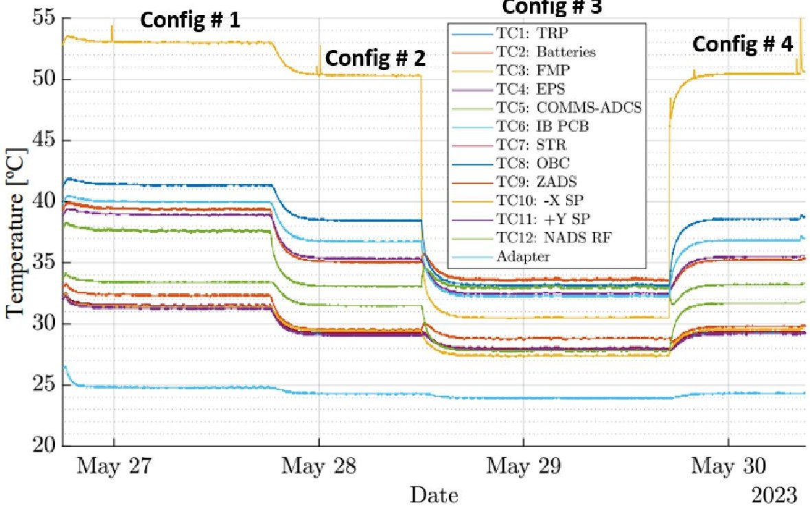

Figure 16. Hot Thermal Balance: Different thermal dissipation cases.

<!-- PDF_PAGE: 29 -->

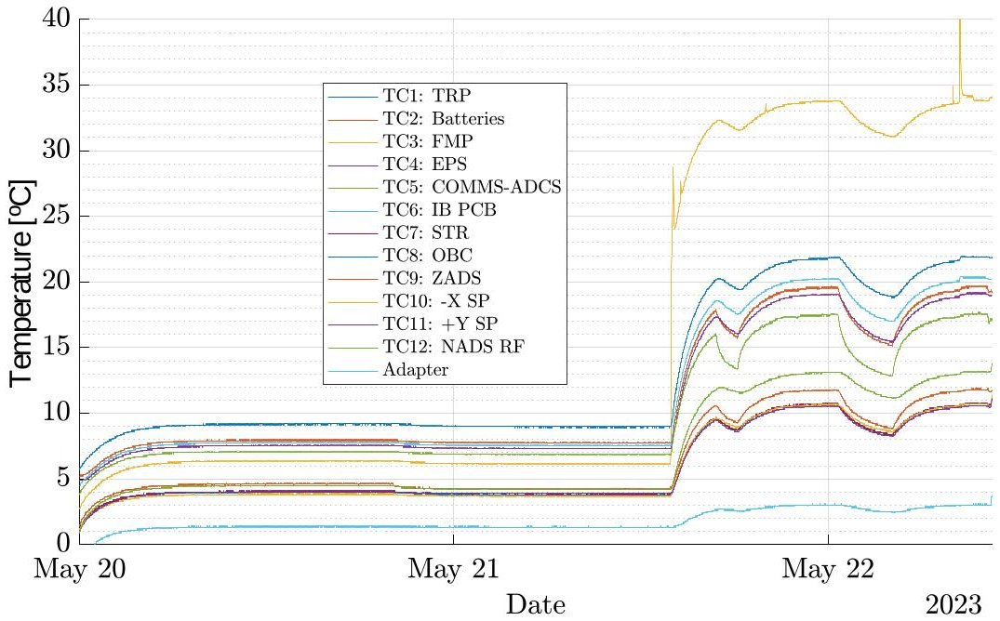

Figure 17. Cold Thermal Balance: At heater nominal operating temperature.

The Figure 18 shows a general summary of the text execution.

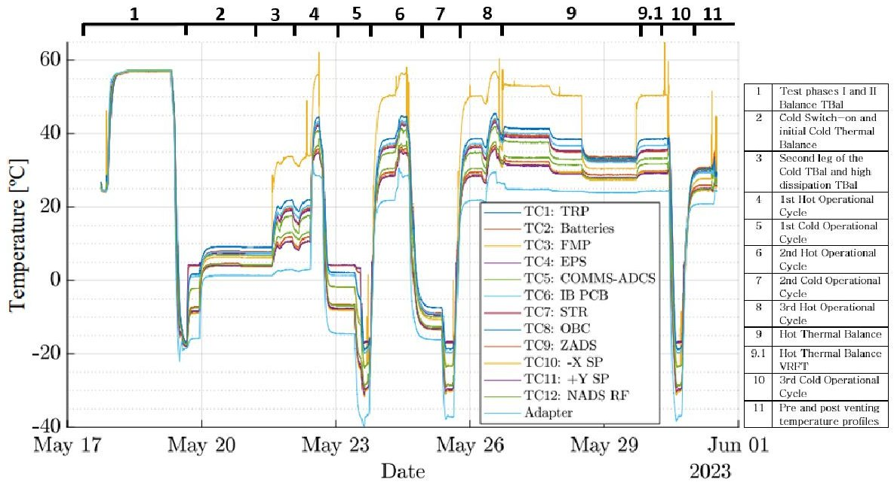

Figure 18. Test execution.

## 5.5.2. Temperatures at the TVAC Test Thermocouple Placements.

Additional data retrieval was conducted on the specific nodes of the model corresponding to the locations of each thermocouple utilized during the system-level TVAC tests. This process aimed to correlate the model's predicted temperatures with the actual temperatures recorded during the tests. For the cold case scenarios, the analysis factored in the hysteresis temperatures of the heaters, which are set between 4-5 $ ^{\circ} \mathrm{C}. $

Tables 21, 22, and 23 present the modeled temperature results located near thermocouple locations in Detumbling, SunSafe, and Nominal modes, respectively.

<!-- PDF_PAGE: 30 -->

Table 21. Detumbling worst cold case, $ 0^{\circ} $ /s spin, at thermocouple locations.

<table border="1"><tr><td rowspan="2">Name_Node</td><td rowspan="2">#Node</td><td rowspan="2">Thermocouple</td><td colspan="2">Calculated</td><td colspan="2">Predicted</td></tr><tr><td>Min</td><td>Max</td><td>Min</td><td>Max</td></tr><tr><td>STRUCTURE_SIDE_FRAMES.102018</td><td>102018</td><td>TC1-TRP</td><td>-24.82</td><td>10.49</td><td>-34.82</td><td>20.49</td></tr><tr><td>EPS_BATTERIES.279</td><td>279</td><td>TC2-Batt</td><td>4.95</td><td>5.72</td><td>-5.05</td><td>15.72</td></tr><tr><td>PAYLOAD.13</td><td>13</td><td>TC3-Overo</td><td>-8.16</td><td>1.22</td><td>-18.16</td><td>11.22</td></tr><tr><td>EPS.387</td><td>387</td><td>TC4-EPS-PCB</td><td>-0.16</td><td>5.09</td><td>-10.16</td><td>15.09</td></tr><tr><td>COMMS_AOCS.218</td><td>218</td><td>TC5-ADCS</td><td>-19.95</td><td>5.87</td><td>-29.95</td><td>15.87</td></tr><tr><td>MOTHERBOARD.78</td><td>78</td><td>TC6-IB</td><td>-3.05</td><td>3.18</td><td>-13.05</td><td>13.18</td></tr><tr><td>STRUCTURE_SIDE_FRAMES.103021</td><td>103021</td><td>TC7-STR</td><td>-24.54</td><td>9.86</td><td>-34.54</td><td>19.86</td></tr><tr><td>MOTHERBOARD.947</td><td>947</td><td>TC8-OBC-Shield</td><td>0.63</td><td>5.16</td><td>-9.37</td><td>15.16</td></tr><tr><td>ZADS.516</td><td>516</td><td>TC9-ZADS</td><td>-24.31</td><td>8.18</td><td>-34.31</td><td>18.18</td></tr><tr><td>SOLAR_PANELS_LATERAL.2518</td><td>2518</td><td>TC10-nX-SP</td><td>-25.48</td><td>17.80</td><td>-35.48</td><td>27.80</td></tr><tr><td>SOLAR_PANELS_LATERAL.3215</td><td>3215</td><td>TC11-Y-SP</td><td>-25.16</td><td>1.13</td><td>-35.16</td><td>11.13</td></tr><tr><td>NADS.46</td><td>46</td><td>TC12-NADS-RF</td><td>-14.62</td><td>1.60</td><td>-24.62</td><td>11.60</td></tr></table>

Table 22. SunSafe Cold Case, $ 2. 5^{\circ} $ /s spin, at thermocouple locations.

<table border="1"><tr><td rowspan="2">Name_Node</td><td rowspan="2">#Node</td><td rowspan="2">Thermocouple</td><td colspan="2">Calculated</td><td colspan="2">Predicted</td></tr><tr><td>Min</td><td>Max</td><td>Min</td><td>Max</td></tr><tr><td>STRUCTURE_SIDE_FRAMES.102018</td><td>102018</td><td>TC1-TRP</td><td>-17.61</td><td>19.01</td><td>-27.61</td><td>29.01</td></tr><tr><td>EPS_BATTERIES.279</td><td>279</td><td>TC2-Batt</td><td>5.04</td><td>14.39</td><td>-4.96</td><td>24.39</td></tr><tr><td>PAYLOAD.13</td><td>13</td><td>TC3-Overo</td><td>-0.21</td><td>11.30</td><td>-10.21</td><td>21.30</td></tr><tr><td>EPS.387</td><td>387</td><td>TC4-EPS-PCB</td><td>1.68</td><td>14.89</td><td>-8.32</td><td>24.89</td></tr><tr><td>COMMS_AOCS.218</td><td>218</td><td>TC5-ADCS</td><td>-13.11</td><td>17.90</td><td>-23.11</td><td>27.90</td></tr><tr><td>MOTHERBOARD.78</td><td>78</td><td>TC6-IB</td><td>3.51</td><td>12.34</td><td>-6.49</td><td>22.34</td></tr><tr><td>STRUCTURE_SIDE_FRAMES.103021</td><td>103021</td><td>TC7-STR</td><td>-17.39</td><td>18.96</td><td>-27.39</td><td>28.96</td></tr><tr><td>MOTHERBOARD.947</td><td>947</td><td>TC8-OBC-Shield</td><td>7.43</td><td>13.99</td><td>-2.57</td><td>23.99</td></tr><tr><td>ZADS.516</td><td>516</td><td>TC9-ZADS</td><td>-17.18</td><td>18.27</td><td>-27.18</td><td>28.27</td></tr><tr><td>SOLAR_PANELS_LATERAL.2518</td><td>2518</td><td>TC10-nX-SP</td><td>-18.18</td><td>19.87</td><td>-28.18</td><td>29.87</td></tr><tr><td>SOLAR_PANELS_LATERAL.3215</td><td>3215</td><td>TC11-Y-SP</td><td>-17.94</td><td>22.09</td><td>-27.94</td><td>32.09</td></tr><tr><td>NADS.46</td><td>46</td><td>TC12-NADS-RF</td><td>-6.39</td><td>13.57</td><td>-16.39</td><td>23.57</td></tr></table>

Table 23. Nominal mode worst hot case, $ 6^{\circ} $ /s spin, at thermocouple locations.

<table border="1"><tr><td rowspan="2">Name_Node</td><td rowspan="2">#Node</td><td rowspan="2">Thermocouple</td><td colspan="2">Calculated</td><td colspan="2">Predicted</td></tr><tr><td>Min</td><td>Max</td><td>Min</td><td>Max</td></tr><tr><td>STRUCTURE_SIDE_FRAMES.102018</td><td>102018</td><td>TC1-TRP</td><td>23.93</td><td>37.73</td><td>13.93</td><td>47.73</td></tr><tr><td>EPS_BATTERIES.279</td><td>279</td><td>TC2-Batt</td><td>32.12</td><td>33.27</td><td>22.12</td><td>43.27</td></tr><tr><td>PAYLOAD.13</td><td>13</td><td>TC3-Overo</td><td>31.82</td><td>33.14</td><td>21.82</td><td>43.14</td></tr><tr><td>EPS.387</td><td>387</td><td>TC4-EPS-PCB</td><td>32.07</td><td>33.28</td><td>22.07</td><td>43.28</td></tr><tr><td>COMMS_AOCS.218</td><td>218</td><td>TC5-ADCS</td><td>28.85</td><td>32.56</td><td>18.85</td><td>42.56</td></tr><tr><td>MOTHERBOARD.78</td><td>78</td><td>TC6-IB</td><td>33.01</td><td>34.29</td><td>23.01</td><td>44.29</td></tr><tr><td>STRUCTURE_SIDE_FRAMES.103021</td><td>103021</td><td>TC7-STR</td><td>24.56</td><td>36.23</td><td>14.56</td><td>46.23</td></tr><tr><td>MOTHERBOARD.947</td><td>947</td><td>TC8-OBC-Shield</td><td>35.95</td><td>36.68</td><td>25.95</td><td>46.68</td></tr><tr><td>ZADS.516</td><td>516</td><td>TC9-ZADS</td><td>25.45</td><td>32.99</td><td>15.45</td><td>42.99</td></tr><tr><td>SOLAR_PANELS_LATERAL.2518</td><td>2518</td><td>TC10-nX-SP</td><td>21.70</td><td>43.23</td><td>11.70</td><td>53.23</td></tr><tr><td>SOLAR_PANELS_LATERAL.3215</td><td>3215</td><td>TC11-Y-SP</td><td>21.49</td><td>46.08</td><td>11.49</td><td>56.08</td></tr><tr><td>NADS.46</td><td>46</td><td>TC12-NADS-RF</td><td>30.75</td><td>32.47</td><td>20.75</td><td>42.47</td></tr></table>

## Max-Min Cases

Tables 24 and 25 summarize the most critical temperatures identified in each operational mode.It extracts and emphasizes the extreme values, with the hottest cases marked in red and the coldest in blue. Additionally, for subsystems that differentiate between operational and non-operational statuses, further selected values are included (indicated in green or orange in the preceding tables). The final columns present the temperatures recorded during testing.

<!-- PDF_PAGE: 31 -->

Table 24. Maximum temperatures of the analysis and tests at thermocouple locations.

<table border="1"><tr><td rowspan="2">Name_Node</td><td rowspan="2">Thermocouple</td><td colspan="2">Calculated</td><td colspan="2">Predicted</td><td colspan="2">Test</td></tr><tr><td>Non-OP</td><td>OP</td><td>Non-OP</td><td>OP</td><td>SubSys</td><td>System</td></tr><tr><td>STRUCTURE_SIDE_FRAMES</td><td>TC1-TRP</td><td>37.73</td><td>-</td><td>47.73</td><td>-</td><td>80(90)</td><td>35.9</td></tr><tr><td>EPS_BATTERIES(Charge)</td><td>TC2-Batt</td><td>-</td><td>33.70</td><td>-</td><td>43.70</td><td>45</td><td>43.6</td></tr><tr><td>EPS_BATTERIES(Disharge)</td><td>TC2-Batt</td><td>-</td><td>33.70</td><td>-</td><td>43.70</td><td>60</td><td>43.6</td></tr><tr><td>PAYLOAD</td><td>TC3-Overo</td><td>32.71</td><td>33.29</td><td>42.71</td><td>43.29</td><td>45</td><td>62.2</td></tr><tr><td>EPS</td><td>TC4-EPS-PCB</td><td>-</td><td>33.72</td><td>-</td><td>43.72</td><td>80</td><td>43.1</td></tr><tr><td>COMMS_AOCS</td><td>TC5-ADCS</td><td>31.71</td><td>32.56</td><td>41.71</td><td>42.56</td><td>65.94</td><td>41.9</td></tr><tr><td>MOTHERBOARD(IB)</td><td>TC6-IB</td><td>34.47</td><td>-</td><td>44.47</td><td>-</td><td>NA</td><td>44.1</td></tr><tr><td>STRUCTURE_SIDE_FRAMES</td><td>TC7-STR</td><td>36.23</td><td>-</td><td>46.23</td><td>-</td><td>80(90)</td><td>36.0</td></tr><tr><td>MOTHERBOARD(OBC)</td><td>TC8-OBC-Shield</td><td>-</td><td>36.98</td><td>-</td><td>46.98</td><td>60(85)</td><td>45.5</td></tr><tr><td>ZADS</td><td>TC9-ZADS</td><td>31.06</td><td>32.99</td><td>41.06</td><td>42.99</td><td>60</td><td>36.8</td></tr><tr><td>SOLAR_PANELS_LATERAL(-X)</td><td>TC10-nX-SP</td><td>-</td><td>43.23</td><td>-</td><td>53.23</td><td>NA</td><td>35.9</td></tr><tr><td>SOLAR_PANELS_LATERAL(+Y)</td><td>TC11-Y-SP</td><td>-</td><td>46.08</td><td>-</td><td>56.08</td><td>NA</td><td>35.7</td></tr><tr><td>NADS</td><td>TC12-NADS-RF</td><td>32.04</td><td>32.62</td><td>42.04</td><td>42.62</td><td>55</td><td>37.7</td></tr></table>

Note: Test column color coding: Green = matched predictions; Blue = within instrument margins; Orange = calculated temperature not reached. Blue text = non-operational elements; Red text = manufacturer tests. (Parentheses) = manufacturer-qualified temperatures; Outside parentheses = $ ^{3} $ Cat-4 unit tested temperatures (acceptance level).

Table 25. Minimum temperatures of the analysis and tests at thermocouple locations.

<table border="1"><tr><td rowspan="2">Name_Node</td><td rowspan="2">Thermocouple</td><td colspan="2">Calculated</td><td colspan="2">Predicted</td><td colspan="2">Test</td></tr><tr><td>Non-OP</td><td>OP</td><td>Non-OP</td><td>OP</td><td>SubSys</td><td>System</td></tr><tr><td>STRUCTURE_SIDE_FRAMES</td><td>TC1-TRP</td><td>-24.82</td><td></td><td>-34.82</td><td></td><td>-25(-50)</td><td>-31.5</td></tr><tr><td>EPS_BATTERIES(Charge)</td><td>TC2-Batt</td><td>-</td><td>4.95</td><td>-</td><td>-5.05</td><td>0</td><td>1.5</td></tr><tr><td>EPS_BATTERIES(Disharge)</td><td>TC2-Batt</td><td>-</td><td>4.95</td><td>-</td><td>-5.05</td><td>-20</td><td>-17.3</td></tr><tr><td>PAYLOAD</td><td>TC3-Overo</td><td>-4.78</td><td>-8.16</td><td>-14.78</td><td>-18.16</td><td>-45</td><td>-23.3</td></tr><tr><td>EPS</td><td>TC4-EPS-PCB</td><td>-</td><td>-0.16</td><td>-</td><td>-10.16</td><td>-20(-40)</td><td>-17.3</td></tr><tr><td>COMMS_AOCS</td><td>TC5-ADCS</td><td>-19.95</td><td>-16.99</td><td>-29.95</td><td>-26.99</td><td>-27.1</td><td>-23.9</td></tr><tr><td>MOTHERBOARD(IB)</td><td>TC6-IB</td><td>-3.05</td><td></td><td>-13.05</td><td></td><td>NA</td><td>-19.8</td></tr><tr><td>STRUCTURE_SIDE_FRAMES</td><td>TC7-STR</td><td>-24.54</td><td></td><td>-34.54</td><td></td><td>-25(-50)</td><td>-31.4</td></tr><tr><td>MOTHERBOARD(OBC)</td><td>TC8-OBC-Shield</td><td>-</td><td>0.63</td><td>-</td><td>-9.37</td><td>-20(-30)</td><td>-18.7</td></tr><tr><td>ZADS</td><td>TC9-ZADS</td><td>-20.95</td><td>-24.31</td><td>-30.95</td><td>-34.31</td><td>-20(-40)</td><td>-29.7</td></tr><tr><td>SOLAR_PANELS_LATERAL(-X)</td><td>TC10-nX-SP</td><td>-</td><td>-25.48</td><td>-</td><td>-35.48</td><td>NA</td><td>-31.7</td></tr><tr><td>SOLAR_PANELS_LATERAL(+Y)</td><td>TC11-Y-SP</td><td>-</td><td>-25.16</td><td>-</td><td>-35.16</td><td>NA</td><td>-31.1</td></tr><tr><td>NADS</td><td>TC12-NADS-RF</td><td>-14.62</td><td>-10.84</td><td>-24.62</td><td>-20.84</td><td>-60</td><td>-29.0</td></tr></table>

Note: Test column color coding: Green = matched predictions; Orange = calculated temperature not reached. Blue text = non-operational elements; Red text = manufacturer tests. (Parentheses) = manufacturer-qualified temperatures; Outside parentheses $ =^{3} $ Cat-4 unit tested temperatures (acceptance level).

It is important to note that the table includes both the Worst Hot and Worst Cold temperatures, as well as the not-Worst Hot and Cold temperatures. 'Worst' conditions refer to scenarios with extreme high or low albedos and solar irradiances, in contrast to the more probable 'not-worst' scenarios, which were used as the reference for testing.

As seen in Table 24, at both the subsystem and system levels, all components were tested to the predicted temperatures, considering instrumentation error (as indicated by the blue cells). The only exception is the solar panels, which reached the calculated but not the predicted temperatures. However, since they are passive elements and the predicted temperatures are well below their rated component temperature of 115 $ ^{\circ} \mathrm{C} $ , there is no critical concern.

Regarding the cold temperatures in Table 25, only the COMMS-ADCS system reached the minimum calculated temperature, falling short of the predicted temperature by less than 3 $ ^{\circ} \mathrm{C} $ . This scenario, which involves a $ 0^{\circ} / \mathrm{s} $ tumbling after CubeSat ejection, is highly unlikely. In this scenario, both COMMS and ADCS would be off after exiting Standby Mode, as Detumbling actuation itself would not be triggered, rendering these subsystems non-operational. If we consider a scenario with only ADCS actuation (Detumbling Mode with a $ 1.5^{\circ} / \mathrm{s} $ spin), but COMMS off, the temperature rises by $ 3^{\circ} \mathrm{C} $ , reaching $ -26.99 \mathrm{~}^\circ \mathrm{C} $ which is slightly higher than the minimum test temperature of $ -27.1 \mathrm{~}^\circ \mathrm{C} $

<!-- PDF_PAGE: 32 -->

5. 5.3. Post Test Review (PTR), Chamber Re-Pressurization and Post Test Reduced Functional Test (RFT):

The final phase of the TVAC test campaign was executed according to plan without any unforeseen events. Upon reaching ambient temperature, a Very Reduced Functional Test (VRFT) was conducted to assess the satellite's status before shutdown. Preceding the TVAC venting process, the spacecraft underwent a 1-hour charging session.

Subsequently, the spacecraft was powered down, and the TVAC chamber was vented. After the venting process was completed, the chamber's condensation collection device was carefully extracted and set aside. This component was allowed to cool down to facilitate the subsequent analysis of any residues that may have accumulated during the test.

A quick health check of the satellite was performed before opening the TVAC to identify any potential issues from the venting process. Following a successful check, the TVAC chamber was opened, and the spacecraft underwent a thorough inspection prior to the dismounting of the Device Under Test (DUT). The umbilical connections and thermocouples were disconnected, and the DUT was transferred to a stable table using a movable bench. A final 1-h charging session brought the batteries to their storage voltage of 8.2 V.

The temperature profile for this last stage of testing is illustrated in Figure 19.

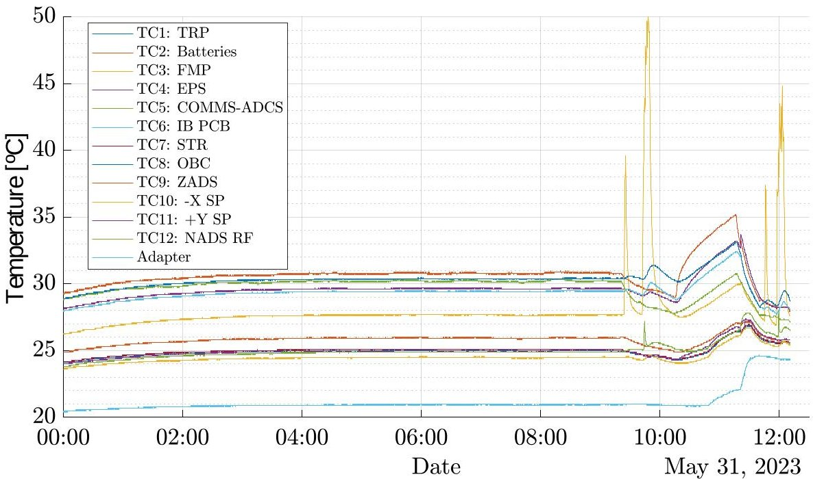

Figure 19. Pre and post venting temperature profiles.

## 5.6. Correlation of the Thermal Model with Test Campaign Results

To enhance the precision and reliability of thermal models for the $ ^{3} $Cat-4 mission, this section focuses on the correlation between the thermal model and results obtained from TVAC tests. The objective of these thermal balance correlations is to refine thermal properties within current and future models, with a specific emphasis on conductances at interfaces and material properties, as well as the radiative optical characteristics.

The methodology involves simulating hot thermal balance scenarios in the Third Phase, which encompasses a Temperate Configuration with ADCS fully activated and FMP deactivated. This configuration is expected to be prevalent during orbital operations, with the FMP deactivated and the ADCS maintaining Nadir Pointing. Simulations were conducted using Thermal Desktop with an environment temperature of 20 $ ^{\circ} \mathrm{C} $ , as documented in the Activity Log of the $ ^{3} $ Cat-4 TVAC Test [28]. Additionally, the First Cold Balance, or 1st Cold Thermal Balance, was simulated to model the Sun Safe Cold case, with Environment Temperature set at $ -20 \, \mathrm{^\circ C} $ and Heaters activated, with hysteresis temperatures at $ [+4 \, \mathrm{^\circ C} /+5 \, \mathrm{^\circ C} ] $

<!-- PDF_PAGE: 33 -->

The results of the Hot Thermal Balance are presented in Figure 20. According to the correlation between the test data and the model results, a Pearson correlation coefficient of 0.7750 was obtained, with the maximum temperature difference occurring at the thermocouple on the COMMS-ADCS board, yielding a temperature difference of 5.10 $ ^{\circ} \mathrm{C}. $

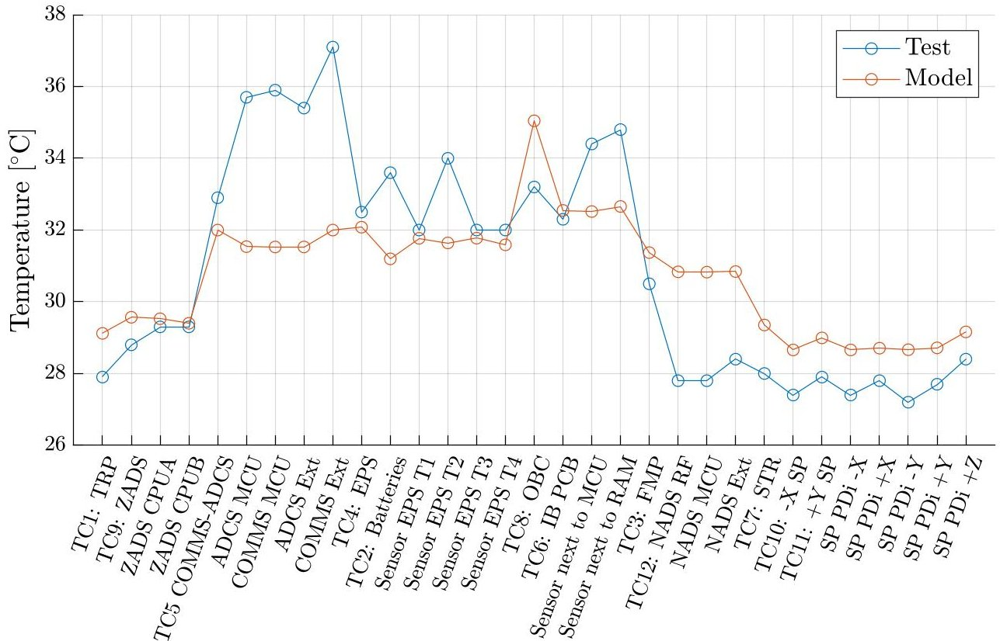

Figure 20. Hot Thermal Balance: Results Test VS Thermal Model.

For the Cold Thermal Balance, a correlation of 0.78904 was observed, with the maximum temperature difference occurring in the COMMS MCU sensor (Figure 21), resulting in a temperature difference of 6.34 $ ^{\circ} \mathrm{C}. $

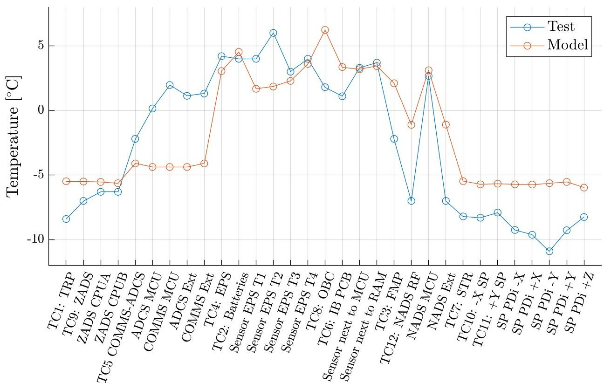

Figure 21. Cold Thermal Balance: Results Test VS Thermal Model.

<!-- PDF_PAGE: 34 -->

Overall, a strong correlation is evident between the thermal model and the results obtained during the TVAC test. Figure 22 presents the difference between the Hot and Cold Thermal Balance correlation results.

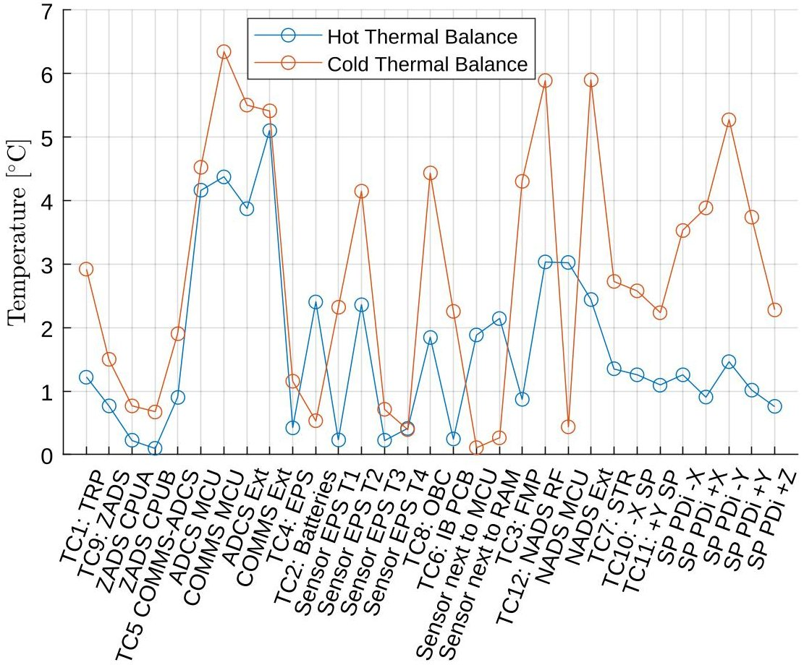

Figure 22. Temperature difference between the Hot Thermal Balance and the Cold Thermal Balance correlation.

## 6. Conclusions

A comprehensive thermal analysis was conducted for the $ ^{3} $Cat-41U CubeSat, prompted by design modifications and alterations in the orbital parameters. The updated thermal model was rigorously validated against prior results, ensuring its accuracy and reliability.

To safeguard the thermal and power budgets within prescribed limits, an in-depth study of the heater and external coatings was undertaken. The outcomes of this study provided assurance that the spacecraft's thermal and power profiles remained well within the defined boundaries.

The Thermal Vacuum (TVAC) test campaign served as a critical phase in the validation process, specifically attesting to the heater's performance.

Overall, the TVAC test campaign demonstrated the spacecraft's resilience and capability to withstand the anticipated temperature variations, affirming its readiness for the demanding conditions of space. These findings collectively contribute to the confidence in the thermal robustness of the satellite in its intended operational environment.

Author Contributions: Conceptualization, J.N.B.-L., I.T.-P., L.C.-B., L.F., G.G.-S., C.d.C.S., L.H., D.P. M.S. and A.C.; methodology, J.N.B.-L., I.T.-P., L.C.-B., L.F., G.G.-S., C.d.C.S., L.H., D.P. M.S. and A.C.; software, J.N.B.-L., I.T.-P., L.C.-B. and L.F.; validation, L.F., C.d.C.S., L.H., D.P. M.S. and A.C.; formal analysis, J.N.B.-L., I.T.-P., L.C.-B. and L.F.; investigation, J.N.B.-L., I.T.-P., L.C.-B. and L.F.; resources, C.d.C.S., L.H., D.P. M.S. and and A.C.; data curation, L.F., C.d.C.S., L.H., D.P. M.S. and and A.C.; writing—original draft preparation, J.N.B.-L., I.T.-P. and L.C.-B.; writing—review and editing, J.N.B.-L., I.T.-P., L.C.-B. and L.F.; visualization, J.N.B.-L., I.T.-P., L.C.-B. and L.F. and A.C.; supervision, A.C.; project administration, A.C.; funding acquisition, A.C. All authors have read and agreed to the published version of the manuscript.

<!-- PDF_PAGE: 35 -->

Funding: This research was funded by project "GENESIS: GNSS Environmental and Societal Missions—Subproject UPC", Grant PID2021-126436OB-C21, sponsored by MCIN/AEI/10.13039/5011000 11033/ and EU ERDF "A way to do Europe".

Data Availability Statement: Data are contained within the article.

Acknowledgments: The mission is possible thanks to the UPC NanoSat Lab members that participated, the ESA Education Office, and the ESA Thermal Control Section.

Conflicts of Interest: The authors declare no conflicts of interest.

## Abbreviations

The following abbreviations are used in this manuscript:

ADCS Attitude Determination Control

<table border="1"><tr><td>ADCS</td><td>Attitude Determination Control</td></tr><tr><td>AIS</td><td>Automatic Identification System</td></tr><tr><td>CSF</td><td>CubeSat Support Facilities</td></tr><tr><td>COTS</td><td>Commercial Off-The-Shelf</td></tr><tr><td>Dd</td><td>Detumbling</td></tr><tr><td>DUT</td><td>Device Under Test</td></tr><tr><td>EGSE</td><td>Electrical Ground Support Equipment</td></tr><tr><td>ESA</td><td>European Space Agency</td></tr><tr><td>ECSS</td><td>European Cooperation for Space Standardization</td></tr><tr><td>ESEC</td><td>European Space Security and Education Centre</td></tr><tr><td>FYS</td><td>Fly Your Satellite</td></tr><tr><td>GSE</td><td>Ground Support Equipment</td></tr><tr><td>MEGSE</td><td>Mehcanical</td></tr><tr><td>NMEA</td><td>National Marine Electronics Association</td></tr><tr><td>PTR</td><td>Post Test Review</td></tr><tr><td>RFI</td><td>Radio-Frequency Interference</td></tr><tr><td>RFT</td><td>Reduced Functional Test</td></tr><tr><td>SDR</td><td>Software Defines Radio</td></tr><tr><td>S/C</td><td>Spacecraft</td></tr><tr><td>SSO</td><td>Sun-Synchronous Orbit</td></tr><tr><td>SS</td><td>Sun Safe</td></tr><tr><td>TC</td><td>Thermocouple</td></tr><tr><td>TCS</td><td>Thermal Control Subsystem</td></tr><tr><td>TRP</td><td>Temperature Reference Point</td></tr><tr><td>TVAC</td><td>Thermal Vacuum Test Campaign</td></tr><tr><td>UVF</td><td>Ultra high Frequency</td></tr><tr><td>VHF</td><td>Very High Frequency</td></tr><tr><td>VRFT</td><td>Very Reduced Functional Test</td></tr></table>

VRFT Very Reduced Functional Test

## Appendix A

Appendix A.1

Table A1 presents the $ ^{3} $Cat-4 mass budget.

<!-- PDF_PAGE: 36 -->

Table A1. Mass Budget

<table border="1"><tr><td rowspan="2">Subsystem</td><td rowspan="2">Part</td><td rowspan="2">Units</td><td colspan="2">Mass(g)</td><td rowspan="2">Material</td></tr><tr><td>Measured/Provider</td><td>Estimation method/Source</td></tr><tr><td rowspan="15">STRUCTURE</td><td>Side_Frames</td><td>2</td><td>109.4</td><td>MatWeb Aluminium 6082</td><td>Alumini 6082</td></tr><tr><td>Ribs</td><td>4</td><td>92.6</td><td>MatWeb Aluminium 6082</td><td>Alumini 6082</td></tr><tr><td>Deployment_Switch-Brackets</td><td>4</td><td>0.46</td><td>MatWeb Aluminium 6082</td><td>Alumini 6082</td></tr><tr><td>Deployment_Switch-Killswitch_Body</td><td>2</td><td>0.3</td><td>SolidWorks Electronics</td><td>Electron compon</td></tr><tr><td>Screw</td><td>8</td><td>0.08</td><td>MatWeb Stainless steel A2-70</td><td>Steel A2</td></tr><tr><td>Spacer</td><td>4</td><td>0.52</td><td>SolidWorks Aluminium 1060 alloy</td><td>Alumini ASTM B</td></tr><tr><td>Rod</td><td>4</td><td>4.4</td><td>MatWeb Stainless steel AISI 304</td><td>Stainles AISI 30</td></tr><tr><td>Switch_PIN-Busje</td><td>2</td><td>0.21</td><td>SolidWorks Aluminium 7075-O</td><td>Alumini 7075</td></tr><tr><td>Switch_PIN-Pin</td><td>2</td><td>0.77</td><td>MatWeb Stainless Steel 430F</td><td>Stainles steel 43</td></tr><tr><td>Switch_PIN-Spring</td><td>2</td><td>0.41</td><td>SolidWorks Stainless Steel</td><td>Steel</td></tr><tr><td>Nut</td><td>4</td><td>0.07</td><td>MatWeb Stainless steel A2-70</td><td>Stainles Steal</td></tr><tr><td>Screw</td><td>8</td><td>0.29</td><td>MatWeb Stainless steel A2-70</td><td>Stainles Steal</td></tr><tr><td>Spacers_Round</td><td>28</td><td>0.052</td><td>MatWeb Aluminium 1050A</td><td>Alumini 1050A H</td></tr><tr><td colspan="2">WHOLE SUBSYSTEM MASS(g):</td><td colspan="2">209.6</td><td></td></tr><tr><td rowspan="2">OBC</td><td>OBC-NanoMind_A712C</td><td>1</td><td>55</td><td>GOMSpace NanoMind_a 712C Data Sheet</td><td></td></tr><tr><td colspan="2">WHOLE SUBSYSTEM MASS(g):</td><td colspan="2">55.0</td><td></td></tr><tr><td rowspan="2">EPS</td><td>EPS-NanoPower_P31u-9</td><td>1</td><td>200</td><td>GOMSpace NanoPower_P31u-9 Data Sheet</td><td></td></tr><tr><td colspan="2">WHOLE SUBSYSTEM MASS(g):</td><td colspan="2">200.0</td><td></td></tr><tr><td rowspan="13">INTERFACE</td><td>Mainboard PCB</td><td>1</td><td>31.54</td><td>Solidworks basic PCB</td><td>Basic PCB</td></tr><tr><td>Mainboard-Data_Bus</td><td>2</td><td>2.78</td><td>SolidWorks ABS</td><td>ABS</td></tr><tr><td>Mainboard-Deployment_Switch</td><td>1</td><td>1.93</td><td>SolidWorks Nylon 101</td><td>Nylon 1</td></tr><tr><td>Mainboard-Deployment_Switch_Pin_Steel</td><td>1</td><td>1.69</td><td>SolidWorks Annealed Stainless Steel</td><td>Stainles Steel</td></tr><tr><td>Daughterboard-Umbilical_conector</td><td>1</td><td>5.94</td><td>Solidworks basic PCB</td><td>Electronic component</td></tr><tr><td>Mainboard-Rbf</td><td>1</td><td>0.55</td><td>Solidworks basic PCB</td><td>Electronic component</td></tr><tr><td>Mainboard-Abf</td><td>1</td><td>1.08</td><td>Solidworks basic PCB</td><td>Electronic component</td></tr><tr><td>Daughterboard-PCB</td><td>1</td><td>4.35</td><td>Solidworks basic PCB</td><td>Electronic component</td></tr><tr><td>Mainboard-Deployment_Switch_Pin_Teflon</td><td>1</td><td>0.48</td><td>SolidWorks politetrafluoroetileno(PTFE)</td><td>PFTE</td></tr><tr><td>Mainboard_Switch_Core</td><td>1</td><td>1.93</td><td>SolidWorks Nylon 101</td><td>Nylon</td></tr><tr><td>Mainboard_Switch_Spring</td><td>1</td><td>0.14</td><td>SolidWorks Stainless Steel</td><td>Stainles Steel</td></tr><tr><td colspan="2">WHOLE SUBSYSTEM MASS(g):</td><td colspan="2">52.4</td><td></td></tr><tr><td rowspan="13">ZADS</td><td>ZADS-Pcb</td><td>1</td><td rowspan="11">30.42</td><td rowspan="11">Whole system measured mass-parts esteemed mass</td><td rowspan="11"></td></tr><tr><td>ZADS-Sensors</td><td>6</td></tr><tr><td>ZADS-Resistances</td><td>12</td></tr><tr><td>ZADS-VHF_Antenna</td><td>1</td></tr><tr><td>ZADS-UHF_Antenna</td><td>1</td></tr><tr><td>ZADS-Supports</td><td>4</td></tr><tr><td>ZADS-Box_Bracket</td><td>2</td></tr><tr><td>ZADS-Side_Cover</td><td>2</td></tr><tr><td>ZADS-External_part</td><td>14</td></tr><tr><td>ZADS-Spring</td><td>2</td></tr><tr><td>ZADS-Screw</td><td>32</td><td>20.16</td><td>MatWeb Stainless steel A2-70</td><td>stainles steel A2-70</td></tr><tr><td>ZADS-Nut</td><td>10</td><td>0.05</td><td>MatWeb Stainless steel A2-70</td><td>stainles steel A2-70</td></tr><tr><td colspan="2">WHOLE SUBSYSTEM MASS(g):</td><td colspan="2">62.6</td><td></td></tr><tr><td rowspan="7">COMMS_AOCS</td><td>COMMS_AOCS-Pcb</td><td>1</td><td>35.69</td><td>SolidWorks Basic PCB</td><td>Basic PCB</td></tr><tr><td>COMMS_AOCS-Bus</td><td>2</td><td>3.53</td><td>SolidWorks ABS</td><td>ABS</td></tr><tr><td rowspan="2">COMMS_AOCS-Torquerods</td><td rowspan="2">9</td><td rowspan="2">99.84</td><td>SolidWorks Nylon 101</td><td rowspan="2">Nylon, aluminium 6063-0, copper, aluminium generic plastic</td></tr><tr><td>SolidWorks Aluminium 6063-0</td></tr><tr><td>COMMS_AOCS-Screw</td><td>12</td><td>0.47</td><td>SolidWorks Steel Alloy</td><td>Steel Alloy</td></tr><tr><td>COMMS_AOCS-Spacer</td><td>12</td><td>0.9</td><td>Steel Alloy</td><td>Steel Alloy</td></tr><tr><td>COMMS_AOCS-Daughterboard</td><td>1</td><td>4.33</td><td>SolidWorks Basic PCB</td><td>Basic PCB</td></tr><tr><td rowspan="4">FMP</td><td>FMP-Mainboard-Pcb</td><td>1</td><td>31.22</td><td>SolidWorks basic PCB</td><td>Basic PCB</td></tr><tr><td>FMP-Daughterboard-Pcb</td><td>1</td><td>17.8</td><td>SolidWorks basic PCB</td><td>Basic PCB</td></tr><tr><td>FMP-Shield</td><td>1</td><td>49.99</td><td>SolidWorks aluminium 7075</td><td>Aluminium 7075</td></tr><tr><td>FMP-Screw</td><td>6</td><td>0.3</td><td>SolidWorks Stainless Steel</td><td>Stainle Steel</td></tr><tr><td colspan="2">WHOLE SUBSYSTEM MASS(g):</td><td colspan="2">99.3</td><td></td></tr><tr><td rowspan="13">NADS</td><td>NADS-Mainboard-Pcb</td><td>1</td><td>34.31</td><td>SolidWorks basic PCB</td><td>Basic PCB</td></tr><tr><td>NADS-Screws</td><td>33</td><td>0.64</td><td>SolidWorks Stainless steel 1.4000(X6Cr13)</td><td>Stainless steel 1.4000(X6Cr13)</td></tr><tr><td>NADS-Nut</td><td>12</td><td>0.14</td><td>SolidWorks Stainless steel 1.4000(X6Cr13)</td><td>Stainless steel 1.4000(X6Cr13)</td></tr><tr><td>NADS-Daughterboard-Pcb</td><td>1</td><td>22.34</td><td>SolidWorks basic PCB</td><td>Basic PCB</td></tr><tr><td>Wire</td><td>7</td><td>0.004</td><td>SolidWorks Nylon 101</td><td>Nylon</td></tr><tr><td>NADS-Deploy_Holder</td><td>32</td><td>6.69</td><td>SolidWorks Stainless steel</td><td>Stainles Steel</td></tr><tr><td>NADS-HELIX-Ring</td><td>2</td><td>0.44</td><td>SolidWorks ABS</td><td>ABS</td></tr><tr><td>NADS-HELIX-Sheath</td><td>1</td><td>28.83</td><td>SolidWorks PTFE</td><td>PTFE</td></tr><tr><td>NADS-HELIX-Antenna</td><td>1</td><td>14.79</td><td>SolidWorks Stainless steel</td><td>Stainles Steel</td></tr><tr><td>NADS-HELIX-Retainer</td><td>3</td><td>3.5</td><td>SolidWorks ABS</td><td>ABS</td></tr><tr><td>Gravity_Boom</td><td>1</td><td>215.45</td><td>SolidWorks PTFE</td><td>PTFE</td></tr><tr><td>NADS-HELIX-Boom_Holder</td><td>1</td><td>1.58</td><td>SolidWorks PTFE</td><td>PTFE</td></tr><tr><td>Shield_Plane</td><td>1</td><td>1.99</td><td>SolidWorks 2024 alloy (SN)</td><td>Al2024-kapton</td></tr><tr><td>NADS-Shield_Plane-PCB</td><td>1</td><td>2.16</td><td>SolidWorks Basic PCB</td><td>Basic PCB</td></tr><tr><td colspan="2">WHOLE SUBSYSTEM MASS(g):</td><td colspan="2">332.9</td><td></td></tr><tr><td rowspan="2">SOLAR PANELS</td><td>SP_Side</td><td>5</td><td>85.51</td><td>SolidWorks Basic PCB</td><td>Basic PCB</td></tr><tr><td colspan="2">WHOLE SUBSYSTEM MASS(g):</td><td colspan="2">85.5</td><td></td></tr><tr><td colspan="2">HARNESSING</td><td colspan="2">3CAT-4-SP-Side_A-X</td><td>Indicative wire lengths with measured density of wire.</td><td>Cooper, plastic</td></tr><tr><td colspan="2">3CAT4</td><td colspan="2">WHOLE SATELLITE MASS(g):</td><td></td><td></td></tr></table>

Note: The row displaying the total mass of each subsystem is shaded in gray.

## Appendix A.2

Table A2 presents the final results—Cold and Hot cases: Heater power consumption for heater ON/OFF temperatures of 4-5 degrees Celsius.

<!-- PDF_PAGE: 37 -->

Table A2. Final results—Cold and Hot cases: Heater power consumption for heater ON/OFF temperatures of 4-5 degrees Celsius.

<table border="1"><tr><td rowspan="2">Case</td><td rowspan="2">Specific Case/Heater Hysteresis Temp.(℃)</td><td rowspan="2">Mode</td><td rowspan="2">Spin(%)</td><td colspan="2">Batteries Calculated Temp(℃)</td><td colspan="2">Batteries Predicted Temp(℃)</td><td rowspan="2">Duty cycle(%)</td></tr><tr><td>Min</td><td>Max</td><td>Min</td><td>Max</td></tr><tr><td>Worst Cold</td><td>Worst Cold Case</td><td>Detumbling</td><td>0 All Axis</td><td>-16.08</td><td>21.36</td><td>-26.08</td><td>31.36</td><td>0%</td></tr><tr><td>Cold Case</td><td>Cold Case</td><td>Detumbling</td><td>0 All Axis</td><td>-10.25</td><td>22.74</td><td>-20.25</td><td>32.74</td><td>0%</td></tr><tr><td>Cold Case</td><td>3 to 4</td><td>Detumbling</td><td>0 All Axis</td><td>2.53</td><td>10.62</td><td>-7.47</td><td>20.62</td><td>18%</td></tr><tr><td>Cold Case</td><td>4 to 5</td><td>Detumbling</td><td>0 All Axis</td><td>3.29</td><td>22.37</td><td>-6.71</td><td>32.37</td><td>18%</td></tr><tr><td>Cold Case</td><td>5 to 6</td><td>Detumbling</td><td>0 All Axis</td><td>4.39</td><td>13.21</td><td>-5.61</td><td>23.21</td><td>25%</td></tr><tr><td>Worst Cold</td><td>Worst Cold Case</td><td>Detumbling</td><td>1.5 Z Axis</td><td>-9.59</td><td>22.43</td><td>-19.59</td><td>32.43</td><td>0%</td></tr><tr><td>Cold Case</td><td>Cold Case</td><td>Detumbling</td><td>1.5 Z Axis</td><td>-4.19</td><td>24.63</td><td>-14.19</td><td>34.63</td><td>0%</td></tr><tr><td>Cold Case</td><td>4 to 5</td><td>Detumbling</td><td>1.5 Z Axis</td><td>3.84</td><td>24.61</td><td>-6.16</td><td>34.61</td><td>18%</td></tr><tr><td>Worst Cold</td><td>Worst Cold Case</td><td>Detumbling</td><td>3.5 Z Axis</td><td>-8.82</td><td>22.65</td><td>-18.82</td><td>32.65</td><td>0%</td></tr><tr><td>Cold Case</td><td>Cold Case</td><td>Detumbling</td><td>3.5 Z Axis</td><td>-4.19</td><td>24.63</td><td>-14.19</td><td>34.63</td><td>0%</td></tr><tr><td>Worst Cold</td><td>Worst Cold Case</td><td>Sun safe</td><td>0 All Axis</td><td>-15.56</td><td>21.45</td><td>-25.56</td><td>31.45</td><td>0%</td></tr><tr><td>Cold Case</td><td>Cold Case</td><td>Sun safe</td><td>0 All Axis</td><td>-9.71</td><td>22.92</td><td>-19.71</td><td>32.92</td><td>0%</td></tr><tr><td>Cold Case</td><td>2 to 3</td><td>Sun safe</td><td>0 All Axis</td><td>1.63</td><td>22.91</td><td>-8.37</td><td>32.91</td><td>16%</td></tr><tr><td>Cold Case</td><td>3 to 4</td><td>Sun safe</td><td>0 All Axis</td><td>2.56</td><td>22.91</td><td>-7.44</td><td>32.91</td><td>17%</td></tr><tr><td>Worst Cold</td><td>Worst Cold Case</td><td>Sun safe</td><td>2.5 Z Axis</td><td>-8.59</td><td>22.82</td><td>-18.59</td><td>32.82</td><td>0%</td></tr><tr><td>Cold Case</td><td>Cold Case</td><td>Sun safe</td><td>2.5 Z Axis</td><td>-3.25</td><td>25.12</td><td>-13.25</td><td>35.12</td><td>0%</td></tr><tr><td>Worst Cold</td><td>Worst Cold Case</td><td>Sun safe</td><td>6 Z Axis</td><td>-8.23</td><td>22.74</td><td>-18.23</td><td>32.74</td><td>0%</td></tr><tr><td>Cold Case</td><td>Cold Case</td><td>Sun safe</td><td>6 Z Axis</td><td>-2.87</td><td>25.02</td><td>-12.87</td><td>35.02</td><td>0%</td></tr><tr><td>Worst Cold</td><td>Worst Cold Case</td><td>Nominal Mode</td><td>0 All Axis</td><td>-14.53</td><td>21.55</td><td>-24.53</td><td>31.55</td><td>0%</td></tr><tr><td>Cold Case</td><td>Cold Case</td><td>Nominal Mode</td><td>0 All Axis</td><td>-8.62</td><td>23.14</td><td>-18.62</td><td>33.14</td><td>0%</td></tr><tr><td>Worst Cold</td><td>Worst Cold Case</td><td>Nominal Mode</td><td>2.5 Z Axis</td><td>-7.62</td><td>23.10</td><td>-17.62</td><td>33.10</td><td>0%</td></tr><tr><td>Cold Case</td><td>Cold Case</td><td>Nominal Mode</td><td>2.5 Z Axis</td><td>-2.28</td><td>25.43</td><td>-12.28</td><td>35.43</td><td>0%</td></tr><tr><td>Worst Cold</td><td>Worst Cold Case</td><td>Nominal Mode</td><td>6 Z Axis</td><td>-7.18</td><td>23.02</td><td>-17.18</td><td>33.02</td><td>0%</td></tr><tr><td>Cold Case</td><td>Cold Case</td><td>Nominal Mode</td><td>6 Z Axis</td><td>-1.98</td><td>25.30</td><td>-11.98</td><td>35.30</td><td>0%</td></tr><tr><td>Worst Cold</td><td>Worst Cold Case</td><td>Released</td><td>10 All Axis</td><td>-16.62</td><td>-1.51</td><td>-26.62</td><td>8.49</td><td>0%</td></tr><tr><td>Cold Case</td><td>Cold Case</td><td>Released</td><td>10 All Axis</td><td>-7.86</td><td>8.42</td><td>-17.86</td><td>18.42</td><td>0%</td></tr><tr><td>Worst Cold</td><td>Worst Cold Case</td><td>Released</td><td>30 All Axis</td><td>-17.08</td><td>-2.14</td><td>-27.08</td><td>7.86</td><td>0%</td></tr><tr><td>Cold Case</td><td>Cold Case</td><td>Released</td><td>30 All Axis</td><td>-10.32</td><td>5.79</td><td>-20.32</td><td>15.79</td><td>0%</td></tr><tr><td>Worst Cold</td><td>Worst Cold Case</td><td>Released</td><td>60 All Axis</td><td>-16.74</td><td>-1.73</td><td>-26.74</td><td>8.27</td><td>0%</td></tr><tr><td>Cold Case</td><td>Cold Case</td><td>Released</td><td>60 All Axis</td><td>-9.90</td><td>6.14</td><td>-19.90</td><td>16.14</td><td>0%</td></tr><tr><td>Worst Cold</td><td>Worst Cold Case</td><td>Pre-detumbling</td><td>10 All Axis</td><td>-14.54</td><td>0.49</td><td>-24.54</td><td>10.49</td><td>0%</td></tr><tr><td>Cold Case</td><td>Cold Case</td><td>Pre-detumbling</td><td>10 All Axis</td><td>-8.36</td><td>7.74</td><td>-18.36</td><td>17.74</td><td>0%</td></tr><tr><td>Worst Cold</td><td>Worst Cold Case</td><td>Pre-detumbling</td><td>30 All Axis</td><td>-15.04</td><td>-0.26</td><td>-25.04</td><td>9.74</td><td>0%</td></tr><tr><td>Cold Case</td><td>Cold Case</td><td>Pre-detumbling</td><td>30 All Axis</td><td>-8.36</td><td>7.74</td><td>-18.36</td><td>17.74</td><td>0%</td></tr><tr><td>Worst Cold</td><td>Worst Cold Case</td><td>Pre-detumbling</td><td>60 All Axis</td><td>-14.61</td><td>0.23</td><td>-24.61</td><td>10.23</td><td>0%</td></tr><tr><td>Cold Case</td><td>Cold Case</td><td>Pre-detumbling</td><td>60 All Axis</td><td>-7.95</td><td>8.07</td><td>-17.95</td><td>18.07</td><td>0%</td></tr><tr><td>Worst Hot</td><td>Worst Hot Case</td><td>Released</td><td>10 All Axis</td><td>23.24</td><td>24.98</td><td>13.24</td><td>34.98</td><td>0%</td></tr><tr><td>Hot Case</td><td>Hot Case</td><td>Released</td><td>10 All Axis</td><td>22.30</td><td>23.67</td><td>12.30</td><td>33.67</td><td>0%</td></tr><tr><td>Worst Hot</td><td>Worst Hot Case</td><td>Released</td><td>30 All Axis</td><td>23.01</td><td>24.79</td><td>13.01</td><td>34.79</td><td>0%</td></tr><tr><td>Hot Case</td><td>Hot Case</td><td>Released</td><td>30 All Axis</td><td>21.96</td><td>23.38</td><td>11.96</td><td>33.38</td><td>0%</td></tr><tr><td>Worst Hot</td><td>Worst Hot Case</td><td>Released</td><td>60 All Axis</td><td>22.81</td><td>24.92</td><td>12.81</td><td>34.92</td><td>0%</td></tr><tr><td>Hot Case</td><td>Hot Case</td><td>Released</td><td>60 All Axis</td><td>21.84</td><td>23.58</td><td>11.84</td><td>33.58</td><td>0%</td></tr><tr><td>Worst Hot</td><td>Worst Hot Case</td><td>Pre-detumbling</td><td>10 All Axis</td><td>24.82</td><td>26.66</td><td>14.82</td><td>36.66</td><td>0%</td></tr><tr><td>Hot Case</td><td>Hot Case</td><td>Pre-detumbling</td><td>10 All Axis</td><td>23.78</td><td>25.25</td><td>13.78</td><td>35.25</td><td>0%</td></tr><tr><td>Worst Hot</td><td>Worst Hot Case</td><td>Pre-detumbling</td><td>30 All Axis</td><td>24.50</td><td>26.40</td><td>14.50</td><td>36.40</td><td>0%</td></tr><tr><td>Hot Case</td><td>Hot Case</td><td>Pre-detumbling</td><td>30 All Axis</td><td>23.51</td><td>25.04</td><td>13.51</td><td>35.04</td><td>0%</td></tr><tr><td>Worst Hot</td><td>Worst Hot Case</td><td>Pre-detumbling</td><td>60 All Axis</td><td>24.22</td><td>26.44</td><td>14.22</td><td>36.44</td><td>0%</td></tr><tr><td>Hot Case</td><td>Hot Case</td><td>Pre-detumbling</td><td>60 All Axis</td><td>23.24</td><td>25.08</td><td>13.24</td><td>35.08</td><td>0%</td></tr><tr><td>Worst Hot</td><td>Worst Hot Case</td><td>Detumbling</td><td>0 All Axis</td><td>20.00</td><td>25.65</td><td>10.00</td><td>35.65</td><td>0%</td></tr><tr><td>Hot Case</td><td>Hot Case</td><td>Detumbling</td><td>0 All Axis</td><td>20.00</td><td>24.50</td><td>10.00</td><td>34.50</td><td>0%</td></tr><tr><td>Worst Hot</td><td>Worst Hot Case</td><td>Detumbling</td><td>1.5 Z Axis</td><td>20.00</td><td>32.96</td><td>10.00</td><td>42.96</td><td>0%</td></tr><tr><td>Hot Case</td><td>Hot Case</td><td>Detumbling</td><td>1.5 Z Axis</td><td>20.00</td><td>31.83</td><td>10.00</td><td>41.83</td><td>0%</td></tr><tr><td>Worst Hot</td><td>Worst Hot Case</td><td>Detumbling</td><td>3.5 Z Axis</td><td>20.00</td><td>32.75</td><td>10.00</td><td>42.75</td><td>0%</td></tr><tr><td>Hot Case</td><td>Hot Case</td><td>Detumbling</td><td>3.5 Z Axis</td><td>20.00</td><td>31.56</td><td>10.00</td><td>41.56</td><td>0%</td></tr><tr><td>Worst Hot</td><td>Worst Hot Case</td><td>Sun safe</td><td>0 All Axis</td><td>20.00</td><td>26.06</td><td>10.00</td><td>36.06</td><td>0%</td></tr><tr><td>Hot Case</td><td>Hot Case</td><td>Sun safe</td><td>0 All Axis</td><td>20.00</td><td>24.80</td><td>10.00</td><td>34.80</td><td>0%</td></tr><tr><td>Worst Hot</td><td>Worst Hot Case</td><td>Sun safe</td><td>2.5 Z Axis</td><td>20.00</td><td>32.99</td><td>10.00</td><td>42.99</td><td>0%</td></tr><tr><td>Hot Case</td><td>Hot Case</td><td>Sun safe</td><td>2.5 Z Axis</td><td>20.00</td><td>32.52</td><td>10.00</td><td>42.52</td><td>0%</td></tr><tr><td>Worst Hot</td><td>Worst Hot Case</td><td>Sun safe</td><td>6 Z Axis</td><td>20.00</td><td>32.57</td><td>10.00</td><td>42.57</td><td>0%</td></tr><tr><td>Hot Case</td><td>Hot Case</td><td>Sun safe</td><td>6 Z Axis</td><td>20.00</td><td>31.43</td><td>10.00</td><td>41.43</td><td>0%</td></tr><tr><td>Worst Hot</td><td>Worst Hot Case</td><td>Nominal Mode</td><td>0 All Axis</td><td>20.00</td><td>26.93</td><td>10.00</td><td>36.93</td><td>0%</td></tr><tr><td>Hot Case</td><td>Hot Case</td><td>Nominal Mode</td><td>0 All Axis</td><td>20.00</td><td>25.69</td><td>10.00</td><td>35.69</td><td>0%</td></tr><tr><td>Worst Hot</td><td>Worst Hot Case</td><td>Nominal Mode</td><td>2.5 Z Axis</td><td>20.00</td><td>33.75</td><td>10.00</td><td>43.75</td><td>0%</td></tr><tr><td>Hot Case</td><td>Hot Case</td><td>Nominal Mode</td><td>2.5 Z Axis</td><td>20.00</td><td>32.52</td><td>10.00</td><td>42.52</td><td>0%</td></tr><tr><td>Worst Hot</td><td>Worst Hot Case</td><td>Nominal Mode</td><td>6 Z Axis</td><td>20.00</td><td>33.33</td><td>10.00</td><td>43.33</td><td>0%</td></tr><tr><td>Hot Case</td><td>Hot Case</td><td>Nominal Mode</td><td>6 Z Axis</td><td>20.00</td><td>32.21</td><td>10.00</td><td>42.21</td><td>0%</td></tr></table>

Note: The color scale shows temperature: dark blue/cold, light blue/less cold, dark red/warm, light red/less warm. Green means nominal values.

<!-- PDF_PAGE: 38 -->

## References

1. UPC NanoSat Lab. $ ^{3} $Cat-4: The Fourth Satellite in the Lab's CubeCat Series. Available online: https://nanosatlab.upc.edu/en missions-and-projects/3cat-4 (accessed on 16 May 2023).

2. CalPoly. Cubesat Design Specification (CDS) Rev. 14.1; CalPoly: San Luis Obispo, CA, USA, 2022; Number 00-34.

3. California State Polytechnic University. CubeSat Design Specification Rev. 13; California State Polytechnic University: Pomona, CA, USA, 2013.

4. Fernandez, L.; Sobrino, M.; Ruiz-de-Azua, J.A.; Calveras, A.; Camps, A. Design of a Deployable Helix Antenna at L-Band for a 1-Unit CubeSat: From Theoretical Analysis to Flight Model Results. Sensors 2022, 22, 3633.

5. Morea Font, A. On-Board Computer Software and FlatSat Testing for the $ ^{3} $Cat-4 CubeSat Mission. Bachelor's Thesis, Universitat Politècnica de Catalunya, Barcelona, Spain, 2021.

6. Munoz-Martin, J.F.; Miguelez, N.; Castella, R.; Fernandez, L.; Solanellas, A.; Via, P.; Camps, A. $ ^{3} $Cat-4: Combined GNSS-R, L-Band radiometer with RFI mitigation, and AIS receiver for a I-Unit Cubesat Based on Software Defined Radio; IGARSS 2018-2018 IEEE International Geoscience and Remote Sensing Symposium: Valencia, Spain,2018.

7. Kuiper, J.M. Attitude Determination and Control System (ADCS). Available online: https://www.tudelft.nl/lr/organisatie/ afdelingen/space-engineering/space-systems-engineering/research/miniaturization/attitude-determination-and-control system-adcs (accessed on 16 May 2023).

8. Muñoz Martin, J.F. Development of Novel Instruments and Techniques for Passive Microwave Remote Sensing; Universitat Politècnica de Catalunya: Barcelona, Spain, 2021.

9. Ruiz-de-Azua, J.A.; Muñoz, J.F.; Fernández, L.; Badia, M.; Llavería, D.; Diez, C.; Aguilella, A.; Pérez, A.; Milian, O.; Sobrino, M.; et al. $ ^{3} $Cat-4 Mission: A 1-Unit CubeSat for Earth Observation with a L-band Radiometer and a GNSS-Reflectometer Using Software Defined Radio. In Proceedings of the IGARSS 2019-2019 IEEE International Geoscience and Remote Sensing Symposium, Yokohama, Japan, 28 July-2 August 2019; pp. 8867-8870. https://doi.org/10.1109/IGARSS.2019.8898317.

10. Fernandez, L.; Sobrino, M.; Milian, O.; Aguilella, A.; Solanellas, A.; Badia, M.; Munoz-Martin, J.F.; Ruiz-de-Azua, J.A.; Sureda, M.; Camps, A. Deployment mechanism for a L-band helix antenna in 1-Unit Cubesat. Acta Astronaut. 2022, 196, 394-399.

11. ISIS. ISIS CubeSat Structures Brochure, 2016. Available online: https://www.isispace.nl/wp-content/uploads/2016/02/ISIS-CubeSat-Structures-Brochure-v1.pdf (accessed on 12 October 2023).

12. ECSS Secretariat. Space Engineering Thermal Control General Requirements; European Cooperation for Space Standardization (ECSS): Noordwijk, The Netherlands, 2008.

13. UPC NanoSat Lab. $ ^{3} $ Cat-4 Thermal Analysis Report; Internal Technical Report; Universitat Politècnica de Catalunya: Barcelona, Spain, 2017.

14. ECSS Secretariat. Thermal Design handbook-Part 2: Holes, Grooves and Cavities; European Cooperation for Space Standardization (ECSS): Noordwijk, The Netherlands, 2011.

15. ECSS. Thermal Analysis Handbook; ECSS-E-HB-31-03A; ESA Requirements and Standards Division: Noordwijk, The Netherlands, 2016.

16. European Space Agency. Ariane 6-Launch Vehicles. Available online: https://www.esa.int/Enabling_Support/Space Transportation/Launch_vehicles/Ariane_6 (accessed on 17 January 2023).

17. González-Barcena, D.; Bermejo-Ballesteros, J.; Pérez-Grande, I.; Sanz-Andrés, A. Selection of time-dependent worst-case thermal environmental conditions for Low Earth Orbit spacecrafts. Adv. Space Res. 2022, 70, 1847-1868.

18. ECSS Secretariat, ESA-ESTEC. ECSS-E-ST-10-04C Space Engineering-Space Environment; European Cooperation for Space Standardization (ECSS) Secretariat, ESA-ESTEC: Noordwijk, The Netherlands, 2010; Revised Version. 1.

19. Gilmore, D.G.; Donabedian, M. Spacecraft Thermal Control Handbook; Aerospace Press: El Segundo, CA, 2002; Volume 1.

20. Raymond, E.S. AIVDM/AIVDO Protocol Decoding. Available online: https://gpsd.gitlab.io/gpsd/AIVDM.html (accessed on 17 April 2023).

21. Kauder, L. Spacecraft Thermal Control Coatings References; NASA/Goddard Space Flight Center: Greenbelt, MD, USA, 2005.

22. MatWeb Online Database. Available online: https://www.matweb.com (Accessed on 7 July 2023).

23. Hasselström, A.K.J.; Nilsson, U.E. Thermal Contact Conductance in Bolted Joints; Chalmers University of Technology: Gothenburg, Sweden, 2012.

24. Yeh, C.L.; Wen, C.Y.; Chen, Y.F.; Yeh, S.H.; Wu, C.H. An experimental investigation of thermal contact conductance across bolted joints. Exp. Therm. Fluid Sci. 2001, 25, 349-357.

25. Roibás-Millán, E.; Alonso-Moragón, A.; Jiménez-Mateos, A.G.; Pindado, S. Testing solar panels for small-size satellites: The UPMSAT-2 mission. Meas. Sci. Technol. 2017, 28, 115801.

26. Tesa, "tesa $ \textcircled{8} $ 51408 Polyimide Adhesive Tape". Available online: https://www.tesa.com/es-es/industria/tesa-51408.html (accessed on 9 September 2023).

27. UPC NanoSat Lab. $ ^{3} $Cat-4 Specifications and Test Procedures Full Assembly Verification Environmental Test Campaign—Thermal and Vacuum Testing; Internal Technical Report; Universitat Politècnica de Catalunya: Barcelona, Spain, 2023; version 1.4.

28. European Space Agency. Activity Log $ ^{3} $ Cat-4 PFM TVAC Test-15 May to 3 June 2023; Internal Technical Report; European Space Agency: Paris, France, 2023.

<!-- PDF_PAGE: 39 -->

Disclaimer/Publisher's Note: The statements, opinions and data contained in all publications are solely those of the individual author(s) and contributor(s) and not of MDPI and/or the editor(s). MDPI and/or the editor(s) disclaim responsibility for any injury to people or property resulting from any ideas, methods, instructions or products referred to in the content.