<!-- PDF_PAGE: 1 -->

Feature Article:

# BioSentinel: A 6U Nanosatellite for Deep-Space Biological Science

Antonio J. Ricco, Sergio R. Santa Maria, Robert P. Hanel, Sharmila Bhattacharya, BioSentinel Team, NASA Ames Research Center Radworks Group, Johnson Space Center

INTRODUCTION

## STUDYING LIFE IN SPACE: THE ENVIRONMENT AS MOTIVATION

Since the last Apollo mission in 1972, no human has travelled beyond low Earth orbit (LEO) and outside the planet's protective magnetic field. In recent years, NASA has set its sights on human exploration of deep space, and more recently, on landing and maintaining human presence on the Moon to provide, among other objectives, a steppingstone to Mars. One of the biggest risks for such endeavors is posed by the deepspace radiation environment [1], which remains a critical gap in knowledge and preparedness for exploration beyond LEO.

The space radiation environment comprises an omnipresent, omnidirectional, time-varying combination of particle types and energies that can affect biological organisms: photons and ions, as well as electrons, neutrons, protons and other subatomic particles, each with its own energy distribution (spectrum). Although living organisms in space, including humans, can be readily shielded from the lower energy species, high-energy species, particularly heavy ions, can penetrate substantial shielding thicknesses. In interplanetary space, the biologically relevant dose rate is generally low enough to pose insignificant hazards over durations of days, although it can rise to dangerous levels

during a solar-particle event (SPE), but exposure is chronic: long-duration exposures can eventually reach hazardous levels. Away from large structures or natural bodies, the radiation is omnidirectional, so shielding must protect from all directions. Table 1 presents typical ionizing dose rates in space, for a number of different locales, for two shielding thicknesses [2].

Terrestrial radiation facilities provide one, and in the best cases a few, types and/or energies of particles at a time [3], a far cry from the full complement found in space. Dosing is acute, delivery occurring over minutes to hours rather than days to months. Because biological responses to many stimuli depend on the time-varying details of the perturbation-dose rate, energy spectrum-no terrestrial facilities can replicate the biologically relevant space environment, let alone provide chronic radiation dosing over the durations of weeks to years needed to fully understand how space habitation impacts living organisms capable of degrees of self-repair. Spaceflight missions are therefore necessary to characterize the radiobiological hazards of this environment, as well as confirming biological radiation damage models and proving the performance of radiation-shielding materials and strategies.

## RADIATION IMPACTS ON LIVING ORGANISMS IN SPACE

Ionizing radiation presents a major challenge to long-term human exploration and habitation in space, particularly outside Earth's magnetosphere. Deep space's variety of highly energetic particles can have multiple detrimental effects on biological organisms, many involving a highly orchestrated series of events that are amplified by endogenous signaling and culminate in oxidative damage to DNA, lipids, proteins, and many metabolites [4].

Importantly, ionizing radiation can also produce direct damage to DNA, including double-strand DNA breaks (DSBs), an extensively studied biological hallmark of ionizing radiation [5]----[7]. In eukaryotes-organisms whose cells have a nucleus—DSBs are repaired without error by a highly conserved (in the presence of

<!-- PDF_PAGE: 2 -->

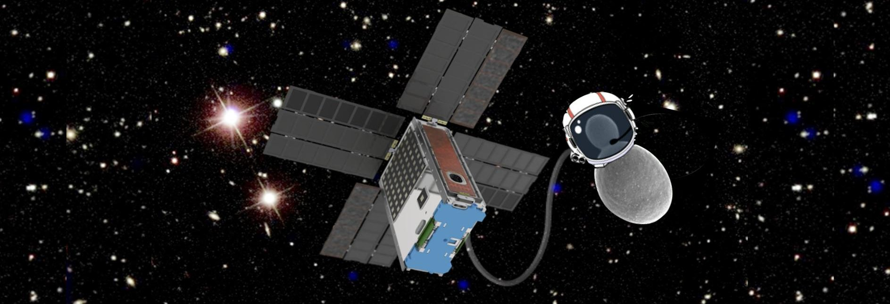

other significant evolutionary changes) pathway known as homologous recombination (HR). Essential to HR are the genes of the RAD52 epistasis group, which include a series of sensor and effector proteins, as well as a complex protein interaction network [8]. In higher eukaryotes like small animals and humans, ionizing radiation has additional complex effects, including but not limited to gross chromosomal aberrations that can lead to impairment of language, cognition, vision, cardiovascular damage, and cancer [4], [9].

## UNDERSTANDING BIOLOGICAL RADIATION EFFECTS TO ENABLE HUMAN EXPLORATION OF THE SOLAR SYSTEM BEYOND LEO

The 1972 Apollo-17 mission was not only the last to visit the Moon, it was also the longest time—12.5 days humans have ever remained beyond LEO. Studies comparing the effects of space radiation on modern LEO astronauts to Apollo-era beyond-LEO (bLEO) astronauts have found significantly increased cardiovascular disease and cataract development in the Apollo cohort, attributed to effects of bLEO ionizing radiation [10], [11].

In stark contrast to Apollo (and planned initial return missions to the Moon), future roundtrip Mars missions are slated to last up to three years. To prepare for such longduration missions and/or space habitation, current radiation-effects research involves the use of single- and mixed-ion species provided by particle-accelerator facilities, the lack of fidelity to space dose rate and energy distribution (see above) notwithstanding.

BioSentinel, Figure 1, will demonstrate how long-duration, deep-space nanosatellite $ ^{1} $ missions enable study of the effects of the bonafide space environment on living

organisms in order to inform countermeasures (i.e., therapies and strategies), both technological and biomedical, to help astronauts cope with the consequences of their environment in future missions to the Moon and deep space. BioSentinel's strategy is that of "the canary in the coal mine": assess health risk for long-duration human missions beyond LEO using a model organism with important similarities to humans, in this case the rate at which DNA double-strand breaks are created and how effectively they are repaired.

BioSentinel's payload will carry the model eukaryote Saccharomyces cerevisiae (S. cerevisiae), or budding yeast. Strong conservation of gene function between yeast and humans is the primary reason for this microbe's relevance to understanding human well-being in space; this genetic overlap is highlighted by the fact that a significant number of essential yeast genes are so similar to those of humans that they can be replaced by their human counterparts [12]. Yeast cells will be loaded into microfluidic "minicards" and launched into deep space in a dormant, desiccated state. Once BioSentinel reaches heliocentric orbit, the yeast cells will be activated over a series of time points in order to investigate how these cells respond to the DNA damage generated by deep-space ionizing radiation as a function of the total dose received and its accompanying radiation spectrum.

S. cerevisiae was selected for BioSentinel not only for its similarity to human cells, especially in the repair of DSBs via the HR pathway, but also for its spaceflight heritage [13], [14] and facile genetic manipulation. Moreover, budding yeast can be desiccated and remain dormant for long periods of time. Two yeast strains will fly aboard BioSentinel, a wild-type and a mutant, the latter defective in its DNA repair capabilities: its RAD51 gene, which expresses the Rad51 recombinase protein—an essential component of DSB HR repair—has been deleted. While the wild-type strain is proficient in DNA repair and represents a healthy control, the so-called rad51 $ \Delta $ mutant does not effectively repair damage caused by ionizing radiation. Thus, by determining the dependence upon overall radiation exposure history of viability differences between the mutant and

<!-- PDF_PAGE: 3 -->

Table 1.

<table border="1"><tr><td rowspan="2">Orbit</td><td rowspan="2">Altitude(from Earth&#x27;s surface,km)</td><td rowspan="2">Inclinationa</td><td rowspan="2">Orbital period about Earth</td><td rowspan="2">Particlee radiation sources</td><td colspan="2">Shielding-dependent monthly radiation dose rangeb(Gy)</td></tr><tr><td>1mmc</td><td>5mmc</td></tr><tr><td>LEO</td><td>300-2000</td><td>0°-55°</td><td>90-127min</td><td>e-，p+</td><td>0.0061-660</td><td>0.0041-36</td></tr><tr><td>ISS in LEO</td><td>330-435</td><td>51.6°</td><td>91-93min</td><td>e-，p+</td><td>5-30</td><td>0.34-0.020</td></tr><tr><td>High-inclinationLEOd</td><td>400-2000</td><td>65°-115°</td><td>92-127min</td><td>e-，p+，GCRs，SEPs</td><td>40-1500</td><td>0.69-140</td></tr><tr><td>Sun-synchronousLEO,incl. polar</td><td>400-1000(typical)</td><td>~98°and others</td><td>92-105min</td><td>e-，p+，GCRs，SEPs</td><td>40-180</td><td>0.86-10</td></tr><tr><td>Lunar orbitf</td><td>perigee:363104apogee:405700</td><td>5°</td><td>27d</td><td>GCRs，SEPs，n0</td><td>7.7-96</td><td>0.38-15</td></tr><tr><td>Interplanetaryspaceg</td><td>&gt;~100000</td><td></td><td>N/A</td><td>GCRs，SEPs</td><td>11-140</td><td>0.55-21</td></tr></table>

$ ^{a}0^{\circ}-90^{\circ} $ inclinations are prograde orbits; $ 90^{\circ}-180^{\circ} $ are retrograde orbits. $ ^{b} $ Assuming an exposure over a solid angle of $ 4\pi $ steradians for 30 days, midway between solar minimum and maximum; dose can vary widely due to solar activity. Data sources and models are described in [2]. $ ^{c} $ Shielding expressed as equivalent thickness of aluminum. $ ^{d} $ Includes orbits near latitudes of Arctic/Antarctic circles, including polar and near-polar orbits. $ ^{e} $ Predominant sources; $ e^{-} $ = electrons, $ p^{+} $ = protons, $ n^{0} $ = neutrons; GCR = galactic cosmic ray; SEP = solar energetic particle. $ ^{f} $ Radiation estimates are for a 50-km lunar orbit about the Moon with a 113-min orbital period. $ ^{g} $ Generally representative of transit to a variety of locations around the solar system, including Mars, its moons, the moons of Jupiter, and various near-Earth objects.

wild-type strains, the effects of radiation upon the DNA DSB repair process can be monitored.

## INTRODUCTION TO THE SCIENCE MEASUREMENTS OF BIOSENTINEL

NASA's BioSentinel mission is the first step in an emergent effort to understand the impacts of the deep-space environment in situ by sending terrestrial organisms to live beyond the radiation shield of Earth's magnetic field and monitoring their responses. The BioSentinel Nanosatellite, a 6U

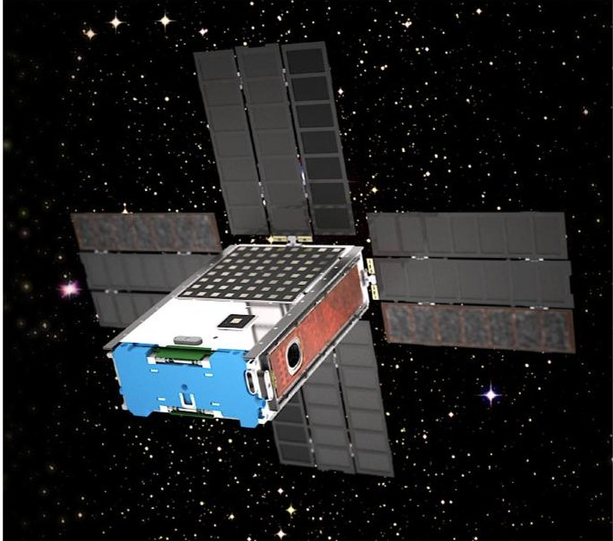

Figure 1. Solid model of BioSentinel 6U nanosatellite in interplanetary space.

deep-space cubesat housing microorganisms grown and characterized as a function of the type and amount of radiation to which they are exposed over a duration of three to nine months in space, is due to launch in 2020. It is the sole biological mission among the secondary payloads on NASA's Artemis-1, planned to be carried into space by NASA's Space Launch System (SLS). Upon ejection from the launch vehicle upper stage following Orion capsule separation, BioSentinel will be deployed on a trajectory that results in a lunar flyby leading to a (permanent) heliocentric orbit well beyond Earth's magnetic field and radiation belts. A companion mission scheduled to operate in LEO aboard the International Space Station (ISS), safely within the geomagnetic field, along with an identical ground-control payload, will enable comparison of the radiation environments of deep space, LEO, and Earth; the three locales also provide controls for effects related to two gravitational environments, i.e., micro-g (on ISS and the BioSentinel Nanosatellite) and terrestrial gravity.

The comparative rates of growth and metabolism of specimens of radiation-sensitized and wild-type yeast will be assessed in BioSentinel's first payload, a microfluidicsenabled system with independent temperature-controlled culture microwells. Multiple replicate cultures of both strains are loaded and dried in the microwells in microfluidic minicards prior to flight, then activated over a series of timepoints spanning the mission duration. Until the time of their growth, each grouping of microwells is maintained in a state of low-humidity, low-temperature stasis—much as baker's yeast are preserved in the refrigerator—to promote

<!-- PDF_PAGE: 4 -->

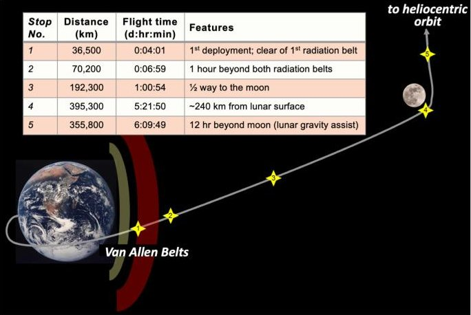

Figure 2.

ICPS trajectory with deployment stops. BioSentinel will deploy at stop no.1.

longevity. Once activated-by warming to near room temperature and adding liquid growth medium laced with metabolic-activity-indicating dye-the microwell-contained yeast cultures will be individually monitored for growth and metabolism using transmitted light at three wavelengths.

To record the concurrent "space weather"—timevarying details of the ambient radiation environment BioSentinel's second payload is a physical radiation spectrometer that includes a dosimeter function. It will characterize the linear-energy-transfer (LET) characteristics of individual radiation events in real time in addition to measuring total ionizing dose (TID). BioSentinel will thus permit the first direct, time-resolved, in situ correlation of measured biological responses with physical radiation dosimetry and spectroscopy in deep space.

In the following pages, we report the design, development, and integration details of BioSentinel, along with its mission design and plan for operations.

## THE BIOSENTINEL MISSION AND SPACE ENVIRONMENT

The SLS Artemis-1 vehicle will carry 13 6U nanosatellites as secondary payloads, all mounted between the Interim Cryogenic Propulsion Stage (ICPS) and the Orion crew vehicle. SLS is designed to deliver astronauts to locations such as Mars, the moon, asteroids, and Earth's Lagrange (libration) points. Artemis-1's objective is to deliver the (uncrewed) Orion capsule to a circumlunar trajectory, with Orion returning on its own to Earth after $ \sim 2 5 $ days. After Orion separates, a disposal maneuver is performed by the SLS upper stage to place it in a heliocentric orbit without risk of future collisions with Earth, the moon, or spacecraft orbiting either one. Upon completion of this maneuver, the secondary nanosats will deploy from the upper stage over a period of several days at multiple "bus stops," Figure 2. BioSentinel will deploy at the first opportunity (4 h after launch), some 37 000 km from Earth, in the outer Van Allen radiation belt; its trajectory from there takes it to a $ \sim 7 0 0 $ km lunar flyby, then a stable

heliocentric orbit that differs from Earth's by a few percent. BioSentinel will progressively separate further from Earth over time due to its different orbital radius. This relative motion results in BioSentinel-to-Earth ranges at the 6-month nominal mission duration of $ \sim 0. 2 $ astronomical units (AU) from Earth and $ \sim 0. 4 $ AU (60 million km) at its 9-month extended mission duration. BioSentinel's science goals require only that it be in an orbit outside the protective benefit of Earth's magnetic field, so no course-altering maneuvers after deployment are required.

BioSentinel is expected to provide a "quiet" microgravity environment, a state of orbital freefall. Relative to ISS, with its movements of crew and operation of life-support and other machinery, perturbations to microgravity by vibrational or inertial acceleration will be few and minor aboard BioSentinel: initial detumbling after deployment; occasional micropropulsive desaturation of reaction wheels; the reaction wheels themselves; and, for durations of a few minutes at a time, opening and closing of miniature fluid valves and operation of a miniature peristaltic pump. Most of the time, the spacecraft will maintain a relatively constant orientation with solar panels facing the sun and its "cold side" (see below) in shadow; the satellite will reorient to point its antennae towards Earth during communications passes.

The anticipated total-dose radiation environment for BioSentinel has two components: galactic cosmic radiation (GCR), estimated at 6.9 cGy over 6 months, and SPEs, which must be estimated probabilistically due to the unpredictability of the sun, in particular the number and magnitude of SPEs it generates in any particular time period [15]. For example, there is a 50% probability, for a shielding thickness equivalent to 3.7 mm (or 1 g/cm $ ^{2} $ ) of aluminum, of a TID of at least 13 cGy being delivered to the payloads by SPEs; there is a 25% chance they will receive at least 50 cGy and 10% chance of 150 cGy from SPEs [15]. At the opposite end of the probability scale, the dose from SPEs becomes insignificant relative to the (invariant) GCR contribution. Thus, the anticipated TID over 6 months can be summarized as a range from 7 to 160 cGy with the corresponding probability ranging from 100% to 25% confidence. While the biological science experiment cannot rely upon TID in excess of $ \sim10 $ cGy to produce measurable results, the electronics must be designed to survive $ >7 $ Gy without loss of function (typically multiplied by two for margin).

Finally, note that the GCR contribution is due to multiple high-energy ions, each with a range of LETs; those that do the most biological damage (highest dose-equivalent rates) are Fe > H > He $ \sim $ O $ \sim $ Si $ > $ Mg. SPE contributions are largely from energetic protons.

## THE BIOSENTINEL SPACECRAFT AND BUS

An exploded view of the BioSentinel spacecraft, Figure 3, shows the key components of the bus, structure, and two

<!-- PDF_PAGE: 5 -->

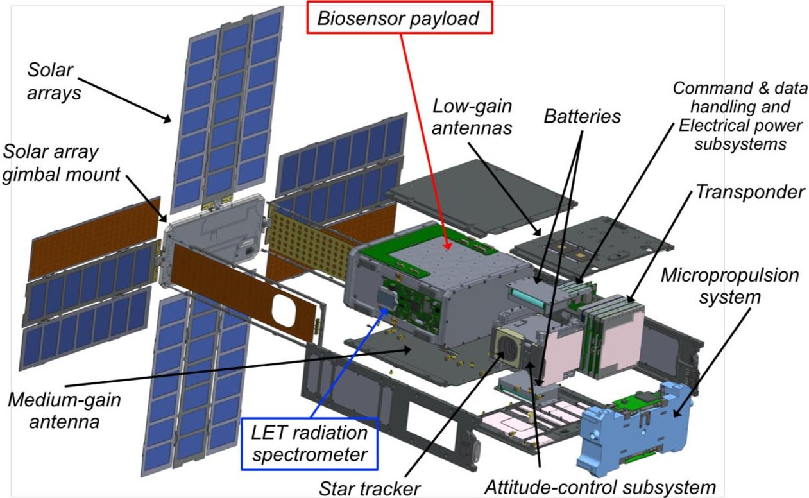

Figure 3. Exploded view of the 14-kg 6U BioSentinel spacecraft.

payloads. The spacecraft builds upon the heritage of Ames Research Center's (ARC's) series of successful nanosatellite missions [14], [16] $ - [20] $ , as well as the lunar atmosphere and dust environment explorer (LADEE) mission [21]. The spacecraft allocates a 4U volume to the payloads. While BioSentinel and the other Artemis-1 secondaries are nominally 6U, the actual outer dimensions of these spacecraft must conform to the specifications of the Planetary Systems Corp. 6U "canisterized satellite dispenser" [22]: BioSentinel measures 11.4 x 23.9 x 36.5 cm, nearly 10 L. Thus, the biological and radiation payloads together occupy $ \sim 4.3 $ L, while everything else in Figure 3 fills the remaining $ \sim 5.6 $ L.

The spacecraft's 3-axis-control system includes three orthogonal reaction wheels and a micropropulsion unit for momentum management. A coherent X-band transponder provides command, data, and ranging capabilities. Deployed solar arrays provide power for processing, communications, and the payloads, including thermal control. The structural subsystem leverages the biological payload ("biosensor") hermetic containment to minimize mass as well as distribute heat. Thermal control uses a cold-biased approach with heaters, sensors, and passive emissivity-control coatings.

## ATTITUDE-DETERMINATION-AND-CONTROL SUBSYSTEM (ADCS) AND PROPULSION

The BioSentinel ADCS must detumble the spacecraft after deployment, orient solar arrays toward the sun, point communications antennae towards Earth, keep the "cold side" of the payload in shadow, and support a robust safe mode,

performing all these functions autonomously. Typical LEO cubesat control solutions are not applicable, as no magnetic field or GPS signals are available for most of the mission.

The BioSentinel ADCS is built around the Blue Canyon Technologies (BCT) XACT 3-axis Integrated Attitude-Control System which contains reaction wheels for primary orientation control, a 3-axis inertial measurement unit, and a star tracker for attitude determination. In addition, five sun sensors from SolarMEMS Technologies support initial deployment and safe mode, and a 7-nozzle three-dimensional-printed propulsion subsystem from Lightsey Space Research provides momentum management and detumble. An extended Kalman filter based on LADEE software provides knowledge estimation, easily meeting the 5 $ ^{\circ} $ pointing-accuracy requirement for solar array and antenna orientation. An example of detumble analysis for BioSentinel's ADCS is shown in Figure 4.

Because no propulsive maneuvers are required for Bio-Sentinel to attain its mission orbit, a propulsion system might seem superfluous. Tipoff analyses using typical rates showed, however, that reaction wheels would saturate during detumble, and could also saturate later in the mission due to pointing operations. The cold-gas propulsion system with integral propellant (hexafluoropropane) tank was therefore added for momentum management, both for initial detumbling and desaturating reaction wheels later in the mission.

## COMMUNICATIONS

The BioSentinel communications system will receive commands, transmit telemetry to the ground, and support navigation and ranging functions. Based on spectrum-

<!-- PDF_PAGE: 6 -->

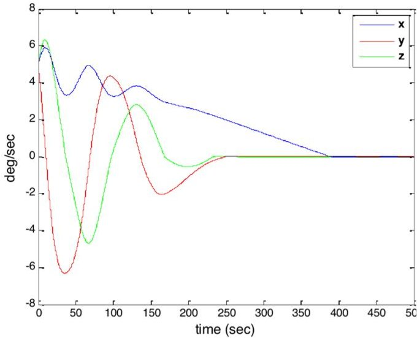

Figure 4. BioSentinel detumble calculation shows full stabilization in under 7 min.

management recommendations relevant to travel beyond lunar distances, BioSentinel uses a coherent X-band transponder, the Jet Propulsion Lab (JPL)-developed Iris CubeSat Deep-Space Transponder. Two patch antennae, one omnidirectional and one medium gain (MGA; 23 dB gain) on opposite faces of the spacecraft provide communications coverage over a large majority of directions around BioSentinel.

Using the MGA-Iris combination, calculations show that BioSentinel will close data links to 34-m deep space network (DSN) ground stations at data rates of 62.5-8000 b/s over its mission lifetime. BioSentinel plans once-daily use of DSN assets for 45 min per pass to retrieve mission science, health-and-status, and performance data and to uplink commands.

## STRUCTURES AND THERMAL-CONTROL SYSTEM (TCS)

The BioSentinel structural system builds upon designs from two nanosats, SporeSat and EcAMSat [18] -[20]. Aluminum structural panels are joined to the biosensor payload canister and to frames holding the electronic components within the system. The interfaces are tailored using various resilient thermal pad (Gap Pad from Bergquist/Henkel) thicknesses or conductive (Al) or isolating (Ultem) custom spacers/washers to meet thermal system requirements.

The BioSentinel TCS design approach is to cold bias the payload, using passive coatings and interface materials to the extent possible, with heaters added for feedback-based control. Silvered poly(tetrafluoroethylene) (PTFE) or fluorinated ethylene propylene (FEP) tapes / coatings provide surface radiative property control; insulating or conductive gaskets are used for interface thermal control. The BioSentinel bus is designed to operate from 0 to $ 7 0^{\circ} \mathrm{C} $ . Under nominal mission operational

conditions, the biosensor payload is maintained between 8 and $ 1 6^{\circ} \mathrm{C} $ (see Biosensor Implementation for more payload thermal details). The absence of a central suneclipsing body in BioSentinel's trajectory allows temperatures to approach steady-state conditions: thermal fluctuations are driven primarily by component duty cycles rather than eclipse, infrared energy, or albedo from a central body.

## COMMAND AND DATA HANDLING (C&DH) AND FLIGHT SOFTWARE (FSW)

The BioSentinel C&DH system, designed for reliable, cost-effective control of spacecraft functions for at least one year in deep space, leverages LADEE FSW heritage. This subsystem, provided by Space Dynamics Laboratory, comprises a single-board computer (SBC) and an integrated expansion card (IXC). At the heart of the SBC, there is a UT700 LEON 3 fault-tolerant processor, with SDRAM (256 MB, with EDAC (error detection and correction)), $ 2 \times 2 $ MB MRAM (magnetoresistive RAM), and 8 GB of flash memory with EDAC. The SBC and IXC are connected via SpaceWire interface; the SBC also has an ethernet interface to facilitate communication during preflight testing. The IXC board supports a field-programmable gate array connected to the various communication interfaces of the satellite (RS422, SpaceWire, SPI). These communication channels will connect to the bus subsystems described above as well as the LET spectrometer and biosensor payloads. The spacecraft begins to operate in space after a redundant pair of deployment-detection switches triggers a delay timer; following the delay period, the C&DH is powered ON, initiating the preprogrammed operational sequence.

BioSentinel uses the FSW base developed for LADEE, built using "Model-Based Software Development": high-level spacecraft and FSW models were developed in a dynamic package, in this case Mathworks' Simulink; FSW requirements were then prototyped and refined using the simulated models. After proving the model in this simulation framework, "C"-code software was automatically generated from the models. The models used information from BioSentinel's system interface control documents to automatically populate tables used by the software with such parameters as mnemonics, sensor mapping, calibration curves, and battery charge curves, among others.

A template for MathWorks' Target Language Compiler, developed in an ARC/MathWorks collaboration, tuned specified Simulink input and output ports to the message structures of NASA Goddard Space Flight Center's (GSFC's) open-source software, core Flight Executive (cFE). It also created a C-header file that defines

<!-- PDF_PAGE: 7 -->

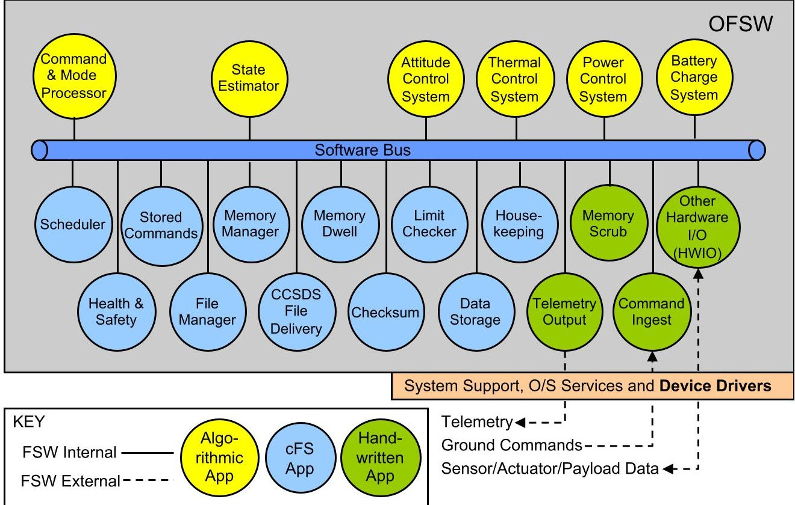

Figure 5.

Biosentinel FSW architecture (CCSDS is the consultative committee for space data systems; OFSW is operational FSW).

message interfaces and entry points along with specific data structures and macros that identify key functions. The autogenerated code was then integrated with the cFE/core Flight System/Operating System Abstraction Layer Government off-the-shelf components developed at GSFC. VxWorks is the underlying Real Time Operating System; commercial off-the-shelf board support packages were re-used for the LEON 3 flight processor. The generated software was then tested on workstation simulators as well as real-time processor-in-the-loop and real-time hardware-in-the-loop (HIL) testbeds. Transportable HIL testbeds were taken to vendor sites to perform early interface development testing with the propulsion system, transponder, and ADCS. Early iteration in the development cycle allows rapid testing and capability development of the software and vehicle models. The BioSentinel FSW architecture is shown in Figure 5.

## ELECTRICAL POWER SYSTEM (EPS) AND SOLAR ARRAYS

BioSentinel's EPS design, developed by ARC, satisfies three primary requirements: to provide adequate electrical power for all electrical services, to provide systems compatible with launch safety, and to provide hardware compatible with the selected C&DH system. The primary load on the BioSentinel system is the Xband transponder. The EPS controller board provides regulated 3.3 and 5 VDC and unregulated 9 ~ 18.5 VDC. It includes a TI-MSP430 FRAM microcontroller

and temperature, voltage, and current monitoring, with RS-422, $ \mathrm{I}^{2} \mathrm{C} $ , SPI, and analog/digital input/output interfaces and maximum-power-point tracking. The power switch board includes an expandable power MOSFET switch, SPI current monitoring of all channels, an $ \mathrm{I}^{2} \mathrm{C} $ temperature sensor, and soft-start capability. The two battery packs are 3S2P Panasonic NCR18650B Li-ion batteries, 3.35 A-h/cell, the highest energy density available at time of design and appropriate for spaceflight use. Selected by at least two other Artemis-1 nanosatellites (Lunar Flashlight and NEA Scout), these battery packs include over-voltage, over-discharge, and over-current protection; in addition to LEO cubesat heritage on the O/OREOS and EcAMSat missions [17], [19], [20], they have been used in Tesla and Prius automobiles.

The four HaWK solar arrays are from MMA Design with an RS-422 interfaced gimbal system (see Figure 3). Power is generated by Spectrolab 28.3%-efficient, triplejunction solar cells. The four arrays produce $ \sim 6 8 $ W at $ 5 0^{\circ} \mathrm{C} $ at beginning of life.

## THE BIOSENTINEL SCIENCE PAYLOADS

## BIOSENSOR SCIENCE APPROACH

The primary science objective of the mission is to measure the DNA damage response to deep-space radiation in a biological organism, which requires an appropriate test

<!-- PDF_PAGE: 8 -->

Table 2.

Biology Testing Performed in Preparation for BioSentinel Artemis-1 Mission

<table border="1"><tr><td>Test</td><td>Duration</td><td>Additional details</td></tr><tr><td>Long-term yeast desiccation</td><td>&gt;2 years</td><td>Tested multiple strains and drying methods for both cell survival and impact on metabolic activity</td></tr><tr><td>Long-term reagent storage</td><td>&gt;2 years</td><td>Tested stability of growth medium and optical properties of alamarBlue* dye in flight-like fluidic bags</td></tr><tr><td>Long-term biocompatibility</td><td>&gt;2 years</td><td>Yeast cells stored in flight-like fluidic minicards with materials selected for flight, then tested for viability and metabolic activity</td></tr><tr><td>Ionizing radiation sensitivity</td><td>N/A</td><td>Performed strain sensitivity (desiccated and in liquid suspension) to different sources of ionizing radiation, including gamma rays, protons, heavy ions, SPE simulations, and GCR simulations</td></tr><tr><td>alamarBlue* effects on biology</td><td>N/A</td><td>Tested effects of various concentrations of alamarBlue on cell growth and metabolic activity to select best mixing ratio of aB and medium</td></tr><tr><td>Sterilization method selection</td><td>N/A</td><td>Tested effects of multiple sterilization methods on materials and biology, including autoclaving, ethylene oxide, electron-beam sterilization</td></tr><tr><td>Temperature and humidity effects on biology</td><td>N/A</td><td>Tested potential flight and pre-launch environmental effects on yeast cells</td></tr></table>

$ ^{*} $ alamarBlue (aB) is a metabolic activity reporting dye (see below).

subject; the reasons for choosing S. cerevisiae are outlined above. Strain selection was then driven primarily by sensitivity to ionizing radiation and tolerance to desiccation. Because sensitivity of wild-type yeast to the anticipated total radiation doses anticipated is little or none, we chose a wild-type diploid strain as the control. To complement the wild type, a mutant strain carrying a deletion of the RAD51 gene, denoted rad51 $ \Delta $ , was chosen because this renders the cells sensitive to ionizing radiation that causes DSBs. Except for the RAD51 gene deletion, the two strains share the same genotype and are prototrophs: they have the same growth requirements and can produce the same set of vital amino acids. Diploid strains were chosen over haploids because the HR pathway is always used for DSB repair in diploids [23], and because they can better tolerate desiccation (our unpublished observations).

To store the yeast in stasis for the prelaunch period and during spaceflight until growth of a given culture microwell, a variety of drying methods and drying buffers, including air-drying, vacuum-drying, and freeze-drying (lyophilization) were tested [24]. Of these approaches, airdrying under ambient conditions, drying from yeast suspended in 10% trehalose-and-buffer solution, resulted in the greatest survival over a long time period [24]. This and additional critical tests are summarized in Table 2.

To characterize the radiation response of the wild-type and rad51 $ \Delta $ mutant strains, a series of defined exposures was performed at various ground facilities, including

NASA ARC (gamma rays), Loma Linda University Medical Center (protons and SPE simulations), and at the NASA Space Radiation Laboratory at Brookhaven National Laboratory (heavy ions and galactic cosmic ray simulations). Cells were exposed both in desiccated state and in liquid suspension; their subsequent growth and metabolic activity were tracked, the latter using the metabolic indicator dye alamarBlue in synthetic complete (SC) growth medium. alamarBlue is a redox-reaction-based dye that serves as a metabolism and cell-heath indicator: it changes from blue to pink (and eventually turns colorless) due to reduction by various enzymes and cofactors, such as NADH and FADH, produced by cells of all types. Typical results for cell growth and responses to low doses of high-energy ionizing radiation are shown in Figure 6.

## BIOSENSOR IMPLEMENTATION

BioSentinel's radiobiological experiment utilizes multiple independently activated sets of 32 microfluidically serviced microwells to monitor DNA DSBs, comparing their impact on the viability of the radiation-sensitized mutant to the self-repair-competent wild-type yeast. This is accomplished by optically monitoring the growth and metabolic activity of multiple microwell-contained cultures, generally 16 microwells each of wild-type and rad51 $ \Delta $ mutant per measurement timepoint.

<!-- PDF_PAGE: 9 -->

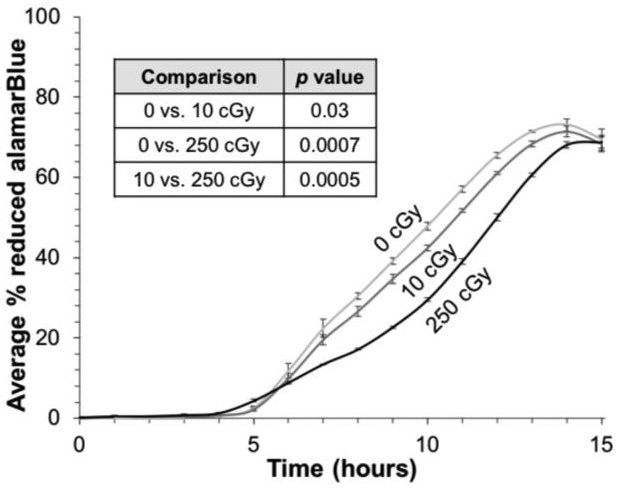

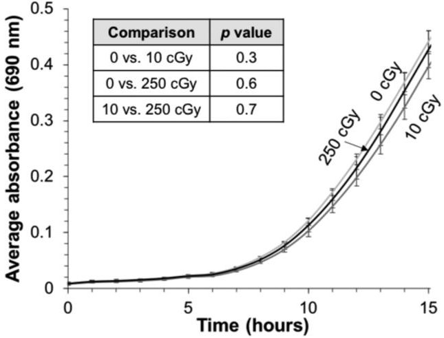

Desiccated yeast are sensitive to low doses of deep-space-relevant ionizing radiation. Dried wild-type cells were irradiated with 0,1, or 250 cGy of 1 GeV protons at the NASA Space Radiation Laboratory at Brookhaven National Laboratory. Cells were then rehydrated and grown in SC medium containing alamarBlue. Top: Average percent reduction of aB for three replicate cultures per dose; bars are $ \pm $ one standard deviation. The slopes of the curves between 7% and 52% aB reduction were determined and compared (Student's t-test); wild-type cells exhibit a statistically significant （ $ p<0.05 $ ）dose-dependent metabolic response to ionizing radiation. Bottom: Average absorbance (OD, or turbidity) at 690 nm of three replicate cultures per dose; bars are $ \pm $ one standard deviation. The slopes of the curves between OD690 values of 0.1 and 0.5 were determined and compared (Student's t-test); growth curves of wild-type cells are not significantly altered （ $ p>0.05 $ ）due to radiation exposure, despite the metabolic differences observed in the same cultures.

Figure 7 shows one of BioSentinel's 18 microfluidic minicards, fabricated by precision machining, laser and blade cutting, and lamination with pressure-sensitive adhesive (PSA). Each microwell is 3.5 mm in diameter $ \times $ 10 mm deep, a contained volume of 100 $ \mu $ L/well and an optical pathlength of 10 mm. The central minicard body (in white, exploded view, Figure 7) is machined polycarbonate; impermeable covers (lavender) are the poly(cycloolefin) "Zeonor"; acrylic PSA (bright green), from 3M's VHB family, maintains its bond strength at temperatures above $ 130^{\circ} \mathrm{C} $ . Integral "track-etched" (Whatman Nucleopore) translucent polycarbonate membranes (pink in Figure 7) provide crosstalk-free inlet/outlet filtration,

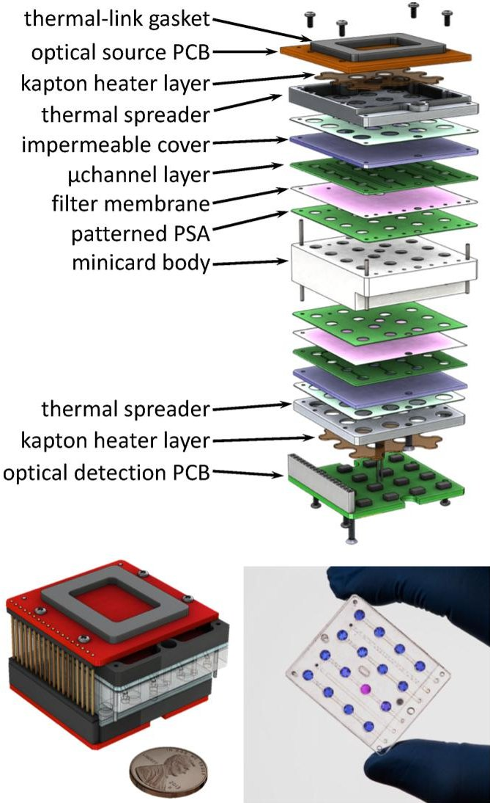

Figure 7. Exploded (top) and assembled (lower left) views of the microfluidic minicard with integral thermal control and optical measurement components. Bottom right: photo of a fluidic minicard; 15 microwells contain aB and one contains the same dye that has turned pink (has been biochemically reduced) due to yeast metabolic activity.

confining the yeast cultures to their respective microwells while permitting initial microwell filling from the dry state via displacement of air, exchange of medium, and precision optical absorbance measurements. These membranes have 0.2- or 1.0- $ \mu $ m diameter pores; one common layer covers the tops of the minicard microwells and a second common layer, the bottoms. The material choices, particularly the PSA, permit the entire fluidic minicard to be sterilized by autoclaving at $ 121^{\circ} \mathrm{C} $ , a process not typically possible for thermoplastic microfluidic devices, but one that is simple, provides reliable sterility, and leaves no cell-detrimental residues. Fluidic minicard materials and processes have all been extensively tested for long-duration biocompatibility (see Table 2).

Figure 8, a cross section of a single fluidic well, shows the optical measurement and thermal-control components. Three surface-mount LEDs provide illumination (570, 630, and 850 nm, sequentially); absorbances are calculated from the output of a dedicated intensity-to-frequency light sensor (ams/TAOS) at each well (the optical system

<!-- PDF_PAGE: 10 -->

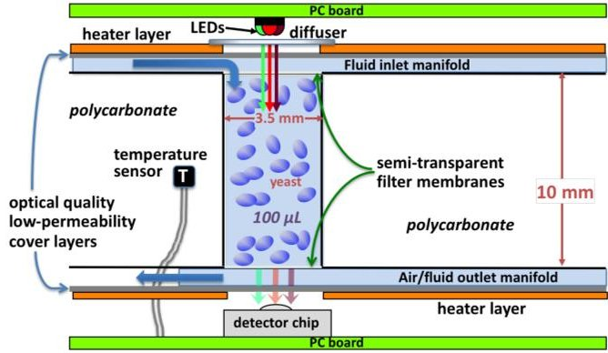

Figure 8. Cross section of one 100- $ \mu\mathrm{L} $ fluidic microwell with integral filter membranes and connecting microchannels. Introduction of growth medium displaces air through porous membranes; yeast dried on walls then grow and bud. Three LEDs per well, with intervening thin-film diffuser, provide green, red, and near-infrared illumination to monitor metabolic activity and track yeast growth via detector at bottom of microwell. Patterned metal-on-kapton heaters with aluminum thermal spreader plates maintain uniform, stable growth temperature $ (23\pm1^{\circ}\mathrm{C} $ or better) via closed-loop control with an embedded Pt resistance-temperature device.

has no moving parts). Minicard cover layers are 1-mmthick injection-molded Zeonor plaques; besides providing optical-quality surfaces for absorbance measurements, the burr-free edges of these plaques promote leak-free, longlifetime PSA bonding to the minicard.

To ensure maximal viability of budding yeast extending through the entire prelaunch period and spaceflight mission, cells are subjected to an optimized desiccation process that uses standard sterile technique. Each strain is first grown in nutrient-rich medium for up to seven days, preconditioning the cells for desiccation [24]. Next, the cells are counted under a light microscope using a hemocytometer chamber to determine culture density, then resuspended in 10% trehalose, a disaccharide that promotes desiccation tolerance in a range of organisms, including budding yeast [25]. A known number of yeast cells in a small liquid volume is then loaded into 15 of the 16 microwells of each fluidic minicard-one microwell serving as a control—and allowed to air dry for one week. The dried yeast in their minicards are sealed in a sterile environment and stored in a low-humidity environment until ready for payload integration.

When properly dried, yeast can survive for months to years. This is critical because the fully integrated BioSentinel spacecraft will be delivered to the launch provider up to one year prior to launch; also, the mission itself has a nominal six-month duration, with a possible extension to nine months, and one or more minicards will be activated (their yeast cultures will be grown) near the mission's end in either case.

A total of 18 sealed minicards are integrated with two fluid-supply manifolds, one of which is shown in Figure 9, in preparation for laboratory and spaceflight testing. Each manifold provides fluidic in/out connections, houses

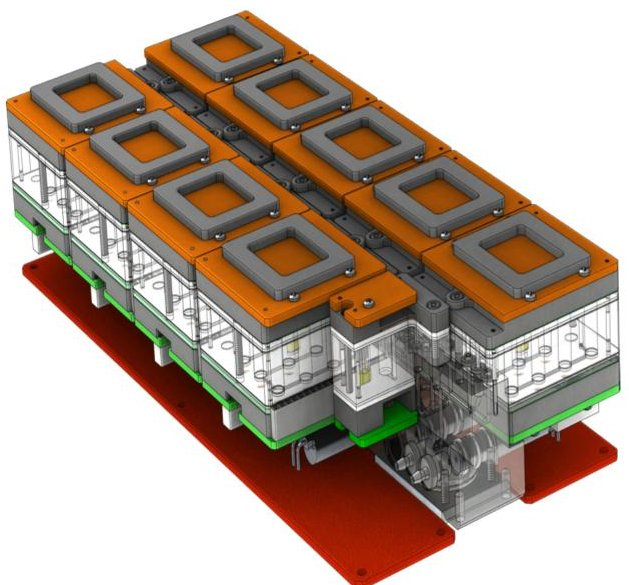

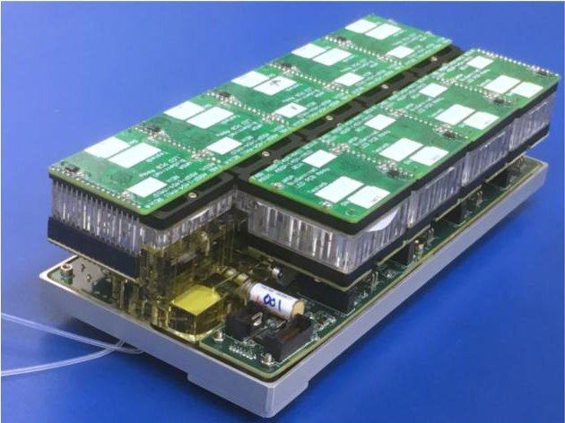

Figure 9. Solid model (top) and photograph (bottom) of nine 16-microwell fluidic minicards integrated and manifolded together for spaceflight; two such sets (288 microwells in total) will be included in the hermetically sealed 4.3-L biopayload container of Figure 3.

solenoid valves and check valves, and supports an optical calibration cell, visible at the near end of the lower bank of minicards at left, that records the absorbance of the aB/ SC mixture to confirm the dye concentration and provide an optical calibration datum at all three wavelengths for each minicard upon filling.

The entire system is integrated, including reagents and media contained in FEP bags (American Fluoroseal/Saint Gobain), an integrated fluid-delivery system, control electronics, and MEMS pressure (Freescale) and humidity (Bosch BME280) sensors. The integrated biosensor system is sealed inside a hermetic biopayload container.

The 18 16-well fluidic minicards will be activated in pairs across the six- to nine-month mission in deep space in order to quantify time-dependent accumulated DNA DSBs. Fluid filling and metering are accomplished by a miniature peristaltic pump (Takasago) and 3-way solenoid valves (Lee Co.).

To help ensure the longevity of the dried yeast while awaiting activation, BioSentinel includes a "refrigeration" feature, enabled by the cold-bias approach described

<!-- PDF_PAGE: 11 -->

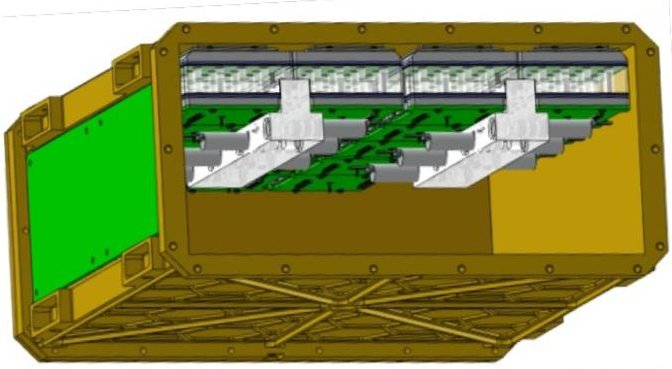

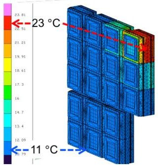

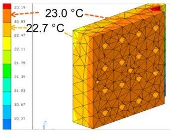

Figure 10. Top: Solid model showing fluidic minicards, with attached PC boards and manifolds, mounted against the interior "cold face" of the biosensor hermetic container. Lower left: Thermal model of 18 minicards with just one card heated to the $ 2 3^{\circ} \mathrm{C} $ yeast growth temperature. Lower right: Thermal uniformity of one heated minicard shows that regions with yeast-containing microwells are within $ 0.3^{\circ} \mathrm{C} $ of the setpoint.

above for the entire spacecraft. Close thermal contact is maintained between the yeast-containing microfluidic minicards, each topped by a conformal thermally conductive gasket (Figures 7 and 9, dark gray open squares) pressed into contact with the inside face of the biosensor payload hermetic container, and the "dark side" of the spacecraft (see Figures 1 and 3), deliberately pointed away from the sun and shaded by the solar panels. Thermal modeling indicates a temperature of $ \sim 8-1 6^{\circ} \mathrm{C} $ can be maintained (dependent on the phase of the mission and the duration and recency of transponder operation) within the unheated minicards—which are monitored and heated only if necessary to avoid freezing. Only minicards with actively growing yeast (no more than two of the 18 at any given time, facilitating power management) are thermostatted at the $ 2 3 \pm1^{\circ} \mathrm{C} $ growth temperature; the expected uniformity for a single heated minicard is shown in Figure 10.

## BIOSENSOR LABORATORY TEST RESULTS

Figure 11 shows biological growth and metabolism results from laboratory testing of a flight prototype of the integrated optical/fluidic/bioanalytical system. The results are for wildtype yeast grown in SC medium at room temperature in the presence of "1x" aB viability dye. As growth progresses, green absorbance increases as the bright pink

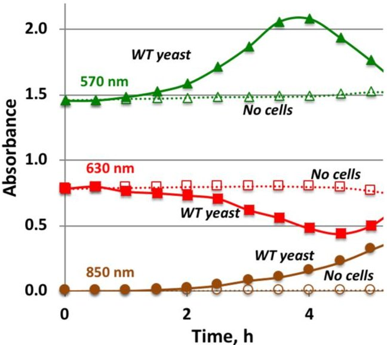

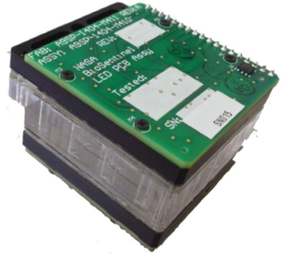

Figure 11. Growth curves (top) recorded using spaceflight optical/fluidic/ thermal prototype shown (bottom) for wild-type S. cerevisiae with added aB (filled symbols) and cell-free control microwells (open symbols); LED wavelengths as indicated.

color of reduced aB appears, then decreases as pink fades to colorless. Red absorbance decreases as the blue dye turns pink, then increases due to light scattering as the cell population grows. Near-IR absorbance (and scattering), unaffected by all forms of the dye, tracks cell population due to the linear relationship between turbidity and cell number. 16 such curves are produced simultaneously from each fluidic minicard in which yeast are growing.

The relatively gas-impermeable 1-mm-thick Zeonor well covers help ensure long-duration yeast viability: cells stay dry and are isolated from volatiles. However, this construction leaves only the oxygen dissolved in the medium to support yeast growth; it also means that $ \mathrm{C O_{2}} $ from respiring yeast can form bubbles once the buffer capacity (which at first converts $ \mathrm{C O_{2}} $ to soluble bicarbonate ion) has been exceeded. Fortunately, alamarBlue color changes along with measurable turbidity increases from the yeast occur, Figure 11, when $ \mathrm{C O_{2}} $ bubbles have yet to form (once such bubbles do form, the optical data become erratic).

<!-- PDF_PAGE: 12 -->

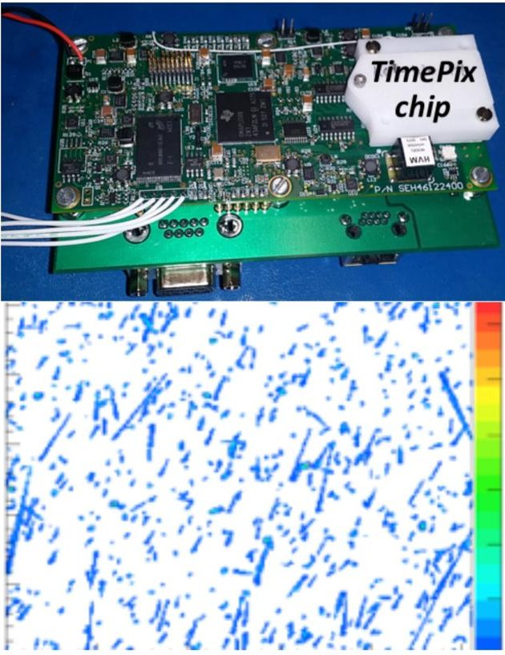

Figure 12. Top: Single-board TimePix-based LET spectrometer, including TID measure-and-store capability, from JSC-Radworks. Bottom: Typical radiation-event data frame recorded by the LET spectrometer; each locus of points is associated with the passage of a single particle or ray.

## LET RADIATION SPECTROMETER

Developed by the Johnson Space Center Radworks Group, BioSentinel's single-PC-board radiation spectrometer is based closely on a predecessor flown on the ISS as well as the first test flight of NASA's Orion capsule in 2014. The LET characteristics of a given particle "hit" are important because they describe the amount of energy the particle deposits as it traverses, e.g., a yeast cell: the units of LET are keV/ $ \mu $m, energy/distance.

On the spectrometer board, a charge-coupled Si device records the passage of each high-energy particle as a track or "blob" of pixels with accumulated charge (see Figure 12). The associated control-and-measurement electronics and software convert the track/blob data into the energy deposited by each high-energy particle per unit length of Si traversed, thus defining its potential to cause (biological) damage including DSBs. The sensor reports radiation over the 0.2 to 300 keV/$\mu$m LET range, the most relevant for biological damage in space, using an active chip volume of 59 $ \mu $L. On-board software computes the LET value of each radiation event (particle hit) and increments the count in an appropriate bin; each of the 256 counting bins is defined by an LET width $ \sim 2.9\% $ of its center value. The binned event counts are reported hourly to the spacecraft's C&DH system for storage and subsequent telemetry to Earth, providing an hourly "space weather report" of the types and numbers of ionizing

particles encountered by BioSentinel. The LET spectrometer also computes, stores in onboard nonvolatile memory, and reports received TID.

## CONCLUSIONS

Directly studying biology's response to the complex interplanetary space radiation environment has never been attempted apart from a few costly, human-operated bLEO missions, yet such studies are critical if humans are to travel beyond Earth's protective magnetic field for durations exceeding a handful of days. BioSentinel is the pathfinding instance of a class of robust, autonomous bioanalytical microsystems compatible with small satellites that are poised to change this paradigm.

## ACKNOWLEDGMENTS

We gratefully acknowledge useful discussions, scientific wisdom, and technical insights provided by Greg Nelson (Loma Linda University), John Game (Lawrence Berkeley National Laboratory and Stanford University, retired), Troy Harkness (University of Saskatchewan), and Roger Brent (Fred Hutchinson Cancer Research Center). We also acknowledge key inputs from our Independent Review Board: John Hines (ARC, retired), Darrell Jan (ARC), Judy Balance (NASA Marshall Space Flight Center), Tom Flatley (GSFC), Hoppy Price (JPL), Gary Ruff (NASA Glenn Research Center), and Kenny Vassigh (ARC). This work was supported by NASA's Advanced Exploration Systems Division in the Human Exploration and Operations Mission Directorate.

This article was prepared for Special Issue of IEEE Aerospace and Electronic Systems Magazine: EM-1 CubeSats.

The past and present members of BioSentinel Team include Nelson Abiva, Elwood Agasid, Chetan Angadi, Watson Attai, Erman Bastopcu, Steve Battazzo, Josh Benton, Nathan Benz, Sharmila Bhattacharya, Rich Bielawski, Justin Blaich, Travis Boone, Ben Bradley, Rick Brewster, James Chartres, Scott Christa, Lisa D'Amico, Neil Davies, Edmund Dela Cruz, Rodolfe De Rossi, Jon Dewald, Vihn Doan, Andres Dono Perez, Matt Dortenzio, Lance Ellingson, Doug Forman, Charlie Friedericks, Jesse Fusco, Diana Gentry, Shi Lei Han, Bob Hanel, Leonard Hee, Mike Henschke, Dzung Hoang, Jeff Homan, Liz Hyde, Luke Idziak, Aesim Jones, Fahrin Kabir, Ali Kashani, Dayne Kemp, Ben Klamm, Matt Knudson, Jonathan Kolbeck, Tony Koudsi, Vanessa Kuroda, Brian Lewis, Dongmeng Li, Lauren Liddell, Greg Limes, Mike Logan, Ed Luzzi, Terry Lusby, Tom Luzod, Nghia Mai, Vas Manolescu, Diana Marina, Eddie Mazmanian, Griffin McCutcheon, Dawn McIntosh, Mike McIntyre, Joel Mueting, Luke Murchison, Andrea Nazzal, Matt Nehrenz, Greg Nelson, Mike Padgen, Macarena Parra, Mario Perez, Craig Pires, Laura

<!-- PDF_PAGE: 13 -->

Plice, Abe Rademacher, John Rasmussen, Charlie Ricco, Tony Ricco, Dan Rowan, Tara Samuels, Hugo Sanchez, Sergio Santa Maria, Aaron Schooley, Kevin Seywald, Philip Shih, Mark Shirley, Matt Sorgenfrei, Terry Stevenson, Tore Straume, Ming Tan, Eric Tapio, Huyen Tran, Sofia Tieze, Stephen Walker, Shang Wu, Zion Young.

The members of JSC Radworks Group include Susan Gavalas, Bobbie Gail Swan, Scott Wheeler, Edward Semones.

## REFERENCES

[1] G. A. Nelson, "Space radiation and human exposures, a primer," Radiat. Res., vol. 185, pp. 349-358, 2016.

[2] H. Cottin et al., "Space as a tool for astrobiology: review and recommendations for experimentation in earth orbit and beyond," Space Sci. Rev., vol. 209, pp. 83-181, 2017.

[3] C. La Tessa, M. Sivertz, I. H. Chiang, D. Lowenstein, and A. Rusek, "Overview of the NASA space radiation laboratory," Life Sci. Space Res., vol. 11, pp. 18-23, 2016.

[4] G. A. Nelson, "Fundamental space radiobiology," Gravitational Space Biol. Bull, vo. 16, pp. 29-36, 2003.

[5] J. Kiefer, R. Egenolf, and S. Ikpeme, "Heavy ion-induced DNA double-strand breaks in yeast," Radiat. Res., vol. 157, pp. 141-148, 2002.

[6] T. C. Akpa et al., "Heavy ion-induced DNA double-strand breaks in yeast," Int. J. Radiat. Biol., vol. 62, pp. 279-287, 1992.

[7] M. Hada and B. M. Sutherland, "Spectrum of complex DNA damages depends on the incident radiation," Radiat. Res., vol. 164, pp. 223-230, 2006.

[8] B. O. Krogh and L. S. Symington, "Recombination proteins in yeast," Annu. Rev. Genetics, vol. 38, pp. 233-271, 2004.

[9] T. Straume, S. Blattnig, and C. Zeitlin, "Radiation hazards and the colonization of mars," in The Human Mission to Mars: Colonizing the Red Planet, J. S. Levine and R. E. Schild, Eds., Cambridge, MA, USA: Cosmology Sci. Publishers, 2010, pp. 803-849.

[10] F. A. Cucinotta et al., "Space radiation and cataracts in astronauts," Radiat. Res., vol. 156, pp. 460-466, 2001.

[11] M. D. Delp, J. M. Charvat, C. L. Limoli, R. K. Globus, and P. Ghosh, "Apollo lunar astronauts show higher cardiovascular disease mortality: Possible deep space radiation effects on the vascular endothelium," Sci. Rep., vol. 6, 2016, Art. no. 29901.

[12] A. H. Kachroo, J. M. Laurent, C. M. Yellman, A. G. Meyer, C. O. Wilke, and E. M. Marcotte, "Systematic humanization of yeast genes reveals conserved functions and genetic modularity," Science, vol. 348, pp. 921-925, 2015.

[13] C. Nislow et al., "Genes required for survival in microgravity revealed by genome-wide yeast deletion collections cultured during spaceflight," BioMed. Res. Int., vol. 2015, 2015, Art. no. 976458.

[14] A. J. Ricco et al., "PharmaSat: Drug dose response in microgravity from a free-flying integrated biofluidic/optical culture-and-analysis satellite," in Proc. SPIE 7929: Microfluidics, BioMEMS, Med. Microsyst. IX," 2011, Paper 79290T.

[15] T. Straume, T. C. Slaba, S. Bhattacharya, and L. A. Braby, "Cosmic-ray interaction data for designing biological experiments in space," Life Sci. Space Res., vol. 13, pp. 51-59, 2017.

[16] A. J. Ricco et al., "Autonomous genetic analysis system to study space effects on microorganisms: Results from orbit," in Proc. 14th Int. Conf. Solid-State Sensors Actuators Microsyst., 2007, pp. 33-37.

[17] P. Ehrenfreund et al., "The O/OREOS mission: Astrobiology in low earth orbit, Acta. Astro., vol. 93, 501-508, 2014.

[18] J. Park et al., "An autonomous lab on a chip for space flight calibration of gravity-induced transcellular calcium polarization in single-cell fern spores," Lab Chip, vol. 17, pp. 1095-1103, 2017.

[19] A. C. Matin et al., "Payload hardware and experimental protocol development to enable future testing of the effect of space microgravity on the resistance to gentamicin of uropathogenic Escherichia coli and its $ \sigma^{\mathrm{s}} $ -deficient mutant," Life Sci. Space Res., vol. 15, pp. 1-10, 2017.

[20] M. R. Padgen et al., "EcAMSat spaceflight measurements of the role of $ \sigma^{\mathrm{s}} $ in antibiotic resistance of stationary phase Escherichia coli in microgravity," Life Sci. Space Res., vol. 24, pp. 18-24, 2020.

[21] R. C. Elphic et al., The Lunar Atmosphere and Dust Environment Explorer Mission (LADEE). Cham, Switzerland: Springer, 2015, pp. 3-25.

[22] "Canisterized satellite dispenser," 2019. [Online]. Available: https://www.planetarysystemscorp.com/product/canisterized satellite-dispenser/

[23] M. Valencia et al., "NEJ1 controls non-homologous end joining in Saccharomyces cerevisiae, Nature, vol. 414, pp. 666-669, 2001.

[24] S. R. Santa Maria, D. Marina, S. Massaro Tieze, L. C. Liddell, and S. Bhattacharya, "Long-term Saccharomyces cerevisiae preservation for a deep space biosensor mission," Astrobiology, vol. 20, pp. xx-xx, 2020.

[25] J. H. Crowe, F. A. Hoekstra, and L. M. Crowe "Anhydrobiosis," Annu. Rev. Physiol., vol. 54, pp. 579-599, 1992.