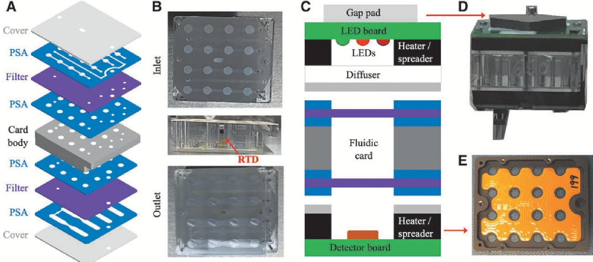
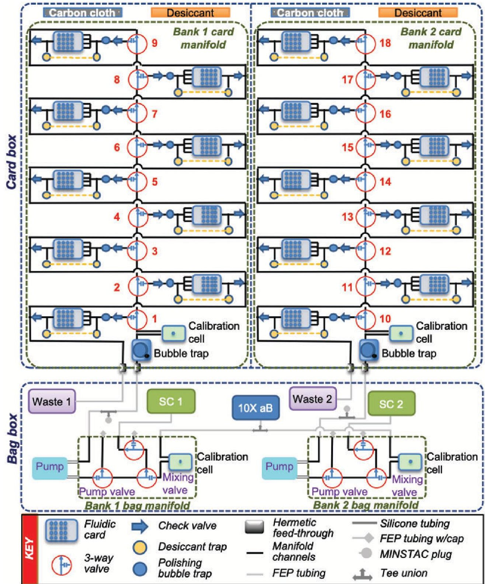
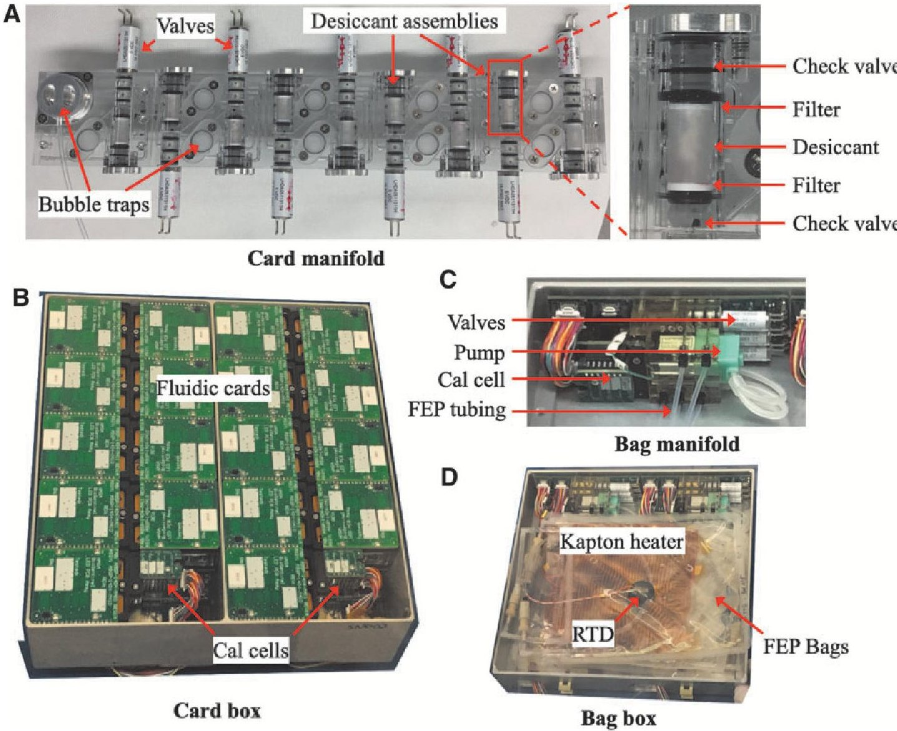
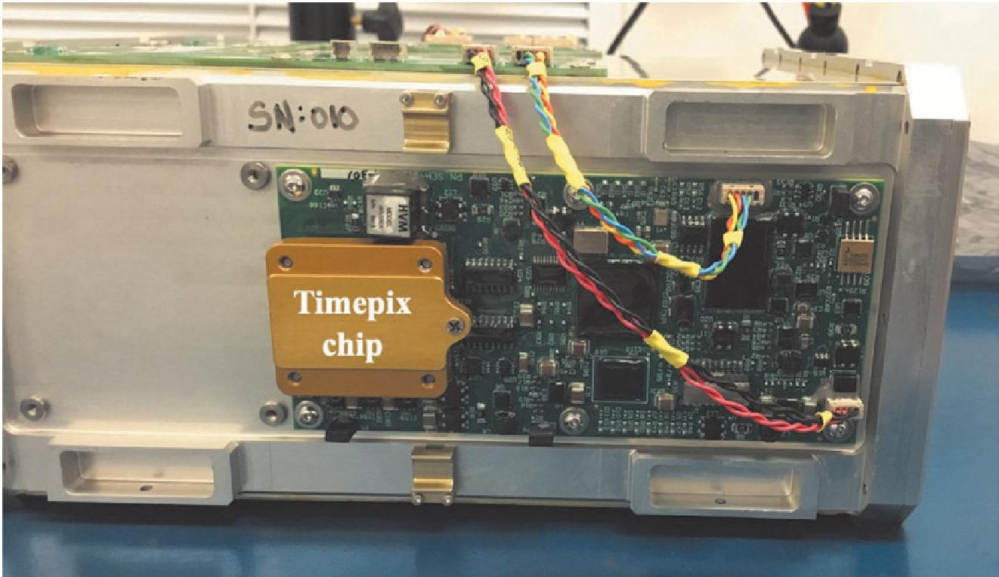
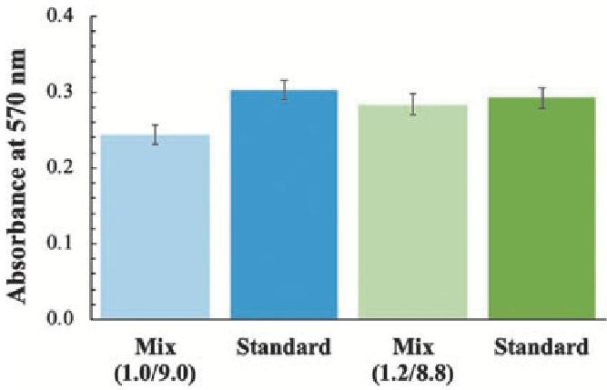
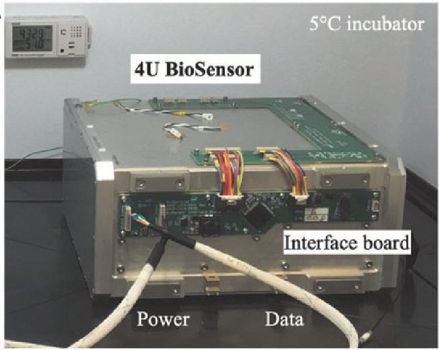
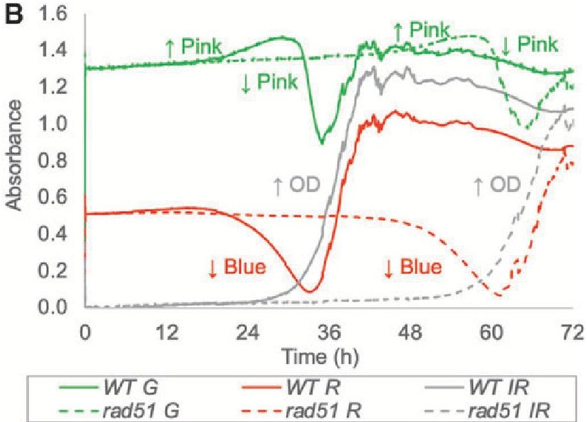

<!-- PDF_PAGE: 1 -->

# BioSentinel: A Biofluidic Nanosatellite Monitoring Microbial Growth and Activity in Deep Space

Michael R. Padgen, $ ^{1} $ Lauren C. Liddell, $ ^{1,2} $ Shilpa R. Bhardwaj, $ ^{1,3} $ Diana Gentry, $ ^{1} $ Diana Marina, $ ^{1,4} $ Macarena Parra, $ ^{1} $ Travis Boone, $ ^{1,5} $ Ming Tan, $ ^{1,6} $ Lance Ellingson, $ ^{1,5} $ Abraham Rademacher, $ ^{1,5} $ Joshua Benton, $ ^{1,7} $ Aaron Schooley, $ ^{1,5} $ Aliyeh Mousavi, $ ^{8} $ Charles Friedericks, $ ^{1} $ Robert P. Hanel, $ ^{1} $ Antonio J. Ricco, $ ^{1} $ Sharmila Bhattacharya, $ ^{1} $ and Sergio R. Santa Maria $ ^{1,9} $

## Abstract

Small satellite technologies, particularly CubeSats, are enabling breakthrough research in space. Over the past 15 years, NASA Ames Research Center has developed and flown half a dozen biological CubeSats in low Earth orbit (LEO) to conduct space biology and astrobiology research investigating the effects of the space environment on microbiological organisms. These studies of the impacts of radiation and reduced gravity on cellular processes include dose-dependent interactions with antimicrobial drugs, measurements of gene expression and signaling, and assessment of radiation damage. BioSentinel, the newest addition to this series, will be the first deep space biological CubeSat, its heliocentric orbit extending far beyond the radiation-shielded environment of low Earth orbit. BioSentinel's 4U biosensing payload, the first living biology space experiment ever conducted beyond the Earth-Moon system, will use a microbial bioassay to assess repair of radiation-induced DNA damage in eukaryotic cells over a duration of 6-12 months. Part of a special collection of articles focused on BioSentinel and its science mission, this article describes the design, development, and testing of the biosensing payload's microfluidics and optical systems, highlighting improvements relative to previous CubeSat life-support and bioanalytical measurement technologies. Key Words: BioSentinel—Deep space—CubeSat— Microfluidics—Biosensor—DNA damage. Astrobiology 21, 637-647.

## 1. Introduction

SINCE THE BEGINNING of space exploration, experiments to understand the impact of space travel on humans have been performed primarily in low Earth orbit (LEO); such experiments continue to this day on the International Space Station (ISS). Accordingly, opportunities for biological experiments beyond LEO have been essentially limited to the Apollo missions, the last in 1972. With a renewed focus by

NASA on returning astronauts to the Moon as a stepping stone to eventual ventures to Mars, understanding the effects of long-term exposure to the deep space environment is paramount to maintaining the health and performance of the astronaut crew. Of primary concern is the radiation environment, specifically how to refine and optimize mitigations or countermeasures to maintain astronaut well-being. Due to the near impossibility of replicating all aspects of the space radiation environment by using terrestrial facilities, coupled

<!-- PDF_PAGE: 2 -->

with a probable lack of human tending of many future science experiments conducted beyond LEO, fully autonomous instruments exemplified by those supported by CubeSats provide a low-cost, frequent-space-access means to perform meaningful research in space using human-relevant model organisms (Woellert et al., 2011).

NASA Ames Research Center has developed and flown a series of biological CubeSats (Massaro Tieze et al., 2020), including GeneSat-1 (Ricco et al., 2007), Organism/Organic Exposure to Orbital Stresses (O/OREOS) (Nicholson et al., 2011; Nicholson and Ricco, 2020), PharmaSat (Parra et al., 2008; Ricco et al., 2011), SporeSat (Park et al., 2017), and E. coli AntiMicrobial Satellite (EcAMSat) (Matin et al., 2017; Padgen et al., 2020a). These missions supported growth and, in the case of PharmaSat and EcAMSat, drug dose-response experiments; the biological subjects were Escherichia coli (multiple strains), Bacillus subtilis (multiple strains), Saccharomyces cerevisiae, and Ceratopteris richardii. All flew in LEO, autonomously performing their experiments and relaying the data collected to one or more ground stations. The experiments required cards or cartridges that maintained the cells in a condition of stasis from loading until the start of the experiment, often several weeks to months, and all but SporeSat used microfluidics systems to deliver growth media and precisely mix reagents (Massaro Tieze et al., 2020).

CubeSats, by their nature, are constrained in size, mass, and power. GeneSat-1, O/OREOS, PharmaSat, and SporeSat were free-flying 3U satellites （1U=10cm cube）including 2U of payload capacity. The 2U payloads contained the biological samples and all support fluidic hardware, as well as the electronics for fluidic and thermal control, optical measurements, and data handling. In each case, the payload enclosure was hermetically sealed to maintain an internal environment of 1 atm. The remaining 1U volume in the satellite was used for the so-called "bus," which provides command and data handling, radios, and an electric power system. The outer surfaces were covered in solar cells to supply power. EcAMSat was NASA's first 6U CubeSat deployed from the ISS; the extra surface area provided by this configuration was required for the additional power demands of that mission (Padgen et al., 2020a, 2020b). The remaining 3U in that satellite carried magnets and hysteresis rods for passive orientation during flight.

Recently, the two 6U Mars Cube One (MarCO) CubeSats demonstrated the capability of small satellites to carry out deep space missions (Klesh et al., 2018). Although these are the only CubeSats to date to travel beyond LEO, thirteen 6U satellites with a multidisciplinary range of payloads will soon launch as secondary payloads on board NASA's Space Launch System Artemis 1 rocket, formerly Exploration Mission 1 or EM-1 (Robinson et al., 2018). Among these, BioSentinel will be the only biological mission, the first interplanetary biological CubeSat (Massaro Tieze et al., 2020) and the first livebiology experiment conducted beyond the Earth-Moon system (Ricco et al., 2020).

The BioSentinel spacecraft will carry two scientific payloads into heliocentric orbit: the larger of the two and subject of this article, the so-called BioSensor payload, monitors DNA damage and repair by using yeast as detailed below. The second payload, implemented on a single printed-circuit board, is a miniature spectrometer to measure and compile the linear-energy-transfer (LET) characteristics of individual radiation events (Kroupa et al., 2015), that is, a continuous

cataloging of ionizing impacts on its detector by particles or photons; this system also computes total ionizing dose (TID). This will enable the cumulative history of BioSentinel's physical radiation environment over the elapsed duration of the mission to be compared and correlated with the biological effects recorded by the BioSensor payload when a given experimental time point is obtained (Ricco et al., 2020).

## 2. BioSentinel Science Goals

The main science goal of the BioSentinel mission is to investigate and better understand the effects of deep space ionizing radiation on living organisms (Massaro Tieze et al., 2020; Ricco et al., 2020). Ionizing radiation induces a series of DNA lesions, including double stranded breaks (DSBs), which unless repaired can lead to genome instability and ultimately cancer in humans (Kanaar et al., 1998; Khanna and Jackson, 2001). The budding yeast Saccharomyces cerevisiae was chosen as a model organism for this mission not only because of its easy genetic manipulation and spaceflight heritage (Pross et al., 2000; Takahashi et al., 2001; Parra et al., 2008; Ricco et al., 2011), but also because of its similarity to human cells (Kachroo et al., 2015), including the repair of DSBs via homologous recombination (Aylon and Kupiec, 2004). Importantly, yeast cells can also be desiccated and survive in this form for long periods of time (Santa Maria et al., 2020), making it an ideal organism to withstand the logistical constraints placed upon many spaceflight payloads.

Two strains of budding yeast were selected for this mission, a wild-type strain and a mutant carrying a deletion of the RAD51 gene (rad51 $ \Delta $ ) essential for DSB repair in yeast (Santa Maria et al., 2020). The loss of RAD51 renders the yeast cells unable to efficiently repair ionizing radiation damage and thus more sensitive to radiation encountered in space. While the wild-type and rad51 $ \Delta $ strains are expected to suffer similar rates of DSBs, the wild type will be far more effective in repairing such damage; differences in growth and metabolism between the two strains will therefore provide information as to how DSB-related damage accumulates when it cannot be effectively repaired, a useful insight for eukaryotic cells of all sorts.

To fulfill the mission experiment goals, yeast cells will be desiccated inside a series of microfluidic cards, which will be activated in space in sets of two at nine successive time points over the course of the 6-month nominal mission (with a potential extension to 12 months). By delivering synthetic complete (SC) growth medium and the metabolic indicator dye alamarBlue (aB), then measuring absorbance of the rehydrated cultures over time, both the growth and the metabolic activity of the two strains can be measured (Santa Maria et al., 2020). Throughout the mission, the incident radiation will be measured with a physical radiation spectrometer (Section 3.2) that also provides a measure of TID, allowing for direct comparison of radiation dose, as well as the mission-integrated flux by particle type and energy, with the biological outcome. In addition to the deep space payloads, a second BioSensor payload will be delivered to the ISS, while delayed synchronous ground control units will be monitored on the ground for both the deep space and ISS missions (Ricco et al., 2020). Differences in growth and metabolism between the deep space, ISS, and ground units will be compared to better understand dose- and particle-dependent radiation damage on

<!-- PDF_PAGE: 3 -->

biological systems in the form of DSBs, with the two space experiments in very different radiation environments facilitating the separation of any microgravity effects.

## 3. Payload Description

The BioSentinel payload consists of two components, the 4U BioSensor, which is the hermetically sealed fluidic/ optical/thermal system that houses the yeast strains, and the LET radiation sensor. A recent description of all the various spacecraft components of the BioSentinel satellite can be found in the work of Ricco et al. (2020).

## 3.1. BioSensor payload

At the heart of the BioSensor are the 18 microfluidic cards that measure roughly $ 3. 9 \times4. 1 \times1. 3 $ cm in size and contain 16 microwells, each (Fig. 1) with a volume of $ \sim1 0 0 \mu \mathrm{L} $ . The main body of each fluidic card is made of two fused polycarbonate (PC) layers that define the inlet and outlet ports and the wells. During assembly, single layers of blade-cut 3M VHB pressure-sensitive adhesive (PSA) are attached on both sides of the body. On the outlet side, a transparent, $ 1. 0 \mu \mathrm{m} $ pore size polycarbonate track-etched (PCTE) filter is aligned and adhered to the card body. The filter covers the outlet side of each of the 16 wells to constrain the cells within the well. The outlet channels consist of two layers of PSA on either side of a $ 2 5 0 \mu \mathrm{m} $ PC carrier that provides rigidity and height for the channels. This channel layer is then adhered to an injection-molded Zeonor cover. Zeonor was chosen over PC as a cover material for its optical clarity and lower water permeability, as both covers are in the optical measurement path. The outlet-side cover is then

aligned to the card body, and a pneumatic press is used to ensure smooth adhesion. The card body, the inlet 0.2 $ \mu \mathrm{m} $ pore size PCTE filter, and the inlet channel PSA attached to the inlet cover are sterilized separately by autoclave. The yeast cells are loaded onto the sidewall of each well in the partially assembled card and allowed to dry for 7 days (Santa Maria et al., 2020). The inlet filter and cover are then added, and the complete assembly pressed with the pneumatic press.

To maintain thermal control of the card during the stasis state of the mission (i.e., to prevent freezing) and during the biological cell growth experiment at $ 2 3^{\circ} \mathrm{C} $ , kapton-filmbased heaters are adhered to aluminum plates attached to the top and bottom of the fluidic card (Fig. 1). A platinumresistance temperature detector (RTD), used for feedback control of the thermal system, is then installed in the middle of each card. Above each well there is an array of three LEDs and below a photodiode-based light intensity detector that provides a frequency output proportional to intensity.

Figure 2 shows a detailed schematic of the fluidic system, including all of the components, tubing, and channels in the system. The card box contains two independent chambers, each with nine cards mounted onto two independent card PC manifolds (Fig. 3), known as the card manifolds. When activated, each 3-way valve will direct flow to its respective card. When no valves are active, the flow will pass from one valve to the next and then out to the waste line. The components of the card manifolds are discussed in more detail in Section 4.2. The peristaltic pumps and fluorinated ethylene propylene (FEP) fluidic bags, which contain the reservoirs of SC and aB, are located in a separate aluminum box ("the bag box") within the payload to help keep the overall humidity low in the vicinity of the fluidic cards, along with a

FIG.1. BioSentinel microfluidic card. Yeast cells are loaded into the polycarbonate card body wells and desiccated by airdrying. (A) The different layers that go into the assembly of the fluidic card are shown. (B) Pictures of the card showing the inlet side (top), the embedded RTD as seen from a side view, and the outlet side of the card (bottom). (C) Cross-section of one microwell of the fluidic stack assembly (card body and associated electronics). "Gap pad" is a silicone-based material that makes thermal contact between one side of the fluidic card stack and the face of the payload container that is in nearpermanent shadow during the mission, and is therefore cold; "Diffuser" is a surface-roughened polycarbonate film that diffuses the light emitted by the LEDs as it passes through this layer in order to illuminate the microwell more uniformly. (D) A picture of the assembled fluidic stack. (E) The kapton-film heater installed on the aluminum thermal spreader.

<!-- PDF_PAGE: 4 -->

FIG. 2. Fluidic schematic of the BioSensor system. Shown are the fluidic cards, valves, bubble traps, calibration cells, desiccant chambers, manifolds, boxes, pumps, tubing, and reagent bags.

separate PC manifold (the "bag manifold") for each bank. To connect the fluidic bags to the manifold, 0.8 mm (1/32") inner diameter FEP tubing with MINSTAC fittings (Lee Co.) is used. These same parts are also used to connect the outlet of the bag manifolds to the inlet of the card manifolds. To pump SC, the pump valve must first be activated. Because the SC bag is connected to the normally open port of the selector valve, no other valve needs to be on. To deliver aB diluted in SC, the mixing valve is toggled to alternate pumping SC and aB (see Section 4.3). Kapton heaters are used when necessary to prevent the fluids from freezing, maintaining at least $ 5^{\circ} \mathrm{C} $ throughout the mission.

The timeline for the growth-and-measurement process for a set of two cards is shown in Fig. 4. First, a series of dark

readings (providing the zero-offset signal of the detector) and unheated baseline (B/L) optics readings are taken. From thermal modeling and thermal vacuum power management (TVPM) testing, the expected temperature for fluidic cards in stasis state is $ \sim 8-1 2^{\circ} \mathrm{C} $ (data not shown). Then, the heaters for the fluidic cards and optical calibration (cal) cells are set to the experiment temperature of $ 2 3 \pm 1. 0^{\circ} \mathrm{C} $ . The cal cells use the same optical system over a single, flow-through, nonbiology well (see Section 4.3). After 1 h, during which the card reaches experiment temperature, another set of baseline optical readings is recorded. The optical measurements for the cal cells continue every 10 s from this point until the end of the fill (pumping) phase; for each card the optics are active only during the fill. For the start-of-experiment time point of

<!-- PDF_PAGE: 5 -->

FIG. 3. BioSensor payload components and subassemblies. (A) The card manifold, showing the valves, bubble traps, and the desiccant assemblies for each card position. The inset shows the components that comprise the desiccant assembly. While the desiccant remains in vapor contact with the card during stasis, it is separated from the fluid path by hydrophobic filters. (B) The assembled card box (minus gap pads) showing the 18 cards and 2 calibration cells installed. (C) The bag manifold with calibration cell, pump, valves, and FEP tubing. (D) The assembled bag box, with two manifolds, FEP fluidic bags, kapton heaters, and RTDs.

each bank, SC medium is pumped through only the manifold for 8 min by turning on the pump valve and operating the peristaltic pump. This initial flush provides a zero-absorbance reading for the mixing cal cell. The mixing valve is then cycled at 1.2 s ON / 8.8 s OFF (see Section 4.3) as the pump re-flushes the system with mixed aB/SC solution, providing a

roughly 10-fold dilution of the aB from the stored stock solution, for 8 min. Then the first card valve is opened, and the mixed medium is pumped to the first of the two cards for 10 min. The fluid passes through the inlet check valve and mini bubble trap before entering the card. Upon exiting, it passes through the outlet check valve into the outlet channel,

<table border="1"><tr><td>Temperature</td><td>~8-12℃</td><td colspan="6">23℃</td><td>~8-12℃</td></tr><tr><td>Phase</td><td>Dark+coldB/L</td><td>Heating(card andcal cells)</td><td>B/L</td><td>SCflush</td><td>aBflush</td><td>Fillcard1</td><td>Fillcard2</td><td>Growth/aB optics</td><td>End</td></tr><tr><td>Time</td><td>10min</td><td>1h</td><td>2min</td><td>8min</td><td>8min</td><td>10min</td><td>10min</td><td>168+h</td><td></td></tr><tr><td>Cal cells</td><td>10s</td><td>Off</td><td>10s</td><td>10s</td><td>10s</td><td>10s</td><td>10s</td><td>Off</td><td>Off</td></tr><tr><td>Card1</td><td>10s</td><td>Off</td><td>10s</td><td>Off</td><td>Off</td><td>10s</td><td>Off</td><td>2min</td><td>Off</td></tr><tr><td>Card2</td><td>10s</td><td>Off</td><td>10s</td><td>Off</td><td>Off</td><td>Off</td><td>10s</td><td>2min</td><td>Off</td></tr></table>

FIG. 4. Two-card experiment timeline. The operating temperature is shown above the phase, while the duration (row labeled "Time") and period (three rows below the "Time" row) of optics measurements (cal cells and fluidic cards) are shown below for the different phases of the experiment. Note: the SC flush is only included during the first experiment for each bank.

<!-- PDF_PAGE: 6 -->

which is connected to the waste bag. The first card valve is then closed, the second opened, and the fill process repeated for the second card. Once the pumping is complete for this set of cards, the period of optics measurements for both cards is changed to once every 2 m for at least 1 week, with the experimental temperature maintained at $ 2 3 \pm1. 0^{\circ} \mathrm{C} $ throughout.

Because there are nine cards on each manifold, there is one case in which both banks are active (i.e., 9th and 10th cards). For this set, the second bank is flushed with SC medium (for the zero-absorbance reading for the second mixing cal cell); then both banks are flushed with mixed aB/SC solution. Then the last card on the first bank and the first card on the second manifold are filled sequentially.

The optical measurement approach employed in the BioSensor is similar to that of PharmaSat, O/OREOS, and EcAMSat, which also used aB to monitor changes in the metabolic activity of the cells (Ricco et al., 2011; Nicholson and Ricco, 2020; Padgen et al., 2020a). aB is a redox indicator dye that changes color from blue (resazurin) to pink (resorufin) upon reaction with electron-donating metabolites (e.g., FADH, NADH, certain cytochromes) produced by actively growing cells (Rampersad, 2012); because it permeates cell membranes, the metabolites do not need to be excreted for metabolism to be registered. Above each fluidic well are three LEDs with emissions centered around 570, 630, and 850 nm, with a photodiode detector below the fluidic well that converts light intensity into a proportional frequency. While the cell-retaining filters are in the optical path (in contrast to previous biological CubeSat missions, when they were off to one side and connected via a microchannel near the tops and bottoms of the wells), there is still sufficient signal from the LEDs to reliably measure absorbance in the range expected during rehydration to full growth (data not shown). By using an empty well (well # 5) in each card as a control and for stray-light correction, the measured light intensities are converted to absorbance values at each wavelength for each well at each time point. The absorbance values at 570 and 630 nm are used to measure changes in the color of aB, while the 850 nm near-infrared (NIR) absorbance is used to track the optical density, or increased turbidity, generated by growing yeast cells (Santa Maria et al., 2020).

By using the measured absorbance of the oxidized (blue) and reduced (pink) forms of aB, the relative concentrations of the two chemical species are calculated. The rates of the disappearance of the blue color (630 nm measurements), the appearance of the pink color (570 nm measurements), and the eventual disappearance of the pink color (aB can be further reduced to a colorless species by some cellular metabolites) are used to monitor the effects of radiation over the length of the experiment.

## 3.2. LET radiation spectrometer

The LET spectrometer was developed by the Johnson Space Center Radworks Group and is designed to measure radiation over the 0.2-300 keV/ $ \mu $ m LET range, the most relevant for biological damage in space. The Timepix-based silicon device measures the amount of energy deposited by each radiation "hit" per unit length of silicon traversed (Ricco et al., 2020). Each hit is counted in one of 256 bins spanning the LET range; the width of each such bin is 2.9% of its center LET value. The counts are reported hourly providing a detailed time-course of radiation events; the firmware that is part of the LET system also computes TID due to all binned radiation events. The LET spectrometer is installed onto the outside of the BioSensor enclosure to be as close as possible to the biological payload (Fig. 5). The measurements of TID and particle characterization over time from the LET spectrometer will be correlated with changes in cell growth and metabolic activity at time points throughout the mission.

FIG. 5. LET spectrometer mounted on the side of the 4U BioSensor payload enclosure. The Timepix chip along with all supporting circuitry is mounted on a single electronic control-and-measurement board.

<!-- PDF_PAGE: 7 -->

## 4. BioSentinel Payload Innovations

## 4.1. Experiment design

One advantage of the BioSentinel system over previous biological CubeSats is that the additional space provided by the 4U BioSensor payload means the number of experiment time points is much larger than in previous experiments (Massaro Tieze et al., 2020). The 18 fluidic cards with 16 wells each provide a total of 288 wells, versus 48 wells for EcAMSat and PharmaSat. The only biological CubeSat mission that had previously run experiments at different time points is the O/OREOS Space Environment Survivability of Living Organisms (SESLO) payload, which filled its three fluidic cards at 2 weeks, 3 months, and 6 months after launch (12 wells per time point) (Nicholson et al., 2011; Nicholson and Ricco, 2020). BioSentinel cards will be filled at nine different time points over the course of the mission (Fig. 6). The first set of cards will be filled as soon as possible after a 2-week checkout period for the spacecraft and will serve as a t=0 time point. Experiments will be started afterward roughly every 2-3 weeks, with each card set given at least a week to complete its growth experiment.

At each time point, two cards are filled and measured. The use of two cards at a time provides redundancy in case of any fill issues and increases the statistical power of each time point. While the activation of each group of cards is programmed to start automatically, they can also be activated from the ground. For example, in the event of a solar particle event (SPE), as detected by the onboard LET spectrometer or other space assets, a command could be sent to the spacecraft to activate a new set of cards. Filling the cards as close to the event as possible—and, ideally, while the SPE is still in progress—would more closely capture the direct biological effects of a SPE, in part because damage of cells by radiation is enhanced when they are in aqueous solution, where OH radicals produced by radiation can do significant damage.

## 4.2. Keeping the yeast alive

An important difference in the BioSentinel free flyer mission from past biological CubeSat missions is the length of the stasis period from the time the biology is loaded into fluidic cards to the start of the experiment in space after launch: it is expected to be at least 18 months before the last fluidic cards are filled with medium and measured (the final fluidic card of the SESLO experiment was filled $ \sim 1 1 $ months after the B. subtilis spores were originally loaded in the laboratory). Desiccating the yeast cells and maintaining a low relative humidity and reasonably low temperature during storage are key factors for the survival of the cells over the long term (Santa Maria et al., 2020).

For loading, yeast cells are counted, diluted, and resuspended in 10% trehalose to improve viability (Tapia and

Koshland, 2014; Santa Maria et al., 2020). A small droplet containing approximately 100,000 cells is then added to the sidewall of each microwell and allowed to dry for 7 days, before the card is sealed. The cards are then stored in desiccators until installed into the payload, which is designed to keep the interior of the cards (and cells) dry until the cards are filled in space. In card-only biocompatibility testing, there were no significant effects of this long-term storage on the survival of the yeast strains compared to microwell plate controls (Santa Maria et al., 2020).

An important feature of the fluidic card, in contrast to those used for previous missions (EcAMSat, PharmaSat, O/OREOS-SESLO), is that the card covers are made of 1 mm thick Zeonor, a cyclo olefin polymer. This material is far less vapor permeable than the 50 $ \mu\mathrm{m} $ thick polystyrene capping layer that was used in several previous designs. This helps isolate one card from its neighbors and maintain low humidity within the card, which is essential for the long-term survival of the yeast cells (Santa Maria et al., 2020).

In each fluidic bank, nine cards are mounted onto the card manifold (Fig. 3). At each position is a series of features to help keep the cards dry during stasis and once the manifold and other fluidic cards have been wetted out, including check valves at both the inlet and outlet of each fluidic card (Fig. 2). The inlet check valve provides an additional humidity barrier between fluid in the main line and the card, while the outlet check valve prevents backflow into the card while also serving as a humidity barrier. In between the two check valves is a desiccant chamber filled with $ \sim 8 0 \mathrm{m g} $ of Drierite desiccant (Fig. 3A). Once mounted on the manifold, the card interior remains in gas-phase contact with the desiccant. Because the desiccant is separated from each well by a hydrophobic, vapor-permeable membrane, wetting out a given well does not flood the associated desiccant chamber.

To maintain low humidity, several process improvements were instituted to keep the hardware as dry as possible. During assembly of the manifold, the manifold is stored in a dry box whenever not actively in use. During leak testing, all air is pumped through a drying tube before reaching the manifold. For sterilization, the manifolds are packed in sealed mylar bags containing additional desiccant.

The fluidic card box is designed to be isolated from the bags containing liquid reagents (growth medium and metabolic dye) so as to limit the humidity that could be passed from the fluidic bags to the cards. In addition to sealing off the card box, additional desiccant bags are added to the card box (Fig. 2).

Humidity is not the only complicating factor for biocompatibility: volatile organic compounds (VOCs) released from printed circuit boards have been shown to have negative effects on the survival of microorganisms (Padgen et al., 2020a). From previous space life science experiments in CubeSats and on the ISS, activated carbon cloth had been

FIG. 6. Mission card activation timeline. Each experiment (Exp 1 to Exp 9) includes the activation of two fluidic cards.

<!-- PDF_PAGE: 8 -->

found to be vital to reduce the effects of VOCs (Kiss et al., 2007). A sleeve of perforated FEP stuffed with activated carbon cloth is therefore installed onto each bank of the card box to reduce the negative effects of VOCs on yeast survival (Fig. 2).

The materials choices, fluidic card architecture, means of sterilization, use of desiccant, "refrigeration" of biological samples, and method of drying yeast within microfluidic wells (Santa Maria et al., 2020) together enable stasis durations of at least 18 months from the time of drying cells in the fluidic microwells until their growth in outer space.

## 4.3. Reagent mixing

In previous biological CubeSat missions, mixing had been performed by pumping a precise volume of the concentrated reagent into a dilution bag, where it was mixed and then delivered to the fluidic card. Because it was found that, over the long term, components of the SC growth medium reduce aB, the two reagents could not be stored together (Santa Maria et al., unpublished data). Because of the large number of time points requiring equivalent mixtures of aB and SC medium, a new approach was needed.

Each fluidic bank is equipped with its own bag of SC medium, while the bag of concentrated 10X aB is shared between the two banks. To get mixed media, the peristaltic pump is run continuously while the mixing valve is repeatedly toggled (OFF: pump SC; ON: pump aB). This is set on a 10-second cycle, initially with the valve ON for 1 second every 10 seconds (1 second ON/9 seconds OFF or 1/9) to dilute the aB dye 10-fold in SC medium. The tortuous path through manifold channels, valves, the pump, and bubble traps thoroughly mixes the medium before it reaches the fluidic cards.

To verify the mixing ratio, there are two cal cells on each fluidic bank (Fig. 2). The first cal cell is attached to the bag manifold to measure the absorbance of the stock 10X aB (Fig. 3C), correcting for any variations in the color of the dye over time. The optical path length of the bag cal cell is 1 mm. Each card manifold also contains a cal cell (10 mm path length, equivalent to the path lengths of the microwells in the fluidic cards) that measures the absorbance of the mixed medium to calibrate the optical readings in the fluidic card wells. If the cal cell shows imprecise mixing during the mission, the timing of the mixing valve can be adjusted for the next set of cards.

To verify that the fluidic system is mixing reagents as expected, a mixing ratio test was performed (Fig. 7). SC growth medium and aB, mixed by the fluidic system, were pumped through the manifold into a 2-card set, and the flowthrough samples were collected into sterile microcentrifuge tubes in $ \sim 1 5 0 \mu \mathrm{L} $ increments. Optical readings were obtained by the manifold cal cell and an absorbance microplate reader for the flow-through samples. Absorbance at 570 nm was used to estimate the concentration of aB in all of the samples. Then, premixed SC/aB (standard) and SC medium (zero-absorbance control) were pumped through the same cards. By comparing both the cal cell and flow-through optical readings between the mixed and pre-mixed media, it was found that the pumped solution had slightly less aB than expected (Fig. 7, first and second columns). This was corrected by changing the amount of time aB is pumped from 1.0/9.0 s to 1.2/8.8 s (Fig. 7, third and fourth columns).

FIG. 7. Mixing ratio test. Absorbance at 570 nm of flowthrough samples when mixing with 1 second ON/9 seconds OFF (1/9) timing and 1.2/8.8 timing, compared to the premixed standards.

## 4.4. Additional payload innovations

Compared to Ames Research Center's previous biological small-satellite payloads, BioSentinel's BioSensor payload implements multiple design and technology improvements to enhance its science measurement capabilities, in addition to those discussed in detail above. These include the following:

(1) constructing fluidic cards entirely from thermally robust polymers and adhesives, enabling their sterilization by autoclave at $ 1 2 1^{\circ} \mathrm{C} $;

(2) a manifold system that physically, fluidically, optically, and electrically integrates fluidic cards as well as valves, check valves, bubble traps, and desiccant compartments, vastly reducing the number of point-to-point fluidic connections;

(3) including a near-infrared LED in the set of illumination sources provided for each one of the 288 microwells in order to measure optical density, or turbidity, resulting from light scattering proportionate to cell population, in a wavelength band where reagents, including metabolic indicator dyes, do not absorb light;

(4) sterilization of the fluidic manifold with most of its components already integrated by electron-beam irradiation, simplifying assembly while avoiding for this key subsystem the use of ethylene oxide with its attendant risk of residual antimicrobial effects that can impair cell longevity during stasis;

(5) passively maintaining biological-specimen-containing fluidic cards in a state of refrigeration while in space by defined thermal contacts to the inside of the shadowed face of the payload container in order to extend the longevity of the microbial specimens, even while other fluidic cards support actively growing cells maintained at $ 2 3 \pm1. 0^{\circ} \mathrm{C} $;

(6) proximate integration of a time series of live-biology experiments with a miniature LET spectrometer to directly correlate the space radiation ambient with biological damage.

## 5. Payload Functionality Demonstration

## 5.1. Experimental verification test

An abbreviated experimental verification test (EVT) was performed to demonstrate the end-to-end functionality of the

<!-- PDF_PAGE: 9 -->

FIG. 8. Experimental verification test (EVT) setup. (A) 4U payload unit in incubator at $ 5^{\circ} \mathrm{C} $ with power and data cables. The data cable connects the payload to the spacecraft emulator, allowing control of the payload through ITOS. (B) Example of optical measurements (72 h) for one wild-type (WT) well and one rad51 $ \Delta $ well. The raw frequency data (proportional to light intensity) has been converted into absorbance for each wavelength.

4U BioSensor payload. The stasis period between loading the yeast strains in the card and running the experiment was approximately 10 months; the delay between the delivery of the flight payload and the execution of the first experiment in space is expected to be at least this long. The payload was assembled according to flight procedures and stored in an incubator at $ 5^{\circ} \mathrm{C} $ throughout the duration of the test (Fig. 8A). The payload was commanded through the spacecraft emulator and the Integrated Test and Operations System (ITOS) software interface. The flight software script was used to run each two-card set, although the time between each run was reduced compared to the actual flight experimental timeline.

Figure 8B shows the absorbance at 570 (green), 630 (red), and 850 nm (NIR, gray) for one well with wild-type (WT) yeast cells (solid lines) and one well with the DNA-repairdefective rad51 $ \Delta $ mutant cells (dotted lines). The drop in the red absorbance ( $ \sim $ 20 and $ \sim $ 48 h for wild type and rad51 $ \Delta $ respectively) results from the reduction of the aB dye, which changes its color from blue to pink. The increase in the green absorbance at the same time is due to the relatively larger absorbance of the pink form at 570 nm. The green absorbance then drops as aB is further reduced to a colorless form. As can be seen in Fig. 8B, there is a significant delay between the wild-type and rad51 $ \Delta $ cells, mostly reflecting differences in growth rate and survival over the long stasis period (Santa Maria et al., 2020).

Of the 288 wells filled during the EVT, only eight were either partial or no fills, meaning more than 97% of the wells were able to be used for analyses. At the completion of the test, the payload was disassembled and inspected, with no leaks or hardware damage identified.

## 5.2. Radiation testing with electronics

A potential cause for concern for the payload was the higher levels of radiation exposure in deep space compared to previous LEO biological CubeSat missions. Concurrent with the biology experiments, the payload electronics have also been exposed to radiation at space-relevant doses

equivalent to those expected during a 6-month mission. During our yeast biosensor sensitivity experiments at the NASA Space Radiation Laboratory (NSRL) in Brookhaven National Laboratory, New York, we exposed a 4U BioSensor unit to 50 cGy of 300 MeV/n Fe-56. Post-exposure disassembly and inspection indicated that no failures of electronic components were found. The results of our radiation studies will be reported elsewhere.

## 6. Conclusions

NASA Ames Research Center has produced a series of successful biological CubeSats that have run microbiology experiments in LEO. BioSentinel leverages many of the lessons learned from these previous missions, but with significant upgrades to the hardware to support experimentation in deep space, beyond LEO. The same payload hardware and experimental protocol will be used for the deep space free flyer, ISS, and ground-control units. Comparing the results from the payloads in different environments at equivalent time points will enhance our understanding of how deep space radiation affects living organisms, an important step in protecting astronaut health and performance during long-term deep space flight.

Importantly, the use of the BioSentinel and BioSensor instruments is not confined to just experiments on yeast cells. Other microorganisms could also be integrated into the payload with only minor changes (e.g., depending on organism size, the filters in each fluidic card can be easily changed). Preliminary experiments in which the BioSentinel fluidics card has been used for a novel life-detection assay have been performed, demonstrating the potential use of the hardware in different fields of study, including future astrobiology-focused missions, rovers, or free flyers surveying the Moon and beyond.

## Acknowledgments

This work was supported by NASA's Advanced Exploration Systems (AES) Program Office.

<!-- PDF_PAGE: 10 -->

## Author Disclosure Statement

No competing financial interests exist.

## References

Aylon, Y., and Kupiec, M. (2004) DSB repair: the yeast paradigm. DNA Repair 3:797-815.

Kachroo, A.H., Laurent, J.M., Yellman, C.M., Meyer, A.G., Wilke, C.O., and Marcotte, E.M. (2015) Systematic humanization of yeast genes reveals conserved functions and genetic modularity. Science 348:921-925.

Kanaar, R., Hoeijmakers, J.H.J., and van Gent, D.C. (1998) Molecular mechanisms of DNA double-strand break repair. Trends Cell Biol 8:483-489.

Khanna, K.K., and Jackson, S.P. (2001) DNA double-strand breaks: signaling, repair and the cancer connection. Nat Genet 27:247-254.

Kiss, J.Z., Kumar, P., Bowman, R.N., Steele, M.K., Eodice, M.T., Correll, M.J., and Edelmann, R.E. (2007) Biocompatibility studies in preparation for a spaceflight experiment on plant tropisms (TROPI). Adv Space Res 39:1154-1160.

Klesh, A., Clement, B., Colley, C., Essmiller, J., Forgette, D., Krajewski, J., Marinan, A., Martin-Mur, T., Steinkraus, J., Sternberg, D., Werne, T., and Young, B. (2018) MarCO: early operations of the First CubeSat to Mars [SSC18-WKIX04]. In Proceedings of the 32nd Annual AIAA/USU Conference on Small Satellites, Logan, UT.

Kroupa, M., Bahadori, A., Campbell-Ricketts, T., Empl, A., Hoang, S.M., Idarraga-Munoz, J., Rios, R., Semones, E., Stoffle, N., Tlustos, L., Turecek, D., and Pinsky, L. (2015) A semiconductor radiation imaging pixel detector for space radiation dosimetry. Life Sci Space Res 6:69-78.

Massaro Tieze, S., Liddell, L.C., Santa Maria, S.R., and Bhattacharya, S. (2020). BioSentinel: a biological CubeSat for deep space exploration. Astrobiology, doi:10.1089/ast.2019.2068, published online ahead of print.

Matin, A.C., Wang, J.H., Keyhan, M., Singh, R., Benoit, M., Parra, M.P., Padgen, M.R., Ricco, A.J., Chin, M., Friedericks, C.R. Chinn, T.N., Cohen, A., Henschke, M.B., Snyder, T.V., Lera, M.P., Ross, S.S., Mayberry, C.M., Choi, S., Wu, D.T., Tan, M.X. Boone, T.D., Beasley, C.C., Piccini, M.E., and Spremo, S.M. (2017) Payload hardware and experimental protocol development to enable future testing of the effect of space microgravity on the resistance to gentamicin of uropathogenic Escherichia coli and its $ \sigma^{s} $ -deficient mutant. Life Sci Space Res 15:1-10.

Nicholson, W.L., and Ricco, A.J. (2020). Nanosatellites for biology in space: in situ measurement of Bacillus subtilis spore germination and growth after 6 months in low Earth orbit on the O/OREOS Mission. Life 10:1-14.

Nicholson, W.L., Ricco, A.J., Agasid, E., Beasley, C., Diaz-Aguado, M., Ehrenfreund, P., Friedericks, C., Ghassemieh, S., Henschke, M., Hines, J.W., Kitts, C., Luzzi, E., Ly, D., Mai, N., Mancinelli, R., McIntyre, M., Minelli, G., Neumann, M., Parra, M., Piccini, M., Rasay, R., Ricks, R., Santos, O., Schooley, A., Squires, D., Timucin, L., Yost, B., and Young, A. (2011) The O/OREOS mission: first science data from the Space Environment Survivability of Living Organisms (SE-SLO) payload. Astrobiology 11:951-958.

Padgen, M.R., Lera, M.P., Parra, M.P., Ricco, A.J., Chin, M., Chinn, T.N., Cohen, A., Friedericks, C.R., Henschke, M.B., Snyder, T.V., Spremo, S.M., Jing-Hung, W., and Matin, A.C. (2020a) EcAMSat spaceflight measurements of the role of $ \sigma^{\mathrm{s}} $ in antibiotic resistance of stationary phase Escherichia coli in microgravity. Life Sci Space Res 24:18-24.

Padgen, M.R., Chinn, T.N., Friedericks, C.R., Lera, M.P., Chin, M., Parra, M.P., Piccini, M.E., Ricco, A.J., and Spremo, S.M. (2020b) The EcAMSat fluidic system to study antibiotic resistance in low Earth orbit: development and lessons learned from space flight. Acta Astronaut 173:449-459.

Park, J., Salmi, M.L., Wan Salim, W.W.A., Rademacher, A., Wickizer, B., Schooley, A., Benton, J., Cantero, A., Argote, P.F., Ren, M., Zhang, M., Porterfield, D.M., Ricco, A.J., Roux, S.J., and Rickus, J.L. (2017) An autonomous lab on a chip for space flight calibration of gravity-induced transcellular calcium polarization in single-cell fern spores. Lab Chip 17:1095-1103.

Parra, M.P., Ricco, A.J., Yost, B., McGinnis, M.R., and Hines, J.W. (2008). Studying space effects on microorganisms autonomously: GeneSat, PharmaSat, and the future of bionanosatellites. Gravitational and Space Biology 21:9-18.

Pross, H.D., Casares, A., and Kiefer, J. (2000) Induction and repair of DNA double-strand breaks under irradiation and microgravity. Radiat Res 153:521-525.

Rampersad, S.N. (2012) Multiple applications of alamar blue as an indicator of metabolic function and cellular health in cell viability bioassays. Sensors 12:12347-12360.

Ricco, A.J., Hines, J.W., Piccini, M., Parra, M., Timucin, L., Barker, V., Storment, C., Friedericks, C., Agasid, E., Beasley, C., Giovangrandi, L., Henschke, M., Kitts, C., Levine, L., Luzzi, E., Ly, D., Mas, I., McIntyre, M., Oswell, D., Rasay, R., Ricks, R., Ronzano, K., Squires, D., Swaiss, G., Tucker, J., and Yost, B. (2007) Autonomous genetic analysis system to study space effects on microorganisms: results from orbit. In Proceedings of the 14th International Conference on Solid-State Sensors, Actuators and Microsystems (Transducers '07/Eurosensors XXI), IEEE, New York, doi:10.1109/sensor.2007.4300065.

Ricco, A.J., Parra, M., Niesel, D., Piccini, M., Ly, D., McGinnis, M., Kudlicki, A., Hines, J.W., Timucin, L., Beasley, C., Ricks, R., McIntyre, M., Friedericks, C., Henschke, M., Leung, R., Diaz-Aguado, M., Kitts, C., Mas I., Rasay, M., Agasid, E., Luzzi, E., Ronzano, K., Squires, D., and Yost, B. (2011) PharmaSat: drug dose response in microgravity from a free-flying integrated biofluidic/optical culture-and-analysis satellite. Proc SPIE 7929, doi:10.1117/ 12.881082.

Ricco, A.J., Santa Maria, S.R., Hanel, R.P., Bhattacharya, S., BioSentinel Team, and Radworks Group. (2020) BioSentinel: a 6U nanosatellite for deep-space biological science. IEEE Aerospace and Electronic Systems Magazine 35:6-18.

Robinson, K.F., Spearing, S.F., and Hitt, D. (2018) NASA's Space Launch System: opportunities for small satellites to deep space destinations [SSC18-IX-02]. In Proceedings of the 32nd Annual AIAA/USU Conference on Small Satellites, Logan, UT.

Santa Maria, S.R., Marina, D., Massaro Tieze, S., Liddell, L.C., and Bhattacharya, S. (2020). BioSentinel: long-term Saccharomyces cerevisiae preservation for a deep space biosensor mission. Astrobiology, doi:10.1089/ast.2019.2073, published online ahead of print.

Takahashi, A., Ohnishi, K., Takahashi, S., Masukawa, M., Sekikawa, K., Amano, T., Nakano, T., Nagaoka, S., and Ohnishi, T. (2001) The effects of microgravity on induced mutation in Escherichia coli and Saccharomyces cerevisiae. Adv Space Res 28:555-561.

Tapia, H., and Koshland, D.E. (2014) Trehalose is a versatile and long-lived chaperone for desiccation tolerance. Curr Biol 24:2758-2766.

<!-- PDF_PAGE: 11 -->

## BIOSENTINEL: A BIOFLUIDIC NANOSATELLITE FOR DEEP SPACE

Woellert, K., Ehrenfreund, P., Ricco, A.J., and Hertzfeld, H. (2011) Cubesats: cost-effective science and technology platforms for emerging and developing nations. Adv Space Res 47:663-684.

Address correspondence to:

Sergio R. Santa Maria

NASA Ames Research Center

Moffett Field, CA 94035

USA

E-mail: sergio.santamaria@nasa.gov

Submitted 27 May 2020

Accepted 22 December 2020

## Abbreviations Used

1U=10cm cube

aB = alamarBlue

cal=calibration

DSBs = double stranded breaks

EcAMSat = E. coli AntiMicrobial Satellite

EVT = experimental verification test

FEP = fluorinated ethylene propylene

ISS = International Space Station

ITOS = Integrated Test and Operations System

LEO = low Earth orbit

LET = linear-energy-transfer

NIR = near-infrared

O/OREOS = Organism/Organic Exposure to Orbital Stresses

PC = polycarbonate

PCTE = polycarbonate track-etched

PSA = pressure-sensitive adhesive

RTD = resistance temperature detector

SC = synthetic complete

SESLO = Space Environment Survivability of Living Organisms

SPE = solar particle event

TID = total ionizing dose

VOC = volatile organic compounds