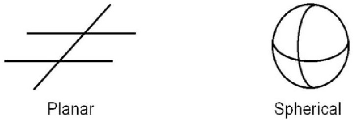
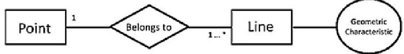
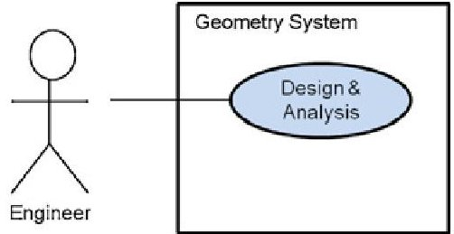
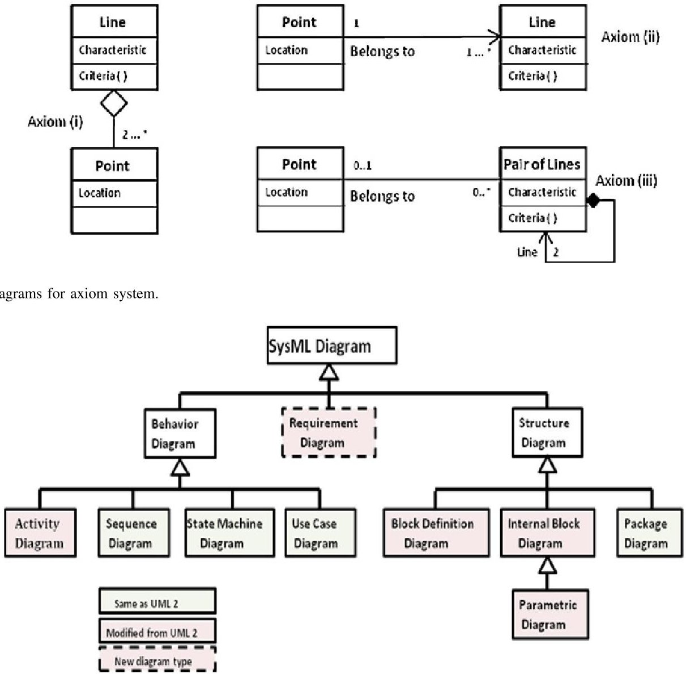
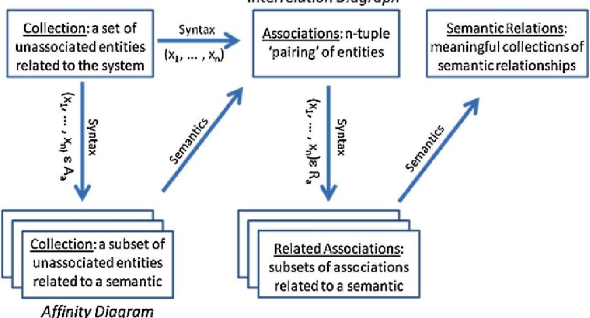
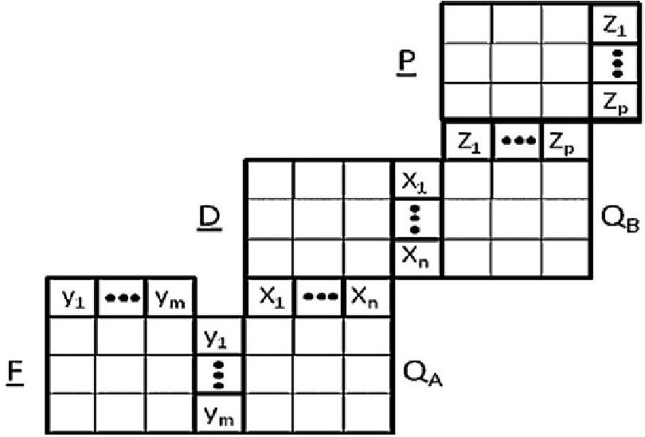
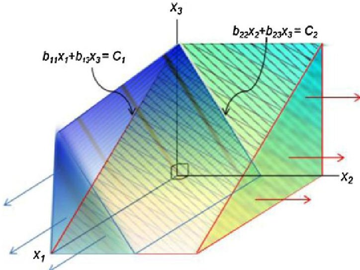
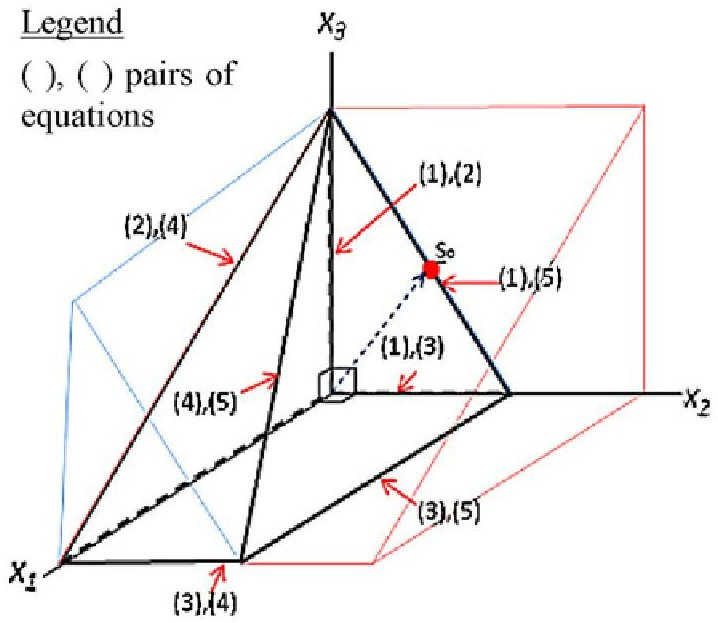
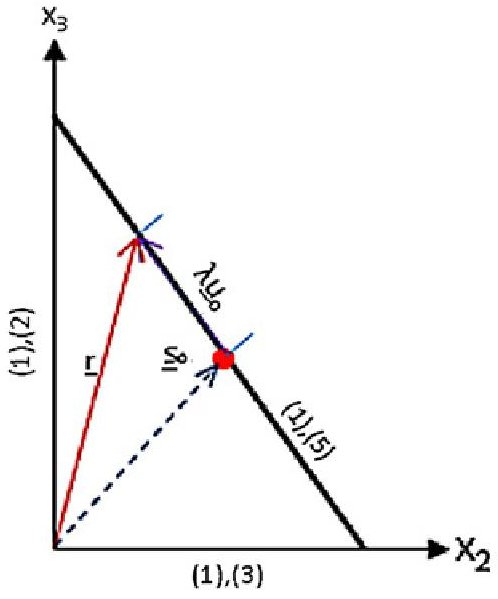

<!-- PDF_PAGE: 1 -->

# A Brief History of Models and Model Based Systems Engineering and the Case for Relational Orientation

Charles E. Dickerson, Member, IEEE, and Dimitri Mavris

Abstract—Models are at the heart of science and engineering. Model-based approaches to software development and systems engineering use technologies to include graphical modeling languages, such as the Systems Modeling Language, that support system design and analysis through machine readable models. This paper traces key historical contributions of software and systems engineers over the past five decades to show a coherent concept of models and how they can be used for software and systems engineering. Recent model-based systems engineering methodologies supported by commercially available modeling tools are also summarized. Relational orientation is seen to be the underlying viewpoint that expresses and binds these approaches. Relational orientation for systems engineering (ROSE) is then specified using a general systems methodology. Systems are seen to access each other's models in ROSE much like classes in object orientation access each other's objects. Object-oriented frames for software engineering are extended to relational frames to specify an innovative framework for system design and analysis. This generalizes the axiomatic design approach of N. P. Suh. A repeatable procedure supporting greater concurrency between design and verification is also demonstrated for searching the solution space in linear axiomatic design.

Index Terms—First-order models, graphical modeling languages, homomorphism, linear optimization, model, model-based systems engineering, model-driven architecture, object-oriented systems engineering methodology (OOSEM), relational frames, relational structures, software engineering.

## I. INTRODUCTION

MODEL-BASED APPROACHES to systems are well understood and practised in science and mathematics, based on the foundation provided by mathematical logic. In order to make models more visual and intuitive, software and systems engineers have developed various graphical modeling languages. The result has been the development of machine readable languages by the object management group (OMG), which are commercially supported and provide a critical technology for model-based software and systems approaches.

## A. Models in Science and Mathematics

A model of a system is generally regarded as a representation of the system. Models are also abstractions that suppress details not of interest. In science, mathematical models of a system bring precision that can be used to predict properties and behaviors of systems. For example, Hawking [1] attributes a good model in physics to be:

1) simple;

2) mathematically correct;

3) experimentally verifiable.

From this viewpoint, mathematics becomes the modeling language of physics.

The language of mathematics is the predicate calculus of logic. The term model in mathematical logic has a specific and formal meaning. Specifically, a model of a sentence is a relational structure for which an interpretation of the sentence expressed in the predicate calculus is valid (true) within that structure. A relational structure is a collection of mathematical relations on a defined set. A mathematical relation is a collection of relationships between the elements of the set, e.g., $ \mathrm{R}_{0}=\{(m,n)|m<n\} $ is an ordering relation on the system of counting numbers and each pair (m, n) is a relationship. Thus, relationships are instances of relations. Interpretations in mathematical logic are one-to-one mappings of sentences in predicate calculus into relational structures.

This concept of a model in logic is made clear by the example of interpretation of the sentences in an axiom system for an elementary geometry. An axiom system is comprised of a collection of key words that remain undefined (to avoid circularity) and sentences, called axioms that establish relations between the key words. An axiom system for an elementary geometry might include the terms point and line as key undefined words, and the axioms for the geometry might include the following three sentences about the key words:

1) every line is comprised of at least two points;

2) there exists a line passing through each point;

3) every pair of lines intersects in at most one point.

The meaning of the key words is determined by: a) relations between the words established by the axioms, and b) interpretation of the axioms into specific models (relational structures). This suggests that there are two types of models needed for every system. One type is for the intrinsic meaning of the sentences (axioms) expressed as relations between the key

<!-- PDF_PAGE: 2 -->

Fig. 1. Two interpretations of an elementary geometry system.

words. The other type is for interpretation of the key words that contributes new meaning to the sentences. Fig. 1 illustrates two interpretations of the elementary geometry axiom system. The first is a planar geometry in which the interpretation of all three the sentences is true. This then is a valid model of the axiom system. The second interpretation is a spherical geometry in which the interpretation of a line is that of a great circle on a sphere. In this case, the third sentence is false because great circles intersect at two points. The interpretation as a spherical geometry is therefore not a valid model of the axiom system.

## B. Comparison With System Specification

The concept of a model offered by mathematical logic and this simple example can give significant insight into system description and specification, which are subject to the same rule of logic that geometry is. Typically, a system specification is a collection of sentences, much like an axiom system. A design then becomes a model of the system that is an interpretation of the system specification. The model should be simple, mathematically correct, and experimentally verifiable. However, as with the geometry system, it should be expected that there can be multiple interpretations of a given specification, some of which may not be valid. Thus, some interpretations of the specification will be valid models of the system and others will not. The precision with which the interpretations are made is the subject of transformation between models, which is first introduced in Section IV.

## C. Graphical Modeling Languages for Systems

Graphical modeling languages for software development have been used for system description and specification from the early years of computer systems. These types of languages are useful for visualizing concepts. Graphical models generally represent the entities of a system as nodes in a graph and relationships as arcs. The sentences carry the key words and the semantics of the association between the key words. The syntax and semantics provided by graphical models helps capture the meaning of natural language sentences. However, to capture the full meaning of the sentences requires interpretation of the graphical models into a machine readable language such as XML/XMI. Three graphical languages are reviewed: 1) entityrelationship (E-R) diagrams; 2) the unified modeling language (UML); and 3) the systems modeling language (SysML). E-R diagrams were an early approach to data modeling. The UML specifies a language for object modeling and software development. SysML is a general-purpose graphical modeling language for specifying, analyzing, designing, and verifying systems. Open specifications for UML and SysML have been adopted by the OMG.

Fig. 2. Basic elements of E-R notation.

Fig. 3. Basic elements of UML use case diagram.

1) Entity-Relationship (E-R) Diagrams: The E-R diagram is a data modeling approach introduced by Chen [2]. E-R is a high level data modeling notation that integrates the concepts of semantic modeling and object-oriented modeling. Semantic modeling is used by linguists to represent the meaning of words and by artificial intelligence researchers for knowledge representation. The core concepts and terminology of E-R have much in common with those of UML. This is to be expected, as E-R, UML, and other graphical modeling approaches have their roots in mathematical logic.

In the graphical notation of E-R, the three basic elements of a diagram are: 1) entities depicted by rectangles; 2) relations represented by diamonds; and 3) attributes depicted by circles. In each case, the name of the entity, attribute, or relationship is annotated inside the node. The nodes are connected by lines, which can be regarded as associations between the three types of elements. Fig. 2 depicts the E-R notation applied to the second axiom of the elementary geometry system. The relation depicted in the figure is a binary relation, i.e., two entities are associated with each other by the relation.

Multiplicities can also be included as in Fig. 2; "1" is associated with the entity Point and "1... *" is associated with line. The multiplicity specifies how many instances of an entity participate in an instance of the relation. Each instance of a relation is one of the relationships that comprise the relation. Note that this usage of the terms relation, relationship, and instance is precisely the same as the mathematical definition given in Section I-A.

2) Unified Modeling Language (UML): This language is the de facto standard for software development. It is a graphical language that provides semantics and notation for object-oriented problem solving. Models are important to software development for both engineering and communication, just like how blueprints drawn by architects are used in the construction of buildings. The more complicated the building, the more critical the communication between architect and builder, and the architect and the customer. There are many excellent references on UML and the OMG has an open website for tutorials: http://www.uml.org/#Links-Tutorials.

The basic artifacts of UML can be used in systems engineering. These include the use case diagram, class diagram, package diagram, sequence diagram, and state transition di-

<!-- PDF_PAGE: 3 -->

agram. Holt [3], among others, offer an overview of using UML in systems engineering organized around this core body of artifacts.

The use case diagram is an external view of a system, in which the interactions of actors with the system represent functional requirements graphically, as illustrated in Fig. 3. The graphical elements of the diagram are the actor(s) (typically represented by named stick figures), the system (a box with the system name inside), the interaction(s) (denoted by communication line(s) between the actor and system), and the function(s) the system is used for by the actor (denoted by named oval(s) inside the box). Note that an interaction is a type of relation. The external viewpoint of the diagram also makes it part of the definition of the system boundary (as denoted by the box), i.e., the actors are identified as entities associated with the system that do not belong to it.

UML classes are abstractions of the entities of the system. In software development, UML classes become objects when instantiated. A class has attributes and methods, which are called out within the diagram. Methods in the notation are distinguished from attributes by the parenthesis that follows the name of the method. Class diagrams model relations between classes with a notation similar to the E-R diagram.

Fig. 4 represents the relations described by the sentences in Axioms (i)-(iii) using three UML Class diagrams. The diamond symbol in the diagram for Axiom (i) is aggregation, and indicates that class line is comprised of the class point. When these three graphical models are instantiated over a set (such as the Cartesian plane), they become a structure that interprets the relations described in the three axioms.

While the UML class diagram has a similar content and form as E-R, there are minor differences. These are easily seen in Axiom (ii) Class Diagram depicted in Fig. 4, which is the UML equivalent of the E-R diagram in Fig. 2. In the class diagram, relations are the lines connecting the classes and text that defines the relation is placed directly on the line. The corresponding diagram in E-R has two lines; one for each of the entities (classes) associated with the relation (E-R symbol diamond), and the text identifying the relation is found inside the symbol. Also, the reference to the attribute in the class diagram is done within the class notation, whereas E-R uses a separate symbol (the circle).

States in physical systems are the values taken on by the system attributes over time. However, UML classes also have methods (operations executed and services accessed) in addition to attributes. Therefore, state values in object-oriented modeling must also include the value of the method, i.e., is it idle or active.

A system model represented by classes can be organized using UML packages, which gather uniquely named model elements and diagrams into groups. A UML package provides an encapsulated name space. Packages and groups of packages become system components in the model. The UML package diagram exhibits the individual packages and their dependencies as client-server relations. Modeling system components and dependencies this way provides a model of the system structure that can be used as part of the specification of the system architecture.

Components can be organized by specifying architectural domains, which are groups of packages defined by a common property, affinity, or governance. In both software and systems engineering, architectural domains should relate to system components and their organization. In model-driven software development, e.g., in [4], the system architecture can be organized around four domains (groups of packages): the application specification, services accessed, the software architecture, and the implementation specification.

3) Systems Modeling Language (SysML): This is a graphical modeling language that extends UML for use in modelbased systems engineering (MBSE). It provides semantics and notation for systems engineering to support the specification, analysis, design, verification, and validation of systems that include hardware, software, data, parametrics, personnel, procedures, and facilities. SysML supports interchange of models and data via XMI and AP233. It has been implemented in tools provided by a variety of vendors. Friedenthal [5] provides a good introduction to SysML and its use in MBSE.

Fig. 5 illustrates the types of diagrams used by SysML; there are three primary types of diagrams at the highest level of the hierarchy: behavior, structure, and requirements. The requirements diagram is new and not part of UML. At the next level down, SysML makes specialized modifications to UML activity diagrams, and it has made significant modifications to UML class diagrams, as extended by UML composite structures, to create what are called block diagrams. A completely new type of diagram called the parametric diagram has been introduced, which shows mathematical relationships among the pieces of the system being designed and more specifically combines mathematical formulas for analysis of critical system parameters. Parametric diagrams have a key role in system modeling.

## II. HISTORY OF MODELING FOR SOFTWARE AND SYSTEMS

This section provides a brief history of some of the key historical contributions to modeling for software and systems over the past half century. The mathematical concept that a system can be regarded as a nonempty set upon which relations are defined can be traced back as early as [6]. More generally, a system has also been regarded as a collection of objects with attributes and relations between the objects, as well as relations between the attributes. Lin [7] compiled an extensive survey of mathematical concepts in the literature. Lin and Ma [8] defined a general system to be an ordered pair (M, R), where M is a set and R is a collection of relations on M, i.e., a relational structure. This definition is a formalization of the concept that a system is a "whole" consisting of interacting parts, which was expressed by von Bertalanffy [9] as early as 1967 and later by INCOSE [10].

## A. Tarski Model Theory

First-order model theory is concerned with the relationships between system descriptions made in a first-order formal language (such as the predicate calculus of mathematical logic) and the structures that satisfy these descriptions. Central to first-order models is Tarski's model theoretic definition of

<!-- PDF_PAGE: 4 -->

Fig. 4. UML class diagrams for axiom system.

Fig. 5. SysML artifact hierarchy and relationship to UML.

truth [6]. Specifically, given a relational structure (M, R), a sentence in the formal language is defined to be true if there is an interpretation of the sentence into the structure for which the sentence becomes true in the structure. The interpretation in this approach is an isomorphism, i.e., the symbols of the sentence are in one-to-one correspondence with the symbols in the image under interpretation into the structure. Instantiation in the sense of object orientation can be regarded as this type of interpretation. In the Tarski model theory, the relational structure is said to be a model of the sentence.

The geometric examples in Fig. 1 can be written as firstorder models of the axiom system (sentences) for the elementary geometry of Section I. For example, the planar geometry model can be defined by taking M to be the Cartesian plane and R to be the collection of all (straight) lines in the plane. Specifically, a line is defined to be a unary relation R on a subset of points $ ( x_{1}, x_{2} ) $ in the plane which are related by the equation $ x_{2}=m x_{1}+b $ , where m and b are the geometric characteristics (i.e., attributes) associated with the line. The three axioms can be interpreted rigorously into the Cartesian plane using the UML graphical models of the three sentences given in Fig. 4. The truth of the interpretation of each statement is then easily inferred from simple algebraic calculations.

## B. Yourdon Structured Analysis and Design

Yourdon [11] introduced a model-based approach for software development from a behavioral viewpoint. He also introduced a graphical modeling language called data flow diagrams to support his approach. Structured design was based on a principle that systems should be comprised of modules, each of which is highly cohesive but collectively are loosely coupled. The strongest forms of cohesion are based on functionality and communication. Cohesion in modules minimizes interactions between elements not in the same module, thus minimizing the number of connections and amount of coupling between modules. Reference [11] also considered that the solution should reflect the inherent structure of the problem.

Yourdon [11] also introduced the concept of structured analysis, which is based on a principle that the specification of the problem should be separate that of the solution. He proposed that separation be accomplished by using two types of models: the essential model, which is an implementationfree representation of the system, and the implementation model, which is a behavior specific representation. These two types of models are consistent with the concepts of the axiom system that identified the need for two types of system models, one for description or specification and the other for interpretation or implementation. Structured analysis requires that the concerns of the two types of models be separated.

<!-- PDF_PAGE: 5 -->

## C. Wymore MBSE

A. Wayne Wymore [12] was one of the early engineering pioneers in the domain of model-based systems engineering. He had a behavioral viewpoint on system in which the model of behavior is comprised of the name of the system, its states, the inputs and outputs of those states, and next state transitions. The model also contained a readout function that provided the output of the state transitions. Wymore advocated that system design is the development of a model on the basis of which a real system can be built, developed, or deployed that will specify all the requirements using a mathematically based system design language.

Wymore [12] also had a concept of homomorphism between system models as a mapping of the states of the systems, to include their inputs and outputs, in such a way that the two models exhibit the same behavior under the mapping. Homomorphism between functional and implementation system design models assures intended system behavior. This is similar to Yourdon's concept of structured design that the solution should reflect the inherent structure of the problem.

The Wymore modeling approach to system design was based on the tricotyledon. In a garden for system development, cotyledons are the seed leaves from which systems will eventually flower. Wymore envisioned three types of cotyledons for system design: functionality, buildability, implementability.

Systems analyses are performed using the cotyledons. These include tradeoffs between figures of merit such as performance and cost, testing and acceptance of the design and implementation, and how well the design satisfies requirements throughout the life cycle.

## D. Klir and Lin General Systems Methodologies

Wymore's concept of homomorphism was generalized by Lin [7] in his concept of a general system by using an algebraic definition of homomorphism. Specifically, given two general system models, $ S_{1}=\left(M_{1}, R_{1}\right) $ and $ S_{2}=\left(M_{2}, R_{2}\right) $ a mapping h: $ S_{1}\rightarrow S_{2} $ is a (relational) homomorphism if for each relation re $ \mathrm{R}_{1}, $ h(r) e $ \mathrm{R}_{2}. $ It should be noted that in abstract algebra that mapping h is a function and is not permitted to make multivalued assignments into $ S_{2}. $

Klir [13] complemented the concept of a general system with a general systems methodology. Simply stated, he regarded problem solving in general to rest upon a principle of alternatively using abstraction and interpretation to solve a problem. He considered that his methodology could be used both for system inquiry (i.e., the modeling of an aspect of reality) and for system design (i.e., the modeling of purposeful man-made objects). Klir's system inquiry can also be regarded as system description.

## E. N. P. Suh Axiomatic Design

During the 1990s, Suh published an extensive body of literature on what he called axiomatic design. Reference [14] offers a concise introduction to his approach to include examples. There are two design axioms: 1) maximize functional independence by decoupling functional elements, and 2) minimize the information content of the design. The first axiom reflects

the principle of structured design prescribed by Yourdon. Axiomatic design uses a flow diagram to concisely represent the system design. A hierarchy of three domains of parameters was core to Suh's approach: functional requirements (FR), design parameters (DP), and process variables (PV). The three domains were linked by two matrices A and B, referred to as the design matrix and the process matrix, respectively. In a linear model using matrix multiplication this gives

$$
[ \mathrm {F R} ] = \mathrm {A} [ \mathrm {D P} ] \mathrm {a n d} [ \mathrm {D P} ] = \mathrm {B} [ \mathrm {P V} ].
$$

The functional requirements in this case are expressed as linear combinations of the design parameters with coefficients that could be functions. The design equation is then given by $ r_{i}=\sum_{j} A_{ij} p_{j} $ , where the $ r_{i} $ are the specified requirements variables, the $ p_{j} $ are the design variables, and $ [A_{ij}] $ is the design matrix. The solutions for $ A_{ij} $ and $ p_{j} $ are derived from analysis and applying the design axioms. Similarly, the design parameters are expressed in terms of the process variables.

Modules in the structured design are regarded as rows of the design matrix. Independence of the system functions (the first axiom) requires that the design matrix A must be triangular. If A is also diagonal, then each FR can be satisfied independently by one DP, in which case the design is called uncoupled. Otherwise, DPs must be changed in proper sequence, in which case the design is called decoupled. Coupled designs consist of all other cases (i.e., not uncoupled or decoupled). Coupled designs violate the axiom of independence.

## F. Historical Summary

During the past half century key historical contributions have been made to establish model-based approaches for systems description, analysis, and design. Generally, a system has been regarded as a collection of objects (entities) with attributes and relations between the objects, as well as relations between the attributes. The mathematical formalization of system modeling has consistently been sought and, in principle, can be accomplished using the first-order model theory of Tarski and the homomorphism of relational structures prescribed in [7] and [13]. However, in practice, a less formal and more intuitive approach has been followed in software and systems engineering using graphical modeling languages.

The organization of system entities into components that are cohesive modules is a pervasive theme that can be traced from [11] to [14] and will be seen to be carried forward into the model-based methodologies of the past decade. This is the principle of structured design. Equally traceable is the principle of structured analysis that states that the specification of the problem should be separate that of the solution. Each of the model based approaches has also incorporated some form of model transformation that preserves structure and behavior. Yourdon sought to preserve the structure of the problem being solved in the structure of the solution. Wymore and Klir sought homomorphic preservation of relations in the flow of events, functions, and states. The axiomatic design of Suh used the design matrix to mathematically transform between functional requirements and design parameters and process variables.

<!-- PDF_PAGE: 6 -->

## III. MODEL-BASED METHODOLOGIES

Starting with the INCOSE survey of MBSE methodologies [15], this section provides a summary of the MBSE methodologies and supporting commercial modeling tools that have been developed over the past two decades. These provide a starting point for an overview of the INCOSE MBSE Initiative, which has been ongoing since 2007.

## A. IBM MBSE Methodologies

Among the IBM methodologies for MBSE are harmony and the rational unified process (RUP) for systems engineering. Harmony is used for integrated systems and software development. Its process elements include: requirements analysis, system functional analysis, and architectural design. The rational unified process for systems engineering extends the IBM RUP for software development to systems. Its elements include: Roles, Work Products, and Tasks. Modeling is supported at the level of: Context, Analysis, Design, and Implementation. This methodology is supported by the IBM Rational Suite.

## B. INCOSE Object-Oriented Systems Engineering Methodology (OOSEM)

The object-oriented systems engineering methodology (OOSEM), developed in the 1990s by the Chesapeake Chapter of INCOSE with significant aerospace involvement, is a top down hybrid approach that leverages object-oriented software and system techniques. It is model based and can be implemented in SysML. The core tenet is integrated product development using a recursive systems engineering Vee approach. Key system development activities in the methodology include: analysis of stakeholder needs, definition of system requirements, definition of the logical architecture, synthesis of candidate allocated architectures, and optimization and evaluation of alternatives. OOSEM is supported by any of a number of tools that have been commercially developed for SysML.

## C. Vitech MBSE Methodology

Based on concurrent systems engineering activities that reflect the systems engineering Vee, the activities of the Vitech MBSE methodology are: source requirements analysis, functional behavior analysis, architecture synthesis, and design validation and verification. The methodology uses a layered approach to system design (the Onion Model) and a common System Design Repository. It specifies a system definition language based on entities, relationships, and attributes. It is commercially supported by the Vitech CORE product suite.

## D. JPL State Analysis

The state analysis of methodology was developed by the California Institute of Technology Jet Propulsion Laboratory (JPL) with deep space missions in mind. Using goal-directed operations engineering the methodology leverages model- and state-based control architecture. States describe the condition of an evolving system, such as a spacecraft over possibly long periods of a mission. This is an iterative process for state discovery and modeling. Models are used to describe

system evolution. Core tenants include state-based behavioral modeling and state-based software design. The methodology seeks to reduce gaps in software implementation of systems engineering requirements. The JPL State Analysis can augment the Vitech CORE functional analysis schema to synthesize functional and state analysis.

## E. Dori Object-Process Methodology (OPM)

The Dori OPM is based on the premise that everything is either an object or a process. Objects exist or have the potential for existence. Processes are patterns for the transformation of objects. States are situations that objects can be in. OPM combines formal object-process diagrams (OPDs) with object-process language (OPL). OPD constructs have semantically equivalent OPL sentences. OPL is oriented toward humans and machines. System structural links (relations) and procedural links (behavior). Structural links are similar to UML class relationships (e.g., generalization). Three mechanisms are used for modeling: 1) unfolding/folding that refines/abstracts structural hierarchy; 2) zooming out/zooming in which exposes/hides details of an object or process; and 3) expressing/suppressing: exposes/hides details of a state.

## F. INCOSE MBSE Initiative

As the systems modeling language SysML was maturing to the level of a formally adopted OMG specification, an MBSE initiative was organized by INCOSE in 2007 for the purpose of establishing MBSE methodologies and integrating them into existing systems engineering practice [16]. A key focus of the initiative is the shift from document centric processes to systems engineering to a model centric processes. Specifically, in this initiative, MBSE is envisioned as the formalized application of modeling to support systems engineering beginning in the conceptual design phase and continuing throughout development and later life cycle phases. The MBSE initiative is currently researching five main themes: 1) modeling and simulation interoperability and how models interact with each other throughout the system lifecycle; 2) modeling for space systems; 3) telescope modeling for the active phasing experiment; 4) biomedical device reference architecture; and 5) global earth observation system of systems (GEOSS) to provide information for decision support tools for a wide variety of users worldwide [17].

## G. Model-Driven Architecture (MDA)

Among the numerous standards and specifications of the Object Management Group (OMG) are UML, SysML, the meta object facility (MOF), and the model-driven architecture (MDA); which come together in MDA. MOF, for example, is a standard for model-driven engineering and is the mandatory modeling foundation for MDA.

MDA is a significant paradigm shift in software engineering in which the OMG made a dramatic move from their object management architecture to models. Initiated in late 2000 and public since 2001, it is a trademarked term from the OMG. Its standards along with a large body of reference material can be found on OMG open websites, such as [18]. MDA provides an

<!-- PDF_PAGE: 7 -->

open, vendor neutral approach to the challenge of business and technology change. It separates business and application logic from underlying platform technology, and seeks to insulate the core of the application. This separation of concerns is an example of structured design. The MDA specified by OMG accomplishes the separation by specifying UML models of the system and transformations between those models. The OMG MDA is currently entering its second generation of specification.

## H. ISO/IEC Standard 42010

ISO [19] has been conceptualized system architecture through relationships: system architecture is the fundamental conception of a system in its environment embodied in elements, their relationships to each other and to the environment, and principles guiding system design and evolution. The specification of models associated with a system from a relational viewpoint therefore has a natural compliance with the ISO specification of system architecture.

## IV. RELATIONAL ORIENTATION

Relational oriented system engineering (ROSE), as introduced in [20], is a general systems methodology that employs a principle of model specification and relational transformation for the purpose of system specification, analysis, and design. It is similar to, but more formal than, the methodology in [13] that rests upon a principle of alternatively using abstraction and interpretation for problem solving. The ROSE methodology generalizes the functional and hierarchical viewpoint of legacy systems engineering which rests upon a principle of definition and decomposition for system specification. Furthermore, ROSE extends the concept of relational homomorphism for general system models used in [7] to a multi-valued bidirectional relational transformation that is algebraically computable.

## A. Specification of Models in Relational Orientation

From the relational viewpoint, the specification of a model associated with a system is the specification of:

1) entities associated with the system;

2) sentences (declarations) about the entities;

3) modeling elements to instantiate the sentences;

4) a semantic structure on the modeling elements;

5) interpretations of the sentences into the semantic structure.

The entities of the system can include attributes, classes and components of the system. There can also be entities associated with the system which are not part of it, such as the environment. The sentences are the basis for system specification. They should be complete in that they determine all intended relations or associations between the entities, and also be consistent. The sentences are instantiated by the modeling elements of the specified semantic structure. The model is valid when the interpretation of each sentence is true within the structure. Relational orientation is primarily concerned with two types of semantic structures: relational

structures and graphical models. Relational frames will be defined in Section IV-C and used to specify semantic structures for organizing knowledge about the system.

Modeling elements can have four types of relational association: 1) relation by belonging to a defined subset of elements (collection of the model elements); 2) n-ary mathematical relation; 3) hierarchical association (decomposition of individual model elements); and 4) association with elements of another model by transformation. The first three types correspond to the internal structure of the model. The associated relational frames will be referred to simply as frames. The fourth type of association is external to the model; this will be referred to as a transformational frame.

When the frames of two models of a system are associated by a transformational frame, the collective three frames will be referred to as a framework. In relational orientation, systems are modeled using multiple frameworks which represent the various knowledge domains and components of the system. Frameworks are integrated into a framework structure by sharing common frames or by transformational associations between frames.

The specification of frames for the models and transformational frames between the models is complete when they form a framework structure that is adequate for system specification, analysis and design. This resultant framework structure provides a metamodel of the system, i.e., an abstract model with rules for specifying the models of the system.

## B. Semantic Structures

Semantic structure is a concept which seeks to formalize the intended meaning of natural language through some type of organization. This could be as elementary as the verb-noun-object structure of the English language, as prescriptive as the Hyper-Text Markup Language, or as mathematically precise as a relational structure on a set. Formalization of semantics includes creating a list or dictionary of terms, rules for grammar, and a schema for organization. While semantic structures are a subject of on-going research and definition, they are central to the specification of models from the relational viewpoint. Without semantic structures only the syntax of a model and its association with a system could be specified with precision.

The concern of ROSE primarily with relational structures and graphical models for formalizing semantics is due to the relational viewpoint. Each of these two types of structure organizes the knowledge of the system around specified relations. This is made clear by the Elementary Geometry System (in Section I), the meaning of which is understood through the relations of the key words in the axiom system to each other and through their interpretation into a meaningful model. As depicted in Fig. 4, the axioms admit modeling through the graphical language of UML Class Diagrams that capture the relations in the axioms (sentences). These diagrams are a type of semantic structure that brings precision to modeling the relations in the axioms without changing their meaning. A mathematically defined relational structure (e.g., lines in the Cartesian plane) is another type of semantic structure. It brings meaning through interpretation of the axioms.

<!-- PDF_PAGE: 8 -->

## C. Relational Frames

The concept of a relational frame will be defined in support of the semantic structures needed for model specification. Relational frames provide a static structure for organizing knowledge about the system captured by the model using specified relations that reflect the structure of the semantic knowledge captured by the sentences and their interpretation into the relational structure. This is a generalization of the concept of object oriented frames used in software engineering as in [21], which are primarily templates that provide structural slots or placeholders for entity descriptions such as the allocation of attributes or methods to a class.

ROSE is concerned primarily with two types of models for system specification, analysis, and design. The first is required for the interpretation of specification (sentences) into a design (model). The other is associated with the intrinsic meaning of the system specification derived exclusively from the relations intended by the sentences comprising the specification. In this case, additional meaning contributed from interpretation is not desirable. Relational frames support the semantic structures needed for each type of these models.

Given a collection M of modeling elements and a type of semantic structure R for organizing the relations on the elements, a relational frame $ \underline{\mathbf{M}} $ is defined to be the ordered pair (M, R). If M is a collection of mathematical objects, such as numbers or sets, and $ \mathrm{R}=\left\{\mathrm{R}_{\alpha}\right\} $ is a relational structure on M, then the frame (M, R) becomes Lin's general system model.

The notation (N, S) for frames will be reserved for models of the system that interpret the sentences $ \mathrm{W}=\left\{\mathrm{W}_{\beta}\right\} $ used for specification. In this case the key words in the sentences are assigned to designated elements or relations in the modeling frame (N, S) and the implications of the assignment must be inferred. The specification of a model associated with the design of a system of will then be denoted as $ \mathbf{N}=(N, \mathrm{S}; \mathrm{W}). $

When the semantics of the sentences are modeled using a graphical language for the purpose of capturing only the intended relations without introducing (design) interpretation, the modeling elements will become nodes in the graphs and will be denoted as G. The semantic structure will be denoted as $ \mathrm{H}=\left\{\mathrm{H}_{\mu}\right\} $ . If the elements of G are taken to be UML classes, the semantic structure H is given by Class Diagrams, as illustrated in the graphical models in Fig. 4. When the sentences $ \mathrm{W}=\left\{\mathrm{W}_{\beta}\right\} $ are written in a language L (e.g., English, Predicate Calculus), it is possible to define a relational frame (L, W) in the same way. In this case, the modeling elements are the key words from the sentences and the relations between the key words are determined by the direct semantic associations in the sentences. The key words in L should be the same as the graphical modeling elements that would be used as nodes of G.

All of these types of frames share a common syntax and semantic style that lends itself to matrix representation. Each type specifies modeling elements and a semantic structure for those elements. The modeling elements can be used as the headers of the rows and columns of a square matrix. The semantic structure can be used to fill in the cells of the matrix according to whether two elements are directly associated by

the structure or not. In the event that they are the entry to the cell can be a symbol or notation for the semantic of the association of the elements. Matrix representations of frames will be important to formalizing relational transformation.

## D. Syntax and Semantics of Relations and Relationships

Mathematical relations and relationships as introduced in Section I have a precise syntax that is given by unary (i.e. subset) and n-ary associations. The syntax of n-ary association is the n-tuple. Strictly speaking these associations can be regarded as mathematical relationships. However, the interpretation of a relationship into a model (relational structure) is intended to give meaning to the syntax. The term semantic relationship will be applied an n-ary association that has been given meaning through interpretation into a semantic structure. Mathematical relations are collections of n-ary associations, i.e., the syntax is the unary relation of subset. Semantic relations are then subsets of semantic relationships.

In engineering practice, however, semantic relations are frequently built up from a list of entities in a different but still systematic way [22, ch. 24], as illustrated in Fig. 6. The initial list is an unassociated collection of entities whose only specified association is that they are in some way related to the system of interest. This list can be generated by formal review processes or by informal brainstorming.

The entities can be grouped according to affinity, i.e., subsets of the entities that have a semantic in common (besides the system). The syntax is that of unary association (subsets). For example, if the system were an aircraft, performance, operational effectiveness, and economics can be used as semantics to group some of the entities associated with the system. The performance grouping would include the attributes of range, speed, fuel capacity, and payload weight.

The initial list of entities can also be grouped into n-ary associations by paring the entities using an Interrelationship Diagraph as indicated at the middle top of Fig. 6. When these n-ary associations are integrated into the semantic groupings of the Affinity Diagram, the result is a version of the affinity groupings in which the entities related to the semantics are organized into subsets of associated entities. In the performance grouping of the aircraft system, for example, aircraft range, speed, fuel capacity, and payload weight would be associated into a 4-tuple, which as yet has no semantic between the four attributes but does have the semantic of the grouping (performance). Simple semantics such as the decrease of range with increased speed and payload or detailed semantics such as the Breguet range equation must ultimately be included. This final step, which is indicated in the upper right corner of Fig. 6, results in the original affinity groupings becoming semantic relations, i.e., meaningful collections (subsets) of semantic relationships.

## E. Syntax of Relational Transformation

Relational transformations admit a syntax that can be used for calculation of the transformation of relationships. This section summarizes the calculation of binary and unary relational transformations. Further details can be found in [22].

<!-- PDF_PAGE: 9 -->

Fig. 6. Syntax and semantics of relations in practice.

1) Binary Relational Transformation: Given a model M, with elements in the set M, a mathematical binary relation $ R_{\alpha} $ on M is a collection of pairs of elements $ y_{i}, y_{j}\in M $ that are associated by $ R_{\alpha} $ as an ordered pair, i.e., $ (y_{i},y_{j})\in R_{\alpha} $ . The equivalent notation $ y_{i}\mathrm{R}_{\alpha}y_{\mathrm{j}} $ is also used.

Let N be another model, with elements in N, and a binary relation $ S_{\beta} $ on N. A binary transformational association Q between M and N, i.e., $ (y_{i},x_{k})\in Q $ . The element $ y_{i}\in M $ is said to be associated with the element $ x_{k}\in N $ by Q. The equivalent notation $ y_{i}Qx_{k} $ is also used. Transformational association can be multi-valued, i.e., each $ y_{\mathrm{i}} $ can be associated with multiple $ x_{k} $ , and is also bi-directional, i.e., the association $ (y_{i},x_{k})\in Q $ is also an association of the element $ x_{k}\in N $ with the element $ y_{i}\in M. $

The calculation of the transformation of binary relationships is straight forward:

$$
(y _ {i}, y _ {j}) \in R _ {\alpha} \text {w i t h} \left(y _ {i}, x _ {k}\right), \left(y _ {j}, x _ {l}\right) \in Q \text {i m p l i e s} \left(x _ {k}, x _ {l}\right) \in R _ {\alpha} Q.
$$

If $ R_{\alpha} Q $ is a subset of one of the relations on N, e.g., $ R_{\alpha} Q $ is a subset of $ S_{\beta} $ , then Q is said to induce a relational transformation $ \mathbf{M}\rightarrow\mathbf{N} $ . In the special case when Q is determined by a function, q: $ M\rightarrow N $ (i.e. not just a transformational association), then the equation above means for $ (y_{i},y_{j})\in R_{\alpha} $ then $ (q(y_{i}),q(y_{j}))\in S_{\beta} $ , since $ R_{\alpha} Q $ is a subset of $ S_{\beta} $ . Thus, q is a relational homomorphism in the sense of the general systems theory of Lin [7]. This demonstrates that relational transformation is a generalization of the relational homomorphism used by Lin.

Relational transformations have a broad range of applications, one of which is to bring precision to the interpretation of the sentences used for system specification. Let $ \mathbf{N} = (N, S; W) $ be a model associated with a system of interest that has been specified from the relational viewpoint. The semantic structure S of a proposed design, although not specified independently of the specification W, is not a direct interpretation of W. Rather W must be interpreted into S. (This is just like the interpretation of the elementary geometry axiom system into the semantic structure of the planar geometry.)

Precision can be added to the interpretation of W into S by using graphical models and relational transformations. First let (G, H) be the frame that graphically models the relations of the sentences W. The semantic structure $ \mathrm{H}=\left\{H_{\mu}\right\} $ could, for example, be a collection of UML Class Diagrams (as was the case with the elementary geometry axiom system). Let Q be the binary transformational association that associates each graphical modeling element $ g_{i}\varepsilon G $ (e.g., a UML Class) with an element $ x_{k}\in N $ . The binary transformation $ \mathbf{G}\rightarrow\mathbf{N} $ results in a relational structure $ HQ=\left\{H_{\mu}Q\right\} $ on N that can now be compared rigorously to relational structure S for validity.

2) Unary Relational Transformation: Finally, of special interest are unary transformations, which associate subsets between domains. If Q associates M with N and if $ R_{\alpha} $ is a subset of M, define $ R_{\alpha} Q=\{x\in N: y Q x $ for some $ y\in R_{\alpha} $ }.This is the subset of N that Q has associated with the subset $ R_{\alpha} $ of M and will be referred to as the unary transformation of $ R_{\alpha} $ by Q. Unary transformation is based on the mathematically natural binary relation defined by subset relationship. Unary transformations are useful for association of data in tables.

## F. Types of Relations Transformed

There are many ways that the elements or parameters of a model can relate to or depend upon each other. The types of relationship can range from logical to metric. These include precedence order, client-server dependencies, and sensitivities derived from simulation and analytics. Statistical correlation is another type of relationship that admits transformation. There are both analytical and numerical methods for computing the transformation of correlation and other statistical quantities. Relational frames are well suited to capture dependencies in a style similar to but more general than design structure matrices.

## V. RELATIONAL VIEWPOINT ON DESIGN AND VERIFICATION

In the practice of engineering development, Design and Verification can be substantially separated. In the legacy

<!-- PDF_PAGE: 10 -->

Systems Engineering V, for example, System Level Design can be separated from System Level Verification by two levels of specification plus testing. In a model driven approach, the focus is shifted from verification of designs by physical testing to verification of the design models.

The model driven approach of Relational Orientation will inherently add a benefit of greater concurrency of verification with design. The same models used for design can also be reused for verification. This will be demonstrated by applying Relational Orientation to the N.P Suh approach for Axiomatic Design. The approach from the relational viewpoint begins with an engineer seeking to improve an existing design who uses the Geometry System to perform design and analysis (as illustrated in the Use Case in Fig. 3) to accomplish this task. The engineer will use a model of the Geometry System to apply a local optimization algorithm to explore the Design Space. This is representative of how the engineer in a model driven environment would behave in general, i.e., to improve the design of any system component; the engineer would access a model of the component. Thus, Relational Orientation supports access to the models of a system in much the same way as UML Classes access each other's software objects.

## A. Applying Relational Orientation to Axiomatic Design

A relational orientated local optimization algorithm for design improvement will be specified for linear Axiomatic Design problem and demonstrated in three dimensions. The conventional solution is to solve the design equation subject to an objective value for each requirement. Unlike the conventional solution the algorithm will seek acceptable ranges of values to meet the requirements. Furthermore, in Axiomatic Design the variables in each vector are intended to be independent of each other, but in practice constraints will create dependencies between design variables. The algorithm must also account for these dependencies.

In relational orientation, the components of the vector [FR] become the entities of a relational frame F for the Requirements Space. The components of [DP] become the entities of a relational frame D for Design Space. For Axiomatic Design, the conventional problem is to solve the design equation: [FR] = A [DP], where A is the design matrix. In Relational Orientation, the transformational frame will be a matrix $ Q_{A} $ of the sensitivities of the requirements parameters to the design variables. The three frames F, D, and $ Q_{A} $ comprise a relational framework for the design problem. Fig. 7 illustrates a full framework structure for the design and process problems of Axiomatic Design.

## B. Achieving Concurrency in Design and Verification

The framework structure for linear Axiomatic Design (FSLAD) and the design equation can be used for design and for verification, respectively. The design framework and the design equation are just different views of the same information. The design matrix A in general contains the equations $ y_{i}=f_{i}(x_{1},\dots,x_{n}) $ , which are the response surfaces used to test the system response for specific values of the design parameters against requirements specifications such as

Fig. 7. Framework structure for axiomatic design.

$ y_{i}\geq Y_{i}. $ In conventional design approaches, requirements are allocated to a system function or component. The design engineer then proposes a solution $ (x_{1}^{*},\dots,x_{n}^{*}) $ and tests the response $ y_{i}^{*} $ against the requirement $ Y_{i} $ using the response surface $ y_{i}=f_{i}(x_{1},\dots,x_{n}). $ The performance margin is given by $ Y_{i}-y_{i}^{*} $ , which is a measure of robustness.

In relational orientation, a framework such as F- $ Q_{A}-\underline{\mathrm{D}} $ in FSLAD can be used to search the Design Space for improvements in functionality or robustness. The metric sensitivities $ Q_{A} $ and $ \underline{\mathrm{D}} $ are used to navigate the solution space. Specifically, the differentials of the response surface guide the way to improvement in the Design Space:

$$
\frac {d y _ {i}}{d _ {x l}} = \sum_ {k = 1} ^ {n} \frac {\partial f _ {i}}{\partial_ {x k}} \frac {\partial_ {x k}}{\partial_ {x l}}.
$$

If the design parameters $ x_{k} $ are independent then there is no summation in the above expression. However, if there are any joint constraints on the design parameters then the partial derivatives between the parameters will contribute more than one term to the summation. The search algorithm in the next subsection is developed around the above expression. It is similar to a steepest descent method but not the same due to the effects of joint constraints. It also shares similarities with but is distinct from the linear programming simplex method. The style and notation should support further research into more advanced methods. In this approach no candidate designs are considered that are not already solutions. The design matrix response surfaces are only used to test robustness.

## C. Searching the Solution Space in FSLAD

We shall assume that the Design Space is a convex region constrained by (linear) equations on the design parameters. The system designer explores the space for robust solutions that satisfy specified requirements. Because the space is convex, a preferred set of paths can be used for the search. These are the edges of the convex hull of the space. In an N-dimensional solution space, an edge is a line formed by the intersection of N-1 linearly independent constraint surfaces. Each edge has only two possible directions of change. Each vertex is the intersection of N linearly independent surfaces.

<!-- PDF_PAGE: 11 -->

Fig. 8. Constraint surfaces for a 3-D design space.

The procedure for local search for design improvement against one specified requirement y is as follows.

1) Begin with an initial solution $ \underline{s}_{0} $ that lies on one of the edges. If the solution is on a vertex then go to step 4.

2) Navigate the edge in the direction of improvement to a vertex by: a) computing the directional derivative dy/d $ \underline{u} $ along the edge, where $ \underline{u} $ is the unit vector defining the edge, and b) choosing the direction $ \underline{u}_{0} $ of improvement $ (+\underline{u} $ or $ -\underline{u} $ ) indicated by the directional derivative.

3) Solve for the vertex by: a) extending the unit vector $ \underline{u}_{0} $ to a ray $ \underline{r}=\underline{s}_{0}+\lambda\underline{u}_{o} $ to intersect any possible constraint surface not comprising the edge, and b) choosing the closest surface that intersects the ray. This intersection point (formed from N equations) is the vertex which is the next candidate for solution improvement.

4) Find all edges that intersect the vertex by: a) evaluating the equation of each remaining constraint surface (i.e., not one of the N equations that produced the vertex) at the vertex, and b) for each intersecting surface, form new edges by deleting one of the previous surfaces and replacing it with the new surface. In the case of multiple surfaces, multiple replacements are admissible.

5) Find and navigate the direction of greatest improvement by: a) computing directional derivatives along each new edge, and b) repeating step 3 to generate the next vertex.

6) The procedure is over when the requirement is met robustly or no further improvement can be achieved.

The constraint surfaces in Fig. 8 will be used to illustrate the algorithm and procedure.

In the relational viewpoint, the Requirements Model is 1-D with one relation: dy > 0. The Design Model has a structure of five relations given by the constraints in Fig. 8 and be represented by

$$
x _ {1} \geq 0
$$

$$
x _ {2} \geq 0
$$

$$
x _ {3} \geq 0
$$

$$
\mathrm {b} _ {1 1} x _ {1} + b _ {1 3} x _ {3} \leq C _ {1}
$$

$$
\mathrm {b} _ {2 2} x _ {2} + b _ {2 3} x _ {3} \leq C _ {2}.
$$

## D. Using Sensitivities to Find the Solution

The feasible region of the design model is convex because the coefficients $ b_{11}, b_{13}, b_{22}, $ and $ b_{23} $ are positive. It can be derived from the two surfaces in Fig. 8 and represented by a four-sided pyramid, as illustrated on the left in Fig. 9. Navigation occurs along one of the eight edges of the pyramid. On the right of Fig. 9 is a 2-D view of the surfaces of the pyramid in the $ x_{2}-x_{3} $ plane within the feasibility region.

The feasibility region is determined by E constraints. Any given solution so that lies on an edge within the region must satisfy: 1) all (E) constraint inequalities, and 2) N-1 constraint equalities (N is the number of dimensions). In this case N=3, therefore, edges are formed from pairs of the $ ( E=5 ) $ equalities.

From the position $ \underline{s}_{0} $ , navigate the edge in the direction of improvement by computing the directional derivative $ \mathrm{d}y / \mathrm{d}\underline{u} $ where $ \underline{u} $ is the unit vector for the direction of the edge; thus, $ \underline{u}_{o} $ is selected to be $ \pm \underline{u} $ depending on which one corresponds to $ dy > 0. $

Extend the vector $ \underline{\mathrm{r}}=\underline{\mathrm{s}}_{0}+\lambda \underline{u}_{0} $ and calculate $ \underline{\mathrm{r}} $ by extending the ray to the intersection with the other constraint surfaces and then substituting $ \underline{\mathrm{r}} $ into the equation of the surface and solving for $ \lambda $ . By convexity, $ \underline{\mathrm{r}} $ will belong to the feasible region only for the closest surface. This corresponds to the minimum value of $ \lambda $ over all possible intersections. This value will be denoted as $ \lambda_{\mathrm{min}} $ . The calculation of $ \lambda_{\mathrm{min}} $ determines the vertex

$$
\underline {{\mathrm {s}}} _ {\mathrm {i}} = \underline {{\mathrm {r}}} = \underline {{\mathrm {s}}} _ {\mathrm {o}} + \lambda_ {\min } \underline {{\mathrm {u}}} _ {0}.
$$

There may be multiple surfaces $ S_{n1}, \dots , S_{n} $ $ ^{*} $ that each have $ \lambda=\lambda_{\min} $ . To find all edges that intersect the vertex; each new edge can be formed by replacing a previous edge surface with a new surface (e.g., $ S_{1}, S_{2} $ is a new edge formed from $ S_{1}, S_{5} $ ). This replaces one design variable with a new design variable. If $ \lambda=0 $ or 8 (i.e. $ \underline{\mathbf{r}} $ is unconstrained on the edge) the edge is not navigable $ (\lambda=0) $ or feasible $ (\lambda=8) $ . Otherwise $ \lambda $ obtains a value that is within the feasibility region, and the algorithm can navigate the feasible edges to the next vertex (or vertices).

If dy < 0 in all possible new edge directions, at any time during the search process, then the search must be stopped, as the vertex is globally optimal. All of the edges need not be navigated if each of the surfaces (E number of equations) is discarded after its first use. For design verification of a solution $ \underline{s}^{*} $ (yielding the response $ y^{*} \geq Y $ ), only the design margin $ Y-y^{*} $ must be checked for robustness, which is done with a local edge analysis.

## VI. SUMMARY AND CONCLUSION

Rooted in the first-order model theory of mathematics and practiced extensively in science, the concepts and methods for model based approaches to software and systems engineering have evolved over the past five decades to a level of maturity that is now commercially supported. The fundamental principles of structured design and analysis developed in the early years of software engineering still apply today and are evident in MDA. The emergence of SysML and MBSE methodologies offered the promise of executable behavioral models that were critical to system design and analysis. Ma-

<!-- PDF_PAGE: 12 -->

Fig. 9. 3-D feasibility region.

chine readable SysML and UML models were envisioned to ultimately support services for systems engineering processes.

The ROSE formalism and methodology integrated and extended the legacy work of Lin [7] and Klir [13] on the use of relational structures and homomorphism to model systems. Hierarchical paradigms, such as definition and decomposition, can be expressed more precisely by the ROSE principle of model specification and relational transformation. The mathematical foundation for ROSE supported the rigorous development of structures for the design of systems and the assemblage of systems of systems and extends the methods of Suh [14] on axiomatic design theory. Relational orientation offered a coherent mathematical foundation for ROSE.

## REFERENCES

[1] S. Hawking, A Brief History of Time. New York, NY, USA: Bantam Books, 1988.

[2] P. Chen, "The entity-relationship model: Toward a unified view of data," ACM Trans. Database Syst., vol. 1, no. 1, pp. 9-36, 1976.

[3] J. Holt, UML for System Engineering, 2nd ed. London, U.K.: The Institute of Electrical Engineers, 2007.

[4] C. Raistrick et al., Model Driven Architecture With Executable UML. Cambridge, MA, USA: Cambridge Univ. Press, 2004.

[5] S. Friedenthal, A Practical Guide to SysML. Amsterdam, The Netherlands: Morgan Kaufmann OMG Press, 2008.

[6] A. Tarski, "Contributions to the theory of models I, II, II," Nederl. Aka. Wetensch. Proc. Ser. A, vol. 57, pp. 572-581, 582-588, 1954, vol. 58, pp. 56-64, 1955.

[7] Y. Lin, General Systems Theory: A Mathematical Approach. New York, NY, USA: Kluwer Academic/Plenum, 1999.

[8] Y. Lin and Y.-H. Ma, "Remarks on analogy between systems," Int. J. General Syst., vol. 13, no. 2, pp. 135-141, Jan. 1987.

[9] L. von Bertalanffy, "General systems theory: Application to psychology, social science," Infor. Sci. Soc., vol. 6, pp. 125-136, Dec. 1967.

[10] International Council on Systems Engineering, INCOSE Systems Engineering Handbook, v.3.2., Seattle, WA, USA, 2010.

[11] E. Yourdon, Modern Structured Analysis. Upper Saddle River, NJ, USA: Yourdon Press, 1989.

[12] A. Wymore, Model-Based Systems Engineering. Boca Raton, FL, USA: CRC Press, 1993.

[13] G. Klir, Facets of Systems Science. New York, NY, USA: Plenum, 1991.

[14] N. P. Suh, "Axiomatic design theory for systems," in Research in Engineering Design, vol 10. Berlin, Germany: Springer-Verlag, 1998, pp. 189-209.

[15] J. Estefan, INCOSE Survey of MBSE Methodologies, INCOSE TD 2007- 003-02, Seattle, WA, USA, May 2008.

[16] S. Friedenthal, R. Griego, and M. Sampson, "INCOSE model based systems engineering (MBSE) initiative," presentation to the INCOSE International Symposium, San Diego, CA, USA, 2007.

[17] [Online]. Available: http://www.omgwiki.org/MBSE/doku.php

[18] [Online]. Available: http://www.omg.org/mda/

[19] International Organization of Standards (ISO), Architecture Description, ISO/IEC Standard 42010 JTC1/SC7/WG42, 2010.

[20] C. Dickerson and D. Mavris, "Relational oriented systems engineering (ROSE): Preliminary report," in Proc. IEEE SoSE, Jun. 2011, pp. 149- 154.

[21] D. Kirk, M. Roper, and M. Wood, "Identifying and addressing problems in object-oriented framework reuse," Empirical Softw. Eng., vol. 12, no. 3, pp. 243-274, Jun. 2007.

[22] C. E. Dickerson and D. N. Mavris, Architecture and Principles of Systems Engineering. Boca Raton, FL, USA: CRC Press Auerbach Publications, 2009.

[23] M. Danilovic and B. Sandkull, "The use of dependence structure matrix and domain mapping matrix in managing uncertainty in multiple project situations," Int. J. Project Manage., vol. 23, no. 3, pp. 193-203, 2005.

Charles E. Dickerson (M'06) received the Ph.D. degree from Purdue University, West Lafayette, IN, USA, in 1980.

He is the Royal Academy of Engineering Chair of Systems Engineering at Loughborough University, Leicestershire, U.K. He has authored numerous papers and a graduate level textbook with the Georgia Institute of Technology on systems engineering and architecture. He has also co-authored an internationally recognized book on military systems architecture and key government reports. Before joining

Loughborough University, he served as an Aegis Systems Engineer for the U.S. Navy Ballistic Missile Defense Program and as the Director of Architecture for the Chief Engineer of the U.S. Navy.

Dr. Dickerson, as a member of the IEEE, the Chair of the INCOSE Architecture Working Group, and the Chair of the Mathematical Formalisms Group at the OMG, works with the systems engineering community on systems architecture practice and standards.

Dimitri Mavris received the B.S., M.S., and Ph.D. degrees in aerospace engineering from the Georgia Institute of Technology, Atlanta, GA, USA, in 1984, 1985, and 1988, respectively.

He is currently the Boeing Professor of advanced aerospace systems analysis at the Guggenheim School of Aerospace Engineering, Georgia Institute of Technology, and the Director of its Aerospace Systems Design Laboratory. He also co-authored with his students in excess of 450 publications.

Dr. Mavris has received numerous awards and

fellowships during his tenure at the Georgia Institute of Technology. He is currently a fellow of the American Institute of Aeronautics and Astronautics and a fellow of the National Institute of Aerospace.