<!-- PDF_PAGE: 1 -->

# A Model-Based Systems Engineering Approach for Efficient System Architecture Representation in Conceptual Design: A Case Study for Flight Control Systems

Andrew Kingsley Jeyaraj

A Thesis

in

The Department of

# Mechanical, Industrial and Aerospace Engineering

# Presented in Partial Fulfillment of the Requirements for the Degree of Master of Applied Science (Mechanical Engineering) at Concordia University

Montreal, Quebec, Canada

April 2019

$ \textcircled{c} $ Andrew Jeyaraj, 2019

<!-- PDF_PAGE: 2 -->

# Concordia University School of Graduate Studies

This is to certify that the thesis prepared

By: Andrew Kingsley Jeyaraj

# Entitled: A Model-Based Systems Engineering Approach for Efficient System Architecture Representation in Conceptual Design: A Case Study for Flight Control Systems

and submitted in partial fulfillment of the requirements for the degree of

# Master of Applied Science (Mechanical Engineering)

complies with the regulations of this University and meets the accepted standards with respect to originality and quality. Signed by the Final Examining Committee:

Chair

Dr. Charles Kiyanda

External Examiner

Dr. Yong Zeng

___Examiner

Dr. Catharine Marsden

___ Supervisor

Dr. Susan Liscouët-Hanke

Approved by

Martin D. Pugh, Chair

Department of Mechanical, Industrial and Aerospace Engineering

2019

Dr. Amir Asif, Dean

Gina Cody School of Engineering and Computer Science

<!-- PDF_PAGE: 3 -->

## Abstract

The reduction of the environmental footprint of aviation requires the development of more efficient aircraft. Emergent technologies in aircraft systems, such as more-electrical aircraft, are potential enablers for the next generation of aircraft. To support the adoption of these new technologies and to tackle the underlying integration challenges, aircraft system architectures need to be considered earlier in the aircraft design process, specifically within the conceptual design stage. To deal with the complexity and to make the system architecture development process more efficient and effective, a key enabler is to improve the representation of system architectures early in the design process. Introducing better architecture representations removes ambiguity and allows engineers to develop a shared understanding of the system. Model Based Systems Engineering (MBSE) has emerged as a systematic methodology to address complexity in systems design and overcome the drawbacks of the traditional paper based systems engineering approach used in aircraft development. This thesis investigates the use of the ARCADIA/Capella MBSE environment for the representation and specification of aircraft systems architecture in conceptual design. This thesis includes survey on the needs for system architecture representations in conceptual design. A methodology is developed within Capella to create architecture representations that are suitable for use in conceptual design. The primary flight control systems (PFCS), which by extension also includes the associated power systems, is selected to illustrate the proposed methodology. The proposed methodology consists of capturing architectural features such as interfaces, exchanges and variability. A catalog of modelling artifacts representing the various flight control actuation technologies at system level, logical and physical level has been developed. These elements can be combined to define any primary flight control system architecture. The model-based specification addresses the need to define rapidly many architecture variants for conventional and more-electrical technologies. The developed methodology is applicable to other aircraft systems. Overall, this work is an initial step towards introducing MBSE earlier in the aircraft development process thereby making it more efficient and responsive to the emerging needs of aircraft development.

<!-- PDF_PAGE: 4 -->

## Acknowledgements

I dedicate this thesis to my parents and would like to thank God for helping me complete it. The experience of carrying out this work over the course of the last couple of years has helped me grow both personally and professionally. I would like to thank Dr. Susan Liscouet-Hanke for providing me the opportunity to contribute to the ever fascinating world of aircraft and for her patient advice and encouragement throughout the entire process. I am also grateful for her support in helping me achieve academic and professional milestones alongside the completion of this thesis. I would also like to thank my lab cohort especially my teammates on the AGILE challenge: Ezhil, Paul and Florian for making it an insightful and enriching experience. Finally, I would like to thank my parents for their endless support and encouragement during my time here at Concordia.

<!-- PDF_PAGE: 5 -->

## Table of Contents

List of Figures vii

List of Tables ix

Nomenclature x

1 Introduction 1

1.1 Background and Motivation 1

1.1.1 Systems Architecting within the Aircraft Development Process 5

1.1.2 Traditional Systems Engineering vs Model-Based Systems Engineering (MBSE) 9

1.2 Thesis Scope & Objectives 12

1.3 Organization of Thesis 14

2 State of the Art 15

2.1 Systems architecting in early aircraft design 15

2.1.1 Design Space Definition 17

2.1.2 Architecture Evaluation 20

2.1.3 Function Based Approaches 22

2.2 Model Based Systems Engineering 28

2.2.1 Advantages of MBSE 30

2.2.2 MBSE Applied to Aircraft System Architecture Definition 32

2.2.3 Commonly Used MBSE Tools 33

2.2.4 ARCADIA/Capella 37

2.3 Architecture Representation 42

3 Architecture Representation in Capella 56

3.1 Desired Characteristics of Representation Framework for Conceptual Design 56

3.2 Modelling Methodology in Capella 62

3.3 Multilevel Modelling Approach 63

3.4 Identifying Generic Flight Control System (FCS) Elements 67

3.5 Variability in Actuator and Power System Technology 82

3.5.1 Aircraft Actuation Technologies 83

3.5.2 Actuator Architectures 86

3.5.3 Power System Architectures 95

<!-- PDF_PAGE: 6 -->

3.5.4 Actuator and Power System Catalog in Capella ... 98

4 Architecture Representation Framework ... 112

4.1 Application of Representation Framework ... 112

4.2 Summary ... 124

5 Conclusion ... 125

5.1 Future Work ... 128

Bibliography ... 129

Appendix A ... 136

Appendix B ... 149

<!-- PDF_PAGE: 7 -->

## List of Figures

Figure 1-1: Aircraft development process represented on the V-cycle, adapted from [6]... 3

Figure 1-2: Typical layout of aircraft flight control and electrical systems for a large commercial aircraft, adapted from [12]... 6

Figure 1-3: Switch to more-electric systems architecture, adapted from [14], [15]... 7

Figure 1-4: Aircraft systems interaction characterized as energy flows, adapted from [30]... 12

Figure 2-1: Activities during design space exploration... 15

Figure 2-2: Morphological matrix for flight control system architectures- showing population of candidate architectures... 18

Figure 2-3: Typical incompatibilities in candidate architectures... 19

Figure 2-4: Conventional vs Function based system architecture definition... 23

Figure 2-5: Application of set based design in systems architecting... 26

Figure 2-6: Role of viewpoints in systems engineering, from [26]... 31

Figure 2-7: Diagrams available in UML and SysML, adapted from [87]... 34

Figure 2-8: Facets of an MBSE modelling environment... 36

Figure 2-9: Viewpoints based approach in ARCADIA, adapted from [90]... 38

Figure 2-10: Viewpoints based approach in ARCADIA, from [90]... 39

Figure 2-11: Airbus A320 layout with control surface placement, adapted from [96]... 43

Figure 2-12: Activities supported by architecture representation... 44

Figure 2-13: Airbus A320 Flight control systems architecture layout, adapted from [97], [98].. 48

Figure 2-14: Typical aircraft FCS and ECS system architectures... 49

Figure 2-15: Airbus A350 XWB Flight control systems architecture, adapted from [99]... 50

Figure 2-16: Aircraft system exchanges flowchart, from [98]... 51

Figure 2-17: Boeing 777 hydraulic systems architecture, from [100]... 52

Figure 2-18: Parametric system components placed inside an aircraft CAD model, from [101] 54

Figure 3-1: Unambiguous definition of functions and exchanges in a system architecture... 57

Figure 3-2: Modular components of an actuator representation... 59

Figure 3-3: Example of desired encapsulated views in system architecture representation... 61

Figure 3-4: Illustration of steps to create architecture representations using the multi-level modelling approach... 64

Figure 3-5: Generic flight control schema, adapted from [106]... 69

Figure 3-6: Aircraft level functional architecture for flight control... 72

Figure 3-7: PFCS functional architecture in Capella using System Architecture Breakdown (SAB) Diagram... 78

Figure 3-8: Generic logical architecture for flight control using Logical Architecture Breakdown (LAB) diagram... 80

Figure 3-9: Architecture of a generic power conversion and transmission system using generic functions, adapted from [107]... 83

Figure 3-10: List of aerospace actuator architectures... 87

Figure 3-11: Hydro mechanical actuator (HMA) architecture, from [98]... 88

Figure 3-12: Electro hydraulic servo actuator (EHSA) architecture, from [98]... 89

Figure 3-13: Electro hydraulic Servo Valve architecture, adapted from [111]... 89

<!-- PDF_PAGE: 8 -->

Figure 3-14: Electro-hydraulic servo actuator (EHSA) functional architecture... 90

Figure 3-15: Electro-hydrostatic actuator (EHA) architecture, from [98]... 91

Figure 3-16: Energy flow through an electro-hydrostatic actuator architecture... 92

Figure 3-17: Logical components of an electro-hydrostatic actuator architecture... 92

Figure 3-18: Electromechanical actuator architecture, adapted from [98]... 93

Figure 3-19: Energy flow and conversion in an electromechanical actuator... 94

Figure 3-20: Electromechanical actuator logical architecture components... 94

Figure 3-21: Electromechanical actuator (EMA) functional architecture... 95

Figure 3-22: Generic aircraft power schema... 96

Figure 3-23: Generic aircraft power generation and distribution logical architecture... 98

Figure 3-24: Electro-hydraulic servo actuator system architecture using System Architecture Breakdown (SAB) diagram in Capella... 100

Figure 3-25: Electro-hydraulic servo actuator logical architecture using Logical Architecture Breakdown (LAB) diagram in Capella... 101

Figure 3-26: Electro-hydrostatic actuator system architecture using System Architecture Breakdown (SAB) diagram in Capella... 104

Figure 3-27: Electro-hydrostatic actuator logical architecture using Logical Architecture Breakdown (LAB) diagram in Capella... 105

Figure 3-28: Actuator catalog in Capella (HMA and EHSA)... 107

Figure 3-29: Actuator catalog in Capella (EHA and EMA)... 109

Figure 3-30: Power system logical architecture in Capella (Generic and detailed representations)

... 111

Figure 4-1: Application of proposed representation framework... 113

Figure 4-2: Pitch control system architecture of the Airbus A320 represented at L0... 116

Figure 4-3: Novel pitch control system physical architecture at L0... 117

Figure 4-4: Pitch control system physical architecture of the Airbus A350 represented at L1 .. 120

Figure 4-5: Pitch control system physical architecture of the Airbus A320 at L1 representation

... 122

Figure A-1: Hydro mechanical actuator system architecture diagram in Capella using System Architecture Breakdown Diagram (SAB)... 136

Figure A-2: Hydro mechanical actuator logical architecture diagram is presented using the logical architecture breakdown (LAB) diagram... 137

Figure A-3: Electromechanical actuator system architecture diagram in Capella using System Architecture Breakdown Diagram (SAB)... 138

Figure A-4: Electromechanical actuator logical architecture diagram is presented using the logical architecture breakdown (LAB)... 139

Figure A-5: Specifying system functional hierarchy using System Function Breakdown Diagram (SFBD) and System Dataflow Blank (SDFB) diagram... 140

Figure A-6: Defining functional hierarchy within System Function Breakdown Diagram (SFBD)

... 141

Figure A-7: Function architecture defined in System Architecture Breakdown (SAB) diagram142

Figure A-8: Logical architecture in Logical Architecture Breakdown (LAB) diagram... 143

<!-- PDF_PAGE: 9 -->

Figure A-9: Physical architecture represented using Physical Architecture Breakdown (PAB) diagram ... 144

Figure A-10: Steps 1-4, Selecting and storing physical architecture components as REC's for reuse ... 145

Figure A-11: Step 5, Instantiating replicable component from catalog into new Capella diagram ... 146

Figure A-12: Step 6, Building physical architecture from reused elements and adding new functions and exchanges ... 147

Figure B-1: Bombardier Challenger 300 Flight Control Schema, adapted from [113]... 150

Figure B-2: Bombardier Challenger 300 Flight Control Layout, from [113]... 151

Figure B-3: Airbus A320 Control Architecture, from [110]... 152

Figure B-4: Airbus A320 Hydraulic System Architecture, adapted from [114]... 153

Figure B-5: Dassault Falcon 7X Hydraulic System Architecture, from [116]... 155

## List of Tables

Table 1: List of common MBSE tools and implemented modelling standards ... 35

Table 2: PFCS function descriptions ... 76

<!-- PDF_PAGE: 10 -->

## Nomenclature

<table border="1"><tr><td>ACE</td><td>Actuator Control Electronics</td></tr><tr><td>ACMU</td><td>Actuator Control Monitoring Unit</td></tr><tr><td>ATA</td><td>Air Transport Association</td></tr><tr><td>AEA</td><td>All Electric Aircraft</td></tr><tr><td>ARCADIA</td><td>Architecture Analysis &amp; Design Integrated Approach</td></tr><tr><td>BWB</td><td>Blended Wing Body</td></tr><tr><td>CAD</td><td>Computer Aided Design</td></tr><tr><td>DSE</td><td>Design Space Exploration</td></tr><tr><td>EHA</td><td>Electro-Hydrostatic Actuator</td></tr><tr><td>EHSA</td><td>Electro-Hydraulic Servo Actuator</td></tr><tr><td>EMA</td><td>Electro Mechanical Actuator</td></tr><tr><td>FCC</td><td>Flight Control Computer</td></tr><tr><td>FCS</td><td>Flight Control System</td></tr><tr><td>FbW</td><td>Fly by Wire</td></tr><tr><td>FHA</td><td>Functional Hazard Analysis</td></tr><tr><td>GMA</td><td>General Morphological Analysis</td></tr><tr><td>GA</td><td>Genetic Algorithm</td></tr><tr><td>HMA</td><td>Hydro Mechanical Actuator</td></tr><tr><td>IV&amp;V</td><td>Integrated Verification and Validation</td></tr><tr><td>IRMA</td><td>Interactive Reconfigurable Matrix of Alternatives</td></tr><tr><td>ICD</td><td>Interface Control Document</td></tr><tr><td>INCOSE</td><td>International Council on Systems Engineering</td></tr><tr><td>JPL</td><td>Jet Propulsion Laboratory</td></tr><tr><td>LVDT</td><td>Linear Variable Differential Transducer</td></tr></table>

<!-- PDF_PAGE: 11 -->

<table border="1"><tr><td>LAB</td><td>Logical Architecture Breakdown</td></tr><tr><td>MTOW</td><td>Maximum Takeoff Weight</td></tr><tr><td>MBSE</td><td>Model Based Systems Engineering</td></tr><tr><td>MEA</td><td>More Electric Aircraft</td></tr><tr><td>OEW</td><td>Operating Empty Weight</td></tr><tr><td>OEM</td><td>Original Equipment Manufacturer</td></tr><tr><td>PAB</td><td>Physical Architecture Breakdown</td></tr><tr><td>PbW</td><td>Power by Wire</td></tr><tr><td>PSSA</td><td>Preliminary System Safety Analysis</td></tr><tr><td>PTU</td><td>Power Transfer Unit</td></tr><tr><td>RAT</td><td>Ram Air Turbine</td></tr><tr><td>REC</td><td>Replicable Elements Collection</td></tr><tr><td>RPL</td><td>Replicas</td></tr><tr><td>SA</td><td>Selected Annealing</td></tr><tr><td>SUAS</td><td>Small Unmanned Air Vehicle Systems</td></tr><tr><td>SysML</td><td>Systems Modelling Language</td></tr><tr><td>SDFB</td><td>System Data Flow Blank</td></tr><tr><td>SFDB</td><td>System Function Breakdown Diagram</td></tr><tr><td>SOI</td><td>System of Interest</td></tr><tr><td>SSA</td><td>System Safety Analysis</td></tr><tr><td>TLAR</td><td>Top-Level Aircraft Requirements</td></tr><tr><td>THS</td><td>Trimmable Horizontal Stabilizer</td></tr><tr><td>UML</td><td>Unified Modelling Language</td></tr></table>

<!-- PDF_PAGE: 12 -->

## 1 Introduction

The aviation industry will see significant growth in the next decade with high passenger numbers and the development of new market segments. Such rapid growth raises concerns about the environmental impact of aviation. In response, stringent emissions regulations have been imposed and optimistic targets are set to reduce the environmental footprint of aviation. Aircraft manufacturers are therefore incentivized to develop more efficient aircraft to stay competitive in the market. This requires effort on the part of aircraft manufacturers to improve the efficiency of the aircraft development process and associated methodologies dealing with the integration of new complex technologies. This chapter presents the context and motivation behind the work performed in this thesis.

## 1.1 Background and Motivation

An aircraft is a complex product and the introduction of new technologies takes time and increases development costs. Aircraft development is time consuming, with a typical time period spanning up to 10 years from conception to entry into service. Moreover, recent experience in developmental delays from major aircraft programs such as the Airbus A380, Boeing 787 and Bombardier C Series indicate that the scale of incurred costs and lost market potential is concerning from a business point of view [1]-[3]. In this context, aircraft systems are of importance as they constitute a third of total development costs in an aircraft program and can benefit from technological infusion[4], [5]. In order to meet the environmental and business needs of aviation, the current aircraft development process should adapt tools and methodologies to enable efficient aircraft development.

<!-- PDF_PAGE: 13 -->

The aircraft development process consists of three stages which are:

1. Conceptual Design

2. Preliminary Design

3. Detailed Design.

This process is formalized through the Aerospace Recommended Practice (ARP) 4754A document "Development of Civil Aircraft and Systems" which is a guideline for aircraft development [6]. The development process follows the V-model which is presented in [7] and Figure 1-1. Here, the aircraft specification, developed at different levels, is matured throughout the preliminary and detailed design process. This is followed by system integration, testing and manufacturing from the end of detail design until the first test flight.

Aircraft level requirements deal with top level aircraft concerns, such as payload, range, speed, and Maximum Takeoff Weight (MTOW), Operating Empty Weight (OEW), etc. System level requirements are drawn from the aircraft level and concern the design of individual systems. Component level requirements are derived from the system level and influence the choice, or design of the individual components that constitute the aircraft system. Between each level, aircraft requirements are validated to ensure that the right system and specification is being developed. Once the system has been integrated, its design is verified against the requirements at each level to ensure that the system has been built correctly and to specification. More detail is added to the aircraft specification at each stage in the design process. This thesis focuses on the development activities performed in the conceptual design stage.

<!-- PDF_PAGE: 14 -->

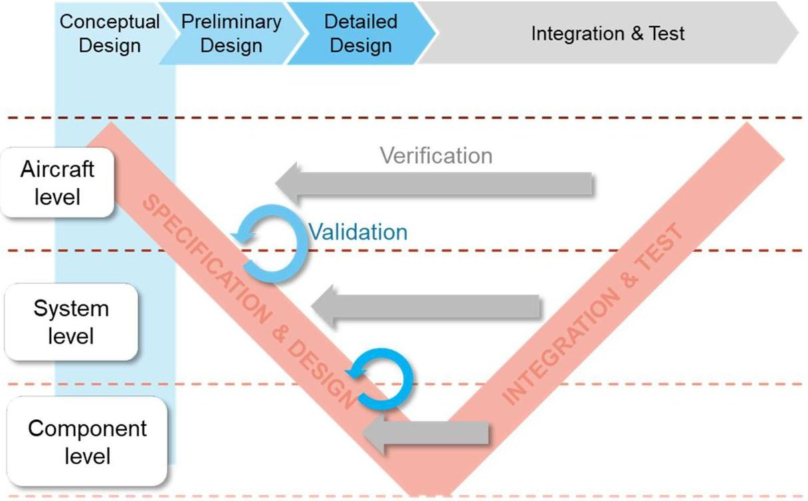

Figure 1-1: Aircraft development process represented on the V-cycle, adapted from [6]

Conceptual design is the earliest stage and is characterised by large design freedom but very little information about the design. Top level aircraft requirements (TLAR), derived from customer needs or marketing studies, set the design boundaries for the aircraft. At this stage, various aircraft configurations are generated and evaluated using low fidelity sizing and performance methods such as those presented in [8], [9]. These methods are mainly statistical in nature and are based on correlations derived from historical aircraft data. The aircraft configuration that best satisfies the TLAR is selected to proceed to the preliminary design stage. Traditionally, conceptual design utilizes up to 1% of the engineering effort during the development process and is characterized by high flexibility in design [10].

The conceptual design phase is where many design options can be explored. Practical considerations about design choices and their impact on aircraft integration and manufacture can be evaluated at this stage. An increase of effort during conceptual design is promising to reduce rework and costs incurred in preliminary and detail design stages. It is therefore imperative to

<!-- PDF_PAGE: 15 -->

ensure that optimal design choices are made in conceptual design. Moreover, the tools that support the early evaluation of aircraft concepts need to be adopted into the aircraft design process.

Aircraft systems such as flight controls, hydraulic, environmental control and electrical systems etc., contribute significantly (30%) to the operating empty weight, aircraft development costs, maintenance costs and indirectly to the direct operating cost through system weight [4], [8]. Aircraft systems fulfill many functions in the aircraft, involving that of providing redundancy to ensure safe and reliable operation. However, these are complex and highly integrated systems, featuring complicated interactions that allow aircraft operation at the required level of performance. As an example, aircraft environmental control systems, interact with aircraft power and avionics systems to allow cabin pressurization, thus ensuring passenger comfort.

Considering the importance of aircraft systems and their significant impact on aircraft performance, cost and operability, it is important to expect the synergistic development of aircraft systems during the conceptual design of the aircraft. However, this is not the case as systems design is traditionally relegated to the preliminary design stage where detailed models and sizing tools are applied. Systems development is typically the responsibility of a supplier or risk sharing partner to whom this task is subcontracted by the aircraft manufacturer. The complexity of aircraft systems often presents with issues during testing and integration, thereby contributing to development delays. This traditional approach further delays the integration of new technologies as new interfaces and interactions have to be dealt with. Therefore, aircraft systems need to be considered during conceptual design to reduce rework and integration issues later in the design process. Furthermore a comprehensive exploration of aircraft system architectures in conceptual design ensures that the system architecture best reflective of aircraft requirements is selected. Early consideration and selection of compatible system architectures ensures an efficient development

<!-- PDF_PAGE: 16 -->

process resulting in the development of aircraft with new technologies that can meet environmental targets and business needs.

## 1.1.1 Systems Architecting within the Aircraft Development Process

Aircraft Systems are crucial to the safe operation of any aircraft and contribute to establishing a comfortable environment for the passengers and the crew. Figure 1-2 shows the typical layout of flight control and environmental control systems for a large commercial aircraft. The inherent complexity of these systems is exemplified by the varied components, power systems, and distribution networks within the architecture. The flight control system (FCS) not only encompasses the means for actuating control surfaces but also comprises of multiple, redundant distribution systems for hydraulic power to be supplied to the actuator. In a similar manner, modern aircraft electrical systems include remote distribution units that are supplied by a redundant centralized power source. Aircraft systems are classified according to their function using the Air Transport Association - 100 (ATA) chapters [11]. Each chapter is associated with a specific function such as chapter 27 for flight control systems and chapter 21 for air conditioning and pressurization. This traditional approach of delineating subsystem responsibilities is insufficient to address the needs of emerging aircraft technologies. A shift to a cross ATA view is required and this is achieved by developing a system architecture. Aircraft system development is typically performed on a mono ATA basis and uses models and techniques adapted to each individual system once the overall architecture is defined. Additionally, system architecture baselines are used from past aircraft programs and data obtained from systems manufacturers.

<!-- PDF_PAGE: 17 -->

Typical Aircraft Flight Control & Power System Architecture

Modern Aircraft Electrical Distribution System Architecture

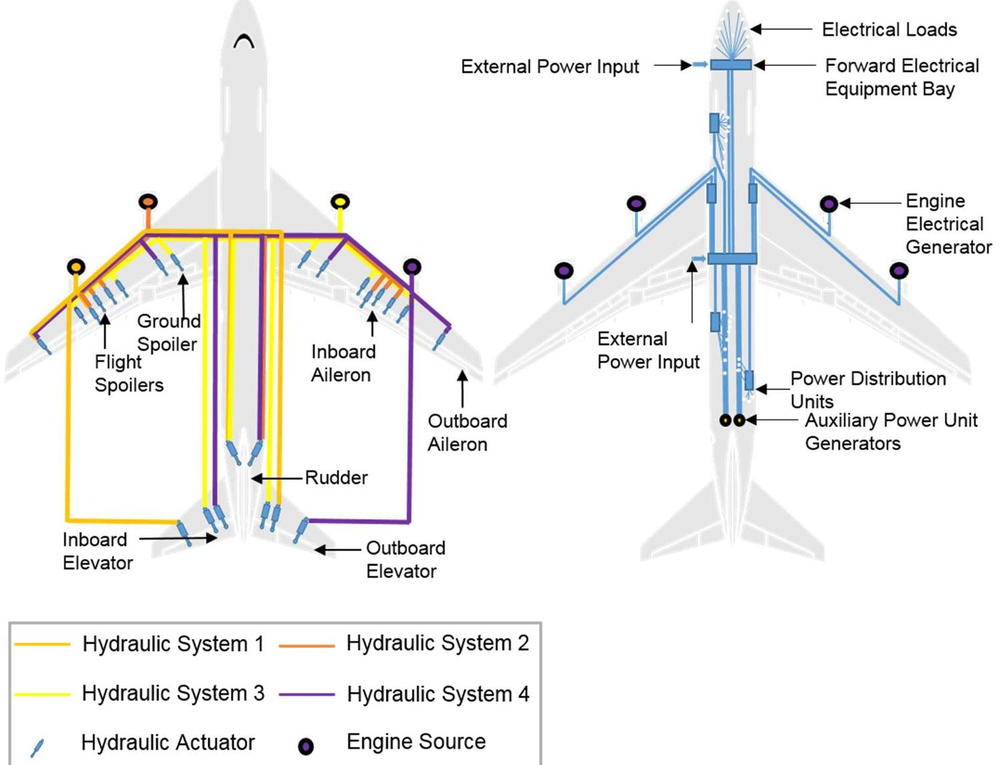

Figure 1-2: Typical layout of aircraft flight control and electrical systems for a large commercial aircraft, adapted from [12]

The reliance on design experience and historical data restricts the design freedom available and the selected subsystem architecture risks being very similar to that of previous aircraft [13]. Moreover, selecting subsystems architecture from established baselines precludes the possibility of adopting novel technologies and visionary configurations with different system architectures and subsystem level interactions. This implies that any rework to the system architecture still incurs a cost and time penalty compared to being done in the conceptual design stage. Furthermore,

<!-- PDF_PAGE: 18 -->

system architecture description done through flowcharts and diagrams at this stage, is unable to capture integration issues that present in later stages.

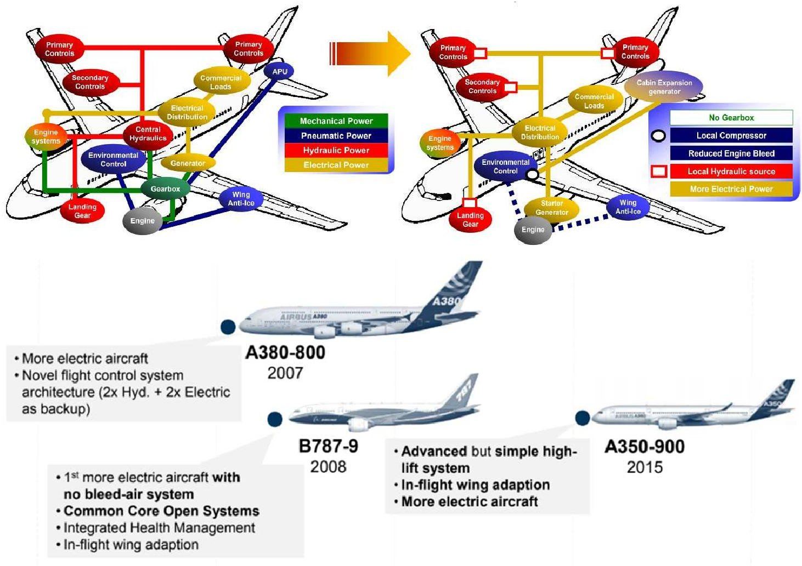

Figure 1-3: Switch to more-electric systems architecture, adapted from [14], [15]

The shift in the early 2000's to a More Electric Aircraft (MEA) philosophy and subsequently recent All Electric Aircraft (AEA) trends, have further exacerbated this problem as historical databases, statistical system weight equations and heuristic rules, gauging subsystem impact during early design are not available for new system configurations [16] -[18]. An earlier consideration of aircraft systems could help capture the full potential of these new technologies such as reduced system weight and increased efficiency [16], [19].

<!-- PDF_PAGE: 19 -->

Systems architectures needs to be comprehensively explored during conceptual design for several reasons:

1. To ensure that the chosen systems architecture satisfies requirements and is compatible with the aircraft configuration

2. To ensure that any integration, and installation effects are considered early in the design process to avoid costly rework and redesign

3. To ensure that safety considerations are addressed early in the design process

Methods to efficiently explore such large design spaces have been proposed in literature [20]-[23], but lack sufficient detail in the description of selected architectures. Clear architecture representation is required to ensure that the structure and interfaces of systems architecture with interacting systems is well understood. Moreover, the layout or geometrical positioning of systems architecture is important to understand installation effects. Additionally, the artefacts used to represent these architectures need to be operable in order to perform aircraft level analysis in terms of mass, safety and reliability. The ability to reuse these artefacts in further stages of design will help make the development process more efficient.

In summary, the aircraft development process can be made more efficient through the early exploration of aircraft systems architectures. One key gap in this architecting process is an efficient means for architecture representation and visualization. The use of clear, unambiguous and formalized representation of systems architectures is required throughout the development process to improve efficiency. The development of an architecture representation framework for the conceptual design process enables the efficient exploration of systems architectures early in the design process. An experienced engineer can easily discard architectures that are non-feasible by

<!-- PDF_PAGE: 20 -->

examining the arrangement and interfaces between system components. More importantly, formal architecture modeling enables important analysis, such as safety assessment and functional hazard analysis early in the design process. Investigation of a broad range of system architectures incorporating the latest technologies is thus made possible leading to the development of more efficient aircraft. Furthermore, a clear architecture representation allows integration issues to be identified early, thereby preventing costly program delays and making the product more competitive.

## 1.1.2 Traditional Systems Engineering vs Model-Based Systems Engineering (MBSE)

The aircraft development process as described by the V-model is part of an overall systems engineering approach. Systems engineering is a comprehensive approach to developing complex systems that focuses on capturing requirements, design synthesis followed by verification and validation at every step while concurrently considering the scope of the system from conception, operation to system retirement [24]. Systems engineering ensures that the components of a system work together to achieve its overall objectives [25].

In the case of aircraft systems architecting, Top Level Aircraft Requirements (TLAR) are transformed into system and item level requirements and are documented at each level. Additionally, aircraft system complexity is captured through detailed system models and interface control documents that specify the implications of networked systems. Moreover, architectures are generated, described and evaluated for attributes like cost, mass and safety. A system architecture's requirements and performance specifications are documented and provided to the subsystem developer. All these activities are performed by various development teams that often use the documented system information as a shared resource for their own developmental activities. However, since most of these documentation artifacts are paper based, the process is prone to error.

<!-- PDF_PAGE: 21 -->

A lack of formalization of processes and documentation convention results in a level of ambiguity in system architecture specification and interpretation, even when a system engineering process is followed. These issues result in costly design iterations and rework through the development process. Moreover, aircraft subsystem development is subcontracted to suppliers for all around the world. The manufacturer must ensure that the suppliers are provided with accurate information about the system architecture and interfaces. Additionally, if subsystems that are developed by different suppliers have interfaces, an interface specification is required to ensure later integration. Moreover, any changes made to system architecture from the aircraft manufacture needs to be tracked and reflected in all the documents provided to each stakeholder. A paper-based systems engineering process is very cumbersome in this manner and an integrated solution is required that can make the system engineering process more efficient.

MBSE replaces the plethora of documents encountered in paper based systems engineering with a system model that is comprehensive in terms of system specification, analysis and verification information [26]. A model-based approach is one in which software models are used to develop or specify an application or platform. In this regard, the International Council on Systems Engineering (INCOSE) defines Model Based Systems Engineering (MBSE) as "the formalized application of modeling to support system requirements, design, analysis, verification, and validation activities beginning in the conceptual design phase and continuing throughout development and later life cycle phases"[27]. The system model specifies the interaction, interfaces between system components and among system functions. It enables the formalized specification of component requirements that are shared with suppliers and subsystem developers, either by directly sharing the system model or through automated documentation. Furthermore, the system model can also be used to generate simulation models for computational analysis and

<!-- PDF_PAGE: 22 -->

to evaluate system performance. Communication is made more efficient as designers can clearly elicit system interactions and share information pertinent to their own system with other development teams. A clear understanding of what the system does and how its individual components are aligned to satisfy requirements is achieved using Model Based Systems Engineering practices.

The motivation for exploring a formal MBSE approach to the system architecture representation and visualization stems from the trend in the industry to use these methods more widely However, most MBSE applications in systems architecting are mainly in the preliminary design stage [28], [29]. The challenges for using MBSE during conceptual design are twofold:

1. The definition of system architecture at multiple levels of abstraction in an MBSE formalism is complex. Generally, various levels of analysis include operational analysis, functional analysis, logical and physical architecture definition and requirements management

2. A lot of time is spent to agree on “how” these analyses are to be performed. As an example, various functional decomposition of aircraft and its systems have been established, but no standard exists to formalize this process.

Due to these two reasons, the formal system architecture definition which is also known as architecting is often skipped until a limited number of architecture candidates are identified. However, using an efficient and adapted MBSE framework during aircraft conceptual design to define, represent and visualize aircraft system architectures can reduce work in later design phases during validation and verification.

<!-- PDF_PAGE: 23 -->

## 1.2 Thesis Scope & Objectives

This thesis presents an MBSE approach to build representations of aircraft system architectures in conceptual design for the limited scope of the primary flight control system (PFCS). This scope is shown in Figure 1-4 and addresses the interaction between primary flight control, and the associated power and actuation systems. The flight control system architecture and its major power interface is chosen as an example of sufficient complexity to illustrate the methodology which can also be applied to other systems.

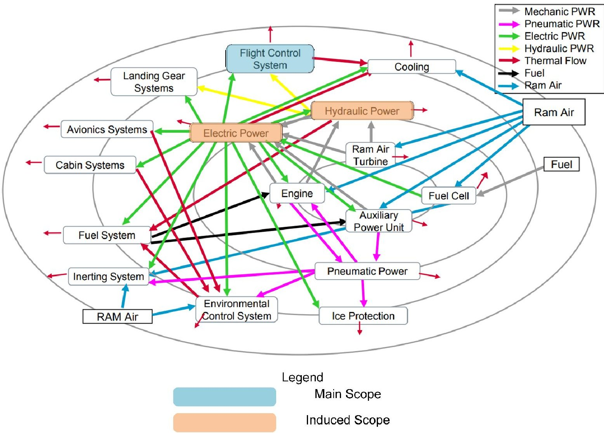

Figure 1-4: Aircraft systems interaction characterized as energy flows, adapted from [30]

Primary flight control system architecture choices are directly driven by aircraft configuration. For instance, a flight control system architecture is composed of choices reflecting the number of actuators per surface, type of actuator and number of surfaces requiring actuation. All this is then

<!-- PDF_PAGE: 24 -->

tied together by allocating power sources such as hydraulic and electric power to each actuator while satisfying safety considerations such as redundancy, system segregation and independence. This system is representative of the complexity of aircraft systems as it lies at the nexus of different types of control, power and information chains.

Furthermore, the definition of flight control architecture involves choices of actuation technology which drives the nature of the power system and its overall association with the aircraft configuration. This set of architectural combinations is called a design space and in the case of PFCS it is expansive. The contribution of the presented work is to develop a generic set of architecture representations and modelling elements within the open source Architecture Analysis & Design Integrated Approach (ARCADIA)/Capella MBSE framework. These developed artefacts allow the creation of PFCS architecture representations in Capella during the conceptual design process.

The following research questions are addressed:

1. How can MBSE be used efficiently to help in system architecture design space exploration, within the scope of the PFCS?

2. Does MBSE help in establishing system architectures in conceptual design?

3. How can variability in the design space be represented using Capella?

<!-- PDF_PAGE: 25 -->

## 1.3 Organization of Thesis

This thesis is structured as follows. Chapter 2 provides the state of the art in aircraft system architecting and architecture representation techniques. Chapter 2 also identifies key criteria required for representing aircraft system architecture in conceptual design. Chapter 3 introduces a multi-level modelling methodology in the ARCADIA/Capella MBSE environment for representing system architectures in conceptual design. Chapter 4 shows the application of this methodology to several examples of primary flight control system architectures. Chapter 5 details concluding remarks and outlines a scope for future work.

<!-- PDF_PAGE: 26 -->

## 2 State of the Art

This section covers the state of the art in aircraft systems architecting, architecture representation and introduces Model Based Systems Engineering (MBSE) applications.

## 2.1 Systems architecting in early aircraft design

System architecting is the process of developing different architecture configurations for a given aircraft system. This is done through an activity called Design Space Exploration (DSE) which constitutes the enumeration, representation and evaluation of all possible architectural design solutions. This process identifies all possible combinations of system components to develop a list of candidate system architectures. Feasible system architectures are then evaluated and a solution architecture that satisfies the requirements is found. Design space exploration is broken down into three distinct activities, which are shown in Figure 2-1.

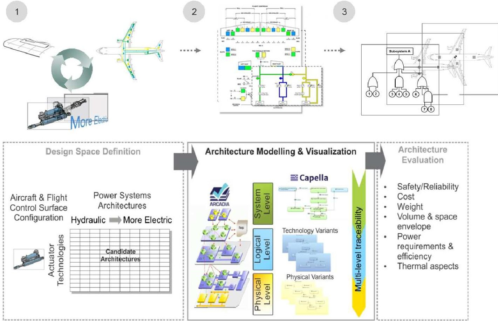

Figure 2-1: Activities during design space exploration

<!-- PDF_PAGE: 27 -->

These are:

## 1. Design Space Definition

In this phase the boundaries of the design space are set. These could be in terms of weight or performance metrics, top level aircraft requirements and technology choices. In the case of PFCS, the design space is characterized by the choice of actuation technology, control surface and power system architecture. Some of these combinations are unfeasible from a technological, integration or performance point of view and some combinations may be inconsistent. Therefore, an aspect of design space definition also involves down selecting unfeasible configurations independent from the architecture evaluation phase.

## 2. Design Space Representation

This phase consists of the modelling and visualization of the selected architectures. System interfaces and exchanges are represented in various diagrammatic forms to aid the development process. This is explored in further detail in section 2.3.

## 3. Architecture Evaluation

Architecture evaluation comprises of activities aimed at eliciting system architecture performance features such as safety, cost and weight. For instance, the power requirements for a system are driven by system sizing, which is in turn influenced by the aircraft configuration and its mission. The flight control system on larger aircraft require more power because they feature more control surfaces and respond to larger control demands compared to a small aircraft. System power is drawn from the engine and therefore power requirements directly affect aircraft performance. Architecture evaluation therefore determines system size, power requirements and the effect of the

<!-- PDF_PAGE: 28 -->

system on overall aircraft performance. Following architecture evaluation, the system architecture with desirable performance is selected and explored further in preliminary and detailed design stages.

Although the stages comprising design space exploration are distinct, there are often overlaps such as in the case of design space definition and evaluation, where some of the architectures that are generated may be evaluated for feasibility. Furthermore, some techniques for architecture definition also have a component of representation and visualization such as functional breakdown which will be discussed in section 2.1.3.

## 2.1.1 Design Space Definition

Design space definition involves the enumeration of all possible design configurations using combinatorial or other methods. The number of generated candidate architectures are often very large (to the order of $ 1 0^{9} $ combinations) and difficult to understand in the absence of a formal representation framework. Unfeasible system architectures need to be filtered out using automated methods so that only the interesting or equivalent alternatives may be examined in greater detail [31].

Certain techniques have been developed to handle complex design spaces that feature combinations of concepts using different technology options. As shown in Figure 2-2 the design space consists of architectures featuring combinations of control surface configuration, actuator type and power type. General Morphological Analysis (GMA), as described by [32] can be used to explore relationships within large problem spaces and help generate system architectures [32], [33]. A morphological matrix, also known as a matrix of alternatives generates many different concepts by allowing the variation and combination of individual system elements [34].

<!-- PDF_PAGE: 29 -->

Categories consisting of architectural options are created and combinations are made by selecting an option within each category to define a system architecture. In the case shown in Figure 2-2, the control surface is a category and the various types of surfaces such as elevator, aileron and rudder are the available options.

<table border="1"><tr><td>Control Surface</td><td>Actuator Type</td><td>Power System</td><td>Backup</td><td>Configuration</td></tr><tr><td>Aileron</td><td>HMA</td><td>Hydraulic</td><td>RAT</td><td>Single</td></tr><tr><td>Elevator</td><td>EBHA</td><td>Hydraulic</td><td>Electric</td><td>Dual-Tandem</td></tr><tr><td>Rudder</td><td>HMA</td><td>Electric</td><td>Hydraulic</td><td>Single</td></tr><tr><td>Flight Spoiler</td><td>EMA</td><td>Electric</td><td>Hydraulic</td><td>Dual</td></tr></table>

Candidate PFCS Architectures

A1: Aileron - 1XHMA - 2 Hydraulic Systems

A2: Flight Spoiler - 2XEMA - 1 Electric, 1 Hydraulic Backup System

HMA - Hydromechanical Actuator

EBHA - Electric Backup Hydraulic Actuator

EMA - Electro Mechanical Actuator

RAT - Ram Air Turbine

PFCS - Primary Flight Control System

Figure 2-2: Morphological matrix for flight control system architectures- showing population of candidate architectures

An option selected from each category comprises a system architecture as shown in Figure 2-2 where an aileron is equipped with one hydro mechanical actuator (HMA) which is fed by two hydraulic systems. Realizing that incompatibilities may exist in such a large design space, pairwise comparisons are performed to eliminate unfeasible architectures.

The Interactive Reconfigurable Matrix of Alternatives (IRMA) extends the GMA by providing an interactive visualization of the trade space by clearly displaying all combinations. A compatibility matrix allows for incompatibilities to be tested and a set of filters down-selects the candidate architectures to a workable number [34]. The example shown in Figure 2-3 highlights the incompatibility between an electromechanical actuator (EMA) and a hydraulic source. These types of incompatibilities can be eliminated to reduce the number of candidate system architectures.

<!-- PDF_PAGE: 30 -->

IRMA makes it easier to reduce the design space to a set of promising concepts that are then analysed further to determine the best option.

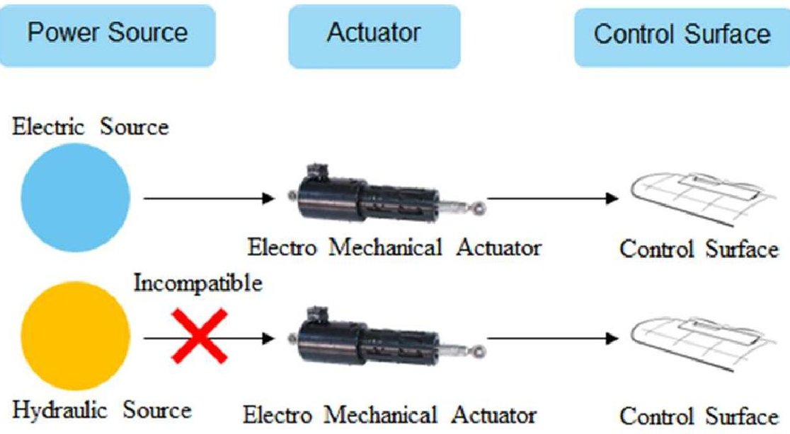

Figure 2-3: Typical incompatibilities in candidate architectures

The IRMA includes aspects of enumeration and selection as options are automatically deselected if they are found to be incompatible with a previous selection. Combined with the use of top-level filters like technology readiness levels and compatibility metrics, the IRMA presents a flexible solution for concept enumeration. The methods presented so far deal with manual enumeration and elimination of unfeasible systems architectures. Automation of this process can allow faster exploration of the design space, especially if unfeasible architectures are easily identified. Stochastic optimization approaches such as Genetic Algorithm (GA) and Selected Annealing (SA) have been applied to aerospace vehicle design space exploration [23]. They have been shown to perform well in exploring the design space during conceptual design for a wide range of applications including aircraft and space launcher architectures [35] $ ^{[3 9]} $ . However, these approaches are unable to handle incompatibilities and concept hierarchy. This is especially pronounced as the number of incompatibilities scale with the size of the design space [34]. Other

<!-- PDF_PAGE: 31 -->

methods based on artificial neural networks and genetic algorithm are available that allow the optimization of the design space but these lie outside the scope of this thesis [40], [41].

A component of architecture evaluation also exists within design space definition. Integrated approaches perform sizing of aircraft systems based on aircraft requirements and then evaluate their impact on aircraft performance. This type of evaluation is typically done in the preliminary design stage when the system architecture is known and the function based approaches presented in section 2.1.2 aim to bring this towards the conceptual design and early preliminary design stages.

## 2.1.2 Architecture Evaluation

The evaluation of system architectures in terms of attributes such as safety, cost, weight, installation constraints and power requirements can help identify the most suitable system architecture for the aircraft. Aircraft manufacturers often rely on regression-based methods to estimate aircraft weight. Aircraft systems are approximated in terms of their mass contributions, based on historical data and empirical expressions found in classical design texts such as in [8] and [9]. Such methods are of low fidelity and are sensitive to a limited number of design parameters. Moreover, regression models based on historical aircraft data are not applicable to the design of emergent aircraft concepts such as MEA and AEA. Statistical approaches based on historical data are useful when operating in a familiar subset of the design space. However, more rigorous methods are required to evaluate the impact of subsystems architecture at an early stage. A summary of medium fidelity approaches to the modelling and sizing of subsystems architecture is presented in [42].

An integrated approach to determine the impact of aircraft power system architectures at the aircraft level is presented in [30] and [43]. This technique leverages the use of aircraft level functions to directly drive the sizing of subsystems based on satisfaction of functional performance

<!-- PDF_PAGE: 32 -->

requirements. This use of functions allows operation outside the traditional ATA chapters thereby opening the design space and allowing direct comparison of different architectures [43]. Although situated towards the early preliminary design stage, this approach incorporates functional analysis and functional decomposition, which are typically done at the aircraft level and in conceptual design.

A function based approach similar to [30] and [43] is presented in [42]. This approach is function based and defines interfaces for system models in order to capture interdependencies with interacting systems. It is a modular approach composed of generic system model elements backed by mathematical models to elicit system characteristics [42]. An advantage of this approach is that entire systems can be built from these individual system elements. Moreover, the exchange of system characteristics ensures a better understanding of the architecture and allows for more efficient synthesis. Individual components in an architecture are sized based on the inherent requirements of the systems they are connected to. Integration aspects are also taken into account by accumulation of individual weights and energy balances [42]. This approach focuses on modularity, extensibility and integration of system architecture with the aircraft configuration and allows for their integrated sizing. Furthermore, reusable model elements and the ability define system interfaces and interactions allow greater flexibility during the conceptual design phase. This shows that a function-based approach can bridge the gap between aircraft level specification and system level analysis thereby bringing system architecture definition into the conceptual design phase.

Another approach to evaluate aircraft systems architecture during conceptual design is to characterize the aircraft level performance impact of subsystems architectures. This is done by evaluating the vehicle level performance penalties like mass, drag and bleed air increments

<!-- PDF_PAGE: 33 -->

incurred by subsystem architectures. An approach for the integrated assessment of aircraft and novel subsystems architectures in early design is described in [16]. The effect of technological uncertainty in estimating the performance of novel subsystem architectures is captured and the progressive electrification of subsystems is also considered [16], [44].

Overall these integrated approaches allow consideration of attributes such as safety, cost and performance of system architectures. This enables decisions to be made on the selection of suitable system architectures for the aircraft. However, the defined system architectures are represented using rudimentary schemes such as textual descriptors, and often heuristic rules based on safety guidelines and aircraft data are used [45]. This is suitable for representing conventional architectures but ineffective for novel integrated system architectures for which operational data is scarce. Therefore a gap exists in the representation of aircraft system architectures in a conceptual design environment.

## 2.1.3 Function Based Approaches

The methods discussed in the previous section use combinatorial approaches that enumerate architectural candidates within the design space. Moreover, the scale of architectural options precludes efficient selection and architecture definition during aircraft conceptual design. Another challenge faced during design space definition is in the enumeration of novel system architecture configurations that may lie outside the traditional design space. Combinatorial methods operate within bounds set by technology, configuration and other such choices. This risks isolating novel system architectures. An abstract representation of the system is required to develop design solutions that are independent of any technology or implementation specific constraints. Function based approaches provide this solution as they enable the system to be built from a set of functions that are generic, traceable and not specific to any implementation. This allows the capture of a

<!-- PDF_PAGE: 34 -->

broader design space encompassing novel system architecture solutions. Furthermore, functionbased description of the system enables early evaluation of system safety as typical aircraft safety analysis requires a functional breakdown of the system.

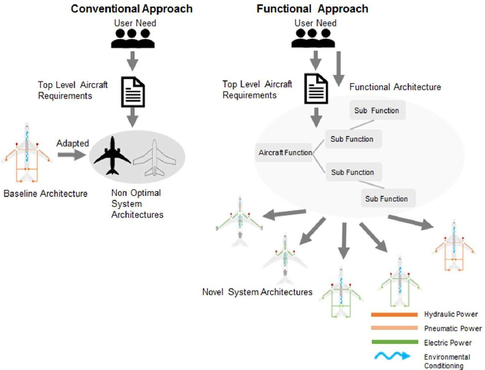

Figure 2-4: Conventional vs Function based system architecture definition

An abstract decomposition of a system, driven by the functions that the system must achieve allows a broad design space to be explored. Different system architectures can be defined that vary according to the chosen implementation. Moreover, this abstraction or breakdown of the system is driven by aircraft and system level requirements thereby ensuring that the defined architectures are not deviating from top level requirements. Figure 2-4 shows a comparison between the traditional approach of architecture description where a baseline systems architecture is adapted

<!-- PDF_PAGE: 35 -->

to an aircraft configuration that is derived from top level aircraft requirements and a function based approach. The function based approach highlights the abstract functional definition of the system architecture that is based on customer requirements and top level aircraft requirements. A variety of novel system architectures can then be derived from the abstract representation which are tailored to the particular aircraft. This form of abstraction is created using building blocks called functions. Functions can be broken down into functional hierarchies and exchanges can be defined between them, thereby creating a functional architecture. The process of identifying functions from requirements and relating them to create a functional architecture is called functional analysis [46]. Functional analysis is used to translate user and performance requirements into a set of tasks that need to be performed by the system. This helps establish an abstract view of the system while providing a platform to identify physical components that could perform those functions. Costly rework in later design stages can be avoided by identifying architectural incompatibilities before physical specification or integration of systems is performed [47]. Functional analysis prescribes a hierarchal approach of function decomposition from system to subsystem level functions. This allows a link between the top-level requirements to the system architecture at various levels of abstraction [48]. Functional analysis is therefore a fundamental tool in design space exploration and architecture definition [49].

Function based approaches, when used in conjunction with combinatorial analytics and other engineering approaches discussed in previous sections, help arrive at a list of feasible system architecture options. Enhanced function-based approaches, which deal with hierarchal functional breakdown, inter functional interaction and constraints have been shown to be successful in identifying feasible platform architecture options [50], [51]. These methods sort architecture options based on the complexity of functional interactions where less complexity is selected

<!-- PDF_PAGE: 36 -->

positively. Furthermore, function-based approaches have been used in aircraft systems design especially with recent trends towards establishing multifunctionality within the aircraft flight control system design [52] -[54]. Further application of function-based approaches to capture multifunctional aspects of the system architecture is shown in [55] where the functional architecture of a Blended Wing Body (BWB) aircraft is presented.

An important feature of function based approaches, as identified in [56]-[58], is that of functional induction. This is observed when a functional requirement that is fulfilled by a solution, in turn induces several other requirements. In this manner a functional chain is created which when implemented, provides the product level physical description [56]. Functional induction helps in understanding relationships between functional requirements and leads to modular architecture. Modularity in architecture is realized as a result of well understood physical and functional interactions. By providing the ability to induce new functional relationships, functional induction allows flexibility in capturing the effect of revolutionary technologies on systems architecture [56].

Another advantage of function based approaches is the ability to perform set based design. Set based design enables the concurrent exploration of design concepts throughout the design process [59]. Gradual elimination of concepts is performed until the best choice is identified. This is different from the traditional point based design approach where a single concept is developed in an iterative manner until it satisfies design requirements. Set based design allows narrowing of the design space by concurrently developing sets of solutions and eliminating unfeasible options through this process. A function based architecture definition is developed to serve as a template for different system implementations. The various architectures are evaluated in parallel until the most feasible architecture is identified. Figure 2-5 illustrates a set based approach where several functional architectures implementing a single aircraft function are developed concurrently. The

<!-- PDF_PAGE: 37 -->

architectures are evaluated and the selected architecture is used to derive several physical implementations.

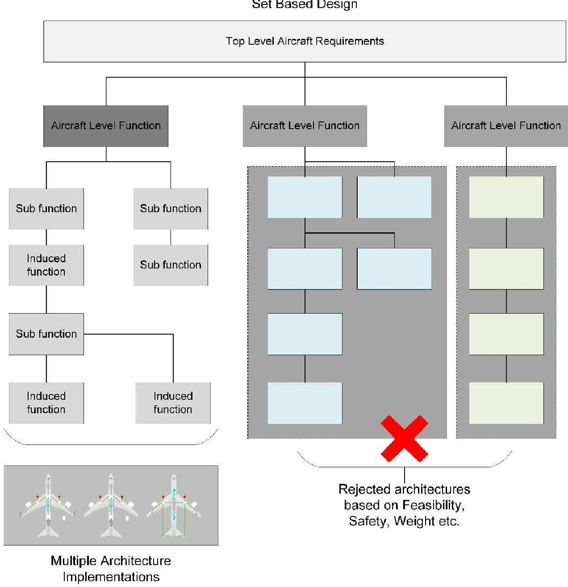

Figure 2-5: Application of set based design in systems architecting

Function based system architecture definition also supports evaluation such as safety analysis. This is shown in [60] where a function driven approach for the design and evaluation of flight control and power system architectures is presented. This approach performs a comprehensive synthesis and evaluation of flight control and power system architectures for a reference aircraft. Functional analysis is performed to determine aircraft level functions followed by allocation to aircraft control

<!-- PDF_PAGE: 38 -->

surfaces. Technology specific induced functions such as the type of actuation are also addressed. The synthesis of top level aircraft functions permits a concurrent safety analysis to be conducted. Failure conditions are identified at an aircraft level using Functional Hazard Analysis (FHA) and are then supported by Preliminary System Safety Analysis (PSSA and System Safety Analysis (SSA) [61][6]. A comprehensive composition of the design space and subsequent evaluation allows the consideration of architectural variants, which are then evaluated against safety objectives. Reliability Block Diagrams are used to represent failure events for a given architecture variant [60]. Overall this method is comprehensive in its utility of a function-based approach to synthesize and evaluate flight control system and associated power system architecture. As the flight control system architecture presents with complex interfaces, not restricted to the type of control employed and the power supplied to the actuation architecture, it is important to note the applicability of a function-based approach to capture variability in this context.

The applicability of function based approaches for aircraft system architecture definition have led towards efforts to standardize function based system architecting. The development of a set of core aircraft functions to support definition of system architecture at the aircraft level in conceptual design is presented in [62]. This early elicitation of functions in conceptual design is identified to improve maturity and reduce risk in subsequent stages. Moreover, the definition of functional architecture at the conceptual design stage would enable safety analysis and the early identification of failure conditions, which are typically performed later. Verification and Validation activities are also supported by means of having traceability between the decomposed functions Furthermore, the formalization of functional modelling by creating well defined functions and established semantics for functional exchanges is presented in [63]. This is important as; functional interpretation is subjective, and a functional model is a means of ensuring a coherent understanding

<!-- PDF_PAGE: 39 -->

of a complex system by all involved. The activity of defining unambiguous functional specification is time consuming and varies according to the domain of the model. Additional work on the mapping of functional models to simulation models is explored in [63],[64] but lies outside the scope of this thesis.

In summary, function based approaches provide a means to clearly define the systems architecture. A broad design space can be explored using generic function based representation which further supports set based design. The functional hierarchy and inter-functional relationships allow for a clear delineation of system interfaces. Furthermore, function based approaches support early validation activities such as system safety analysis which can be beneficial in evaluating system architectures when performed in the conceptual design stage. Therefore, a function-based representation of system architecture can help bridge the gap between architecture definition and evaluation, within the design space exploration of aircraft system architectures in conceptual design.

## 2.2 Model Based Systems Engineering

Aircraft development employs a systems engineering approach where requirements drive the development of the system by influencing architectural and technology choices. It is therefore imperative that requirements are captured efficiently during the functional analysis phase. Formalised systems engineering approaches such as the V-Cycle enable the development and verification of requirements at all developmental levels. Systems engineering methodologies such as Requirements-Functional-Logical-Physical (RFLP) support this process by enabling functional structures to be the link between requirements and physical implementation [62]. Additionally, the traceability established between different levels helps remove ambiguity and generates a clear understanding of the system. Interfaces are clearly defined and documented, and changes can be

<!-- PDF_PAGE: 40 -->

tracked. However, a formalized methodology for representation is yet to be established. Current practices enable the use of standard office tools (e.g. Microsoft PowerPoint or Visio) to describe system architecture through block diagrams, logic diagrams and textual specification. Moreover, complex systems may be spread across diagrams that make it hard to visualize and understand.

All these activities are performed by various development teams that often use documented system information as a shared resource for their own developmental activities. However, since most of these documentation artifacts are paper based, the process is prone to error. A lack of formalization of processes and documentation convention, results in a level of ambiguity in system architecture specification and interpretation, even when the abovementioned system engineering process is followed. These issues result in costly design iterations and rework throughout the development process. Moreover, aircraft subsystem development is subcontracted to suppliers all around the world with aircraft programs like the Airbus A380 having 200 major suppliers [65]. The manufacturer must ensure that the suppliers are provided with accurate information about the system architecture and interfaces. Additionally, if subsystems that are developed by different suppliers have interfaces, an interface specification is required to ensure later integration. Moreover, any changes made to system architecture from the aircraft manufacture needs to be tracked and reflected in all the documents provided to each stakeholder. A paper-based systems engineering process is prohibitive in this manner and an integrated solution is required that can make the system engineering process more efficient.

Model based system engineering is the formalized application of modelling to support the system engineering process [27]. MBSE facilitates the generation, management and dissemination of information pertaining to the developmental activity within a system engineering process [66]. This is important for the development of complex systems as the process generates a large amount

<!-- PDF_PAGE: 41 -->

of information and involves communication between often geographically disparate multidisciplinary teams.

## 2.2.1 Advantages of MBSE

The key advantages of MBSE as discussed by [26] and [67] are enhanced communication, reduced developmental risk, improved quality and increased productivity. A model-based approach ensures a formalized interpretation of the system model by all stakeholders, thus ensuring more efficient communication of system information. Ambiguity is removed from the design process as the system model is communicated in a formalized modelling language across all design teams [67] The ability to create stakeholder specific views of the system from a centralized system model addresses integration throughout the design process. MBSE applies formalized modelling to the traditional SE process and therefore supports validation and verification of requirements throughout the process at various level of system abstraction [67]. This ensures that the system design adheres to requirements and the synchronous development of subsystems mitigates integration issues in later stages. MBSE is not process specific and ensures that all information about the system design is contained in a model repository thereby leading to a more consistent development process.

<!-- PDF_PAGE: 42 -->

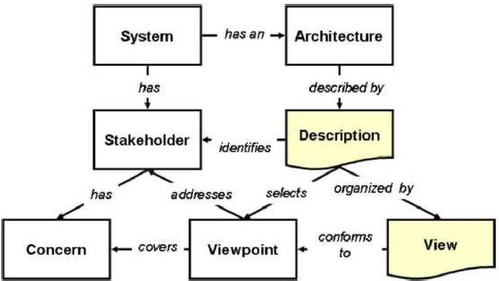

Figure 2-6: Role of viewpoints in systems engineering, from [26]

An overview of present MBSE methodologies and current industry applications is presented in [68]and [69]. Practitioners of MBSE have reported clarity in understanding the design problem, informed requirements development and fast concept design [70]. MBSE has gained widespread adoption at NASA following initial recommendations on the need to implement MBSE during project formulation, based on lessons learnt during the Constellation program [71]. The Jet Propulsion Laboratory (JPL) has also deployed MBSE, motivated by a need to improve product and mission quality and also to reduce costs [72]. MBSE has been applied in trade space exploration for fractioned satellite architectures at JPL[72]. Moreover, the Europa project- a satellite reconnaissance mission of Jupiter's moon Europa - uses MBSE for all system engineering activities such as requirements derivation, traceability, verification, metrics and document generation [73]. Therefore, MBSE has been widely adopted for the development of highly integrated systems within diverse domains. The following section discusses the application of MBSE to aircraft systems architecting.

<!-- PDF_PAGE: 43 -->

## 2.2.2 MBSE Applied to Aircraft System Architecture Definition

A model-based approach for the functional specification of an aircraft Environmental Control Systems (ECS) is presented in [74] highlighting its advantages over conventional paper-based approach. It also discusses how MBSE can ensure consistent, clear and easily validated specifications. An approach to develop a specification of an Integrated Modular Avionics architecture using an MBSE methodology is discussed in [75]. The use of MBSE for the integration of avionics and aircraft fuel systems is detailed in [76] and [77].

MBSE has also been used for the platform based synthesis of small unmanned air vehicle systems (SUAS) [78]. Advantages in collaborative design by using MBSE have also been identified in this application. MBSE system specification is validated using simulation tools in a case study featuring the development of an aircraft landing gear brake system [79]. The use of a model-based approach to capture mission options, interfaces, and physical decomposition as well as for carrying out analyses such as mass and power estimates on the Europa Clipper project is documented in [80].

MBSE has gained adoption in industry with major Original Equipment Manufacturers (OEM) such as Rolls Royce and Boeing reporting advantages of using an MBSE approach to design [69]. Boeings implementation of MBSE in the development of digital aircraft networks has been seen to reduce development time and identify design errors early[81]. MBSE has also been recognized as a tool to capture and manage the increasing complexity of automotive systems [82].

Overall, MBSE is suited to managing complexity and increasing the efficiency of the development process by capturing information and representing it in stakeholder specific views. A system model serves as a single source of truth in the development process, thus removing ambiguity and ensuring coherency in the design process. A model-based approach ensures complete traceability

<!-- PDF_PAGE: 44 -->

and management of requirements on a large scale and is a solution to many of the problems faced by the traditional requirements-based approach [82].

## 2.2.3 Commonly Used MBSE Tools

Model based systems engineering is the paradigm of using system models to support system engineering activities. A model is a representation of the system in a textual, physical, mathematical or logical form [83][84]. The two major types of models used in MBSE are:

## 1. Descriptive Models

Descriptive models are used to represent logical relationships such as the exchanges between different system components and functions. Furthermore descriptive models represent the logical and physical architecture of the system [83].

## 2. Analytical Models

Analytical models represent a system and its characteristics through equations, rules and other direct relationships. These models are used in developing simulations to validate system performance characteristics. A system model may be an analytical, descriptive or a combination of both in order to represent the various views of the system. For example, a system model can support descriptive specification which can be mapped to a simulation model to test performance. Furthermore, safety, reliability and performance views can be elicited from the system model.

MBSE is supported by the application of Model Based languages, tools, processes and frameworks as shown in Figure 2-8. The MBSE effort is most effective when all these components are applied synergistically [85] . The predominant system modelling languages are:

<!-- PDF_PAGE: 45 -->

## 1. Unified Modelling Language (UML)

The UML is a visual modelling language specifically for specifying, documenting and visualizing software systems architecture [86]. UML relies on graphical notations and artifacts to represent complex software systems. The UML diagram suite provides a systematic means of presenting clear stakeholder specific views of the system. UML is widely used in software engineering to develop object oriented software. A few UML concepts and diagram are also found in the SysML standard as shown in Figure 2-7.

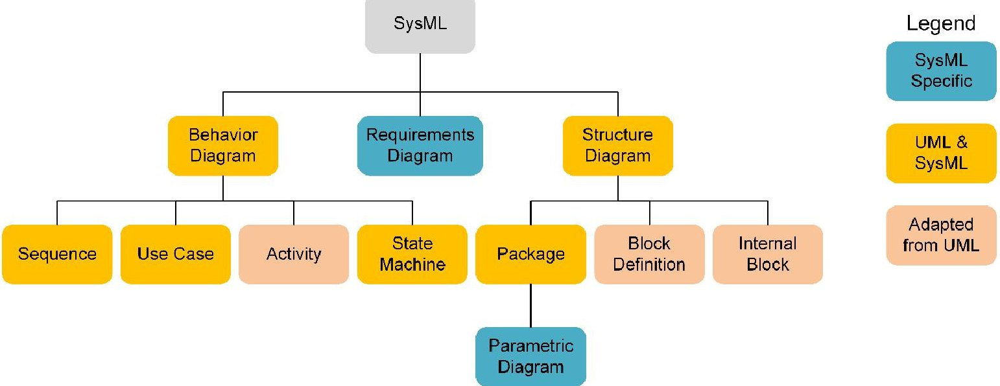

Figure 2-7: Diagrams available in UML and SysML, adapted from [87]

## 2. SysML (Systems Modelling Language)

SysML is a graphical modelling standard that extends the capabilities of UML for system engineering applications. Moreover, SysML retains a set of diagrams from UML and presents modified versions of others. SysML is widely used in the systems engineering community and is implemented by a majority of model based systems engineering tools. Table 1 presents an overview of MBSE tools and modelling standards in use; most of these tools implement the SysML standard and are integrated suites that support system engineering activities such as requirements

<!-- PDF_PAGE: 46 -->

engineering, architecture definition, verification, validation and model simulation. Cameo Systems Modeller, Rhapsody and Core are some of the more prolific solutions although ANSYS SCADE and the Modelica suite also have enriched capabilities.

Table 1: List of common MBSE tools and implemented modelling standards

<table border="1"><tr><td>Tool</td><td>Publisher</td><td>Modeling Standard</td><td>License</td></tr><tr><td>Cameo Systems Modeler</td><td>NoMagic</td><td>SysML</td><td>Proprietary</td></tr><tr><td>Innoslate</td><td>Spec Innovations</td><td>SysML&amp;DoDAF</td><td>Proprietary</td></tr><tr><td>Rhapsody</td><td>IBM</td><td>SysML&amp;UML</td><td>Proprietary</td></tr><tr><td>Enterprise Architect</td><td>SPARX Systems</td><td>SysML</td><td>Proprietary</td></tr><tr><td>Core</td><td>ViTech</td><td>SysML&amp;DoDAF</td><td>Proprietary</td></tr><tr><td>ANSYS SCADE Architect</td><td>ANSYS</td><td>SysML</td><td>Proprietary</td></tr><tr><td>Modelica and Dymola</td><td>Dassault Systems</td><td>Modelica</td><td>Proprietary</td></tr><tr><td>Capella</td><td>PolarSys</td><td>ARCADIA</td><td>Open source</td></tr></table>

The choice of an MBSE tool depends on the nature of the application or system being developed. However, as mentioned earlier, the effective use of an MBSE paradigm requires a modelling language, tool, and process and architecture framework. This is represented in Figure 2-8 where all these aspects are shown to be synergistic to the development of a system model.

A standardized modelling language is required to be implemented by a tool. Most of the MBSE solutions in Table 1 use UML or SysML except for Capella. Furthermore, the definition of a systematic process to develop system models is required to ensure clarity and a shared understanding of the system between engineering teams. This is however, not prevalent among the available MBSE solutions where the tool and process are separate.

<!-- PDF_PAGE: 47 -->

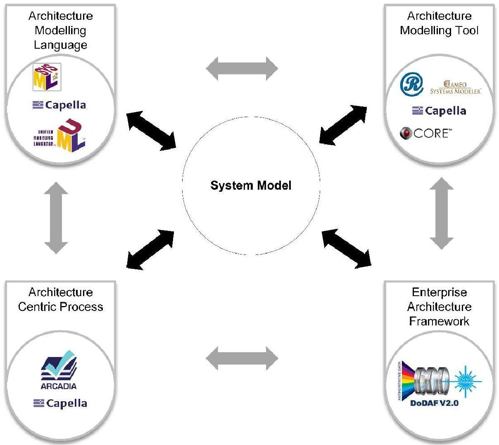

Figure 2-8: Facets of an MBSE modelling environment

The tool solely implements the modelling standard and does not specify a process of model development. For example, most of the tools in Table 1 implement a standard modelling language i.e. SysML, and do not have a native modelling methodology. However, ARCADIA/Capella provides an integrated tool, methodology and modelling environment that allows the complete definition of the system from requirements to physical architecture in one solution. It is also developed and maintained by an open source consortium with a wide online user base. ARCADIA/Capella has been field proven by Thales and has attracted attention from the industry. Its extensibility and integrated capabilities make it an attractive MBSE solution and is the tool of choice for this thesis. More details about ARCADIA/Capella are provided in the following section.

<!-- PDF_PAGE: 48 -->

## 2.2.4 ARCADIA/Capella

The ARCADIA MBSE methodology is a structured modelling framework aimed at defining and validating the architecture of complex systems [88]. The development of ARCADIA was spurred on by Thales' transition from a supplier to one of a systems integrator across aerospace and other domains [89]. This required a shift from a reliance on customers to issue a need in terms of technical specifications to one where operational capabilities would have to be provided by employing architectural features [89]. Internal reviews of all engineering divisions revealed that a methodology allowing for better analysis of customer requirements was required. Architecture definition was expected to play a major role in improving the effectiveness of engineering and system integration [89]. Improvement of the V&V process by ensuring a clear understanding of the system at all engineering levels was envisioned. Moreover, architecture defects and incompatibilities needed to be detected early in the design process. All these considerations formed the basis for the development of the ARCADIA methodology. ARCADIA uses the concept of a viewpoint to ensure verification of the architecture by all engineering specialities. The methodology and modelling process is common to all stakeholders and the product is represented in the system model. Models at different levels are linked with one another and joint elaboration of models between different engineering levels is supported [88].The modelling process is set up in a manner that facilitates the capture of operational needs of the stakeholders, enabling a structured engineering process and final Integration Verification and Validation (IV&V) of the system. ARCADIA has been shown to be extensible to different engineering disciplines and business units within Thales and is being adopted by the engineering community at different scales.

<!-- PDF_PAGE: 49 -->

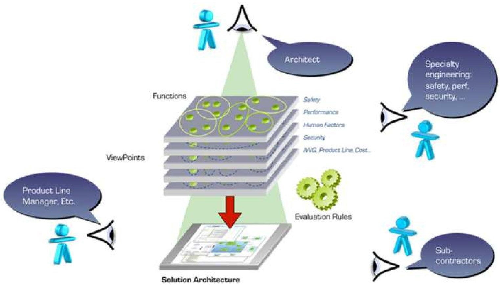

Figure 2-9: Viewpoints based approach in ARCADIA, adapted from [90]

Figure 2-9 shows the organization of the ARCADIA methodology as a system architecture envisioned by the architect is verified against requirements at all engineering levels and is finally transformed into a specification for the solution architecture provided to subcontractors or engineering units for implementation. The modelling process and various levels present in the ARCADIA methodology are explained below:

ARCADIA focuses on using functional need analysis to drive engineering activities. Requirements are converted to functions and functional exchanges; states and data flows are well defined [91]. ARCADIA is tool agnostic but is supported by the Capella workbench that provides features to develop models and manage complexity. Filters, replicable elements and copy-paste functionality among others allow for a familiar user experience. Capella is based on Melody Advanced which is Thales' internal tool implementing ARCADIA. The ARCADIA methodology uses familiar

<!-- PDF_PAGE: 50 -->

engineering semantics such as functions, components, data etc. to ensure easier user adoption [92]. Key phases in ARCADIA are the understanding of user needs followed by the development of a solution. The needs of the user are supported by Operational and System analysis where Requirements are converted into well-defined user needs. Solution architectures satisfying these needs are developed by creating Logical and Physical architectures. A suite of diagrams can be generated from the model allowing for representation according to different system views. Figure 2-9 illustrates the different engineering levels available in ARCADIA.

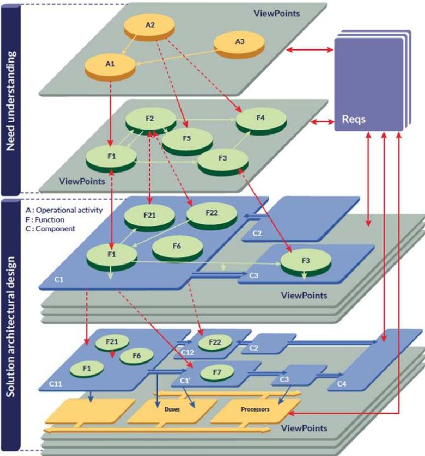

Operational Analysis What the users of the system need to accomplish

Functional & Non Functional Need What the system has to accomplish for the users

Logical Architecture How the system will work to fulfill expectations

Physical Architecture How the system will be developed and built

Figure 2-10: Viewpoints based approach in ARCADIA, from [90]

<!-- PDF_PAGE: 51 -->

The different engineering levels in ARCADIA are elaborated as follows:

## 1. Operational Level

The Operational level is where stakeholder needs are identified. The needs and tasks of system users are outlined at this stage through modelling artifacts called Operational Activities. The pattern of definition at any level in ARCADIA follows the creation, transfer and allocation of artifacts. The Operational Architecture Diagram (OAB) is used to create an operational architecture detailing the operational activities, entities and actors involved in using the system. These are then transitioned to the system level to develop the system architecture.

## 2. System Level

The system level in Capella responds to the requirements captured in the Operational Analysis phase. This level helps to determine what the system will accomplish for the user. The functional architecture of the system comprising of function definition and allocation is introduced at this level. Initially the functions are defined in a System Function Breakdown Diagram (SFBD), (See Appendix B) using the system analysis workbench in Capella. Here, functions are assigned to top level functions to form a functional hierarchy Figure 3-6 shows the top-level functions for a flight control system.

The top-level functions are split into three sub-functions along each axis of control, i.e. pitch, roll and yaw. Functions that interact with the system but are outside its scope such as the actor functions shown in blue are also defined. Following the definition of functions, a functional dataflow diagram is created using the System Data Flow Blank (SFDB) feature in Capella. This outlines the exchanges between the sub-functions that implement the top-level functions. Using these diagrams in Capella ensures that the functional architecture is well defined and the relationship between

<!-- PDF_PAGE: 52 -->

functions is well documented. Moreover, the exchanges between functions are traceable and available at subsequent levels of abstractions. This ensures that a functional architecture represented is well defined, unambiguous and completely traceable. A clear definition of functional architecture using Capella diagrams also supports activities like Functional Hazard Analysis in conceptual design. Thus, a multi-level approach supported by a structured framework of diagrams for architecture definition and representation in Capella, ensures clarity in the developed representations.

## 3. Logical Level

The logical level is the third level of abstraction in Capella and deals with the definition of logical components and the assignment of functions to these components. Once the system architecture is defined, the automatic transfer capability in Capella ensures that the system functions are transformed into logical functions. All exchanges and relationships between functions are preserved in this process thus ensuring traceability between different levels. The logical architecture address the way in which the system will work to achieve its requirements. A Logical Architecture Breakdown (LAB) diagram is used to outline logical components and define relationships between them. It is important to note that at all of ARCADIA's engineering levels follows a series of steps starting with , function definition, logical or physical component creation followed by the allocation of functions to components or in some cases components to parent components.

## 4. Physical Level

The Physical level is the final level in this hierarchy, where components representative of physical implementation are defined. This level describes how the system will be developed and

<!-- PDF_PAGE: 53 -->

constructed. The same flow of logic is applied wherein logical elements and functions are transferred, physical components are defined following which, the logical elements are allocated to these physical components. All exchanges and relationships defined between components at any of the previous levels are preserved and changes can be reflected using the transition feature in Capella.

## Applications of ARCADIA/Capella

The ARCADIA methodology has been applied to modelling of an end to end earth observation system as part of an exercise for its adoption at Thales Alenia [93]. ARCADIA has been field proven as it has been adopted internally by THALES based on its application in the development of complex systems. One such example is the application to the architecture definition of a Nuclear power plant [94]. It was found that ARCADIA possessed the flexibility for the development of complex systems such as fluid simulation and control systems. The ARCADIA methodology has also been used in aircraft systems architecture description for applications in ECS and flight control systems [75], [95]. Furthermore, the feasibility of developing a system architecture specification for aircraft high lift systems using top down and bottom up approaches is demonstrated in Capella [28]. These applications are situated in the conceptual design phase and concern key aircraft systems. Building on these applications this work will evaluate the feasibility of ARCADIA/Capella to system architecture description in conceptual design, focusing on the primary flight control system as the system of interest.

## 2.3 Architecture Representation

A review of current methods for design space exploration reveals that a gap exists for the efficient representation of aircraft systems architectures in conceptual design. Aircraft systems are complex and are characterized by interactions among the many subsystems that are present. Architecture

<!-- PDF_PAGE: 54 -->

representation enables a clear and unambiguous presentation of system interfaces, exchanges between system components and those with other system elements as well. This develops a unified understanding of the system among all stakeholders in the design process. The conceptual design stage is characterized by the development of sketches, representations and layouts of aircraft configuration and basic systems architecture. The location of control surfaces, power plants and other aircraft configurational choices is formalized through these diagrams and sketches.

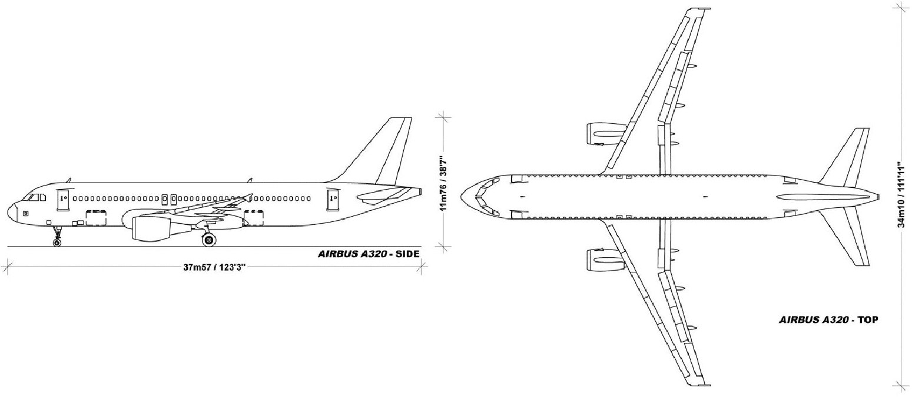

Figure 2-11: Airbus A320 layout with control surface placement, adapted from [96]

Systems architecture is elaborated in detail during preliminary design. System components are placed within 3D aircraft models in a Computer Aided Design (CAD) environment to check for installation and routing concerns. The detail design stage features elaborate engineering drawings that aid the manufacture of aircraft components. However, for aircraft systems, an architectural specification document that details system requirements, components and interfaces is provided to the subcontractor or risk sharing partner. The subcontractor then develops the system independently and provides it back to the aircraft manufacturer for integration. Layouts and flowcharts are used to detail the position of system components on the aircraft and to identify the

<!-- PDF_PAGE: 55 -->

exchanges between various components respectively. An Interface Control Document (ICD), that lists all system interfaces is the main means of detailing systems interaction and is provided to the system developer. Moreover, a technical specification indicating all system performance requirements is also provided along with the ICD.

Architecture representation also generates information that is beneficial to the design process. Topological representation of system architecture provides information about routing, wiring length and mass of the system. Additionally, a representation that deals with the breakdown of a system into its components allows safety and redundancy factors to be considered. In summary, architecture representation removes ambiguity in system architecture definition, promotes a shared understanding of the architecture and generates useful information about the system for use in the design process.

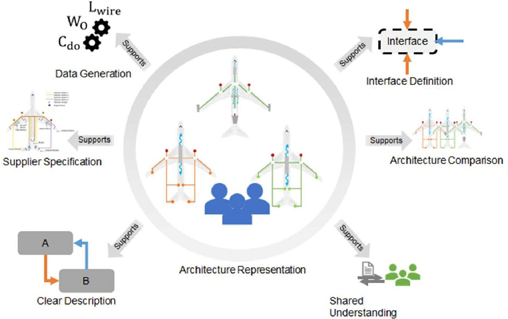

Figure 2-12: Activities supported by architecture representation

<!-- PDF_PAGE: 56 -->

Typically, architecture representation supports activities in conceptual design pertaining to the definition of aircraft configuration, layout and allocation of system components. In conceptual design, information about the system is not widely available and system architecture representations lack detail. More detailed representations are created during the preliminary design process. This implies that the representation artifacts created in conceptual design are not developed further in subsequent design stages. The continuous development of the system architecture representations introduced in conceptual design makes the design process more efficient.

Several activities performed in conceptual design stand to benefit from architecture representation at this stage. A key activity in this stage is the estimation of aircraft weight which is usually done based on handbook methods [8], [9]. More importantly, system weights are approximated based on regression analysis and are not representative of a system architecture choice. The use of architecture representation within a CAD framework enables the estimation of system weight by generating a weight buildup of individual system components. This type of representation also provides a topology of system components and the requisite wiring length for their installation.

System architecture flowcharts provide a detailed understanding of the system. A system specialist can garner pertinent system information from flowcharts that represent exchanges, interfaces and flows within the system. However, the broader context of the system, at the aircraft level is lost in this form of representation. The superimposition of system architecture to aircraft layout is also an effective way of ensuring a shared understanding of the system.

Present methods of creating architecture representations can capture various views of the system. These representations are time consuming to create and need to be justified by potential benefits to conceptual design activities. Moreover, an efficient means of generating architecture

<!-- PDF_PAGE: 57 -->

representation is required that allows for reuse of artifacts in further design stages. The activities that architecture representation in conceptual design supports are as follows:

1. Weight & Center of Gravity Estimation

2. System Architecture Layout Creation

3. Safety Analysis

4. Architecture Specification for downstream use

Present architectural representation means rely on static documents that capture information about the system in different diagrams and formats. These documents are time consuming to create and lack important features such as extensibility, modularity and traceability. Typically, such representations are created in general purpose tools like PowerPoint and Visio, which do not have the artefacts to capture the complex interactions in systems architecture. Despite the use of standard layout, diagrammatic views and computer aided drawings simplify this process, it is nonetheless time-consuming and resource intensive. The large design space available for systems architecture also limits the number of candidate architectures that can be represented during conceptual design.

Common templates for representing system architectures are as follows:

1. Layout Diagrams

2. System Flow Charts

3. 3D CAD based Layout

<!-- PDF_PAGE: 58 -->

Layout diagrams in system architecture representation position the system architecture in reference to the configuration of the aircraft. System components are represented with artifacts such as simple shapes, notations and symbols. Superimposition of system components with the aircraft layout highlights system features and their positioning. A typical example is that of the flight control and power system architecture as shown in Figure 2-11 for the Airbus A320 aircraft. This layout highlights the three interacting systems architecture that are:

## 1. Flight Control Signaling

## 2. Flight Control Power System

## 3. Actuation System

The interaction of these three systems are presented within the context of the A320's configuration of control surfaces. Flight control signaling is represented by the designation of flight control computers that control each actuation surface. Power system architecture is described using a color-coded schema for each individual hydraulic system. Flight control actuation representation is coupled with that of the power system, as the combination of control signal and type of power supplied, indicates the type of actuator used. In this case, since an FCC is used for signaling an actuator provided with hydraulic power, the actuator being used is therefore an Electrohydraulic servo actuator (EHSA) or Fly by Wire (FbW) actuator. The description of each individual system is complex but, in this representation, they are shown at an abstraction suitable to the aircraft level. This means that key features such as the redundancy of power systems and flight control computers are highlighted and made easy to understand. The use of color coding as in Figure 2-13 makes this representation more intuitive. The redundancy in power system allocation to the operation of each

<!-- PDF_PAGE: 59 -->

control surface is also made evident. The superimposition of the system architecture with the aircraft layout is intuitive, removes ambiguity and makes it easy to understand. Architecture representation is required to document the system architecture and to detail the flow of information, control signals and power across system interfaces. This type of layout is readily found in aircraft operating manuals and represents mature system architectures. Simplified versions of these diagrams can be used in conceptual design to show the routing of power supply, control cables, wiring and other exchanges, superimposed over the aircraft configuration.

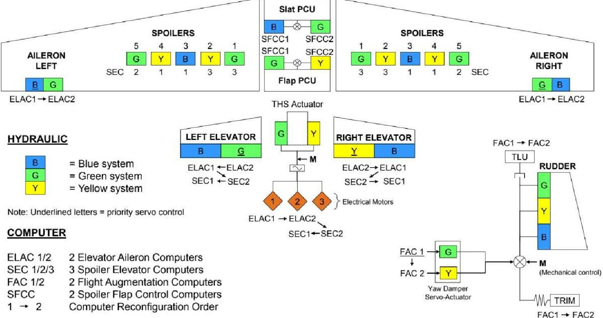

Figure 2-13: Airbus A320 Flight control systems architecture layout, adapted from [97], [98]

Consider Figure 2-14 where an aircraft hydraulic and environmental control system architecture is presented. Although these architectures are fictitious, they are representative of the potential use of layout diagrams in conceptual design. The major drawback is that when many artifacts are used, the drawings tend to get cluttered which is detrimental to readability. However, they are still able to convey the general orientation and layout of system architecture components in the aircraft at the conceptual design stage. More detailed aspects of the system architecture cannot be represented

<!-- PDF_PAGE: 60 -->

using aircraft level layout diagrams. The allocation of actuator to power system and control surface is represented by color coded blocks with the initial of the power system supplying it, as show in the flight control and power system architecture of the Airbus A350XWB in Figure 2-15. However, the interface of aircraft power system and the actuators is not shown.

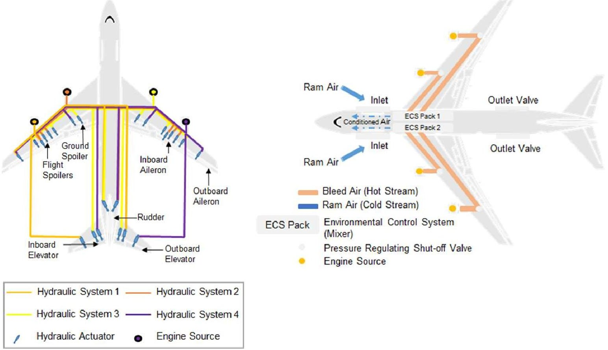

Figure 2-14: Typical aircraft FCS and ECS system architectures

This interface consists of control signal and power supply which may differ according to the architecture. In the Airbus A350XWB Electro hydraulic servo actuators are used for aileron actuation. Here the interface is between electrical control signals that enable hydraulic power supply to the actuator thereby causing its action. The Airbus A350 XWB also features an integrated actuation package or electric backup hydraulic actuator (EBHA) that is signaled electrically and uses both hydraulic and electric power sources.

<!-- PDF_PAGE: 61 -->

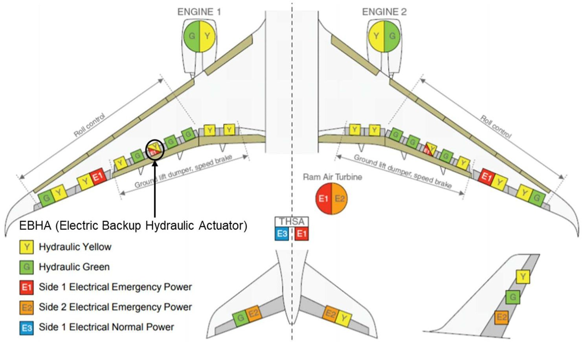

Figure 2-15: Airbus A350 XWB Flight control systems architecture, adapted from [99]

## System Flowcharts

System flowcharts provide detailed information about a system. Each component and artifact is clearly labelled with consistent notation. Flowcharts also specify the exchanges such as heat, mass, power and signalling through system interfaces. Figure 2-16 shows the typical heat exchanges between typical integrated civil aircraft systems. The engine is the source for bleed, hydraulic and electric power generation using bleed valves, hydraulic pumps and electric generators respectively. Bleed air from the engine is used for environmental conditioning whereas ram air is used for cooling the engine oil. This form of representation is useful for visualizing and understanding exchanges between systems. It is also suited for conceptual design as it requires only basic information about system exchanges and does not require a mature system architecture.

<!-- PDF_PAGE: 62 -->

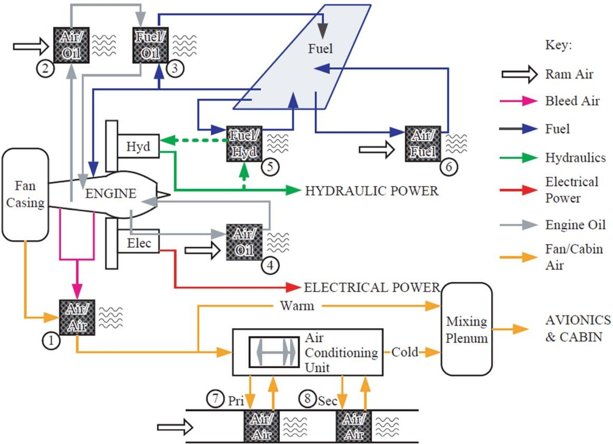

Figure 2-16: Aircraft system exchanges flowchart, from [98]

A combination of flowcharts and layout diagrams can be used to build a detailed systems architecture representation such as in Figure 2-17 where the hydraulic system of a Boeing 777 aircraft is shown. A set of engine driven and electric motor pumps pressurize three hydraulic reservoirs that supply different consumers. The "Right" system supplies the Tail and Wing flight controls which are made redundant with a supply from the "Left System". Notations on the diagram show the direction of flow and return of the hydraulic fluid. It is evident from Figure 2-17 that this form of representation is used to describe a mature system architecture. The key components, layout and exchanges are established and are used derive a detailed understanding of the system. This form of representation is situated towards the preliminary and detail design stages, although simplified versions could be developed using the limited information in conceptual design stage.

<!-- PDF_PAGE: 63 -->

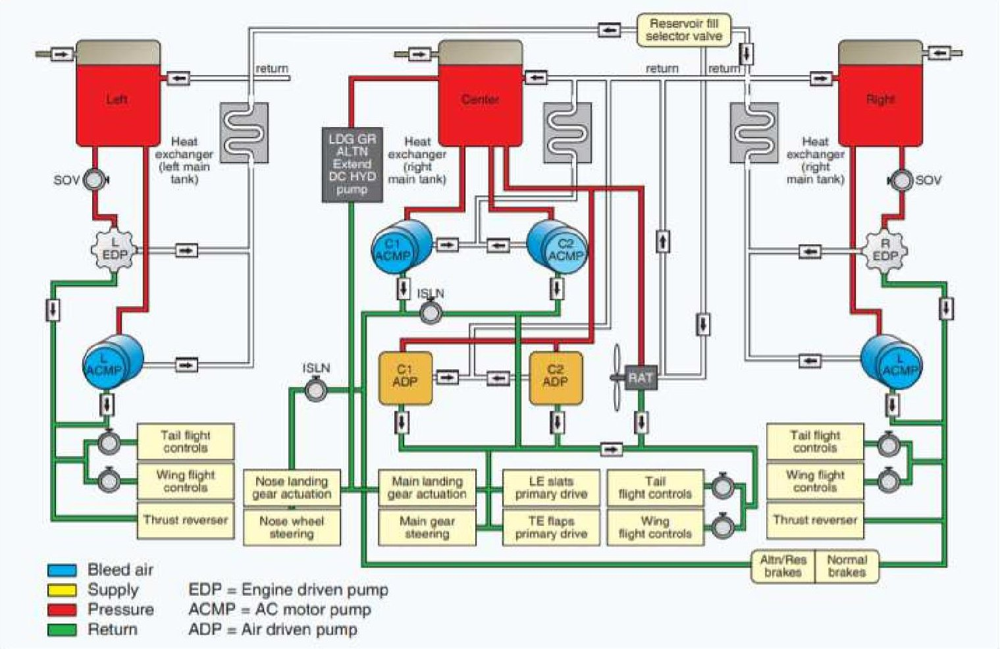

Figure 2-17: Boeing 777 hydraulic systems architecture, from [100]

## 3D Representation

The aircraft design process is heavily dependent on Computer Aided Design (CAD), especially in later, preliminary and detail design stages. Three dimensional (3D) CAD based representation allows the presentation of system architecture to exact dimensional specifications. 3D CAD models provide an unmatched representational and visualization capability and allow for the generation of static documents capturing different views of the aircraft or subsystem. The development of such high-fidelity models is time consuming and is done at a stage where the system is well defined. Application of such detailed models in conceptual design is not justified in terms of time consumed to develop each candidate architecture in a CAD environment.

<!-- PDF_PAGE: 64 -->

An important feature of CAD based representation is the ability to parametrize and reuse representation artifacts. Parametrization and predefinition of system components in a CAD environment ensures that the model can be defined quickly with a limited number of input variables. This feature has been leveraged in parametric approaches to represent subsystem architectures in a CAD environment for conceptual design [101] - [103]].

The implementation of a CAD based system architecture representation for automatically positioning system architecture components for Flight Control, ECS, Hydraulics Electrical and Avionics systems is presented in [101]. This approach was developed in response to the needs of an industrial conceptual design environment. Figure 2-18 shows the placement of representative system architecture components within a three-dimensional aircraft model. An example of wire routing and space allocation for piping is also seen in Figure 2-18. Demonstrated benefits of this approach include the identification of wiring routes which support early detection of spatial integration issues that could be problematic if the system architecture is matured. The positioning of system components in representative locations within the aircraft allows information about piping, ducting and overall system weight to be developed within the conceptual design stage.

Knowledge based rules applied to the routing of components ensure that realistic system architecture metrics such as weight, length and installation volume are generated to support architecture evaluation and selection. Overall the implementation of this approach is reported to make the conceptual design process more efficient by reducing the number of costly design iterations. Additionally, the three-dimensional visualization of aircraft system architecture enables harmonized understanding and improves communication between system integrators and disciplinary specialists early in the conceptual design process [101].

<!-- PDF_PAGE: 65 -->

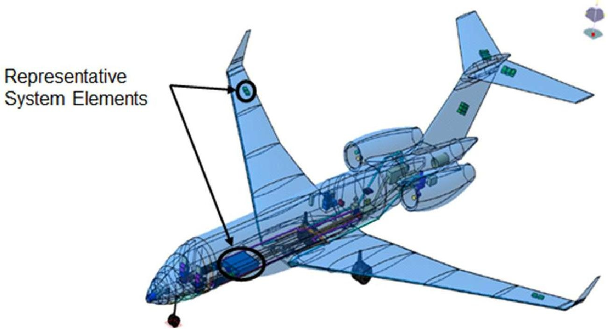

Figure 2-18: Parametric system components placed inside an aircraft CAD model, from [101]

Representing aircraft systems architecture using simplified parametric components in a CAD environment is an effective approach towards architecture visualization. Moreover, the application of rules derived from experience and compatibility between systems can be applied to ensure that only feasible architectures are represented. Knowledge based design rules are applied to the visualization of aircraft fuel system architectures during conceptual design [104]. In addition to the estimation of piping length and fuel pump positioning, insights about the impact of fuel distribution and tank geometry on aircraft center of gravity are drawn using this approach. Complete automation of this process allows a wide range of candidate subsystem architectures to be explored. A similar approach is used to visualize the integration of flight control and actuation system. Simplified three dimensional models of flight control actuators are integrated into an automatically generated aircraft flight control system architecture [103]. An overview of approaches using knowledge-based rules applied to CAD based representation of aircraft systems architecture is presented in [105]. Parametric models of aircraft system architecture components

<!-- PDF_PAGE: 66 -->

such as fuel tanks and actuators are positioned within a model of the aircraft according to knowledge-based rules, as part of a larger subsystem sizing and performance framework presented in [105]. A parametric schema containing information about system architecture components and the parametric aircraft model is used in conjunction with a CAD representation tool to visualize the integrated systems architecture. Here, the parametric schema forms the link between architecture representation and evaluation domains.

Overall, CAD based approaches have been widely investigated to support, system architecture visualization and analysis of system architecture integration in conceptual design. CAD models provide superior visualization capabilities compared to simple diagrammatic representation and are shown to be applicable in conceptual design. Moreover, CAD models can be used to generate diagrams of different views of aircraft systems architecture. The only drawback of these approaches is that interfaces between system components are not adequately visualized in conceptual design. Although CAD models generated in conceptual design can be enhanced downstream to include these aspects, only simplified representations can be used in conceptual design. Interfaces are an important component of aircraft system architectures and well-defined interfaces contribute to improved understanding of the architecture, thereby mitigating issues and rework later in the design process. Therefore, although CAD based approaches are suitable for visualization, they need to be paired with alternate representation approaches that focus more on architecture specification to be comprehensively used in system architecture description for conceptual design.

<!-- PDF_PAGE: 67 -->

## 3 Architecture Representation in Capella

This chapter introduces the features required for architecture representation in conceptual design. A modelling methodology for developing architecture representations in Capella is introduced and a framework of modelling artifacts representing actuation and power systems architectures is presented.

## 3.1 Desired Characteristics of Representation Framework for Conceptual Design

System architecture representation at the conceptual design space makes the design process efficient by dissemination of system architecture information across conceptual, preliminary and detailed design. At the same time a varied set of architecture representation schemes exist, each addressing a need and conveying specific information. In order to support early representation and exploration of aircraft system architectures in conceptual design, the architecture representation framework used needs to possess the outlined characteristics:

## Clear & Unambiguous (Clarity)

The purpose of system architecture representation is to provide an unambiguous representation that facilitates a thorough understanding of the system. This implies that each component and system interaction should be represented clearly using a formal syntax. Moreover, reference to the aircraft should be provided to ensure intuitive understanding of the positioning of system components. Relationships and exchanges between components should be well defined and different sources, consumers and their exchanges need to be labeled consistently. Formalization of descriptive syntax needs to be performed to remove ambiguity in architecture description. Exchanges between components in the form of matter, energy, information and others should be clearly outlined. Convention for the naming of these exchanges also needs to be defined as per the

<!-- PDF_PAGE: 68 -->

application domain. In the case of flight control systems in conceptual design, these take the form of control signal signals, feedback signals and type of power supplied. Control signals are further described according to their nature as electrical, mechanical or otherwise. Figure 3-1 shows a set of generic system components with respect to the aircraft layout. The interface of each system component is clearly defined using dotted lines. The functions assigned to these components are formalized and the exchanges between components are described as being Energy and Information.

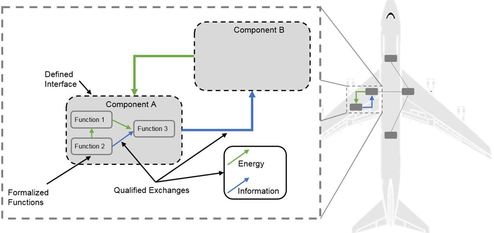

Figure 3-1: Unambiguous definition of functions and exchanges in a system architecture

## Systematic

Architecture representations created during conceptual design should be used throughout the design process in order to make it more efficient. This implies that artifacts and representations created in conceptual design will be handled by various stakeholders and development teams along the way. Aircraft development follows a multilevel engineering approach with systems architecture being described at aircraft, system and item levels at corresponding degrees of

<!-- PDF_PAGE: 69 -->

granularity. The use of a unified process for the development of architecture representation ensures clarity and improves collaboration. Furthermore, such a systematic approach prescribes uniformity in architecture description and understanding across all disciplines which further improves the efficiency of the development process. A formalized process for architecture representation, structures information about the system in a familiar way which facilitates easier system understanding. Formalization can begin by standardizing the components used in representing aircraft systems architectures. Generic diagram artifacts should be established that allow the creation of system architecture diagrams from such building blocks. Conventions for specific system layouts or aircraft configuration representation should also be specified. Overall, the process developed to represent architectures must be understood and adopted by all the parties involved in the development process.

## Modular

Architectural representation of systems is not only limited to the conceptual design process. Architecture descriptions created during conceptual design should be continuously enriched through subsequent stages to ensure an efficient design process. This requires the artefacts created during conceptual design to be reusable and modifiable. Reusable artefacts should be able to represent multiple instantiations of a specific component or interface. The architecture representation framework should be able to adapt and represent emerging system architecture concepts. In addition to being reusable, the generic artifacts defined in the framework should be able to represent components and capture new technologies. For example, the artifacts used to represent an electrically signaled and hydraulically actuated, EHSA should be able to also represent an electrically signaled and powered, EHA. In other words, the building blocks of different elements of architectural representation should be flexible enough to be adapted to

<!-- PDF_PAGE: 70 -->

represent different actuation technologies.Modularity in the elements used for architecture representation ensures that the design space outside conventional system architecture can be explored.

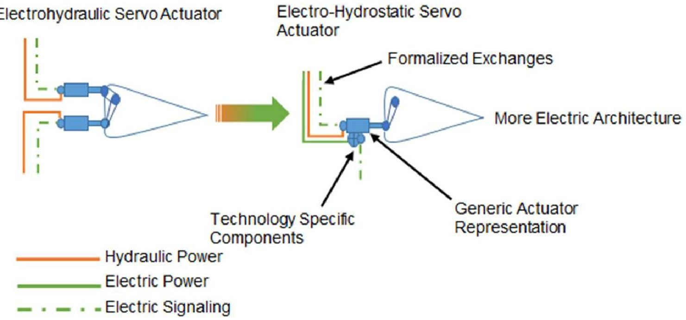

Figure 3-2: Modular components of an actuator representation

## Extensible

The architecture representation framework should be extensible to represent emerging technologies. The framework should support additional functionality in architecture representation or evaluation. Artefacts used in architecture representation should be amenable to modification and reuse. Extensibility requires that the toolset and environment used for architecture representation be open for modification and enhancement. Additional information can be generated by extending the frameworks capability to include safety analysis, weight and center of gravity estimation as well as performance analysis of the described architecture. The ability to represent an architecture and derive performance and safety metrics will support the comparison of candidate system architectures. Such activities, when performed early in the design process can

<!-- PDF_PAGE: 71 -->

reduce cost and developmental time by ensuring that the chosen architecture best responds to customer and stakeholder needs.

## Traceability

Current practice involves architecture description through diagrams and flowcharts that are static documents. Changes made to the design are only reflected when a completely new drawing is created. Moreover, the use of general-purpose tools such as Microsoft Viso and PowerPoint for diagramming is time consuming and prohibits the exhaustive representation of candidate system architectures. Ensuring traceability also generates links between artifacts and their dependencies which is useful when performing safety analysis. As a chosen architecture is enhanced through the development process, these links provide a way of managing the complexity of the system architecture. Completely traceable architecture representation ensures that the impact of configuration and technology changes is reflected throughout the architecture. This allows for better comparison of candidate architectures. Moreover, having inherently traceable representations allows the generation of static diagrams capturing the architecture from various viewpoints such as performance, mass, safety, lifecycle management etc.

## Encapsulation

In the context of architecture representation, encapsulation refers to the nesting of complex architecture representation within a simplified diagram element. This element is in turn part of a simplified representation that is present at a higher level of abstraction. The ability to switch between these two levels of detail within an architectural representation helps manage complexity and improves readability.

<!-- PDF_PAGE: 72 -->

The simplified representation describes the main interactions of the system architecture whereas the detailed representation is used when creating system specification or while performing other downstream activities such as system safety analysis. Encapsulation is useful when architecture representation is dense and is not conducive to intuitive understanding. The simplified view of such a system ensures that it is understood, and the detailed representation is used to create a subsystem specification which can be used for further analysis.

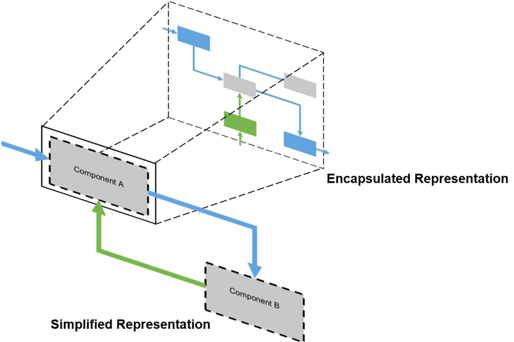

Figure 3-3: Example of desired encapsulated views in system architecture representation

## Visualization

Effective visualization is required to ensure that the represented architecture is intuitive and easily understood. The positioning of system architecture components, routing of cables and installation effects should be well captured. Encapsulation enables better visualization by reducing complexity

<!-- PDF_PAGE: 73 -->

and clutter in system architecture diagrams However, to be of use in later design stages, a representation framework must possess good visualization and representation qualities.

## 3.2 Modelling Methodology in Capella

This section provides an overview of the modelling methodology developed to represent flight control systems architectures within the ARCADIA/Capella environment. Capella offers many diagrams at different levels of abstraction to represent architectures. This is well suited for the clean sheet development of system architectures or in cases where the system architecture is not already well defined. In the case of flight control system architecture, the scope of the system is already known in its various implementations such as mechanically signaled, FBW actuation etc. Therefore, a ground up development of system architecture is not necessary and only selected diagrams and specific levels of granularity are required to build Flight Control Systems (FCS) architecture representations in Capella. The presented method focuses on basic architecture diagrams and the question of how to establish generic and technology variants of flight control and power supply system elements that can be re-used to build complex architectures in Capella.

The novelty in the approach is to address the system architecting needs by capturing the prevailing variability and commonality within the design space for conventional and more-electrical FCS. Variability in actuator technology such as mechanical, hydraulic and more electrical actuation is directly driving the power systems architecture (hydraulic and electrical) and vice-versa, depending on the starting point of the design. Enumerated interfaces and flows of information in all forms are clearly highlighted to determine their implications at the architecture level. Moreover, this methodology allows a clear representation capturing system interfaces and exchanges to be created in conceptual design, which can then be enhanced in later stages and provided to suppliers for development.

<!-- PDF_PAGE: 74 -->

## 3.3 Multilevel Modelling Approach

Two levels of detail are introduced, a generic level for simplified representations and a detailed level for more granular representations. This second level focuses on the actuation components of FCS that are created at the generic level. Detailed representation of the flows of control and power to these actuation components are presented at this second level. The development of models at each level follows ARCADIA's modelling convention [92]. Functions are created at system level, transitioned to the logical level and allocated to logical components. These logical components are then allocated to physical components that comprise the physical FCS architecture. Figure 3-4 shows the breakdown of activities required to create architecture representation at each level of granularity.

## The two levels of granularity are defined as follows:

Level 0 (L0): This level is characterized by the lowest level of detail and highest level of abstraction. Representations at this level are required to depict the overall FCS architecture, including all control surfaces and power systems associated with the individual actuators. The use of low level of detail ensures that the represented architecture is easy to understand while still preserving the exchanges at the interface of different components. Although the entire architecture is easier and clearer to represent at L0, in practice it is still an extensive diagram, for this reason focusing on individual control axis, such as pitch, roll and yaw architecture is recommended. This practice is similar to the consideration of individual flight control axes for safety analysis. Referring to Figure 3-4, the activities at the system level pertain to the identification of generic functions of the FCS and the development of a system architecture. At this stage, generic logical components of the system are identified or are known from previous analysis.

<!-- PDF_PAGE: 75 -->

Level 0 (L0) Generic Representation

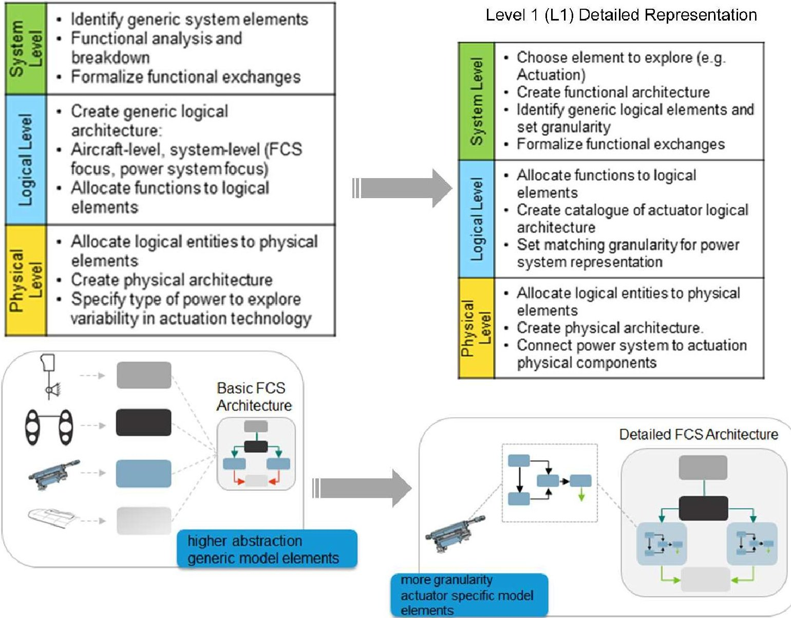

Figure 3-4: Illustration of steps to create architecture representations using the multi-level modelling approach

The system architecture is then transferred to the logical level where system functions are assigned to generic components that make up the logical architecture. Capella ensures traceability between all modelling levels. This implies that any modifications performed to the system architecture will be reflected in the subsequent logical and physical architectures. At this stage the logical architecture has been created and is transitioned to the physical architecture where generic logical components are allocated to generic physical components. These physical components represent the physical hardware of the PFCS such as a sidestick for control input, flight control computer for signal relay and actuation systems as end effectors. These components are then stored as

<!-- PDF_PAGE: 76 -->

reusable model element that can be instantiated when required, to build PFCS system architecture representations at L0 level of granularity. Moreover, since the logical architecture is generic, many types of physical implementations are possible for the PFCS components. A sidestick could also be a Control Column and different actuation types can be considered. The only difference is the exchanges between different components. Use of electric signalling would show an electric control signal issued to the flight control computer and relayed to the actuator. Whereas choice of an electromechanical actuator is realized by supplying electrical control signals and power to the actuator element. It is important to note that at this stage, all the actuator types are represented by generic physical blocks. The only aspect of differentiation is the type of control signal and power supplied to each actuation element. When assembled, these representations at L0 provide a clear understanding of the main exchanges through the interface between elements of the PFCS.

Level 1 (L1): The system architecture is represented at an additional level of detail such that the interfaces between system components are shown in greater detail. Typically, L1 representation could be used to represent any component of the PFCS but in this thesis, it provides additional granularity to the interface between aircraft power and actuation systems. L1 provides the additional level of granularity required to assess the effect of changing actuator technology on the interface between power and actuation systems. This is important, as actuation functions in aircraft undergo further electrification with development in electromechanical actuators and digital signaling. Furthermore, L1 allows greater resolution of the exchanges through the interface and within the actuator itself. The power system is also represented at an equivalent level of granularity to show the various power generation and distribution sources and their supply to each actuator. "L1" is intended to produce more granular descriptions of FCS architecture with a focus on capturing the power and control interfaces with varying actuator technologies. The levels of

<!-- PDF_PAGE: 77 -->

abstraction are like those of the previous level but at this level only an element of the FCS architecture is chosen to be elaborated in detail. In this case it is the actuation block that is developed into a catalog of common actuator technology implementations. System functions are defined based on an analysis of the actuator type and its hardware architecture. These functions are transferred to the logical level and a logical architecture is created for each actuator element along with a power system representation. Physical architectures are then created for each actuator type and the actuation blocks are made reusable and are instantiated when building any physical architecture diagram. L1 is useful at the conceptual design stage as it shows detailed information about control and power exchanges between the actuator and power system early in the design process. Furthermore, the definition of actuator and power system level functions also contribute to the identification of failure conditions for safety analysis. Having a candidate PFCS architecture represented at this level in conceptual design makes the design process more efficient as these representations can be reused as a specification in later stages.

In summary, a modelling framework defined within the ARCADIA methodology is used to create primary flight control system architecture representations. The actuator and power supply representations are enhanced to show the flow of control, power and feedback through their respective interfaces. Architectures of individual actuators and power systems are created and made available as a catalog of reusable elements. The steps outlined in this framework allow the creation of any primary flight control systems architecture using at the generic level. Further enhancement of specific elements and interfaces is possible using additional levels of granularity. A precondition for this type of representation is the identification of the generic components comprising a flight control system architecture which is discussed in the following section.

<!-- PDF_PAGE: 78 -->

## 3.4 Identifying Generic Flight Control System (FCS) Elements

A survey of primary flight control system architecture implementations aboard the Bombardier Challenger 300, Airbus A320 and Dassault Falcon 7X is performed to investigate the range of employed actuation and power systems technologies. These aircraft were specifically chosen as they represent three varied categories of aircraft such as the commercial narrow body A320, tri jet Falcon 7X and the business jet Challenger 300. Furthermore these aircraft showcase a range of signaling and actuation technologies from simple mechanical signaling and hydraulic actuation in the Challenger 300 to electrical Fly by Wire (FBW) signaling and electro hydrostatic actuation in the Falcon7X.

A combination of top down and bottom up methodologies are used to analyze the PFCS implementations aboard these aircraft and identify the generic elements of flight control. The top down approach focuses on creating an overview of the system using black boxes to represent PFCS elements that process, modify or execute exchanges. The bottom up approach identifies the physical components or hardware across the different PFCS implementations and creates higher level abstractions of components, elements and interfaces. Figure 3 5 illustrates an example of abstracting physical components of a PFCS using the bottom up approach.

A survey of PFCS implementations using top down and bottom up approaches allow the generic elements of a PFCS to be established. The architectural elements of flight control systems vary across their many implementations. Flight control commands could be received through implements varying from control columns, joysticks, autopilot servos and sidesticks etc. Similarly, the input signals can be relayed by simple mechanical means such as pulleys, cables and pushrods or complex fly by wire systems using flight control computers and electrical signals. Actuation means also vary based on the choice of actuator from mechanical power, hydraulic actuation to

<!-- PDF_PAGE: 79 -->

fully electric actuation. In between these are integrated technologies such as the electric backup hydraulic actuator that features both conventional hydraulic power supply and a backup electric motor to power the hydraulic cylinder. Control in conventional aircraft has been achieved by the actuation of a surface, redirection of thrust or the implementation of novel means such as fans. However, an end effector is always required to position or engage the means of control, therefore the need for actuation is present across all flight control systems architectures presently implemented. In a similar fashion, a set of generic elements are identified that are common across the surveyed flight control systems architecture. The exchanges between these elements can also be described in generic terms such as control, feedback and power. The bottom up approach establishes the generic exchanges of a PFCS. Furthermore, the bottom up approach in conjunction with a top down abstraction highlights the generic elements through which these exchanges take place.

Figure 3-5 shows a set of flight control implementation that vary according to the nature of implemented power and signaling. A generic flight control schema is thereby identified that consists of a "control interface" that implements a control command which is then relayed through a "signalling medium". The command results in the regulation of power at the "actuation means" that performs a palpable action on the control surface. The term "Control Surface" is in turn genericized by considering the end effect of actuation to be performed on a movable unit, thereby termed as a "Moveable". Moreover, the external actors in this schema are identified as the pilot or autopilot unit and the aircraft itself which responds to the control effort with a change in attitude termed as "inertial feedback". This generic schema allows for an abstract representation of the PFCS that is independent of implementation, thereby enabling a broad design space of flight

<!-- PDF_PAGE: 80 -->

control implementations to be explored. Moreover, the generic schema serve as entities from which flight control functions are derived to create a functional architecture for a PFCS.

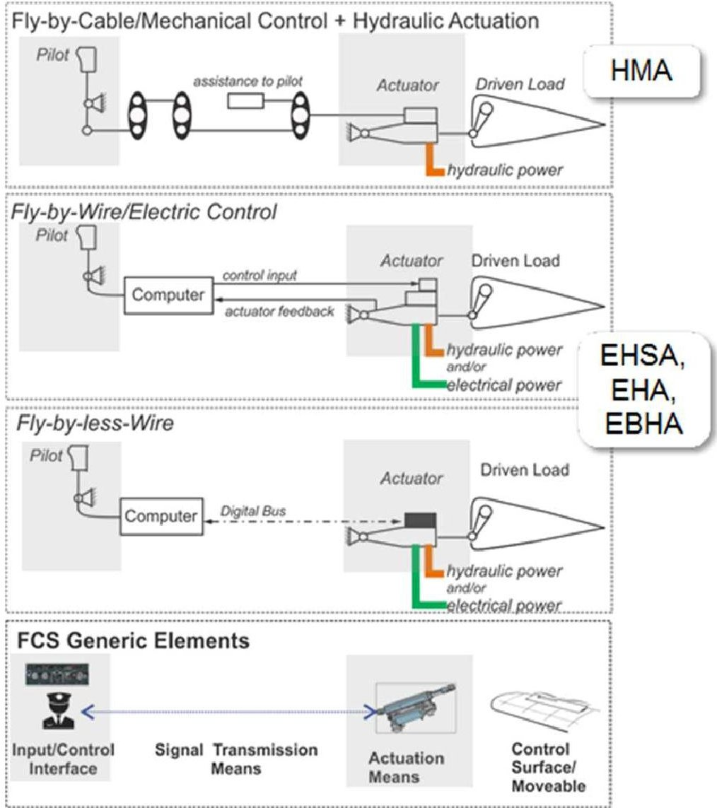

Figure 3-5: Generic flight control schema, adapted from [106]

These generic elements can now be used in the conceptual design process to enable simple descriptions of candidate flight control architectures. Along a single control axis, the flow and nature of the control signal and its interaction with the available power type is made quite clear in this manner. The establishment of these elements precludes the time-consuming activity of formalization of artefacts and naming conventions that would otherwise have to be done before

<!-- PDF_PAGE: 81 -->

any architecting activity could begin. Furthermore, these generic elements are used to create logical architectures that can then be made available in other stages of design. These elements are highly abstracted and are the basis of the L0 level of representation. However, each element can also represent a host of subsystems and sub-elements and the L1 level exploits this capability of Capella to explore variability of actuation technology.

The identified generic flight control schema is used to develop a logical flight control systems architecture. These generic elements are also logical entities to which functions are assigned. Functions are identified using a top down analysis, by identifying the functions realized by each logical component in conjunction with a bottom up analysis where actual FCS implementation is considered. This method has been applied in Capella for developing high lift systems architectures by [28].

In conceptual design, a generic set of functions is desired so as to not isolate regions of the design space. Top-level aircraft functions pertaining to the flight control system are identified and decomposed further to create a PFCS functional architecture. This process, called Functional Analysis is defined as the identification, description and relation of functions that a system must perform to realize its design objectives [46], [62]. A functional architecture describes functions, sub-functions and the transformation of exchanges that are required to achieve the systems mission objectives [62]. Methods for performing functional analysis are prescribed by [6] and [46] among others. An advantage of performing functional analysis in conceptual design is that it supports safety analysis as described in ARP 4761 [6][61]. The defined functions are required in order to perform aircraft level and system level functional hazard analysis [6], [62]. This allows the identification of failure conditions, causes and implications early in the design process thus developing more information about a candidate system architecture.

<!-- PDF_PAGE: 82 -->

## Functional Architecture

A first step towards the development of a system functional architecture is the identification of the System of Interest (SOI). The SOI outlines the scope of the system and helps remove non-system entities from the system definition. In this thesis, the Primary Flight Control System is considered the SOI. Having defined the SOI as being the PFCS, the top-level aircraft functions are now considered. Figure 3-6 shows the breakdown of the top-level aircraft function identified for PFCS. "Control aircraft attitude" encompasses control of the aircraft along all three axes, pitch, roll and yaw. Therefore, this top-level function is broken down into "Control Pitch attitude", "Control Roll Attitude" and "Control Yaw Attitude" Function Names. This functional breakdown is performed in line with the aircraft level functional specification discussed by the ARP6750A [6].

The functions in blue are termed "Actor" functions and are realized by entities outside of the scope of the system. These include, Pilot/Autopilot and Aircraft, as they provide input and receive feedback from the system itself but are not involved in implementing the activities within the system. Top-level functions are then further decomposed into sub-functions. In this case, aircraft pitch control is considered by decomposing "Control pitch attitude" into 6 sub functions relating to aircraft pitch control. Best practice proposed by [62] suggests that each top-level function be broken down into a manageable set of six functions. Additional decomposition is possible, but would result in a non-uniform level of granularity with some functions being decomposed into greater detail than others. The decomposed pitch control functions are all at the same level of granularity.

<!-- PDF_PAGE: 83 -->

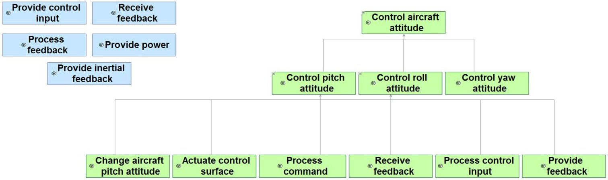

Figure 3-6: Aircraft level functional architecture for flight control

The pitch control functions in Figure 3.-6 are derived by analyzing the generic flight control architecture presented above. Each generic element is analyzed in terms of potential functions implemented and function names are assigned accordingly. Formalization of functions is performed in a systematic and iterative manner as recommended by [46]. The functions used in this thesis were formalized through several iterations based on how well they realize the functionality of the allocated system component. Some components like the "Pilot" actor implement several functions simultaneously and thus separations of functions is considered in this case. A description of each function is provided below.

## PFCS Scope Functions

Process control input: A top down approach requires the chain of control to be initiated by a function. A distinction is made between "Control Input" and "Control Command". From a bottom up approach, it is clear that "Control Input" is issued by the pilot, autopilot or flight management system through physical or computational means. The "Control Command" on the other hand is issued by the flight control system to the control surfaces being actuated. Therefore, the function "Process control input" is at the interface between the pilot/autopilot and the flight control system. Control input is applied on an input device such as a sidestick, control column or through direct

<!-- PDF_PAGE: 84 -->

intervention of the autopilot on the signaling medium as seen in implementations where mechanical signaling is used. This function takes the control input from the pilot/autopilot etc. and generates a control command that is passed to the signaling medium. The role of this function is to convert the control input to a control command that is supplied to the flight control system. The word "Process" is emphasized as this conversion can have a variety of implementations that range from simple mechanical conversion to complex signal processing as implemented through sidesticks.

Process command: A control command issued by the "Process control input" function is captured and relayed by the signaling medium which is represented by the "Process Command" function. A bottom up analysis of flight control implementations shows that the signaling medium can range from mechanical means, such as cables and pulleys on the Bombardier Challenger 300 to a fly by wire system on the Falcon 7X and Airbus A320 aircraft. The signaling medium is comprised of elements related to the relay and processing of control signals. In a FBW implementation, control input is processed by the stipulated flight control computer and a command signal is issued to the actuator control unit. Therefore, the choice of "Process Command" is prudent in that it captures both the processing and signal relay aspects of the signaling medium

Actuate Control Surface: "Actuate Control Surface" is performed by the actuator or actuation element. This function receives inputs from the signaling medium as well the power supply unit. The command signal regulates the application of power and thereby the movement of the control surface or moveable. This function represents the actuation of the control surface or moveable in response to a power supply and input command signal.

Change Aircraft Attitude: The flight control system ensures complete control of an aircraft during all stages of its operation. A bottom up analysis shows that conventional flight control is

<!-- PDF_PAGE: 85 -->

achieved using control surfaces that institute a change in aircraft attitude. This change in attitude is achieved by influencing the flow field around that surface. Using a top down approach, it is seen that the ultimate objective of the flight control system is the change of aircraft attitude. This can be implemented using traditional control surfaces, multi-functional control surface or any other novel means. Therefore, this function is associated to any component that is used to control the aircrafts attitude. Figure 3-6 shows the top-level aircraft functions in green and a set of other functions in blue. These functions are located outside the primary scope of the flight control system and are referred to as "Actor" functions in Capella terminology. Actor functions provide exchanges to the system and receive inputs from the system. However, they are not included in the primary scope

## Actor Functions

Provide Feedback: The control command issued by the flight control system elicits some action from the actuation means. In order to close the control loop, the flight control system requires pertinent information about the state of the actuation means. This is provided by the" Provide Feedback" function that sends relevant information through a "Feedback" exchange. A bottom up analysis shows that this form of feedback is gathered by sensors or transducers such as the linear variable differential transducer used in hydraulic actuators. Information about actuator extension and control surface forces can be provided back to the flight control system.

Receive Feedback: The flight control input elicits a change in aircraft attitude by the actuation of control surfaces. The movement of control surfaces causes a change in pressure field around these elements. The surface is subjected to certain forces based on the prevailing flight conditions. A bottom up approach shows that these forces are relayed to the pilot input interface using artificial feel systems. This tactile feedback allows the pilot to gauge how much control effort is required at

<!-- PDF_PAGE: 86 -->

the control input. The "Receive Feedback" represents such feedback from the actuated surface to the pilot or control input provider.

Provide Control Input: This function references the control input provided to the flight control system. The control input is a physical action or control intent that the flight control system converts into a control command. Control input can be provided among other means, by pilot action on control interface, autopilot correction or through any other novel approach. This function also receives an input from the "Process Feedback" function introduced below. This input is representative of artificial feel and other tactile responses that can be provided to the pilot.

Process Feedback: The inertial feedback generated by change in aircraft attitude as well as the tactile feedback received by the pilot through the control interface is registered using this function. The "Process Feedback" function generates an input to the "Provide Control Input" function based on the response of the aircraft and the feedback to the pilot. This captures the Pilot/Autopilot's ability to issue a control command and gauge the response of the aircraft as well as information provided by the flight control system to issue additional control commands as required.

Provide Power: "Provide power" is function that captures the power supplied by the aircraft power generation and distribution systems. At L0 this function is considered external to the system and can supply any power type that is required by the PFCS. At L1 this function is further decomposed to capture the sub functions involved in power generation and distribution.

Provide Inertial Feedback: "Provide Inertial Feedback" refers to the aircraft as an actor and its ability to respond to flight control commands with a change in attitude. This function provides an input to the "Process Feedback" function which in turn influences the "Provide Control Input" function

<!-- PDF_PAGE: 87 -->

Following the definition of system level functions, the exchanges between functions are also formalized. Three different types of exchanges are used in the functional architecture.

## Exchanges

Control Signal: This exchange captures control commands generated by the control interface and relayed by the signaling medium. In a top down approach, a control signal can be defined as carrying information that elicits a control response from the target. In the case of a bottom up approach a control signal can be mechanical or electrical and carry information or data. The exchange "Control Signal" represents the instructions provided to elicit a control response from the actuation means.

Feedback: The "Feedback" exchange captures the signals that are sent back from the actuation means indicating its present state. Feedback can be in the form of mechanical or electrical signals as seen in artificial feel systems on the Challenger 300 and Airbus A320 aircraft. The Challenger 300 has a mechanical artificial feel system whereas Flight Control Laws dictate the effort the pilot needs to apply to the side stick in the Airbus A320.

Power: As the name suggests, this exchange represents the power type provided to the actuation means. It can be broken down into Mechanical, Hydraulic and Electrical power in terms of physical implementation. At L0 only the power type is specified in the physical architecture, however at L1 the specific generation, transformation and distribution of each power type is shown.

Table 2 lists the functions in the primary FCS scope and provides references to relevant physical systems.

Table 2: PFCS function descriptions

<!-- PDF_PAGE: 88 -->

<table border="1"><tr><td>Function Name</td><td>Function Description</td><td>Referenced Physical System</td></tr><tr><td>Process control input</td><td>Accept input control command</td><td>Interface/Control Input Hardware/Autopilot</td></tr><tr><td>Process command</td><td>Provides relaying of control command</td><td>Relay Medium/FCC/ACMU</td></tr><tr><td>Actuate control surface</td><td>Ensures actuation activity</td><td>Actuator Unit</td></tr><tr><td>Change aircraft attitude</td><td>Enforces change in aircraft along selected control axis</td><td>Control Surface</td></tr><tr><td>Provide inertial feedback</td><td>Provides inertial feedback from aircraft attitude change</td><td>Aircraft Attitude-FCC/ACMU</td></tr><tr><td>Receive feedback</td><td>Receives feedback from actuation function on application of control command</td><td>Position/Displacement Data/ACMU</td></tr></table>

It is to be noted that these functions implement a generic primary flight control system architecture. They can be used to represent pitch, roll and yaw architectures. The coupling between roll and yaw, however, requires additional exchanges to be defined and is not covered within this thesis. The purpose of segregating the architecture representation along each axis is to improve clarity and support activities like FHA that are typically done on individual flight control axes.

Assembling all these elements using the SDFB and SFBD diagrams in Capella, the functional architecture shown in Figure 3-7.

<!-- PDF_PAGE: 89 -->

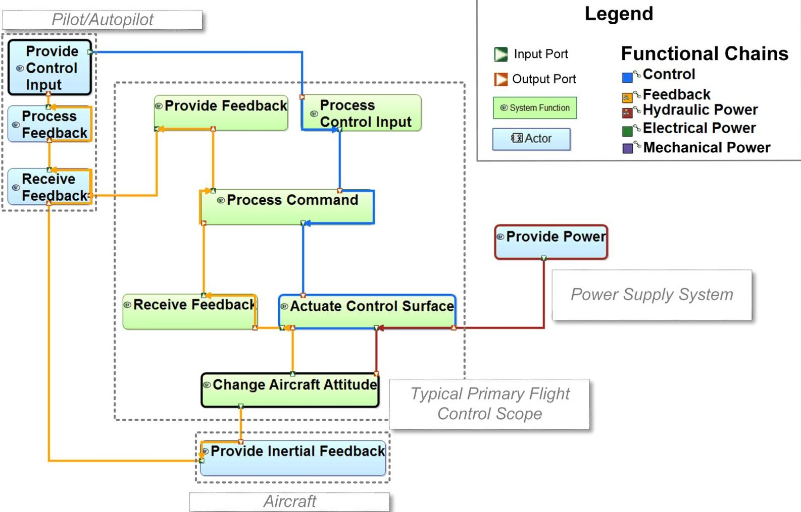

Figure 3-7: PFCS functional architecture in Capella using System Architecture Breakdown (SAB) Diagram

The chain of control is initiated by the pilot, implementing the "Provide Control Input" function which issues a control input to the "Process Control Input" function. Here, the control input is converted to a control command and passed to the "Process Command" function. Typically, the "Process Control" input can be implemented using a control column, sidestick controller or other Human Machine Interface. The "Process Command" function generates a control command that is passed to the "Actuate Control Surface" function. This control command regulates the power supplied by the "Provide Power" function and actuates the control surface. The control surface or moveable implements the "Change Aircraft Attitude" function, which provides inertial feedback to the pilot through the "Receive Feedback" actor function. The position of the control surface and actuator is relayed back through a feedback signal to the "Receive Feedback" system function,

<!-- PDF_PAGE: 90 -->

which is then sent to the "Provide Feedback" function. This function sends the feedback to the "Receive Feedback" actor function that processes the feedback signal using the "Process Feedback" actor function. The ultimate target for the feedback is the "Provide Control Input" which closes the control loop. The chain of control, feedback and power is highlighted using the functional chain feature in Capella. Functional chains enable key exchanges to be tracked through a system architecture. It is to be noted that the feedback from "Change Aircraft Attitude" passes through "Actuate Control Surface" as a part of this feedback also includes the state of the actuator. This comprises the functional architecture of a generic flight control system.

A flight control command signal is issued by the pilot to the "Control Interface" logical element, which is representative of a sidestick controller or control column in typical flight control implementations. The control command is relayed by the "Relay Means" which transmits the command to the various actuators involved. This element can be realized by several means depending on the prevailing actuator technology used. In a purely mechanical control chain, a cable, pulley, pushrod system is used whereas for FBW control, a flight control computer and electric signaling means play this role. The command now passes to the "Actuation Means" logical element which is representative of the actuator being used. The actuator element is supplied with the appropriate power from the "Power System" logical element. A feedback loop ensures that the actuator position is passed back through the "Relay Means" element to the pilot. The inertial change invoked by control surface movement is also described as feedback provided to the pilot. In this case both the aircraft and the pilot are represented as "Actor" elements.

## Logical Architecture

Creating a generic logical architecture is the next step in the modelling process. The generic flight control schema described in a previous section is used to define logical components that constitute

<!-- PDF_PAGE: 91 -->

this logical architecture. The generic logical architecture uses, "Control Interface", "Relay Means", "Actuation Means" and "Moveable" as the logical components. A logical architecture serves as a template for physical architecture. A single architecture can have many physical implementations that differ based on specific technologies and components used.

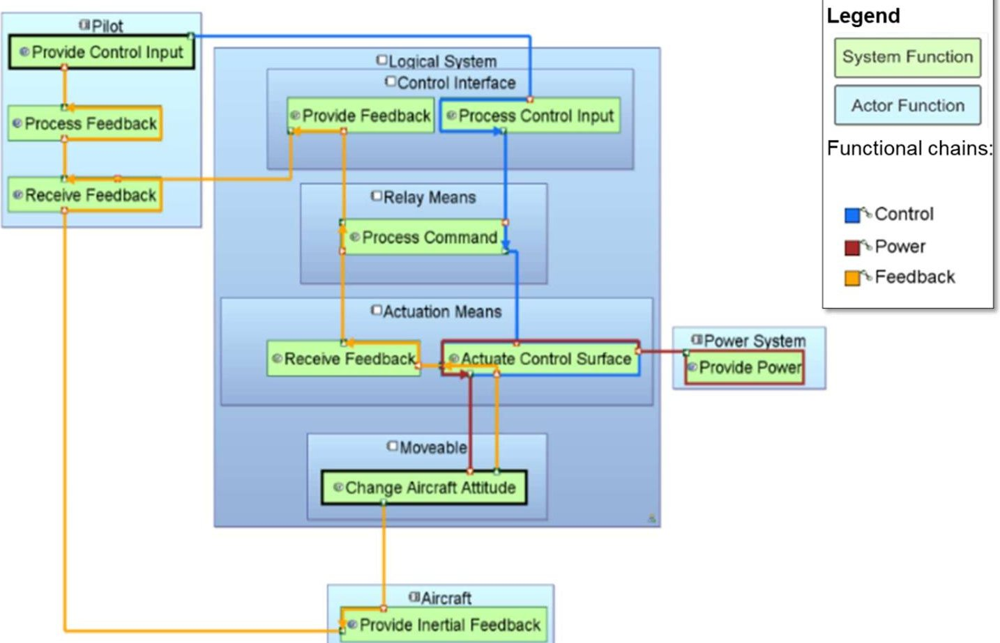

Figure 3-8: Generic logical architecture for flight control using Logical Architecture Breakdown (LAB) diagram

The purpose of a logical architecture is to capture an abstract system architecture that is flowed down from system requirements. This information is captured using functions which are then grouped into logical components within a logical architecture. Functions are now allocated to logical component based on the identified functionality of each component and a generic logical architecture for flight control is created using the Logical Architecture Breakdown diagram in Capella. Logical components in Capella use "Component Exchanges" to describe their interactions. Furthermore, functional exchanges in Capella are routed through these component

<!-- PDF_PAGE: 92 -->

exchanges which serve as containers at the logical level. The generic logical architecture presented in Figure 3-8 serves as a template for multiple physical architecture variants. All components are subject to variation in physical architecture, but this thesis focuses specifically on variability in the actuation technology. Therefore the "Actuation Means" element is subject to variability and is represented in detail at L1.

## Physical Architecture

A physical architecture is comprised of the actual hardware used when the system is deployed. It is a specification of which hardware components perform what function and describes the physical exchanges such as mass, energy, data etc. that are shared between them. Physical architecture is built in Capella using the Physical Architecture Breakdown (PAB) diagram. Having defined the functional and logical architecture of the primary flight control system. A transition is made from the logical architecture to the physical architecture using Capella's built-in transfer capability. This brings all the functions logical components and exchanges defined at previous levels to the physical level. At this stage two new components are introduced, they are Node and Behavior physical components. A node represents a specific hardware element whereas a behavior is used to represent physical components that can be implemented in a node. An example for a node with an embedded behavior component would be a processor running a specific application or process. At the physical level, interactions between components are represented using physical exchanges.

The generic flight control logical architecture is transitioned to the physical level and logical components are assigned to specific physical nodes. Logical components manifest as Behavior physical components in Capella. The logical components such as "Control Interface" get mapped

<!-- PDF_PAGE: 93 -->

to actual physical implementation like "Control Column" and "Sidestick". The actuation means is now represented based on the type of actuator selected, for e.g. EHSA, EBHA, EHA or EMA. Moreover, the physical component represents the hardware and the behavior component assigned holds the function that is being realized. This representation is presented at L0 and the "Actuation Means" component is generic and is differentiated only by the type of power supplied to it. At L1 representation, variability is explored through defining specific representations for each type of actuation technology. Physical architecture diagrams are presented in detail within Chapter 4.

## 3.5 Variability in Actuator and Power System Technology

The flight control actuation system presents a broad range of architectures implementing many different technologies. Actuation technology has developed alongside aircraft from the use of "wing warping" powered by mechanical exertion by the pilot to modern day integrated actuation packages. The means of signaling and power supply has also undergone significant changes. The move towards More Electric and All Electric aircraft ushers in electrical technologies for implementation in aircraft flight control. The aircraft flight control system is a constant consumer of aircraft secondary power. Therefore, the power generation and distribution means are also influenced by the choice of actuation technology.

Variability in actuation technology is an important aspect of flight control systems architecture representation because different actuation technologies present with varied signal and power interfaces. Actuators are essentially energy transformation systems where the supplied power is metered, converted and transmitted to the load which, in flight control is the aircrafts control surface. The interface between the power conversion, metering and transmission functions performed by the actuator changes according to the actuation technology employed. Moreover,

<!-- PDF_PAGE: 94 -->

there also exists a flow of signal, data and information that enables metering and actuation functions. Figure 3-9 shows a schematic representative of a power transformation system. The various functions mentioned above are presented along with the control and power chains inherent to these systems.

According to [107] generic functions are identified within the power chain such as "Supply, Distribute", "Meter etc. These functions can be used according to the type of actuator implementation and can be repeated as required. Moreover, the identification of generic functions involved allows the representation of actuator architecture and variability can then be captured by using these functions to represent the signal and power chain.

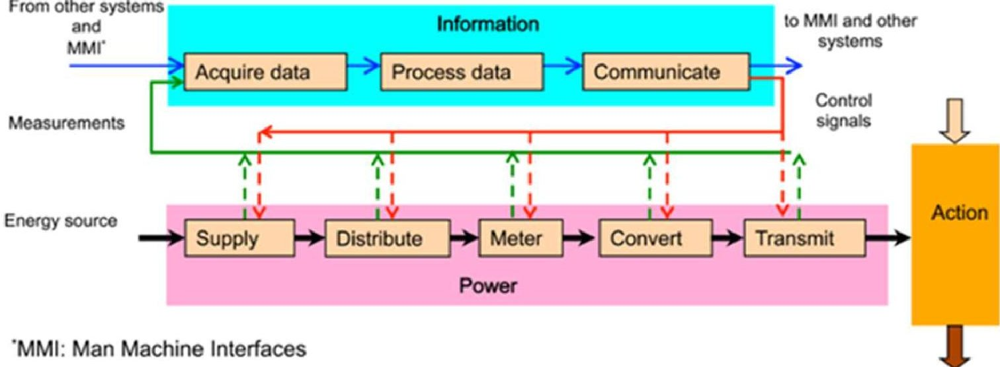

Figure 3-9: Architecture of a generic power conversion and transmission system using generic functions, adapted from [107]

## 3.5.1 Aircraft Actuation Technologies

Actuation technology varies according to the type of signaling and power used. The architecture of the actuator is also influenced by these factors. Actuators can be divided into three categories

<!-- PDF_PAGE: 95 -->

based on power type as manual, hydraulic and electric. Manual actuation is performed by power supplied by pilot exertion on the control interface. This form of actuation is applied where mechanical signaling in the form of control rods, cables and pulleys are used. A notable example is the roll control implementation on the Bombardier Challenger 300 where ailerons are actuated mechanically. Pilot effort can be aerodynamically assisted using control tabs or through the direct input of the autopilot system. This form of actuation is more commonly found in General Aviation aircraft rather than in commercial aviation aircraft where the large control forces required make it unfeasible. Mechanically signaled hydraulic boost actuators provide a solution to this problem by providing large control forces and also maintaining the simplicity of mechanical signaling architecture.

Electrical signaling or Fly By Wire actuators were first used on commercial aircraft in the Airbus A320. Although a mechanical backup system was used, FBW provided unmatched control performance and the ability to implement flight control envelope protections using Flight Control Computers (FCC) for signaling the actuators. FbW is now widely used on modern commercial aircraft like the Boeing 787, 777, Airbus A330, A350 and A380. In a FbW actuator, which is also referred to as an Electro Hydraulic Servo Actuator (EHSA): the servo valve is the interface between control and power domains [108]. The servo valve converts the control signal to regulate the hydraulic power supplied so as to actuate the load.

The introduction of the Electro hydrostatic Actuator (EHA) follows a trend towards MEA and distributed aircraft systems architecture. The EHA is a self-contained unit featuring an electric motor pump, accumulator, hydraulic reservoir and hydraulic cylinder. It is powered electrically. This actuation architecture removes the need for a central hydraulic distribution system and thereby reduces weight. EHA's have been implemented on the Airbus A350 XWB for rudder

<!-- PDF_PAGE: 96 -->

and aileron actuation. EHA implementations are also found on the Airbus A380 and A400M aircraft.

The Electro-hydrostatic backup servo-hydraulic actuators (EBHA) are a hybrid between a pure EHA and a conventional EHSA. EBHA's operate as conventional EHSA's and are supplied with hydraulic power. However, in back up mode they function as EHA's and therefore are also supplied with electric power. This solution is a compromise between EHA and EHSA in terms of reliability considerations. EBHA's have seen operation in the Airbus A380 and are used for spoiler actuation of the Airbus A350 XWB.

Electro Mechanical Actuators are a completely electric solution that converts electrical power into mechanical actuation of the load using a mechanical transmission system. EMA's have seen service aboard the Boeing 787 aircraft where they are used to actuate 4 of 14 spoilers [106]. Moreover, EMA's have been used for the actuation of secondary flight controls such as slat actuation in the Airbus A380 and Trimmable Horizontal Stabilizer (THS) on the Airbus A320 [109], [110] . EMA's remove the need for a dedicated hydraulic system, thereby reducing weight and present with advantages in installation, accessibility and maintainability. However, thermal management is an issue as hydraulic fluid absorbs heat generated in the actuation process. EMA heat dissipation is a major drawback in addition to the tendency for jamming of the mechanical transmission. Compared to a hydraulic actuator where the fluid also functions as a heat sink, an EMA requires a specific cooling solution thereby negating its weight benefits. Nonetheless, EMA's are regarded as an enabling technology for transitioning to a completely electrified flight control system.

<!-- PDF_PAGE: 97 -->

## 3.5.2 Actuator Architectures

A top down approach to understanding actuator architecture is by considering the type of signal and power that is supplied to an actuator. This limits consideration to mechanical, hydraulic and electrical power. Applying a similar approach to signal type yields mechanical and electrical signaling as the two types of actuator control. A bottom up approach on the other hand shows the energy transformation that takes place within the actuator. Actuator components such as servo valves present with energy transformations that are not evident from a top down approach. For example, in an EHSA, the electrical energy supplied through a control signal is transformed into mechanical energy through the movement of a spindle in the servo valve. This mechanical energy then regulates the hydraulic energy supplied by the aircraft hydraulic system into the hydraulic cylinder, which is then transformed into mechanical energy to actuate the load. Therefore, in order to identify a generic actuator architecture and to develop reusable functions, both a top down and bottom up approach is followed. The top down approach focuses on the nature of signal and power supplied to the interfaces whereas the bottom up approach identifies energy transformations occurring within these interfaces. A list of actuator technologies with signal and power types is presented in Figure 3-10.

<!-- PDF_PAGE: 98 -->

<table border="1"><tr><td>Aircraft</td><td>Elevator</td><td>Aileron</td><td>Flight Spoiler</td><td>Rudder</td><td>Control and Power Interface</td></tr><tr><td>Challenger 300</td><td>2XEHSA</td><td>1XMechanicalActuation</td><td>1XEHSA</td><td>2XEHSA</td><td>EHSA机械-HSA机械Actuation</td></tr><tr><td>Falcon7X</td><td>2XEHSA</td><td>1XDualEHSA</td><td>1XEBHA</td><td>1XDualEHSA</td><td>DualEHSAEBHA</td></tr><tr><td>AirbusA320</td><td>2XEHSA</td><td>2XEHSA</td><td>1XEHSA</td><td>3XEHSA</td><td>EHSA</td></tr><tr><td>AirbusA350XWB</td><td>1XEHSA1XEHA</td><td>2EHSA+1EHA1EHSA*</td><td>1XEHSA+1XEHA*</td><td>1XEHSA1XEHA</td><td>EHA</td></tr><tr><td colspan="6">Hydraulic Power Electric Motor Pump EHSA-Electrohydraulic Servo ActuatorElectrical PowerIntegrated Servo ValveMechanical-HSA-Mechanically ControlledHydraulic ActuatorEBHA-Electric Backup Hydraulic Actuator</td></tr></table>

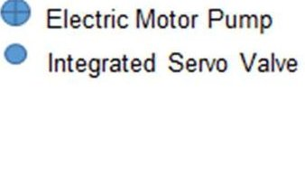

EBHA-Electric Backup Hydraulic Actuator EHA-Electro Hydrostatic Actuator

Figure 3-10: List of aerospace actuator architectures

## Hydro mechanical Actuator (HMA)

A hydro mechanical actuator uses hydraulic power from the aircraft hydraulic systems and is mechanically signaled. A servo valve is used as the interface between signaling and hydraulic power regulation. The architecture for a conventional hydro mechanical linear actuator is shown in Figure 3-12. The blue channel and green channel refer to two different hydraulic power system supplies. Mechanical control commands issued by the pilot cause the summing link to rotate about the pivot thereby activating the servo valve. The servo valve regulates the flow of hydraulic fluid into one side of the hydraulic cylinder causing the fluid to move the piston and actuate the control surface. At the same time a feedback link restores the summing link to its original position when the desired actuation is achieved.

<!-- PDF_PAGE: 99 -->

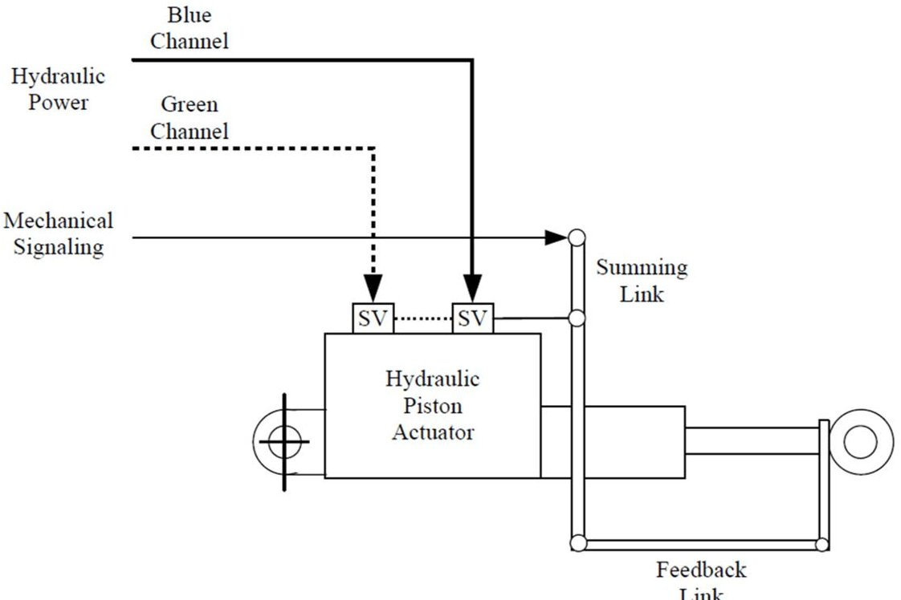

Figure 3-11: Hydro mechanical actuator (HMA) architecture, from [98]

Electro-Hydraulic Servo Actuator (EHSA)

An EHSA also known as a Fly by Wire (FbW) actuator uses an electrically signaled servo valve to regulate the flow of hydraulic fluid into the actuation cylinder. Figure 3-12 shows the architecture of an EHSA where the control signals are provided through either a direct electrical link or a FbW command. The difference is that a FbW command is processed by the flight control computer whereas the electrical link directly communicates with the actuator. FbW commands provide flight envelope protection whereas a direct link is used in case the primary FbW is not operational [98]. The Actuator Control Electronics processes the digital FbW or direct electrical link commands and issues analog signals to the servo valve to enable actuation. Moreover, a Linear Variable Differential Transducer (LVDT) detects the position of the actuator rod and supplies this information back to the Actuator Control Electronics thereby closing the control loop [98].

<!-- PDF_PAGE: 100 -->

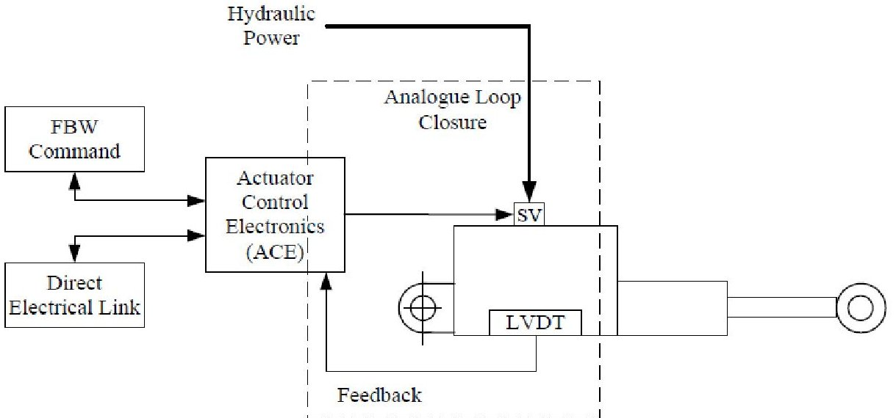

Figure 3-12: Electro hydraulic servo actuator (EHSA) architecture, from [98]

The electro hydraulic servo valve is the interface between the electrical control and hydraulic power supply. Power is directed into the appropriate side of the hydraulic cylinder depending on the direction of actuation desired. A schematic of an Electro- Hydraulic servo valve is provided in Figure 3-13 and a map of energy transformations inside the valve are also shown.

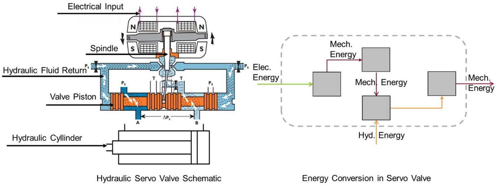

Figure 3-13: Electro hydraulic Servo Valve architecture, adapted from [111]

Electrical control signals from the FCC or direct electrical link are provided to the actuator control electronics, which then issues analog electrical signals to the servo valve. Coils in the valve are

<!-- PDF_PAGE: 101 -->

energized and cause the deflection of a rotating spindle inside the valve. This deflection moves a ram within the servo that causes hydraulic fluid to be supplied on one side of the hydraulic cylinder. Electrical energy is converted to Mechanical energy that is used to regulate the flow of hydraulic energy inside the servo valve. The regulated hydraulic energy moves the hydraulic cylinder and causes motion of the actuation rod.

## Functional Architecture of an EHSA

A top down approach is used to identify generic components that realize the energy conversion detailed in Figure 3-14. The servo valve performs a "Metering" function to regulate the flow of hydraulic fluid into the cylinder. Moreover, the primary actuation is performed within the hydraulic cylinder and can be classified as an "Actuation" logical component. Figure 3-14 shows the assembled logical components supporting the energy exchanges within the actuator

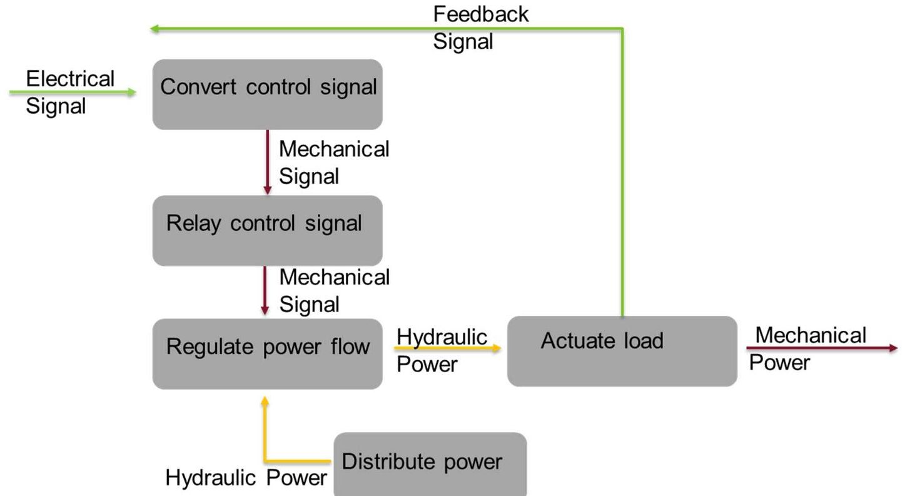

Figure 3-14: Electro-hydraulic servo actuator (EHSA) functional architecture

<!-- PDF_PAGE: 102 -->

Convert control signal" references the conversion of the analog electrical signal into mechanical deflection of the spindle within the servo valve. "Relay Control Signal" captures the transfer of the mechanical spindle deflection into movement of the ram that enables hydraulic flow to be regulated. This regulation of hydraulic flow is represented by "Regulate power flow". Hydraulic power is then provided to the "Actuate Load" function that converts hydraulic power into mechanical power to move the actuator rod. This functional architecture is used to create the reusable actuation elements shown in section 3.5.4.

## Functional Architecture of an EHA

An Electro-hydrostatic Actuator consists of a variable speed electric motor coupled with a fixed displacement hydraulic pump. This arrangement along with power electronics and an AC power supply ensures that actuation needs can be elicited on demand and removes the need for the actuator to be powered continuously as in conventional hydraulic actuation. The variable speed motor drives a fixed displacement pump which moves the actuation rod as required. An LVDT completes the control loop by relaying the actuator position to the control electronics.

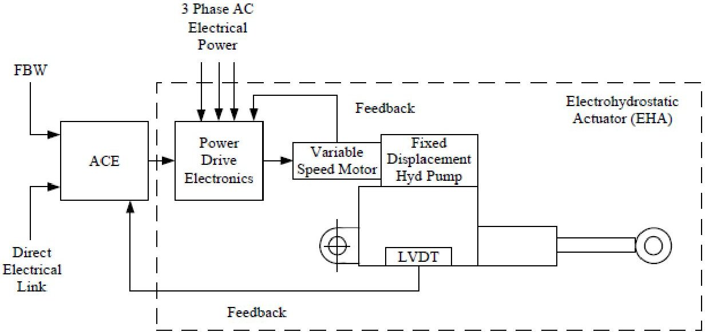

Figure 3-15: Electro-hydrostatic actuator (EHA) architecture, from [98]

<!-- PDF_PAGE: 103 -->

Electrical energy supplied as electrical power to the EHA is regulated by control signals issued by the Actuator Control Electronics and is used to drive the variable speed motor. Electrical energy is converted to mechanical energy by the electric motor which is further transformed into hydraulic energy at the fixed displacement pump. The hydraulic cylinder converts hydraulic energy to mechanical energy by the translation of the actuator rod.

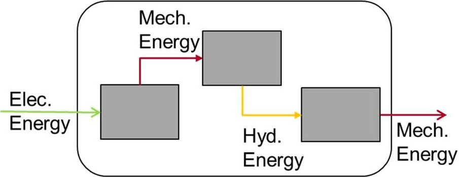

Figure 3-16: Energy flow through an electro-hydrostatic actuator architecture

A set of generic logical components that enable these energy transformations are identified. Generic functions are then allocated to these logical components to create a functional and logical architecture.

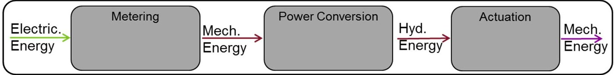

Figure 3-17: Logical components of an electro-hydrostatic actuator architecture

An EHA is shown to have "Metering", "Power Conversion" and "Actuation" logical components. "Metering" ensures that the right amount of power is released for the requested actuation demand. "Power Conversion" on the other had represents the transformation of electrical energy to hydraulic energy by the electric motor and fixed displacement pump respectively. The "Actuation" logical component is realized by the hydraulic cylinder and the actuator rod.

<!-- PDF_PAGE: 104 -->

Electro mechanical actuators are a completely electric solution to actuation. EMA's incorporate a brushless DC motor coupled with a reduction gear that allows conversion of rotary motion into translation of the actuator arm. Electrical power supplied from a 3 phase AC bus is converted by power drive electronics to operate the DC Motor. A reduction gear enables rotary motion of a screw jack configuration of the actuator arm.

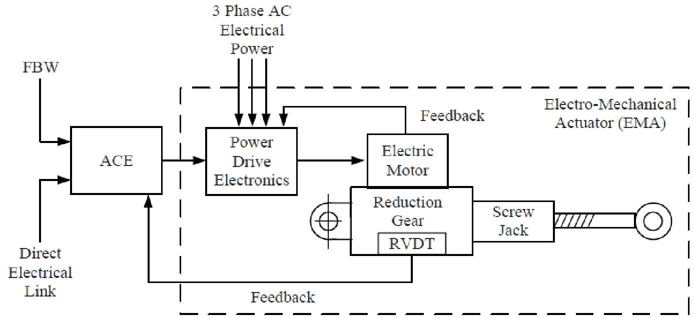

Figure 3-18: Electromechanical actuator architecture, adapted from [98]

The energy conversion architecture in an EMA features the conversion of electrical energy into mechanical energy by the electric motor. A further transformation from rotational mechanical energy to translational mechanical energy takes place through the reduction gear and screw jack arrangement. Figure 3-19 highlights the energy transformation within an EMA.

<!-- PDF_PAGE: 105 -->

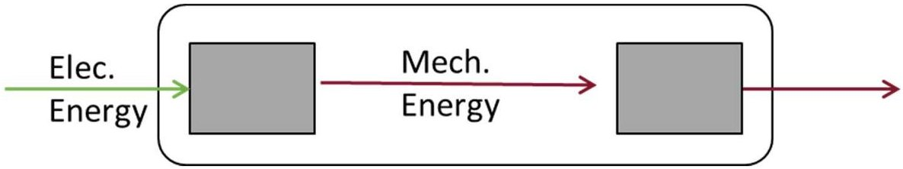

Figure 3-19: Energy flow and conversion in an electromechanical actuator

A set of logical components that constitute the EMA are identified and assembled into a logical architecture. The two generic logical components are "Metering" and "Actuation". "Metering" represents the regulation of electrical power supplied to the motor by the Actuator Control Electronics. "Actuation" captures the combined action of the reduction gear and screw jack arrangement in its transformation of rotational motion to linear motion.

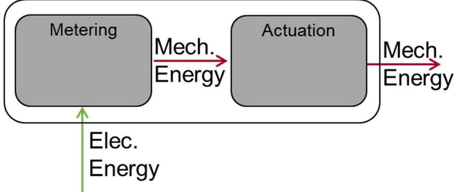

Figure 3-20: Electromechanical actuator logical architecture components

A set of functions realizing these logical components are identified and a functional architecture for the EMA is created. As shown in Figure 3-21 the function "Relay control signal" refers to the action of the Actuator Control Electronics that relay the control command. Power regulation by the Power Drive Electronics is captured by "Regulate Power Flow" and power conversion is realized by "Convert Power". The interface between electrical and mechanical power is represented using the "Convert Power Function". "Actuate Load" represents the movement of the actuator rod driven by the electric motor and reduction gear.

<!-- PDF_PAGE: 106 -->

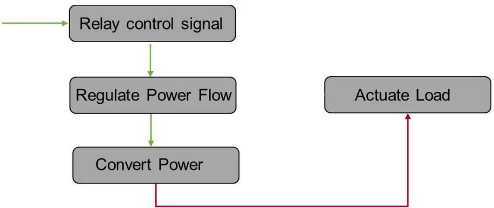

Figure 3-21: Electromechanical actuator (EMA) functional architecture

The variability in actuation technology is captured by creating a generic functional and logical architecture. In representing actuation architectures there are a variety of generic functions comprising the architecture. By specifying exchanges between these generic functions, a set of functional architectures are built for different actuator technologies. Moreover, coupling these functions together in logical components enables the logical architecture to be defined. Having established the functional and logical architectures for each actuation technology, a generic aircraft power system architecture is identified in the next section.

## 3.5.3 Power System Architectures

Aircraft secondary power is the non-propulsive power extracted by the engine from the fuel. Secondary power is mainly consumed by aircraft systems of which hydraulic, electrical and pneumatic systems form a major proportion. For flight control actuation systems, the secondary power sources are either hydraulic, electric or a combination of both. Figure 3-22 shows the aircraft power system architecture from a PFCS context.

<!-- PDF_PAGE: 107 -->

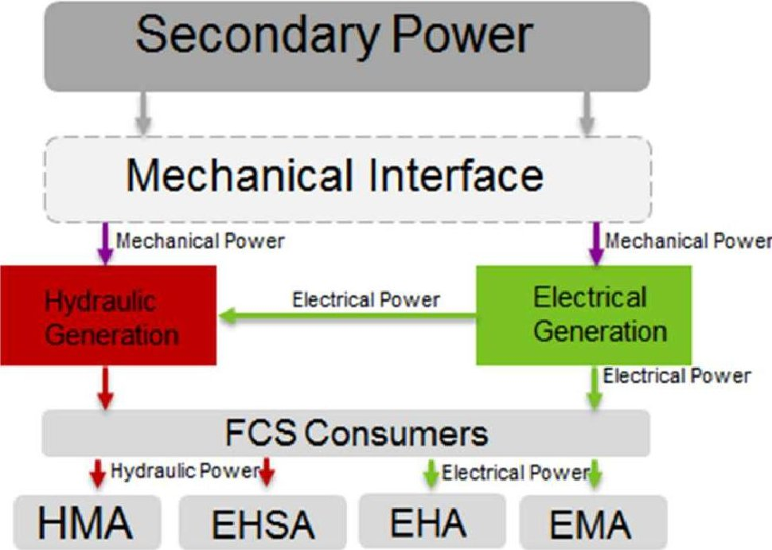

Figure 3-22: Generic aircraft power schema

Hydraulic power systems consist of independent networks supplying pressurized hydraulic fluid to consumers such as flight control and landing gear actuators. Hydraulic power is typically generated by Engine Driven Pumps (EDP) that are coupled to the auxiliary gearbox that extracts energy from the engine shaft. Moreover, electric driven pumps powered by an independent electrical supply are also used. This electrical supply is also derived from the engine using an integrated drive generator. Therefore, both mechanical and electrical sources are used to generate hydraulic power in an aircraft. A list of typical sources of hydraulic power is included below:

1. Engine Driven Pump

2. Electric Motor Pump

3. Air Driven Pump

4. Ram Air Turbine

<!-- PDF_PAGE: 108 -->

In addition to these sources, accumulators are used to store and provide instantaneous hydraulic power for short periods of time when constant supply is unavailable. Moreover, a power transfer unit can be used to shift power from one independent system to another in case of the failure of any one system.

The architecture of aircraft power systems is characterized as containing two categories of components. Power sources that generate power and distribution elements that provide power to the consumer systems. Other considerations in power systems architecture are related to ensuring redundancy against system failures. Segregation of systems is also required to ensure that a single source of failure does not render all systems inoperative.

A flight control systems perspective on power systems architecture sees the interaction of four major components. These are as follows:

1. Hydraulic Generation

2. Electrical Generation

3. Hydraulic Distribution

4. Electrical Distribution

Hydraulic generation sources provide hydraulic power from secondary power to consumers such as conventional EHSA and HMA actuators. However, hydraulic power can also be generated electrically using Electric Motor Pumps (EMP). More electric actuation technologies like EHA and EMA's require direct electric sources thereby justifying the need to have an electric distribution element in the power system logical architecture. A simplified version of the FCS context of power system architecture shown in Figure 3-22 is presented in Figure 3-23.

<!-- PDF_PAGE: 109 -->

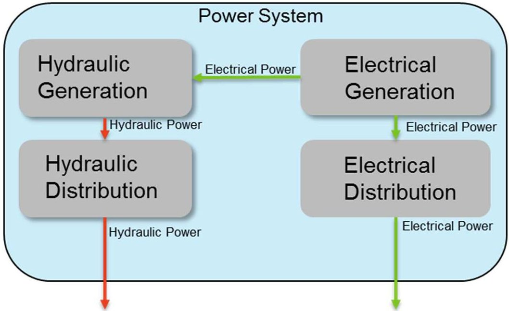

Figure 3-23: Generic aircraft power generation and distribution logical architecture

## 3.5.4 Actuator and Power System Catalog in Capella

At the highest level of abstraction (L0), variability in actuation technology is not represented well in terms of the level of detail employed. The only way to differentiate between actuators represented at L0 is through the type of power being supplied to it. Although L0 representations are useful for creating simple descriptions of flight control architecture, variability is not sufficiently addressed. In order to clearly represent the changing signal and power interfaces that variability in actuation technology presents, the actuation element needs to be selectively brought into a greater level of detail. Functional and logical architectures described in the previous section facilitate the creation of Capella models for each type of architecture. These logical architecture models of different actuators are then used to create physical architectures and exchanges for each actuator. Physical architectures for each actuator are stored as replicable elements which can be used in the creation of flight control system architectures.

<!-- PDF_PAGE: 110 -->

## EHSA Logical Architecture in Capella

The logical and functional architectures of the EHSA as presented in Figure 3-12 and Figure 3-14 respectively are used to develop its implementation in Capella. An L1 representation of power system architecture is also presented in the same diagram to highlight the sources of the power supplied to the actuator. A functional architecture of this system is first created in Capella and exchanges between each function are defined. The system architecture is created separately for both the power system and actuator. Interface functions are then linked together using functional exchanges.

Figure 3-24 shows the system architecture of an EHSA coupled with a generic aircraft power system architecture. The actuation scope is highlighted and key functions such as "Regulate power flow", "Convert control signal" and "Actuate Load" are shown to be interfaces between signal and power chains. The control scope is shown to begin with the "Pilot/Autopilot" where control instructions are received and relayed to the actuation means. Power sources vary as electric and hydraulic respectively and hydraulic power is also generated using electric means.

The distribution system provides hydraulic power to the "Regulate power flow" function where it interacts with the actuation control command. The actuation demand determines how much hydraulic power is released to the actuator to move the control surface. Feedback about actuator and control surface position is provided back to the relay means and to the control interface and pilot. Further feedback is also provided through inertial means by the aircraft which is interpreted by the Pilot. The interface functions are important as they represent the interaction of signal and power. Furthermore, these functions are common between different system scopes such as actuation and control. This form of representation allows such functions to be identified and enables derived requirements and exchanges to be captured.

<!-- PDF_PAGE: 111 -->

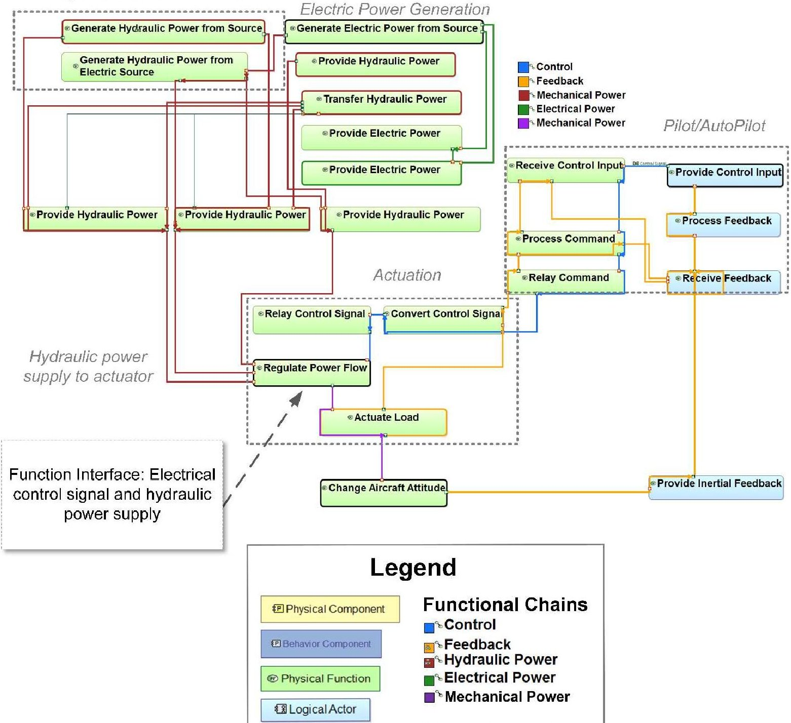

Figure 3-24: Electro-hydraulic servo actuator system architecture using System Architecture Breakdown (SAB) diagram in Capella

This system architecture is the basis for the development of a logical architecture in Capella. The system functions shown above are allocated to their generic logical components within a logical architecture. Capella automatically preserves the exchanges between the different functions thereby ensuring traceability between system and logical engineering levels. The logical architecture of an EHSA is shown in Figure 3-25.

<!-- PDF_PAGE: 112 -->

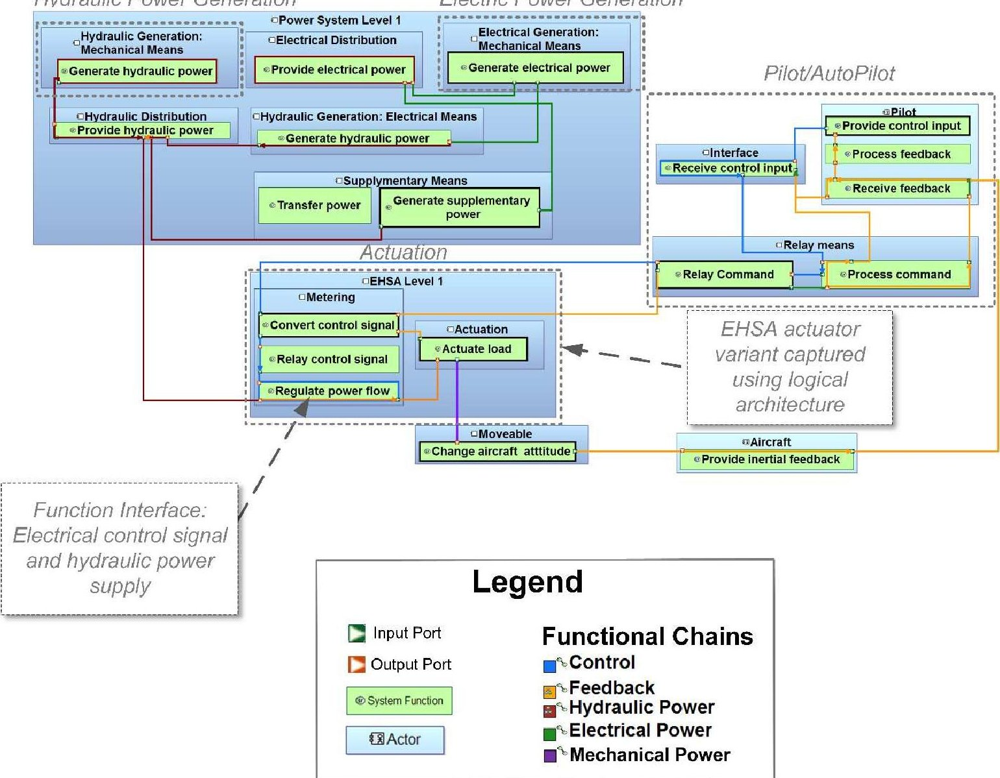

Figure 3-25: Electro-hydraulic servo actuator logical architecture using Logical Architecture Breakdown (LAB) diagram in Capella

This logical architecture gives an abstract representation of the power transformations occurring inside an EHSA. The power system is captured as a specific logical component and the functions associated with control interface and control signal relay are assigned to "Interface" and "Relay Means" logical components respectively. Moreover, the actor functions defined in the system architecture diagram are assigned to logical actor components in the logical architecture. Functional chains are shown to highlight the various control, power and feedback flows within the logical architecture. A logical architecture allows variability capture as it uses abstract functions

<!-- PDF_PAGE: 113 -->

and components to represent the system. Establishing a logical architecture helps formalize these abstract functions, exchanges and their allocation to generic system components.

In Figure 3-25 the control signal from the relay means is conditioned by the "Convert control signal function" after which it is relayed to the "Regulate power flow" function. Power supplied from the power system is then regulated and provided to the "Actuate Load" function. Hydraulic power is converted to mechanical power by the "Actuate Load" function causing movement of the control surface or movable thereby effecting the desired flight control. The "Actuate Load" function also provides information about the actuation activity in the form of a feedback which is passed back through the "Convert control signal" function through the relay means and to the control interface and Pilot. Furthermore, an inertial feedback is provided by the aircraft as an actor component implementing the "Provide inertial feedback" function. This closes the control loop as the control demand issued using the control chain is closed by the feedback chain providing information about the new state of the aircraft. These logical architecture representations help identify the differences in flows of control, power and information amongst different actuation technologies. Moreover, when different types of actuation architectures exist in an aircraft, then the exchanges at key interfaces are made clear using this form of representation.

## EHA Logical Architecture in Capella

The system architecture for an EHA is presented in Figure 3-26. This type of actuator is supplied with electrical power and internally performs a hydro mechanical power conversion, i.e. hydraulic power is generated using an electric motor pump that is then converted to mechanical power within the integrated hydraulic cylinder. EHA's are part of the More Electric Actuation or Power by Wire (PbW) paradigm where actuators are signalled and powered electrically. In an EHA electric power generated by the power system is supplied to the "Regulate power supply" function. Here it

<!-- PDF_PAGE: 114 -->

interacts with the actuation control signal issued by the control interface. Electric power is regulated by this function which is typically implemented using power electronics and actuator control modules. The supplied electric power is transformed into hydraulic power at the "Convert Power" function. Typical realization is seen in the form of a local hydraulic circuit that uses an accumulator and an electric motor pump to pressurize the hydraulic fluid. The hydraulic power is converted to electric power at the "Actuate Load" function where pressurized hydraulic fluid is used to move the piston connected to the actuator rod. An EHA features local hydraulic power generation within the scope of the actuator.

The functions in Figure 3-26 are allocated to generic logical components and a logical architecture is created. The logical components "Metering", "Power Conversion" and "Actuation" are generic and reflective of the functions performed within actuators. The complete logical architecture is shown in Figure 3-27 and key component groups are such as hydraulic and electrical power generation are highlighted. Each component within this logical architecture can be implemented as a physical component and Capella ensures that the links between each component are preserved in the physical architecture.

<!-- PDF_PAGE: 115 -->

Hydraulic Power Generation Electric Power Generation

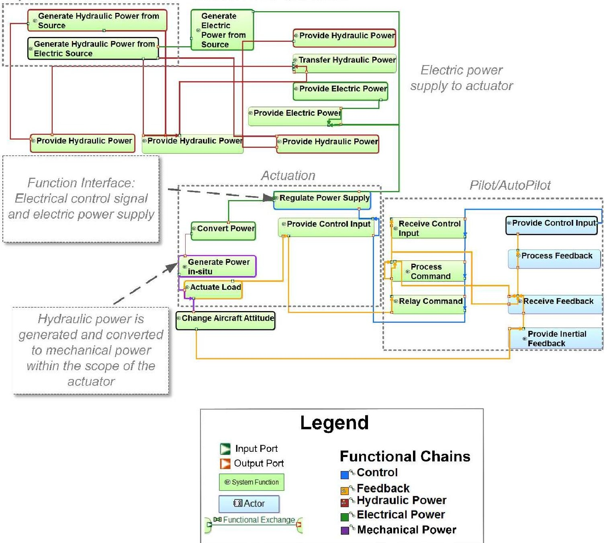

Figure 3-26: Electro-hydrostatic actuator system architecture using System Architecture Breakdown (SAB) diagram in Capella

<!-- PDF_PAGE: 116 -->

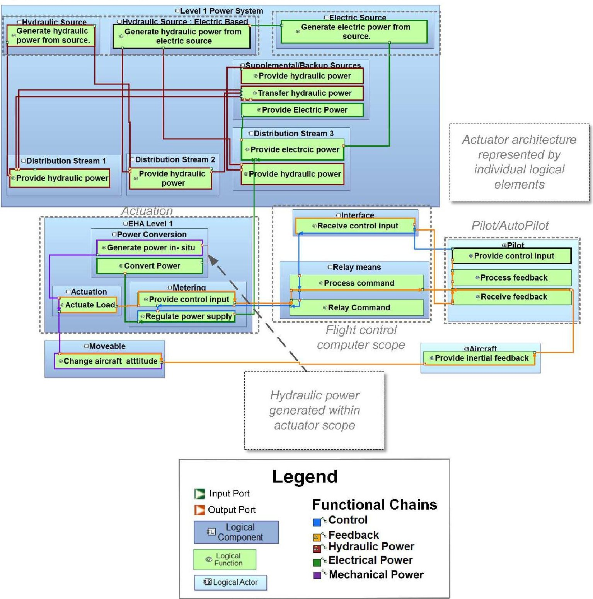

Figure 3-27: Electro-hydrostatic actuator logical architecture using Logical Architecture Breakdown (LAB) diagram in Capella

<!-- PDF_PAGE: 117 -->

The architectures of hydro mechanical actuators and electro mechanical actuators introduced in 3.5.2 are also developed and a catalog of actuator logical architectures are created in Capella. These actuator logical architectures are made reusable using the Replicable Elements Collection (REC) in Capella. An REC is a reusable element that can be used in multiple contexts, configurations and models [112]. This feature enables the reuse of Capella modelling elements and ensures that relationships between exchanges, logical components and functions are preserved. These REC's are instantiated as Replicas (RPL) within a given configuration or model [112]. In this context each actuator logical architecture is saved as a template (REC) and is instantiated (RPL) when building a model as required. Therefore models can be created with a number of actuators of the same type. Additionally the REC/RPL feature in Capella's REC supports three types of features which are listed as follows:

1. Black box: This implies that the RPL created from an REC cannot be modified

2. Constrained Reuse: Some modification is possible but the exchanges, functions and other components within the REC cannot be modified.

3. Inheritance: Any number of changes can be made including modification, addition and removal of elements constituting the REC.

Therefore, Capella provides the required flexibility to predefine templates for actuators at logical and physical architecture levels. These templates can then be instantiated while building complete system architecture representations. This form of reuse reduces the time required to build architecture representations and also creates modelling artifacts that can be enriched for later use. The developed actuator logical architectures are presented in Figure 3-28 and Figure 3-29.

<!-- PDF_PAGE: 118 -->

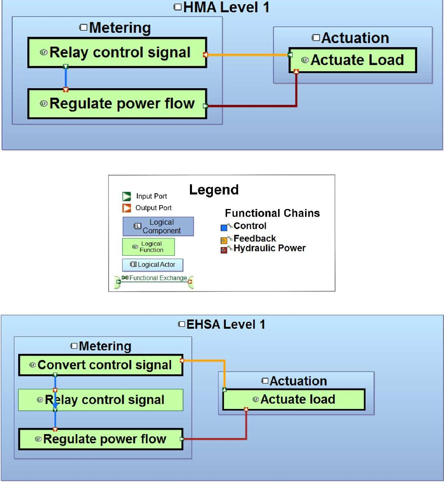

Figure 3-28: Actuator catalog in Capella (HMA and EHSA)

Figure 3-28 shows an L1 representation of Hydro-mechanical actuator (HMA) and an electrohydraulic servo-actuators (EHSA) logical architecture. Exchanges within the actuator are

<!-- PDF_PAGE: 119 -->

classified as Control, Power and Feedback. In the HMA the control signal regulates the supply of hydraulic power supplied to the actuation function and a feedback signal is generated by the "Actuate load" function. The control signal in an HMA is of a mechanical type. The EHSA however, uses an electrical control signal to regulate hydraulic supply to the "Actuate Load" function which converts hydraulic power into mechanical power. Figure 3-29 shows the logical architectures of EHA and EMA respectively. The EHA and EMA implement an additional "Power Conversion" element as both actuators deal with multiple internal power conversions. As an example, an EHA converts electrical energy to hydraulic energy which is then transformed to mechanical energy. Furthermore, in actual implementation specific components are dedicated to realize these functions. For example an EMA uses an electric motor to drive a fixed displacement hydraulic pump that in turn drives a hydraulic piston connected to the actuator arm. In a similar manner an EHA has reduction gears to transfer energy from the electric motor and to convert rotary motion into linear actuation. The logical architectures in the actuator catalog are used to build physical actuator architectures which are then used in building PFCS architecture diagrams. Selected PFCS architecture of the Airbus A350 XWB and Airbus A320 are presented in Chapter 4.

<!-- PDF_PAGE: 120 -->

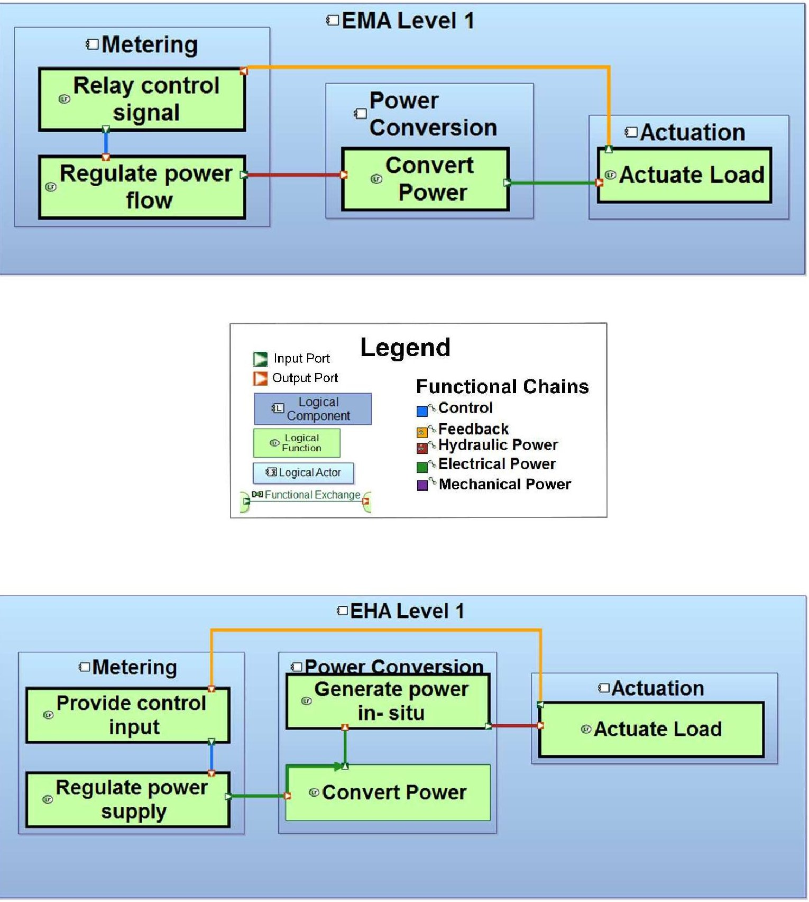

Figure 3-29: Actuator catalog in Capella (EHA and EMA)

<!-- PDF_PAGE: 121 -->

## Power System Catalog in Capella

The power system logical architecture as presented in Figure 3-30 categorises power sources according to the nature of power generation. For e.g., hydraulic pumps driven by mechanical means are represented as hydraulic sources of a mechanical type whereas electric pumps are categorised as electric based hydraulic power sources. Additionally, the means of distribution are also defined in the power system architecture. The choice of power system representation should be made to match the granularity level of the overall architecture representation as both a generic (L0) and detailed (L1) representation are made available in the catalog. The generic power system architecture only includes elements that represent sources of hydraulic or electric power. It can also be seen that hydraulic power generation can be achieved through electric sources like an EMP. The generic power system logical architecture as shown in Figure 3-30 does not include any elements related to power distribution. This is addressed by including these elements in the L1 power system representation. Other secondary power sources like the PTU (Power Transfer Unit) and RAT (Ram Air Turbine) are represented using the "Supplementary Means" logical element. A generic representation like this is useful in conceptual design to represent many of the architectures coming out of the design space exploration exercise.

These logical architectures are templates for the creation of physical architectures at both L0 and L1 levels. Physical architectures are created by transferring logical architectures to the physical level using Capella's automatic transfer capability. This is illustrated in Appendix A. Furthermore, the physical architectures created are made reusable and can be used to represent any primary flight control system architectures. This is presented in the next chapter where several PFCS architectures of existing aircraft are assembled using the model catalog.

<!-- PDF_PAGE: 122 -->

Figure 3-30: Power system logical architecture in Capella (Generic and detailed representations)

<!-- PDF_PAGE: 123 -->

## 4 Architecture Representation Framework

Previous chapters have discussed the need for clear architecture representation in conceptual design. This section presents several use cases that apply the developed framework for the representation and visualization of PFCS architectures.

## 4.1 Application of Representation Framework

The methodology presented in Chapter 3 is used to create a catalog of actuator physical architectures in Capella. This catalog can be applied within a conceptual design environment for the representation of primary flight control system architectures. The framework provisions a generic and architecture specific level of granularity for PFCS architecture representation. The generic level allows representations of different flight control systems architectures to be created quickly and the architecture specific level enables detailed definition of architecture interfaces. Moreover, the provision of power system architecture representations at each of the aforementioned levels ensures that interfaces can be clearly defined even in conceptual design. The sources of power for each actuator are elaborated in detail at the L1 level by including a dedicated power supply architecture. Figure 4-1 illustrates how the framework is to be applied.

<!-- PDF_PAGE: 124 -->

Figure 4-1: Application of proposed representation framework

The following steps are to be completed in order to build a PFCS architecture representation in Capella using the developed actuator catalog:

## Building the Catalog

1. A textual description of the PFCS architecture detailing the control axis, number of control surfaces and the allocation of actuators per surface is created. Information about each actuator type is also included.

2. The generic logical elements created at L0 are used to create physical architecture components using the Physical Architecture Breakdown (PAB) diagram. Here, generic logical components are transitioned to the physical level and allocated to generic physical components named according to the type of physical implementation that is required. For example, control input can be provided both using a control column and a side stick.

<!-- PDF_PAGE: 125 -->

3. Once these generic physical components are created, the REC/RPL feature in Capella is used to make them reusable. This means that the components can be called into a diagram and reused many times. Component names can be changed to distinguish between them.

4. A physical architecture is built using the reusable components at L0. Tools like functional chains are used to highlight flows of control, power and information. The image export feature in Capella can be used to generate images of each architecture representation.

5. Once a catalog has been established at L0, a more detailed catalog is created at L1 using the same approach but specifically for the detailed L1 logical architectures of each actuator type.

## Creating Architecture Representations

1. Once the catalog has been established at the physical level, system architectures can be built easily. The textual descriptor of the architecture is used as input at L0 and a generic representation is developed using L0 generic elements.

2. The diagram is populated with catalog elements and functional exchanges are automatically realized within each replicable element. Exchanges between elements are allocated and the physical architecture is completed.

3. Power supply is allocated to each actuator according to its type

4. An L1 architecture is created by replacing the generic elements with the more detailed actuator specific physical architectures. This is supported by a detailed representation of the power system architecture. Actuators are then allocated distribution systems and functional chains are used to highlight different power types.

A guide on the use of Capella's REC/RPL feature is presented in Appendix A which details the creation, storage and instantiation of replicable elements.

<!-- PDF_PAGE: 126 -->

In the following section, the PFCS architecture of the Airbus A320 and A350 aircraft is used to illustrate the developed approach. The primary flight control system architecture comprises of the elevators, ailerons, flight spoilers and rudder for pitch, roll and yaw control respectively. These are continuously active during the course of aircraft operation and are the main means of controlling the aircraft. In the following representations the pitch control axis is presented in order to manage the scale of the diagrams.

## L0 Representation

This level of representation uses generic elements to develop simple representation of systems architecture focusing on the exchanges between system components. To illustrate the features of L0, the pitch control architecture of the Airbus A320 and a novel architecture consisting of two different actuation types are represented

The pitch control system of the Airbus A320 aircraft features the use of EHSA with each of the two elevator surfaces being actuated by a pair of EHSA's. The actuators are signaled electrically and actuated using hydraulic power. The physical architecture diagram presented in Figure 4-2 uses the physical implementation of generic flight control elements such as "Relay Means", "Actuation Means" and "Moveable". Furthermore, the power system is represented by a single actor function and physical component. This simplified power system representation supplies hydraulic power to the actuators. The flows of control, power and feedback are highlighted using color coded functional chains. This feature allows the identification of interface functions such as "Actuate Control Surface" and "Process Command". The direction of each exchange is adjudged using the input and output port designators on each function.

<!-- PDF_PAGE: 127 -->

Figure 4-2: Pitch control system architecture of the Airbus A320 represented at L0

The physical architecture of the Airbus A320 shows the representation of characteristic features such as the "Sidestick Controller", "Flight Control Computer" and ESHA's. The physical components used in this representation are established using the methodology detailed in section 3.2. The control chain is represented in blue using the functional chain feature in Capella and in this case show the electrical control signal Control regulating the power flow to the actuator through the "Actuate Control Surface" function. The generic components used can be reused in other diagrams to represent diverse PFCS architectures. For example a novel pitch control system

<!-- PDF_PAGE: 128 -->

architecture featuring two types of actuators is assembled using these generic elements and illustrated in Figure 4-3. This architecture consists of four elevator surfaces, each being actuated by an EHA and EHSA pair, respectively. The power system at L0 is represented using a "Logical Actor" which supplies both electrical and hydraulic power to each type of actuator

Figure 4-3: Novel pitch control system physical architecture at L0

<!-- PDF_PAGE: 129 -->

In both Figure 4-2 and Figure 4-3, the control and feedback chains are similar. The functional chain called "control" starts with the pilot, who issues a command using the "Sidestick Controller" which is then processed and relayed using the "FCC" and the signaling medium. The control command reaches the actuator where it is used to regulate the power flow and actuate the control surface. Feedback to the control command is initiated by the aircraft which provides inertial feedback directly to the pilot through a change in attitude. Furthermore, the position of the actuator is relayed back through the "Actuate Control Surface" function and FCC to the pilot. This feedback can be in the form of artificial feel at the control interface or a status indicator in the cockpit.

The elements used in this diagram are the same as the ones used in Figure 4-2. They are reusable within Capella and can be used to represent different combinations of actuators, and control surfaces that constitute flight control system architectures. However, the readability of the diagram is reduced as the number of representation artifacts is increased. Although the Capella viewer provisions for zooming in and out, the same feature is not available when the diagram is exported as an image. Therefore, practical guidelines for the efficient export of diagrams that were identified over the course of this work dictate the reduction of empty space by clustering all the elements together.

L0 allows the building of high-level representations of flight control system architectures. The reuse of generic elements ensures that this can be achieved quickly and that a diverse set of architectures can be developed. However, more detailed representation is often required to view specific interactions within a system architecture or to further develop a selected system architecture. The development of architecture specifications requires certain elements of the system architecture to be defined in greater detail. This can be done with the L1 representation level, which is illustrated in the following section.

<!-- PDF_PAGE: 130 -->

## L1 Representation

L1 based representations provide greater detail on specific components of the architecture. This is important to zoom in on specific interfaces and internal components or to develop certain architectural elements further, with more detail. In this application, the L1 representation is used to capture variability in flight control actuation technology in greater detail. Figure 4-4 illustrates the application of L1 in the representation of the Airbus A350's pitch control architecture. This architecture features a pair of EHA and EHSA's that actuate each surface. Electrical signalling is used for both actuators however the EHSA is supplied with hydraulic power whereas the EHA uses electrical power.

The physical components used in this representation are developed from the catalog of actuator logical architectures presented in section 3.5.4 Each actuator physical component is shown to consist of elements performing metering, actuation and in the case of EHA's, power conversion. In this representation, the interface between control and power is shown to differ based on the type of actuator. In an EHA, the control signal and power supply are interfaced by the "Regulate Power Supply" function. Following this power conversion takes place and hydraulic power is generated within the scope of the actuator by the "Generate Power In-Situ" function. This is in contrast to the EHSA where the interface is within the "Metering" logical component at the "Regulate Power Supply" function.

<!-- PDF_PAGE: 131 -->

Figure 4-4: Pitch control system physical architecture of the Airbus A350 represented at L1

<!-- PDF_PAGE: 132 -->

A representation of the aircraft power system is also provided at L1. The L1 representation of the power systems shows the sources of each power type (e.g. pumps or generator) and their distribution. The detailed representation of power system architecture in addition to the flight control system allows the exploration of redundancy, as individual actuators can be allocated different sources of power. In this way, L1 provides enough detail on the functional interactions between the actuator and power system to perform early safety analysis.

Figure 4-4 also illustrates the issues with readability when modelling elements are spaced out across the diagram. In this case, enhanced views of the EHA and Power system physical components are shown to make the underlying functions and exchanges readable.

The pitch control architecture of the Airbus A320 is represented at L1 in Figure 4-5. Two EHA's are assigned to each actuator and supplied with hydraulic power. The power system architecture has several power generation and distribution elements which are as follows:

1. EDP: or Engine Driven Pump is used to pressurize the hydraulic system using engine power offtake.

2. GEN refers to an electrical generator that derives power from the engine power offtake. Although the Airbus A350 features a variable frequency generator, this level of detail is not explored in this representation.

3. EMP or Electric Motor Pump uses the electrical power generated by the IDG to pressurize the hydraulic system.

4. PTU/RAT: This refers to the Power Transfer Unit and Ram Air Turbine, both of which are emergency power sources. The PTU uses the pressure in one hydraulic system to pressurize another in case of failure of any one hydraulic system.

<!-- PDF_PAGE: 133 -->

Figure 4-5: Pitch control system physical architecture of the Airbus A320 at L1 representation

<!-- PDF_PAGE: 134 -->

The RAT generates electrical and hydraulic power from the freestream as it is deployed outside the aircraft. These components are an integral part of the aircraft power system and are used to ensure safety and redundancy in the power systems. The distribution systems included in the power system representation supply the generated power to individual actuators. An actuator can be powered by more than one system which is further supplied by different sources. For example, in Figure, "Hydraulic System 2" is supplied by both EDP and EMP which further supply two different actuators.

The chains of power control and feedback are color coded and highlighted in the presented diagrams, using the functional chain feature in Capella. This form of representation allows the flow of control, power and feedback to be clearly identifiable. However, in some cases this makes it difficult to identify the source and target of particular exchanges. For example the power source to a particular actuator is hard to determine in Figure 4-5. This can be solved by hiding the functional chain option and displaying the exchanges directly with labels for identification purposes. Functional chains are used extensively in the above presented diagrams to highlight the various control, power and feedback chains within the PFCS architecture. Thus, functional chains help to improve the representation effectiveness.

<!-- PDF_PAGE: 135 -->

## 4.2 Summary

This chapter presented a case study that implements the framework developed in Chapter 3. The pitch control architectures of the Airbus A320 and A350 are built using the developed modelling elements at increasing levels of granularity. L0 representation allows simplified representations of PFCS architectures to be created easily. The use of generic elements ensures that the resulting diagrams are readable and exchanges between components are clear. However, L1 based representation allows a deeper insight into the interaction between the actuator and power system, within the scope of the PFCS. Functional interfaces within the actuator are highlighted and the flow and transformation of power is also made clear. L1 based representation are suitable for detailed analysis of the system architecture along a single control axis.

<!-- PDF_PAGE: 136 -->

## 5 Conclusion

An approach for the modelling of flight control system (FCS) architectures during conceptual design stages is described using the open source MBSE framework ARCADIA/Capella. This is followed by the development of a framework of modeling artifacts that capture the various actuation technologies used in PFCS architecture. A two level approach is presented featuring generic and technology specific modelling elements at system, logical and physical architecture levels. A catalog of modelling elements representing various actuator technologies is developed to ease the generation of system architecture models for design space exploration and subsequent architecture analysis. The application of this modelling framework in conceptual design is illustrated through the representation of PFCS architectures of the Airbus A320 and A350. These aircraft represent both conventional and more electric actuation technologies and allow the utility of the developed actuator catalog to be demonstrated.

The proposed architecture representation framework enables the representation of aircraft system architectures during the conceptual design stage. Representation of architectures early in the development process enables a deeper understanding of the system and its associated interfaces. Moreover, the ability to quickly represent architectures using generic elements ensures that a large set of candidate architectures can be explored faster. This makes the design process more efficient resulting in the evaluation and selection of optimal system architectures early in the design process. The early representation of system architectures in an MBSE framework ensures that there is a shared understanding of the system among all project teams and stakeholders. The use of this MBSE based representation framework also allows for integral processes such as safety analysis to be performed by leveraging the functional structure of the architecture. A major advantage of using this MBSE framework is the development of artifacts, in this case: generic and architecture

<!-- PDF_PAGE: 137 -->

specific reusable modelling elements that can be used throughout the development process. An MBSE representation established during conceptual design can therefore be developed further and used throughout the aircraft development process. Moreover, the developed representation can be used to create a technical and interface specification that is provided to the subsystem developer. This is important, as there is no ambiguity in terms of subsystem requirements and definition of interfaces. The system integrator or aircraft manufacturer can specify the system that best suits aircraft needs and the supplier then develops the system to this specification. The supplier can apply their domain specialization to optimize the system without being hindered by unambiguous interfaces and integration challenges. Ensuring efficiency in system integration mitigates developmental delays and ultimately reduces development cost and time.

The presented framework also supports Model Based Systems Analysis using Capella's support of external modules or add-ons. These add-ons provide "Viewpoints" of the model from the perspective of Cost, Performance and Safety [90]. The use of analysis modules in Capella can enable activities like safety analysis, early in the design process thereby allowing an evaluation of the feasibility of candidate systems architectures

## Challenges

Although the proposed representation framework satisfies the main criteria of clarity, modularity and traceability, it still presents with several drawbacks. The architecture representations are difficult to read as the number of elements being represented increases. This is due to the exchanges between components overlapping and reducing the readability of the diagram. Moreover, larger diagrams are hard to visualize within a single view. Another drawback is the inability to "zoom" into encapsulated diagrams as a system component can contain a detailed representation encapsulated within it. In Capella this is only supported in a separate model or

<!-- PDF_PAGE: 138 -->

diagram and there is no capability to access the encapsulated representation directly from the main diagram.

Representations at L1 involve a large number of elements and the readability of individual components and exchanges is significantly reduced. Although this form of representation is able to capture system exchanges and serves as a robust architecture specification, it is not well suited for visualization. Additionally, the location of system components with reference to the aircraft is not directly possible. Superimposition of Capella system architecture diagrams with aircraft drawings is difficult, time consuming and does not provide any added clarity.

The development of a catalog of reusable elements helps reduce the time spent in building diagrams. However, some effort is still required to define exchanges between the instantiated reusable elements. Although architecture analysis is supported through the implementation of custom modules in Capella, the process of developing these is time consuming. Furthermore, automating the process of diagram generation in Capella is required to make it more efficient.

Overall, the proposed framework implemented in Capella is an excellent tool for generating concise architecture representations for conceptual design. The generic representation using L0 elements and the added granularity of L1 enables exploration of the architectural design space. This framework facilitates the creation of an architecture specification which can then be used later in the design process.

<!-- PDF_PAGE: 139 -->

## 5.1 Future Work

Further work is required on developing standards in visualization of modelling elements including tools that allow "zooming" into specific subcomponents. Moreover, the automation of architecture generation would enable the exploration of a larger system architecture design space. As a next step, the link between the system architecture and evaluation attributes needs to be established. Some of these features are already present in the Capella tool including mass and cost attributes that can be associated with physical components. However, others such as reliability and safety analysis need to be investigated.

Another aspect for further development is the link between architecture specification and 3D visualization. The ability to generate parametric visualization of aircraft systems within a 3D modelling environment will allow the early consideration of system installation and integration issues. Furthermore, using a physical architecture specification as a basis for generating 3D models will allow a more accurate estimation of system metrics such as weight, wiring length etc. in conceptual design. These features will bring the design space exploration of aircraft system architectures further into the conceptual design phase and contribute towards an efficient aircraft development process.

<!-- PDF_PAGE: 140 -->

## Bibliography

[1] P. Pisquali, "Airbus A380 History - Modern Airliners." [Online]. Available: http://www.modernairliners.com/airbus-a380/airbus-a380_history/. [Accessed: 25-Mar 2019].

[2] D. Greising and J. Johnsson, "Behind Boeing's 787 delays Problems at one of the smallest suppliers in Dreamliner program causing ripple effect," 2007. [Online]. Available: https://www.chicagotribune.com/news/ct-xpm-2007-12-08-0712070870-story.html. [Accessed: 25-Mar-2019].

[3] Bombardier Inc., "Bombardier Aerospace Granted Authority to Offer CSeries Aircraft to Customers - Bombardier," 2015. [Online]. Available: https://www.bombardier.com/en/media/newsList/details.158-bombardier-aerospacegranted-authority-to-offer-cseries-aircraft-to-customers.bombardiercom.html. [Accessed: 25-Mar-2019].

[4] D. Scholz, "Section 12: Aircraft Systems," in The Standard Handbook for Aeronautical and Astronautical Engineers, New York: McGraw Hill, 2002, p. 12.1.

[5] International Air Transport Association, "IATA Technology Roadmap," 2013.

[6] SAE International, "ARP4754A: Development of Civil Aircraft and Systems," 2011.

[7] J. Gausemeier and S. Moehringer, "VDI 2206- A New Guideline for the Design of Mechatronic Systems," in IFAC Proceedings Volumes, 2002, vol. 35, pp. 785-790.

[8] D. Raymer, Aircraft Design: A Conceptual Approach 5e and RDSWin STUDENT. American Institute of Aeronautics and Astronautics, Inc., 2012.

[9] J. Roskam, Airplane design: Part I. Lawrence, Kansas: Roskam Aviation and Engineering Corp., 2015.

[10] D. P. Raymer, Aircraft Design: A conceptual approach. Reston, VA: AIAA, 2006.

[11] Air Transport Association, "ATA 100." [Online]. Available: http://www.s- techent.com/ATA100.htm. [Accessed: 12-Mar-2019].

[12] The Boeing Company, "AERO - 787 No-Bleed Systems," 2008. [Online]. Available: https://www.boeing.com/commercial/aeromagazine/articles/qtr_4_07/article_02_3.html. [Accessed: 25-Mar-2019].

[13] D. M. Judt and C. P. Lawson, "Application of an automated aircraft architecture generation and analysis tool to unmanned aerial vehicle subsystem design.," in Proceedings of the Institution of Mechanical Engineers. Part G, Journal of Aerospace Engineering, 2015, vol. 229, no. 9, pp. 1690-1708.

[14] M. Hornung, "Aircraft Systems ACS2017 Lecture 1," Introduction to Aircraft Systems. Munich, Germany, 2017.

[15] L. Faleiro, "Power Optimised Aircraft A keystone in European research in More Electric Aircraft Equipment Systems," 2006.

[16] I. Chakraborty and D. N. Mavris, "Integrated Assessment of Aircraft and Novel Subsystems Architectures in Early Design," J. Aircr., vol. 54, no. 4, pp. 1268-1282, 2017.

[17] B. Sarlioglu and C. T. Morris, "More Electric Aircraft: Review, Challenges, and Opportunities for Commercial Transport Aircraft," IEEE Trans. Transp. Electrif., vol. 1, no. 1, pp. 54-64, 2015.

[18] M. Noriko, T. Michiya, and O. Hitoshi, "Moving to an All-Electric Aircraft System," IHI Eng. Rev., vol. 47, no. 1, pp. 33-39, 2014.

[19] P. W. Wheeler, J. C. Clare, A. Trentin, and S. Bozhko, "An overview of the more

<!-- PDF_PAGE: 141 -->

electrical aircraft," Proc. Inst. Mech. Eng. Part G J. Aerosp. Eng., vol. 227, no. 4, pp. 578-585, Dec. 2012.

[20] D. Judt and C. P. Lawson, "Methodology for automated aircraft systems architecture enumeration and analysis," in AIAA ATIO, 2012.

[21] J. Olvander, B. Lunden, and H. Gavel, "A computerized optimization framework for the morphological matrix applied to aircraft conceptual design," Comput. Des., vol. 41, no. 3, pp. 187-196, 2009.

[22] H. Gavel, J. Oelvander, B. Johansson, and others, "Aircraft fuel system synthesis aided by interactive morphology and optimization.," in 45th AIAA Aerospace Sciences Meeting, 2007.

[23] F. Villeneuve, "A method for concept and technology exploration of aerospace architectures," Georgia Institute of Technology, 2007.

[24] "Systems Engineering Overview - SEBoK." [Online]. Available:

https://sebokwiki.org/wiki/Systems_Engineering_Overview. [Accessed: 25-Mar-2019].

[25] INCOSE, "Systems Engineering Vision 2020," 2004.

[26] S. Friedenthal, A Practical Guide to SysML: The Systems Modeling Language. Burlington: Elsevier/Morgan Kaufmann Publishers, 2008.

[27] "Model-Based Systems Engineering (MBSE) (glossary) - SEBoK." [Online]. Available: https://www.sebokwiki.org/wiki/Model-Based_Systems_Engineering_(MBSE)_(glossary). [Accessed: 04-Apr-2019].

[28] S. Liscouet-Hanke, B. R. Mohan, P. Jeyarajan Nelson, C. Lavoie, and S. Dufresne, "Evaluating a Model-Based Systems Engineering approach for the conceptual design of advanced aircraft high-lift system architectures," in Canadian Aeronautics and Space Institute AERO 2017, 2017.

[29] D. Huart and O. Olechowski, "Towards a Model-Based Systems Lifecycle: CPCS from design to operations," in International Workshop on Aircraft System Technologies, 2017.

[30] S. Liscouët-Hanke, "A Model Based Methodology for Integrated Preliminary Sizing and Analysis of Aircraft Power System Architectures," Université Toulouse III - Paul Sabatier, 2008.

[31] E. Kang, E. Jackson, and W. Schulte, "An Approach for Effective Design Space Exploration BT - Foundations of Computer Software. Modeling, Development, and Verification of Adaptive Systems," 2011, pp. 33-54.

[32] F. Zwicky, Morphological Analysis and Construction. New York: Wiley Inter-science, 1948.

[33] K. Griendling and D. Mavris, "A Systems Engineering Approach and Case Study for Technology Infusion for Aircraft Conceptual Design," in Advances in Systems Engineering, American Institute of Aeronautics and Astronautics, Inc., 2016, pp. 219- 268.

[34] W. Engler, P. Biltgen, and D. Mavris, "Concept Selection Using an Interactive Reconfigurable Matrix of Alternatives (IRMA)," in 45th AIAA Aerospace Sciences Meeting and Exhibit, American Institute of Aeronautics and Astronautics, 2007.

[35] C. P. Frank, R. A. Marlier, O. J. Pinon-Fischer, and D. N. Mavris, "Evolutionary multiobjective multi-architecture design space exploration methodology," Optim. Eng., vol. 19, no. 2, pp. 359-381, 2018.

[36] F. Villeneuve and D. Mavris, "A New Method of Architecture Selection for Launch Vehicles," in AIAA/CIRA 13th International Space Planes and Hypersonics Systems and

<!-- PDF_PAGE: 142 -->

Technologies Conference, 2005.

[37] R. Perez, J. Chung, and K. Behdinan, "Aircraft conceptual design using genetic algorithms," in 8th Symposium on Multidisciplinary Analysis and Optimization, 2000.

[38] L. Blasi, L. Iuspa, and G. D. Core, "Conceptual aircraft design based on a multiconstraint genetic optimizer," J. Aircr., vol. 37, no. 2, pp. 351-354, 1999.

[39] W. Crossley, E. T. Martin, and D. W. Fanjoy, "A multiobjective investigation of 50-seat commuter aircraft using genetic algorithm," AIAA Pap., pp. 2001-5247, 2001.

[40] L. Chi, H. Qiu, Z. Chen, and L. Ke, A Design Space Exploration Method Using Artificial Neural Networks and Metamodeling, vol. 544. 2012.

[41] E. Ipek, S. A. McKee, K. Singh, R. Caruana, B. R. de Supinski, and M. Schulz, "Efficient architectural design space exploration via predictive modeling," ACM Trans. Archit. Code Optim., vol. 4, no. 4, pp. 1-34, Jan. 2008.

[42] T. Lammering, "Integration of aircraft systems into conceptual design synthesis," RTWH Aachen, Aachen, 2014.

[43] S. Liscouët-Hanke, J.-C. Maré, and S. Pufe, "Simulation Framework for Aircraft Power System Architecting," J. Aircr., vol. 46, no. 4, pp. 1375-1380, Jul. 2009.

[44] I. Chakraborty and D. Mavris, "Assessing Impact of Epistemic and Technological Uncertainty on Aircraft Subsystem Architectures." 2016.

[45] I. Chakraborty and D. N. Mavris, "Heuristic Definition, Evaluation, and Impact Decomposition of Aircraft Subsystem Architectures," in 16th AIAA Aviation Technology, Integration, and Operations Conference, 2016.

[46] NASA, "Systems Engineering Handbook," 2017.

[47] A. T. Morris and J. C. Breidenthal, "The Necessity of Functional Analysis for Space Exploration Programs."

[48] E. L. Cole, "Functional analysis: a system conceptual design tool [and application to ATC system]," IEEE Trans. Aerosp. Electron. Syst., vol. 34, no. 2, pp. 354-365, 1998.

[49] N. Viola, S. Corpino, M. Fioriti, and F. Stesina, "Functional Analysis in Systems Engineering: Methodology and Applications," in Systems Engineering - Practice and Theory, pp. 71-96.

[50] D. Raudberget, C. Levandowski, O. Isaksson, T. Kipouros, H. Johannesson, and J. Clarkson, "Modelling and assessing platform architectures in pre-embodiment phases through set-based evaluation and change propagation," J. Aerosp. Oper., vol. 3, no. 3,4, pp. 203-221, 2015.

[51] D. S. Raudberget, M. T. Michaelis, and H. L. Johannesson, "Combining set-based concurrent engineering and function Means modelling to manage platform-based product family design," in 2014 IEEE International Conference on Industrial Engineering and Engineering Management, 2014, pp. 399-403.

[52] D. Reckzeh, Multifunctional wing moveables: Design of the A350XWB and the way to future concepts. 2014.

[53] T. Lampl, D. Sauterleute, and M. Hornung, "A Functional-Driven Design Approach for Advanced Flight Control Systems of Commercial Transport Aircraft," in 6th International Workshop on Aircraft System Technologies, 2017.

[54] T. Lampl, T. Wolf, and M. Hornung, "Preliminary design of advanced flight control system architectures for commercial transport aircraft," CEAS Aeronaut. J., pp. 1-10.

[55] O. Bertram, A. Berres, and H. Schumann, Function-driven Design Process of a Flight Control System for a Blended Wing Body Configuration. 2015.

<!-- PDF_PAGE: 143 -->

[56] M. Armstrong, C. De Tenorio, D. Mavris, and E. Garcia, "Function Based Architecture Design Space Definition and Exploration," in The 26th Congress of ICAS and 8th AIAA ATIO, American Institute of Aeronautics and Astronautics, 2008.

[57] M. Armstrong, "A process for function based architecture - Definition and modeling," Sch. Aerosp. Eng., vol. Master of, no. April, p. 209, 2008.

[58] D. Mavris, C. de Tenorio, and M. Armstrong, Methodology for Aircraft System Architecture Definition. 2008.

[59] "Set-Based Design - Scaled Agile Framework." [Online]. Available:

https://www.scaledagileframework.com/set-based-design/. [Accessed: 05-Mar-2019].

[60] R. Bornholdt, T. Kreitz, and F. Thielecke, "Function-Driven Design and Evaluation of Innovative Flight Controls and Power System Architectures." SAE International, 2015.

[61] SAE International, "ARP4761:Guidelines and Methods for Conducting the Safety Assessment Process on Civil Airborne Systems and Equipment.," 1996.

[62] G. Esdras and S. Liscouet-Hanke, "Development of Core Functions for Aircraft Conceptual Design: Methodology and Results," in Canadian Aeronautics and Space Institute AERO 2015 Conference, 2015.

[63] A. Canedo and J. H. Richter, "Architectural Design Space Exploration of Cyber-physical Systems Using the Functional Modeling Compiler," Procedia CIRP, vol. 21, pp. 46-51, 2014.

[64] A. Canedo, E. Schwarzenbach, and M. A. A. Faruque, "Context-sensitive synthesis of executable functional models of cyber-physical systems," in 2013 ACM/IEEE International Conference on Cyber-Physical Systems (ICCPS), 2013, pp. 99-108.

[65] K. Michaels, "Key Trends In Commercial Aerospace Supply Chains," Montreal, 2017.

[66] "Model Based Systems Engineering | Siemens." [Online]. Available: https://www.plm.automation.siemens.com/global/en/our-story/glossary/model-based systems-engineering/28573. [Accessed: 27-Mar-2019].

[67] N. A. Tepper, "Exploring the use of Model-Based Systems Engineering (MBSE) to develop Systems Architectures in Naval Ship Design," Massachusetts Institute of Technology, 2010.

[68] J. A. Estefan, "Survey of Model-Based Systems Engineering (MBSE) Methodologies," 2008.

[69] A. Maheshwari, "Industrial Adoption of Model-Based Systems Engineering: Challenges and Strategies," 2015.

[70] B. A. Morris, D. Harvey, K. P. Robinson, and S. C. Cook, "Issues in Conceptual Design and MBSE Successes: Insights from the Model-Based Conceptual Design Surveys," INCOSE Int. Symp., vol. 26, no. 1, pp. 269-282, Jul. 2016.

[71] National Aeronautics and Space Administration, "Constellation Program Lessons Learned Volume II Detailed Lessons Learned," 2011.

[72] D. Nichols and C. Lin, "Integrated Model-Centric Engineering: The Application of MBSE at JPL Through the Life Cycle," 2014.

[73] T. J. Bayer et al., Model Based Systems Engineering on the Europa Mission Concept Study. .

[74] C. Becker and T. Giese, "Application of Model Based Functional Specification Methods to Environmental Control Systems Engineering," SAE Int. J. Aerosp., vol. 4, no. 2, pp. 637-651, 2011.

[75] P. George Mathew, S. Liscouet-Hanke, and Y. Le Masson, "Model-Based Systems

<!-- PDF_PAGE: 144 -->

Engineering Methodology for Implementing Networked Aircraft Control System on Integrated Modular Avionics - Environmental Control System Case Study," SAE Tech. Pap., Oct. 2018.

[76] H. Luiz Valdivia de Matos, "Model-Based Specification of Integrated Modular Avionics Systems using Object-Process Methodology," in 2018 IEEE/AIAA 37th Digital Avionics Systems Conference (DASC), 2018, pp. 1-8.

[77] C. Pessa, M. Cifaldi, E. Brusa, D. Ferretto, K. M. N. Malgieri, and N. Viola, "Integration of different MBSE approaches within the design of a control maintenance system applied to the aircraft fuel system," in 2016 IEEE International Symposium on Systems Engineering (ISSE), 2016, pp. 1-8.

[78] Z. C. Fisher, K. Daniel Cooksey, and D. Mavris, "A model-based systems engineering approach to design automation of SUAS," in 2017 IEEE Aerospace Conference, 2017, pp. 1-15.

[79] X. Hai, S. Zhang, and X. Xu, "Civil aircraft landing gear brake system development and evaluation using model based system engineering," in 2017 36th Chinese Control Conference (CCC), 2017, pp. 10192-10197.

[80] T. Bayer, "Is MBSE helping? Measuring value on Europa Clipper," in 2018 IEEE Aerospace Conference, 2018, pp. 1-13.

[81] R. Malone, B. Friedland, J. Herrold, and D. Fogarty, "Insights from Large Scale Model Based Systems Engineering at Boeing," INCOSE Int. Symp., vol. 26, no. 1, pp. 542-555, Jul. 2016.

[82] J. D'Ambrosio and G. Soremekun, "Systems engineering challenges and MBSE opportunities for automotive system design," in 2017 IEEE International Conference on Systems, Man, and Cybernetics (SMC), 2017, pp. 2075-2080.

[83] "Types of Models - SEBoK." [Online]. Available: https://www.sebokwiki.org/wiki/Types_of_Models#Model_Classification. [Accessed: 29-Mar-2019].

[84] "DoD Modeling and Simulation (M&S) Glossary." United States Department of Defense, 1998.

[85] "MBSE Works $ ^{\mathrm{TM}} $ : MBSE + SysML Overview - What is MBSE?" [Online]. Available: https://mbseworks.com/mbse-overview/. [Accessed: 05-Apr-2019].

[86] "What is Unified Modeling Language (UML)?" [Online]. Available: https://www.visual-paradigm.com/guide/uml-unified-modeling-language/what-is-uml/. [Accessed: 27-Mar 2019].

[87] "SysML FAQ: What are the SysML diagram types?" [Online]. Available: https://sysmlforum.com/sysml-faq/what-are-sysml-diagram-types.html. [Accessed: 05- Apr-2019].

[88] P. Roques, Systems Architecture Modeling with the Arcadia Method: A Practical Guide to Capella, 1st ed. Elsevier, 2017.

[89] J.-L. Voirin, "Motivations, Background and Introduction to Arcadia," in Model-based System and Architecture Engineering with the Arcadia Method, M. Voirin, Ed. Elsevier, 2018, pp. 3-14.

[90] "Capella MBSE Tool - Arcadia." [Online]. Available: https://polarsys.org/capella/arcadia.html. [Accessed: 04-Mar-2019].

[91] J.-L. Voirin, "Modelling Languages for Functional Analysis Put to the Test of Real Life," in Complex Systems Design & Management, 2012.

<!-- PDF_PAGE: 145 -->

[92] P. Roques, "Systems architecture modeling with the Arcadia method: a practical guide to Capella." 2018.

[93] E. Caliò, F. Di Giorgio, and M. Pasquinelli, "Deploying Model-Based Systems Engineering in Thales Alenia Space Italia," 2016.

[94] J. Navas, P. Tannery, S. Bonnet, and J. Voirin, "Bridging the Gap Between Model-Based Systems Engineering Methodologies and Their Effective Practice: A Case Study on Nuclear Power Plant Systems Engineering," Insight, vol. 21, no. 1, pp. 17-20, 2018.

[95] S. Liscouët-Hanke and A. Jeyaraj, "A Model-Based Systems Engineering approach for efficient flight control system architecture variants modelling in conceptual design," Int. Conf. Recent Adv. Aerosp. Actuation Syst. Components, pp. 34-41, 2018.

[96] "File:A32XFAMILYv1.0.png - Wikimedia Commons." [Online]. Available: https://commons.wikimedia.org/wiki/File:A32XFAMILYv1.0.png. [Accessed: 04-Mar 2019].

[97] Hornung. Mirko, "Flight Control Systems -ACS2017." pp. 69-121, 2017.

[98] I. Moir and A. Seabridge, Aircraft Systems Mechanical, electrical, and avionics subsystems integration, Second Edi. London: Professional Engineering Publishing Limited, 2001.

[99] Airbus, "Flight Deck and Systems Briefing for Pilots A350-900 Flight Deck and Systems Briefing for Pilots."

[100] FAA, FAA-H-8083-31A, Aviation Maintenance Technician Handbook-Airframe, Volume 2. .

[101] S. Liscouet-Hanke, A. Tfaily, and G. Esdras, Parametric 3D Modeling for Integration of Aircraft Systems in Conceptual Design. 2015.

[102] J. Fuchte, B. Nagel, and V. Gollnick, "Automatic Fuselage System Layout using Knowledge Based Design Rules," in Deutscher Luft- und Raumfahrtkongress (DLRK), 2012.

[103] R. Munjulury, I. Escolano Andr'es, A. Diaz Puebla, and P. Krus, "Knowledge-based flight control system and control surfaces integration in RAPID.," in Aerospace Technology Congress 2016, 2016.

[104] R. Munjulury, I. Staack, A. Sabaté López, and P. Krus, Knowledge-based aircraft fuel system integration, vol. 90. 2018.

[105] N. Kodali Rao, "Influence of Parametric Modelling of Wing Subsystems on the Aircraft Design and Performance," TU Delft, 2017.

[106] J.-C. Maré, "Aerospace actuators 2: signal-by-wire and power-by-wire," vol. 1, no. April 1992, p. 255, 2017.

[107] J. C. Maré, "Aerospace Actuators 1: Needs, Reliability and Hydraulic Power Solutions," Aerosp. Actuators 1 Needs, Reliab. Hydraul. Power Solut., no. 9, pp. 1-220, 2016.

[108] J. Maré, "Signal-by-Wire Architectures and Communication."

[109] X. Le Tron, "A380 Flight Controls Overview," 2007.

[110] AIRBUS, "AIRBUS A320 Flight Crew Operating Manual - Flight Control System."

[111] MOOG Inc., "Electro-Hydraulic Valves: A Technical Look | Moog." [Online]. Available: http://www.moogvalves.com/h-and-p/infographic-1585DB-4148ZT.html. [Accessed: 13-Mar-2019].

[112] PolarSys, "Capella User Guide- Replicable Elements." 2017.

[113] Bombardier Inc., "Bombardier Challenger 300 Flight Crew Operating Manual CSP 100-6 (Flight Controls)," 2004.

<!-- PDF_PAGE: 146 -->

[114] AIRBUS, "AIRBUS A320 Flight Crew Operating Manual - Hydraulic System."

[115] Dassault Aviation, "Dassault Falcon 7X ATA 27-FLIGHT CONTROLS."

[116] Dassault Aviation, "Falcon 7X: ATA 29-Hydraulic System General."

<!-- PDF_PAGE: 147 -->

## Appendix A

Figure A-1: Hydro mechanical actuator system architecture diagram in Capella using System Architecture Breakdown Diagram (SAB)

Functional chains are used to represent the flows of control, power and feedback and capture the interface between functions.

<!-- PDF_PAGE: 148 -->

Hydraulic Power Generation Electric Power Generation

Figure A-2: Hydro mechanical actuator logical architecture diagram is presented using the logical architecture breakdown (LAB) diagram

Generic flight control elements are represented as logical components and the power system logical architecture is included to identify the source of power. Mechanical control signal is used to regulate the flow of hydraulic power within the actuator scope. Hydraulic power is converted to mechanical power in the actuator and is supplied to actuate the control surface or moveable.

<!-- PDF_PAGE: 149 -->

Figure A-3: Electromechanical actuator system architecture diagram in Capella using System Architecture Breakdown Diagram (SAB)

Electric power system is converted within the EMA scope into mechanical energy that is used to actuate the control surface or moveable.

<!-- PDF_PAGE: 150 -->

## Hydraulic Power Generation

Figure A-4: Electromechanical actuator logical architecture diagram is presented using the logical architecture breakdown (LAB)

Three generic logical components are included within the actuator scope dealing with power metering, power conversion and actuation.

<!-- PDF_PAGE: 151 -->

Figure A-5: Specifying system functional hierarchy using System Function Breakdown Diagram (SFBD) and System Dataflow Blank (SDFB) diagram

This section presents a guide to creating system, logical and physical architectures in Capella. Figure A-5 shows the first step in this process, which is the specification of system functional hierarchy and dataflow.

<!-- PDF_PAGE: 152 -->

Figure A-6: Defining functional hierarchy within System Function Breakdown Diagram (SFBD)

A top level functional hierarchy is shown with sub functions assigned to top level functions using the "Contained in "relationship.

<!-- PDF_PAGE: 153 -->

Figure A-7: Function architecture defined in System Architecture Breakdown (SAB) diagram

This shows the functional hierarchy with defined functional exchanges in a System Architecture Breakdown diagram. The hierarchy defined in Figure A-7 are recalled using the "Functions: option and exchanges are allocated using "Functional Exchanges" option.

<!-- PDF_PAGE: 154 -->

Figure A-8: Logical architecture in Logical Architecture Breakdown (LAB) diagram

In Figure A-8 a logical transition is shown that transfers all the system functions defined in Figure at the system level, to the logical level. This allows the creation of a logical architecture with the definition of logical components and the allocation of transferred system functions to them. Additionally, logical actor components are also defined.

<!-- PDF_PAGE: 155 -->

Figure A-9: Physical architecture represented using Physical Architecture Breakdown (PAB) diagram

Figure A-9 shows the transition from logical architecture to physical architecture using the automated transfer feature in Capella. Physical components are created and logical components are allocated to them. Furthermore, system functions associated with these logical components can be called and allocated to these physical components. All exchanges and ports are preserved between all levels thereby ensuring traceability.

<!-- PDF_PAGE: 156 -->

Figure A-10: Steps 1-4, Selecting and storing physical architecture components as REC's for reuse

<!-- PDF_PAGE: 157 -->

Figure A-11: Step 5, Instantiating replicable component from catalog into new Capella diagram

Figure A-11 and Figure A-12 show the steps required to create reusable elements in Capella. First the component to be recreated is selected and the Reusable Elements Catalog (REC) option is selected. This saves the selected components and exchanges within the REC Catalog. When required this component can be called into the diagram by selecting the Replica (RPL) option. The component is

<!-- PDF_PAGE: 158 -->

then visible when the "Node PC" is chosen for the case of Node Physical components. It 's associated Behavior component and functions are also preserved and are called into the diagram using the standard Capella options. Furthermore, compliancy options allow modifications to be made to these reusable components as shown in Figure

Figure A-12: Step 6, Building physical architecture from reused elements and adding new functions and exchanges

<!-- PDF_PAGE: 159 -->

<!-- PDF_PAGE: 160 -->

## Appendix B

A top down or knowledge-based approach is used to identify the key elements involved in flight control. A survey of typical flight control implementations, in terms of signaling and actuation technology, as well as the configuration of control surfaces is presented. The Bombardier Challenger 300 (CL300), Airbus A320 (A320) and Dassault Falcon 7X (F7X) are chosen as they are representative of a broad range of signaling and actuation technology found in FCS implementations. This varies from mechanical signalling to fly by wire control and hydraulic actuators to electro hydrostatic actuators. An aircraft flight control system is divided into two sections i.e. primary flight control and secondary flight control. Primary flight control provides attitude control along the three flight control axes that are Pitch, Roll and Yaw. Primary flight control is a critical system and one that is always active during the operation of the aircraft. Secondary flight control provides the aircraft with high lift during specific phases of flight such as take-off and landing. Some secondary flight control functions are used to supplement primary flight control to improve aircraft handling. An example is the asymmetrical deployment of flight spoilers to assist in roll control.

## Bombardier Challenger 300

The pitch control implementation on the Challenger 300 aircraft is illustrated in Figure B-1. It uses mechanical signaling to hydraulically actuate the elevator surfaces. Pilot input is transmitted by a system of pushrods, cables and pulleys to the actuators. Autopilot corrections are also directly applied to the cable system using a servomotor. The cables are a signaling or communication means between the pilot and the actuation system and can be compared to a typical communication bus found in electronic systems. The relayed information also maintains an interaction with the

<!-- PDF_PAGE: 161 -->

hydraulic power system at the actuator through its servo valve. A fully mechanical signalling and actuation system is used for lateral control on this aircraft. The pilot and co-pilot control columns are linked to the aileron surfaces by a system cables and pulleys and pushrods. Moreover, electrically signalled flight spoilers are used to assist aileron roll control. A disconnect mechanism exists that allows the pilot and co-pilot to separately control the flight spoilers and ailerons respectively.

Figure B-1: Bombardier Challenger 300 Flight Control Schema, adapted from [113]

Control input is issued using the sidestick or by an autopilot servo motor within the cabling system. The input command is relayed to the control surface by a mechanical system consisting of cables, pulleys and pushrods. Power supply for actuation is from pilot exertion at the control column, augmented by the mechanical signal relay system. Moreover, an artificial feel allows the pilot to sense the control input required to change aircraft attitude. The generic elements in this

<!-- PDF_PAGE: 162 -->

implementation are, a control input interface, relay means, power supply and a moveable surf ace. Figure B-2 shows the control surfaces powered by a specific power system.

Figure B-2: Bombardier Challenger 300 Flight Control Layout, from [113]

The Bombardier Challenger 300 has two main hydraulic system and a backup auxiliary system. Each main system is supplied at 3000 psi using an Engine Driven Pump (EDP) and a backup DC Motor Pump (DCMP). In case of loss of two hydraulic systems the auxiliary system uses a DCMP to power main flight controls for a short period of time as it draws power from a battery. Ailerons are manually controllable, but the roll assist function of the spoilers is lost in case of a hydraulic system failure. The hydraulic system comprises of power generation and power distribution elements. Power Generation elements are those that use secondary power from the engine to generate hydraulic and electrical energy. Power distribution elements provide power to each of the

<!-- PDF_PAGE: 163 -->

systems consumers. Both sets of elements are provided with redundancies to ensure safe operation of the aircraft. Power generation elements include the Engine Driven Pump (EDP), Electric Motor Pump (EMP) and Auxiliary pumps. A power transfer unit is used to pressurize a failed hydraulic system using the power from the other hydraulic system.

## Airbus A320

The A320 features a fully FBW control architecture with Roll and Pitch control using a sidestick and Yaw control with rudder pedals [5]. Its PFCS has four elevator and two aileron surfaces as well as eight roll spoilers. Each aileron and elevator surface has two hydraulic servo actuators whereas the roll spoilers feature only one hydraulic servo actuator per surface. The rudder surface has three electrically controlled servo actuators. Figure shows the control architecture for each control axis in the Airbus A320.

Figure B-3: Airbus A320 Control Architecture, from [110]

<!-- PDF_PAGE: 164 -->

The control architecture comprises of two Elevator Aileron Computer (ELAC) and three Spoiler Elevator Control computers (SEC) which are responsible for each of the actuated surfaces. A Flight Augmentation Computer is used for electrical control of the rudder. The system can be operated in three Flight Control Laws (FCL), i.e. Normal, Alternate and Direct. As shown in Figure B-3 the input is received through the autopilot or directly from the Human Machine Interface (HMI), in this case, the sidestick. This input is passed along with flight data to the ELAC and SEC which then issue the required control command according to FCL, to the actuation devices. Furthermore, the FCC's and the communication bus constitute the "Transmission Means" as in the case of the Falcon 7X which also featured FBW. The "Actuation Means" encompasses the individual actuator and the interface between control and power systems.

Figure B-4: Airbus A320 Hydraulic System Architecture, adapted from [114]

<!-- PDF_PAGE: 165 -->

The power system on the Airbus A320 consists of three independently powered hydraulic systems with an emergency power source connected to one of the systems. Two systems, Green and Yellow as shown in figure are sourced directly from engine driven pumps and are also augmented by electric motor pump (EMP). The Blue system is powered by an Electric Motor Pump and a Ram Air Turbine which is used in emergencies. Hydraulic accumulators are interspersed to provide instantaneous hydraulic power in case of delay in system pressurization and leakage.

An aircraft hydraulic system consists of several generic elements pertaining to their function within the system. Power generation elements, in a hydraulic power system such as Hydraulic and Electric Pumps, pressurize the hydraulic fluid for supply to aircraft system consumers. On the other hand, distribution element such as hydraulic reservoirs, accumulators and shutoff valves provide the generated hydraulic power to consumer elements. These abstracted elements of an aircraft hydraulic system are used to create a generic logical architecture. Building a system architecture using this form of abstraction is effective as it eliminates the need to represent specific technologies and represents the overall functionality of the system.

## Dassault Falcon 7X

The PFCS of the Falcon 7X aircraft comprises of a pair of elevators for pitch control, two ailerons and roll spoilers effecting roll control and a single rudder surface for control in yaw. In total, it has 7 primary control surfaces which are actuated by electrically powered hydraulic actuators. The elevator surfaces have two actuators per surface whereas the ailerons and rudder have a dual actuator bundle per surface. Additionally, the roll spoilers are actuated by a single EHSA type. The surfaces are controlled by a FBW system that ensures envelope protection, control augmentation and aerodynamic configuration optimization [115]. The actuators are supplied by three hydraulic systems, along with an electric backup generated used for the spoiler actuators in

<!-- PDF_PAGE: 166 -->

a EBHA configuration. A back up electric system provides power to one hydraulic system in case of a complete engine failure[116]. Figure B-5 illustrates the control architecture of the Falcon's FCS implementation. The control command is collected through the Human Machine Interface (HMI), i.e. sidestick, rudder pedals, trim wheel etc. and along with other flight data such as Weight on Wheels (WOW), Landing Gear Status and Flight Environment Parameters are fed into the three Main Flight Control computers (MFCC). Similarly, a trifecta of Secondary Flight Control computers is present to take over in case of failure of all three MFCC's and operates only on direct Flight Control Law (FCL). The MFCC's (and SFCC's) implement calculations for the control command based on the FCL that is in effect. Commands are sent from the various FCC's to the Actuator Control and Monitoring (ACMU) unit which then, effects an actuator demand.

Figure B-5: Dassault Falcon 7X Hydraulic System Architecture, from [116]

<!-- PDF_PAGE: 167 -->

The power system architecture of the Dassault 7X comprises of three independent hydraulic systems that are powered by engine driven pumps on each engine. An electric motor pump is provided in case of a triple engine failure and allows an emergency descent from 51000 feet [116].Components of the hydraulic power distribution system are routed and installed in a manner that no single failure can cause the loss of more than one hydraulic system [116].The possibility of rotor burst on all three engines is considered and hydraulic routing is segregated to protect against that eventuality.