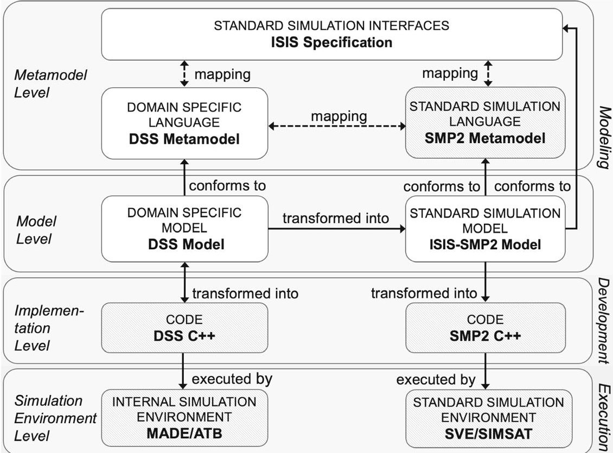
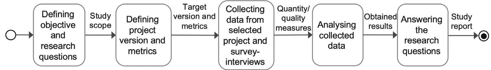

<!-- PDF_PAGE: 1 -->

WILEY

# Model-driven engineering for simulation models interoperability: A case study in space industry

Romina Eramo $ ^{1} $ Martina Nolletti $ ^{2} $ Luigi Pomante $ ^{2} $ Laura Pasquale $ ^{3} $ Dario Pascucci $ ^{3} $

$ ^{1} $Department of Communication Science, University of Teramo, Teramo, Italy $ ^{2} $Department of Information Engineering, Computer Science and Mathematics, University of L'Aquila, L'Aquila, Italy $ ^{3} $Domain Observation & Navigation Italy, Avionic Electrical & EMC Engineering, Thales Alenia Space Italy, Rome, Italy

Correspondence

Romina Eramo, Department of Communication Science, University of Teramo, Teramo, Italy. Email: reramo@unite.it

## Abstract

Modeling and simulation represent an essential part of overall systems engineering. Complex engineering systems are composed of many heterogeneous components often modeled and simulated employing different languages and environments, and often by different organizations; thus, demands for interoperability are getting increased. Model-driven engineering (MDE) has been demonstrated to be an advancement in software engineering: existing software in several domains today benefits from abstraction and automation during the system development process. Although these techniques are now highly advanced, many industries may require considerable effort before fully benefiting from them. This article reports on a case study carried out for 12 months within a company in the space industry domain. The goal of this empirical study is to investigate the adoption of MDE in supporting simulation models interoperability. The article identifies factors considered important for MDE adoption as well as obstacles that can be encountered in a real case. Researchers and practitioners may benefit from our findings typically when reusing models across different simulation environments, exchanging simulation models between different stakeholders, and seeking to improve simulation modeling practices.

KEYWORDS

model interoperability, model-driven engineering, simulation modeling languages, space industry

## 1 INTRODUCTION

Complex engineering systems have structures characterized by heterogeneous components, interconnections, and elaborated configurations. The modeling and simulation of systems have been gaining recognition as a central process of systems engineering. The use of modeling and simulation during the early stages of the system design and architecture is central to assessing functional and non-functional requirements, estimating costs, evaluating trade-offs, and providing valuable insights to improve the system. $ ^{1} $

The reuse of simulation models $ ^{*} $ across different simulation environments and their exchange among different stakeholders has become pivotal in the industry. In this respect, simulation modeling standards play an important role in

<!-- PDF_PAGE: 2 -->

defining agreed-upon system modeling concepts that can be represented for a particular domain of interest and enable the integration of different types of models across domains of interest.

Despite key initiatives that are commonly undertaken to promote and support simulation models reuse and exchange (e.g., standard languages and environments, co-simulation frameworks, etc.), in many real cases the adoption of these solutions is challenging. One way to reduce the complexity and cost of integrating different languages is to base different languages on the same underlying language (or metamodel). While it is in general not possible or practical to base all aspects on the same underlying language, it is highly desirable to consolidate as much as possible. $ ^{3} $ Often adopting internal simulation environments, notations and libraries is a common practice within the companies; in these cases, systems components are modeled and simulated employing different languages and execution environments, and very often by different organizations, making the interoperability a challenge.

Model-driven engineering (MDE) $ ^{4} $ has demonstrated to be an advancement in software engineering; existing software in several domains today benefits from abstraction and automation during the system development process. $ ^{5} $ To support the integration, the models must establish semantic interoperability to ensure that a construct in one model has the same meaning as a corresponding construct in another model. This information must also be exchanged between tools. $ ^{3} $ One approach to simulation model interoperability is to use model transformations between different simulation models. Although these techniques are now highly advanced, many industries require considerable effort before fully benefiting from them. In fact, MDE is a long-term investment and needs customization of environments, tools, processes, and training. In particular, new MDE approaches can be difficult to understand for developers as they require the capacity to work at a high level of abstraction and, as said, training. $ ^{6} $

This article reports on a case study carried out in the context of the space industry, within Thales Alenia Space Italy (TASI). $ ^{\dagger} $ This exploratory case study aims to investigate the effects of the adoption of model-driven practices to enhance the interoperability of different simulation environments and to enable the exchange of correspondent simulation models. The empirical data collected and analyzed in this study come from our 12 months of experience in defining and developing a model-driven approach enabling the reuse of models across different simulation environments, and the exchange of simulation models between different stakeholders. We evaluated technical results from the application of the approach and analyzed interviews and surveys distributed among 16 satellite simulation modeling experts and 2 MDE experts.

The purpose of this article is to investigate factors considered important for MDE approach adoption as well as obstacles that can be encountered in a real case. Software managers and developers can benefit from this knowledge by improving simulation modeling practices. This study does not try to investigate a universal solution, rather, it presents a context-driven research $ ^{7} $ considering real-world working practices in a given industrial context. In addition, we draw some analyses that make sense in the explored context.

The results obtained are encouraging. They showed the potential progress of adopting MDE practices to improve the interoperability of simulation models. The results revealed a recognized benefit due to the abstraction obtained, modeling practices (including graphics/visual modeling), and automation achieved by means of MDE techniques. The advantages found are the reduction of costs, increase in the level of model portability, and better management of evolution. However, the results also provided an understanding of the limits and obstacles that may be encountered when adopting these approaches in specific contexts. In fact, migration towards such practices is burdensome and challenging, especially in contexts where integration involves legacy models (i.e., low-level code, languages with little or no abstraction, etc.). Business processes should migrate completely to model-based approaches and shift the focus to design/modeling rather than code, requiring a substantial investment.

This study is aimed at researchers and practitioners and provides knowledge on practical issues, serving as a starting point for future research.

The rest of this article is organized as follows: Section 2 explains the industrial context of the study, introduces the motivation for this work, and describes the activities we experienced during the project development. Section 3 introduces the research method of this study. Section 4 describes and discusses the obtained results; Section 5 discusses some threats to validity; Section 6 presents related work, and finally, Section 7 concludes the article.

## 2 STUDY CONTEXT

This study refers to the ongoing project agreed upon by the University of L'Aquila (UNIVAQ) and Thales Alenia Space Italy (TASI) $ ^{\ddagger} $ (both in Italy), hereafter called Satellite Simulation Framework (SSF) project. The SSF project's objective is

<!-- PDF_PAGE: 3 -->

the development of a model-driven approach to enhance the interoperability of simulation models. This section presents the context of the case study and the background required to understand this article.

## 2.1 Company and study duration

Our case study was carried out in TASI. The company contributes to many leading space programs, working for both government and commercial customers, including NASA, $ ^{\S} $ the European Space Agency (ESA), $ ^{\#} $ and the Italian space agency (ASI), $ ^{\#} $ as well as leading satellite operators.

The study lasted for 12 months, including the development of a model-driven approach enabling interoperability across different simulation environments, the definition of the experimental study, the collection and analysis of data, as well as the reporting of the results achieved.

## 2.2 Company's simulation techniques and practices

In the space industry, simulation techniques are used to support different aspects of a typical satellite mission life-cycle. This has resulted in the development of numerous simulators which are very different in terms of use cases, size, and scope, as well as implementation tools and execution platforms.

Internal environment. In this regard, TASI specified an internal language/framework, called dynamic simulation software (DSS), for the modeling and simulation of satellite subsystems, entirely implemented in C++. It defines several functional interfaces for simulation models and implements several core capabilities; in its stand-alone version, it also provides a dedicated simulation environment for testing both software and hardware units running on the physical On Board computer (OBC), as well as verifying operational procedures during the verification and validation phase.

European standards. The ESA has undertaken several key initiatives to support simulation model reuse, among them the simulation standards called SMP2 $ ^{8} $ and the new ECSS SMP, supported by the SIMULUS simulation suite. $ ^{ \parallel} $ Interestingly, SIMULUS supports the model-driven software design and development of simulation models, that can be performed within Magic Draw UML $ ^{**} $ enhanced with the SMP2 profile, and then automatically transformed into the SMP2 source code, documentation, and the libraries needed for the execution. Note that, the project, we considered in this work, refers to the standard SMP2, as when the project started the new environment was not yet available. Note that, the SMP standards are infrastructure agnostic of any space-specific model (thus, it can be used for different domains, such as defense, transport, energy, etc.). In contrast, the DSS is specifically used for controlling the attitude and position of a complete space vehicle or satellite. Thus, the expressiveness of the languages is different, for example, the SMP standard cannot be used for the modeling of specific hardware aspects of avionics systems.

Finally, with the aim to promote interoperability, the French space agency (CNES) defined the "Initiative for Space Innovative Standards" (ISIS), which introduces a set of abstracts and generics concepts and services for mission control systems. It is composed also of set functional interfaces that are out of the scope of the SMP2 standards (that are space agnostic), but that, as in our case, are needed to effectively create simulation models suitable for different simulation frameworks adopted by the space industry.

## 2.3 Motivation for adopting model-driven engineering

Recent companies' missions and programs require the reuse of legacy models (i.e., DSS models) and the interchange of simulation models across different stakeholders, that already fully adopted the SMP2 standard. In this landscape, there are several aspects to consider. On the one hand, the internal notation has no reason to be discontinued (in fact, it may offer complementary and still necessary services), but rather be favored with the reuse of existing models

<!-- PDF_PAGE: 4 -->

into new standards. On the other hand, these standards are evolving, and consequent migrations are needed (according to technological support availability).

In the past, the company attempted the implementation of a set of wrappers (written in C++) to expose to an earlier version of the standard environment the subset of compatible internal functionalities. However, any solution of this kind would be short-lived, as it would require to re-develop it from scratch on every simulation model and, especially, on every new iteration of the standard. For this reason, the company expressed the need to experiment with an approach with a higher level of abstraction, rather than implementing (even for the current standard version) ad-hoc solutions. Therefore, a model-driven approach to support the integration and reuse of models can result in a better investment toward the seamless interoperability of simulation models in this scenario. Such an approach should realize interoperability based on existing modeling and communication standards without altering or constraining the internal simulation capabilities already in use.

## 2.4 Development of the experimental project

In this section, we describe the experience carried out in TASI, notably how the SSF project has been developed and the activities performed; this experience is the basis of the case study object of this article.

The technical and scientific activities were carried out by UNIVAQ, with the collaboration of TASI in the study of languages and environments and in the validation of the activities. To investigate how to address the company's interoperability problem, the UNIVAQ team needed, first, to analyze the adopted simulation processes and techniques, then it defined a model-driven approach to facilitate the exchange of simulation models. Although the benefits of adopting MDE practices (characterized by proprietary notations with a low level of abstraction) were known early in the project, introducing these techniques into a systems engineering context required a long initial study period. After that, the model-driven approach has been defined and developed as follows.

The proposed model-driven architecture, aiming at supporting interoperability between simulation models, is depicted in Figure 1. The architectural levels are grouped into simulation process phases, as follows:

- Modeling, that describes metamodels and models involved in the simulation modeling activities;

- Development, that represents the code that implements the simulation models designed in the previous phase; and

FIGURE 1 Model-driven architecture for simulation models interoperability.

<!-- PDF_PAGE: 5 -->

- Execution, that contains the simulation environments able to execute the simulations.

The white boxes represent the artifacts provided in the project, while the gray patterned rectangles represent the artifacts already existing. The top Metamodel level encloses the involved simulation metamodels and interfaces. In particular:

- Domain specific language (DSS metamodel): the DSS metamodel has been specified from scratch by raising the level of abstraction of the DSS notation and providing a domain-specific language able to reduce development time in simulation tasks. The modeling process was not based on any previous model (as they were not present), the only artifacts available were the simulation code written in C++ and the DSS notation specification (also written in C++);

- Standard simulation language (SMP2 metamodel): the SMP2 standard metamodel has been considered as provided by ESA;

- Standard simulation interfaces (ISIS metamodel): the ISIS metamodel has been specified starting from the standard ISIS interfaces provided in C++. While ISIS interfaces have been specified by considering the SMP standard, and thus conforming to it by definition, the DSS conforms to only part of them.

The UNIVAQ team analyzed the involved languages and identified the commonalities between DSS and ISIS as well as between DSS and SMP2. Since ISIS has been defined considering the SMP2 language, each SMP2 model conforms to ISIS by design, thus, the comparison between them was not needed. In order to define the DSS-ISIS and DSS-SMP2 mappings, the UNIVAQ team followed the steps below:

- Considering the language description documentation provided by TASI (which explains the role and use of each element);

- Analyzing the source code of classes, interfaces, and methods, for each language;

- Analysing SMP2 models specified in MagicDraw/Simulus;

- Considering feedback from TASI and iterating the process to refine the mappings.

- Specifying mapping rules among elements;

Model transformations $ ^{10} $ have been defined which establish correspondence between the concepts in one model (source model) and the concepts in another (target model). The mappings have been defined, in terms of the correspondences identified between the DSS and ISIS metamodels and the ones between DSS and SMP2. In particular, it specifies interfaces and classes that a DSS model needs to be transformed into a model that conforms to both ISIS and SMP2, that is, to fulfill the standards environment requirements.

The Model level depicts the models involved in the architecture. The DSS model conforms to the specified DSS metamodel and can be transformed into the ISIS-SMP2 model, which conforms to both the ISIS and SMP2 metamodels.

A DSS model can now be designed as instances of the DSS metamodel, and then automatically translated in DSS code (Implementation level), and vice versa, via a bidirectional model-to-text transformation. $ ^{10} $ The transformation between DSS models and DSS code is specified as bidirectional. The existing DSS simulations, expressed in C++ code, are transformed into DSS models to be integrated into SMP2. However, the new approach allows the designing of new DSS models conforming to the DSS metamodel. Those models can be also transformed into C++ code to be executed by an internal simulation environment, to satisfy specific TASI needs. This allows, in one direction, the reuse of existing DSS code towards the standard environments, in fact, the correspondent DSS model is transformed into an (ISIS-)SMP2 model that is automatically translated into C++ by SIMULUS. On the other direction, it allows the reuse of new DSS models in the internal environments that can execute only DSS code. The model-driven architecture provided by SIMULUS allows us to automatically transform the models into code, therefore the validity of the transformation between the SMLP2 models and the SMP2 code is guaranteed by the environment. On the DSS side, the model-to-code transformation has been correctly specified and verified for a limited number of models currently available.

The Simulation environment level includes the runtime simulation environments executing the DSS models and the standard SIMSAT/SIMULUS. The SMP2 implementation resulting from the integration of DSS models can be directly simulated in SIMSAT/SIMULUS.

<!-- PDF_PAGE: 6 -->

The implementation of the architecture relies on Eclipse Epsilon. $ ^{\dagger\dagger} $ Epsilon offers a family of open-source languages for automating common model-driven software engineering tasks. In particular, ETL $ ^{\ddagger\ddagger} $ has been used for model-to-model transformation, and EGL $ ^{\S\S} $ for model-to-text transformation (in this case the UNIVAQ team needed to implement two unidirectional transformations from DSS model to code and vice-versa). Besides, Epsilon works with EMF $ ^{\#\#} $ (whose Ecore format was used for the definition of metamodels), and UML (including MagicDraw that is also used in SIMULUS). In this project, all the metamodels and models have been created (in Ecore format), allowing to perform model-based automatic operations (including validation); in future work, the UNIVAQ team plans to use a graphic editor (Sirius $ ^{##} $ ) and a text editor (Xtext $ ^{||||} $ ) to model and manage the languages involved in the project.

## 2.5 Final remarks

The proposed architecture facilitates interoperability between models, in particular, in this work, we experimented with integrating DSS models into SMP2 models. Automatic transformations also make it easy to support synchronization between models and propagation of changes, even for large models.

Although we have considered only a recent version of the TASI modeling project and have not dealt with the problem of model evolution in detail, the adoption of a model-driven architecture represents a benefit for the company, because offers, by design, numerous advantages. For instance, it will be possible to adopt the numerous techniques of synchronization, change propagation, and co-evolution existing in the literature. $ ^{11,12} $

In future work, we plan to consider the problem of model evolution. One aspect to consider is the loss of information that might occur in the case of synchronization of models with elements obtained in a non-automatic way. $ ^{13} $ Furthermore, we plan to consider the evolution of metamodels, for example in the case of adopting the new ECSS-SMP version, well-known techniques of model co-evolution can be applied to co-evolve models conform to SMP2. $ ^{14} $

The empirical knowledge obtained from this study will be used for the future development of the project and its adoption in TASI, as discussed in Section 7. Moreover, the obtained results can be used both by researchers and practitioners interested in understanding the implications of adopting model-driven practices for enhancing the interoperability of simulation models.

## 3 RESEARCH METHOD

This section presents the research protocol adopted to perform our empirical case study. This protocol was formulated based on well-known guidelines $ ^{15,16} $ to design and run empirical studies, as well as based on our industrial experience in carrying out this project.

Figure 2 introduces the adopted case study research process. In the first step, we define objectives and research questions. Then, we define the version to be analyzed and prepare procedures and protocols for the data collection. After collecting data, the evidence collected from the project is used for the analysis. The obtained analysis results are used to answer the research questions and to derive insight and lessons learned. These steps are detailed in the rest of this section.

## 3.1 Objectives and research questions

The objective of this case study is to investigate the adoption of a model-driven approach with the aim of enhancing the interoperability of simulation environments and enabling the exchange of simulation models across different stakeholders.

Based on the aforementioned goal, we formulated the following research questions (RQs):

<!-- PDF_PAGE: 7 -->

FIGURE 2 Case study research process.

- RQ1: What is the integration capability expected from the adoption of the MDE-based interoperability approach?

- RQ2: What are the benefits associated with the adoption of the MDE-based interoperability approach?

- RQ3: What factors should be considered when adopting the MDE-based interoperability approach?

- RQ4: What are the challenges associated with the short and long-term use of the MDE-based interoperability approach?

## 3.2 Preparation for data collection

This step includes the definition of the procedures for the collection of data.

Definition of the versions to be analyzed. This step has the objective of making the selection of the versions to be analyzed and thus the data sources. As explained in Section 2, the industrial experience lasted for 12 months, starting from January 2021. The approach has been gradually defined, and we have adopted an iterative software development process to meet the company's business needs. The criterion for choosing the selected version to perform the experimental study was to select the version where a prototype of all the architecture was delivered and TASI began to use it in the modeling and integration activities within a use case, hereafter called Satellite Simulation Framework Use Case (SSF-UC).

We adopted a direct method in which we had contact with the company and collected used and updated data (i.e., languages source code and documentation, virtual machine, and models). In particular, TASI provided 13 different versions of the SSF-UC, which we considered for the analysis and specification activity, whereas we executed the transformation only on the last version.

This study has been realized in collaboration with TASI, after having obtained prior written consent and agreed on the terms and conditions of the publications. Notably, in agreement with TASI, we cannot disclose the source code of the DSS and ISIS, information relating to national defense, the institutions or other customers or partners, or any industrial know-how belonging exclusively to TASI.

Measurements. We utilized a set of measurements deriving from the analysis and development activities carried out within our industrial experience, with the aim to quantitatively evaluate the degree of integration that we have achieved. In particular, we considered the numbers of interfaces, classes, methods, and attributes that are contained in the considered metamodels (ISIS, DSS, and SMP2); then, we defined a set of properties used to describe the model-to-model and model-to-text mappings (both at model and metamodel levels), in terms of automation, as follows:

- Mapping (Map): It refers to the number of source metamodel elements (i.e., DSS components and behaviors) that are transformed into target metamodel elements (i.e., ISIS-SMP2 elements). Note that, this is the sum of the next measurements;

- Fully automated mapping (Auto): It refers to the source metamodel elements that are automatically transformed into target metamodel elements;

- Human-in-the-loop (Hil): It refers to the source metamodel elements that are partially or ambiguously represented by elements of the target metamodel, thus the mapping needs to be manually refined to avoid loss of information; note that SIMULUS allows designers adding fragments of simulation code (i.e., conforms to the SMP2 catalog) in model elements, directly from the modeling environments (i.e., MagicDraw).

Moreover, we considered the activities performed in the SSF-UC project to measure the numbers of models,interfaces, classes, methods, and attributes belonging to the whole modeling project, the SMP2 models designed from scratch and the DSS models integrated into SMP2/ISIS.

<!-- PDF_PAGE: 8 -->

Starting from these measurements, we also defined the following metrics:

- Coverage, that is the percentage of (DSS) features that are covered by the mappings (i.e., considered in the transformation rules) with respect to the total amount of the (DSS) features;

- Integration, that is the percentage of (DSS) features that have been integrated (i.e., transformed in SMP2) versus the total amount of features.

Such measures have been calculated by considering the involved metamodels, the SSF-UC, and the existing DSS library.

Survey and interviews. We conducted a survey in the form of an online questionnaire concerning the adoption of the approach and the expectation to experiment with the project tool. The questionnaire was submitted to a team of 18 people including 16 satellite simulation modeling experts and 2 MDE experts, and it reflects the opinions of the practitioners involved. In order to avoid bias, none of the people involved in the questionnaire participated in the development of the MDE approach presented in this article; in particular, they consist of the TASI employees who have or have had experience with the languages considered and, in addition, two external MDE experts. The answers are anonymous; we have labeled each participant as User A, User B, ..., User T. The questionnaire included 25 questions in total, of which 16 were answered giving a preference from 1 to 5 on a linear scale (i.e., not at all, slightly, moderately, very, extremely) with optional comments, while the others were given an open answer.

Furthermore, we conducted semi-structured interviews with the practitioners previously involved. The interviews have been guided by a set of structured questions (similar to the ones used in the survey) to discuss and capture complex information on participants' opinions, behaviors, and beliefs. The interviews were carried out online in groups of two, three, or four participants. Both the questionnaire used for the online survey and the questions asked during the interviews is provided in Appendix A.

## 3.3 Data collection

In this step, we define the process to carry out to collect data from the experience within the company. The quantitative evidence has been collected in a consistent manner from activities described in Section 2. In particular, we collected and calculated the measurements described in the previous section by considering the selected versions of the project. We calculated the measurements described by counting the number of interfaces, classes, attributes, and methods belonging to each metamodel. Then, we counted the elements involved in the mappings by distinguishing automatic and manual ones. Finally, we considered the instance models of the last version of the SSF-UC and counted the correspondent elements and mapped elements. For instance, SSF-UC DSS m (int %) has been calculated by counting the number of integrated DSS elements over the total number of elements of the whole SSF-UC project.

In November 2022, we distributed the questionnaire among all the practitioners involved in the industrial cases. We received the responses completed by individual participants (18 responses, 25 answers each). After that, we needed to discuss with the participants to obtain accurate opinions and insights.

## 3.4 Analysis of collected data

This study aims to report empirical evidence about the effects of the adoption of a model-driven approach for simulation modeling interoperability in an industrial setting. For this reason, the study relies on quantitative and qualitative methods to report and analyze the results in a realistic scenario.

First, we performed a quantitative analysis of the values obtained from the collected data. Even if the quantitative data are preliminary, because they are based on the application of the approach on a single modeling project, they allow us to reason and link observations to conclusions. Furthermore, the qualitative data obtained from questionnaires and interviews have been used to evaluate the practitioner's and experts' points of view about the developed project, thus providing additional insights in relation to the results obtained from quantitative analysis.

<!-- PDF_PAGE: 9 -->

## 3.5 Answers and reporting

On the base of the analysis results, we answered the research questions and discussed insight and open issues. To ease the replicability of this study, the complete replication package is publicly available. $ ^{17} $

## 4 RESULTS AND DISCUSSION

This section describes the results obtained on the basis of both the quantitative and qualitative methods that we have adopted and related to the formulated research questions (as described in Section 3). In particular, we present our analysis divided according to the study's research questions.

## 4.1 Expected integration (RQ1)

This section describes the obtained results, based on both the quantitative and qualitative adopted methods and related to the formulated research questions (as described in Section 3). In particular, we present our analysis divided according to the study's research questions.

In order to understand what level of interoperability is expected from the adoption of the MDE-based approach, we considered the quantitative data collected in Tables 1 and 2. As explained in Section 3.2, we utilized a set of measurements both at metamodel and model levels, deriving from the analysis and development activities carried out within our industrial experience.

Table 1 presents the considered measurements at metamodel level. As shown in the top-most block of the table, the ISIS metamodel (ISIS mm) is composed of 39 interfaces, 30 classes, 86 attributes, and 94 methods; the SMP2 metamodel (SMP2 mm) is composed of 40 interfaces, 29 classes, 128 attributes, and 179 methods; whereas, the DSS metamodel (DSS mm) is composed of 8 interfaces, 12 classes, 92 attributes, and 155 methods. As the numbers suggest, the metamodels can be categorized by their size (as established in Reference 18): the ISIS and SMP2 metamodels are large, while the DSS metamodel is medium.

The next part of the table shows the measurements related to the model-to-model transformations (m2m) among the considered metamodels, and in particular to the automated/non-automated portions of the mappings. In particular, the mapping between DSS and ISIS (DSS-ISIS m2m map) involves 5 interfaces corresponding to 62% of DDS interfaces,

TABLE 1 Measurements of the m2m and m2t mappings (metamodel level).

<table border="1"><tr><td></td><td>#Interf.</td><td>#Classes</td><td>#Attrib.</td><td>#Meth.</td></tr><tr><td>ISISmm</td><td>39</td><td>30</td><td>86</td><td>94</td></tr><tr><td>SMP2mm</td><td>40</td><td>29</td><td>128</td><td>179</td></tr><tr><td>DSSmm</td><td>8</td><td>12</td><td>92</td><td>155</td></tr><tr><td>DSS-ISISm2mmap(cov%)</td><td>5(62%)</td><td>5(41%)</td><td>33(35%)</td><td>16(10%)</td></tr><tr><td>DSS-ISISm2mauto(cov%)</td><td>4(50%)</td><td>4(33%)</td><td>21(22%)</td><td>6(3%)</td></tr><tr><td>DSS-ISISm2mhil(cov%)</td><td>1(12%)</td><td>1(8%)</td><td>12(13%)</td><td>10(7%)</td></tr><tr><td>DSS-SMP2m2mmap(cov%)</td><td>3(37%)</td><td>3(25%)</td><td>6(6%)</td><td>4(3%)</td></tr><tr><td>DSS-SMP2m2mauto(cov%)</td><td>2(25%)</td><td>2(16%)</td><td>1(1%)</td><td>1(1%)</td></tr><tr><td>DSS-SMP2m2mhil(cov%)</td><td>1(12%)</td><td>1(8%)</td><td>5(5%)</td><td>3(2%)</td></tr><tr><td>DSSm2t(f)map(cov%)</td><td>8(100%)</td><td>12(100%)</td><td>92(100%)</td><td>155(100%)</td></tr><tr><td>DSSm2t(f)auto(cov%)</td><td>8(100%)</td><td>12(100%)</td><td>92(100%)</td><td>155(100%)</td></tr><tr><td>DSSm2t(f)hil(cov%)</td><td>0(0%)</td><td>0(0%)</td><td>0(0%)</td><td>0(0%)</td></tr><tr><td>DSSm2t(b)map(cov%)</td><td>8(100%)</td><td>12(100%)</td><td>92(100%)</td><td>155(100%)</td></tr><tr><td>DSSm2t(b)auto(cov%)</td><td>8(100%)</td><td>12(100%)</td><td>92(100%)</td><td>155(100%)</td></tr><tr><td>DSSm2t(b)hil(cov%)</td><td>0(0%)</td><td>0(0%)</td><td>0(0%)</td><td>0(0%)</td></tr></table>

<!-- PDF_PAGE: 10 -->

5 classes corresponding to 41% of DDS classes, 33 attributes corresponding to 35% of DSS attributes, and 16 methods corresponding to 16% of DSS methods. Among them, we can see that most of the interfaces and classes can be automatically mapped (DSS-ISIS m2m auto), whereas several attributes and methods need human intervention (DSS-ISIS m2m hil) to be semantically translated (e.g., the methods have different parameters or return different values).

The mapping between DSS and SMP2 (DSS-SMP2 m2m map) involves three interfaces corresponding to 37% of DDS interfaces, 3 classes corresponding to 25% of DDS classes, 6 attributes corresponding to 6% of DSS attributes, and 4 methods corresponding to 3% of DSS methods. Among them, we can see that some attributes and methods need human intervention to be semantically translated (DSS-SMP2 m2m hil), while the rest are transformed automatically (DSS-SMP2 m2m auto). As expected, both the mappings do not involve many components; in fact, DSS functional interfaces are defined at the level of satellite equipment units and provide for specific purposes for them, while SMP and, consequently, ISIS consist of space-agnostic technical interfaces. Given the difference between the two languages, to support their integration, the mapping must establish semantic interoperability to ensure that a construct in one model has the same meaning as a corresponding construct in another model. The rest of the table shows the measurements related to the model-to-text transformations (m2t) between DSS models and the correspondent DSS code. As shown, the mappings—both in the forward (f) and backward (b) directions—are fully automated and cover 100% of the features, meaning that the transformation works without loss of information.

Table 2 presents the considered measurements at the model level, in particular, it provides an overview of the modeling and integration performed within the considered use case (SSF-UC); all the modeling project (SSF-UC all) is composed of 38 models, 57 interfaces, 52 classes, 313 attributes, and 499 methods. Within the modeling project, 29 SMP2 models (SSF-UC SMP2 m) were designed from scratch within Magic Draw (within SIMULUS), including 42 interfaces, 38 classes, 208 attributes, and 334 methods. Then, 9 DSS models (SSF-UC DSS m), conforming to the DSS metamodel, were considered as source models to be transformed into SMP2; they include 15 interfaces, 14 classes, 105 attributes, and 165 methods.

The next part of the table shows the measurements related to the model-to-text (m2t and model-to-model transformations (m2m) executed in this use case. In particular, starting from the DSS code (DSS t), we run the model-to-text transformation in the backward direction (DSS m2t (b) map) and obtained the correspondent nine models conform to the DSS metamodel. Even in this case, the mapping is fully automated and covers 100% of the features. Then, all the DSS source models have been transformed in SMP2 by executing the transformation between DSS and SMP2 (DSS-SMP2 m2m map). The mappings involved 13 interfaces corresponding to 73% of DDS interfaces, 12 classes corresponding to 85% of DDS classes, 94 attributes corresponding to 88% of DSS attributes, and 136 methods corresponding to 81% of DSS methods. Among them, we can see that most of the interfaces and classes were automatically mapped (DSS-SMP2 m2m auto); unfortunately, several attributes and methods needed the human intervention (DSS-SMP2 m2m hil) to be semantically translated (e.g., the methods have different parameters or return different values that must be decided by the designer). However, as a future work, the company can define a library of DSS components, then some specific mapping rules can be defined and made automatic.

TABLE 2 Measurements of the m2m and m2t mappings (model level).

<table border="1"><tr><td></td><td>#Models</td><td>#Interf.</td><td>#Classes</td><td>#Attrib.</td><td>#Meth.</td></tr><tr><td>SSF-UC all</td><td>38</td><td>57</td><td>52</td><td>313</td><td>499</td></tr><tr><td>SSF-UC SMP2 m</td><td>29</td><td>42</td><td>38</td><td>208</td><td>334</td></tr><tr><td>SSF-UC DSS t</td><td>9</td><td>15</td><td>14</td><td>105</td><td>165</td></tr><tr><td>SSF-UC DSS m</td><td>9</td><td>15</td><td>14</td><td>105</td><td>165</td></tr><tr><td>DSS m2t(b) map(cov%)</td><td>9(100%)</td><td>15(100%)</td><td>14(100%)</td><td>105(100%)</td><td>165(100%)</td></tr><tr><td>DSS m2t(b) auto(cov%)</td><td>9(100%)</td><td>15(100%)</td><td>14(100%)</td><td>105(100%)</td><td>165(100%)</td></tr><tr><td>DSS m2t(b) hil(cov%)</td><td>0(0%)</td><td>0(0%)</td><td>0(0%)</td><td>0(0%)</td><td>0(0%)</td></tr><tr><td>DSS-SMP2 m2m map(cov%)</td><td>9(100%)</td><td>13(73%)</td><td>12(85%)</td><td>94(88%)</td><td>136(81%)</td></tr><tr><td>DSS-SMP2 m2m auto(cov%)</td><td>6(67%)</td><td>8(53%)</td><td>10(71%)</td><td>48(45%)</td><td>74(44%)</td></tr><tr><td>DSS-SMP2 m2m hil(cov%)</td><td>3(33%)</td><td>5(20%)</td><td>2(14%)</td><td>46(43%)</td><td>62(37%)</td></tr><tr><td>Integration % DSS m</td><td>23%</td><td>26%</td><td>26%</td><td>33%</td><td>33%</td></tr></table>

<!-- PDF_PAGE: 11 -->

Regarding the whole process, the conformance between metamodels and models is implicit, meaning that all the used models conform to the corresponding metamodel. Also, the correctness of the code on the simulation side is guaranteed by the correctness of the model-to-text transformation.

The results show that the existing DSS models, considered in the use case, were successfully mapped into SMP2 models and integrated into the SSF-UC modeling project. These measures can be used as early indicators of the integration capability expected from the approach, and encourage further investment/development.

## 4.1.1 Highlights

Major challenges in portability occur when simulation modeling languages are semantically different or have a different expressive power, compared to the others. In particular, in this work, the languages involved in the case study have different purposes, that is, they are specialized in different application domains and one language is domain-specific and the other general-purpose. As a consequence, to support their integration, the mapping must establish semantic interoperability to ensure that a construct in one model has the same meaning as a corresponding construct in another model. In some cases, human intervention can be unavoidable.

The benefits of MDE emerge in the definition of the mapping and the abstraction obtained, but on the other hand the specification of model transformations can be tedious and some features may not be covered by automatic mapping.

## 4.2 Benefits (RQ2)

To understand the advantages associated with adopting the MDE-based interoperability approach, we considered the qualitative data obtained from online surveys and interviews. We investigated several factors mainly focusing on: (i) how the MDE approach facilitates simulation modeling, (ii) how the MDE approach helps the integration of different simulation models, and (iii) how the MDE approach promotes the reuse of existing simulation models. In the following, we discuss both quantitative and qualitative results.

Several questions of the online survey concerned the benefits related to the adoption of this approach and were then detailed during the interviews. The survey and interview findings are:

- On the question "How would you rate the usability of graphical modeling environments (like Magic Draw)?" the responses were mainly "Very usable" and "Moderately usable", while three responses were "Extremely usable" and one response was "Slightly usable."

The adoption of an MDE architecture may imply a large usage of visual modeling (e.g., Magic Draw is integrated into SIMULUS by means of the UMF plugin). Graphical modeling is largely considered a benefit since drawing models is easier than coding. However, it presents some drawbacks. For instance, User D commented "While creating graphical models from scratch is pretty straightforward, editing them, as they grow in size, is usually not. The tasks carried out using the user interface are not repeatable. In some cases, a single user interface action corresponds to multiple model modifications that the user should already know about. Interoperability is very limited, as export/import features heavily rely on schema versions, and programmatically manipulating modeling artifacts is cumbersome." Such drawbacks can be overcome by allowing the designer to write code or use the concrete syntax of the modeling language. For instance, in the interview, User A points out that SIMULUS allows adding fragments of simulation code (i.e., conforms to the SMP2 catalog) directly in the graphical environment (as we also mentioned in Section 3.2).

- The above finding is confirmed on the question "How comfortable have you been with using Magic Draw for defining simulation models?"; in fact, most users answered "Very" and "Moderately comfortable," while two users answered "Slightly comfortable." User E commented "In SIMULUS, the adopted UML Profile provides stereotypes that define a domain-specific language for SMP2. Then, the dedicated plugin provides a complete model-driven process allowing to design of UML models without dealing with implementation details."

- More consensus was on the question "How profitable is it to use Magic Draw as opposed to writing simulation model code directly?" where almost everyone answered with "Very profitable," the other answers were "Moderately profitable" and "Extremely profitable"; in addition, one response was "Extremely profitable." User D commented "relying on modeling improves understandability and evolution"; User H commented "The visual environment in conjunction with the automatically generated code saves time during design"; and User O commented "The developer's effort focuses only on simulation issues, also the reuse of previous models avoids to model well-known units from scratch."

<!-- PDF_PAGE: 12 -->

- On the question "How beneficial can it be to use model-to-model transformation instead of a wrapper-based solution for the integration of simulation models?" the responses were mainly "Moderately beneficial," "Very beneficial," and "Extremely beneficial," with slightly less of the last category. The users agreed to the large benefit deriving from the adoption of model transformations, for instance, the D highlighted that "Model transformations can be easily evolved and provide a clear view of the mapping." Users also recognized some risks, for instance, User A commented that "There might be constraints on the model interfaces and architecture that limits automatic transformation and requires manual refinements or a wrapper-based solution instead," whereas User H commented that the success of the model transformation could "depend by the model and the complexity of the entire system."

- On the question "How advantageous is it to have languages defined with a high level of abstraction and/or with model-based methodologies?" were mostly replied with "Very advantageous" and "Extremely advantageous." Among them User D commented "Abstraction provides a means to evaluate high-level tasks without altering the system." Three users answered with "Moderately advantageous" and "Slightly advantageous." Among them, User R commented "Currently, the entire process is heavily code-centric (including inspection, analysis, and verification tools). To take full advantage of a high abstraction and model-based approach, the whole environment should shift the focus from code to design."

- On the question "Does the adoption of a model-driven architecture facilitate the identification of commonalities and differences between heterogeneous simulation languages?" was mostly replied with "Very facilitating," while the other answers were "Extremely facilitating" and "Moderately facilitating." User D commented that "The only alternative would be manually comparing code, which is unpractical." Such benefit is confirmed by the measurements collected in Tables 1 and 2, in fact, the coverage shows the percentage of elements that have been mapped from DSS to ISIS or SMP2, showing that not all of the DSS metamodel (which, as mentioned before, has different purposes) can be mapped in standard notations. Then, the percentage of integration obtained on the use case shows that it was possible to reuse the existing models within the SMP2 project.

- Most consensus was on the question "Does the adoption of model-based languages help the understanding of language elements and their role?" where most users answered with "Extremely helping," in addition, some other responses were "Very helping" and "Moderately helping." User D commented that "Without models, the only option is to rely on code relations like function calls and use of attributes."

Analyzing the interviews revealed an additional factor perceived as important, that is, the long-term return of the adoption and cost-effectiveness of the approach.

- Users stated that they to answer in the reduction of integration and refactoring costs thanks to the proposed approach. They agreed in answering "Integration and refactoring require a deep understanding of the impacts of modifications to the system. Without an MDE approach, such understanding is usually left to designers' expertise." "We are sure that the interfaces between models are well-established reduction of time in modeling and integration via automatic model-to-model and model-to-text transformation, and automation of model-coevolution in case of metamodel evolution."

- Furthermore, users are confident that the proposed approach will have a return on investment, as they will be facilitated in the exchange of their models and information with other companies, and there will be a reduction in costs and an increase in reuse and portability.

These findings are related to the measurements shown in Table 1. In fact, it reports that the DSS mm has been successfully defined from the existing DSS code, so that allowed to specify the DSS-ISIS and DSS-SMP2 model transformations. Also, the measurements show that the m2m transformations are mostly fully automated, and a few manual refinements can be needed, helping model integration. Whereas, the m2t transformations are fully automatic, allowing the reuse of DSS models and code.

## 4.2.1 Highlights

The main findings for this section are the following:

<!-- PDF_PAGE: 13 -->

- The adoption of an MDE architecture may imply a large usage of graphical modeling environments. It is agreed that this may help modeling practitioners in better process information captured in models and convey information more effectively than text, especially to novices.

- All the users concur on the advantages of adopting abstraction and modeling. In fact, while modeling improves understandability and evolution, abstraction provides a means to evaluate high-level tasks without altering the system. Also, the option of manually comparing code to the end of providing integration is considered unpractical.

- The users agree that the integration at the model level provides several advantages. Model transformations can be easily evolved and provide a clear view of the mapping. Alternatively, implementing an ad-hoc wrapper (relying on code relations like function calls and use of attributes) affects maintainability and reuse in case of changes.

- Despite the clear benefits in terms of reuse and interoperability, to achieve the overall benefit, business processes should migrate completely to model-based approaches and shift the focus to design/modeling rather than code. This requires a substantial investment.

## 4.3 Adoption (RQ3)

To understand what factors should be considered when adopting the MDE-based interoperability approach, we considered the qualitative data obtained from online surveys and interviews. We identified several factors, including obstacles, that should be considered when adopting the MDE-based interoperability approach. They are related to the initial effort to raise the level of abstraction of internal practices and the initial difficulty in adopting modeling principles and techniques if the company is unfamiliar with them.

The following questions were directly related to the adoption of this approach:

- On the question "How much does it help to have a model-based representation of simulation languages in defining the mappings?" the users mostly answered "Very helping," while the other answers were "Extremely helping" and "Moderately helping." User D commented "Metamodels help understand not only the involved types (that one could get also from the code) but most importantly the involved concepts and their high-level relations."

- The comments on the (previously discussed) question "How beneficial can it be to use model-to-model transformation instead of a wrapper-based solution for the simulation model integration?" add some relevant findings. In fact, the users agreed that the advantages of adopting such an approach outweigh some drawbacks, that are, for instance, the fact that "model transformations require additional effort in the beginning" or that "there might be constraints on the model interfaces and architecture that limits automatic transformation and requires a low-level solution instead," as explained by the user D and A, respectively.

- On the question "What obstacles do you foresee if not all space agencies adopt these approaches?" the main answers were "Need for appropriate tools to automatically generate simulation models compatible to the standard environments, e.g., Magic Draw models from the standardized exchanged SMP catalog," "The number of models from previous projects inheritance," "Increase in integration costs, development of wrap models for the integration of those are supplied externally. No chance of providing simulator models to those companies that are not compliant with this approach and standards," "It could be more difficult to define standards that rely on high-level modeling," and "Deadlock in the adoption of standards and interoperability." "Model exchange delays can occur, impacting productivity" "Model portability will be hindered" "Time-consuming wrapping or manual migration" "All agencies will face a cost increase. Each industry will perform the Model-driven processes but will also need to perform "old" processes in order to have proficient communication with all stakeholders."

Such discussion was been detailed during the interviews; in fact, the TASI engineers explained how within SIMULUS it is possible to export both MD (MagicDraw) models, used by partners who use the same environment, and directly the code of the SMP catalog, used by agencies that use the same standard but in different proprietary environments other than SIMULUS. The proposed MDE approach gives the possibility to remain within the SIMULUS environment. Therefore the fact that the standard is in an MDE platform facilitates interoperability in itself, increasing the consensus towards model-driven approaches in general because one has the visual and concrete perception of proving its functionality.

These findings are related to the measurements shown in Table 2. In fact, it reports that the set of DSS models (DSS m), considered as input, has been successfully integrated into the SMP2-compliant modeling project (SFF-UC). Moreover, it

<!-- PDF_PAGE: 14 -->

shows that, given the whole SFF-UC project, 23% of the modeling activity came from the integration of DSS models. Such measurements have shown that the adoption of the approach promises advantageous results. In fact, despite the initial efforts, the metamodels have been defined and the transformations specified, allowing a successful integration activity.

## 4.3.1 Highlights

The users, both satellite simulation and MDE experts, agreed on the different implications of the adoption of the approach.

- Adopting a model-based representation may imply the onerous task of defining specific metamodels from existing simulation code written in an object-oriented language such as C++ or Java.

- The use of model transformation to automatize the integration and portability is recognized as beneficial. However, due to the different expressiveness and semantics of the involved languages could be impossible to fully automatize the process.

- Users recognize the importance of a model-based approach and the advantages in terms of abstraction and automation, as the ultimate goal of portability and exchange would not be compromised if other companies did not adopt similar approaches. In fact, from the simulation environment, it is possible to export code from the SMP catalog to communicate and exchange information with companies that do not use the same environment.

- The presence of a standard language based on an MDE architecture (the SMP standard in this case) plays a pivotal role between the different notations and environments adopted internally and destined to survive with the legacy projects.

## 4.4 Challenges (RQ4)

Finally, we identified a set of challenges associated with the short- and long-term use of the MDE-based interoperability approach; to this end, we considered the qualitative data obtained from online surveys and interviews. The challenges are mainly related to the support for the exchange of models between different companies and the need to co-evolve the integration methods in case of the evolution of the considered languages.

We observed several topics and grouped questions and answers accordingly.

A. Reducing modeling and integration costs

- On the question "How much can a model-driven methodology for simulation model integration reduce costs?" the responses were mainly "Very fruitful," while five users answered "Moderately fruitful" and one user answered "Extremely fruitful";

- "Related to the previous question, what costs can be reduced/minimized?": the responses were "Architectural design effort, speeding up the integration, reduce human errors," "The time spent in the interfaces analysis and implementation, the approach guarantees that the interfaces between models are well established," "The costs related to the development of common model's features which can be grouped in a set of generic models," "Evolution and maintenance from a design cost perspective. But also the cost of integrating new members into a team," "The adoption of a model-driven approach favors the automation and management of migrations and changes in case of the evolution of languages and tools." The other answers mostly were "Development costs," "Integration costs," "Integration test and interfaces definition (development externalization)."

- On the question "How does the proposed approach prove capable of minimizing integration and refactoring costs?" the responses mostly were "Very beneficial," while other users answered "Extremely beneficial" and "Moderately beneficial";

- "Related to the previous question, what costs can be minimized?": the responses were "We are sure that the interfaces between models are well established," "Integration tests should be reduced by the centralization of common features in generic models and standard interfaces which should have a unique expected behavior," "Integration and refactoring require a deep understanding of the impacts of modifications to the system. Without an MDE approach, such understanding is usually left to the designer's expertise," "Reduction of time in modeling and

<!-- PDF_PAGE: 15 -->

integration via automatic model-to-model and model-to-text transformation, and automation of model-co-evolution in case of metamodel evolution," "Integration costs," "It can minimize the time needed to understand how the new model collaborates with existing models," "The portability of the models is the key, integrating all the existing, tested, models in a new framework and make them work together with new ones without errors is a good way to reduce development work," "Testing costs," "Refactoring process," and "Simulation costs."

## B. Increasing reuse and portability

- On the questions "How does the proposed approach prove capable of maximizing reuse and portability?" most users replied with "Very beneficial," the other users replied with "Extremely beneficial," while only one user replied with "Moderately beneficial";

- "Related to the previous question, how reuse and portability can be measured?": three users responded in a similar way "Time required to model and instantiate new simulator models starting from models already developed" and "number of reusable components," the others responded with "Time for existing or new teams to design or port a simulation model should greatly decrease with the increasing familiarity with high-level modeling techniques," "Required effort to migrate towards different platforms and/or different languages" and "The approach evaluation can be obtained based on a set of modeling projects (i.e., industrial cases)";

- On the questions "How much does the proposed approach help to relate or exchange information with other partners or suppliers?" the responses were "Extremely helping," "Very helping," and "Moderately helping." Only two users replied with "Helping" Two users commented "In this case, besides modeling, standardization also plays a big role" and "Medium advantage in a short time due to the heterogeneous internal processes adopted by the companies. Possible good advantages in a long time if the other company adopts approaches with a high level of abstraction."

## C. Impacting the space industry's practices

- On the questions "To the best of your knowledge, other space industries and agencies converging towards model-based or model-driven approaches?" most of the responses were "Moderately," some users answered with "Very," while one user answered with "Extremely" and another with "Slightly." In fact, as one user commented "such change should be a consequence of the ESA strategy," however, the users doubt the actual realization by the companies (probably due to the costs necessary for a complete change).

- On the questions "In your opinion, the adoption of this approach by the various stakeholders would allow for easy exchange of models?" more of the 50% of the responses were "Very enabling," while the other users replied with "Extremely enabling" and "Moderately."

- To the previous question the following question was asked "What problems might persist?" to which the users answered "Compatibility between development tools," "No immediate problems," "While modeling can ease the transition to standards, these standards still need to be adopted" and "Heterogeneous simulation environments have to be managed," "Different modeling background," "Training efforts and costs," "Performance issues," "Convergence time."

- On the question "Considering the proposed approach, do you think that the SSF-UC project can be fully exchanged with the other project partners? If not, why?" most of the users answered in a positive way; more detailed answers were: "The project can be exchanged as a set of models that can be executed within the standard environment," even if "Other companies could use a different simulation framework, we have to be sure that there is a compatibility with internal libraries."

## D. Managing changes and evolution

- To these questions "Considering future evolution/changes of simulation languages or environments, how much does the proposed approach be beneficial in both modeling and integration activities?" and "Considering future projects/missions in satellite simulations, how much does the proposed approach be beneficial in both modeling and integration activities?" the answers were "Extremely beneficial," "Very beneficial," while fewer users answered with "Moderately beneficial" and "Slightly beneficial." User D commented "It can be a fundamental advantage in adopting new evolutions," while User G commented "This approach provides a common basis for different projects."

- To the question "Considering the modeling and refactoring activities performed on DSS and ISIS, what can be improved?" the answers were "Automation of DSS to ISIS/SMP. Need to complete the analysis for the integration of ISIS+SMP into DSS," "Implementation of model-to-model and model-to-text transformations," "Readability of the documentation," "Enhancing the DSS notation."

<!-- PDF_PAGE: 16 -->

- On the question "In the near future, do you expect to need to migrate existing DSS project in ISIS/SMP2?" the users had different opinions. Some users were confident about the fact that "The migration into ISIS+ECSS-SMP is an intermediate step and, once a new standard ECSS-SMP will be formalized to replace ISIS, the plan is to be fully ECSS-SMP compliant" and "In the near future, the modeling activities will be based on ECSS-SMP, therefore it will be necessary to adapt the approach." Whereas, other users believe that there will be still a need to migrate from DSS to the ESA standard. In the interviews, it emerged that the next version of ECSS-SMP will permanently replace ISIS. Nevertheless, the previous work between DSS and ISIS/SMP is not eliminated because being specified at a high level it can easily co-evolve, unlike ad-hoc low-level solutions.

- To the question "Do you expect that in new versions of the SVE OBC (or indifferent projects), there will be new integration/interoperability requirements?" the users had different opinions. Some users answered "Up to now the ISIS IF could be fine but we are at the beginning so new requirements could be required," others believe that there will still need to deal with interoperability issues.

The developed approach has been defined at the metamodel level (as demonstrated by the measurements in Table 1). This guarantees that its application is not limited to the set of input DSS models (as would happen in the case of ad-hoc written wrappers on portions of code), but can be applied to any DSS model or code, ensuring compliance with SMP2 and ISIS. The positive results also guarantee that, in the case of language evolution, the transformations can be modified (updating the mapping rules) without having to develop everything from scratch.

## 4.4.1 Highlights

The main findings for this section are the following:

- Challenge A: Reducing modeling and integration costs. Users agree that despite the initial effort, the approach can reduce modeling and integration costs, as well as the costs for handling new requirements (e.g., new standard versions); in fact, the adoption of a model-driven approach favors the automation and management of migrations and changes in case of the evolution of languages and tools;

- Challenge B: Increasing reuse and portability. Users agree that the approach is beneficial both in the short and long term. While portability and reuse are improved, the use of the standards is facilitated and as a consequence also the exchange between stakeholders;

Challenge C: Impacting the space industry's practices. The approach is beneficial for automating the interoperability of simulation models, but the impact is reduced if other industries do not adopt a compatible approach and remain anchored to internal solutions;

- Challenge D: Managing changes and evolution. During the interviews, the users specified that the MDE approaches are very useful and enabling for the proposed challenges. All participants are confident in the evolution of the proposed approaches.

## 4.5 Further remarks

Based on the answers received for each question of the online survey (answered with a score from 1 to 5) we considered the preferences expressed by each user and calculated the average score by grouping the answers by the research question, as shown in Table 3. The participants are characterized as satellite simulation experts (Users A, B, and C) and MDE experts (Users D and E). The sample is too small to generate statistical conclusions, although the scores are useful for understanding the results.

Some survey responses were slightly in contrast with others, during the interviews it emerged that, despite some different points of view (also due to different experiences), all users agreed on the benefits and adoption of the proposed approach. Furthermore, much consensus was found on the challenges of this approach, in particular on the exchange of models with other companies and on the future benefits that any evolution can bring.

We conclude that despite problems with the ease of use and scalability of the tools, development users participating in the survey generally think they want to use the MDE approach in their future work.

<!-- PDF_PAGE: 17 -->

TABLE 3 Average scores given by participants to the questions in the survey.

<table border="1"><tr><td></td><td>Benefits</td><td>Adoption</td><td>Challenges</td></tr><tr><td>User A</td><td>3.85</td><td>5.00</td><td>3.87</td></tr><tr><td>User B</td><td>4.14</td><td>4.00</td><td>4.12</td></tr><tr><td>User C</td><td>3.85</td><td>5.00</td><td>4.12</td></tr><tr><td>User D</td><td>4.14</td><td>5.00</td><td>4.00</td></tr><tr><td>User E</td><td>4.57</td><td>4.00</td><td>4.12</td></tr><tr><td>User F</td><td>3.71</td><td>4.00</td><td>4.25</td></tr><tr><td>User G</td><td>4.28</td><td>3.00</td><td>3.87</td></tr><tr><td>User H</td><td>4.00</td><td>4.00</td><td>4.12</td></tr><tr><td>User I</td><td>3.14</td><td>4.00</td><td>4.00</td></tr><tr><td>User L</td><td>3.42</td><td>4.00</td><td>4.00</td></tr><tr><td>User M</td><td>3.85</td><td>3.00</td><td>4.25</td></tr><tr><td>User N</td><td>3.85</td><td>4.00</td><td>4.50</td></tr><tr><td>User O</td><td>3.85</td><td>4.00</td><td>4.25</td></tr><tr><td>User P</td><td>3.85</td><td>4.00</td><td>3.12</td></tr><tr><td>User Q</td><td>3.00</td><td>4.00</td><td>2.87</td></tr><tr><td>User R</td><td>3.00</td><td>3.00</td><td>2.87</td></tr><tr><td>User S</td><td>4.42</td><td>4.00</td><td>3.75</td></tr><tr><td>User T</td><td>3.85</td><td>5.00</td><td>3.25</td></tr><tr><td>All</td><td>3.82</td><td>4.05</td><td>3.85</td></tr></table>

## 5 THREATS TO VALIDITY

Despite our best efforts, the presented results could suffer from potential threats to validity. According to the classification of Wohlin, $ ^{16} $ we consider the following threat types.

## 5.1 Internal validity

It concerns any extraneous factor that could influence our results. One threat to the internal validity of our study is the limited number of quantitative data. As said, even if the qualitative data are preliminary because they are based on the application of the approach on a single TASI modeling project (SSF-UC), they allow us to reason and link observations to conclusions. Moreover, the empirical knowledge obtained from this study resulted in invaluable insight to be used in the rest of the development of the approach and its adoption in TASI. Future research should however be devoted to filling the gap for quantitative results left by this study (e.g., by considering the application of the approach to a large set of satellite simulation modeling projects).

Another threat to the internal validity of our study is the distribution of surveys and interviews. In particular, the respondents are interested in the SSF project, thereby potentially causing a positive bias in the results. To mitigate this, the questionnaire was submitted to a team of 18 participants. As said, none of the participants took part in the development of the MDE approach presented in this document; rather, we involved the TASI employees who have or have had experience with the languages considered and with their integration and, moreover, by two external MDE experts.

## 5.2 External validity

It refers to the validity of the obtained results in other broader contexts. The qualitative and the quantitative techniques are meant to lead to richer information on the subject of the study but do not allow any claim that the findings are

<!-- PDF_PAGE: 18 -->

representative of organizations in general. The small sample size is a threat to the generalization of the questionnaire results to a larger population. The correct view of generalization is therefore evaluating the findings presented in this article in the context of the reader's experience and how the findings may be valuable in other contexts or in designing future empirical research on MDE.

However, we believe that the results obtained from this study can be generalized to other contexts, for example considering different systems subject to simulation, teams, simulation languages, and source code. In this sense, we could examine whether the studied effects of MDE to improve the interoperability of simulation modeling could be maintained concerning variations in these aspects. According to Campbell, $ ^{19} $ the theory of proximity by similarity can be used to identify the degree of generalization of the results. As this study has not yet been replicated, we describe some criteria that can be used to identify similar contexts to which our findings can be closely applied. Some criteria are shown as follows. First, the team must use multiple simulation languages (standard or not) and must have the need to do integration or interoperability, or the team must use one or more simulation languages and needs to exchange models with other teams that use different notations. Therefore, we can deduce that the results of our study can be generalized to other contexts more similar to these needs.

## 5.3 Construct validity

It concerns any factor that can compromise the validity of the measurements and the resulting observations. Evaluation results are highly dependent on the quality of the considered measures. Thus, we must ensure that (i) the quantification methods, therefore the definition of the metrics is done correctly and (ii) the qualitative methods are being used correctly.

For this study, we used quantitative measures and metrics that are calculable across the processes being studied, that is, the proposed approach applied to the considered languages and models. Whereas, the qualitative study was performed with interviews and surveys with technical experts with years of experience and knowledge about MDE and simulation in industrial practice. As such, these subjects could provide in-depth answers in the studied context and valid support to answer the study's research questions.

## 5.4 Conclusion validity

It concerns the reliability of the measures. To this end, we presented as much detail as possible concerning the case company, the collected data as well and how the analysis was performed. The verifiability of our results should derive from the soundness of the research method followed, $ ^{20} $ we, therefore, provided in Section 3 an in-depth description of the research method we followed throughout our investigation. These measures should make it possible to judge the validity of this work as well as to replicate the study in similar contexts to the one described. Additionally, references have been added to clarify the methods used in this work and to endorse the study's replication.

## 6 RELATED WORK

In industry, the problem of ensuring interoperability between different simulation environments is common (e.g., in the context of satellite simulation several papers focused on this issue $ ^{21-23} $ ). Despite this, in the literature, there are few approaches that deal with the interoperability of domain-specific/standard languages exploiting MDE principles and techniques. In the following, we discuss some papers that propose MDE approaches for simulation, as well as studies on the adoption of MDE.

## 6.1 MDE for simulation interoperability

Even if these papers have a different purpose than ours, they can be considered related works discussing the application of model-driven techniques in a simulation context.

<!-- PDF_PAGE: 19 -->

## 6.1.1 Approaches supporting specific simulation standards

The following papers refer to the use of specific general-purpose or high-level standards. Unfortunately, these approaches cannot be applied in cases of specific standards and/or domain-specific languages (as in our use case). Furthermore, our approach aims to offer a generalizable solution.

Risco-Marti et al. $ ^{24} $ proposed xDEVS, a framework for interoperability modeling and simulation of formal discrete event systems. It is built upon the discrete event system specification (DEVS) Application for both modeling and simulation layers, promoting interoperability between the existing platform-specific (C++, Java, Python) DEVS implementations. It is based on model-based and model-driven systems engineering principles.

Touraille et al. $ ^{25} $ proposed SimStudio, a modeling and simulation environment based on the DEVS formalism (discrete event systems specification). $ ^{26} $ It is based on a model-driven infrastructure proposing model transformation features (code generation, among others).

Garredu et al. $ ^{27} $ conducted a survey of model-driven approaches applied to modeling and simulation. The paper focuses on increasing the DEVS interoperability. In particular, this article provided a state-of-the-art of the MDE contributions to DEVS formalism (including modeling and metamodeling, model and model-to-text transformations, and interoperability approaches) and provides a comparative study.

Neto et al. $ ^{28} $ discuss systems-of-systems (SoS) modeling and simulation within the Brazilian space industry. The industrial experience dealt with multiple satellites, data collection platforms, and information systems. They used the MS4ME platform and enriched it with a model transformation approach (from a formal architectural description to DEVS models). Unlike our empirical study, this article is an industrial experience report discussing lessons learned and challenges. While our approach aims to address interoperability independently from the specific notation, these approaches deal with models that conform to the DEVS formalism; however, it demonstrates the importance of leveraging MDE principles and techniques for interoperability and reuse.

D'Ambrogio et al. $ ^{29} $ illustrated how model-driven approaches and technologies have been investigated and applied to the simulation of robotic systems for planetary exploration missions at the ESA. The paper focuses on the development and validation of a model-driven framework for supporting the semi-automated generation of simulations based on HLA (high-level architecture). $ ^{30} $ Less recently, even Adak et al. $ ^{31} $ proposed an approach for automated code generation for an HLA application.

Bocciarelli et al. $ ^{32} $ proposed an MDE approach that allows generating the HLA-based simulation code, starting from SysML models and by a chain of model-to-model and model-to-text transformations. Even in these cases, these approaches focus on specific standards. However, they show how MDE techniques (i.e., a sequence of model transformations) can be used to develop processes for HLA federations.

## 6.1.2 Approaches for co-simulation

As said, many simulation languages and tools are available. This, on one side, enables designers to choose the toolchain that best suits their needs, on the other side poses huge interoperability challenges when one needs to simulate systems whose subsystems have been designed and modeled using different toolchains.

To overcome such an interoperability problem, co-simulation emerged as an enabling technique, where global simulation of a coupled system can be achieved by composing the simulations of its parts (see, e.g., References 33 and 2 for recent surveys). Also, several approaches were proposed for integrating model-based co-simulation technologies (e.g., Reference 34). In 2010 the Functional Mock-up Interface (FMI) was proposed and adopted as an open standard to support both model exchange and co-simulations of simulation models created with different tool chains (see, e.g., Reference 35 or for a full list. $ ^{36} $ Reference 37 proposed the development of an interface between architectural models and the co-simulation framework in the domain of complex smart grid. In particular, the authors specified the interconnection between domain specific systems engineering (DSSE) and the smart grid architecture model (SGAM), and the simulation tool Mosaik.

In Reference 38, the authors proposed a model-driven continuous/discrete co-simulation framework based on the OMG SysML standard—a UML profile for system engineering applications—for discrete event modeling, and on the industry de-facto standard Matlab/Simulink for continuous time modeling.

In Reference 39, the authors applied MDE to such cyber-physical systems (CPS) combining physical and digital components and proposed SGridSF, the smart grid simulation framework, which automates tasks in order to ensure

<!-- PDF_PAGE: 20 -->

consistency between different simulation models. This framework consists mainly of a domain-specific language for modeling a co-simulation unit, called CosiML for Co-simulation Modeling Language, a domain-specific language for modeling the functional architecture of a Smart Grid, called SGridML for Smart Grid Modeling Language, and a tool implementing different transformation rules to generate the files and scripts for executing a co-simulation.

In Reference 40, the authors presented a domain-specific modeling language for distributed co-simulation scenarios. It is designed as a UML profile, extending SysML, and can be used for design, communication, and preparation for execution, of distributed co-simulation scenarios.

Unfortunately, co-simulation approaches are not always feasible, especially in contexts, such as our use case, where there are standards or legacy notations to be respected. Thus, interoperability issues between different languages and tools remain challenging.

## 6.1.3 Other approaches

In Reference 41, the authors proposed a MDE approach to support the modeling of healthcare systems in epidemic episodes combining different perspectives, and the translation to efficient code for scalable distributed simulations. In Reference 42, the authors proposed a framework grounded in a combination of component-based and model-driven approaches to promote rapid prototyping of complex systems through the effective reuse of the simulation models. In particular, they proposed the use of the extended finite-state machine as conceptual modeling formalism, any logic simulation platform for the implementation, and probabilistic model checking technique using communicating sequential process formalism for the verification. Compared to our article, these works propose the application of MDE in different domains.

## 6.2 Studies on the adoption of MDE

Recently, several studies have been proposed to discuss the benefits and implications of the adoption of MDE approaches in an industrial context.

Mohagheghi et al. $ ^{43} $ investigated the state of the practice of applying MDE and factors considered important for its adoption in the industry. Interviews and surveys are carried out with the aim of understanding how using MDE approaches and tools impacted the work of four companies. Unlike our study, this article does not report an industrial experience and does not refer to a specifically developed framework in a specific domain, rather it reports a large-scale study on different companies to belong to different domains. Also, unlike our study, this article does not propose a quantitative analysis of the results.

Santos et al. $ ^{44} $ proposed an empirical study that consists of a quantitative comparison between two different frameworks to build agent-based modeling and simulation, that is, MDD4ABMS, that exploits MDE, and NetLogo. In particular, MDD4ABMS relies on a high-level modeling language, that provides reusable building blocks that hide computational complexity, and code generation via model-to-text transformation. Similar to our study, the authors highlighted that an MDE approach can contribute to increasing development productivity quality, and interoperability. However, the approach they considered differs from our approach, in fact in the TASI context we dealt with a different interoperability problem, arising from their need to exchange and integrate models between existing simulation languages. Moreover, unlike this article, we report an industrial case study and we performed also a qualitative analysis.

Whittle et al. $ ^{45} $ discussed the impact of tools on MDE adoption and practice. The analysis is performed based on a set of in-depth interviews with MDE practitioners in specific companies. Unlike our article, the key contribution is a taxonomy of tool-related considerations, to be used to reflect on the tooling landscape as well as inform future research on MDE tools.

Medeiros et al. $ ^{46} $ presented an exploratory study to analyze the adoption of MDE in the software development process, by considering discussions about MDE from two question-and-answer (Q&A) forum platforms: Stack Overflow and Software Engineering Stack Exchange. One hundred fourteen discussions have been analyzed concerning different application domains, tools, and developer interests.

Mohamed et al. $ ^{47} $ presented a systematic mapping study on using the MDE paradigm in CPS development and management. 140 research papers are evaluated to understand how significant challenges, like the integration of the artifacts of several disciplines and fields, and the difficulty of maintaining such heterogeneous artifacts should be taken into account, have been addressed.

<!-- PDF_PAGE: 21 -->

## 7 CONCLUSION AND FUTURE WORK

This article presents the results of an empirical case study carried out within a company in the space industry domain. This empirical study investigated the effects of the application of model-driven practices to enhance the interoperability of simulation environments and enable the exchange of simulation models. The empirical data collected and analyzed in this study came from our 12 months of experience in defining and developing a model-driven approach enabling the reuse of models across different simulation environments, and the exchange of simulation models between different stakeholders; We evaluated technical results from the application of the approach and analyzed interviews and surveys distributed among 16 satellite simulation modeling experts and 2 MDE experts.

The results of this study highlighted both important benefits and obstacles encountered when adopting the MDE approach, as summarized in the following.

- The initial investment in adopting an MDE approach can be high, especially when the languages involved have different purposes or are not defined with a high level of abstraction. At the same time, both short and medium-long-term benefits are important; in fact, the study promises expected results in terms of model integration, exchange between different stakeholders, degree of interoperability, and consequent cost reduction in the integration and refactoring phases.

- The results revealed a recognized benefit due to the abstraction obtained, modeling practices (including metamodeling, and graphics/visual modeling), and automation achieved by means of MDE principles and techniques.

- Migration towards such practices is burdensome and challenging, especially in contexts where integration involves legacy models (i.e., low-level code, languages with little or no abstraction, etc.). Business processes should migrate completely to model-based approaches and shift the focus to design/modeling rather than code, requiring a substantial investment.

In future work, the insights gained from this work will be used as a basis for completing the process of developing and adopting the approach within the company. Although the initial impact of model-driven concepts and technologies was difficult, after the delivery of the first prototype, the proposed methodology was seen as beneficial by the company, encouraging continued development. Furthermore, we intend to validate the approach in several industrial use cases. After this validation, we intend to extend this empirical study to different stakeholders and companies in the domain of the space industry, or in general complex systems domain.

## AUTHOR CONTRIBUTIONS

Romina Eramo: Conceptualization; methodology; investigation; supervision; writing. Martina Nolletti: Data curation; investigation; resources; software; writing. Luigi Pomante: Investigation, data curation; writing. Laura Pasquale: Resources; writing. Dario Pascucci: Resources; writing.

## CONFLICT OF INTEREST STATEMENT

All authors declare that they have no conflicts of interest.

## DATA AVAILABILITY STATEMENT

The data that support the findings of this study are openly available in Zenodo at https://zenodo.org/record/7391260.

## ORCID

Romina Eramo https://orcid.org/0000-0002-3572-5875

## REFERENCES

1. Guide to the Systems Engineering Body of Knowledge v.2.1mitchell2010research. Wiley; 2019.

2. Schweiger G, Gomes C, Engel G, et al. An empirical survey on co-simulation: promising standards, challenges and research needs. Simul Model Pract Theory. 2019;95:148-163. doi:10.1016/j.simpat.2019.05.001

3. Abrahão S, Bourdeleau F, Cheng B, et al. User experience for model-driven engineering: challenges and future directions. 2017 ACM/IEEE 20th International Conference on Model Driven Engineering Languages and Systems (MODELS). IEEE; 2017:229-236. doi:10.1109/MODELS.2017.5

<!-- PDF_PAGE: 22 -->

4. Brambilla M, Cabot J, Wimmer M. Model-Driven Software Engineering in Practice. Synthesis Lectures on Software Engineering. 2nd ed. Morgan & Claypool Publishers; 2017. doi:10.2200/S00751ED2V01Y201701SWE004

5. Kautz O, Roth A, Rumpe B. Achievements, failures, and the future of model-based software engineering. In: Gruhn V, Striemer R, eds. The Essence of Software Engineering. Springer; 2018:221-236. doi:10.1007/978-3-319-73897-0_13

6. Mohagheghi P, Fernandez MA, Martell JA, Fritzsche M, Gilani W. MDE adoption in industry: challenges and success criteria. In: Chaudron MRV, ed. Models in Software Engineering. Springer; 2009:54-59.

7. Briand L, Bianculli D, Nejati S, Pastore F, Sabetzadeh M. The case for context-driven software engineering research: generalizability is overrated. IEEE Softw. 2017;34(5):72-75. doi:10.1109/MS.2017.3571562

8. European Space Agency (ESA). SMP 2.0 documentation, EGOS-SIM-GEN-TN-0101, Issue 1, Revision 2. SMP2.0; 2005. http://www.eurosim.nl/support/manuals/manual_7_1/html/

9. Georger JM. CNES-ISIS, design of future ground system operations over a fully automatized stack of CCSDS-MO services. AIAA 2018-2573. 2018 SpaceOps Conference. AIAA; 2018.

10. Kahani N, Bagherzadeh M, Cordy JR, Dingel J, Varró D. Survey and classification of model transformation tools. Softw Syst Model. 2019;18(4):2361-2397. doi:10.1007/s10270-018-0665-6

11. Giese H, Hildebrandt S. Efficient Model Synchronization of Large-Scale Models. Vol 28. Universitätsverlag Potsdam; 2009.

12. Kessentini W, Sahraoui HA, Wimmer M. Automated metamodel/model co-evolution: a search-based approach. Inf Softw Technol. 2019;106:49-67. doi:10.1016/j.infsof.2018.09.003

13. Cicchetti A, Di Ruscio D, Eramo R, Pierantonio A. JTL: a bidirectional and change propagating transformation language. In: Malloy B, Staab S, van den Brand M, eds. Software Language Engineering. Springer; 2011:183-202.

14. Rutle A, Iovino L, König H, Diskin Z. Automatic transformation co-evolution using traceability models and graph transformation. In: Pierantonio A, Trujillo S, eds. Modelling Foundations and Applications. Springer; 2018:80-96.

15. Runeson P, Höst M. Guidelines for conducting and reporting case study research in software engineering. Empir Softw Eng. 2009;14(2):131-164. doi:10.1007/s10664-008-9102-8

16. Wohlin C, Runeson P, Hst M, Ohlsson MC, Regnell B, Wessln A. Experimentation in Software Engineering. Springer Publishing Company; 2012.

17. Eramo R, Nolletti M, Pomante L, Pasquale L, Pascucci D. Replication package: model-driven engineering for the interoperability of simulation modeling languages: a case study in the space industry; 2022. https://zenodo.org/record/7391260

18. Wimmer M, Langer P. A benchmark for model matching systems: the heterogeneous metamodel case. Softw Trends. 2013;33:101-104. https://doi.org/10.1007/s40568-013-0062-9

19. Campbell DT, Russo MJ. Social Experimentation. Vol 1. SAGE Publications; 1999.

20. Hoda R, Noble J. Becoming agile: a grounded theory of agile transitions in practice. 2017 IEEE/ACM 39th International Conference on Software Engineering (ICSE). IEEE; 2017:141-151.

21. Fritzen P, Kranz S, Walsh A. An experimental ECSS SMP development and runtime environment. Workshop on Simulation and EGSE for Space Programmes (SESP); 2019.

22. Nozhenkova L, Isaeva O, Gruzenko E. Architecture of the simulation modeling infrastructure based on the simulation model portability standard. Proceedings of the 2017 International Conference on Applied Mathematics, Modelling and Statistics Application (AMMSA 2017). Atlantis Press; 2017:125-128. doi:10.2991/ammsa-17.2017.27

23. Nozhenkova L, Isaeva O, Gruzenko E, Markov A. Problem-oriented integration of SMP-models in the simulation modeling infrastructure. Adv Intell Syst Res. 2017;141:121-124.

24. Risco-Martín JL, Mittal S, Henares K, Cárdenas R, Arroba P. xDEVS: a toolkit for interoperable modeling and simulation of formal discrete event systems. Softw Pract Exp. 2023;53(3):748-789. doi:10.1002/spe.3168

25. Touraille L, Traoré MK, Hill DR. A model-driven software environment for modeling, simulation and analysis of complex systems. SpringSim (TMS-DEVS). Citeseer; 2011:229-237.

26. Concepcion AI, Zeigler BP. Devs formalism: a framework for hierarchical model development. IEEE Trans Softw Eng. 1988;14(2):228-241.

27. Garredu S, Vittori E, Santucci JF, Poggi B. A survey of model-driven approaches applied to DEVS-a comparative study of metamodels and transformations. 2014 4th International Conference on Simulation and Modeling Methodologies, Technologies and Applications (SIMULTECH). IEEE; 2014:179-187.

28. Neto VVG, Paes CE, Rohling AJ, Manzano W, Nakagawa EY. Modeling & simulation of software architectures of systems-of-systems: an industrial report on the Brazilian space system. 2019 Spring Simulation Conference (SpringSim). IEEE; 2019:1-12.

29. D'Ambrogio A, Bocciarelli P, Delfa J, Kisdi A. Application of a model-driven approach to the development of distributed simulations: the ESA HRAF case. 2020 Spring Simulation Conference (Springsim). IEEE; 2020:1-12.

30. IEEE Standard for Modeling and Simulation (M & S) High Level Architecture (HLA)—Framework and Rules. IEEE Std 1516-2010 (Revision of IEEE Std 1516-2000); 2010:1-38. doi:10.1109/IEEESTD.2010.5553440

31. Adak M, Topçu O, Oguztüzün H. Model-based code generation for HLA federates. Softw Pract Exp. 2010;40(2):149-175. doi:10.1002/spe.949

32. Bocciarelli P, D'Ambrogio A, Falcone A, Garro A, Giglio A. A model-driven approach to enable the distributed simulation of complex systems. Complex Systems Design & Management. Springer; 2016:171-183.

33. Gomes C, Thule C, Broman D, Larsen PG, Vangheluwe H. Co-simulation: a survey. ACM Comput Surv. 2018;51(3):49. doi:10.1145/3179993

34. Larsen PG, Fitzgerald J, Woodcock J, Gamble C, Payne R, Pierce K. Features of integrated model-based co-modelling and co-simulation technology. In: Cerone A, Roveri M, eds. Software Engineering and Formal Methods. Springer International Publishing; 2018:377-390.

<!-- PDF_PAGE: 23 -->

35. Sinisi S, Alimguzhin V, Mancini T, Tronci E. Reconciling interoperability with efficient verification and validation within open source simulation environments. Simul Model Pract Theory. 2021;109:102277. doi:10.1016/j.simpat.2021.102277

36. Blockwitz T, Otter M, Åkesson JR, et al. Functional mockup interface 2.0: the standard for tool independent exchange of simulation models. Proceedings of the 9th International MODELICA Conference. Linkoping University Electronic Press; 2012 https://fmi-standard.org

37. Binder C, Fischinger M, Altenhuber L, Draxler D, Lastro G, Neureiter C. Enabling architecture based co-simulation of complex smart grid applications. Energy Inform. 2019;2(1):20. doi:10.1186/s42162-019-0084-0

38. Bombino M, Scandurra P. A model-driven co-simulation environment for heterogeneous systems. Int J Softw Tools Technol Transf. 2013;15(4):363-374. doi:10.1007/s10009-012-0230-5

39. Oudart D, Cantenot J, Boulanger F, Chabridon S. The smart grid simulation framework: model-driven engineering applied to cyber-physical systems. In: Hammoudi S, Pires LF, Selić B, eds. Model-Driven Engineering and Software Development. Springer International Publishing; 2021:3-25.

40. Krammer M, Benedikt M. Design and application of a domain specific modeling language for distributed co-simulation. 2019 IEEE 17th International Conference on Industrial Informatics (INDIN). Vol 1. IEEE; 2019:677-682. doi:10.1109/INDIN41052.2019.8972116

41. Arronategui U, Bañares JA, Colom JM. A MDE approach for modelling and distributed simulation of health systems. In: Djemame K, Altmann J, Bañares JA, Agmon Ben-Yehuda O, Stankovski V, Tuffin B, eds. Economics of Grids, Clouds, Systems, and Services. Springer International Publishing; 2020:89-103.

42. Mahmood I, Kausar T, Sarjoughian HS, Malik AW, Riaz N. An integrated modeling, simulation and analysis framework for engineering complex systems. IEEE Access. 2019;7:67497-67514. doi:10.1109/ACCESS.2019.2917652

43. Mohagheghi P, Gilani W, Stefanescu A, Fernandez MA. An empirical study of the state of the practice and acceptance of model-driven engineering in four industrial cases. Empir Softw Eng. 2013;18(1):89-116.

44. Santos F, Nunes I, Bazzan AL. Quantitatively assessing the benefits of model-driven development in agent-based modeling and simulation. Simul Model Pract Theory. 2020;104:102126.

45. Whittle J, Hutchinson J, Rouncefield M, Burden H, Heldal R. A taxonomy of tool-related issues affecting the adoption of model-driven engineering. Softw Syst Model. 2017;16(2):313-331. doi:10.1007/s10270-015-0487-8

46. Medeiros CA, Bandeira A, Maia PHM, Paixao M. MDE in the wild: an exploratory analysis on what developers are discussing from Q&A platforms. Proceedings of the XXXIV Brazilian Symposium on Software Engineering. Association for Computing Machinery; 2020:157-166. doi:10.1145/3422392.3422447

47. Mohamed MA, Challenger M, Kardas G. Applications of model-driven engineering in cyber-physical systems: a systematic mapping study. J Comput Lang. 2020;59:100972. doi:10.1016/j.cola.2020.100972

How to cite this article: Eramo R, Nolletti M, Pomante L, Pasquale L, Pascucci D. Model-driven engineering for simulation models interoperability: A case study in space industry. Softw: Pract Exper. 2024;54(6):1010-1033. doi: 10.1002/spe.3309

## APPENDIX A. ON-LINE SURVEY AND INTERVIEWS

## In the following, we report the questions asked in the online survey.

1. How would you rate the usability of graphical modeling environments like Magic Draw (within SIMULUS)?

2. How comfortable have you been with using Magic Draw (within SIMULUS) for defining simulation models?

3. How profitable is it to use Magic Draw as opposed to writing simulation model code directly?

4. How advantageous is it to have languages defined with a high level of abstraction and/or with model-based methodologies?

5. Does the adoption of a model-driven architecture facilitate the identification of commonalities and differences between heterogeneous simulation languages?

6. Does the adoption of model-based languages help the understanding of language elements and their role?

7. How beneficial can it be to use model-to-model transformation instead of a wrapper-based solution for the simulation model integration?

8. How much does having a model-based representation of simulation languages (i.e., metamodels) help in defining the mappings?

9. How much can a model-driven methodology for simulation model integration reduce costs?

10. Related to the previous question, what costs can be reduced?

11. How does the proposed approach prove capable of minimizing integration and refactoring costs? (What is your expectation?)

<!-- PDF_PAGE: 24 -->

12. Related to the previous question, what costs can be minimized?

13. How does the proposed approach prove capable of maximizing reuse and portability? (What is your expectation?)

14. Related to the previous question, how reuse and portability can be measured?

15. How much does the proposed approach help to relate or exchange information with other partners or suppliers? (What is your expectation?)

16. To the best of your knowledge, are other space industries and agencies converging toward model-based/model-driven approaches?

17. What obstacles do you foresee if not all space agencies adopt these approaches?

18. In your opinion, the adoption of this approach by the various stakeholders would allow for an easy exchange of models?

19. Related to the previous question, what problems might persist?

20. Considering future evolution/changes of simulation languages or environments, how much does the proposed approach be beneficial in both modeling and integration activities? (What is your expectation?)

21. Considering future projects/missions in satellite simulations, how much does the proposed approach be beneficial in both modeling and integration activities? (What is your expectation?)

22. Considering the modeling and refactoring activities performed on DSS and ISIS, what can be improved?

23. Considering the proposed approach, do you think that the SVE OBC modeling project can be fully exchanged with the other project partners? If not, why?

24. Do you expect that in new versions of the SVE OBC (or in different projects), there will be new integration/interoperability requirements?

25. In the near future, do you expect to need to migrate the existing DSS projects in ISIS/SMP2?

Moreover, hereafter we report the list of questions that we used to discuss with the participants during the semi-structured interviews:

- What are the advantages and disadvantages of modeling in Magic Draw versus C++ coding?

- Are there any parts of the model that you are unable to model via the UI (Magic Draw)?

- With respect to writing ad-hoc wrappers in C++, model transformations can be easily evolved and provide a clear view of the mapping. What obstacles do you foresee?

- Concerning the adoption of an MDE approach, what obstacles could arise while defining standards that rely on high-level modeling?