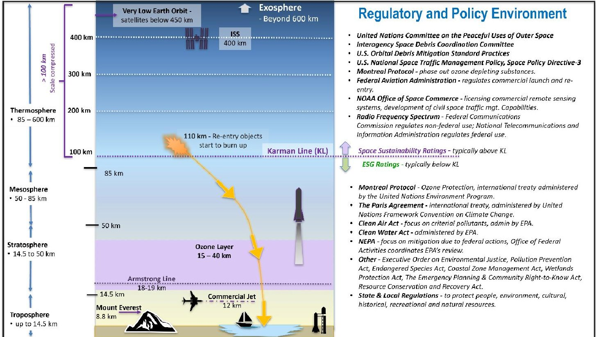
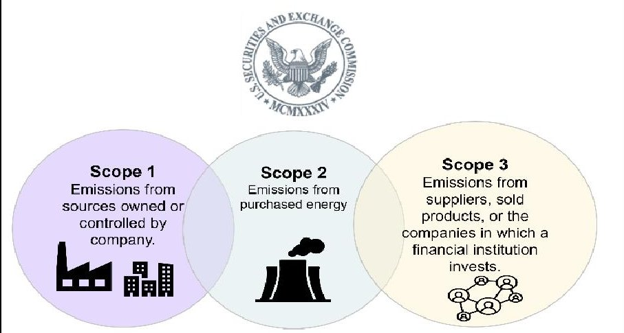
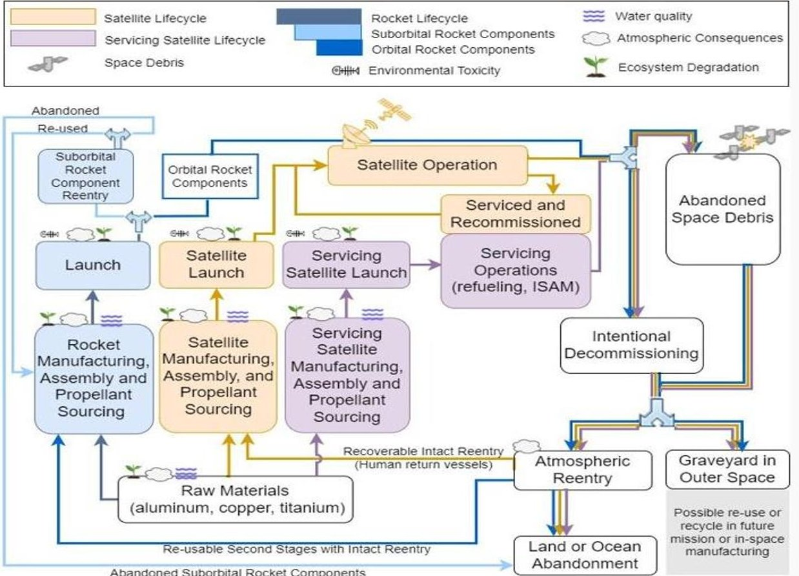

<!-- PDF_PAGE: 1 -->

# Space Sector Sustainability: A Circular Approach to Mitigating Environmental Impacts

Karen L. Jones $ ^{*} $

The Aerospace Corporation, Center for Space Policy and Strategy, Arlington, VA 22202, USA

This paper provides an overview of space sector sustainability trends along with a discussion of "cradle to grave" satellite life cycle and circular economy strategies to advance environmental stewardship, influence greener space systems, and to meet evolving regulatory and voluntary reporting. As defense and civilian spacefaring agencies navigate towards reduced environmental footprints, life cycle thinking can be applied with consistent criteria and systematic methodology to inspire and motivate the space industry to mitigate environmental impacts, improve designs and practices, and realize operational and economic efficiencies.

## I. Introduction

The global space economy has expanded significantly over the past decade, yet few comprehensive studies exist across the entire cradle-to-grave satellite life cycle (e.g., manufacturing, launch, operations through end of life). Environmental impacts are particularly challenging to understand and address, given their complexity and distribution across multiple domains (e.g., land, sea, atmosphere, upper stratosphere, and space). And yet despite several understudied research areas related to the environmental consequences of launching and operating satellites, changes are happening as social and investor pressures for improved sustainability and transparency intensify across all industries. Within this context the space sector has an opportunity to apply environmental life cycle assessments (E-LCAs) to identify environmental stewardship opportunities or areas where industry can apply responsible use and protection of the natural environment through conservation and sustainable practices. Such efforts can improve conservation actions, advance sustainable use and management of resources, and improve ecosystem resilience and diversity and human well-being. [1]

E-LCAs can also establish milestones towards the "circular economy." According to the U.S. Environmental Protection Agency (EPA), a circular economy uses a systems-focused approach that is restorative or regenerative by design to enable resources to maintain their highest value for as long as possible. [2] In other words, circular economies eliminate waste through better process design across their lifecycle. As industries transition from a traditional linear economy, or "take-make-use and dispose" practices, to a circular economy, or "make-use-recycle and/or reuse," they need a standardized way to measure and navigate toward more sustainable practices. Circular economy principles are gaining global momentum: 193 countries and the European Union are parties to the Paris Climate Change Agreement, an international treaty. Since the extraction and processing of natural resources causes half of global emissions and over 90% of biodiversity loss, the shift to a circular economy will be vital to achieving the Paris Agreement goal of limiting global temperature rise. [3] Circular principles also extend beyond climate and altruistic goals as E-LCAs can reveal more efficient designs and reduce costs or supply chain risks. Such efforts could also attract ESG-minded investors and customers to expand market access and increase profit.

<!-- PDF_PAGE: 2 -->

## II. Background

Significant attention has focused above the Karman line, the border between space and Earth's atmosphere at 100 kilometers in altitude above mean sea level. $ ^{\dagger} $ Beyond the Karman line, environmental impacts are typically discussed in terms space sustainability challenges due to a crowded space environment. Typical concerns involve space debris in crowded orbits and electromagnetic spectrum interference issues. The United Nations, national space agencies, space industry associations, and various regulatory agencies such as the Federal Communications Commission (FCC) have started to collaborate to develop and demonstrate best practices for space sustainability. [4] And while there is much work and cooperation needed to address orbital debris, this paper focuses on environmental impacts below the Karman line, where environmental stewardship and mitigation encompasses sustainability issues relating to Earth's natural resources, habitat, biodiversity, toxicity exposure, and pollution concerns.

The Karman line does not reliably, and precisely separate regulatory applicability. As an example, an Aerospace Corporation study noted that optical reflective emissions of orbiting satellites could contribute to light pollution and "may have a negative impact" on astronomical research from ground-based telescopes. And yet, satellites themselves appear to be exempt from the National Environmental Policy Act (NEPA), although related terrestrial based space activities are not exempt. [5] Moreover, spaceport licensing is subject to NEPA review and industrial activities relating to rocket production, launch, and satellite manufacturing are subject to a range of Federal and state environmental regulations (see Figure 1).

Fig. 1 The Space Industry's Complex Multi-Domain Environment.

## III. A Range of Operating Environments

The space sector affects a wide range of operating environments and domains, including terrestrial, sea, atmosphere, and space. As illustrated in Figure 1, the space sector traverses different geographies and physical boundaries and requires an understanding of international, national, and regional regulations and norms to address:

- Terrestrial impacts - protection of wetlands, endangered species, habitat and biodiversity, cultural sites, and mitigation measures to reduce impacts to nearby communities including noise and traffic issues.

<!-- PDF_PAGE: 3 -->

- Atmospheric impacts - including stratospheric Ozone and breathable air, below the Armstrong line $ ^{ \ddagger} $ .

- Debris and safety issues in space, above the Karman line.

The satellite industry's operations can generate a variety of environmental consequences including stratospheric ozone depletion, the release of greenhouse gases, air acidification, smog, toxic waste spills, water pollution, noise pollution, water consumption, and various types of material demands which can contribute to resource depletion. [6] These effects have varying severity, and in certain cases, are small but growing compared to other industries. Space players must navigate a complex web of overlapping regulatory regimes across ground, water, air, and space and across a range of satellite life cycle phases, including manufacturing, launch, operations, and reentry.

Like other industries, space is regulated by state, Federal, and international laws governing air, water, and land use. Space actors are required to comply with both procedural and regulatory requirements across the space industry value chain, including manufacturing, operations, and launch facilities. Depending upon the industrial process and location, a wide range of sustainability, procedural, and environmental regulations might apply. Space sector operations requiring federal licensing, planning or permitting are subject to NEPA review, such as spaceport development and operations. NEPA can also apply for non-terrestrial actions, such as satellite spectrum licensing.

In addition, there is now increased corporate attention on Environmental, Sustainability and Governance (ESG) performance. Commercial companies across many sectors, including space, strive to meet ESG expectations from investors, lenders and stakeholders. According to a study, companies that develop ESG practices and successfully mitigate related risks experience fewer controversies and potentially generate better shareholder returns. [7]

## A. Terrestrial Impacts and Spaceports

Environmental stewardship and mitigation starts with appropriate launch site selection and allowing for an adequate buffer to address ecosystem, wildlife, cultural, and human habitation concerns. It is during this critical site selection and permitting phase that the National Environmental Policy Act (NEPA) applies to ensure that the federal government has considered a range of environmental considerations and protections. These considerations could also include proposed mitigation measures such as ecosystem and habitat protection and ongoing environmental monitoring.

## 1. National Environmental Policy Act (NEPA) Review

NEPA, enacted in 1970, requires federal agencies to consider the environmental consequences of major federal actions. A range of actions covered by NEPA is broad and includes: making decisions on permit applications, adopting federal land management actions, and constructing highways and other publicly owned facilities. Issuing an experimental permit or a vehicle operator license for a launch site is considered a major federal action under NEPA and requires an environmental review. Prior to issuing a license, the Federal Aviation Administration (FAA) is the lead federal agency for environmental reviews of spaceports. Using the NEPA process, the FAA evaluates the environmental and related social and economic effects of proposed space sector actions and provides opportunities for public review and comment on those evaluations.

For launch sites outside the U.S., environmental obligations and laws do not generally apply unless expressly stated in statute. For example, Executive Order 12114 "Environmental effects abroad of major Federal actions" furthers the purpose of NEPA and the Marine Protection Research and Sanctuaries Act and the Deepwater Port Act with respect to the environment outside the United States, its territories, and possessions. And beyond legal compliance in various countries, establishing best practices can go a long way toward establishing trust and transparency in host countries, and longer-term environmental risk mitigation.

## 2. Ecosystem and Habitat Protection.

There are 17 FAA or federal licensed spaceports in the United States comprising over 366,000 acres. (See Appendix A - Space Ports in the United States). They range in size from 67 acres (SpaceX's spaceport, Boca Chica, Texas) to 90,000 acres (Vandenberg Space Force Base, California) and even up to 144,000 acres at Kennedy Space Center, Cape Canaveral Florida. The environmental impacts for coastal spaceports can be significant. Even without one single launch, the land development alone has created a direct loss of habitat and has potentially reduced several endangered species from reproducing, finding food, and nesting at several spaceport sites. For instance, there are only 8,400 piping plovers left on the planet. [8] Boca Chica is a critical habitat for these birds that play a critical role in the beach ecosystem. Other threatened or endangered species at Boca Chica include the Red Knot, Aplomado Falcon, Eastern Black Rail, Jaguarundi, Ocelot and various types of sea turtles. See Appendix A, for a list of

<!-- PDF_PAGE: 4 -->

spaceports and their environmental settings. Other spaceports, such as NASA's Kennedy Space Center, also have various endangered species onsite, including the green and loggerhead turtles, both listed as endangered species and therefore protected by the Endangered Species Act of 1973. Fortunately, NASA's efforts to protect the turtle's critical habitat is showing results. During 2023, biologists counted 639 more nests than 2022, in part due to efforts to use "turtle-friendly lighting and properly maintained dunes". [9]

## 3. Monitoring Practices.

In response to regulations, statutory requirements, and ESG guidelines, launch operators should institute routine monitoring practices, for disclosure and compliance across water, terrestrial, and air environments, such as:

- water quality sampling to include storm-water runoff and samples from nearby water bodies;

- soil sampling near and around launchpad, chemical and fuel storage areas;

- air quality monitoring before during and after launch; and

- noise and vibration monitoring and methods to mitigate disruptions to ecosystem and human environments.

## B. Atmospheric Impacts

The space industry is several orders of magnitude smaller compared to air transportation. During 2022, there were 186 orbital launches, compared to 27.7 million airline flights. [10] However, the increase in rocket launches coupled with a growing amount of orbital reentry debris could have long-term impacts on the Earth's atmosphere. While more studies are needed to understand the stratospheric impacts from various launch systems and propellants, proactive environmental stewardship and mitigation could start now by steering the space industry towards cleaner fuels.

## 1. Stratospheric Impacts and Montreal Protocol

Rocket emissions impact the stratosphere in a way that no other industrial activity does. This is a fundamental aspect of placing payloads into space using chemical propulsion. Different types of propulsion systems affect the stratosphere in different ways. According to Dr. Martin Ross, an Aerospace Corporation scientist who studies atmospheric impacts, "Spaceflight emissions are the only human produced compounds directly injected into the atmosphere above 18 km". [11] Rocket emissions from solid rocket motors, for instance, inject chlorine directly into the ozone layer. Additionally, NOAA's Office of Atmospheric Research and The Aerospace Corporation modeled the stratosphere's response to increased future emissions of black carbon, or soot, from rockets burning kerosene fuel. This study suggests that rocket black carbon increases stratospheric temperatures and changes the global circulation, which causes a reduction in the total ozone column. [12]

The Montreal Protocol, an international treaty entered into force in 1989, successfully banned or limited nearly 100 substances that deplete the ozone layer, including long lived chemical compounds known as chlorofluorocarbons (CFCs) which include ozone destroying chlorine atoms. $ ^{**} $ The agreement focuses on industrial substances and does not address emission sources such as rockets and aircraft that emit directly into the stratosphere. [13] However, in the future this may change as a United Nations Environment Program report summarizing the 2022 quadrennial assessment for the Montreal Protocol acknowledged that "increased launch frequencies could exert a substantial influence in the future". [14]

## 2. Rocket Fuels and Propellants.

Some launch providers are moving towards cleaner burning rocket propellants, such as hydrogen and liquified natural gas (LNG) which is typically 85 to 95% methane, $ ^{\dagger\dagger} $ and away from kerosene, and aluminum-based solid rocket fuels for both environmental and financial reasons. [15] Kerosene, a highly enriched petroleum product, produces several by-products when burned, including carbon dioxide, black carbon, and water. By comparison, methane has a shorter hydrocarbon molecule than kerosene and is well known as a clean burning fossil fuel compared to kerosene. However, methane is a potent greenhouse gas and presents risks earlier in the life cycle. Without appropriate controls, methane could escape into the atmosphere during the extraction, pipeline transport and storage phases. Another area where methane releases occur is during the chilling and filling a methane fuel tank.

<!-- PDF_PAGE: 5 -->

This natural evaporation, or boil-off gas, must be removed to preserve the tanks' pressure. However, if the gas can be routed to a flame, then emissions and safety hazards can be reduced.

Aluminum-based solid rocket motors typically produce chlorine gases, alumina, and carbon dioxide. Several studies have shown that black carbon, alumina, and chlorine emissions are among the most concerning rocket combustion products. Chemical reactions involving chlorine and the surface of alumina particles can cause ozone loss. [13] Hydrogen is a clean burning fuel that does not produce chlorine, alumina, or black carbon. Instead, hydrogen combustion creates only water. But understanding the entire life cycle of hydrogen is important. "Brown hydrogen", for instance, is created through coal gasification and releases high amounts of carbon dioxide, a greenhouse gas, and carbon monoxide. [16]

There are many unknowns regarding the atmospheric consequences of rocket launches. The impacts are complex. By way of example, methane combustion produces water and carbon dioxide. At lower altitudes carbon dioxide behaves as a greenhouse gas, absorbing infrared radiation and heating the lower atmosphere. [17] But the situation is different at higher altitudes, where the upper atmosphere is becoming colder. The Yale School of the Environment sums up upper atmospheric cooling concerns by noting that "the scale of cooling aloft are leaving atmospheric physicists with new worries about the safety of orbiting satellites, about the fate of the ozone layer, and about the potential of these rapid changes aloft to visit sudden and unanticipated turmoil on our weather below". [18] [19]

## 3. Direct and Indirect Emissions

Responding to global regulatory trends $ ^{ \ddagger\ddagger} $ and mounting pressure to reduce investors' exposure to climate risks, the US Security and Exchange Commission's (SEC) proposed new rules in March 2022, which will apply to all "registrants" including many companies involved in the space sector. $ ^{\S\S} $ The proposed rules will require that publicly traded companies report Scope 1, 2 and 3 emissions (see Figure 2). Scope 3 "value chain" emissions, from sources not owned or controlled by the reporting company, are the most difficult to assess and this is where most of the public debate lies. Various members of congress have become increasingly concerned regarding the reporting burden and related costs associated with the SEC proposed rules, particularly Scope 3 reporting requirements. [20] But even if the SEC rules do not pass as originally intended, increasing transparency expectations appear to be a strong trend. And while "environmental reporting" casts a wide net, across ecosystems, biodiversity, and water resources, most environmentalists agree that the most significant danger to our climate is derived from emissions, particularly those industries burning fossil fuels. For this reason, regulatory and reporting pressures will continue to push for increased, uniform and universal company disclosures of direct and indirect emissions. [21]

Figure 2. The SEC's Proposed Enhancement and Standardization of Climate-Related Disclosures for Investors.

## C. Above the Karman Line - The Space Debris Paradox

While the focus of this paper is on terrestrial and atmospheric impacts, there are liability responsibilities for U.S. owned objects in space and safety concerns arising out of orbital debris and satellite collisions in space. The U.S. government has responsibility for U.S.-owned objects in space, regardless of whether that object is launched by the

<!-- PDF_PAGE: 6 -->

United States or by a foreign launch provider. Similarly, foreign satellites remain the property of foreign entities, even if launched from a U.S. rocket. [22] Regardless of liability issues, debris congestion is worsening as planned projects for mega-constellations of telecommunication satellites in low earth orbit (LEO) continue to launch and deploy.

SpaceX operates approximately 5,000 Starlink LEO satellites and Amazon's Project Kuiper plans to launch half its planned 3,236 planned LEO constellation by the end of 2026. [23] Due to increased space activities, there is now intensifying scrutiny and concerns relating to the environmental impacts on the stratospheric ozone. Recently, scientists from the National Oceanic and Atmospheric Administration (NOAA) found that meteoric 'space dust,' is populated with metallic particles $ ^{* * *} $ from satellites and spent rocket boosters vaporized by the intense heat of reentry. [24]

There is a paradox in that deorbiting space debris reduces the chances of on-orbit collisions. However, reentering satellites, reentering rockets and space debris will contribute to the number of particles in the stratosphere, which can introduce some still unknown damages to the protective ozone layer surrounding the planet. There is also the paradox of the paradox, as these metallic particles might introduce unintentional geoengineering—such as reflecting sunlight and unintentionally shielding the Earth, causing lower temperatures. The burning up of reentry debris might have both positive and negative effects-aerosolized aluminum and black carbon could create cooling effects at the surface but also through a series of chemical interactions, contribute to the destruction of the ozone layer. [25] At this point, there is much speculation and further studies, and analysis are needed.

## D. Other NEPA Reviews-FCC Spectrum and Satellite Licensing

The FAA is not the only federal agency conducting NEPA reviews for space sector actions. The Federal Communications Commission $ ^{+ + + } $ (FCC) reviews actions related to spectrum and orbital rights and is required to comply with NEPA and related statutes during the spectrum licensing of satellites and is responsible for the engineering review of satellite systems applications. The FCC typically reviews potential environmental impacts and sometimes excludes certain proposals from NEPA review, known as "categorical exclusions". The FCC asserted that their 2018 approval of the SpaceX request to launch thousands of satellites was covered under the FCC's categorical exclusion as allowed under NEPA. Some are questioning whether a categorical exclusion should apply particularly for large constellations. The Government Accountability Office (GAO), for example, found that the FCC "has not sufficiently documented its decision to apply its categorical exclusion when licensing large constellations of satellites" and emphasizes that such a review is needed to ensure that the categorical exclusion "is still current and appropriate for large constellations of satellites and in consideration of the research being conducted by federal agencies on their potential environmental effects." [26]

There is also commercial space sector pushback. Viasat submitted a petition $ ^{+ + + } $ in the proceeding for the third SpaceX modification to its Gen 1 Starlink constellation—requesting that the FCC conduct either an environmental assessment or more rigorous environmental impact statement of Starlink before approving nearly 3,000 more low earth orbit satellites. [27] The debate continues to rage, as many feel that the NEPA categorical exclusion is too far sweeping. Kevin Bell, staff counsel at Public Employees for Environmental Responsibility (PEER) noted that this broad categorical exclusion "was designed for another time, before large scale space exploration." [28]

## IV. Life Cycle Frameworks as a Path to Understanding Space Environmental Impacts

There is often no standard or harmonized method to measure whether an industry has achieved sustainable consumption or production levels. For space activities, this is particularly challenging when both harmful impacts and mitigation measures span so many different contexts and domains. Even so, E-LCAs remain a well-established way to synthesize the complex dynamics for space activities, exploring the relationship between the activity and the environment at every stage of space system development, operation, and disposal. (See Figure 3). An E-LCA can be

<!-- PDF_PAGE: 7 -->

used to measure or validate environmental impacts, making it a potentially critical assessment tool as more industries strive for higher levels of long-term sustainability.

## A. E-LCA Challenges - Data Sharing and Harmonization

E-LCAs in the space sector are relatively new and there are challenges associated with sharing proprietary information. Still, there are opportunities to protect data and to standardize how the data is reported to provide meaningful metrics. As a large volume buyer and primary investor in many space systems, the U.S. government, as an anchor tenant could drive life cycle implementation. [29] Such efforts are supported by other initiatives and legislation such as the SEC's proposed Scope 1-3 emissions reporting and a White House Executive Order known as "The Federal Sustainability Plan" which sets out ambitious goals to deliver greenhouse gas emissions reductions. Moreover, the satellite industry includes many international players who are already integrating life cycle strategies. Notably, the European Space Agency has already included E-LCA requirements in projects such as Copernicus and Ariane 6 expansion missions. [30] Still, there are challenges ahead to harmonize E-LCAs on a global basis, particularly with the recent debate over indirect or "Scope 3" emissions reporting.

Abandoned Suborbital Rocket Components

Figure 3. Satellite Life Cycle Overview. The circular nature of the space industry across launch, satellite manufacturing and operations, and in-space servicing allows increased sustainability opportunities, wherein the materials or waste from one phase can "loop back" to provide re-use for future manufacturing or extended life missions. The E-LCA system boundaries for this diagram do not include raw material extraction, and some process loops such as recycling some materials in orbit. (Source: Karen L. Jones, Asha K. Jain, "The Green Circularity: Life Cycle Assessments for The Space Industry," April 2023).

## B. E-LCA Challenges - Implementation Burden

Adoption of an E-LCA requirement could impose a significant implementation burden on space industry stakeholders. To help overcome early hurdles, the research community could work with regulators and industry to advance the knowledge base for E-LCAs, with the intent to close critical knowledge gaps. Regulators will also need to be comfortable with partial information, because life cycle inventory data can be difficult to obtain, and best estimates will sometimes need to suffice. Also, regulators and acquiring agencies should consider a phased approach with appropriate pilot activities to maximize learning and minimize disruption. As the life cycle discipline matures, government and the commercial space community can build a body of knowledge which can gradually reduce the implementation burden.

<!-- PDF_PAGE: 8 -->

## IV. Conclusion

E-LCAs can be useful beyond measuring the current impact of space activities. They can also establish milestones towards a key feature of sustainable industries, the "circular economy". A growing and secure space industrial base relies upon a foundational understanding of environmental effects across the entire life cycle, including terrestrial and atmospheric impacts. This understanding allows space companies to become better environmental stewards by fully considering cradle-to-grave impacts, potential mitigation, and compliance measures.

Government and commercial space stakeholders should not assume that life cycle study efforts are the unfortunate cost of doing business. Rather, life cycle assessments can identify opportunities to implement environmental mitigation measures which can reduce risks across the value chain of space activities. Circular principles and smart environmental stewardship will also attract environmental, social, and governance (ESG)- minded investors and customers. Ultimately, a booming space economy and a clean and sustainable space sector are not mutually exclusive goals. However, achieving this mutual advantage requires an understanding of the satellite industry, from manufacturing to end of life, along with cooperation between and among industry and government stakeholders. To this end, the U.S. government working closely with allies, has an opportunity to catalyze the space industry toward a sustainable future by driving the standardization and application of life cycle assessment for future space systems.

<!-- PDF_PAGE: 9 -->

Appendix A. Spaceports in the United States $ ^{\S S S} $

<table border="1"><tr><td>Spaceports in United States</td><td>Launch Type</td><td>Area Acres</td><td>Environment</td><td>License</td></tr><tr><td>Alabama- Huntsville International Air and Space Port</td><td>Orbital Reentry</td><td>6,000</td><td>Developed and undeveloped land, forest land and some aquatic environments, but outside the Alabama Coastal Area Mgt. Program.</td><td>FAA</td></tr><tr><td>Alaska- Pacific Spaceport Complex(Kodiak Island)</td><td>Vertical</td><td>3,700</td><td>Tidelands, waterways, beaches, trails, historic landmarks. State-owned under Interagency Land Use Agreement with Dept. of Natural Resources.</td><td>FAA/Federal</td></tr><tr><td>California- Mohave Air &amp; Space Port</td><td>Horizontal</td><td>2,998</td><td>Largely developed and heavily impacted area, Mohave desert.</td><td></td></tr><tr><td>California- Vandenberg Space Force Base, launch ops since the 50s, now a federal and comm&#x27;l space port.</td><td>Vertical, Horizontal</td><td>90,000+</td><td>Coastal property, sensitive ecosystems, need NEPA approvals for new launch pads.</td><td></td></tr><tr><td>Colorado- Colorado Air &amp; Space Port</td><td>Horizontal</td><td>3,980</td><td>Plains grassland ecosystem, high level of modification on property prior to spaceport, already disturbed native ecosystem.</td><td></td></tr><tr><td>Florida- Kennedy Space Center, Cape Canaveral Space Force Station Status-historic and operational facilities for spaceflight.</td><td>Vertical, Horizontal</td><td>144,000</td><td>9% of land developed, the site also serves as a wildlife sanctuary and national seashore. many endangered species onsite (manatees, bald eagles, panthers, etc...).</td><td></td></tr><tr><td>Florida- Space Florida Facilities, Space Florida Launch Complex</td><td>Vertical, Horizontal</td><td></td><td>Coastal area, wetlands and floodplains, many endangered species onsite. Area included in Cape Canaveral (above).</td><td></td></tr><tr><td>Florida- Cecil Air &amp; Space Port</td><td>Horizontal</td><td>6,000</td><td>Floodplains and wetlands.</td><td></td></tr><tr><td>Florida- Space Coast Regional Airport</td><td>Horizontal</td><td>1,650</td><td>Floodplains and wetlands.</td><td></td></tr><tr><td>Georgia- Camden Spaceport Status-voters rejected in a 2022 referendum, citing environmental, safety and funding.</td><td>Vertical</td><td>4,000</td><td>Former industrial site, coastal and wetlands.</td><td></td></tr><tr><td>New Mexico- Spaceport America</td><td>Vertical, Horizontal</td><td>18,000</td><td>Undeveloped open range lands. Semi-desert grassland, plains-mesa sand scrub, and Chihuahuan desert scrub.</td><td></td></tr><tr><td>Oklahoma- Oklahoma Spaceport controlling agency for Spaceflight Corridor, first FAA approved corridor in Natl Airspace System.</td><td>Horizontal</td><td>2,700</td><td>Plains grassland ecosystem, high level of modification on property due to existing airport.</td><td></td></tr><tr><td>Texas- Launch Site One West Texas Status-owned and operated by Blue Origin.</td><td>Suborbital launch</td><td>165,000</td><td>Land includes working farms and former ranch properties. Chihuahuan desert scrub.</td><td></td></tr><tr><td>Texas- Boca Chica/SpaceX Status-Programmatic Env. Assessment approved with 117 mitigation measures.</td><td>Vertical</td><td>67</td><td>Coastal zone, wetlands, floodplains, critical habitat for endangered species, are a of historical interest.</td><td></td></tr><tr><td>Texas- Houston Spaceport (Ellington Airport)</td><td>Horizontal, Vertical</td><td>2,600</td><td>Within airport boundaries incl. approx. 8,000 ft; and a 45,000 ft2 space hanger.</td><td></td></tr><tr><td>Texas- Midland International Air and Space Port</td><td>Horizontal</td><td>40</td><td>For commercial space flight and aerospace development, within airport &amp; city limits.</td><td></td></tr><tr><td>Virginia- Wallops Flight Facility and Mid-Atlantic Spaceport</td><td>Vertical</td><td>6,200</td><td>Tidewater region, Atlantic Coastal Plain, inlets, marshes, bays, creeks, and tidal estuaries.</td><td></td></tr></table>

<!-- PDF_PAGE: 10 -->

[1] "Stewardship definitions," National Oceanic and Atmospheric Administration, [Online]. Available: https://www.noaa.gov/office-education/noaa-education-council/monitoring resources/common-measure-definitions/stewardship-definitions#:~:text=Definitions- Environmental %20stewardship,et%20al.%2C%202010%20)..

[2] "What is a circular economy and why is it important?," U.S. Environmental Protection Agency, [Online]. Available: https://www.epa.gov/circulareconomy/what-circular economy. [Accessed 30 November 2023].

[3] United Nations Climate Change, "Shifting to a Circular Economy Essential to Achieving Paris Agreement Goals," 2021.

[4] Satellite Industry Association, "Space Debris, Mitigation & Sustainability," [Online]. Available: https://sia.org/policy/space-debris-mitigation-sustainability/. [Accessed November 14, 2023 2023].

[5] J. S. Koller, R. C. Thompson and L. H. Riesbeck, "Light Pollution from Satellites," Center for Space Policy and Strategy, October 2020.

[6] L. Miraux, A. R. Wilson and G. J. D. Calabuig, "Environmental Sustainability of Future Proposed Space Activities,," Acta Astronautica, vol. 200, pp. 329-346, November 2022.

[7] M. Analytics, "The Business Impact of ESG Performance," June 2022. [Online]. Available: https://www.moodysanalytics.com/whitepapers/pa/2022/stronger-esg-risk-mitigation practices-linked-to-better-shareholder-returns.

[8] "Birdlife International," Data Zone, 2019 from Partners in Flight. [Online]. Available: https://datazone.birdlife.org/species/factsheet/piping-plover-charadrius melodus/details#:~:text=Population%20justification%3A%20The%20latest%20census,And res%20in%20litt..

[9] M. C. Bendayan, "Record Number of Sea Turtle Nests at NASA Spaceport," 25 October 2023. [Online]. Available: https://www.nasa.gov/centers-and-facilities/kennedy/recordnumber-of-sea-turtles-hatch-at-nasa-spaceport/#:~:text=This%20year%2C%20a%20record%20number,record%2Dkeeping%20began%20in%201984.. [Accessed 21 November 2023].

[10] I. A. T. Association, "IATA Annual Review 2022," 2022. [Online]. Available: https://www.iata.org/contentassets/c81222d96c9a4e0bb4ff6ced0126f0bb/annual-review 2022.pdf.

[11] M. N. Ross, Interviewee, PhD. [Interview]. 3 November 2023.

[12] C. M. Maloney, R. W. Portmann, M. N. Ross and K. H. Rosenlof, "The Climate and Ozone Impacts of Black Carbon Emissions from Global Rocket Launches," vol. 127, no. 12, 2022.

[13] M. N. Ross and J. A. Vedda, "The Policy and Science of Rocket Emissions," Center for Space Policy and Strategy, April 2018.

[14] United Nations Environment Program, "Synthesis of the 2022 assessment reports of the Scientific Assessment Panel, The Environmental Effects Panel and the Technology and Economic Assessment Panel," Montreal Protocol on Substances that Deplete the Ozone Layer, 8 June 2022.

<!-- PDF_PAGE: 11 -->

[15] M. Kramer and A. Snyder, "Space industry eyes next generation fuels to send rockets to new heights," Axios, 22 August 2023.

[16] Swinburne University of Technology, "The colours of hydrogen explained," 17 May 2022. [Online]. Available: https://www.swinburne.edu.au/news/2022/05/the-colours-of-hydrogen explained/.

[17] S. C. Solomon, "Effects of carbon dioxide on the upper atmosphere," AccessScience, 2008.

[18] F. Pearce, "The Upper Atmosphere Is Cooling, Prompting New Climate Concerns," Yale Environment 360, 18 May 2023.

[19] "Exceptional stratospheric contribution to human fingerprints on atmospheric temperature," vol.120, no.20, 8 May 2023.

[20] "Manchin, Hagerty Urge SEC To Reconsider Climate Disclosure Rules," 9 November 2023. [Online]. Available: https://www.manchin.senate.gov/newsroom/press-releases/manchin-hagerty-urge-sec-to-reconsider-climate-disclosure-rules. [Accessed 21 November 2023].

[21] "ESG should be boiled down to one simple measure: emissions," The Economist, July 21, 2022.

[22] E. M. Sims, B. M. Braun and A. P. Zucherman, "Policy Compliance Roadmap for Small Satellites," September 2022.

[23] T. Hitchens, "Amazon, OneWeb slowly stalk SpaceX for piece of Pentagon SATCOM pie," Breaking Defense, 16 October 2023.

[24] NOAA Research, "NOAA scientists link exotic metal particles in the upper atmosphere to rockets, satellites," 2023.

[25] L. Ratliff, "Space Debris Reentry: Inadvertent Geoengineering?," 2 May 2022.

[26] Government Accountability Office, "Satellite Licensing: FCC Should Reexamine Its Environmental Review Process for Large Constellations of Satellites," Government Accountability Office, 2022.

[27] J. Foust, "SpaceNews," Viasat asks FCC to perform environmental review of Starlink, 28 December 2020.

[28] J. O'Callaghan, "The FCC's Approval of SpaceX's Starlink Mega Constellation May Have Been Unlawful," 16 January 2020.

[29] K. L. Jones and A. K. Jain, "The Green Circularity: Life Cycle Assessments for the Space Industry," April, 2023.

[30] European Space Agency, "ESA LCA Database and Handbook: Framework for Life Cycle Assessment in Space," 2021.

[31] Opposition to SpaceX for Major Modification, 2020.

[32] G. A. Office, "Satellite Licensing:FCC Should Reexamine Its Environmental Review Process for Large Constellations of Satellites," 2 November 2022.

[33] "The Policy and Science of Rocket Emissions," April 2018.