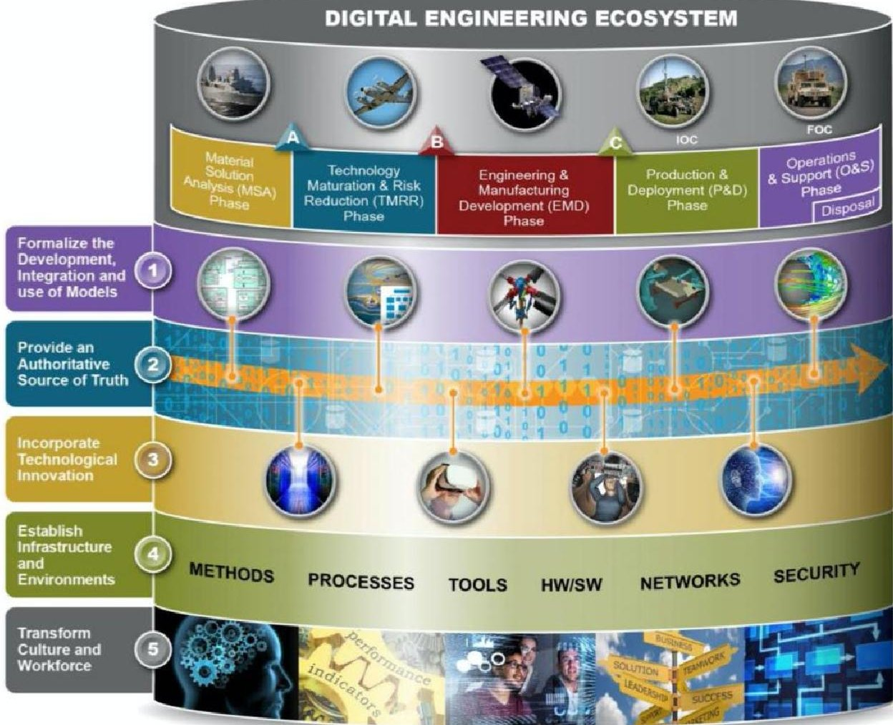
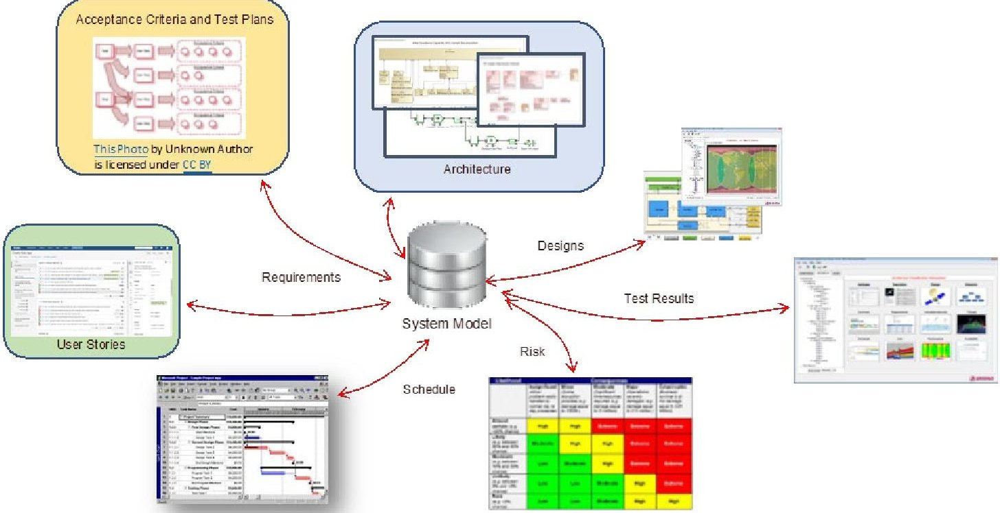

<!-- PDF_PAGE: 1 -->

## MITRE

Sponsor: NGA/CIO Dept. No.: N443 Contract No.: W56KGU-18-D-0004

Project No.: 0721P04Z-8S

The views, opinions and/or findings contained in this report are those of The MITRE Corporation and should not be construed as an official government position, policy, or decision, unless designated by other documentation.

Approved for Public Release; Distribution Unlimited. Public Release Case Number 21-1658

©2021 The MITRE Corporation. All rights reserved.

McLean, VA

MTR210203 MITRE TECHNICAL REPORT

# Digital Engineering Fundamentals

A Common Basis for Digital Engineering Discussions

Author(s): Kenneth J. Laskey Martha L. Farinacci Omar C. Diaz

Reviewer(s) Melvin H. Dedicatoria Michael S. Russell Robert M. Kobee

September 27, 2021

<!-- PDF_PAGE: 2 -->

This page intentionally left blank.

<!-- PDF_PAGE: 3 -->

## Abstract

Digital Engineering (DE) is an integrated digital approach using authoritative sources of system data and models as a continuum through the development and life of a system. DE updates traditional systems engineering practices to take advantage of computation technology, modeling, analytics, and data sciences. DE is the way DoD and other organizations, both government and commercial, approach and implement systems development, fundamentally changing engineering, acquisition and sustainment. The purpose of this document is to provide a common basis for understanding DE, how it impacts current practices, and the benefits of doing so, and to pass on best practices and lessons learned.

<!-- PDF_PAGE: 4 -->

This page intentionally left blank.

<!-- PDF_PAGE: 5 -->

## Acknowledgement

The authors of this technical paper recognize Ms. Rosie P. Scott of the National Geospatial Intelligence Agency for her leadership role to adopt a Digital Engineering approach and develop this material for her agency. Without Ms. Scott's leadership, it would have been challenging to define an integration path, comprising people, process, and technology, appropriate to realizing an effective digital engineering ecosystem capable of supporting the Agency's needs.

<!-- PDF_PAGE: 6 -->

This page intentionally left blank.

<!-- PDF_PAGE: 7 -->

## Table of Contents

1 Introduction ... 1

2 Purpose of this Document ... 1

3 Digital Engineering ... 2

4 Critical Enablers of DE ... 2

5 Other Goals Underpinning Digital Engineering ... 4

6 Model Management ... 5

7 Conclusions ... 6

8 References/Bibliography ... 7

Appendix A Aspects of Digital Engineering Models ... 8

Appendix B Abbreviations and Acronyms ... 11

## List of Figures

Figure 1. Digital Engineering Ecosystem ... 2

Figure 2. Notional Integrated Multi-Domain Digital Engineering Models ... 9

<!-- PDF_PAGE: 8 -->

This page intentionally left blank.

<!-- PDF_PAGE: 9 -->

## 1 Introduction

The vision for implementing Digital Engineering (DE) is for an organization to undergo a transformation that will provide benefits such as enhanced transparency, accountability, realtime, accurate and reliable reporting to leadership, and oversight. Many organizations are transitioning to a DE Ecosystem that combines model-based techniques, digital practices, and computing infrastructure. This paper is motivated by efforts at the National Geospatial- Intelligence Agency (NGA) to accomplish this transformation. For many systems such as those at NGA, with complex baselines and extensive collections of data sources, it is imperative to transition from a paper-based baseline management process to a digital environment in order to address broader questions about IT technology investments, and provide traceability and understanding of where budget and execution dollars are committed and spent. DE also allows organizations such as NGA to address the growing complexity of its baseline and more effectively engineer, integrate, and deliver mission-relevant capabilities.

A digital based environment will:

- Improve transparency of the baseline and the traceability across the architecture, requirements, and budgets

- Enable the ability to understand and provide decision making opportunities for the introduction of new technologies and functionality, design changes, and retirement of legacy functionality

- Provide timely, comprehensive, and accurate responses to leadership and oversight for securing their budget

Digital Engineering not only changes how engineering will operate, but it also changes business operations, acquisition practices, and contract activities through consistent use of an authoritative source of truth and other digital artifacts.

## 2 Purpose of this Document

Digital Engineering has gained increasing attention throughout the technical literature as more organizations look to increase speed of development, improve consistency of design and analysis, and increase the robustness and resiliency of their systems to accomplish critical missions. However, emphasis on what is important when discussing DE can lead to inconsistent meaning of what needs to be included in that discussion. Often there is a recitation of a list of perceived benefits, but similar lists appear in numerous DE documents, making these lists repetitive but also inconsistent. For example, few would dispute the importance of Model-Based Engineering (MBE), but less attention is usually given to systems engineering processes, such as DE governance. Consistency in management and use of DE artifacts requires an unambiguous use of semantics; reuse of digital assets requires tracking of information that describes artifact provenance. In short, current documents waste precious real estate, often without adding to clarity.

The purpose of this document is to build a common foundation on which to base needs, the description of oft-used assets, and basic assumptions. It is not claiming to be complete for all aspects of DE, but it should provide consistent coverage for the most important topics and an unambiguous reference on which to base other DE development.

<!-- PDF_PAGE: 10 -->

## 3 Digital Engineering

Digital Engineering (DE) is an integrated digital approach using authoritative sources of system data and models as a continuum through the development and life of systems. The models, data, infrastructure, and stakeholders and users comprise the DE Ecosystem. DE does not require the adoption and use of agile methodologies in the DE Ecosystem, but agile and DE are often mutually reinforcing, and DE can take significant advantage of the agile approach.

The DE Environment is the technological infrastructure that supports the DE Ecosystem. The DE Environment is a set of interconnected information, communication, and software technologies. It is an integrated digital environment that fuses database systems and information content to increase sharing.

## 4 Critical Enablers of DE

Figure 1. Digital Engineering Ecosystem

Figure 1 $ ^{1} $ shows layers capturing the five goals of the Department of Defense (DoD) DE Strategy. $ ^{2} $ This document emphasizes two of those layers, formalizing models and providing an Authoritative Source of Truth (ASoT), as critical enablers that combine to empower DE and support realizing the

<!-- PDF_PAGE: 11 -->

other three goals, as will be discussed below. This is consistent with the emphasis in the Systems Engineering Digital Engineering Fundamentals developed by the DoD Digital Engineering Working Group. $ ^{3} $

As the first critical enabler, a model is defined as:

A selective representation of some system, at some particular point in time or space, whose form and content are chosen based on a specific set of concerns. The model is related to the system by an explicit or implicit mapping to promote understanding of the real system. $ ^{4} $

This definition underpins the goal to formalize the development, integration, and use of models to inform enterprise and program decision making.

Architecture models describe and specify the business functions and relationships, data relationships, application interfaces and functionality, as well as the technical system characteristics and solutions. A data model captures the data requirements as well as data structure, metadata, and semantic relationships. All of these models are critical in system design and development. Having a system described as a set of integrated models enables real-time system analysis, model integration, simulations, change management, and impact analysis.

In this context, the term system is interpreted to include socio-technical aspects, such as engineered components (e.g., hardware, software, applications, infrastructure), human elements (e.g., business processes), and the natural environment (e.g., cloud cover, electromagnetic effects). A model within the DE environment is an approximation, representation, or idealization of selected aspects of the structure, behavior, operation, or other characteristics of one or more other systems. It also describes the assumptions on which the model is based, the communications between the model and the user, and the other outcomes of using the model.

The nature of models within the DE environment is further described in Appendix A.

The second critical enabler is the Authoritative Source of Truth. Goal 2 of the DoD Digital Engineering Strategy specifies the need to "provide an enduring, authoritative source of truth." The strategy further states ASoT:

captures the current state and the history of the technical baseline. It serves as the central reference point for models and data across the lifecycle. The ASoT will provide traceability as the system of interest evolves, capturing historical knowledge, and connecting authoritative versions of the models and data. Changes made to the ASoT will propagate throughout the digital design model to all affected systems and functions. Properly maintaining the ASoT will mitigate the risk of using inaccurate model data and support

<!-- PDF_PAGE: 12 -->

effective control of the current and historic configuration data files. The goal is to enable delivery of the right data to the right person for the right use at the right time.

The ASoT for digital artifacts serves as the primary means of ensuring the credibility and coherence of the digital artifact that its creators share with a variety of stakeholders. It gives stakeholders from diverse organizations and distributed locations the ability to discover, access, analyze, and use valid digital artifacts from an authoritative source. The owners of information models supporting the DE Environment provide stakeholders with an ASoT that assures confidence in the quality of the digital artifact across disciplines, domains, and lifecycle phases.

ASoT is not necessarily a single implementation artifact; rather, it is likely a set of federated sources. This introduces several considerations from a semantics perspective. First, component sources likely reflect the semantics preferred by the source owner, sometimes reflecting an agreed-upon, unified semantics and sometimes reflecting a specialized semantics of the domain and purpose for which the source was created and is now maintained. A second consideration that follows is the semantics being used must be well-documented and unambiguously identified when used. This enhances understanding of the source content and is a critical means to facilitate translation and use across different sources.

## 5 Other Goals Underpinning Digital Engineering

Digital Engineering requires a robust, actively managed inventory of models and an equally robust collection of authoritative data sources that, together with the models, describe the system under development or in use. Given the models and data, the DoD DE Strategy introduces three other goals that should be supported:

- Incorporate technological innovation to improve the engineering practice

- Establish a supporting infrastructure and environments to perform activities, collaborate, and communicate across stakeholders

- Transform the culture and workforce to adopt and support digital engineering across the lifecycle

Technological innovation. Digital Engineering provides visibility into resources that are in use or can otherwise be brought to bear in designing, describing, analyzing, and testing systems. It can catalog tools and document the standards and processes for specifying consistent use of tools, data sources, and other resources. This knowledge provides the basis for investigating new technologies and underlies decisions for replacing or updating tools and modifying what data is collected and otherwise curated. DE facilitates rapid and effective adoption within a connected digital enterprise.

Supporting infrastructure. The DE infrastructure supports the activities needed to realize the other DE goals. The infrastructure enables consistently defined and implemented tool, data, and other resource access across the enterprise. This includes wide access to licensed products and enforcement of intellectual property, cybersecurity, and security classification constraints. The DE infrastructure also enables real-time collaboration among teams within the enterprise. The infrastructure also enforces consistent policies and governance processes.

Workforce culture. The success of a DE transformation depends on a consistent focus across the enterprise of increasing efficiency and effectiveness by

<!-- PDF_PAGE: 13 -->

- breaking down stovepipes between organizations, emphasizing joint development of program data, and supporting the lowest practice level of decision making

- replacing paper-based systems and processes with digital artifacts and processes

- emphasizing the importance of using models in conjunction with authoritative sources of truth for decision making, acquisition, design, analysis, and other activities throughout the enterprise lifecycle

Success requires an effective champion in leadership to maintain the focus and adequate training for the staff in building, maintaining, and using models and corresponding authoritative sources of truth. Also, strategic communications is needed to maintain focus and consistency across the enterprise.

## 6 Model Management

Considerations of models. The concept of truth and accuracy is complicated in the case of models, since models are intended to be abstract representations that omit some details in the actual system in order to focus on specific concerns. A model may be sufficiently true and accurate for one purpose, but not for a different purpose. The Defense Modeling and Simulation Coordination Office (DMSCO) has defined three interrelated processes for determining whether a model's capabilities, accuracy, correctness, and usability are sufficient to support its intended users: $ ^{5} $

- Verification: the process of determining that a model implementation and its associated data accurately represent the developer's conceptual description and specifications

- Validation: the process of determining the degree to which a model and its associated data provide an accurate representation of the real world from the perspective of the intended uses of the model

- Accreditation: the official certification that a model, simulation, or federation of models and simulations and its associated data is acceptable for use for a specific purpose

Furthermore, DMSCO provides policy, standards, and best practices for Verification, Validation and Accreditation (VV&A) of DoD models and simulations. $ ^{6} $

Federation of models. Every model should have an unambiguously stated purpose, the statement of which is concise and sufficiently detailed to be clear about what the model accomplishes, under what circumstances the model is valid, and how the model may be combined with other models. A federation of models is supported by these points and enables reuse of component models in other supported analyses. It also supports using the most appropriate languages and tools, such as Business Process Modeling Notation (BPMN) for modeling processes or a costing model that can leverage the relevant data and reflect changes to the system components. In general, it is best practice to avoid large monolithic models because they are difficult to understand and error-prone to modify. A federation of models also supports having multiple teams work concurrently, and the resulting model can be made available to users as it becomes available.

<!-- PDF_PAGE: 14 -->

Model semantics. Semantics formalizes the meaning of symbolic models to enable the unambiguous representation and interpretation about a system in question. $ ^{7} $ The semantics of the modeling language used provide a clear way to interpret the model and enable execution needed to perform analyses. A standardized representation of architecture modeling elements will enable the comparison of different architectures, which in turn enables the reuse of common modeling patterns and elements. This will lower the construction cost for enterprise architectures. Drawings, $ ^{8} $ as opposed to models, may have a similar appearance but typically lack underlying semantics and rely on human interpretation, which may not be complete or consistent across those intending to use the drawing. While often useful, drawings do not provide the underlying basis for analysis and model execution.

Model and data provenance. Provenance is information about entities, activities, and people involved in producing a piece of data or thing, e.g., a model, that can be used to form assessments about its quality, reliability, or trustworthiness. $ ^{9} $ Model and data provenance are types of metadata that are important to confirm the authenticity of data and to enable it to be reused. Provenance provides a critical foundation for assessing authenticity, enabling trust, and enabling reproducibility. Put simply, provenance answers the questions of why and how the models or data were produced, where and when, and by whom. $ ^{10} $ Provenance metadata with enterprise scope, e.g., used for access control or expressing intellectual property, must be consistent across that enterprise. In addition, accommodations must be made to share provenance metadata across contracts or organizations that develop models and deliver these to the Operations and Maintenance (O&M) contractor. Provenance, which can identify the chain of custody and a body of evidence, is a critical element for assessing GEOINT Assurance. Data integrity is at high risk in today's environment, both from internal and external threats. Provenance can help to mitigate that risk.

Provenance also talks to the need to capture assumptions. Data producers would establish which assumptions are important to adequately describe the models or data and then how to convey this to users. Here, provenance looks to how assumptions align with existing conditions, and it is concerned with suitability. For users, it is necessary to understand context so they can determine if the data is "authoritative" for their purposes.

## 7 Conclusions

Digital Engineering is critical to achieve an organization's transformation to an environment enabling model and data-driven decision making, constant experimentation and innovation, and an ecosystem of partners that can work to achieve common goals. Of special importance is the creation, maintenance, and cross-domain use of models and data that are consistently understood across the digital ecosystem. The building of the Digital Ecosystem is the vital step in problem solving for the future.

<!-- PDF_PAGE: 15 -->

## 8 References/Bibliography

Australian National Data Service (ANDS). Data Provenance. https://www.ands.org.au/working-with-data/publishing-and-reusing-data/data-provenance.

Defense Modeling and Simulation Coordination Office (DMSCO), https://vva.msco.mil. Last modified: 10/26/2020.

Hybertson, D. Model-Orientated Systems Engineering Science: A Unifying Framework for Traditional and Complex Systems, Auerbach Publications/CRC Press, Boca Raton, FL. 2009.

Lankhorst, M. et al. Enterprise Architecture at Work: Modelling, Communication and Analysis (2nd. ed.). Springer Publishing Company, Incorporated. 2013.

PROV-Overview, An Overview of the PROV Family of Documents. World Wide Web Consortium (W3C), W3C Working Group Note, 30 April 2013. https://www.w3.org/TR/prov-overview/

Systems Engineering Digital Engineering Fundamentals, DoD Digital Engineering Working Group, https://ac.cto.mil/wp-content/uploads/2019/06/DE-Fundamentals.pdf.

US DoD Digital Engineering Strategy, Office of the Deputy Assistant Secretary of Defense for Systems Engineering, June 2018. https://ac.cto.mil/wp-content/uploads/2019/06/2018- Digital-Engineering-Strategy_Approved_PrintVersion.pdf

Verification, Validation, and Accreditation (VV&A). Defense Modeling and Simulation Coordination Office (DMSCO), https://www.msco.mil/MSReferences/VVA.aspx. Last modified: 10/26/2020.

Zimmerman, P. Digital Engineering Strategy & Implementation Status. Washington, DC, USA. June 2019. http://www.ndia.org/-/media/sites/ndia/divisions/systems-engineering/divmeeting-presentations/jun-2019/2_-_zimmerman_digital_engineering_ndia1.ashx?la=en

<!-- PDF_PAGE: 16 -->

## Appendix A Aspects of Digital Engineering Models

Within the DE Ecosystem, many models will likely be associated with the same system. The contents of the models will vary depending on the user and the purpose. The community for a given digital engineering model will determine the specific types of tools, techniques, and processes it needs to create, offer, request, and exchange those models and analytic results for its domain. The digital engineering sources are heterogeneous and thus unique to the needs of their community. Models will likely vary along these dimensions: $ ^{11} $

- Hierarchical decomposition: A model may be decomposed consistent with different hierarchies. For example, systems models may be decomposed into constituent component models, forming a multi-layered parts-whole hierarchy. In a control hierarchy, the relationships typically represent organizational reporting structures or command structures. Relationships can also signify instances of an overall category, where instances inherit the characteristics and behaviors of the category model.

- System and model boundary: When modeling a system, the modeler will need to decide what is internal to the system of interest and what is external. Internal components are generally modeled, and external elements typically provide boundary conditions to the model. The location of the boundary is subjective and depends on the purpose of the model. For example, an engineer who is responsible for the detailed design of a component system will need a different view than a system engineer who is responsible for managing the interfaces between systems in a complex System-of-Systems environment, or an architect who needs to demonstrate the linkage of the architecture to enterprise strategy.

- Descriptive versus prescriptive: Some models are prescriptive (e.g., requirements models, "to-be" architecture models, performance specifications). Other models are descriptive (e.g., as-built specifications, operational test results).

- Integrated, multi-domain models: A particular system of interest may be represented by a collection of models from across different domains. For example, a Concept of Operations (CONOPS) model may describe the system's behavior from the point of view of the user, and several variants of the CONOPS could demonstrate behaviors under different external conditions. System models could define the structure and performance of software and hardware elements. Those models could also be linked to physics-based mathematical models that estimate the performance of the overall system or its subsystems under various loading conditions. Cost models could provide estimates of the lifecycle cost of developing and managing the system. Typically, each of these models would be linked through use of formal relationships, forming a comprehensive integrated model. The relationships support an important function in that they enable the analysis of secondary or tertiary effects of changes. For example, the impact of a system design change could be analyzed in terms of impact on cost and performance. An example is depicted in Figure 2.

<!-- PDF_PAGE: 17 -->

Figure 2. Notional Integrated Multi-Domain Digital Engineering Models

The Military Health System will be used here to illustrate the different types of models that may be created. At the enterprise level, the Department of Defense (DoD) Business Enterprise Architecture (BEA) represents DoD systems at a very high level of abstraction as a federation of businesses offered by the Services and Agencies. Each individual Service or Agency develops more detailed models describing their specific business processes and technology, while maintaining traceability to the BEA. Within a particular Service or Agency, models are developed to a level of detail that is needed to manage the mission.

For example, the Military Health System (MHS) makes use of models of facilities (e.g., hospitals), equipment (e.g., intensive care units), supplies (e.g., respirators, personal protective equipment), and personnel (e.g., doctors, nurses) used to provide medical services, the estimates of healthcare needs, and the locations where care is required. The relationship between the BEA and the MHS models is an example of hierarchical modeling.

Some System-of-Systems (SoS) studies need to address the interactions between multiple Agency business systems. As an example, the Defense Logistics Agency (DLA) provides the transportation services to deliver personnel and supplies to the locations needed by the MHS. The DLA develops models of supply chains, transportation vehicles and personnel capacity (e.g., planes, ships, trucks, drivers, pilots), and demand patterns. The United States Transportation Command (TRANSCOM) may add model variations to cover emergency and military operations. An SoS study may look at the capacity of DLA, US TRANSCOM, and MHS to

<!-- PDF_PAGE: 18 -->

deliver the healthcare needs of service personnel. Such an analysis would focus on the interfaces between the DLA, US TRANSCOM, and MHS business systems, but it would not require MHS to understand how DLA delivers supplies or require DLA to understand how doctors treat patients. In this example, the DLA, US TRANSCOM, and MHS have different system boundaries. Finally, the COVID-19 pandemic is a good example of the importance of time in models. As disease hotspots moved from one area of the country to another, and as treatment options improved, the requirements on the supply chain evolved. Any supply chain or capacity analysis would need to take into consideration when the data was relevant and what has changed since the capture of the data.

<!-- PDF_PAGE: 19 -->

## Appendix B Abbreviations and Acronyms

<table border="1"><tr><td>Term</td><td>Definition</td></tr><tr><td>ASoT</td><td>Authoritative Source of Truth</td></tr><tr><td>BEA</td><td>Business Enterprise Architecture</td></tr><tr><td>BPMN</td><td>Business Process Modeling Notation</td></tr><tr><td>CONOPS</td><td>Concept of Operations</td></tr><tr><td>DE</td><td>Digital Engineering</td></tr><tr><td>DLA</td><td>Defense Logistics Agency</td></tr><tr><td>DMSCO</td><td>Defense Modeling and Simulation Coordination Office</td></tr><tr><td>DoD</td><td>Department of Defense</td></tr><tr><td>GEOINT</td><td>Geospatial Intelligence</td></tr><tr><td>MBE</td><td>Model-Based Engineering</td></tr><tr><td>MHS</td><td>Military Health System</td></tr><tr><td>NGA</td><td>National Geospatial-Intelligence Agency</td></tr><tr><td>O&amp;M</td><td>Operations and Maintenance</td></tr><tr><td>PDR</td><td>Preliminary Design Review</td></tr><tr><td>SoS</td><td>System-of-Systems</td></tr><tr><td>TRANSCOM</td><td>United States Transportation Command</td></tr><tr><td>VV&amp;A</td><td>Verification, Validation and Accreditation</td></tr><tr><td>W3C</td><td>World Wide Web Consortium</td></tr></table>