<!-- PDF_PAGE: 1 -->

# A Case for Space Platforms - A Comparative Analysis of Spacecraft Architectures for Deep Space Observation

Athip Thirupathi Raj $ ^{1} $ and Jekan Thangavelautham $ ^{2} $ Space and Terrestrial Robotics Exploration (SpaceTREx) Laboratory, The University of Arizona, Tucson, Arizona, USA.

One of the critical goals of the Artemis program is to establish a sustainable presence on the Moon, including the development of lunar bases. These bases will be used for scientific research, resource exploration, and utilization and as a stepping stone for further solar system exploration. However, the development of lunar bases poses many challenges, including the harsh environment on the lunar surface, such as micrometeorite impacts, which are a safety hazard and threat to astronauts, especially with a lack of atmosphere on the Moon to mitigate the effects. This calls for an Observation Post in Cislunar space to identify some events of interest, act as an early warning system, and characterize them. We propose using a swarm of CubeSats as part of an Observation Station Platform in Cislunar Space outfitted with sensors of varying specifications. Using the "Smartphone camera" approach to sensors, where there are a variety of imaging sensors with varying focal lengths, fields of view, and apertures, the probability of capturing an observation of an event of interest is significantly increased. "Scout" CubeSats equipped with lower-resolution sensors with a wider field of view provide information about the location of the event to an autonomous planner algorithm in real-time as they cover a wider area. The planner may redirect another CubeSat with a higher resolution sensor but a lower field of view to observe the event in greater detail. At the same time, the Scout is either retargeted to look for other events or to provide data from another view angle for sensor fusion. This scouting and retargeting approach is not possible with a single large spacecraft, making the CubeSat swarm the ideal candidate for satisfying such requirements. This presentation discusses the mission design elements of a Cislunar Observation outpost using a swarm of CubeSats. First, we perform Physics-based 3D simulations to establish the need for an outpost in Cislunar space and a genetic algorithm to optimize and find the minimum number of CubeSats and the combinations of onboard sensors required to observe all possible event occurrences. In addition, the onboard processing required to run the planner algorithm in real time is calculated. Finally, we propose real-world testing of our hypothesis using a swarm of drones in a controlled environment to observe randomly occurring simulated events of interest to determine the effectiveness of the autonomous planning algorithm.

<!-- PDF_PAGE: 2 -->

## 1. Nomenclature

ISS = International Space Station

RSO = Resident Space Object

ECLSS = Environmental Control and Life Support System

LEO = Low Earth Orbit

NASA = National Aeronautics and Space Administration

SPHERES = Synchronized Position Hold, Engage, Reorient, Experimental Satellites

CDH = Command and Data Handling

TT&C = Tracking, Telemetry and Command

FoV = Field of View

SDA = Space Domain Awareness

SSA = Space Situational Awareness

CSDA = Cislunar Space Domain Awareness

## II. Introduction

In the ever-evolving landscape of technological advancements and the intensifying competition in space exploration, the significance of Space Domain Awareness (SDA) has reached unprecedented levels. There is a growing importance of SDA, particularly in the cislunar domain, where human activities extend beyond Earth's orbit. The focus is on tracking satellites, managing space debris, and mitigating collision risks to maintain the sustainability of space operations. As humanity continues to push the boundaries of space exploration, the space environment has become increasingly congested, contested, and competitive. The growing number of satellites, space debris, and other objects in orbit has raised concerns about potential collisions and the creation of more debris, a scenario known as the Kessler Syndrome. To address these challenges, the role of SDA has become pivotal in providing essential information for monitoring and regulating space traffic. [1] SDA plays a critical role in mitigating the risks associated with the congestion of space. By continuously tracking the location of satellites and other objects in orbit, it enables operators to make informed decisions to avoid potential collisions. This not only ensures the safety of space assets but also enhances the overall efficiency of space operations. The information provided by SDA allows for precise orbital maneuvers, optimizing the positioning of satellite constellations and minimizing the probability of accidents. One of the primary concerns in the realm of space activities is the creation of the Kessler Syndrome. This domino effect of collisions, resulting in an ever-growing cloud of debris, poses a severe threat to both operational satellites and future space missions. SDA acts as a crucial tool in preventing the onset of the Kessler Syndrome by providing real-time data on the location of objects in space. This information enables operators to adjust trajectories and avoid potential collisions, thereby breaking the chain reaction that could lead to irreversible consequences.

SDA contributes significantly to space traffic management by offering the necessary information to monitor and regulate the movement of spacecraft in orbit. The data provided by SDA allows for the coordination of trajectories, reducing the risk of collisions and ensuring responsible and efficient use of space resources. As the number of satellites and other objects in space continues to grow, effective space traffic management becomes essential to avoid accidents and optimize the utilization of orbital space.

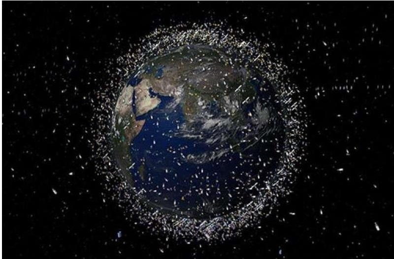

Fig. 1 Resident Space Objects (RSO) around the Earth [2]

<!-- PDF_PAGE: 3 -->

Beyond collision avoidance and space traffic management, SDA also plays a vital role in identifying and monitoring potential threats to space assets. As space becomes a more contested domain, the security and integrity of space-based capabilities become paramount. SDA enables the continuous surveillance of the space environment, helping to detect and assess potential risks posed by other satellites or objects in orbit. This information is crucial for safeguarding national and commercial interests in space.

With human activities expanding into cislunar space, encompassing lunar orbits and Lagrange points, the importance of Cislunar Space Domain Awareness (CSDA) is on the rise. United Launch Alliance (ULA) has proposed a visionary plan known as Cislunar 1000 (Fig. 2), aiming to establish a sustainable space economy by leveraging in-space resources and refueling spacecraft in Earth orbit. The plan envisions a significant expansion of human activities beyond Earth's orbit, particularly in Cislunar space. The plan revolves around laying the foundations for an in-space economy by leveraging the vast resources available in cislunar space. This includes utilizing lunar resources, Lagrange points, and other strategic locations for economic activities. The plan involves the establishment of infrastructure for refueling spacecraft in Earth's orbit. This capability is crucial for extending the operational life of satellites, enabling more extensive exploration missions, and reducing overall mission costs. The broader goal is to create an in-space economy, referred to as the Econosphere, within cislunar space. This involves tapping into the abundant resources available in this region to support various space-based activities. While specific details of the plan may require more in-depth exploration, ULA's Cislunar 1000 represents a forward-looking initiative to facilitate sustainable and economically viable activities in cislunar space, showcasing the company's commitment to advancing the frontiers of space exploration and utilization.

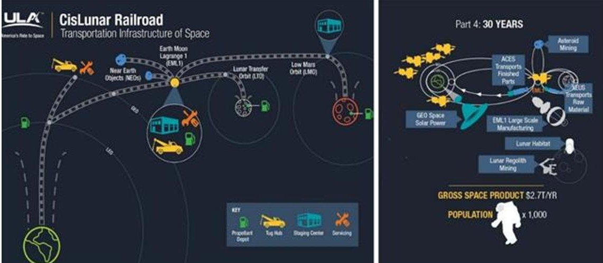

Fig. 2 ULA's Cislunar Railroad concept [3-4]

Governmental and commercial missions to the Moon and beyond necessitate effective space traffic management to ensure the safety and sustainability of Cislunar operations. CSDA provides the required information to track and coordinate spacecraft trajectories in this extended domain, reducing collision risks and facilitating responsible exploration and utilization of cislunar space.

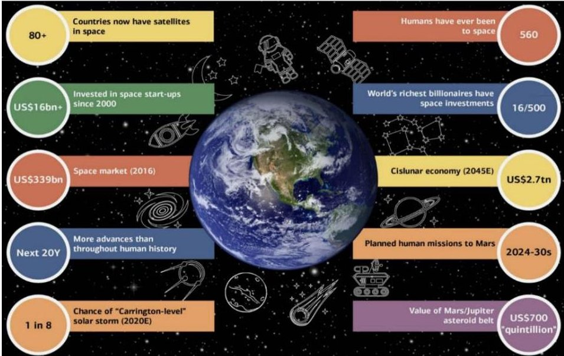

<!-- PDF_PAGE: 4 -->

Fig. 3 Emerging Space Markets as Seen by Analysts at Bank of America Merrill Lynch [5]

The evolution of technology and the increasing congestion of space highlight the critical role of Space Domain Awareness in ensuring the sustainability and security of space activities. SDA's contribution to collision avoidance, space traffic management, and the prevention of the Kessler Syndrome cannot be overstated. As humanity ventures further into cislunar space, the importance of Cislunar Space Domain Awareness becomes increasingly evident, emphasizing the need for continued advancements in technology and international collaboration to safeguard the future of space exploration.

## III. Related Work/Literature Survey

## A. Surface Telescopes

Ground-based Space Situational Awareness (SSA) encompasses the capacity to observe and comprehend space activities and objects from Earth-based vantage points, utilizing sensors, radars, and telescopes (Fig. 4). These systems track satellites, space debris, and other orbiting entities, furnishing real-time and historical data crucial for the safety and security of space operations. Ground-based SSA relies on various technologies, including radar and optical sensors, to track both natural celestial bodies and artificial satellites.

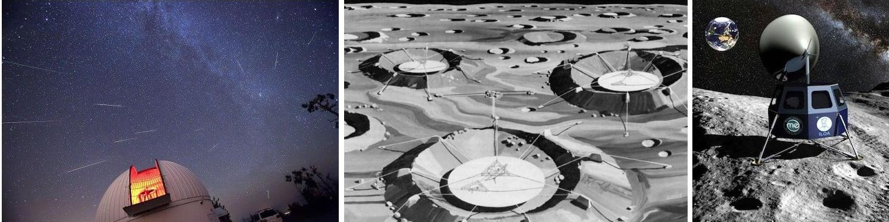

Fig. 4 One of the telescope systems used by Catalina Sky Survey [6] (Left); An artist rendering of Telescopes on Lunar craters [7] (Center); An artist rendering of a proposed telescope on the Malapert crater [8] (Right)

Particularly effective in monitoring Low Earth Orbit (LEO), ground-based SSA aids collision avoidance and space traffic management, playing a pivotal role in the safety of Earth observation and communication satellites. However, it contends with weather dependence, where adverse conditions can hinder optical sensors' effectiveness, emphasizing the need for alternative observation methods. Strategic placement of ground-based SSA systems optimizes coverage, considering factors like light pollution and interference.

Collaboration and data sharing are integral due to the global non-uniform distribution of ground-based sensors. Shared data enhances understanding and contributes to comprehensive SSA coverage. While effective for LEO, ground-based SSA encounters challenges tracking objects in higher orbits, necessitating integration with space-based sensors and satellite operator data. Ongoing advancements in sensor technologies, including sophisticated radars and optical instruments, coupled with automation and machine learning, continuously improve ground-based SSA's efficiency and capabilities. In conclusion, despite limitations, ground-based SSA remains a fundamental component in ensuring the safety and sustainability of space activities, evolving through technological advancements and collaborative initiatives.

## B. Large Scale Reconnaissance Spacecraft

The Lunar Reconnaissance Orbiter (LRO) and the Lunar Crater Observation and Sensing Satellite (LCROSS) are integral components of NASA's Lunar Precursor Robotic Program, both launched in June 2009 with the overarching goal of enhancing our understanding of the Moon and facilitating future human exploration.

The Lunar Reconnaissance Orbiter (LRO) primarily aimed to comprehensively map the lunar surface at high resolution, utilizing instruments such as the Lunar Reconnaissance Orbiter Camera (LROC). Beyond mapping, LRO sought to identify potential resources on the Moon, which are crucial for planning future crewed missions. The orbiter played a pivotal role in selecting future human landing sites by providing detailed information about potential zones. Additionally, LRO contributed to spacecraft and spacesuit design for lunar missions and assessed the radiation environment around the Moon. Notable instruments like the Lunar Reconnaissance Orbiter Camera (LROC), Diviner Lunar Radiometer, and Lunar Exploration Neutron Detector (LEND) played crucial roles in achieving these

<!-- PDF_PAGE: 5 -->

objectives. LRO successfully created detailed lunar maps and contributed to the discovery of water ice in shadowed regions near the lunar poles.

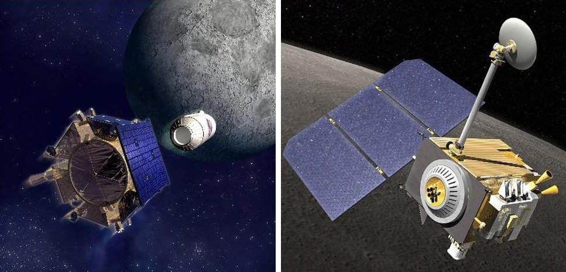

Fig. 5 Lunar Crater Observation and Sensing Satellite LCROSS [9] (Left); Lunar Reconnaissance Orbiter LRO [10] (Right)

On the other hand, the Lunar Crater Observation and Sensing Satellite (LCROSS) had the primary objective of confirming the presence of water ice in a permanently shadowed crater near the Moon's south pole. It executed a unique impact experiment, separating from the spent Centaur rocket stage and directing it to impact the Moon. The resulting debris plume was analyzed by instruments on the shepherding spacecraft, including a Near-Infrared Spectrometer and Visible Light Spectrometer. LCROSS successfully confirmed the presence of water ice in the lunar debris plume, providing essential insights into potential resources for future lunar exploration. The impact experiment also yielded valuable data on the composition of the Moon's polar regions, furthering our understanding of lunar resources.

In summary, while the Lunar Reconnaissance Orbiter focused on mapping and resource identification, the Lunar Crater Observation and Sensing Satellite conducted a groundbreaking impact experiment to confirm the presence of water ice in the Moon's polar regions. Together, these missions significantly advanced our knowledge of the Moon, laying the groundwork for future lunar exploration endeavors.

## C. Small Satellite Constellations

Lunar small satellite (small sat) constellations have gained attention for their potential applications and contributions to lunar exploration. Research indicates a focus on the major parameters necessary for achieving orbit control and autonomy in small sat constellations for real-time operations [11]. The design and optimization of autonomous constellations with small satellites have been impactful in the new space era, especially in real-time applications [12]. The concept of satellite constellations, where groups of satellites work in concert, is seen as a powerful and effective application in the realm of small satellites [13]. Moreover, research is exploring innovative ideas, such as a lunar-orbiting satellite constellation designed for wireless energy transmission to the lunar surface. While specific details about lunar small satellite constellations may vary, the overall trend suggests a growing interest in leveraging small satellites and constellations for various lunar missions, including exploration and potential resource utilization.

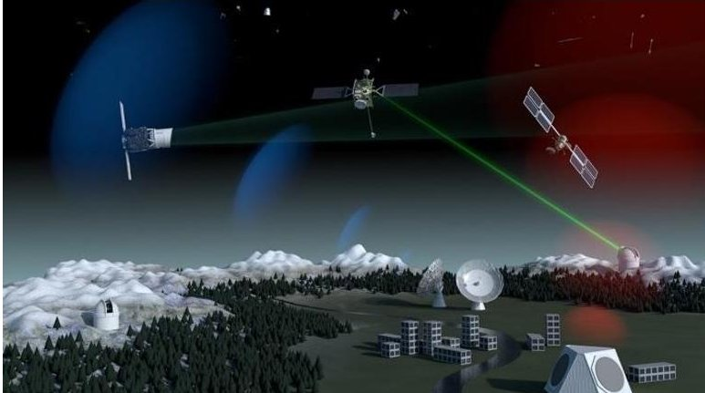

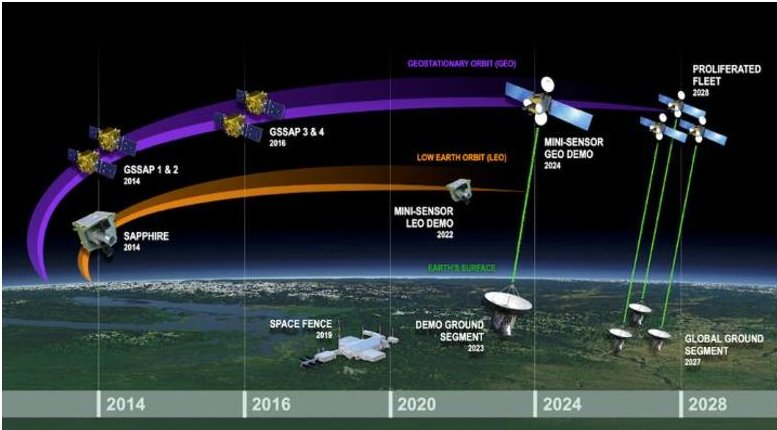

Fig. 6 SST Segment of ESA's SSA System [14] (Left); GEO Swarm proposed by MIT [15] (Right)

<!-- PDF_PAGE: 6 -->

## D. Modular Robotic Platforms

Robotically assembled space stations herald a groundbreaking paradigm in space construction, leveraging automation and robotic systems to assemble structures, habitats, and infrastructure in space autonomously. The central aim is to minimize or eliminate human intervention during the construction process, with advanced robotic systems handling tasks such as module assembly, component connection, and repairs independently. This approach not only promises increased efficiency and cost-effectiveness by reducing reliance on human spacewalks but also envisions faster construction timelines as robotic systems can operate continuously.

Key technologies and approaches underpinning robotically assembled space stations include the potential utilization of in-situ resources like lunar or asteroidal materials, mitigating the need to transport all construction materials from Earth. The modular design is another cornerstone, facilitating incremental component additions and streamlined maintenance. Applications span from human habitats and research stations to broader orbital infrastructure such as communication platforms or telescopes.

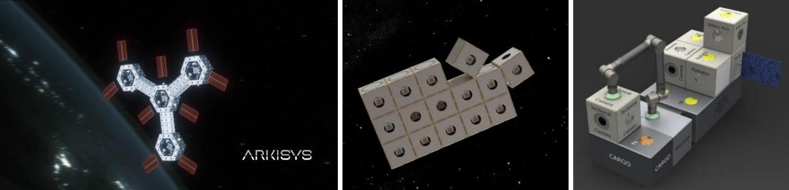

Fig. 7 The "Port" concept by Arkisys [16] (2020); The Hive Concept by Aerospace Corporation [17] (2018); MOSAR Concept funded by the EU [18] (2021)

Both space agencies and private companies, including NASA and initiatives like the Asteroid Redirect Mission (ARM), "The Port" concept by Arkisys, The Mosar concept by the EU, and the Hive concept by The Aerospace Corporation, are actively exploring the feasibility and technology required for robotically assembled space stations, challenges persist. Developing robust and reliable robotic systems capable of navigating the complexities of space assembly is a key technological hurdle. Ensuring the long-term reliability and maintainability of structures assembled robotically poses another critical challenge.

Looking forward, the future of robotically assembled space stations hinges on international collaboration, with collaborative efforts between space agencies and partnerships playing a pivotal role in advancing development and deployment. Continued advancements in robotic technologies and materials science are anticipated to bolster the feasibility and success of these transformative projects, ushering in a new era of space construction methodologies.

## IV.Challenges with Current Technology

SDA is a critical component for ensuring the safe and secure operation of activities in space. As humanity continues to push the boundaries of space exploration, the challenges associated with achieving effective awareness in this complex and dynamic environment become increasingly apparent. This section delves into the challenges faced by Current SDA technology and explores the innovations and strategies required to overcome them.

## A. Complexity of Tracking Space Objects

The ever-increasing number of space objects poses a significant challenge for SDA. Fig.1 illustrates the sheer volume of satellites, debris, and other objects in orbit, emphasizing the need for precise tracking and monitoring. Predicting the movements of debris particles, which often have uncertainties in their orbits, is essential to prevent collisions with operational satellites and other space assets.

## B. Non-Uniform Availability and Coverage of Sensors

The availability and coverage of space-based sensors and ground-based radars are not uniform across the globe. This non-uniform distribution leads to gaps in SDA coverage, making it challenging to monitor certain regions of space effectively. The disparities in coverage emphasize the necessity of global collaboration and data sharing among different entities, including nations and commercial operators, to achieve comprehensive space situational awareness.

<!-- PDF_PAGE: 7 -->

## C. Adaptation to Evolving Satellite Technologies

The landscape of satellite technologies is rapidly evolving. Satellites are becoming smaller, more numerous, and capable of performing a wider range of functions. Adapting SDA capabilities to these changes requires continuous development and innovation. The challenge lies in keeping pace with technological advancements and ensuring that SDA systems can effectively track and monitor the diverse array of satellites in orbit.

## D. Limitations of Ground-Based SDA

Ground-based SDA, while currently the most popular method, has its limitations. It has limited coverage and can be adversely affected by weather conditions such as clouds, rain, or atmospheric disturbances. During periods of poor weather, ground-based systems may be rendered ineffective, highlighting the need for alternative or supplementary methods to maintain continuous awareness.

## E. Optical Sensor Limitations

Optical sensors, a common component of SDA systems, are typically affected by daylight conditions. This limitation restricts their observation capabilities to nighttime, reducing the frequency of observations and limiting the timeliness of space situational awareness data. Overcoming this constraint requires innovative solutions, such as advancements in sensor technologies or the integration of multiple sensor types for comprehensive coverage.

## F. Challenges in Tracking Higher Orbits

While ground-based systems are generally effective at monitoring objects in low Earth orbit (LEO), tracking and characterizing objects in higher orbits, such as geostationary orbit and Cislunar space, pose additional challenges. The limited viewing angles from the Earth's surface make it more challenging to precisely monitor objects in these higher orbits, necessitating advancements in tracking technologies and the exploration of novel observation methods.

While SDA is indispensable for the safe and secure operation of space activities, overcoming the challenges associated with tracking, monitoring, and predicting space objects requires a concerted effort. Continuous innovation, global collaboration, and the integration of diverse sensor technologies are key to enhancing SDA capabilities and ensuring effective space situational awareness in the evolving landscape of space exploration.

## V.Methodology

## A. Objectives

We hypothesize that it is possible to monitor the space objects in LEO and Cislunar space with a suite of sensors from one of the Earth-Moon Lagrange points (L1/L2). Free-floating swarms of satellites performing reconnaissance require a significant amount of energy to upkeep. Hence, we propose deploying a structured swarm in the form of a "Superstructure."

The primary objectives of the system are:

1. Identify and characterize the "Events of Interest" (TBD)

2. Modular, Reconfigurable, Extensible and Autonomous Operation

3. Onboard warehousing of spare parts

Based on the above objectives, a "Smartphone camera" approach was chosen, which involves the use of three types of sensors with varying Field of View (FoV) and resolutions:

1. Wide FoV, low resolution: "Scout" or "Lookout" instrument

2. Medium FoV, medium resolution: General purpose tracking instrument

3. Low FoV, high resolution: "Telephoto" instrument

## B. System Architecture

The platform necessitates sophisticated autonomous systems to function independently over prolonged durations, given the variable response time from Earth to Cislunar space, spanning several days to weeks. These autonomous capabilities encompass navigation and tracking, resource management, and decision-making. The deployment of robotic systems is imperative for tasks including assembly, maintenance, and cargo handling, demanding the ability to execute intricate and delicate operations amidst the challenging conditions of Cislunar space. An integral feature of the platform is its modular and expandable design, facilitating the addition of new modules or sections over time to accommodate evolving requirements, additional experiments, or equipment.

The station must incorporate onboard warehousing facilities designed to store supplies, equipment, and scientific instruments, necessitating temperature and radiation-controlled environments to safeguard sensitive materials [19].

<!-- PDF_PAGE: 8 -->

The sustainable operation of the system hinges upon the efficient management of resources, including power and fuel, thus requiring advanced recycling and resource regeneration systems. To facilitate communication with Earth and enable remote instructions, the space station should be equipped with robust communication systems featuring high-speed data handling, processing, storage, and real-time decision-making capabilities.

Power for the platform is envisioned to be derived from solar panels or other advanced energy generation systems, complemented by energy storage systems to ensure continuous operation during off-nominal periods of low sunlight. Security measures are indispensable to shield the station from space debris, radiation, and potential threats like micrometeorites. While designed to operate autonomously, the station should also be remotely controllable from Earth, enabling monitoring, troubleshooting, and mission planning and extensions.

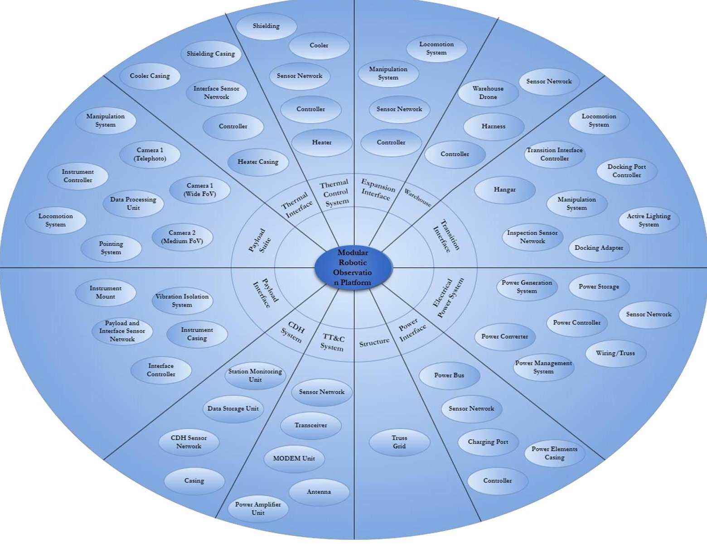

Fig. 8 Space Platform System Architecture

## C. Platform System Design

The Expansion Interface allows for reconfiguration and expansion and contains the hardware and software necessary for the task. Some of the core elements of the Expansion Interface are the decentralized controller, the locomotion and manipulation system, which may be a drone or swarm drone with manipulators attached, and the sensors and structural elements associated with them. The Thermal Interface houses the elements required for Thermal Control in addition to the Thermal Control System, as the system may have varied thermal requirements based on the payload and the Space Environment. The payload may be a set of Cameras for an Observation Platform, as discussed in Fig. 8, or other scientific instruments for an experiment platform or cryogenic storage.

<!-- PDF_PAGE: 9 -->

Table 1: Tentative System Specifications

<table border="1"><tr><td>Dimensions</td><td>100m x 100m x 100m(TBR)</td></tr><tr><td>Number of Telephoto Cameras</td><td>12(TBR)</td></tr><tr><td>Number of Medium Range Cam</td><td>36(TBR)</td></tr><tr><td>Number of Wideangle Cameras</td><td>84(TBR)</td></tr><tr><td>Number of Servicing Robotos</td><td>15(TBR)</td></tr><tr><td>Max. Observable Range</td><td>TBD</td></tr><tr><td>Min. Observable Luminosity</td><td>TBD</td></tr><tr><td>Location</td><td>CisLunar Space(TBR)</td></tr><tr><td>Warehouse Capacity</td><td>TBD</td></tr><tr><td>Resupply Frequency Required</td><td>TBD</td></tr></table>

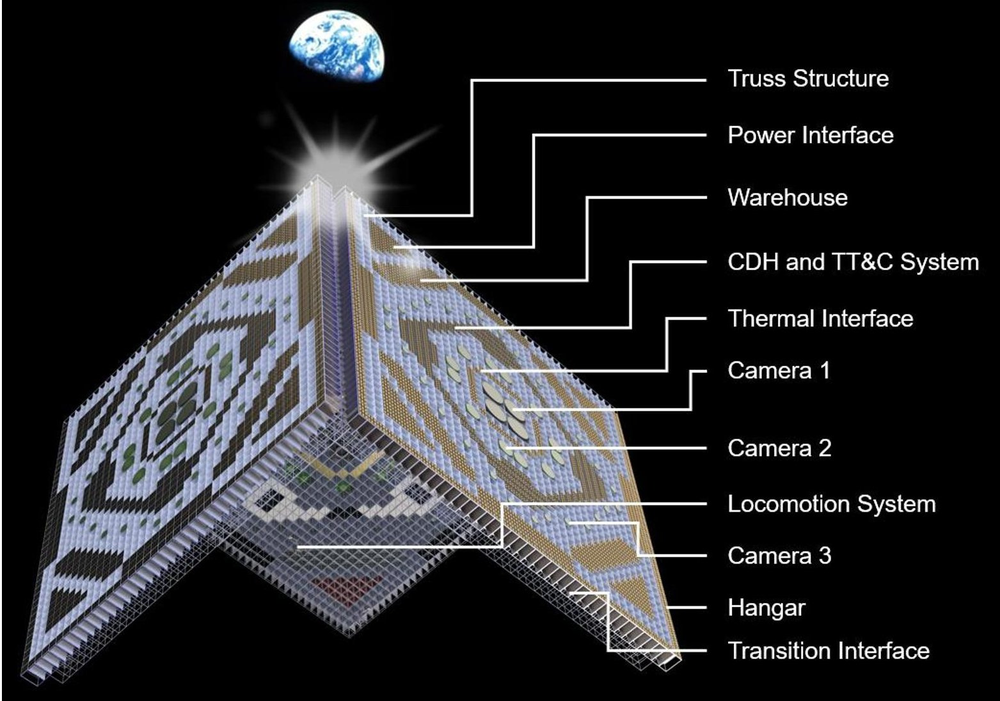

Fig. 9 System Layout

The Thermal Control System needs to be in the form of modules that are compatible with the Thermal Interface so that the system may host a variety of instruments based on customer needs. A similar Interface System is also present on the Payload side, where the Payload Interface may host a variety of payloads based on the science needs. The other modules are derived from a typical space platform architecture, being the CDH for onboard computing, TT&C for communications, EPS for power generation and storage, and a truss structure for housing. The transition interface is one of the critical elements of such a platform, containing the docking adapters for interaction with the rest of the environment, including resupply. It also contains warehousing for logistics and inventory management. These complex systems would benefit from a distributed computing system, i.e., a decentralized planner that handles the subsystem-level tasks and a centralized Inventory management system that manages all the elements on board the system along with their status.

<!-- PDF_PAGE: 10 -->

## D. Hierarchy of operations

The establishment of a sophisticated platform capable of autonomously executing a diverse array of Earth observation tasks from Cislunar Space involves a multifaceted operational framework. Initially, the launch and deployment phase entails launching standardized and miniaturized modules from Earth, utilizing ride-share opportunities with larger payloads to optimize the first cut version of the simulation. These modules serve various functions, including assembly, repair, service, and expansion. Precision in instrument pointing is facilitated through elements within the Payload Interface, aligning the state of the Instruments with the Observation Requirements. The station's geometry ensures continuous solar panels pointing towards the sun for power generation, with provisions for energy storage during off-nominal eclipse conditions.

Integral to the platform's functionality is resource management, where the station logistics planner maintains a constant inventory, tracks element status and locations, and triggers repair or replacement requests as needed. The observation payloads employ a "Smartphone Camera" approach, incorporating wide-angle, medium-range, and telephoto camera systems to identify, track, and analyze Events of Interest. The station's extensive data collection is processed and stored in onboard warehousing facilities, with real-time data analysis, compression, and secure transmission through high-speed data links and advanced encryption mechanisms. Temperature and radiation-controlled warehousing preserves the integrity of both raw and processed data, as well as repair and replacement components. A critical aspect is the adaptability of the platform, manifested through its modular design, allowing for the addition of new payloads, instruments, and technological upgrades to enhance capabilities over time. The station's adaptive observation strategy enables it to dynamically adjust priorities based on real-time events and user-defined criteria, such as focusing on natural disasters, climate trends, or potential threats. Additionally, the platform necessitates resupply missions to deliver essential resources, ensuring a prolonged operational lifespan.

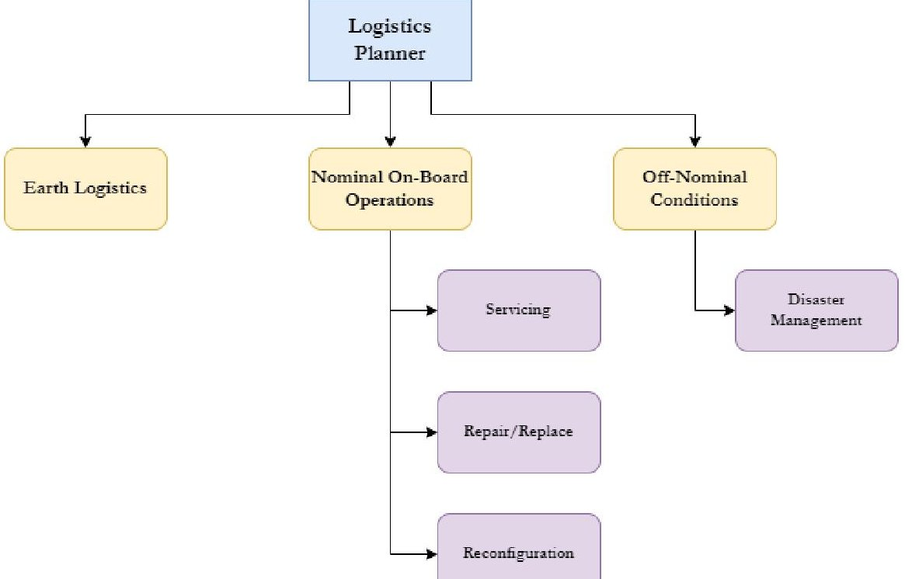

Fig. 10 System Architecture of the Autonomous Logistics Planner

## E. Operational Scenario: Redirection of Instruments

Two out of the three critical operational scenarios identified, which significantly impact the logistics of a large-scale Observational platform, encompass nominal operations, specifically science operations involving observation, tracking, and resolution of events of interest. Subsequently, regular maintenance is instituted to address the repair or replacement of worn-out or damaged components and the system's response to off-nominal scenarios, leading to disaster management. A schematic representation of the Concept of Operations for science operations is depicted in Fig. 10. During this phase, the space surrounding the platform undergoes continuous monitoring for a user-defined set of events of interest using a suite of wide-angle cameras. Onboard machine learning algorithms continuously process the data to identify events, and following identification, medium-range cameras with higher resolution are deployed to track the events. The Payload Interface is designed to facilitate the gimbal motion of the cameras for tracking, and the decentralized planner controls both the Instrument and the Interface to execute the tracking. Subsequently, longrange telescopic systems are employed for further analysis. The simulation setup described in Fig. 13 elucidates the

<!-- PDF_PAGE: 11 -->

operation of the system during this scenario, involving randomly generated static events in a pre-defined space around the platform. Further simulations, incorporating dynamic events with varying velocities and luminosities, are essential to validate the design parameters of the payload suite.

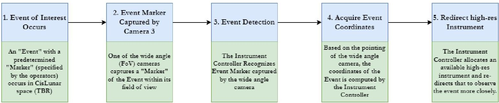

Fig. 11 Scenario: Redirection of Instruments

The Concept of Operations for soliciting repairs and upgrades (Fig. 12) follows a structured process to ensure the ongoing functionality, efficiency, and adaptability of the system to evolving needs. Commencing with an Initial Assessment and Evaluation, this phase involves identifying the need for repairs or upgrades based on performance issues, changing requirements, or emerging technologies. Criticality assessment of the element to ongoing operations and objectives follows, with the centralized inventory record being updated to capture the system's current state, encompassing hardware, software, and performance metrics, along with documentation of specific issues, malfunctions, or areas requiring improvement.

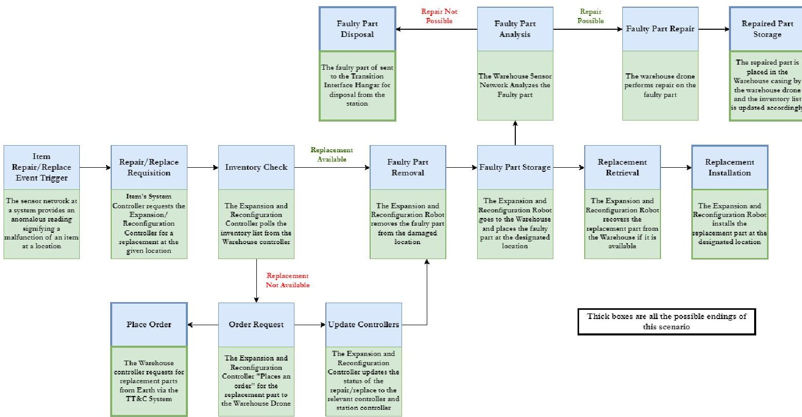

Fig. 12 Scenario: Requisition of Upgrades/Repairs

Subsequent evaluation of the repairability of the element, based on criticality and warehouse stock, precedes the relay of a request for repairs and upgrades, including a clear description of the issues or enhancements, to the Earthbased ground station. The request specifies desired outcomes, budgetary requirements, and potential impacts on operations. Prioritization factors, including safety, operational impact, and available resources, are considered in realtime cost-benefit analysis to justify the investment, taking into account long-term benefits such as increased efficiency, extended system lifespan, and reduced operational risks. Upon obtaining approval for proposed repairs or upgrades based on criticality, the system develops a detailed implementation plan, addressing potential challenges, downtime,

<!-- PDF_PAGE: 12 -->

and contingency measures. Execution of approved repairs or upgrades is followed by a testing phase to validate improved functionality and adherence to specified performance criteria. The updated system is then integrated into the existing operational environment, with post-upgrade monitoring and maintenance measures implemented to prevent future issues. The system concludes the process with a report on the success of repairs or upgrades, incorporating metrics demonstrating improvements, subject to refinement through feedback and iteration.

## VI. Simulation and Results

The two nominal case scenarios described in Section V are simulated using an object-oriented approach to evaluate their validity and further refine the requirements, leading to further design and proof-of-concept testing.

## A. Simulations Setup

A Monte Carlo simulation is performed involving multiple cameras viewing randomly generated events around. In this context, the simulation aims to replicate the behavior of multiple cameras observing various events within their field of view. The objective of this Monte Carlo simulation is to assess the performance of a camera network in monitoring and capturing random events occurring within a defined area. The simulation will help evaluate factors such as event detection accuracy, coverage, and the number of cameras required for effective surveillance.

## 1. Components of the Simulation:

a. Environment Modeling:

a. Define the simulation space, including its size and layout.

b. Specify or randomly spawn the locations and characteristics of events (e.g., moving objects, anomalies, luminosities) that can occur within the environment. Vary the characteristics of events to simulate real-world unpredictability.

b. Camera Network:

a. Place multiple virtual cameras at strategic positions within the environment, corresponding to the layout defined in Fig. 9

b. Define each camera's field of view, resolution, range of operation, sensitivity to luminosity, gimbal operational limits, and other relevant parameters.

c. Camera Observation:

a. Simulate how each camera captures events within its field of view.

b. Account for factors like camera angles, distance, and visibility.

c. Introduce noise, occlusions, and other uncertainties into the observations.

d. Assess the accuracy of event detection based on ground truth data.

e. Record data related to detected events, camera positions, and observation outcomes.

f. Collect performance metrics, including detection rates, false positives, and coverage statistics.

## d. Monte Carlo Iteration:

e. Simulate multiple iterations, each with different random event placements and camera configurations.

f. Accumulate results across iterations to obtain system performance metrics.

## g. Analysis and Output:

Analyzing the Monte Carlo simulation involves evaluating the effectiveness of the camera network in terms of event detection, coverage, and response time, as well as assessing the impact of varying camera parameters, such as field of view, resolution, and placement, identifying optimal camera configurations and network designs for different scenarios, quantifying the trade-offs between increasing the number of cameras and improving surveillance quality. Fig. 14 shows a pictorial representation of the simulation setup followed.

<!-- PDF_PAGE: 13 -->

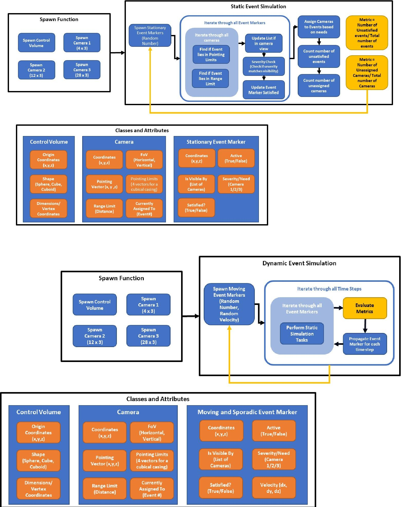

Fig. 13: Simulation setup: Static Events around the platform (Top); Dynamic Events around the platform (Bottom)

<!-- PDF_PAGE: 14 -->

The first set of simulations with static events in terms of velocity and luminance shows the presence of blind spots in procedurally generated camera configurations. The cameras were generated in a circular pattern, as shown in Fig. 14 (Top), with the FoV of the telephoto, medium range, and wide-angle camera suites shown in Fig. 14 (Bottom). There is a significant overlap between the FoV of the wide-angle cameras and the medium-range cameras, which covers the need for redundancy in coverage. The number and placement of the telephoto cameras, along with a suitable set of intrinsic parameters from Fig 14, will need to be varied with the gimbaling capabilities of the Payload Interface to arrive at the optimum number of telephoto cameras needed for full coverage.

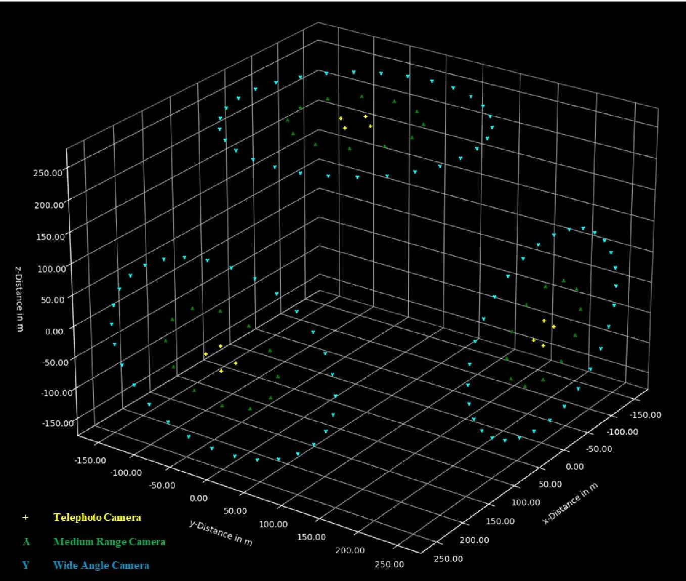

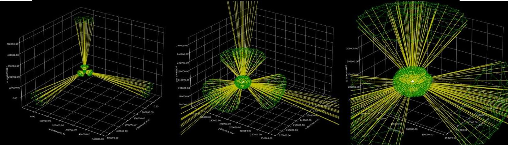

Fig. 14 Camera Placement in the simulation space (Top); Camera FoV and Coverage during nominal operations (Bottom)

<!-- PDF_PAGE: 15 -->

The establishment of a robotic space station in cislunar space emerges as a crucial imperative for advancing Space Domain Awareness (SDA) in this intricate and dynamic region of space. Cislunar space, the vast expanse between Earth and the Moon, poses unique challenges and opportunities, necessitating a dedicated platform equipped with state-of-the-art sensors and monitoring instruments.

At the heart of this initiative is the concept of a robotic observation platform strategically positioned in cislunar space. This platform serves as a central hub for SDA activities, playing a pivotal role in transforming our approach to understanding and managing the complexities of cislunar space. The deployment of advanced sensors on this robotic station ensures real-time data collection, offering a comprehensive view of the environment, including space debris potential collisions, and various celestial phenomena.

One of the key strengths of a robotic space station is its versatility. With the capability to dock and deploy satellites, the platform becomes a dynamic observatory capable of continuously monitoring the ever-evolving celestial landscape. This adaptability is crucial for addressing the challenges posed by the increasing congestion in cislunar space. The ability to deploy and reposition satellites allows for a more agile response to emerging threats and opportunities, ensuring a proactive stance in maintaining the integrity of space assets.

Moreover, the collaborative nature of this robotic platform fosters international cooperation in enhancing SDA capabilities. In an era where space activities are becoming increasingly globalized, the shared resources and data generated by such a station create a foundation for collaborative efforts in space situational awareness. By pooling expertise and resources, nations can collectively contribute to a safer and more sustainable environment for future space endeavors.

Table 2. Preliminary Comparison Table for SDA Mission Architectures

<table border="1"><tr><td>Parameters</td><td>Monolithic Spacecraft</td><td>Surface Telescopes</td><td>Smallsat Constellations</td><td>Observation Platforms</td></tr><tr><td>Separate comms link required for each member</td><td>√</td><td>√</td><td>√</td><td></td></tr><tr><td>Dedicated Launches Required</td><td>√</td><td>√</td><td></td><td></td></tr><tr><td>High Upkeep Energy</td><td></td><td></td><td>√</td><td></td></tr><tr><td>Ease of serviceability</td><td></td><td></td><td>√</td><td>√</td></tr><tr><td>Continuous Observation</td><td>√</td><td></td><td>√</td><td>√</td></tr><tr><td>Extensibility</td><td></td><td></td><td>√</td><td>√</td></tr><tr><td>Single Point Failures</td><td>√</td><td>√</td><td></td><td></td></tr><tr><td>Ease of Fabrication of Units</td><td></td><td></td><td>√</td><td>√</td></tr><tr><td>Speed of Fabrication of Units</td><td></td><td></td><td>√</td><td>√</td></tr><tr><td>Low Unit Cost</td><td></td><td></td><td>√</td><td>√</td></tr></table>

The modular design of the robotic space station adds another layer of significance. The station's modular components enable expansion and upgrades, ensuring that it can evolve alongside the changing demands of cislunar space exploration. This adaptability is crucial for accommodating advancements in sensor technologies, data processing capabilities, and communication systems, thereby future-proofing the platform against obsolescence.

Table 2 shows a preliminary comparison of the four CSDA Mission Architectures discussed in Section 2. Further deeper analysis is required to solidify the clear advantages of the Observation Platforms over the other three in terms of Upkeep Energy, Extensibility, Cost, and Serviceability. This paper describes a simulation of the Observational capabilities of the platform (Fig 15). Further Monte Carlo simulations with the current simulation framework are underway.

<!-- PDF_PAGE: 16 -->

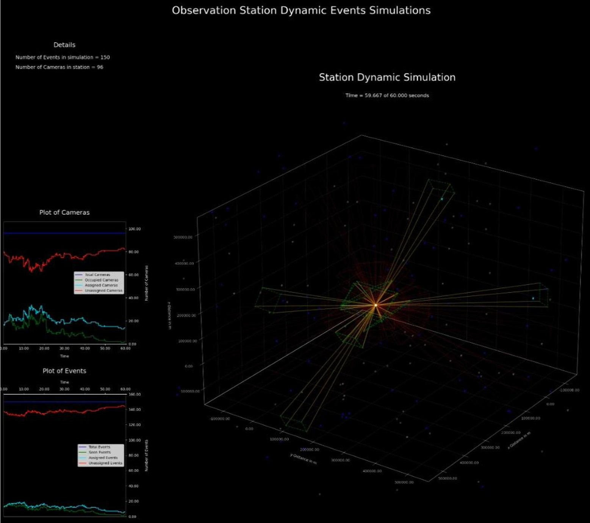

Fig. 15 Robotic Observation Station Simulation Result

Efficient orbital adjustments further enhance the station's capabilities. By optimizing its position in cislunar space, the platform can maximize its coverage and observation capabilities, addressing the inherent limitations of groundbased Space Domain Awareness systems. This orbital flexibility is instrumental in overcoming challenges associated with monitoring objects in higher orbits, such as geostationary orbit and beyond.

In conclusion, the establishment of a robotic space station in cislunar space represents a milestone in advancing Space Domain Awareness. Its role as a central hub for real-time data collection, international collaboration, adaptability, modular expansion, and orbital efficiency positions it as an indispensable tool for comprehensively understanding and managing the increasingly crowded and dynamic cislunar space environment. This initiative not only enhances our ability to navigate the challenges of the present but also lays the groundwork for a sustainable and cooperative future in space exploration.

## VIII. Acknowledgements

This research was funded in part by the National Aeronautics and Space Administration, grant number 80NSSC19M0197.

<!-- PDF_PAGE: 17 -->

[1] SSI: Space Situational Awareness | The Aerospace Corporation. (n.d.). Aerospace Corporation. https://aerospace.org/ssi-space-situational-awareness

[2] ARES | Orbital Debris Program Office | Photo Gallery. (n.d.). https://orbitaldebris.jsc.nasa.gov/photo-gallery/

[3] Kornuta, D., Abbud-Madrid, A., Atkinson, J. F., Barr, J., Barnhard, G. P., Bienhoff, D., Blair, B. R., Clark, V., Cyrus, J., DeWitt, B., Dreyer, C. B., Finger, B. W., Goff, J., Ho, K., Kelsey, L., Keravala, J., Kutter, B., Metzger, P. T., Montgomery, L., . . . Zhu, G. (2019). Commercial lunar propellant architecture: A collaborative study of lunar propellant production. REACH, 13, 100026. https://doi.org/10.1016/j.reach.2019.100026

[4] Thangavelautham, J. (2020). Autonomous robot swarms for Off-World construction and resource mining. AIAA Scitech 2020 Forum. https://doi.org/10.2514/6.2020-0795

[5] Tran F, Nahal S, Ma B, Epstein RJ, Heelan B. Thematic Investing: To Infinity And Beyond - Global Space Primer, Bank of America Merryl Lynch Transforming World Thematic Research; 30 October 2017.

[6] Star, E. B. S. T. a. D. (2010, November 14). Catalina Sky Survey keeps eye out for wayward asteroids. Arizona Daily Star. https://tucson.com/special-section/catalina-sky-survey-keeps-eye-out-for-waywardasteroids/article a6514240-5806-5450-a471-08ea3d8ccd6e.html

[7] Betz, E. (2020, June 4). The history and future of telescopes on the moon. Discover Magazine. https://www.discovermagazine.com/the-sciences/the-history-and-future-of-telescopes-on-the-moon

[8] Mann, A. (2013, July 18). The private plan to put a telescope on the moon. WIRED. https://www.wired.com/2013/07/moon-ex-iloa-telescope/

[9] Tabor, A. (2023, July 27). What is LCROSS, the Lunar Crater Observation and Sensing Satellite? - NASA. NASA. https://www.nasa.gov/general/what-is-lcross-the-lunar-crater-observation-and-sensing-satellite/

[10] Lunar Reconnaissance Orbiter. (n.d.). Lunar Reconnaissance Orbiter. https://lunar.gsfc.nasa.gov/spacecraftillustrations.html

[11] Rashed, M. I., & Bang, H. (2022). A study of autonomous small satellite constellations for disaster management and deep space strategy. Remote Sensing, 14(23), 6148. https://doi.org/10.3390/rs14236148

[12] Rashed, M. I., & Bang, H. (2022). Design and optimization of an autonomous constellation of small-satellites for LEO and beyond. 36th Annual Small Satellite Conference. https://digitalcommons.usu.edu/cgi/viewcontent.cgi?article=5476&context=smallsat

[13] Lopez, F., Di Mauro, A., Mauro, S., Monteleone, G., Sfasciamuro, D. E., & Villa, A. (2023). A Lunar-Orbiting satellite constellation for wireless energy supply. Aerospace, 10(11), 919. https://doi.org/10.3390/aerospace10110919

[14] Space Surveillance and Tracking - SST segment. (n.d.)

https://www.esa.int/Space_Safety/Space_Surveillance_and_Tracking - SST_Segment

[15] Optical payload for space situational awareness in geosynchronous orbit - MIT Technology Roadmapping. (n.d.). https://roadmaps.mit.edu/index.php/Optical_Payload_for_Space_Situational_Awareness_in_Geosynchronous_O orbit

[16] The port | Arkisys. (n.d.). Arkisys. https://www.arkisys.com/the-port

[17] Hu, G., Li, Y., Li, X., Zhang, G., Zhang, Z., Wang, X., & Man, W. (2023). Modular self-reconfigurable spacecraft: Development status, key technologies, and application prospect. Acta Astronautica, 207, 240-256. https://doi.org/10.1016/j.actaastro.2023.03.012

[18] Mosar. (n.d.). https://www.h2020-mosar.eu/

[19] Edwards, D. (2020, January 31). How robotics can be extremely beneficial to warehouse business. Robotics & Automation News. https://roboticsandautomationnews.com/2020/01/31/how-robotics-can-be-extremely-beneficial-to-warehouse-business/29344/