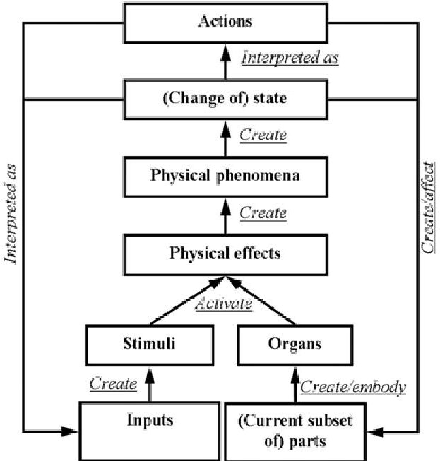
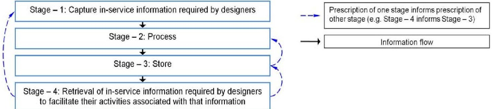
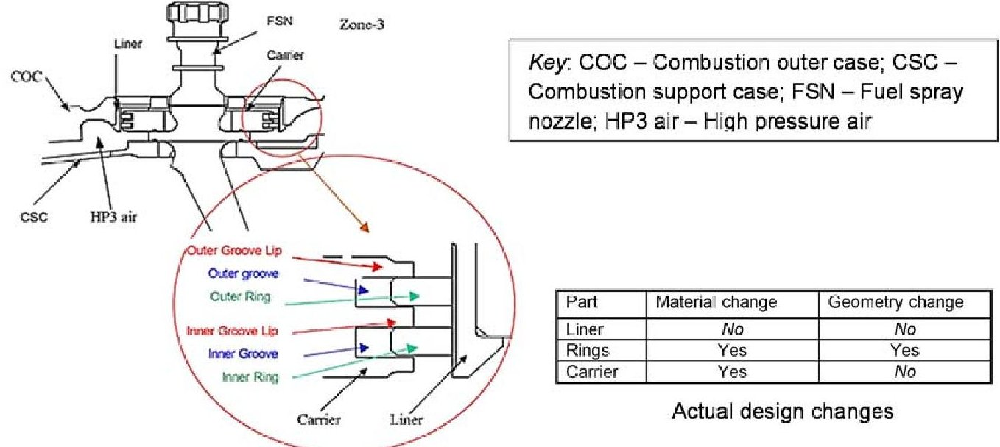
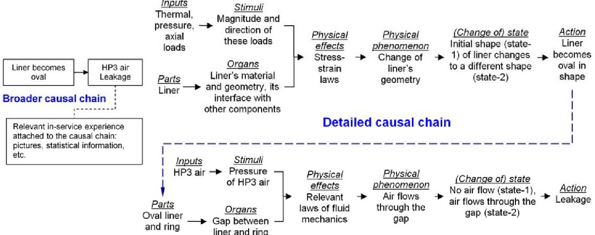
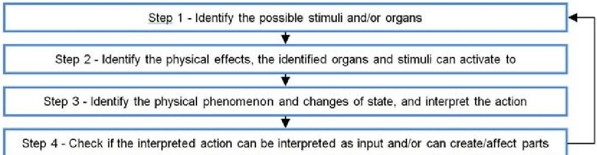
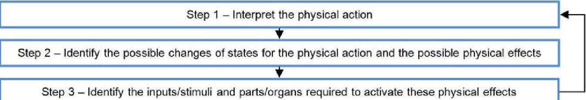

<!-- PDF_PAGE: 1 -->

# A CONCEPTUAL FRAMEWORK TO SUPPORT ENGINEERING DESIGNERS IN USING IN-SERVICE INFORMATION

S. Jagtap, A. Johnson and A. Larsson

Keywords: in-service information, engineering design, aerospace engineering, knowledge management, causality

## 1. Introduction

Research in engineering design is motivated by the challenges that current manufacturing organizations are facing, and these challenges often emerge from the development of a global market economy and increasing competition. Recently, a shift in business models from the selling of products to the provision of services is becoming noticeable [Mont et al. 2006]. In the case of mature products, this shift is driven by increasing competition and the need to establish long-term relations with customers. Such shifts in business models influence the design of products. Since design is an information-intensive activity, this has a subsequent impact on the types of information accessed and used by designers. In the field of engineering design research, several studies focusing on the engineering information issues (e.g. designers' information-seeking practices) have been undertaken in industrial environment [Court 1995], [Marsh 1997], [del Rey Chamorro 2004], [Aurisicchio 2005]. However, these studies do not focus on a specific type of information, for example, in-service information. Furthermore, the reviewed literature does not include studies on how to support designers in using in-service information in a design task. In-service information is the information on product and support services such as repair, overhaul, etc., which is generated after the product's entry into service.

In the global market of air transport, the integration of products and services is now seen as being necessary for the long-term success of engine manufacturers. In our previous research, we carried out descriptive studies in an aerospace company from the UK. This company is involved in the design, manufacture, and provision of service support for aero engines. The company now offers contracts, under which it remains responsible for the maintenance of engines. Different services such as repair and overhaul, technical publications, inventory management, predictive support through engine health monitoring, etc. have been designed and adapted for those contracts. These services transfer the technical and financial burden of engine maintenance and management onto the company. This affects the design of new and existing engines, which now need to have low and predictable maintenance costs, in addition to the previous requirements of reliability and low specific fuel consumption. By incorporating in-service experience from existing engines in the (re)design of components and systems in an existing or a new engine, it is hoped to tackle some of the current in-service problems through better design.

A flow of in-service information to designers is thus crucial for minimising in-service issues, and in reducing the cost of both planned and unplanned maintenance. A literature review showed that there are no studies that have proposed or developed methods or tools to support designers in using in-service information in a design task. It is therefore important to propose or develop such methods or tools. In order to develop a method or tool which can enable designers to retrieve the in-service

<!-- PDF_PAGE: 2 -->

experience of existing engines in an effective and efficient way, it is necessary to understand: (1) the present flow of in-service information to designers, (2) their requirements regarding this information, and (3) how they use this information in a design task. Our previous work has identified how the in-service experience of existing engines informs design of new engines, how in-service information flows to designers, and designers' requirements regarding this information [Jagtap et al. 2007a], [Jagtap and Johnson 2011]. In addition, we identified how designers use the in-service information (e.g. designers' activities regarding in-service information) in the design of components and systems of an existing and a new engine [Jagtap and Johnson 2010], [Jagtap 2008]. The work presented in this paper aims at proposing a framework to support designers in using in-service information in a design task. This framework is based on the findings of our previous research, and these findings are explained further in Section 3.

## 2. Background literature

## 2.1 In-service information and product design

The reviewed literature confirms the importance of in-service experience, in improving the design of the next generation of products. Collection and storage of in-service information are important in the design of functional (i.e. total care) products [Alonso-Rasgado et al. 2004]. The authors define total care products as "integrated systems comprising hardware and support services". A clear understanding of the causes behind the failures of existing products is important in the design of the next generation of products. Petkova [2003] describes the consumer electronics products' field feedback that companies require to make decisions regarding product quality.

Harrison [2006] has discussed the elements of the process, describing problems and successes in the deployment of 'Design for Service' for the Trent 1000 aero engine, used in the Boeing 787 aircraft. He has listed some of the significant operator cost drivers such as: range and payload, safety, schedule reliability, life cycle fuel burn and engine overhaul. The in-service information is useful in understanding the following issues, which can address all of the above drivers positively: understanding the engine's deterioration mechanisms; controlling their rate of occurrence and impact; and ensuring effective and low-cost restoration of capability at overhaul.

A recent study carried out by [Vianello and Ahmed 2009] identified that the engineering designers require in-service information at a component level to improve next generation of products through design. Their study is based on the interviews with engineering designers and service engineers from oil industry. The designers from oil industry were interested in in-service information in a structured form so that it can be used in their different activities during a design process. Lannoy and Procaccia [1996] state that, for creating a database from operation feedback, it is necessary to identify the needs of its potential users. Data regarding reliability, maintenance, operations, service, market, management focus, etc. help to improve the product. The data has to be stored in systems that make it easy to retrieve, analyze, and draw conclusions from [Markeset and Kumar 2003]. Some of the requirements for the design of such information management systems are to identify the users and their requirements. Although the aforementioned literature suggests the importance and usefulness of in-service information in the design of products, it does not include any studies focusing on how to support designers in using in-service information.

## 2.2 Functionality, causality, and side effects in a technical system

We present a brief review of literature on the theory of technical systems because we have used a model of causality (i.e., the Sym-SAPPhIRE model) found in this literature for proposing the conceptual framework to support designers in using in-service information in a design task.

A given function of a technical system is achieved by a physical process, which is realised by physical effects and the geometric and material characteristics of the system [Pahl and Beitz 1996]. Pahl and Beitz [1996] define side effect as a "functionally undesired and unintended effect of a technical system on a human or on the environment". Chakrabarti et al. [1999] discuss the problem of identifying side effects in conceptual solutions. They define side effects as "effects whose outputs affect the intended operations of a system". In order to activate physical effects, the right 'inputs' and right 'contextual

<!-- PDF_PAGE: 3 -->

parameters' are necessary. The authors have provided an example - "activation of a piezoelectric effect requires stressing (input) of certain crystals (context)". Side-effects can be identified by noticing the inputs and contexts that are available in the situation in which a system works. From these inputs and contexts the possible physical effects that might get activated can be identified.

There are multiple meanings and representations of function, form, design problems and solutions [Chakrabarti 1993]. Chandrasekaran and Josephson [1997] state, "there is also quite a bit of confusion between function and behavior in the literature". The SAPPhIRE (State-Action-Parts-physical Phenomenon-Inputs-oRgan-physical Effect) model provides a rich causal explanation of a physical phenomenon and attempts "to reach a non-arbitrary degree of detail of behavioural explanation" [Chakrabarti et al. 2005]. The SAPPhIRE model defines the relationships between the following seven constructs: parts - "a set of physical components and interfaces constituting the system and its environment of interaction"; state - "the attributes and values of attributes that define the properties of a given system at a given instant of time during its operation"; organ - "the structural context necessary for a physical effect to be activated"; physical effect - "the laws of nature governing change"; input - "the energy, information or material requirements for a physical effect to be activated; interpretation of energy / material parameters of a change of state in the context of an organ"; physical phenomenon - "a set of potential changes associated with a given physical effect for a given organ and inputs"; and action - "an abstract description or high level interpretation of a change of state, a changed state, or creation of an input".

Jagtap [2008] modified Chakrabarti et al.'s [2005] SAPPhIRE model by proposing an additional construct 'stimuli' and two additional relationships 'embody' and 'affect' (see Figure 1). The developed model is called the 'Sym-SAPPhIRE' model of causality (see Figure 1), since it completes the symmetry of the original SAPPhIRE model. They defined the construct 'stimuli' as follows: "input context necessary for a physical effect to be activated in the presence of the relevant organs". Different aspects of an input (e.g. measure of input's attribute) and/or relationships between inputs create 'stimuli'.

Figure 1. 'Sym-SAPPhIRE' model of causality [Jagtap 2008]

The Sym-SAPPhIRE model is useful in tackling the confusion created by the multiple meanings and representations of the various concepts such as function, behaviour, structure, etc. We believe that this model has integrated the concepts 'function', 'behaviour', and 'structure'. The constructs parts and organs explain the structure of a device, and the construct regarding the changes in states describes the behaviour of a device. Regarding the function of a device, Chakrabarti et al. [2005] state, "In our view, function is seen as specific, limited, intended aspects of the rich causal behaviour of artifacts embedded in and in conjunction with the environment in which it operates, and could be seen as: State change; Attained, final state; Inputs; I/O transformation; Creation of the context for physical effects to appear, i.e., organs, etc".

<!-- PDF_PAGE: 4 -->

Furthermore, the Sym-SAPPhIRE model can express physical actions such as corrosion and wear, that result from the operation of products in service, and which are subsequently seen in the in-service information. Our conceptual framework, proposed in this paper, is built on the Sym-SAPPhIRE model of causality.

## 3. The basis for the proposed framework

As mentioned in Section 1, our conceptual framework to support designers in using in-service information is based on the findings of our previous research. In that research, we used different methods such as interviews, questionnaires, and case studies. In those case studies, we carried out an in-depth analysis of design definition reports which document different type of information accessed and used by designers throughout the design process involving the phases, namely, task clarification, concept generation, embodiment design, and detail design [Jagtap and Johnson 2010]. These phases are suggested by Pahl and Beitz [1996]. Some of the findings of our previous research are as follows. The in-service information required by designers (i.e. the in-service information which they currently use in design tasks, and that which they would like to obtain) mainly consists of deterioration information (deterioration causes, deterioration effects, deterioration mechanisms, etc.). They access this in-service information primarily during the task clarification phase of the design process. The activities associated with this information are analysis of the problem and formulation of requirements. In addition, designers use this information to generate solutions. For example, designers use causal chains (e.g. chains of deterioration causes, deterioration mechanisms) in the in-service information to generate different solutions. These solutions are evaluated by identifying or speculating on negative side effects (e.g. deterioration mechanisms) or positive side effects (e.g. improvement in the life of a component). The designers of components or systems in either an existing or new engine use in-service information from components similar to the one being designed. In addition, these designers require design information (e.g. previous design modifications, the rationale behind these modifications, etc.), and other types of information (e.g. testing and analysis findings), along with the in-service information.

Figure 2. Different stages to provide in-service information required by designers

By considering the best method of presenting relevant in-service information to facilitate designers in their activities (e.g. task clarification, solution generation, searching for similar components, etc.), we can establish: (1) what in-service information needs to be captured; and (2) how this in-service information might be stored. The captured in-service information needs to be stored in such a way that the designers' requirements can be easily satisfied. This is illustrated in Figure 2. Note that stage 4 in this figure is the most important stage for designers. The prescription of this stage informs prescription of other stages. A framework using the Sym-SAPPhIRE model of causality is proposed, to present in-service information to designers.

## 4. Supporting designers in using in-service information

The in-service information required by the designers of components or systems of an existing or new engine mainly consists of deterioration information (e.g. deterioration mechanisms, deterioration causes, deterioration effects, etc.). Storing and presenting this deterioration information in the form of causal chains using the Sym-SAPPhIRE model of causality can help designers in their subsequent use of this information, during the following activities: (1) task clarification and solution generation; (2)

<!-- PDF_PAGE: 5 -->

searching for similar components; (3) identifying potential deteriorations; and (4) linking design rationale to in-service experience. The usefulness of the Sym-SAPPhIRE model of causality in these activities is described below.

## 4.1 Task clarification and solution generation

The reviewed literature [Kokotovich 2008], [Salustri et al. 2007], [Hoffman et al. 2002], [Aurisicchio et al. 2007] suggests that the diagrammatic representation of information during the early phases of the design process has the following advantages: it helps designers to comprehend design problems; it improves the effectiveness and efficiency of early engineering design, and facilitates human cognitive processes fostering innovation; and information can be analysed at a faster rate than in a text format; This suggests that the diagrammatic representation of in-service information and in particular deterioration information (e.g. deterioration causes, deterioration mechanisms, deterioration effects, etc.) is useful for improved comprehension and effective use of in-service information in a design task. In addition, this diagrammatic representation can allow designers to understand which parts of the causal chains of deterioration information are (or are not) used for generating solutions, and this can help them in generating useful solutions. The Sym-SAPPhIRE model of causality is useful in presenting the deterioration information in a diagrammatic format. Computer programs (e.g. DRed developed by Bracewell and Wallace [2003] can be used to create such diagrams. It would be useful to present the relevant in-service information to the designers in the form of rich and detailed causal chains of physical actions seen in deterioration information, and broader causal chains as well. These broader causal chains can allow the designers to gain a more holistic view.

We have used the in-service information on the burner seal of an aero engine to illustrate the diagrammatic representation of this information using the Sym-SAPPhIRE model of causality. The burner seal has three main parts, namely, a liner, a pair of rings, and a carrier (see Figure 3). All three parts experience slight wear in service. In addition, the following issues have been noted. Due to thermal effects, the shape of liner changes when the engine is at cruise. Although this shape change is very small, it increases the air leakage. Finally, the rings experience a deterioration mechanism, namely corrosion. In order to tackle these issues, this burner seal was redesigned. Figure 3 also shows the actual design changes to the three parts of the burner seal. The liner was not changed.

Figure 3. Illustration of the burner seal and actual design changes

In the case of the burner seal, Figure 4 illustrates the diagrammatic representation of in-service information using the Sym-SAPPhIRE model of causality. This figure also illustrates broader and detailed causal chains. The relevant in-service experience (e.g. pictures of failed components, statistical information) can be attached to these causal chains (see Figure 4). In this example, designers have proposed a solution, which targets the 'organs' in the lower part of the detailed causal chain shown. However, they have not proposed a solution which targets parts/organs or inputs/stimuli in the

<!-- PDF_PAGE: 6 -->

upper part of this detailed causal chain. This is evident from the diagrammatic representation of the deterioration information. This would be less evident if the information was presented in a text format as the causal chains are not explicit in such a format.

Our previous research shows that the designers involved in the redesign of components or systems have not used 41% of the total number of causal chains seen in the in-service information to generate solutions [Jagtap and Johnson 2010]. If the designers had been presented with the deterioration information as shown in Figure 4, they might have noticed which parts of the causal chains are (not) used to propose a solution, and they might then have proposed additional solutions. A greater number of alternative solutions helps to produce a higher quality design [Fricke 1996], [Dylla 1999]. This suggests that the diagrammatic representation of deterioration information may help to produce higher quality design by generating additional solutions. This explains the advantages of the diagrammatic representation of in-service information in the form of causal chains of deterioration information by using the Sym-SAPPhIRE model of causality.

Figure 4. Illustration of diagrammatic representation of in-service information

## 4.2 Searching for similar components

In-service information from components similar to the one being designed can help designers to understand different issues relevant to their design task. Analogical thinking can assist in identifying the similar components. Ball et al. [2004] state "Analogical reasoning entails the use of 'source' information from a previous problem-solving episode as a means to facilitate attempts at solving a current, 'target' problem." Holyoak and Thagard [1995] explain that "...analogical thinking involves establishing a mapping, or systematic set of correspondences, between the elements of the source and the target analog".

The designers of components or systems of an existing engine typically use the type of component as the only criterion in searching for similar components [Jagtap 2008]. They tend not to use any other criteria to search for components that are similar in some characteristics to the one being designed. For example, in the abovementioned system burner seal (see Section 4.1), for which it was identified that improvements could be made to reduce 'air leakage', the designers did not appear to have searched for other components or systems that faced the issue of 'leakage'. The in-service information from such components or systems might have helped those designers to understand the possible causes behind the problem of 'leakage'. Furthermore, the information on design changes (if any) to tackle the problem of 'leakage' on those similar components or systems might have helped the designers, involved in the redesign of the burner seal, to generate solutions to the problem of burner seal's leakage. Therefore, there is a need to support designers in searching for similar components or systems.

The type of component (the construct 'part' of the Sym-SAPPhIRE model of causality) and features can be used as a criterion when searching for similar components, and designers can consecutively

<!-- PDF_PAGE: 7 -->

access in-service information on these components. In addition, a designer can use the SymSAPPhIRE model's constructs, namely 'inputs', 'stimuli', 'actions', etc. to search for similar components or systems. Designers can use a single construct or a combination of constructs (e.g. stimuli plus organs) to search for similar components. For example, in the redesign of the burner seal, designers might search for similar components by using the following criteria: material of ring (simple search); material of ring plus action 'leakage' (combination search). Computers can assist in searching for similar components when designers supply the search criteria.

It can also be useful if designers search for similar components when they propose a design change. For example, when a designer proposes a change in a feature on a component, he can search for similar components using the changed feature as a criterion, and subsequently access the in-service information on those similar components. This will inform the designer about the in-service experience of existing components having the 'changed' feature, and may thus lead to a better decision regarding the component which is being re-designed. For example, when designers propose Jethete as a material for the rings of the burner seal, they can search for components made up of Jethete, and can subsequently access in-service information from those components. This would help them to understand the performance of the material Jethete in service.

## 4.3 Identifying potential deteriorations

Designers evaluate a solution by identifying or speculating on physical actions (positive or negative side effect) in that solution. They therefore need to be supported in identifying emerging physical actions and in particular potential deteriorations (i.e. negative side effects) when they propose a solution. The Sym-SAPPhIRE model of causality can help designers in identifying potential deteriorations in the early phases of design process. In addition, the Sym-SAPPhIRE model is useful in capturing designers' decisions as the use of this model helps them to follow explicit and systematic steps to identify potential deteriorations. When designers propose a solution, they can identify a potential deterioration by following the steps shown in Figure 5. The first step is identifying the possible stimuli and/or organs resulting from a proposed solution. Next, in the second step, they can identify the activated physical effects. A database of physical effects would be useful in this step. In the third step, they can interpret the action, and in the fourth step they can check if that action can be interpreted as input and/or create/affect parts. If required, they can follow the steps iteratively as shown by the arrow from step four to step one. An identified physical action which might interfere with functionality of the system can be considered as a potential deterioration. Computers can be useful in identifying the physical effects (step 2) and thereby the possible change of state (part of step 3). In order to achieve steps two and three by using computers, a database of physical effects (and the possible stimuli and organs necessary to activate these physical effects) is required. Inputs (i.e. stimuli and organs) can be given by the designers and computers can generate the output (i.e. possible change of state) by identifying the physical effects and thereby the physical phenomena. Designers can then interpret the change of state as an action. Thus the Sym- SAPPhIRE model of causality can help designers in better evaluation of solutions as they can identify the pros (i.e. positive physical actions) and cons (i.e. negative physical actions) in those solutions.

Figure 5. Process to identify the potential deteriorations

The in-service information, if any, regarding the potential deteriorations identified through the process outlined in Figure 5, can be useful to validate the potential deteriorations identified through that process. In-service information stored as causal chains in the Sym-SAPPhIRE model of causality can

<!-- PDF_PAGE: 8 -->

be searched for unintended physical actions (i.e. deteriorations). The stimuli and organs of component or system being designed can be used as criteria to search the available in-service information for unintended actions. The results of this search can be compared with the results of the process of identification of potential deteriorations shown in Figure 5. This comparison of the results can help to validate the potential deteriorations identified through the process described in Figure 5. This is exemplified as follows. Consider a system consisting of sliding pair of two components A and B. By using the organs (e.g. materials of these two components, sliding pair between them) and stimuli (e.g. forces acting on those two components) of this system, designers can identify or speculate on physical actions in that system in the following two ways: (1) using the process shown in Figure 5; and (2) searching the available in-service information by using the organs and stimuli of that system. Suppose the identified physical action by using the first way is the wear of the component A. Increased confidence can be gained in this physical action if the same physical action (i.e. wear of component A) is seen in the search-results of the second way.

In the aerospace company, where we carried out our previous descriptive research, the technical services and operations (TS & O) team collects and provides in-service information to the designers. In addition, this team performs the root cause analysis to identify causes behind deteriorations of components and systems. The Sym-SAPPhIRE model of causality is also useful to the members of the TS & O team to identify causes behind deterioration. Figure 6 shows the procedure for identifying causes behind deteriorations. The Sym-SAPPhIRE model is useful in identifying the possible inputs/stimuli and parts/organs that are responsible for a deterioration, which is a physical action. For the identified inputs and parts, if required, one can identify the possible physical actions that could be interpreted as those inputs or created those parts. This is shown by the arrow from Step 3 to Step 1 in Figure 6. A database of physical effects can help in the process of identification of causes behind deterioration.

Figure 6. Identifying causes behind deterioration

Consider for example the identification of causes behind damage to the surface of a component. Suppose that the laboratory findings identify this damage as a physical action 'corrosion'. In order to identify the causes behind this physical action 'corrosion', it is necessary to identify the possible physical effects which can lead to this physical action. This is followed by the identification of the possible inputs/stimuli and parts/organs for those physical effects, and checking if these identified inputs/stimuli and parts/organs are applicable in the context under examination (e.g. exposure of a component to humid air).

The Sym-SAPPhIRE model of causality offers a logical procedure for identifying the causes behind deterioration, and thereby helps to capture the rationale of the process of identification of causes behind deterioration. The causes behind deterioration and the rationale of the process to identify these causes can be represented diagrammatically. Computer programs (e.g. DRed developed by [Bracewell and Wallace 2003] can be used by the members of the TS & O team to create diagrams of the causes behind deterioration and to capture the rationale of the process to identify these causes. This captured rationale would be useful to the designers of components or systems of an existing and a new engine to identify potential deteriorations in their design. Furthermore, this captured rationale can be useful to the members of the TS & O team in future similar tasks of identifying causes behind deterioration.

## 4.4 Linking design rationale and in-service information

The designers of components and systems of an existing and a new engine use other types of information (e.g. design information, testing and analysis findings, etc.) and in particular design

<!-- PDF_PAGE: 9 -->

rationale. The design rationale includes the reasons behind various decisions made by the designers of an existing component, different alternatives considered, etc. Relating the design rationale of a component with its in-service experience can help subsequent designers to understand the decisions responsible for the existing component's (un)successful experience in service. If the in-service experience of the existing component is successful, then the designers can adapt or adopt the decisions made by that component's designers.

The Sym-SAPPhIRE model of causality is useful in linking the design rationale and the in-service experience of an existing component. This is explained as follows. In terms of the constructs of the Sym-SAPPhIRE model of causality, a designer of a component specifies 'stimuli' and 'organs'. In the process of this specification, he considers different issues, solutions to address these issues, and pro and con arguments for these solutions. Thus, he makes many decisions to specify 'stimuli' and 'organs' in the design of a component or system. These specified stimuli and organs predict the functionality and (un)successful in-service experience of the component or system. A designer can ask the following questions in linking the design rationale and the in-service experience of an existing component or system: (1) What are the stimuli and/or organs responsible for the unintended physical actions, if any, seen in the in-service experience of the existing component or system? (2) What were the different issues, solutions, and arguments considered by the original designers of the component or system in specifying these stimuli and/or organs?

Answers to these questions can help a designer to adopt, adapt or reject the decisions made by the original designers of the component. Thus, the Sym-SAPPhIRE model can help designers to ask the questions necessary to link the in-service experience and the design rationale of an existing component or system.

This is exemplified as follows. The rings of the burner seal corrode in the presence of high temperature air. The 'organs' in the causal chain leading to this action corrosion consists of the material of the rings and the exposure of the rings to high temperature air. In this case, the designers can refer to the design rationale behind the selection of that particular material. This design rationale can provide information such as: different issues such as temperature, manufacturing cost, material cost, etc. (not) considered; alternatives generated (e.g. different materials considered); and evaluation of these alternatives (e.g. pro and con arguments for the different alternatives). This information can help the designer to make appropriate decisions in redesigning the ring, so that it will not corrode in service.

The above discussion shows that the Sym-SAPPhIRE model of causality helps designers to use inservice information in a design task, and also helps the TS & O team to provide this information to designers. The functions of designers and members of the TS & O team are different, and the use of the Sym-SAPPhIRE model of causality will help to build a commonly-shared understanding between them, and thereby a better communication between them. This improved communication can help designers to better understand and use the in-service information in their design task. The use of inservice information in the design of components or systems of existing and new engines helps to avoid the deteriorations experienced by the components or systems of existing engines, and thereby leads to improved design of existing or new engines.

## 5. Conclusions

The use of the Sym-SAPPhIRE model of causality to store and present the in-service information and in particular deterioration information is discussed. This model can help designers in their activities (e.g. analysing the problem, generating solutions, etc.) associated with in-service information. The Sym-SAPPhIRE model of causality is useful in presenting deterioration information in a diagrammatic format, and this should lead to improved comprehension and effective use of in-service information in a design task. A designer can use the Sym-SAPPhIRE model's constructs to search for components similar to the one being designed, and can subsequently access in-service information on these similar components. He can use a single construct or a combination of constructs to search for such components. The potential usefulness of the Sym-SAPPhIRE model of causality in identifying possible deterioration mechanisms in the early phases of the design process has also been discussed. Furthermore, use of this model in linking the in-service experience of existing components or systems

<!-- PDF_PAGE: 10 -->

and the design rationale of these components or systems is explained. This model is useful to the members of the TS & O team in identifying causes behind deterioration, and in capturing the rationale of this identification process. Finally, the Sym-SAPPhIRE model of causality of causality can help to build a commonly-shared understanding between designers and the members of the TS & O team, and this subsequently can lead to better communication between them.

Future work consists of evaluating this framework in a pilot study by carrying out experimental studies with professional engineering designers. Using the results of this evaluation, our framework can be modified (if required) for implementing it in a computer-based application before conducting a further large-scale evaluation.

## Acknowledgments

The authors acknowledge the support of Rolls-Royce plc through the UTP for Design.

## References

Alonso-Rasgado, T., G. Thompson, et al. (2004). "The Design of Functional (Total Care) Products." Journal of Engineering Design 15(4): 515-540.

Aurisicchio, M. (2005). Characterising Information Acquisition in Engineering Design, University of Cambridge, U.K.

Bracewell, R. H. and K. M. Wallace (2003). A Tool for Capturing Design Rationale. International Conference on Engineering Design, ICED 03, Stockholm.

Chakrabarti, A. (1993). Towards A Theory for Functional Reasoning in Design. International Conference on Engineering Design, ICED'93. The Hague.

Chakrabarti, A. and A. Johnson (1999). Detecting Side Effects in Solution Principles. International Conference on Engineering Design, ICED'99. Munich.

Chakrabarti, A., P. Sarkar, et al. (2005). "A Functional Representation for Aiding Biomimetic and Artificial Inspiration of New Ideas." Artificial Intelligence in Engineering Design and Manufacturing, AI EDAM 19(2): 113-132.

Chandrasekaran, B. and J. R. Josephson (1997). Representing Function as Effect. Proceedings of Functional Modeling Workshop. Electricite de France, Paris, France.

Court, A. (1995). The Modeling and Classification of Information for Engineering Designers, University of Bath.

del-Rey-Chamorro, F. (2004). Understanding the process of retrieving information in aerospace design. Department of Engineering. Cambridge, University of Cambridge.

Dylla, N. (1991). Thinking methods and procedures in mechanical design, Mechanical design, technical university of Munich.

Fricke, G. (1999). "Successful Approaches in Dealing with Differently Precise Design Problems." Design Studies 20(5): 417-429.

Harrison, A. (2006). Design for Service - Harmonising product design with a Services Strategy. ASME Turbo Expo 2006: Power for Land, Sea and Air. Barcelona, Spain.

Hubka, V. (1982). Principles of Engineering Design, Butterworth Scientific.

Jagtap, S. and A. Johnson (2010). "Requirements and use of in-service information in an engineering redesign task: Case studies from the aerospace industry." Journal of the American Society for Information Science and Technology 61(12): 2442-2460.

Jagtap, S. and A. Johnson (2011). "In-service information required by engineering designers." Research in Engineering Design 22(4): 207-221.

Jagtap, S. N. (2008). Capture and Structure of In-Service Information for Engineering Designers, University of Cambridge, U.K.

Jagtap, S., A. Johnson, et al. (2007a). In-Service Information Flows to Designers. International Conference on Engineering Design, ICED'07. Paris, France.

Lannoy, A. and H. Procaccia (1996). "The EDF Failure Reporting System Process, Presentation and Prospects." Reliability Engineering and System Safety 51(2): 147-158.

Markeset, T. and U. Kumar (2003). "Integration of RAMS and Risk Analysis in Product Design and Development Work Processes: A Case Study." Journal of Quality in Maintenance Engineering 9(4): 393-410.

Marsh, J. R. (1997). The Capture and Utilisation of Experience in Engineering Design, University of Cambridge, U.K.

<!-- PDF_PAGE: 11 -->

Mont, O., C. Dalhammar, et al. (2006). "A New Business Model for Baby Prams Based on Leasing and Product Remanufacturing." Journal of Cleaner Production 14(17): 1509-1518.

Pahl, G. and W. Beitz (1996). Engineering Design. London, Springer-Verlag.

Petkova, V. T. (2003). An Analysis of Field Feedback in Consumer Electronics Industry, Eindhoven University of Technology.

Santosh Jagtap

Innovation Engineering

Department of Design Sciences

Lund University, Sweden

Email: santosh.jagtap@design.lth.se

<!-- PDF_PAGE: 12 -->

