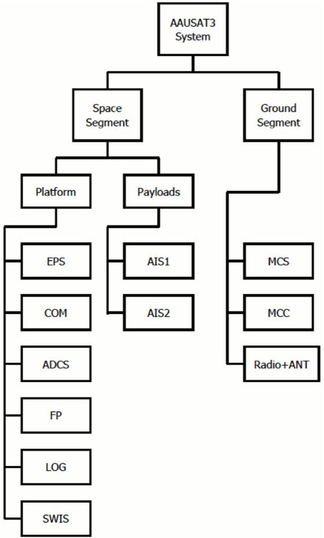
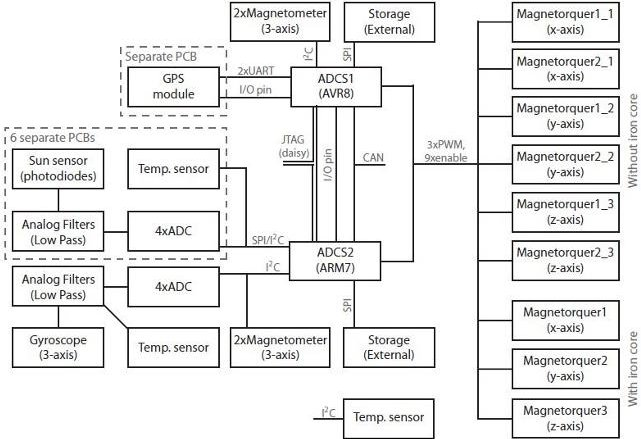

<!-- PDF_PAGE: 1 -->

# A Decentralized Design Philosophy for Satellites

Jens Dalsgaard Nielsen and Jesper A Larsen

Department of Electronic Systems

Aalborg University, 9000 Aalborg, Denmark

Email: {jdn,jal} @es.aau.dk

Abstract-For the last decade development and construction of student cubesat satellites has played an important part in the engineering Master Program within Electrical Engineering and Information Technology at Aalborg University, Denmark. As a result three cubesats AAU CUBESAT, AAUSAT-II and AAUSAT3 has been constructed and launched (AAUSAT3 will launch Q3 2011). This paper focuses on distributed system approach for internal as well as ground link structure.

## I. INTRODUCTION

Traditionally small satellite design is often based on a monolithic concept. All functionality is centralized around one central On-Board Computer (OBC), and all inter communication between different subsystems passes the OBC. The OBC acts has master privileges and slave nodes are often of simple nature.

We of course fully acknowledge, that there has been other ways of designing the interconnectivity, but in general small satellites have been build with a high degree of inter dependability.

In the last decade Aalborg University Student Satlab [1] has designed, constructed and launched two student cubesat satellites and heavily involved in ESA' SSETI EXPRESS - all based on a centralised conceptual design.

AAU CUBESAT - initiated in 2001 and launched June 2003, SSETI EXPRESS was launched October 2005 and AAUSAT-II was launched April 2008 and is (April 2011) alive.

A monolithic style of building satellites has some advantages as well as disadvantages. A central design has often a more optimal utilization of on-board computing power and space. Design is eased in some ways because the satellite is regarded as one entity. For that reason a centralised design principle is often selected when constructing a small satellite from scratch because parallel development is avoided and reuse of components/subsystems is not existing - analogue to sequential versus parallel program code development. A simple mission may benefit on such a centralised design but on the other hand more complex missions may suffer in the same situation.

A major and crucial disadvantage is that the integration phase is normally prolonged, due to the fact that many tests has to be carried out after the satellite has been integrated. Uncovering errors can lead to design changes which as a result may be a redesign. This can roll back satellite design to initial design phases, and if discovered in later phases more radical changes may be the result.

Another major disadvantage is the cumbersome situation where mission goal and therefore design has to be modified e.g extending a monolithic centralised design. In addition there is of course derivative problems like single point of failure, high and varying power consumption - even when idling, lack of short in time high intensive number crunching and so forth.

Finally because each component is tight integrated with the rest of the satellite it rapidly becomes increasingly difficult to reuse subsystems for other satellites. Something that is becoming increasingly important for keeping up a rapid space mission turn around time from initial design to launch along with lowering the overall mission cost.

In contradiction to this a more decentralized design philosophy has been used on our next cubesat - AAUSAT3, which will be launched in Q3 2011 which will be the case study for this paper which will lead to a design methodology for small satellites.

## II. METHOD

As opposed to the just described monolithic design philosophy AAUSAT3 is based on a decentralized and distributed philosophy, where each subsystem is responsible for taking care of all needs internally, e.g. having sufficient processing power and data storage. The following goals was set up prior to project start:

1) Architecture shall be easy extent-able

2) No single computing unit may - if possible - be single point of failure

3) Architecture shall be independent of control unit architectures

4) Communication must be so direct as possible between units/subsystems

5) Physical decomposition must follow functional decomposition

6) (Safety) critical HW interfacing must be physical connected with the relevant controlling unit

7) it must support early sub system testing

Decomposition in subsystem shall follow a number of rules and metrics that shall be taken into consideration

1) Functional decomposition

2) Temporal behaviour (EPS running all time, experiments some of time)

3) Importance for mission succes criteria list items

4) Identification of couplings

5) Identification of HW and primary input/output bindings

<!-- PDF_PAGE: 2 -->

6) Communication metrics (bandwidth, delay, types of services)

## A. A generic platform approach

For most small satellites the space segment will have the following basic subsystems: Electronic Power Supply (EPS), Ground Communication (COM). Depending of the nature of operations the next generic subsystem might be a Flight Planner (FP).

In addition to this comes the more mission specific subsystems.

## B. Infra structure

In a decentralised architecture connectivity becomes very critical - with reliability as the most important. In a small satellite resources are very scars and protocol handling and network must be crafted very carefully. A small satellite may have a power budget less than 1,5W leading to subsystems with controllers running at very low frequencies (1-20 MHz) often with less than 16 kByte main memory so complex computing demanding communication protocols are not an option.

## C. Distributed benefits

It is a common approach to have a flight planner functionality for controlling experiments and payloads. This introduce the flight planner as one of the components that must not fail. This can be achieved in several way but in AAUSAT3 a different approach is the cornerstone in robustness. All sub systems can operate by them self in basic modes. EPS will switch on sub systems in accordance with available power and a predesignated plan of operation and activated sub systems will carry out predefined operations. Results will be available for beacon composition as well from ground segment requested transmission. The COM sub system - which admitted in the AAUSAT3 implementation is a single point of failure due to only one radio - shall act as a transparent routing device. So all sub systems can on own initiative initiate ground communication and can directly receive ground communication. So for operation of a given sub system only EPS and COM is needed. For intensive transport of huge amount of data the control is a ground segment issue and is not directly part of the satellite internals. All in all this approach give the possibility to carry out a functional and time based decomposition and parallel development(design, construction and testing) of the identified distributed components. And all components should be in of shape where reuse is fairly easy.

## D. AAUSAT3 - a distributed architecture

AAUSAT3 has a rather complicated shape. AAUSAT3 is a one unit cubesat with active attitude control (3 axis magnetometer) UHF ground communication with Forward Error Corrective Protocols, advanced on-board SW image server for dynamic update of on board SW, a flight planner and a logging system. In addition to the logging system each autonomous sub system are responsible for storage of own scientific

Fig.1. Subsystem breakdown of the AAUSAT3 satellite

data. The primary payload are two AIS receivers (Automatic Identification System for ships) which primarily shall track ships in the Arctic region. According to IMO(International Maritime Organisation) rules all commercial ships shall carry a beacon system which on 162 MHz and on regular basis broadcast id, position, speed, course etc. AIS are normally received of ships and coastal station within range (less than 60 nautical miles) and are transmitted with 2/12,5 W. Calculations and link budget shows that it is possible with a reasonable margin to receive the AIS signal in space even from a small antenna equipped cubesat. One of the AIS receivers is based on SDR technology and demands high processing capabilities in predesignated periods of time normally less than 5 minutes. A secondary payload is a SW image Server (SWISS) which purpose is to provide smooth on the fly update of SW including fall back strategies. It is not critical for the mission.

## E. Layout of AAUSAT3

Following the previous rule set the following physical sub systems was identified: EPS, COM, ADCS, AIS-1(standard) and AIS-2(SRD based). FP, LOG and SWIS was identified as functional subsystems that could be hosted on several locations. Infra structure was the last component and may be viewed as the ultimate distributed application.

The three subsystems EPS, COM and ADCS are by nature closely coupled with their associated input/output hardware(batteries, solar cells, radio HW and antennas, magnetorquers and sensors. To achieve a high level of integrity each sub system reside on its own PCB so even in critical situations

<!-- PDF_PAGE: 3 -->

they can carry out the designated default operations. Lessons learned from AAUSAT-II indicates that a critical parameter is the thermal properties which has lead to more than 14000 spontaneous reboots of AAUSAT-II with in three year period. For that reason all high power sub systems must be deployed on own independent HW - for AAUSAT3 it is EPS, COM, ADCS and AIS-2.

Opposed to this are the two subsystems FP, LOG and SWIS. These are three subsystems, which you would normally find on the main OBC, however as these two functional subsystems do no have any hardware bindings the can be hosted on one or more physical subsystems. One clear advantage of this is, that if e.g. the FP host subsystem fails in orbit, the FP could easily be available as a replicate on another subsystem. This should clearly be taken into consideration when decomposition during initial design phases takes place.

## F. Infra structure

The development of AAUSAT3 is based on lessons learned from AAU Cubesat, SSETI EXPRESS and AAUSAT-II. One major obstacle was reliable fault resilient infra structure which is suited for a real distributed non master governed system.

In order to facilitate a satellite bus with such loose bindings between subsystems a dedicated communication protocol called the Cubesat Space Protocol (CSP) has been developed and has been released as open source(google code). CSP has been designed with small systems in mind as well as low bandwidth network as primary media:

- Independent of OSI layer 1 and 2

- Optimized for small size controllers (like AVR8,PIC,MSP430)

- Optimized for low bandwidth network(canbus, I2C,RS 232,...)

- Simple API similar to Berkeley sockets(socket, bind, listen, read, write)

- Possibility of static routing

The CSP only handles layer 3 and 4 of the OSI model, and is total open for using different layer 1 and 2. Interfaces to such different physical layers as CANBUS, I2C and RS-232 has been developed as well as using TCP/IP as layer 1/2. CSP provide static routing and all nodes can act as a routing device. The predominant advantage of using the described framework for developing the AAUSAT3 satellite is the significant ease of testing during development. Not only is it easy to emulate any subsystem using a standard PC and the previously described bridging capabilities in CSP, but it is also possible to have subsystems situated at different physical locations, and having them bound transparently together through IP tunnels using the Internet, thus a given subsystem would experience the subsystem as being situated adjacent to it within the satellite. This adds the opportunity to do real step wise integration and if (physical)subsystems are not available. A good example is to test a satellite with ground segment with the COM module only implemented as a routing device on a wired network. CSP has shown good capabilities and will in the next year be on board at least one commercial European satellite. The static

routing capabilities is in AAUSAT3 use to extend the on board network to ground. So every application can be handled from ground in the same way applications can be handled internally. The radio link is guarded with additional cryptography to keep out intruders.

## G. Timing considerations

In a centralised timing is primarily a thread and kernel design issue. Internal communication is normally much less time consuming than the rest of the code. In contradiction to that a networked system impose communication delays compared with a monolithic architecture. This must be taken into design calculations and even more important testing applications and bridged simulators (like replacing radio link with a ether net) must carefully mimic a realistic timing behaviour. The AAUSAT3 radio link at lowest speed is transmitting with 1200 baud, and on top of the CSP telegram is imposed forward error corrective protocols which gives a bit speed seen from application around 600 bit/second or approximately 100000 slower than a 100 Mbit network.

## H. SCRUM and distributed design philosophy

Rapid development frameworks like SCRUM is very well suited for the decentralised design principle ideas given in this paper as it supports the idea of early stepwise integration and refinement down the line[2].

## III. SUBSYSTEMS

In the following each sub AAUSAT3 system is discussed more in details.

## A. EPS - power system

Without power no satellite to state it short. EPS provide power, supervise power consumption and other sub sub systems and has the ability to switch on and all sub systems. Even in a centralised design the EPS module shall be autonomous and be able to operate when everything else fails. In addition to that EPS act as an intelligent watch dog because power cycling of a malfunction subsystem may be the only way to regain control. As EPS is the first subsystem to be up and running and the last to stop it is based on a relatively slow robust architecture - AVR8. CPU speed is 8/16 MHz and non exotic components are used. On AAUSAT-II a PIC running at 1 MHz was used.

## B. COM - Communication

COM provide radio link to ground. On one side COM is not needed for satellite operations, on the other hand without COM no mission seen from ground segment. As the radio link is only acting as a routing device it is clearly an advantage to have it as a physical stand alone sub system and not hosted on another sub system. As the EPS the COM system is also based on a slow running AVR8.

<!-- PDF_PAGE: 4 -->

Fig. 2. AAUSAT3 ADCS systems

## C. AIS - payload

A payload will often not be active all time for various reasons. The phenomena to be observed will not be present all time, Processing demands can not be running all time due to energy considerations, transfer of experiment data to ground may take much longer than experiment time. In the case of AAUSAT3 an experiment could be observing ships when orbiting along Greenland - up to 10 minutes. And afterwards maybe even days to send down experiment information. The two first step - observing and processing - may reside on a powerful system which only will be active for 30 seconds to 5/10 minutes and the following transmission may be based on the distributed logging system.

The AIS payload is actually two experiments. AIS-1 is a modem based decoding. An AVR8 architecture has shown to have enough calculating power to decode. AIS-2 is a hybrid system which is based on a SDR concept. A Blackfin DSP process the down converted signal. It samples with 1MHz and have several algorithms to decode. Due to the power requirements AIS-1 and AIS-2 can be switched off when not running experiments

## D. ADCS - attitude control system

The ADCS system is as generic physical sub system with processing demands when running pointing based ADCS. in AAUSAT-II the ADCS system was hosted on the main OBC which had a reboot anomaly (up to 20 times every 24 hour). Every reboot did reset the ADCS which was a main obstacle to get tumbling under control. By having ADCS as a stand alone system will reduce negative impact in such situations. Furthermore the ADCS system may be reused in other small satellites. As seen on the figure a standard detumbling system is based on an AVR8. It has no pointing control but can carry out detumbling. The ADCS-2 system has more advanced and demanding capabilities and runs on an ARM7.

## E. FP - flight planner

The FP is often considered as one the critical applications. Without a FP no scientific experiments will be carried out. A FP is the natural center in a centralised system whereas in the decentralised solution it adds flexibility to the pre

designed experiments in the sub systems. In AAUSAT3 the AIS payload may run experiments when passing Greenland without notification from FP. The FP may reallocate experiments temporarily - like observing over Europe - change AIS channels etc. IN AAUSAT3 it will be of high benefit having FP running but not critical.

## IV. RESULTS

During development of AAUSAT3 a distributed approach for constructing small satellites has matured. AAUSAT3 is a fully distributed decentralised system which high degree of autonomy in all sub systems. There has been crafted a set of guide lines which together with a SCRUM based working methodology shall ensure development of small satellites will be manageable in an educational environment. The distributed concept may also facilitate very early testing and proof of concept by combined in vivo simulation together with functional sub systems. We do foresee further refinement if this approach on coming satellites with more focus on an integrated documentation as part of the process.

## V. CONCLUSION

In this paper is presented a decentralised concept for small satellites. The concept has a number of advantages when it comes to non trivial mission and satellites. It will ease design, add possibility for parallel development and testing of sub systems, add possibility for late mission redesign/modification and finally add ability to reuse of generic systems. As long as power system and communication system and internal infrastructure is intact it is possible to run a mission of the running sub systems without need to reallocate basic functionality. Lastly reuse of subsystems for other small satellites becomes increasingly more important for keeping up a rapid space mission turnaround time from initial design to launch along with lowering the overall mission cost - and to achieve even higher quality.

The authors would like to thanks our colleges from the satellite group at Aalborg University, as well as our supporting partners and sponsors. Without them no satellites.

## REFERENCES

[1] A. University, "Aalborg university student space program," http://www.studentspace.aau.dk.

[2] "Wikipedia," http://en.wikipedia.org/wiki/scrum_(development).