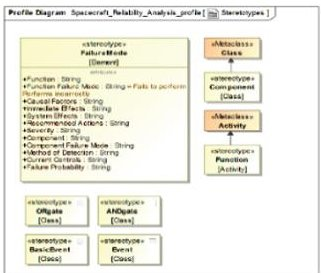
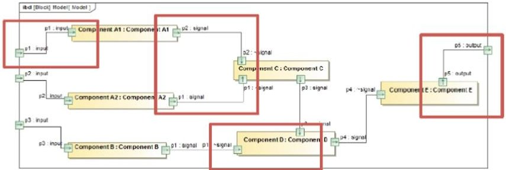
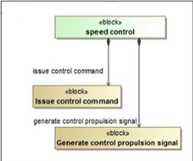
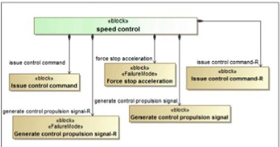
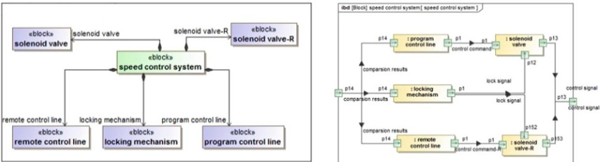
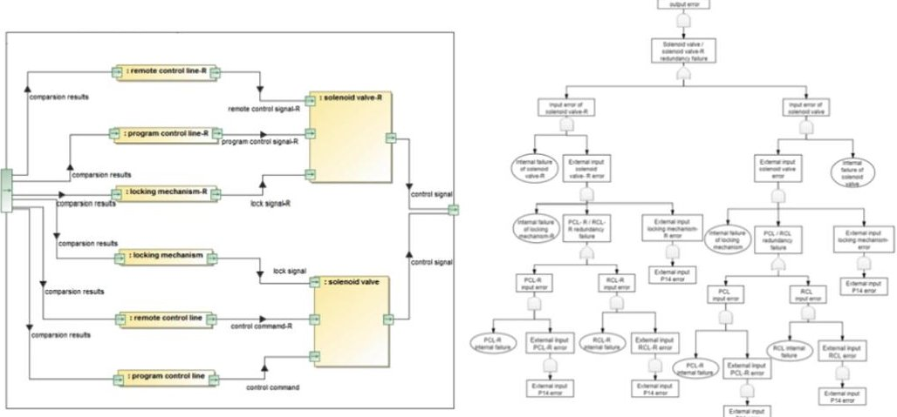

<!-- PDF_PAGE: 1 -->

# A Design Framework for Complex Spacecraft Systems with Integrated Reliability Using MBSE Methodology

Jingyi Chong $ ^{(\boxtimes)} $ , Haocheng Zhou $ ^{(\boxtimes)} $ , Min Wang, and Yujun Chen

China Academy of Space Technology, 104 Youyi Road, Beijing 100094, China chongjingyi@l26.com, zchouhch77@l63.com

Abstract. In the development of the spacecraft system, reliability analysis is often performed independently of the system design, and its input is usually an artificial abstract of the design scheme, such as function trees or block diagrams. This model gap between analysis and design lead to uncertainty in the results, while the conclusions are difficult to feed directly into the system design. In addition, manual reliability analysis consumes a lot of time and effort, while also increase the risk of errors. With the rapid growth in the size and complexity of spacecraft systems, reliability analysis is becoming increasingly challenging and its value is difficult to show. To cope with these difficulties, model-based systems engineering has emerged. However, MBSE focuses on requirements for traceability without a precise definition of reliability, resulting that the model conversion is still needed. In order to truly exploit the advantages of MBSE, this paper proposes a system design framework integrated reliability analysis for complex spacecraft system using MBSE. Both the design and reliability analysis are based on a single SysML model, from which FMEA and fault tree analysis can be generated directly. This framework ensures the consistency of the system model and the reliability model, eliminating the model conversion and reducing the workload of manual analysis. In this paper, the application process of a simple case is also demonstrated.

Keywords: MBSE · Spacecraft systems · Reliability analysis · FMEA · FTA

## 1 Introduction

Spacecraft systems, as typical complex systems, contain numerous subsystems which involve many disciplines. Due to the harsh environment, high cost and nonmaintainability, the spacecraft is required to be superior reliability. Therefore, it is needed to conduct a comprehensive reliability analysis to identify potential weaknesses and make proper design improvements so that all the possible failure effects are within the acceptable range. With the development of technology, the spacecraft system shows the trend of multi-functional, complex and highly integrated. Thus, traditional document-based design and analysis are not able to support the complex requirements, and the model-based system engineering has become an important direction.

However, under the model-based digital development of the spacecraft, reliability analysis has not already been integrated with design, so that the traditional limitations

<!-- PDF_PAGE: 2 -->

are not substantially improved through the pure MBSE methodology. Furthermore, the traditional reliability analysis requires engineers to extract and analyze manually, which is difficult to reflect the value of reliability analysis for design guidance.

Model-based reliability analysis ensures the model consistency of design and analysis which increases the traceability of model elements. In addition, thanks to the strictly defined in the model association, an efficient automatic generation of reliability analysis can be realized by digital means.

In this paper, an integrated framework of MBSE-based system design and reliability analysis is proposed for complex spacecraft system. Based on the forward design and SysML modeling, reliability information and the system model are integrated through the metamodel expansion. Meanwhile FMEA and FTA could be generated directly through the mapping and reasoning of system model elements. In the paper, Sect. 2 describes the related research in this field. Then Sect. 3 presents the specific process proposed in this paper. In Sect. 4, a simplified model carries out the validation of the feasibility. Finally, Sect. 5 concludes the entire paper.

## 2 Literature Review

Reliability analysis of complex systems is tedious and error-prone, so people have resorted to formal tools such as AltaRica to automate reliability analysis. However, models in AltaRica still cannot resolve the uncertainty caused by model differences. So, it is necessary to carry out reliability analysis directly from the system model, which can strictly ensure the model consistency and facilitate rapid feedback.

Pierre David proposed MeDISIS method for reliability analysis of complex systems expressed in SysML [1-3]. It first captures each component and function from the SysML model to create a preliminary FMEA, and finally supplements the analysis by experts. Mhenni proposed SafeSysE, a framework for integrating the automatic generation of FMEA and FTA, which completely describe the system modeling integrated with security analysis as well as dynamic behavior verification [4]. Alfredo Garro proposed RAMSAS which integrating overall system design, reliability analysis, and Simulink simulation based on SysML [5].

Based on the above research, the framework proposed in this paper integrates the characteristics of the spacecraft reliability analysis of each level in the process of forward design, and generates the analysis through the mapping and reasoning of model elements.

## 3 Concrete Framework

The integration of system design and reliability analysis starts from the requirement definition in early stage. In initial requirement analysis, functional requirements should be taken into consideration, and based on the subsequent reliability analysis, the requirements should be added to provide constraints for design changes.

In MBSE, the functionality of the system can be identified from the use case scenarios. Functional decomposition proceeds from the top-level functionality down

<!-- PDF_PAGE: 3 -->

through the hierarchy until components. In SysML, Block Definition Diagram (BDD) describes the functional hierarchy and Activity Diagram (AD) or Internal Block Diagram (IBD) expresses the interaction between functions. Functional decomposition will be an input to reliability analysis at functional level. According to the function FMEA, the functional architecture is updated and a new iteration could be performed until the failure impact is within acceptable limits. This process effectively strengthens the integration between reliability analysis and system design, avoiding subsequent costly changes to the logical or even physical architecture.

Through the iteration in requirements and functional layer, a complete system functional architecture has been formed. Based on these, components can be assigned which result in a further logical architecture. In this phase, components are described through BDD, and the internal interactions are described through IBD. The logical architecture will be an input to the component-level reliability analysis. Similarly, new reliability requirements should be added for unacceptable failure risks and fed back to the requirements layer for iteration.

Based on the previous iterations of design and analysis, in order to clear the fault propagation of specific failure modes, a fault tree analysis is needed. The fault tree is generated from the logical architecture which is mentioned above. IBD describes the interactions within the components. Thus, these can be used for the identification of fault propagation. According to the generated fault trees, qualitative analysis can specify the minimum set of cuts for a particular failure and provide targeted guidance to eliminate or reduce the risk of failure. Design changes will continue to be fed back to the requirements layer of the overall system design for a further iterative until all the risks are reduced to an acceptable level. Components at the layer above are logical components actually, and at the physical layer, a more detailed decomposition will be performed.

## 3.1 Construction of SysML Profile

In the framework proposed, reliability information should be integrated with the system model at first. However, SysML is domain-independent so that special semantics cannot be constructed directly. Here, a specific profile could be constructed, so that the reliability information can be explicitly defined in the system model. For the FMEA

Fig.1 Spacecraft reliability analysis profile

<!-- PDF_PAGE: 4 -->

and FTA in this study, "Spacecraft Reliability Analysis Profile" can be created as Fig.1.

## 3.2 Model-Based FMEA

FMEA for spacecraft systems include functional FMEA and component FMEA. Functional FMEA focuses on the functions in its mission which is mainly based on the functional architecture. While component FMEA focuses on the specific components after the logical architecture have been defined.

Model stands for stack of elements. When the information required has been already carried in the model, extracting the model elements and creating the corresponding units can generate the preliminary FMEA easily. Therefore, in Magicdraw, using a program can realize the automatic generation of functional FMEA from functional decomposition.

BDD, AD and IBD describe the functional decomposition created by the system design. Functions are provided by a series of activities and the hierarchical decomposition of system functions can be captured as well. So far, these models have completely described system functions and their interaction. At first the program extracts all the function and develops a list. Then failure mode units are made for each function, which are populated with the generic failure modes defined in the Profile. Next, the input and output of the functional module are populated to the cause unit as an aid in subsequent refinement. Finally, for the impact unit, related upstream and downstream functions are populated, which plays an important supporting in the refinement.

Based on the final results, if unacceptable conditions are identified, changes need to be done to the functional architecture and a further iteration is needed.

Component FMEA is nearly the same as functional FMEA, except that the failure causes and effects can be supported by a standard library of models. On the basis of the functional architecture, one component could be assigned to each function. If a function requires more components, the decomposition of function is considered incomplete (except for backups for the same function). After that, logical architecture could be constructed already.

So far, these models have completely described the components and their interactions. Similarity, the information required can be extracted from the system model using a program. Since the failure mode of components are relatively fixed, these can be extracted and populated from the model library as well.

## 3.3 Model-Based FTA

Fault tree analysis for spacecraft needs to clarify the fault propagation, which are reflected in the interactions between components. As IBD describes the interactions, FTA is also obtained from the IBD at logic layer.

In order to capture all the fault propagation, the generation can be achieved using program traversal in Magicdraw. In these process, two main problems need to be solved, which the first is to abstract the IBD graph into a tree structure, and the second is to determine the logical relationships. Since the current qualitative analysis of FTA is

<!-- PDF_PAGE: 5 -->

limited to monotonic correlation fault trees consisting of and-gate, or-gate and fault events, only "and" and "or" are considered.

Generating tree structure from IBD can be achieved by directed graph. IBD can be presented as a directed graph of $ \mathrm{G}=(\mathrm{V},\mathrm{E}) $ , where V is the set of vertices and E is the set of directed edges. The vertex set consists of system components and the external port. Internal port can be expressed by directing edges which connect the components. Therefore, using traversal algorithm could find the causes that are related by directed edges. When utilizing deep traversal, it may happen that the upstream of the vertex has not been visited yet, so it needs a sub tree before stitching. In contrast, when using breadth traversal, because it is done hierarchically, the fault tree can be generated sequentially. As well as traversing the directed graph, reasoning about the logical relationships according to certain rules is also needed. In SysML, IBD composes of three parts: "external input", "external output" and "intermediate execution" (Fig. 2).

Fig. 2. IBD diagram partition diagram

Structure 1: External Output. The failure of the external output is regarded as the top event. The adjacent vertex is component E, so the top event is caused by the internal fault of component E or by the input error of port P4, which are connected by "or" gate.

Structure 2: External Input. Component A1 in the figure has a port representing external input, and outputs to component B through the internal port P2. The external input port could represent all the bottom events from the external, and are connected with "component A1 internal fault" through "or" gate to transfer the fault to all components connected with component A1.

Structure 3: Intermediate Execution. The logical relationship of intermediate execution needs to be judged according to the fault transmission. If the components connected to the input port are assigned to the same function, it is considered that the faults are connected by "and" gate. While if the components are assigned to different functions, they are connected by "or" gates.

<!-- PDF_PAGE: 6 -->

## 4 Case Study

This section verifies the feasibility of the framework through the design and reliability analysis of a simplified system, which is the rotational speed control system of a spinstabilized satellite.

First, at the requirements level, the system boundaries and operating modes need to be defined. The system is installed on the satellite and receives the control signal, which is the comparison result of measurement and rated range. The system controls the speed of the satellite through the propulsion system. Also, the real system interacts with other stakeholders which are not listed here. Its operation mode is: After separation of the satellite and the rocket, the satellite is accelerated until reaching the upper limit of the rated range. Then during operation, due to the external interference, the satellite is decreased. When its speed is lower than the limit, the system will accelerate again, so as to control the speed within the rated range. By analyzing the system context and life cycle, initial requirements can be described in the requirements diagrams and tables. And then, the top-level use cases can be determined. At a functional level, the use case can be expanded through an AD with swim lanes, resulting in the functional decomposition architecture of the system which will be the input of functional FMEA (Fig. 3). Finally, according to the method mentioned above, the final function FMEA could be output and the expert supplement has been marked (Fig. 4).

Fig. 3. Functional decomposition

Judging from the results, some preventive measures should be taken, which could include redundant, protection or fault tolerance design as well as the isolation of faults. Thus, additional reliability requirements could be "when reaches the upper limit, even if the system sends an acceleration command, it should force stop accelerating" and "when the main function fails, the system can still complete the task". Function decomposition after design iteration is shown in Fig. 5, in which the backup of the main function as well as the protective function is added.

Then, components could be assigned to the logic layer resulting in the logical architecture of the system (Fig. 6). Also, the interaction between components can be clearly described in IBD. Based on the method of component FMEA, the final results are shown in Fig. 7 and the supplementary content of experts have been marked.

<!-- PDF_PAGE: 7 -->

<table border="1"><tr><td>Function</td><td>Failure Mode</td><td>Failure Mode(Supplement)</td><td>Casual factors</td><td>Immediate effects</td><td>System effects(Supplement)</td><td>Severity</td></tr><tr><td rowspan="2">Issue control command</td><td>Function not performed</td><td>No control command issued</td><td rowspan="2">in:Attitude measurement system out:Generate control propulsion signal</td><td rowspan="2">upstream:Attitude measurement system downstream:Generate control propulsion signal</td><td>Satellite speed out of control</td><td>Disastrous</td></tr><tr><td>Function execution error</td><td>Issue error control instruction</td><td>Satellite speed out of control</td><td>Disastrous</td></tr><tr><td rowspan="2">Generate control propulsion signal</td><td>Function not performed</td><td>No control signal is generated</td><td rowspan="2">in:Issue control command out:propulsion system</td><td rowspan="2">upstream:Issue control command downstream:propulsion system</td><td>Satellite speed out of control</td><td>Disastrous</td></tr><tr><td>Function execution error</td><td>Generate error control signal</td><td>Satellite speed out of control</td><td>Disastrous</td></tr></table>

Fig. 4. Final functional FMEA

Fig. 5. Updated functional decomposition

Fig. 6. Logical architecture and component interaction.

According to the results, the failure of the locking mechanism and the leakage of the valve have a serious impact on system, so control measures are needed. In component level, these could be redundant design, preferred components as well as protection and isolation devices. In this case, the redundancy of the locking mechanism is increased and using two-seats valves to reduce the possibility of leakage. The corresponding fault tree can be generated according to the FT method mentioned above (Fig. 8).

<!-- PDF_PAGE: 8 -->

<table><thead><tr><th>Component</th><th>Function</th><th>Failure Mode</th><th>Failure Mode (Supplement)</th><th>Immediate effects (Supplement)</th><th>System effects (Supplement)</th><th>Severity</th></tr></thead><tbody><tr><td rowspan="2">Program control line</td><td rowspan="2">Issue control command</td><td>Function not performed</td><td>No instruction</td><td>Unable to issue control command</td><td>No impact</td><td>No impact</td></tr><tr><td>Function execution error</td><td>Misinstruction n</td><td>Issue control instruction by mistake</td><td>No impact</td><td>No impact</td></tr><tr><td rowspan="2">Remote control line</td><td rowspan="2">Issue control command</td><td>Function not performed</td><td>No instruction</td><td>Unable to issue control command</td><td>No impact</td><td>No impact</td></tr><tr><td>Function execution error</td><td>Misinstruction n</td><td>Issue control instruction by mistake</td><td>No impact</td><td>No impact</td></tr><tr><td rowspan="2">Program control line-R</td><td rowspan="2">Issue control command</td><td>Function not performed</td><td>No instruction</td><td>Unable to issue control command</td><td>No impact</td><td>No impact</td></tr><tr><td>Function execution error</td><td>Misinstruction n</td><td>Issue control instruction by mistake</td><td>No impact</td><td>No impact</td></tr><tr><td rowspan="2">Remote control line-R</td><td rowspan="2">Issue control command</td><td>Function not performed</td><td>No instruction</td><td>Unable to issue control command</td><td>No impact</td><td>No impact</td></tr><tr><td>Function execution error</td><td>Misinstruction n</td><td>Issue control instruction by mistake</td><td>No impact</td><td>No impact</td></tr><tr><td rowspan="2">Solenoid valve</td><td rowspan="2">Generate control proposition signal</td><td>Function not performed</td><td>Blocked</td><td>Unable to generate control proposition signal</td><td>No impact</td><td>No impact</td></tr><tr><td>Function execution error</td><td>leak</td><td>Error generating control proposition signal</td><td>Satellite overpass</td><td>Disastrous</td></tr><tr><td rowspan="2">Solenoid valve-R</td><td rowspan="2">Generate control proposition signal</td><td>Function not performed</td><td>Blocked</td><td>Unable to generate control proposition signal</td><td>No impact</td><td>No impact</td></tr><tr><td>Function execution error</td><td>leak</td><td>Error generating control proposition signal</td><td>Satellite overpass</td><td>Disastrous</td></tr><tr><td rowspan="2">Locking mechanism</td><td rowspan="2">Forced stop proposition</td><td>Function not performed</td><td>Lose lock</td><td>impossible to force the stop to stop</td><td>No impact</td><td>No impact</td></tr><tr><td>Function execution error</td><td>False lock</td><td>Error force a stop advance</td><td>Satellite low speed</td><td>Disastrous</td></tr></tbody></table>

Fig. 7. Final component FMEA

Fig. 8. Updated component interaction and generated fault tree.

## 5 Conclusion

This paper introduces a framework for integrating reliability analysis in the design of spacecraft systems, which ensure the consistency of models through model-based FMEA and FTA. It is shown that the proposed framework could benefit in the efficient iterative of system design and reliability analysis, and fully reflects the constraints and guidance of reliability analysis in design. However, the process still contains some human definition so that further research is needed to reduce the human involvement and realize the fully automated analysis based on system models.

<!-- PDF_PAGE: 9 -->

## References

1. David, P., Idasiak, V., Kratz F.: Towards a better interaction between design and dependability analysis: FMEA derived from UML/SysML models. In: Proc. ESREL 2008 and 17th SRA-Europe Annual Conference, Valencia, Spain, Sept (2008)

2. David, P., Idasiak, V., Kratz, F.: Improving reliability studies with SysML. In: Reliability & Maintainability Symposium. IEEE (2009)

3. Cressent, R., Idasiak, V., Kratz, F., David, P.: Mastering safety and reliability in a model based process. In: Proceedings-Annual Reliability and Maintainability Symposium, IEEE, Lake Buena Vista, FL, USA (2011)

4. Mhenni, F., Nguyen, N., Choley, J.-Y.: Towards the integration of safety analysis in a modelbased system engineering approach with SysML. In: Design and Modeling of Mechanical Systems. Springer, Berlin, Heidelberg (2013)

5. Garro, A., Tundis, A.: A model-based method for system reliability analysis. In: Simulation Series (2012)