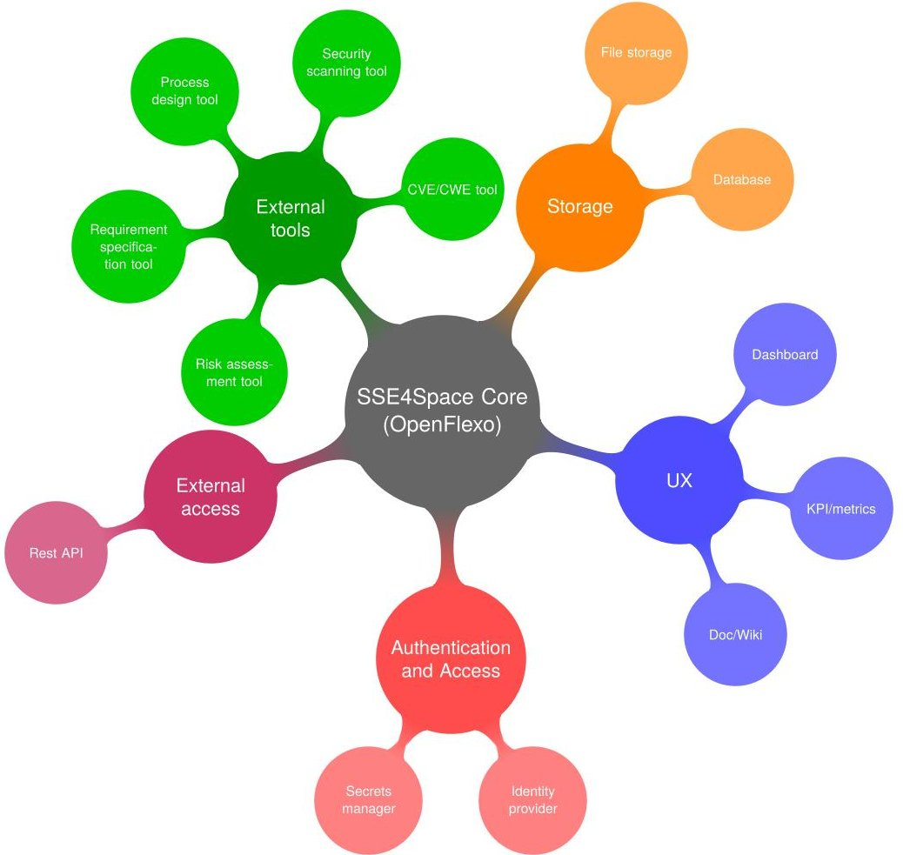
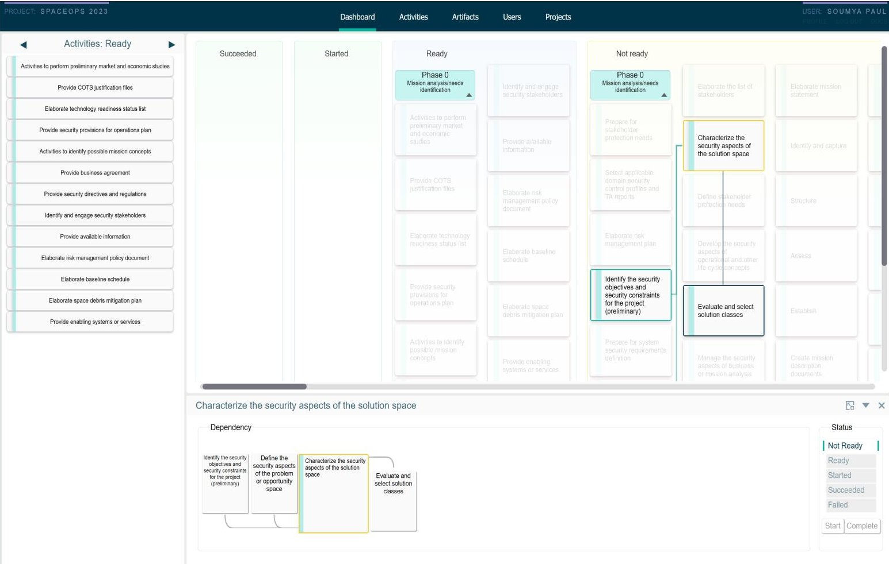
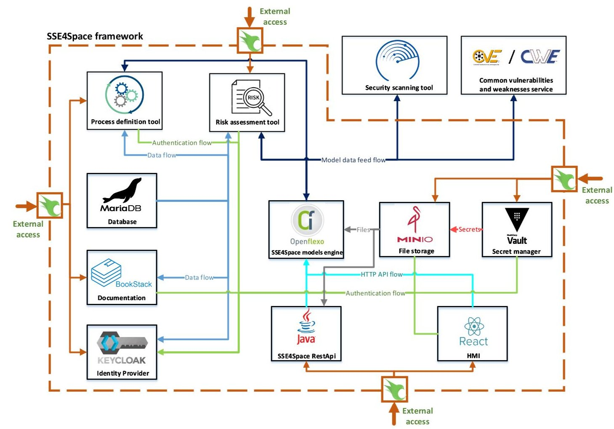
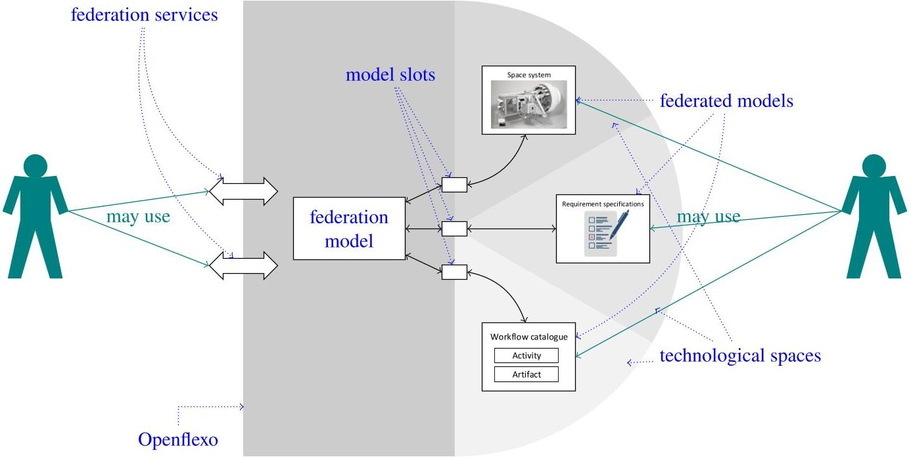
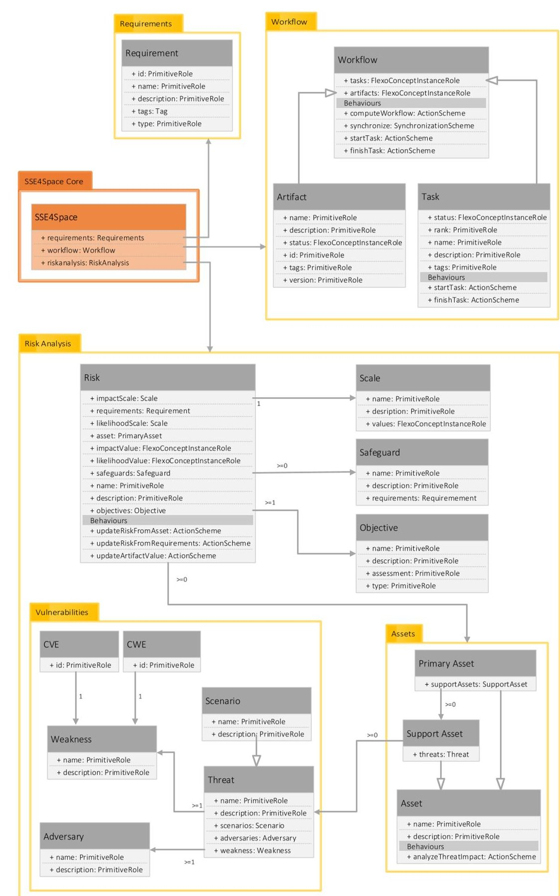

<!-- PDF_PAGE: 1 -->

SpaceOps-2023, ID # 530

# A flexible and robust framework for the secure systems engineering of space missions

Tom Leclerc $ ^{\mathrm{PXL}} $ , Soumya Paul $ ^{\mathrm{PXL}*} $ , Jussi Roberts $ ^{\mathrm{ESA}} $ , Fabien Dagnat $ ^{\mathrm{IMT}} $ , Florian Ledoux $ ^{\mathrm{PXL}} $ , Jean-Christophe Bach $ ^{\mathrm{IMT}} $ , Marcus Wallum $ ^{\mathrm{ESA}} $ , Nicky Mezzina $ ^{\mathrm{PXL}} $ , Daniel Fischer $ ^{\mathrm{ESA}} $ , Sylvain Guerin $ ^{\mathrm{EAB}} $ , Ihab Benamer $ ^{\mathrm{IMT}} $ and Pierre Jeanjean $ ^{\mathrm{PXL}} $

$ ^{PXL} $ Proximus Luxembourg S.A., Luxembourg $ ^{ESA} $ European Space Agency / European Space Operations Centre, Germany $ ^{IMT} $ IMT Atlantique, Lab-STICC, UMR 6285, Brest, France $ ^{EAB} $ ENSTA Bretagne, Lab-STICC, UMR 6285, Brest, France $ ^{*} $ Corresponding Author

10 March 2023

## Abstract

Modern society has become more reliant on space systems than ever before. Critical infrastructure, emergency services, weather forecasting, scientific study, communication, and decision making rely heavily on space systems and space-based data. As society's reliance on space systems continues to grow, so too does their attractiveness as potential targets to adversaries. There is an abundance of secure systems engineering standards, methodologies, and processes that guide the secure engineering process of terrestrial IT systems. However, such standards and methodologies that systematically guide the end-to-end secure engineering process of space systems, which are highly complex and multi-disciplinary by nature, are scarce. This paper presents a potential solution to this problem in the form of a software framework titled Secure Systems Engineering for Space (SSE4Space).

This paper presents one framework currently under development in response to a tendering action initiated under the European Space Agency's General Support Technology Programme (GSTP). It aims to bridge the gap between top-level security governance and secure space systems engineering practices. This includes: identifying and extending applicable threat and risk assessment and secure systems engineering methodologies; defining consistent vocabulary to be used throughout the framework; building software tooling to guide users through the end-to-end secure systems engineering process; and defining and generating reusable products such as security requirements catalogues, test reports and risk assessment reports among others.

To achieve this, SSE4Space identifies the gaps present in the current ECSS standards by comparison with the other existing state-of-the-art international Secure Systems Engineering (SSE) standards. Based on that, it creates a complete end-to-end process catalog, consisting of the standard ECSS tasks reinforced with security tasks prescribed in the SSE standards. It then develops a software framework that encodes this process catalog and guides the user throughout the course of a project indicating the security tasks to be performed and feeding the security artifacts properly and at the right time in the process. This ensures that the adequate level of security has not only been achieved on the completion of the project but is maintained throughout its course. This also helps in developing a certification methodology to verify how closely the process has been followed and to what extent the desired level of security has been ensured.

Keywords: secure systems engineering, model based system engineering, secure process, model federation, secure space missions

<!-- PDF_PAGE: 2 -->

<table border="1"><tr><td>AIV</td><td>Assembly, Integration and Verification</td></tr><tr><td>API</td><td>Application Programming Interface</td></tr><tr><td>BPMN</td><td>Business Process Model and Notation</td></tr><tr><td>CCSDS</td><td>Consultative Committee for Space Data Systems</td></tr><tr><td>CSOC</td><td>Cyber Safety and Security Operation Centre</td></tr><tr><td>CVE</td><td>Common Vulnerabilities and Exposures</td></tr><tr><td>CWE</td><td>Common Weakness Enumeration</td></tr><tr><td>DSML</td><td>Domain Specific Modelling Language</td></tr><tr><td>ECSS</td><td>European Cooperation for Space Standardisation</td></tr><tr><td>ESA</td><td>European Space Agency</td></tr><tr><td>FML</td><td>Federation Modelling Language</td></tr><tr><td>GASF</td><td>General Application Security Framework</td></tr><tr><td>GSTP</td><td>General Support Technology Programme</td></tr><tr><td>KPI</td><td>Key Performance Index</td></tr><tr><td>MBSE</td><td>Model Based Systems Engineering</td></tr><tr><td>MEHARI</td><td>MEthod for Harmonized Analysis of RIsk</td></tr><tr><td>NIST</td><td>National Institute of Standards and Technology</td></tr><tr><td>RACI</td><td>Responsible Accountable Consulted Informed</td></tr><tr><td>RF</td><td>Radio Frequency</td></tr><tr><td>S3</td><td>Simple Storage Service (Amazon S3)</td></tr><tr><td>SCCoE</td><td>Cyber Security Centre of Excellence</td></tr><tr><td>SDLC</td><td>System Development Lifecycle</td></tr><tr><td>SEST</td><td>Secure Engineering Support Tool</td></tr><tr><td>SSE</td><td>Secure Systems Engineering</td></tr><tr><td>SSE4Space</td><td>Secure Systems Engineering framework for Space</td></tr><tr><td>SSO</td><td>Single Sign-On</td></tr><tr><td>SRA</td><td>Security and Risk Assessment</td></tr><tr><td>TO</td><td>Technical Officer</td></tr></table>

Table 1: List of acronyms/abbreviations

## 1. Introduction

In recent decades, society's reliance on space missions has increased significantly. Communication systems, critical infrastructure, navigation systems, and scientific study form the building blocks of modern society. These systems depend on space-based data and systems such as navigation, timing, and earth observation. As our reliance on these systems continues to strengthen, so does their attractiveness as targets to threat actors due to the potentially high reward involved in compromising space systems.

Numerous standards and methodologies currently exist for the development and assurance of security for terrestrial information systems. Cybersecurity has also seen an increasing focus for the space domain as exemplified by recent publications [8,18]. There is a pressing need to analyze and evolve space system security engineering, quality and management standards, and govern the development process during the entire system development life cycle from early requirements engineering through to retirement. Additionally, a way to guide projects on how to effectively plan and implement security activities during all phases of the mission is needed.

Unclassified civil space missions have typically been large institutional government-backed, complex endeavours,

<!-- PDF_PAGE: 3 -->

that have crucially overlooked the importance of security engineering. This lack of security focus with unclassified missions may be attributed to a number of factors, such as the heavy reliance on security through obscurity due to the complexity and unfamiliarity of the space domain to the vast majority of threat actors. Space missions are complex systems of systems consisting of highly customized hardware, software, data, procedures, facilities, people, and communication protocols, indicating necessity for highly specific domain knowledge from a potential threat actor. Additionally, the conservative nature of space mission operations means that mission owners may be hesitant to introduce new security controls due to increased complexity in system design and perceived operational risk.

The increased frequency of cyberattacks that are focused on the assets of both private and public entities, exacerbated by geopolitical turmoil and uncertainty in recent years, has led to a welcome increase in stakeholder awareness of cybersecurity. This, in turn, has led to a recent increasing focus on security engineering in institutional, governmentbacked unclassified civil space missions. This can be witnessed by the increase in space security related publications, an increase in the size and number of security related working groups and new standards published, and existing standards updated with security considerations by the Consultative Committee for Space Data Systems (CCSDS) and the European Cooperation for Space Standardisation (ECSS), and by the substantial increase in the number of security engineering initiatives and activities initiated and run by the European Space Agency (ESA) and other space agencies.

ESA has the responsibility of protecting and developing its member states' interests and capabilities in the civil space domain and has responded to this increased demand for space security with a number of initiatives and top-level security regulations and directives, such as mandating an ESA security framework and information security policy for all ESA projects and missions. Some of the recent security initiatives include the establishment of a Cyber Security Centre of Excellence (SCCoE), a Cyber Safety and Security Operation Centre (CSOC), a number of automated cyber security testing solutions, and the Secure Systems Engineering framework for Space (SSE4Space), presented in this paper.

The SSE4Space framework that is currently under development by the European Space Agency is a software framework that aims to bridge the gap between top-level security governance and secure systems engineering practices by:

- Identifying and updating applicable, Threat and Risk Assessment (TRA), and Secure Systems Engineering (SSE) methodologies that integrate into a System Development Lifecycle (SDLC).

- Defining and setting consistent vocabulary for clear use of terminology throughout the framework, compatible with a Model Based Systems Engineering (MBSE) paradigm.

- Identifying applicable data and adapting them to specific contexts, such as system context, organizational context etc., and categorizing them into re-usable catalogues and profiles such as security requirements, objectives, controls, threats and vulnerabilities.

- Building complete software tooling that supports easy-to-use workflows that implement threat and risk assessment, security requirements engineering, security testing, and security accreditation and certification processes, and supports data exchange between external tools that may support some of these workflows.

- Definition and generation of products i.e., templates and reports for documents such as System Requirements Engineering Statements, Security Operations Reports, Risk Assessments, Residual Risks and Security Testing Reports.

This paper presents the secure software engineering framework, currently under development in response to a tendering action initiated under the ESA General Support Technology Programme (GSTP). It presents the status of one of two issued parallel contracts (with alternative approaches) executed in partnership with European industry. The remainder of the paper is structured as follows: Section 2 describes the focus and motivation of the activity, highlighting the challenges and constraints in more detail; Section 3 discusses the SSE4Space solution in detail, describing the underlying design principles, architecture, and functionalities; Section 4 guides the reader through the workflow of the framework from a user perspective; and finally Section 5 concludes the paper with future work and concluding remarks.

<!-- PDF_PAGE: 4 -->

## 2. Problem statement, requirements and constraints

Given the background and motivation presented in Section 1 the problem needing to be addressed may be summarized as follows: "Design a framework to establish that the system conceived meets the proper level of security in proportion to its exposure to risk. The framework should ensure that various elements related to security such as risk, requirements, testing, validation, certification, etc. contain the proper validated information throughout the lifecycle of a space system engineering effort, giving confidence that the target level of security assurance has been reached. Additionally, develop a software tool that guides the actions to be taken (by users) in such a security engineering process by initiating all security engineering tasks and artifact generation at the correct time during the System Development Lifecycle."

In this chapter we describe the requirements and constraints that drive the design and establishment of the security framework described above. We begin by discussing general constraints applicable to both terrestrial and space systems, followed by constraints specific to space systems.

## 2.1. General constraints

A multitude of factors must be kept in mind when developing a secure systems engineering framework:

- The security of a system is an emergent property of the system and is the result of merging and integrating multiple components, functions, interfaces and processes. It also stems from dynamic behaviours, and interactions among system elements or assets. The scope of the system assets involved in space missions thus range from software and data to hardware, physical structures, people, processes and procedures.

- System security is highly context dependent, typically defined based on stakeholder concerns related to the business, mission, operational and performance objectives of the system. Security objectives typically:

- relate to protection against loss of system assets which together realize the stakeholder concerns

- cover the protection of the data or products received, managed and produced by the system

- may be addressed not only by security-dedicated components and security functions or controls, but also through appropriate constraints and controls applied to components and functions across the system

- may impact or constrain other mission objectives.

Security must therefore be multidisciplinary and be integrated with well-established system engineering principles. This enables defining a complete systems engineering process that includes security, ensures coherent and adequate security across the entire system, and provides sufficient evidence and assurance of trustworthiness to stakeholders.

- The design of the framework should be modular, incorporating data from different tools and technologies used in various domains. This allows for seamless integration and switching between tools as required. A secure lifecycle should apply iteratively to each module or subsystem, taking a common approach for each of the security engineering processes. This must then be consolidated to achieve the overall system-level view.

- The target users for the framework vary widely across various domains and disciplines, and as such, the framework itself should be as simple and easy to use as possible. It should, however, be flexible enough to account for deviations from the initially defined process within and across domains.

- Traceability should be maintained throughout the process lifecycle - any and all changes to a system element should be traced to the source of the change. This helps in developing a certification methodology to verify how closely the process has been followed and to what extent the desired level of security has been ensured.

<!-- PDF_PAGE: 5 -->

## 2.2. Space-specific constraints

Space systems must address security concerns beyond controls and risk management approaches from well-known IT frameworks such as [15] , to account for particularities not covered by generic terrestrial systems. Some of these concerns include:

- Specific to the space environment, threat models must consider attack paths such as denial of service by jamming of the radio frequency (RF) signals of the uplink or downlink of space to ground links, or spoofing of signals produced or received by a spacecraft, or intercepting and modifying the integrity of imagery, navigation signals or other space mission products [4]

- Associated controls for space communications security (e.g. [5]], or more generally from telecommunication security standards [2]) or space-specific challenges such as multi-user/-level access control for hosted on-board payloads, distributed systems and third parties, lightweight cryptography for resource-constrained missions etc. must also be accounted for.

- Space systems are usually built on custom hardware often lacking in processing power. The software that is used to run the custom hardware such as the onboard computer, spacecraft subsystems, and scientific instruments is often written in low level programming languages such as C/C++, Ada, and Fortran. These languages can often be prone to vulnerabilities due to bad coding practices.

- Another key concern is that the lifetime of space systems is typically long (often between 5-20 years) and technology obsolescence is a common occurrence-emphasizing the need, particularly for legacy terrestrial software, to protect against well-known exploits and manage the associated risks.

- The stakes involved in the security of space systems and space missions are high. Modern society is dependent on satellites to an extent that any failure or attack on the space infrastructure can have adverse effects on day-to-day functioning of society.

- A multi-disciplinary approach to secure systems engineering is particularly important for space systems, considering the complexity and multifaceted nature of domains involved, ranging from spacecraft hardware Assembly, Integration and Verification (AIV) to ground system software developers, to control centre personnel including operators and facility security guards. Ensuring security of the supply chain (to the extent determined necessary by the risk assessment), adherence to common standards and policies and traceability throughout the procurement process is thus a key challenge.

A number of publications have highlighted the modern challenge of security in space (e.g. [13,19]). CCSDS publications propose security architectures [3], high-level threat considerations [5] and security considerations for mission planners, including a mapping to ISO 27001 [15,4].

## 3. Proposed solution: the SSE4Space framework

In this section we describe our solution to the problem elaborated in Section 2. We propose a framework called SSE4Space that consists broadly of two parts:

1. an end-to-end secure systems engineering workflow/process

2. a software tool to carry out and maintain the process

The overall goal of the SSE4Space framework is to ensure that the system conceived meets the proper level of security in proportion to its exposure to risks. Simply put, all that the framework must enforce is that the different elements related to security (risks, requirements, tests, validations, certifications, etc.) contain the proper validated information that permit to confirm that the level of security sought has been reached and that this security is appropriate

<!-- PDF_PAGE: 6 -->

to the system's context. To make this easier and efficient, the framework guides the actions to be taken to feed all the security artifacts properly and at the right time in the process. As discussed above, it is agreed that processes permit to ensure that the result is appropriate, but in practice, a certain flexibility is often necessary to cope with unforeseen events. Therefore, the proposed framework maintains a clear dashboard always showing the target: reaching the appropriate level of security for all elements. To guide the user as best as possible, the dashboard displays the current security status, past and current tasks and also the next possible tasks.

We now describe the two parts of the SSE4Space framework in detail.

## 3.1. End-to-end process

The first part of the SSE4Space framework was the conception and design of a secure end-to-end process that users need to follow to ensure the proper and adequate level of security throughout the lifecycle of a system. The different aspects of the end-to-end process are described below.

## 3.1.1. Secure Workflow

Security measures and practices should be "baked-in" at the very beginning and throughout the System Development Life Cycle (SDLC). This means that the overall security of the system is maintained at every step of the design and development process. Publications like [22] have highlighted this need and have formulated the links between security and systems engineering processes [16]. This security by design is therefore the approach that we follow for the design and development of the SSE4Space framework. To this end, we carried out the following steps:

1. We analyzed the existing ECSS standards $ ^{1} $ to create an initial system engineering end-to-end process.

2. We carried out a formal gap analysis on this initial process. This was done as follows:

- A collection of international state-of-the-art secure systems engineering standards were identified. These include:

- NIST SP800-160: Systems security engineering [22]

- CCSDS standards: Security threats against space missions, Security guide for mission planners and Security architecture for space data systems [5,4,3]

- ISO/IEC/IEEE 15288:2015 [16]

- ITSG-33: Canadian Cybersecurity standards [7]

- Airbus Defence & Space systems security standards

- The security processes of the above standards were analyzed. For every task in the security processes, it was determined if it was covered by existing tasks in the ECSS standards or if it was necessary to augment the ECSS process by adding additional tasks.

- This identified the existing gaps in the ECSS standards and created a mapping to the standards mentioned above.

3. Finally, we augmented the initial process by inserting the identified security tasks in the appropriate places, thereby creating a secure end-to-end system engineering process.

A key takeaway of the above gap analysis is that the existing ECSS process is lacking and needs to be modified by adding security specific tasks. A summary of the (approximate) number of tasks to be added per standard is presented in Table 2. In the context of the European Space Agency, this is partially addressed by the Security Directives and Regulations [1]. However, it is necessary to clearly specify how and where to integrate these regulations in the end-to-end process itself. This is also something that the secure end-to-end process designed above addresses. The results of

<!-- PDF_PAGE: 7 -->

<table border="1"><tr><td>ECSS standard</td><td>Identified security gaps</td></tr><tr><td>ECSS-E-ST-10-02C Verification</td><td>3 tasks consisting of 14 activities</td></tr><tr><td>ECSS-E-ST-10-03C Testing</td><td>8 activities</td></tr><tr><td>ECSS-E-ST-10-06C Technical requirements specification</td><td>4 tasks consisting of 15 activities</td></tr><tr><td>ECSS-E-ST-10C System engineering general requirements</td><td>6 tasks consisting of 24 activities</td></tr><tr><td>ECSS-E-ST-70C Ground systems and operations</td><td>4 tasks consisting of 16 activities</td></tr><tr><td>ECSS-E-HB-50A Communication guidelines</td><td>1 task</td></tr><tr><td>ECSS-M-ST-10C Project Planning and Implementation</td><td>6 tasks consisting of 25 activities</td></tr><tr><td>ECSS-M-ST-40C Configuration and information management</td><td>8 tasks consisting of 31 activities</td></tr><tr><td>ECSS-M-ST-80C Risk Management</td><td>5 tasks consisting of 16 activities</td></tr><tr><td>ECSS-Q-ST-20C Quality assurance
ECSS-Q-ST-10C Product assurance management</td><td>5 tasks consisting of 17 activities</td></tr><tr><td>ECSS-Q-ST-10-09C Rev 1 Nonconformance control system</td><td>15 activities</td></tr></table>

Table 2: Summary of the number of gaps identified per ECSS standard

the gap analysis were provided to ECSS and at time of writing there is an ECSS working group that is actively working towards addressing them.

The intention is to keep the SSE4space framework generic in all aspects, risk analysis included. Different projects can select their own risk analysis methodology and tool that best fit the needs of the project. The core of the framework imports the risk data (which includes the asset, threat and vulnerability models) from an external tool and creates virtual models to be used by the other modules of the framework. In particular, the SSE4Space software tool interfaces with the Secure Engineering Support Tool (SEST $ ^{2} $ ), a risk assessment tool that uses the MEHARI methodology $ ^{3} $ for risk assessment.

## 3.1.2. Role-based access

Another crucial mechanisms by which the framework maintains security in the end-to-end process is by enforcing role-based access for all tasks in the end-to-end process as well as the artifacts involved in those tasks. It uses the well-established RACI principle to enable this access [21]. This ensures that for any task, the person with the appropriate role is involved and responsible to complete it. For any particular artifact (e.g. a document), certain roles have access (read/write/modify) only to particular artifacts involved in the ongoing tasks for that role. Section 4 describes how roles intervene in practice when using the SSE4Space framework.

## 3.1.3. Flexible workflow

A particularity of the SSE4Space solution is that it does not implement and execute this secure end-to-end system engineering process in a typical manner as could be done in frameworks such as BPMN [20] where the process is a static series of tasks connected with links and decisions. Instead, the approach follows a more agent-based [17] approach where each task provides its needs and constraints, such as which elements are necessary to complete before starting the next one, and which results it produces (i.e. which elements are modified and which elements are created). This process is computed dynamically.

The implementation of the secure end-to-end process is done by defining the constraints and results for each task. With these constraints, the process computation starts with the initial task (i.e. one with no input constraints) and after each step, the next set of startable tasks is determined based on the produced output(s) and their current state (the result is shown as a simple list in the dashboard as shown Figure 2).

<!-- PDF_PAGE: 8 -->

Although the secure end-to-end process designed for the framework recommends that the next tasks to be performed for each user involved in the project, as per their RACI role, a user with appropriate authority (e.g. the Project Manager), is at liberty to select the next task and to decide to skip certain tasks or to replace a selection of tasks with a single alternative task. However, some of the tasks are deemed mandatory and cannot be skipped. Skipping a mandatory task risks putting the security of the system in danger. The tasks take inputs and produce outputs which are collected and aggregated in the data model. The data model is used to monitor the status, progress and security (e.g. through the risk analysis maintenance and through KPIs and scores supporting auditing activities) of the current workflow and elements and also to present information to the various roles involved in the project. The data model therefore forms the backbone of the SSE4Space framework and is elaborated further in Section 3.2.3.

On each modification of an artifact in the project, be it by the means of a pre-defined task in the workflow or an alternative task introduced by the Project Manager for example, its security status is put under question. A review task, by an appropriate role, is later required to ascertain the exact impact this modification has had on the overall security of the system. After the review, the security status of the process comes back on track. Such reviews may be included in the secure end-to-end process, or dynamically added to accommodate out-of-line modifications.

Another form of flexibility made possible in the framework is to split the workflow into several branches, and later merge the branches together. The split can happen on a single task or a set of task chosen by a user of the appropriate role. Each branch of the split could be assigned different access rights based on the context. This reflects a real-life situation where multiple organizations, for example, simultaneously work on different parts of an artifact and each of them have different access rights on the artifact. The merge task at the end of a split is itself context-dependent. The merge can either combine multiple artifacts into a single artifact, ignore one or more of the artifacts produced in the split branches, or keep them all.

## 3.1.4. Profiling

The base secure end-to-end process as designed above in the section 3.1.1 contains all the tasks from ECSS and the security standards [22, 7] including all the artifacts therein. However, the projects in real-life may often be carried out on a smaller scale and may involve only a subset of the tasks and artifacts of the above process. The SSE4Space framework allows the creation of profiles on the base process where each such profile can include only the tasks that are relevant in its context. This is done by the user selecting the required tasks for the project at hand after which the associated SSE4Space software reinforces it with additional security and non-security tasks. This creates a full end-to-end process which is still adequately secure and serves the same purpose as the full base process would but in the context of the current small-scale project.

## 3.2. The SSE4Space software

## 3.2.1. Architecture

The SSE4Space framework design is based on a microservice architecture. It relies on software components or modules, dedicated to specific tasks that communicate with each other. Inputs managed by SSE4Space are very heterogeneous - user interactions, files or data extracted from various tools etc. The same situation occurs for outputs as the framework can update tools, push files or show results on the user graphical interface. In order to support all of these features, the key concept of the SSE4Space framework design is the combination of modules through data flows. Each type of data managed by the framework follows a path between modules, being processed, stored or provided to the user. The different modules of the framework and their mutual interactions are abstractly depicted in Figure 1. The core of the framework is implemented based on the open source software Openflexo, which is elaborated on in detail in Section 3.2.2. The basic principle behind Openflexo is to collect data from different sources (external tools), refine, and combine them to create virtual models conducive to be used by other modules/tools. Below we describe the various modules of SSE4Space and how they interact with the core framework.

<!-- PDF_PAGE: 9 -->

Figure 1: SSE4Space framework modules

- External tools: These are the tools that the core of the framework interacts and exchanges data with. These include:

- End-to-end process design tool: The secure end-to-end process designed for part 1 of the framework [described in Section 3.1] is encoded in the form of a catalog using a process design tool. The core of the framework interacts with this tool and retrieves the data for the encoded secure process. As described earlier, the process consists of tasks to be performed by various roles of the project and the artifacts produced and consumed by each of these tasks. This process is then used by the user interface to populate the dashboards that a user of the framework uses to interact with it.

- Requirement specification tool: This tool can be used to formally record all of the user requirements, both general and security requirements. The data can be then fed to the framework core to be used by the process design tool or other tools.

- Risk assessment tool: This tool carries out the risk analysis at various stages of a project and typically builds threat, asset and vulnerability models. The data of these models are imported into the core of the framework and used by other modules as and when required.

- Vulnerability processing: During the course of a project, if new vulnerabilities or threats arise for one or more components, information regarding such vulnerabilities is gathered using the vulnerabilities processing interface (e.g. reports containing CVEs $ ^{4} $ ). Based on the extent and severity of the vulnerability reported, the relevant security models for the project might be put in question to reflect its impacts. For example,

<!-- PDF_PAGE: 10 -->

through the risk model, the framework core can feed the information to the risk assessment tool and also trigger a task for the re-assessment of the project risks.

- Security scanning tool: Such tools are used predominantly during the validation phase of the project but can also be used in the initial phases when the initial risks are drawn. Such tools can include penetration testing tools/vulnerability scanners etc. that can identify possible weaknesses and vulnerabilities in the system. The data gathered is then fed to the framework core where the appropriate role can, from the dashboard, define additional tasks to deal with the issue as deemed appropriate.

## User experience

- Dashboard: The dashboard is the principal mode by which a user interacts with the framework. The dashboard (see Figure 2) is populated with the list of tasks of the secure end-to-end process that has been computed by the framework using data fed by the process design tool as described above. As mentioned, one of the main goals of the framework is to guide users through a project workflow ensuring that the tasks are performed properly and in the correct order integrating security-specific tasks in the process, thereby maintaining the targeted level of security. The dashboard displays the tasks in the form of a matrix clearly depicting the completed/ongoing/ready/not-ready tasks. The information on the dashboard updates dynamically as the project workflow progresses and tasks move from not ready to ready to ongoing to completed. There are mandatory review tasks that either testify to the security of the process so far or put one or more completed tasks' artifacts in question. The process then has to revisit the questioned tasks and take corrective action to bring the security of the process back on track.

Figure 2: SSE4Space dashboard

<!-- PDF_PAGE: 11 -->

The dashboard also supports role-based display with certain roles restricted access to sensitive information. This is already defined for the tasks and data artifacts of the process in the process design tool using the RACI principle.

- Documentation: The documentation for the framework is maintained in a wiki-style web page which is updated regularly. This includes not only the software user manual for the framework and the features that may be added on a regular basis but also other important information regarding the framework in general. The user can access this documentation directly from the dashboard.

- KPI/metrics: Various performance metrics are maintained for the projects handled by the framework. These include their security status, time spent on various tasks, logs etc. A relevant role can access these KPIs directly from the dashboard. For example, such metrics may help in the auditing and certification tasks.

## Authentication and access

- Identity provider: Authentication is centralized inside the SSE4Space framework. From the perspective of the user, the framework features single sign-on (SSO) which allows the user to sign-on only once to use all SSE4Space modules (according to their permissions).

- Secrets manager: The secrets manager handles the private keys within the framework and authenticates requests with the identity provider.

## Storage

- File storage: There is a storage location, which typically uses S3 API compatible buckets $ ^{5} $ for files generated and managed by the SSE4Space framework, and is the primary data storage for the framework. It contains the Openflexo model definition represented as FML (Federation Modelling Language) files. It also contains all the artifacts of projects (e.g. documents, structured files, media files). In addition to project-related data, this storage is also used to keep files required by the framework itself in order to work properly. Such data includes metadata about projects that cannot be stored in tools or recalculated at framework initialization. Backup archives can be held here as well. Each type of data is organized inside its dedicated bucket per project and tags are applied on files in order to ease the filtering process. The users of the SSE4Space framework have access to the storage for pushing new updates on artifacts, authenticated by the identity provider. These modifications are monitored through the API by Openflexo to update the global workflow accordingly.

- Database: Some modules inside the SSE4Space framework require a relational database to work properly. This module handles databases for the process design tool, the risk assessment tool, the documentation and the identity provider. The data flow type is a direct internal TCP connection between modules and the relational database.

- External access: All external accesses of the SSE4Space framework is managed by a single module which acts as a reverse proxy. The role of the reverse proxy module is to provide a single point access to all SSE4Space applications / modules that expose an external API or user interface. Reverse proxying external traffic also permits to achieve some filtering tasks like authentication checks or making redirections (e.g. HTTP to HTTPS).

The various components, technologies used for said components, and the flow of information and authentication between them are illustrated in Figure 3.

## 3.2.2. Model federation

Given the previously presented requirements and the inherent multidisciplinary nature of space systems engineering, a model-based approach is used for the design and development of the SSE4Space framework. In this approach, any

<!-- PDF_PAGE: 12 -->

Figure 3: Component technology, data and authentication flow

artifact contributing to the project is considered to be a model. Therefore, the focus is on creating and exploiting domain models as the primary means of information exchange between engineers, rather than document-based information exchange. Under this approach, all elements and artifacts from all the disciplines are represented as models having the requisite information and behaviour. Thus, even if the underlying representation or technology of the different tools change, the models associated with them do not, thereby guaranteeing continuous compatibility with the framework.

To meet these challenges, SSE4Space follows the model federation approach as defined in the ISO-14258 standard [14], in which model federation is described as a process where relationships between models are defined a posteriori. This is contrasted with integration (where a common model gathers all the elements of all the used models) and unification (where a metamodel fixes common elements that the various models must follow). SSE4Space uses the platform Openflexo $ ^{6} $ for modelling and interacting with tools and data from the various disciplines. Openflexo is an open-source project that treats any and every piece of information as a model in a unified approach through model federation. It has been actively developed for over ten years [12] and has been used previously in various contexts. For example, it has been used to:

- propose a tool for free modelling allowing to build domain specific modelling tools [10] in an agile manner,

- bridge the gap between informal requirements and formal models [11],

- define a continuous requirement engineering framework [9]

<!-- PDF_PAGE: 13 -->

Figure 4: The principle of federation

The fundamentals of model federation are illustrated in figure 4. In this figure, the Openflexo platform is the central element. Abstractly, it makes it possible to provide services (here on the left) offered on the basis of a set of external models called federated models. These federated models (on the right of the figure) are kept in their technological spaces, a term used to coin the usual set of engineering methods and tools of a domain. This means that a user, in addition to the federation services, can also maintain its usual practice and work on the federated models directly.

In the federation model approach, a federation model is in charge of maintaining consistency among the various models and providing the federation services. It is a model developed in a Domain Specific Modelling Language (DSML) called FML. In FML, models contain both other models and concepts. Following an object-oriented approach, a concept has features that may contain data (a sort of attribute) or behaviour (a sort of method). This data carries the information held within the concept instance while the behaviours express the way these instances evolve and may be manipulated. In practice, one will often find two types of behaviour:

1. functional behaviours that wait to be called explicitly (either by another behaviour or a service),

2. reactive behaviours that are automatically fired by the platform whenever a certain event occurs.

Notice that a behaviour may involve computation and interaction with users.

To use a federated model, the platform uses software libraries called technology adapters to be able to interpret the model and to manipulate it. Such a library encapsulates the various abstractions both in terms of data and behaviours needed to interact with a technological space. Based on these software abstractions, the federation model is able to connect to external federated models through elements in charge of mediating the access to data called model slots.

A common scenario within model federation is to maintain synchronization between common information expressed in several technological spaces often in heterogeneous formats. Another, is to be able to interact and select relevant information in a set of (federated) models. In this case, the federation model is in charge of interpreting the data coming from the federated models and offer common services using this information. Thereby, model federation avoids the burden of conceiving one giant unified model.

<!-- PDF_PAGE: 14 -->

## 3.2.3. The model

Figure 5 represents the models implemented in SSE4Space with the Openflexo framework. These models are built using data ingested from the various external tools used by the framework. There are three primary models:

- Workflow: This consists of 3 further (sub)models, namely, Artifact, Task and Workflow. The Artifact and Task models are built using the data from the process definition tool. This data includes fields like name, description, id, tags, etc. of the artifact/task and also the behaviour of the models themselves. For instance, the Task model has two behaviours called startTask and finishTask that contain the logic to maintain the status of the particular task in terms of the workflow. The Workflow model orchestrates tasks and artifacts (models) mainly using the computeWorkflow behaviour that computes the process workflow from the dependencies between the tasks and the artifacts and dynamically updates the status of the tasks. The synchronize behaviour is used to synchronize the model information with the external tools. The frontend uses the data from this model to update the dashboard.

- Risk Analysis: This model consists of all the (sub)models relevant for the risk analysis of the project. The immediate submodels are called Assets and Vulnerabilities. The Assets model contains the data for the assets relevant for the project and are divided into a Primary and Support asset model. An asset has a behaviour called analyzeThreatImpact that computes the impact of a threat on that particular asset. The Vulnerabilities model includes (sub)models for Threat, Weakness, Scenario and Adversary and also for incoming CVE/CWEs that includes the id and description of the CVE/CWE.

In addition, there is the Objective model that is used to hold the stakeholders needs for the risk analysis. The Safeguard model is used to define measures that are already in place to overcome the determined project risks. The Risk model relates all these (sub)models. In particular, it lists the assets concerned by the risk, the corresponding evaluated likelihood and impact scales, the requirements and the safeguards taken for the risk, all in line with the associated objectives.The more important behaviours of the Risk model include updateRiskFromAsset that calculates the risk based on the Asset model, and updateRiskFromRequirements that updates the risk based on the Requirements model.

- Requirements: This model is built using data from the requirement specification tool that contains the requirements for the project. Note that the Requirements and the Risk model are federated through the SSE4Space Core model. Openflexo federates both models by ensuring both are synchronized accordingly. Typically, the risk analysis will only be fed with security requirements or requirements that have an impact on security. This logic is performed by the updateRiskFromRequirements behaviour.

<!-- PDF_PAGE: 15 -->

Figure 5: SSE4Space model

<!-- PDF_PAGE: 16 -->

## 4. Using the SSE4Space framework

In this section we describe a typical user journey through the framework to highlight how the various concepts mentioned above come together in our proposed solution.

At the beginning of the project, the framework already creates a default user who can initially login (with admin rights) to KeyCloak, which is the identity provider used to create and assign roles for the project. These roles and assignments are reflected in all of the associated tools for the framework. Following the role-based access policy, a user needs to log in to the framework in the capacity of a particular role. Example roles include: Technical Officer (TO), SRA Analyst, Software Developer, etc. The access and modification rights to the dashboard and functionalities of the framework are tailored based on the role.

Let us assume a scenario where the user signs in to the framework with the role of a Technical Officer to initialize a project. They then have the option of choosing an existing project or creating a new one. Let us suppose that the Technical Officer wishes to create a new project. They can then move to the external process design tool where they are already logged into the appropriate role thanks to SSO (handled by KeyCloak and Vault). In the General Application Security Framework tool (GASF) [6], several profiles are available which the Technical Officer can choose from, or they can create their own custom profile. The profiles propose the most common project types and standard tailoring levels of the basic end-to-end process catalog created on GASF as described in Section 3.1.1. Selecting a profile amounts to selecting a set of tasks (security and non-security) and the artifacts associated with those tasks (to be used, produced or consumed). Once a profile is selected, the set of tasks for that profile are imported to Openflexo which is then fed to the Dashboard module as a JSON file. The Dashboard module uses the JSON file to populate the frontend as shown in the screenshot of Figure 2.

At any point, a user who logs in as a particular role is presented a view of the task grid on their Dashboard, e.g. as a to-do grid, showing all the tasks that are enabled for them. Performing a task updates the status of the deliverables and produces, modifies or updates the project artifacts. Artifacts go through their respective lifecycle as a draft and once reviewed and approved, finally transition through Final and Approved release statuses. If an artifact is modified outside of an existing task, its status is put as "questioned" and a "review questioned" task is dynamically created for the appropriate role. That role when logged in can review the questioned event and its associated artifact, the framework then proposes contextualized compensation tasks matching the potential regression state the artifact should be put in. In other words, the appropriate role can view the questioned event with the originator's comment in detail, decide on the release status the artifact is regressed to (e.g. change artifact status from Approved to Reviewed), and select the task that may best compensate the issue (e.g. redo a previous task, or select a particular regression task). Such review tasks may also be triggered by incoming CVEs and CWEs $ ^{7} $ . The CVEs and CWEs are imported into Openflexo using a specific technology adapter. Openflexo enable the mapping of the incoming CVE/CWEs (e.g. mapping CVE to an asset) or any other task (e.g. trigger a risk assessment task) accordingly. The security of the whole process is thus kept in check not only by performing security-related tasks in the selected process profile but also by properly justifying and reviewing any deviation from the standard process and any questioned task or artifact.

Some of the tasks for a selected profile pertain to risk assessment for the project at hand. The appropriate role (the SRA manager, SRA analyst etc.) can use the associated risk assessment tool, (e.g. the Security Engineering Support Tool (SEST), for the purpose. When the user launches SEST, they are automatically signed into their appropriate role by virtue of SSO. The risk models created/modified in SEST, which include the threat and vulnerability model, asset model, scenarios etc., are imported into Openflexo and the risk status of the project is updated. In addition, there is an associated automated penetration testing tool, PenBox, that is used during the validation phase of the project but can also be used for the initial risk assessment. A task of the form "Perform penetration tests" directs the user to the PenBox tool where they are signed in again appropriately using SSO. PenBox can be used to scan the network and discover vulnerabilities which are then fed to Openflexo which then builds the corresponding model with the incoming data. The data can then be used to update the risk models through risk assessment tasks.

As previously mentioned, the tasks of the project produce, modify, and update artifacts. There is an associated

<!-- PDF_PAGE: 17 -->

storage, $ \mathrm{M i n I O}^{8} $ , which is used to store these artifacts. MinIO is an S3 bucket management tool that comes with built-in versioning and role management. In the context of a task of the process, the user can upload/download a file into a MinIO bucket for that particular task. The user is already logged on to their appropriate role in MinIO and the versioning and access rights of the artifact are automatically maintained by MinIO.

## 5. Conclusion

The SSE4Space framework presented in this paper fills an existing gap in European space mission systems by supporting secure system engineering processes and practices and ensuring that the system conceived meets the proper level of security in proportion to its exposure to risk. It enforces that the different elements related to security such as risks, requirements, tests, validations, certifications, etc. contain the proper validated information throughout the lifecycle of a space system project. This permits to confirm that the target level of security assurance has been reached. To make this easier and efficient, the framework guides the actions to be taken in such a security engineering process by initiating all security engineering tasks and artifact generation at the right time by the right role. The proposed approach not only focuses on security specific tasks but also takes into account the multidisciplinary aspects and integration with existing processes such as system engineering, operations, project management and their specialized tooling and methods. The design of the framework is based on MBSE, and uses the concept of model federation, through Openflexo. This allows the design to remain as simple as possible, but as complex as necessary by decoupling the model from the underlying domain or even team specific models, tools, methodologies and processes. Being tool agnostic ensures that the framework can be maintained and improved over time, e.g. by introducing a new behaviour upon receiving a vulnerability report.

The framework is still under development and will be evaluated and validated in terms of security and practicality in the next months by Airbus Defence & Space on a mission currently in development. Results from these practical use cases will be used to improve the framework. Notably, the auditing and certification aspects, although conceptually defined, are not yet implemented. The validation of the framework on the real-life project will help concretize these aspects ensuring that appropriate information is captured and provided in practical and timely manner. Additional to the conceptual and practical feedback, extensive testing of the framework will be carried in terms of unit, integration, system and high-level tests.

The framework focuses on handling the proper realization of not only tasks related to the security of a process but also general tasks. This, together with the fact that the different tools used in the framework are loosely coupled (integrated by building generic models using Openflexo), makes the framework highly flexible and expandable. This opens up many possibilities for its future use not only in other areas (e.g. project management) but also for missions related to disciplines other than space. Using it for missions spanning over multiple entities, stakeholders, and projects spanning over multiple decades, involving various types of legislation, operational constraints and teams, is the next step-up for the SSE4Space framework. This poses significant but interesting challenges towards the expansion of the current framework. Notably, suitable tailoring of the process and security catalogs for different domains and different security levels should be carried out and the software should be adapted to be used simultaneously across multiple organizations. This would require distributed instances of the software to work seamlessly on different networks and securely synchronize and integrate the data from the various instances.

## References

[1] European Space Agency. ESA Security Regulations. Regulations, European Space Agency, July 2020.

[2] ITU Telecommunication Standardization Bureau. Security in telecommunications and information technology an overview of issues and the deployment of existing ITU-T recommendations for secure telecommunications Technical report, International Telecommunications Union, September 2020.

<!-- PDF_PAGE: 18 -->

[3] CCSDS. Security architecture for space data systems. Recommended practice, Issue 2, CCSDS 351.0-M1, Magenta Book, NASA, National Aeronautics and Space Administration (NASA), Washington, DC, USA, November 2012.

[4] CCSDS. Security guide for mission planners. Informational report, Issue 2, CCSDS 350.7-G-2, Green Book, NASA, National Aeronautics and Space Administration (NASA), Washington, DC, USA, April 2019.

[5] CCSDS. Security threats against space missions. Informational report, Issue 3, CCSDS 350.1-G-3, Green Book, NASA, National Aeronautics and Space Administration (NASA), Washington, DC, USA, February 2022.

[6] Daniel Fischer, Mariella Spada, Jean-François Job, Tom Leclerc, Cédric Mauny, and Jéremy Thimont. The weak point: A framework to enhance operational mission data systems security. In 2015 IEEE Aerospace Conference, pages 1-17, 2015.

[7] Canadian Center for Cybersecurity. It security risk management: A lifecycle approach (ITSG-33). Informational report, Government of Canada, November 2012.

[8] Bundesamt für Sicherheit in der Informationstechnik. It-Grundschutz-Profil für Weltrauminfrastrukturen. Technical report, Deutschland Digital Sicherheit BSI, June 2022.

[9] Fahad R. Golra, Antoine Beugnard, Fabien Dagnat, Sylvain Guérin, and Christophe Guychard. Continuous requirements engineering using model federation. In 2016 IEEE 24th International Requirements Engineering Conference (RE), pages 347-352, 2016.

[10] Fahad R. Golra, Antoine Beugnard, Fabien Dagnat, Sylvain Guérin, and Christophe Guychard. Using free modeling as an agile method for developing domain specific modeling languages. In MODELS 2016:ACM/IEEE 19th International Conference on Model Driven Engineering Languages and Systems, pages 24-34, Saint Malo, France, October 2016.

[11] Fahad R. Golra, Fabien Dagnat, Jeanine Souquières, Imen Sayar, and Sylvain Guérin. Bridging the gap between informal requirements and formal specifications using model federation. In 16th International Conference on Software Engineering and Formal Methods (SEFM 2018), pages 54-69, Toulouse, France, June 2018.

[12] Christophe Guychard, Sylvain Guérin, Ali Koudri, Antoine Beugnard, and Fabien Dagnat. Conceptual interoperability through Models Federation. In Semantic Information Federation Community Workshop, Miami, United States, October 2013.

[13] Todd Harrison, Kaitlyn Johnson, and Thomas G. Roberts. Space threat assessment 2019. Report, CSIS - Center for Strategic and International Studies, April 2019.

[14] ISO/TC 184/SC 5 Interoperability, integration, and architectures for enterprise systems and automation applications committee. Industrial automation systems and integration - concepts and rules for enterprise models. Standard ISO 14258:1998, International Organization for Standardization, Geneva, CH, 1998.

[15] ISO/IEC. Information security, cybersecurity and privacy protection - information security management systems requirements. Standard ISO/IEC 27001:2022, International Organization for Standardization, Geneva, CH, 2022.

[16] ISO/IEC/IEEE. Systems and software engineering — system life cycle processes. Standard ISO/IEC/IEEE 5288:2015, International Organization for Standardization, Geneva, CH, 2015.

[17] Nicholas R. Jennings. An agent-based approach for building complex software systems. Commun. ACM, 44(4):35-41, April 2001.

<!-- PDF_PAGE: 19 -->

[18] Suzanne Lightman. Satellite Ground Segment: Applying the Cybersecurity Framework to Satellite Command and Control. Technical report, National Institute of Standards and Technology, 2022.

[19] David Livingstone and Patricia Lewis. Space, the final frontier for cybersecurity? Research paper, Chatham House, The Royal Institute of International Affairs, September 2016.

[20] Object Management Group. Business Process Model and Notation (BPMN), Version 2.0, January 2011.

[21] Celia Paulsen, Jon Boyens, Nadya Bartol, and Kris Winkler. Criticality analysis process model - prioritizing systems and components. Technical report, National Institute of Standards and Technology, July 2017.

[22] Ron Ross, Michael McEvilley, and Janet Carrier Oren. Systems security engineering: Considerations for a multidisciplinary approach in the engineering of trustworthy secure systems. Technical report, National Institute of Standards and Technology, November 2016.

