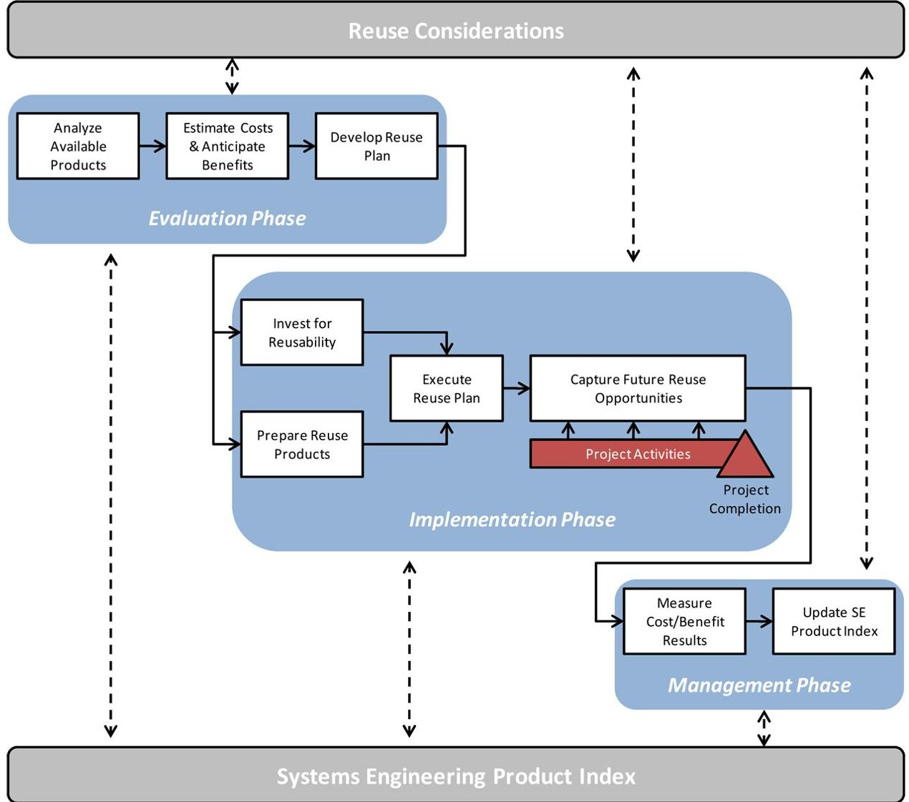

<!-- PDF_PAGE: 1 -->

# A Framework for Reusing Systems Engineering Products

Jared Fortune $ ^{1} $ and Ricardo Valerdi $ ^{1,2,*} $

$ ^{1} $The Aerospace Corporation, 2310 E. El Segundo Blvd., El Segundo, CA 90245-4691 $ ^{2} $University of Arizona, 1127 East James E. Rogers Way, Tucson, AZ 85721

Received 30 September 2011; Revised 4 June 2012; Accepted 4 June 2012, after one or more revisions Published online 12 November 2012 in Wiley Online Library (wileyonlinelibrary.com). DOI 10.1002/sys.21232

## ABSTRACT

As budgetary pressure on large complex systems continues to increase, the interest in reusing systems engineering products is emerging. Reuse is the idea of leveraging previously developed products (i.e., hardware, software, designs, outcomes of a process) into a new application for purposes of improving project attributes such as quality, cost, schedule, or risk. While reuse is well documented and commonly practiced in the domains of software and product-line development, limited research has been performed on the (deliberate or accidental) reuse of systems engineering products. This paper classifies such products as those generated as outputs of both the systems engineering process, including architecture elements, requirements, test plans, and interface specifications, as well as the overall system design process. Through reuse, systems engineers may not need to repeat certain development activities associated with these products, potentially reducing effort, or obtaining schedule/risk benefits through the utilization of heritage products. To begin addressing the topic of reuse from a systems engineering perspective, this paper presents a generalized framework for the reuse of systems engineering products; documenting the key considerations, activities, and resources necessary for effective reuse. Building on insight from systems engineering practitioners and previous work by the authors on systems engineering cost estimation, the framework is intended to serve as a tool for planning, executing, and managing reuse activities, as well as identifying reuse opportunities. $ \textcircled{c} $ 2012 Wiley Periodicals. Inc. Syst Eng 16: 304-312, 2013

Key words: reuse; cost estimation; COSYSMO

## 1. REUSE BACKGROUND

As the demand for systems with greater performance, wider compatibility, higher reliability, and shorter development cycles continues to grow, systems engineers are challenged to push technical limits while still maintaining a manageable level of complexity as well as realistic cost goals. Frequently,

the only way for a systems engineer to satisfy these often conflicting demands is to reuse previously generated systems engineering products. Since few (if any) systems are "built from scratch," a systems engineer is likely to reuse these products, such as architecture elements, requirements, test plans, and interface specifications. This paper describes the research associated with developing a generalized framework for the reuse of systems engineering products; documenting the key considerations, activities, and resources necessary for effective reuse.

The major challenge associated with reuse within the systems engineering domain is that the traditional view of reuse is focused more on reusing tangible products, including

<!-- PDF_PAGE: 2 -->

systems, components, hardware, software [Wymore and Bahill, 2000]. This perspective overlooks the potential reuse of less tangible products of the system development effort, which are common outputs of the systems engineering process. Within the scope of this research, the term systems engineering "product" is used in the context of a product generated as an output of the systems engineering process, such as architecture elements, requirements, test plans, and interface specifications. While the term "reuse" may not be in the vocabulary of every systems engineer, the concept is similar to "commonality," "platform engineering," or "product-line development," which occurs frequently as part of the systems engineering process.

While this second version of the cost model provided a quantitative approach for estimating systems engineering reuse, the associated research effort also revealed the lack of guidance available to the systems engineering community for dealing with the process of reusing a product or taking into account a variety of qualitative, but economically impactful, considerations.

This paper leverages insights and experiences from practitioners to refine prior research and progress towards a systems engineering reuse framework, provide a generalized process for reusing systems engineering products, and document key considerations for reuse success. The target audience of this paper, particularly in terms of the identification of systems engineering products for reuse and application of the reuse framework, are systems engineering managers and program managers.

## 1.1. Example Systems Engineering Products for Reuse

The motivation for researching reuse within the systems engineering domain emerged not out of simple academic curiosity, but rather practitioner need. After the utilization of a systems engineering cost model [Valerdi, 2008] at several diversified engineering organizations, practitioners observed significant differences between model results (estimates for systems engineering effort) and historical data across a subset of systems. Further investigation into these observed differences revealed that the systems in this subset contained a substantial amount of reuse of systems engineering products. To address this shortfall, a second version of the cost model was developed with the capability to quantify the effect of reuse on the systems engineering effort estimate [Fortune, 2010].

In earlier work [Wang, Valerdi, and Fortune, 2010], possible types of systems engineering reuse were described including "adopted," "modified," "deleted," and "managed." The generalized idea behind identifying these types (or categories) of reuse is to identify the degree of reuse associated with a product to an (anticipated) amount of cost/effort savings. From a modeling perspective, the connection between the product being reused and the degree of reuse is incorporated as a mathematical weight. While previous research [Fortune et al., 2009] has identified a mathematical formulation for a reuse model, it is necessary to also identify the various products that can be leveraged into savings via reuse. While other types of products exist, this list below (additional examples

identified in Table III) contains the most common candidates for reuse as identified by systems engineering subject matter experts:

a. System requirements

b. System architectures

c. System description/design documents

d. Interface specifications (especially for legacy systems)

e. Configuration management plan

f. Systems engineering management plan

g. Well-established test procedures

h. User guides and operation manuals.

These products begin to outline the "what" of systems engineering reuse and provide the starting point for thinking about opportunities for reuse. A good criterion for identifying a potentially reusable product is:

Reuse candidates are routine, identifiable products that encapsulate lower-level functions or processes.

Products that are routine not only have wider set of potential reuse opportunities than more one-of-a-kind products, but also have likely been refined and proven over time, further improving reuse applicability. Products that encapsulate lower-level functions address the idea of targeting a "sweet spot" for reuse. Reuse of products at too high of a level may not be tailored enough for a specific application and still require substantial modifications. Reuse of products at too low of a level may require significant amounts of integration that could offset any anticipated effort savings. With these example products and guidelines in mind, the following section introduces generalizable considerations for reuse.

## 1.2. Reuse Heuristics

Prior research examined software reuse for general principles applicable to the reuse of systems engineering products, so that reuse benefits can be realized to the maximum potential [Mili, Mili, and Mili, 1995; Jacobson, Griss, and Jonsson, 1997; Lim, 1998; Poulin, 1997; Reifer, 1997; Selby, 2005]. This guidance was initially captured in a set of six heuristics that serve to inform reuse decisions [Fortune and Valerdi, 2008]. This list of six was elaborated to ten heuristics—not considered to be mutually exclusive—and has been validated by the literature and expert feedback. These ten heuristics are provided as a basis for illustrating how better reuse decisions can be made:

Heuristic #1: Reuse is not free, upfront investment is required (i.e., there is a cost associated with design for reusability).

Heuristic #2: Reuse needs to be planned from the conceptualization phase of programs.

Heuristic #3: Most project related products can be reused.

Heuristic #4: Reuse is more successful when level of service requirements are equivalent across applications.

Heuristic #5: Reuse is as much of an organizational issue as it is a technical one.

<!-- PDF_PAGE: 3 -->

Heuristic #6: The benefits of reuse are nonlinear with regard to project size (i.e., small-scale systems have been shown to not enjoy the same benefit from reuse as large-scale systems).

Heuristic #7: Higher reuse opportunities exist when there is a match between the diversity and volatility of a product line and its associated supply chain.

Heuristic #8: Bottom-up (individual elements where make or buy decisions are made) and top-down (where product line reuse is made) reuse require fundamentally different strategies.

Heuristic #9: Reuse applicability is often time dependent; rapidly evolving domains offer fewer reuse opportunities than static domains (i.e., products may have a "reuse" shelf life).

Heuristic #10: The economic benefits of reuse can be described either in terms of improvement (quality, risk identification) or reduction (defects, cost/effort, time to market).

These heuristics, aside from being helpful for making decisions related to reuse, are descriptive in nature. In other words, they describe how or why certain reuse properties exist. The next step in further understanding reuse is to provide prescriptive strategies related to reuse. Following these strategies, a reuse framework is described that provides more specific advice about how reuse can be leveraged into benefits for a project while being embedded in organizational practices.

## 1.3. Reuse Approaches

Systems engineering practitioners generally pursue two approaches for reusing systems engineering products: opportunistically and strategically. Presented in Table I, each approach has advantages and disadvantages and must align with the orientation (i.e., stove-pipe, matrix) and rhythm (i.e., rapid, measured) of the systems engineering organization to be effective.

Opportunistic reuse is commonly the default strategy for systems engineering organizations, attempting to obtain savings through reuse, but without an overarching plan for how this will be accomplished. Practitioners who follow opportunistic reuse frequently cite the experience of reusing an available product actually costing more than using a new product, primarily due to failing to account for the number of conditions that must be in place to achieve success. Along with higher than anticipated initial costs, the "copy and paste" aspect of an opportunistic approach frequently results in higher than anticipated long-term (i.e., operations, maintenance) costs. Too often, a (commonly short-term) business goal drives the adoption of opportunistic reuse, rather than strategically reusing products as a means to achieve a (realistic, long-term) business goal—described in the following paragraph.

Strategic reuse is a more disciplined approach to reuse with greater expected benefits. In this approach, reuse is more deliberate and process-oriented; candidate products for reuse are identified upfront, and an investment in making a product more reusable may be made. Through this approach, strategic reuse helps to maximize benefits while minimizing the potential for breakage (unforeseen, negative impacts on the system). Because strategic reuse requires an organization to have a disciplined perspective on reuse, a framework was developed to help capture the relevant considerations and process steps that increase the chance of reuse success.

Within the context of strategic reuse, there are two general methods for executing this approach: the theoretical and the practical. The theoretical method involves steps traditionally described for reuse, including the completion of a domain analysis, the identification of common product features, and finally execution. Several challenges exist with this method. Conducting a thorough domain analysis can be difficult, and it is unclear who manages a product once identified for reuse as well as how repeatability is captured. While similar, the practical method emphasizes greater ease of implementation and repeatability; steps include evaluating existing products, identifying common products, extracting these into a product

Table I. Opportunistic vs. Strategic Approaches to Reuse

<table border="1"><tr><td></td><td>Opportunistic Reuse</td><td>Strategic Reuse</td></tr><tr><td>Definition</td><td>Limited up-front identification of reuse opportunities or specific products</td><td>Opportunities and specific products for reuse are pre-identified</td></tr><tr><td>Application</td><td>Considered on an ad-hoc basis</td><td>Considered prior to project start, often with product-line implications</td></tr><tr><td rowspan="2">Advantages</td><td>No requirement for investment in reusability or a product repository</td><td>Product more likely to be designed for reuse; fewer implementation issues</td></tr><tr><td>Reuse can be pursued during any stage of the project</td><td>Greater chance of reuse success due to up-front planning</td></tr><tr><td rowspan="2">Disadvantages</td><td>Identified product may not be intended for reuse</td><td>Investment needed to manage products for current/future reuse</td></tr><tr><td>Late-stage reuse may cause unplanned effects(i.e. breakage, excessive re-testing, re-work)</td><td>Limited reuse opportunities following project start</td></tr><tr><td>Requirements</td><td>Awareness of internal/external products</td><td>Mature product repository exists and resources available to tailor products to a particular application</td></tr></table>

<!-- PDF_PAGE: 4 -->

repository, performing configuration management on these products, and finally execution. By using existing (proven) products, some risk associated with breakage can be mitigated and implementation challenges can be reduced. By extracting the common features from these products, and either transforming these feature sets into (albeit smaller) products themselves or at least highlighting these features for ease of recognition when conducting a reuse survey, reusability can be improved.

## 2. SYSTEMS ENGINEERING REUSE FRAMEWORK

Others have attempted to define frameworks to help reason about reuse in software engineering [Biggerstaff and Richter, 1987; Malak and Paredis, 2007]. However, nobody has specifically treated the question of reuse in the systems engineering context, with the exception of Wymore and Bahill [2000], who explore the idea of reusing systems rather than products of the systems engineering process. One could argue that many of the same principles from software engineering reuse apply to systems engineering reuse, which is generally true. However, there are some unique differences between software engineering and systems engineering that warrant the development of systems engineering-specific metrics, models, and frameworks. We present the framework first since it provides a way to organize the remainder of the discussion.

A framework provides a means of thinking about, classifying, or managing concepts [Garud and Kumaraswamy, 1995]. Frameworks have been developed on a wide range of concepts, including software measurement [Kitchenham, Pfleeger, and Fenton, 1995] and manufacturing techniques [Young, 1992]. Process-related frameworks, such as the reuse framework presented in this paper, illustrate relationships between elements in a particular process [Carlile, 2004]. A framework is useful when it addresses an abstract concept and provides perspective or context. From a practitioner standpoint, a framework can enable concept standardization, facilitate communication, and encourage knowledge sharing [Garud and Kumaraswamy, 1995]. From a researcher standpoint, a framework can support proposition formulation [Budros, 1999], validate research methodology, and guide model development. Frameworks are developed from observations from literature, discussions with subject matter experts, examples from industry, or a combination of methods [Young, 1992]. Validation of a framework occurs through iterations with subject matter experts and/or comparisons with industrial examples [Kitchenham, Pfleeger, and Fenton, 1995].

Table II. Framework Evaluation Criteria

<table border="1"><tr><td>Criteria</td><td>Addressed by Framework</td></tr><tr><td>Definition</td><td>Categories of reuse, boundaries of process</td></tr><tr><td>Fidelity</td><td>Developed with expert opinion, literature/industry observations</td></tr><tr><td>Scope</td><td>Applicable to systems engineering organizations</td></tr><tr><td>Objectivity</td><td>Generalizable to areas beyond which it was developed</td></tr><tr><td>Constructiveness</td><td>Relevant, standardized process</td></tr><tr><td>Detail</td><td>Multi-level framework that provides informative “big picture” as well as actionable information</td></tr><tr><td>Stability</td><td>Applicable across multiple organizations and domains</td></tr><tr><td>Ease of use</td><td>Provides operational guidance and description of framework</td></tr><tr><td>Prospectiveness</td><td>Covers reuse process from beginning to end of life cycle</td></tr><tr><td>Parsimony</td><td>Driven by industry inputs, validated through expert opinion</td></tr></table>

The framework presented in this paper describes the process for how an organization should evaluate, implement, and manage the reuse of systems engineering products. The criteria for a good framework are similar to the criteria for a good model [Boehm, 1981]. Table II lists these criteria and identifies how the reuse framework addresses each.

One of the benefits of a framework is its ability to communicate a common process to people. The reuse framework we present (Fig.1) is a multilevel concept identifying the actions that comprise the process of reusing systems engineering products. At its core, the framework presents the type and order of activities that should be conducted to improve the likelihood of reuse success. Although an opportunistic approach can be successful, the disciplined and more repeatable nature of a strategic approach improves the likelihood of reuse success. The intention of the framework is to aid the user in transitioning from an opportunistic to a strategic approach or further refining a strategic approach.

## 2.1. Reuse Activities

The individual activities associated with reuse are illustrated as white rectangles in Figure 1. These activities occur before, during (represented by the small rectangle labeled Project Activities and milestone triangle), and after the execution of the project-of-interest; however, nearly all of the reuse activities occur prior to, or following, the overall project activities. $ ^{1} $ Above and below these actions are gray (light green online) boxes representing the reuse considerations and systems engineering products. The dotted bidirectional arrows represent information flows into and out of the reuse activities. For each activity, products are either pulled from the index (i.e., repository) for reuse or pushed into the index for future reuse. Similarly, each activity either takes reuse considerations into account or identifies new considerations for future reuse attempts. The following sections provide a description of the three phases of the reuse framework—evaluation, implementation, management—and describe specific considerations at each phase that represent industry best practices. $ ^{2} $

<!-- PDF_PAGE: 5 -->

Figure 1. Systems engineering reuse framework. [Color figure can be viewed in the online issue, which is available at wileyonlinelibrary.com.]

## 2.1.1. Evaluation Phase

2. 1.1.1. Analyze Available Products. The first phase an organization should undergo when considering reuse is to evaluate existing products and develop a plan for the execution. This involves determining what products are available and how applicable they are to the project-of-interest. The available products include both internally-developed products $ ^{3} $ (i.e., requirements, test procedures, management plans, etc.) as well as externally-developed or acquired products (i.e., GOTS, COTS, modeling tools, etc.). In some cases an organization can pull from their existing index of systems engineering products. In cases where such a repository does not exist, the analysis is focused on make/buy decisions to determine which externally developed products meet the needs of the program.

Hardware and software products have a significant influence on systems engineering reuse. The deliberate planning and reuse of system components determine whether certain systems engineering products can be reused. As a result, systems engineering reuse considerations should be made in conjunction with hardware and software reuse planning.

The analysis step also involves the identification of opportunities for future products to be developed for reuse. For

example, a systems engineering may ask "how much of this requirement will be similar in the next project?" Once determining the degree of commonality, a decision can be made whether to invest in reusability.

2. 1.1.2. Estimate Costs and Anticipate Benefits. Once potential products have been identified, the organization needs to determine the expected costs of reuse as well as their anticipated savings/benefits. The costs are those associated with either developing the product to be reusable or tailoring the reusable product for a specific application. Anticipated savings from reuse can be cost/effort reductions or benefits such as shorter schedules or lower risk. An estimation tool such as the Constructive Systems Engineering Cost Model (COSYSMO 2.0) [Wang, Valerdi, and Fortune, 2010] can be applied at this step to assist with quantifying the potential cost/benefit.

For organizations planning to invest in reusable products it is necessary to estimate anticipated return-on-investment

<!-- PDF_PAGE: 6 -->

for such development. This can be done by estimating the reuse percent of a product, reuse cost avoidance, or reuse value added to identify the ROI for either a project or an organization [Poulin, Caruso, and Hancock, 1993; Boehm, Valerdi, and Honour, 2008].

2. 1.1.3. Develop Reuse Plan. Assuming that the anticipated benefits of reuse outweigh the estimated costs, an actionable plan should be developed for how/when/to what degree each product will be implemented. The plan could be program-specific (outlining the details on which product will be reused from other programs and which products will be developed for future reuse) or platform-specific (outlining a broader strategy that identifies specific areas of commonality across families of programs. Either approach can be tightly coupled with a CMMI $ ^{5} $ quantitative management plan. For example, rather than rewriting a test procedure document in its entirety, an alternative approach would be to retain the main part of the document and create an appendix that is to be updated based on each project. The customer can buy-in to the "core" test procedure document and focus their review on the relevant appendices specific to their project. Subsequent project teams can then leverage this core document, already accepted by the customer, thereby reducing the amount of required activities and ultimately effort. A high degree of commonality exists across programs for documents such as: life cycle cost and independent assessment report, system safety program plan, and hazard analysis. Heavy reuse also exists in documents such as a Configuration Management Plan and a Systems Engineering Management Plan.

2. 1.2.2. Prepare Reuse Products. The preparation step readies both the product and the organization for reuse. Preparation includes extracting the product from the repository, conducting an integrity review, potentially making minor modifications for the application, and establishing familiarity with the product.

2. 1.2.3. Execute Reuse Plan. Once the products have been prepared, the reuse plan can be executed. Execution involves applying each product at the appropriate point in project development. Attention should be paid to avoid deviation from the plan or at least document any adjustments in order to maximize repeatability of the process in the future or record lessons learned to help avoid issues.

## 2.1.2. Implementation Phase

2. 1.2.1. Invest for Reusability. The second phase involves implementing the reuse plan while the project-of-interest is being completed in parallel. At this point, an organization should invest in developing/tailoring a reusable product (if applicable) or preparing the desired products (preselected from the prior analysis) for reuse.

2. 1.2.4. Capture Future Reuse Opportunities. As the overall project proceeds (illustrated by the small rectangle in Fig. 1), the organization should be simultaneously working to capture future reuse opportunities, such as other processes/plans/tools. This step requires maintaining a strategic perspective in order to associate reuse potential opportunities

with other projects to establish cross-program reuse (also known to as "platform reuse" or "product line reuse"). A best practice from industry has demonstrated that investment in reuse by individual programs is nowhere near as effective as if multiple (at least two) organizations commit to using a product prior to investing for reuse. Moreover, cross-domain reuse is extremely difficult unless low-level features (small work unit) can be identified as common.

## 2.1.3. Management Phase

2. 1.3.1. Measure Cost/Benefit Results. After the project has been completed, several reuse management activities remain. One is to measure the actual costs and realized benefits of the reuse products implemented. This information should be included in the repository along with the products to assist with the evaluation of similar products in future reuse applications. The collection of actual cost (and benefit) data can also be incorporated back into a systems engineering reuse estimation model (e.g., COSYSMO) to refine a local calibration of the model and improve the estimation power of the tool for future applications. These activities provide both heritage and traceability of results for reusing products, as well as help to build justification for reuse in the future.

2. 1.3.2. Update Product Index. The final activity in this phase is to update the product index with the actual cost/benefit data collected, along with any other products that were identified during the execution of the project as having potential for future reuse applications. Ideally, updating the repository should be a dynamic process that occurs throughout the project lifecycle (illustrated by dotted arrows to/from the Systems Engineering Product Index rectangle), potentially even in an automated fashion. The index itself should be a searchable database with links to ancillary information about the product and managed by a single group/team that ensures consistency and completeness of submissions. More information about the product index is provided in Section 2.3.

## 2.2. Reuse Considerations

Through all reuse activities, reuse considerations need to be both taken into account as well as identified for future applications. Most reuse considerations are generalized heuristics that serve as guidance or lessons learned for organizations to improve their ability to reuse successfully (see Sec. 1.2). Through recent discussions with systems engineering practitioners and reviews of relevant literature, we have initiated an effort to document these considerations. Below is a subset of the considerations identified by practitioners at two recent industry workshops. $ ^{6} $

## Product Considerations.

- Reuse brings the potential for cost savings, along with the potential to inherit product defects; however, a reusable product proven to work (and has few defects) will likely work again.

- Traceability is a pre-requisite for successful reuse (i.e., documented heritage).

<!-- PDF_PAGE: 7 -->

- Developer may need to prove to customer that a reused product is identical/sufficient.

- Characteristics of an existing product should align (to the greatest extent possible) with domain, technology evolution, and level of service requirements of intended application (i.e., products designed for low-reliability environments will not work in high-reliability environments).

- When using external products, ensure the rights to the associated knowledge have been obtained.

- User must be made aware of the product, such as through an index or search tool, and the product must be accessible to the user for transfer [Agresti, 2011].

- A measure of a successful repository is not the number of products it contains; it is how often the products get reused.

## Activity/Process Considerations.

- Projects where "cost is king" may make justifying a strategic reuse approach challenging, since an upfront investment to make a product reusable may be required and project managers may not want to pay for it out of their own budget.

- It may be more effective to measure the results of reuse, rather than any reduction in activities performed prior to completion; reuse savings are not fully realized until implementation is complete.

- If not managed properly, product reuse can introduce additional (usually unanticipated) risks into a project.

- Organizational/Governance Considerations.

- Past experiences may result in positive/negative biases on the applicability/benefit of reusing a particular product (i.e., "this didn't work before"); each application should be evaluated independently based on the fact that the context and customer are likely different.

- Engineers may have a "not invented here mentality" and discourage reuse.

- A customer may simply prefer new products over reused products; or vice versa.

- Reuse is only one aspect of the make/buy decision.

- The cost/benefit of reuse can be improved or impaired, depending on the degree of synergy across programs [Sillitto, 2010].

- Managing a product index is critical to supporting current/future reuse activities; a consistent structure is essential to avoid configuration issues from diverse groups/locations.

- A formal governance process for the reuse framework needs to be in place so that periodic reviews of the product index and decision criteria (e.g., ROI calculations, make/buy/reuse, etc.) are in place.

Table III. Candidate Fields for Reuse Repository and Potential Content

While we recognize this list of considerations is by no means exhaustive, it provides a foundation for at capturing the "intangibles" that can dramatically affect reuse success, but are not commonly considered while implementing systems engineering reuse.

<table border="1"><tr><td>Function</td><td>Business development
Finance
Hardware
Software systems</td></tr><tr><td>Product Type</td><td>Lessons learned
Program plans
Site initiative
Six sigma
CMMI
Checklists
Tailoring processes
Utilities
Technical papers
Work breakdown structure</td></tr><tr><td>Scope/Applicability</td><td>Across the board
Specific lines of business</td></tr><tr><td>Applicable site(s)</td><td>Headquarters
Geographic site A
Geographic site B
Geographic site C</td></tr><tr><td>End user(s)</td><td>Systems engineering
Quality
Integrated Product Teams
Program Management</td></tr><tr><td>Program name</td><td>The source of the product</td></tr><tr><td>Cost type</td><td>Cost plus award fee
Fixed price, time and material</td></tr><tr><td>Program size</td><td>Small
Medium
Large</td></tr></table>

## 2.3. Systems Engineering Product Index

A mature reuse strategy involves a disciplined process for contributing to a product repository, as represented by the bottom rectangle in the reuse framework (Fig. 1). A board of reviewers (i.e., a clearing house), organized by expertise, should be tasked with identifying exemplary products that are worthwhile adding to the repository. This allows easy access to the repository, when someone searches by key word(s) so that they can find instructions, templates, forms, and tools. A list of possible index fields is provided in Table III. Naturally, each organization should select the fields with the most appropriate metadata that would result in a thorough description of each product and in the highest number of successful searches by users.

## 3. CONCLUSION

With the framework and considerations described in this paper, a systems engineering organization should have a greater awareness of the expected challenges and benefits associated with reuse, along with how to implement a reuse strategy with greater success. The reuse framework is expected to continue to evolve over time and reflect the experiences of systems engineering practitioners across a variety of contexts. It must be noted that the proposed framework is most effective in circumstances where repeatability is high; it is not very useful in unprecedented projects that require custom elements.

<!-- PDF_PAGE: 8 -->

This work has significant implications for researchers and practitioners. For researchers, it provides a platform for understanding and planning new experiments to test the effectiveness of various reuse strategies. For practitioners, it provides a basis for establishing or benchmarking systems engineering reuse programs.

## ACKNOWLEDGMENTS

Funding for this work was provided by The Aerospace Corporation's independent research and development program. Numerous individuals provided inputs to the framework including Barry Boehm (USC), Ron Carson (Boeing), Paul Frenz (General Dynamics), Mauricio Pena (Boeing), Jennifer Lukas (Boeing), Gaston Mascarenas (General Dynamics), Allan McQuarrie (BAE Systems), Jeff Poulin (Lockheed Martin), Garry Roedler (Lockheed Martin), and Gan Wang (BAE Systems). We also acknowledge the participation and feedback from attendees of the 25th COCOMO Forum at USC in November 2010, the INCOSE International Workshop in Phoenix, AZ in January 2011, and the INCOSE Measurement Working Group Meeting in Denver, CO in June 2011.

## REFERENCES

W.W. Agresti, Software reuse: Developers' experiences and perceptions, J Software Eng Appl 4(1) (2011), 48-58.

T. Biggerstaff and C. Richter, Reusability framework, assessment, and directions. IEEE Software 4(2) (1987), 41-49.

B.W. Boehm, Software engineering economics. Prentice Hall, 1981.

B.W. Boehm, R. Valerdi and E. Honour, The ROI of systems engineering: Some quantitative results for software-intensive systems, Syst Eng 11(3) (2008), 221-234.

A. Budros, A conceptual framework for analyzing why organizations divide, Org Sci 10(1) (1999), 69-82.

P. Carlile, Transferring, translating, and transforming: An integrative framework for managing knowledge across boundaries, Org Sci 15(5) (2004), 555-568.

J. Fortune, Estimating systems engineering reuse with COSYSMO 2.0, VDM Verlag, Saarbrücken, Germany, 2010.

J. Fortune and R. Valerdi, Considerations for successful reuse in systems engineering, AIAA Space 2008, San Diego, CA, September 2008.

J. Fortune, R. Valerdi, B.W. Boehm, and F.S. Settles, Estimating systems engineering reuse, Conf Syst Eng Res, Loughborough, UK, April 2009.

R. Garud and A. Kumaraswamy, Technological and organizational designs for realizing economies of substitution, Strategic Management J 16(1) (1995), 93-109.

I. Jacobson, M. Griss, and P. Jonsson, Software reuse: Architecture process and organization for business success. Addison-Wesley Professional, Reading, MA, 1997.

B. Kitchenham, S. Pfleeger, and N. Fenton, Towards a framework for software measurement validation, IEEE Trans Software Eng 21(12) (1995), 929-944.

W. Lim, Managing software reuse, Prentice Hall, Upper Saddle River, NJ, 1998.

R.J. Malak and C.J.J. Paredis, Validating behavioral models for reuse, Res Eng Des 18(3) (2007), 111-128.

H. Mili, F. Mili and A. Mili, Reusing software: Issues and research directions, IEEE Trans Software Eng 21(6) (1995), 528-562.

J.S. Poulin, Measuring software reuse, Addison-Wesley, Reading, MA, 1997.

J.S. Poulin, J.M. Caruso, and D.R. Hancock, The business case for software reuse, IBM Syst J 32(4) (1993), 567-594.

D. Reifer, Practical software reuse, Wiley, Hoboken, NJ, 1997.

R. Selby, Enabling reuse-based software development of large-scale systems, IEEE Trans Software Eng 31(6) (2005), 495-510.

H.G. Sillitto, Building a re-use infrastructure: Optronics reference architecture and layered reference model, INCOSE Symp, Chicago, IL, 2010.

R. Valerdi, The constructive systems engineering cost model (COSYSMO): Quantifying the costs of systems engineering effort in complex systems, VDM Verlag, Saarbrücken, Germany, 2008.

G. Wang, R. Valerdi, and J. Fortune, Reuse in systems engineering IEEE Syst J 4(3) (2010), 376-384.

A.W. Wymore and A.T. Bahill, When can we safely reuse systems, upgrade systems, or use COTS components, Syst Eng 3(2) (2000), 82-95.

S.M. Young, A framework for successful adoption and performance of Japanese manufacturing practices in the United States, Acad Management Rev 17(4) (1992), 677-700.

Jared Fortune is a Senior Member of the Technical Staff at The Aerospace Corporation in the Military Satellite Communication Division. His role includes providing systems engineering and cost analysis across a diverse range of space systems. Dr. Fortune is a Visiting Associate at the Center for Systems & Software Engineering at the University of Southern California, Los Angeles, CA and teaches a graduate course on economic considerations for systems engineering. He earned his B.S., M.S., and Ph.D. from the University of Southern California in Industrial & Systems Engineering. Dr. Fortune is a member of INCOSE.

<!-- PDF_PAGE: 9 -->

Ricardo Valerdi is an Associate Professor at the University of Arizona in the Department of Systems & Industrial Engineering. Previously he was a Research Associate in the Engineering Systems Division at the Massachusetts Institute of Technology. His research focuses on systems engineering metrics, cost estimation, test & evaluation, human systems integration, enterprise transformation, and performance measurement. His research has been funded by Army, Navy, Air Force, BAE Systems, Lockheed Martin, Raytheon, and the IBM Center for the Business of Government. Dr. Valerdi is the co-Editor-in-Chief of the Journal of Enterprise Transformation and the Journal of Cost Analysis and Parametrics. He served on the Board of Directors of the International Council on Systems Engineering (INCOSE) and is a Senior Member of the Institute of Electrical and Electronics Engineers (IEEE). He received a Ph.D. in Industrial & Systems Engineering from the University of Southern California, Los Angeles, CA.