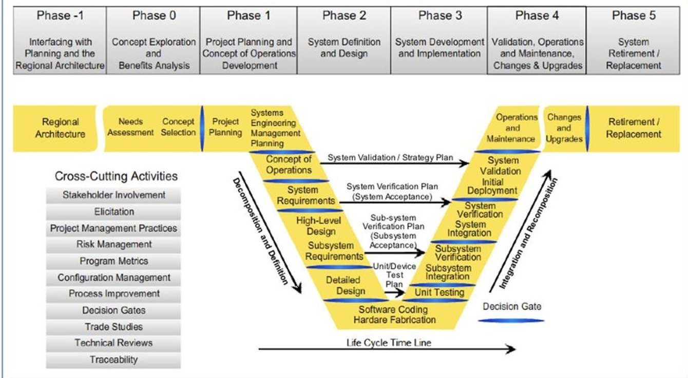
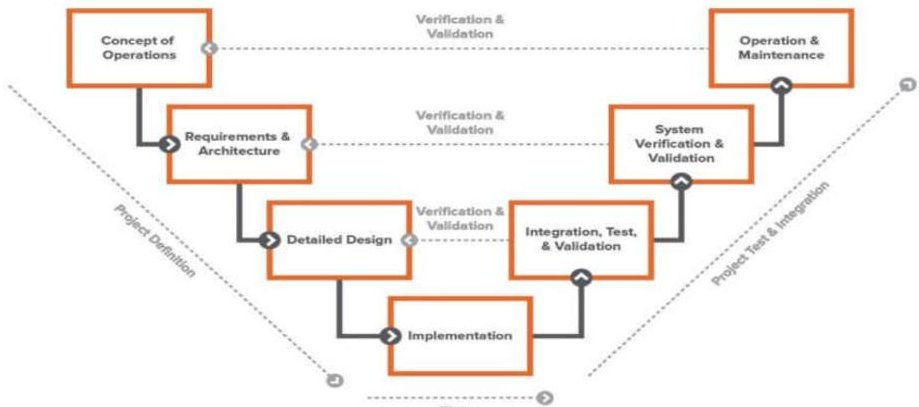

<!-- PDF_PAGE: 1 -->

ISSN: 2394-658X

# A Framework for Agile Requirements Engineering in Large-Scale Projects

Iqtiar Md Siddique

Department of Industrial, Manufacturing, and Systems Engineering, The University of Texas at El Paso, USA. Email id - iqtiar.siddique@gmail.com.

## ABSTRACT

In today's rapidly evolving technological landscape, large-scale projects demand adaptive methodologies to effectively manage requirements engineering processes. Traditional waterfall approaches often struggle to keep pace with changing project dynamics, leading to delays, cost overruns, and suboptimal outcomes. In response to these challenges, the adoption of agile methodologies has gained traction, offering flexibility, responsiveness, and enhanced collaboration throughout the project lifecycle. This paper proposes a comprehensive framework for agile requirements engineering tailored specifically for large-scale projects. Drawing upon principles from agile development methodologies such as Scrum and Extreme Programming (XP), as well as best practices in requirements engineering, the framework provides a structured approach to managing requirements in dynamic and complex project environments. At the core of the framework is a iterative and incremental approach to requirements elicitation, analysis, prioritization, and validation. Emphasizing user involvement and stakeholder collaboration, the framework advocates for the continuous refinement of requirements throughout the project lifecycle. This iterative process allows for early detection and resolution of ambiguities, inconsistencies, and evolving stakeholder needs, mitigating the risk of costly changes later in the development process. Key components of the framework include user stories, feature prioritization techniques, and iterative prototyping to facilitate effective communication and alignment between stakeholders and development teams. Cross-functional collaboration, facilitated by dedicated product owners and scrum masters, ensures that requirements are understood, validated, and delivered in a timely manner. In conclusion, the proposed framework offers a systematic and adaptable approach to agile requirements engineering in large-scale projects. By embracing principles of agility, collaboration, and continuous improvement, organizations can enhance their ability to deliver high-quality products that meet stakeholder expectations, even in the face of complexity and uncertainty.

## Key words: Framework, Agile, Requirements Engineering, Large-Scale Projects, Methodology

## INTRODUCTION

In the ever-evolving landscape of software development, the importance of effective requirements engineering cannot be overstated. Requirements serve as the foundation upon which software systems are built, defining the scope, functionality, and quality attributes that ultimately determine the success or failure of a project. However, traditional approaches to requirements engineering have often struggled to keep pace with the dynamic nature of modern software projects, particularly in large-scale and complex environments [1].

Evolution of Requirements Engineering: The field of requirements engineering has evolved significantly over the years in response to the growing complexity and diversity of software systems. Traditional waterfall methodologies, characterized by sequential phases of requirements elicitation, analysis, and specification, have given way to more iterative and collaborative approaches [2]. Agile methodologies, such as Scrum, Extreme Programming (XP), and Kanban, have gained popularity for their ability to adapt to changing requirements and deliver value incrementally [3]. The framework also addresses scalability and governance concerns inherent in large-scale projects. It offers guidelines for managing dependencies, coordinating work across distributed teams, and integrating agile practices with existing project management frameworks. Additionally, the framework emphasizes the importance of metrics and feedback mechanisms to monitor progress, identify bottlenecks, and continuously improve the requirements engineering process [4]. To validate the effectiveness of the framework, a case study of its application in a real-world large-scale project is presented. The case study highlights the practical challenges encountered and the strategies employed to address them, providing valuable insights for practitioners seeking to adopt agile requirements engineering in their own projects.

<!-- PDF_PAGE: 2 -->

Challenges in Large-Scale Projects: Large-scale software projects present unique challenges that necessitate specialized approaches to requirements engineering. The sheer size and complexity of these projects amplify the risk of miscommunication, scope creep, and stakeholder conflicts. Traditional requirements engineering practices, which rely heavily on upfront documentation and formalized processes, often struggle to accommodate the dynamic nature of large-scale projects, leading to delays, cost overruns, and diminished stakeholder satisfaction [5].

The Agile Paradigm Shift: Agile methodologies represent a paradigm shift in software development, advocating for flexibility, collaboration, and customer-centricity. Agile principles, such as iterative development, self-organizing teams, and continuous feedback, offer a compelling alternative to traditional approaches, particularly in large-scale projects where requirements are inherently uncertain and subject to change. By embracing agility, organizations can adapt to evolving requirements, mitigate risks, and deliver value more effectively.

The Need for Agile Requirements Engineering: While agile methodologies have demonstrated success in many contexts, their adoption in large-scale projects presents unique challenges. One of the key challenges lies in effectively managing requirements in agile environments, where priorities are constantly shifting, and stakeholder needs are evolving. Agile requirements engineering seeks to address this challenge by providing a systematic and adaptable approach to requirements elicitation, analysis, prioritization, and validation within the context of agile development.

Purpose of the Framework: The purpose of this paper is to propose a comprehensive framework for agile requirements engineering specifically tailored for large-scale projects. Building upon principles from agile methodologies and best practices in requirements engineering, the framework aims to provide guidance and support to organizations embarking on large-scale software projects. By offering a structured approach to managing requirements in agile environments, the framework seeks to address the unique challenges and complexities inherent in large-scale projects while leveraging the benefits of agility.

In the following sections, we will delve into the core components of the framework, including its underlying principles, key activities, and best practices. Through a detailed exploration of each component, we aim to provide a practical roadmap for organizations seeking to adopt agile requirements engineering in their own large-scale projects. Additionally, we will present a case study illustrating the application of the framework in a real-world context, highlighting the challenges encountered and the strategies employed to overcome them. Ultimately, our goal is to offer valuable insights and practical guidance to practitioners and researchers alike, fostering a deeper understanding of agile requirements engineering and its role in driving success in large-scale software projects [6].

Figure 1: Guiding the Project: The Systems Engineering Process [7]

Framework Overview: The proposed framework for agile requirements engineering in large-scale projects is built upon a foundation of agile principles and best practices in requirements engineering. At its core, the framework emphasizes iterative and incremental development, stakeholder collaboration, and a focus on delivering value early and often. By breaking down the requirements engineering process into manageable iterations, teams can adapt to changing requirements, gather feedback from stakeholders, and make course corrections as needed. The framework also promotes transparency and visibility, ensuring that requirements are well-understood and aligned with project goals.

<!-- PDF_PAGE: 3 -->

Benefits of Agile Requirements Engineering: Adopting agile requirements engineering practices in large-scale projects offers a multitude of benefits. Firstly, it promotes stakeholder engagement and buy-in, fostering a sense of ownership and commitment among project stakeholders. By involving stakeholders early and often throughout the requirements engineering process, teams can ensure that the final product meets their needs and expectations. Additionally, agile requirements engineering enables teams to respond quickly to changing market conditions and customer feedback, reducing the time-to-market and increasing the likelihood of project success. Moreover, the iterative nature of agile development allows teams to uncover and address issues early in the development lifecycle, minimizing the risk of costly rework and delays. Overall, agile requirements engineering empowers teams to deliver high-quality software that meets customer needs, on time and within budget.

## METHODOLOGY

Literature Review: The methodology begins with a comprehensive review of existing literature on agile methodologies, requirements engineering, and large-scale project management. This includes academic papers, industry reports, case studies, and best practices guides. The literature review serves to establish a foundational understanding of the theoretical and practical aspects of agile requirements engineering in large-scale projects.

## A. Framework Development:

Drawing upon insights garnered from an extensive literature review, the methodology advances to the development of a robust framework tailored for agile requirements engineering in large-scale projects. This framework is meticulously crafted to address the unique challenges and complexities inherent in managing requirements for expansive and dynamic projects. The development process involves several critical steps, including the identification of core principles, the definition of key activities, and the outlining of best practices for each stage of the requirements engineering process.

## B. Identification of Core Principles:

At the heart of the framework lies a set of core principles designed to guide the requirements engineering process. These principles emphasize flexibility, adaptability, and continuous improvement, which are essential for accommodating the evolving needs of large-scale projects. They also prioritize stakeholder collaboration, ensuring that the diverse perspectives and expertise of all involved parties are integrated into the requirements engineering process. Additionally, the principles advocate for a user-centric approach, focusing on delivering value to the end-users and aligning project outcomes with their needs and expectations.

## C. Definition of Key Activities:

Building on these core principles, the framework delineates a series of key activities that constitute the agile requirements engineering process. These activities are organized into distinct stages, each encompassing specific tasks and deliverables:

D. Initiation and Planning:

Establishing project goals and objectives

Identifying key stakeholders and their roles

Developing high-level requirements plan

Elicitation and Analysis:

Conducting workshops and interviews with stakeholders

Gathering and documenting user stories and requirements

Analyzing and prioritizing requirements based on their impact and feasibility

Specification and Documentation:

Creating detailed requirements specifications

Utilizing agile artifacts such as user stories, use cases, and acceptance criteria

Ensuring requirements are clear, concise, and testable

Validation and Verification:

Reviewing requirements with stakeholders to ensure accuracy and completeness

Conducting peer reviews and inspections

Performing acceptance testing to validate requirements against user needs

Change Management and Continuous Improvement:

Implementing a process for managing requirements changes

Continuously refining and updating requirements based on feedback and changing project conditions

Retrospectively analyzing project performance to identify areas for improvement

E. Outlining Best Practices:

To support the execution of these activities, the framework outlines a series of best practices tailored to the context of large-scale projects. These best practices include leveraging agile methodologies such as Scrum or Kanban to manage the iterative development of requirements, employing collaborative tools to facilitate communication and coordination among distributed teams, and integrating automated tools for requirements management and tracking. Additionally, the framework emphasizes the importance of maintaining a flexible and adaptable approach, allowing organizations to tailor the process to their specific needs and project contexts.

<!-- PDF_PAGE: 4 -->

## F. Flexibility and Adaptability:

The designed framework is inherently flexible and adaptable, recognizing that no two projects are identical and that organizations may need to adjust the framework to suit their unique circumstances. This flexibility is achieved by providing a modular structure that allows organizations to select and implement the components that are most relevant to their projects. Furthermore, the framework encourages continuous learning and improvement, enabling organizations to refine their requirements engineering practices over time and in response to new challenges and opportunities.

## G. Expert Consultation:

To ensure the robustness and practicality of the framework, expert consultation is sought from practitioners and researchers with expertise in agile methodologies and requirements engineering. Feedback from experts helps to refine the framework, identify potential pitfalls, and validate its applicability in real-world scenarios. This iterative process of consultation and refinement ensures that the framework aligns with industry standards and best practices. The collection of research by Siddique I. M. spans a diverse range of topics within engineering, technology, and environmental science, highlighting emerging trends, innovative technologies, and sustainable practices. In "Emerging Trends in Requirements Engineering: A Focus on Automation and Integration" (2023), Siddique examines the increasing role of automation and integration in requirements engineering, emphasizing the need for advanced methodologies to streamline processes and enhance system functionality. His work on "Carbon Nanotube-based Sensors" (2021) provides a comprehensive review of these advanced materials, detailing their applications and advantages in sensor technology [12-15].

Siddique's research also delves into sustainable practices, with "Sustainable Water Management in Urban Environments" (2022) and "Integrating Innovative Technologies and Practices to Address Water Scarcity and Pollution" (2021), where he explores strategies to tackle water-related challenges in urban areas. His contributions to sensor technology are further explored in "Exploring the World of Sensors - Advancements in Nanotechnology" (2022), which discusses the latest developments in nanotechnology-based sensors [15-20]. Moreover, Siddique's work on high-performance liquid chromatography (HPLC) is detailed in "Unveiling the Power of High- Performance Liquid Chromatography: Techniques, Applications, and Innovations" (2021) and "High-Performance Liquid Chromatography: Comprehensive Techniques and Cutting-Edge Innovations" (2023), showcasing advanced techniques and applications of HPLC in various fields [21-23].

His studies on systems engineering, including "Systems Engineering in Complex Systems: Challenges and Strategies for Success" (2022) and "Harnessing Artificial Intelligence for Systems Engineering: Promises and Pitfalls" (2022), provide insights into the complexities and strategies for successful implementation of systems engineering practices, especially with the integration of artificial intelligence.

## CASE STUDY SELECTION

A case study is selected to demonstrate the application of the framework in a real-world context. The case study should represent a large-scale software project with complex requirements and dynamic stakeholder interactions. Criteria for case study selection include project size, industry domain, geographic location, and availability of data. The selected case study serves as a practical example of how the framework can be implemented and adapted to address the challenges of large-scale requirements engineering.

A. Data Collection: Data collection for the case study involves gathering information on project objectives, stakeholder requirements, team dynamics, and project outcomes. This may include interviews with project stakeholders, observation of team meetings, analysis of project documentation, and review of project artifacts. The goal of data collection is to provide a comprehensive understanding of the project context and inform the application of the framework.

B. Framework Application: The framework is applied to the selected case study, following the guidelines and best practices outlined in the methodology. This involves iterative cycles of requirements elicitation, analysis, prioritization, and validation, guided by agile principles and practices. Throughout the application process, data is collected on the effectiveness of the framework in addressing project challenges, meeting stakeholder needs, and achieving project objectives.

C. Analysis and Evaluation: Data collected during the framework application phase is analyzed to evaluate the effectiveness of the framework in practice. This includes assessing the framework's ability to facilitate stakeholder collaboration, manage changing requirements, and deliver value incrementally. Key performance indicators may include project timelines, budget adherence, stakeholder satisfaction, and product quality. The analysis aims to identify strengths, weaknesses, and areas for improvement in the framework [8].

D. Framework Refinement: Based on the findings of the analysis, the framework is refined and updated as needed to address any identified shortcomings or gaps. This may involve revising guidelines, modifying activities, or incorporating additional best practices to enhance the framework's effectiveness and usability. The iterative process of refinement ensures that the framework remains relevant and applicable in evolving project environments.

<!-- PDF_PAGE: 5 -->

E. Documentation and Dissemination: The final step of the methodology involves documenting the framework, findings, and recommendations in a comprehensive report. This report serves as a valuable resource for practitioners, researchers, and organizations seeking guidance on agile requirements engineering in large-scale projects. Additionally, the findings may be disseminated through academic publications, conference presentations, and industry forums to contribute to the body of knowledge in the field.

## ROLE OF INDUSTRIAL ENGINEERS

Industrial engineering plays a crucial role in optimizing complex systems and processes across various industries, ultimately aiming to improve efficiency, productivity, quality, and safety. Here's an overview of the key roles and contributions of industrial engineering:

A. Process Optimization: Industrial engineers analyze and redesign processes to streamline operations and eliminate inefficiencies. This may involve studying workflows, identifying bottlenecks, and implementing strategies such as lean manufacturing or Six Sigma to enhance productivity and reduce waste.

B. System Integration: Industrial engineers focus on integrating various components of a system, such as machinery, equipment, and personnel, to ensure smooth and efficient operation. They design layouts, develop scheduling systems, and implement automation technologies to optimize resource utilization and minimize downtime.

C. Quality Management: Industrial engineers play a vital role in ensuring product and service quality by implementing quality control measures and continuous improvement initiatives. They design and implement quality assurance processes, develop testing protocols, and analyze data to identify and address quality issues.

D. Supply Chain Management: Industrial engineers are involved in managing supply chains, from sourcing raw materials to delivering finished products to customers. They optimize logistics, inventory management, and distribution processes to minimize costs, reduce lead times, and improve customer satisfaction.

E. Workforce Management: Industrial engineers focus on optimizing workforce utilization and performance. They design job roles, develop training programs, and implement performance measurement systems to enhance employee productivity, morale, and safety [9,10].

F. Ergonomics and Human Factors: Industrial engineers consider the ergonomic and human factors aspects of work environments to ensure the health, safety, and well-being of workers. They design workstations, tools, and equipment to minimize physical strain and prevent workplace injuries.

G. Data Analysis and Decision Support: Industrial engineers utilize data analysis techniques and simulation models to inform decision-making and optimize processes. They collect and analyze data on key performance indicators, forecast future trends, and recommend improvements based on data-driven insights.

H. Sustainability and Environmental Management: Industrial engineers are increasingly focused on promoting sustainability and environmental stewardship within organizations. They design eco-friendly processes, optimize energy usage, and minimize waste generation to reduce environmental impact and enhance corporate social responsibility.

I. Project Management: Industrial engineers often take on project management roles, overseeing the planning execution, and completion of projects within budget and schedule constraints. They coordinate crossfunctional teams, manage resources, and mitigate risks to ensure project success.

J. Continuous Improvement: Industrial engineers promote a culture of continuous improvement within organizations by encouraging innovation, fostering collaboration, and implementing best practices. They lead initiatives such as Kaizen events and value stream mapping to drive ongoing process optimization and innovation.

Overall, industrial engineering plays a multifaceted role in enhancing the efficiency, effectiveness, and sustainability of organizations across a wide range of industries, contributing to their long-term success and competitiveness in the global marketplace.

Figure 2: Role of engineers [11]

<!-- PDF_PAGE: 6 -->

## CONCLUSION

Throughout this paper, we have explored the pressing challenges associated with water management in urban environments, highlighting the impact of urbanization, climate change, and aging infrastructure on water resources. By examining various sustainable water management strategies, including water conservation, water reuse, stormwater management, and green infrastructure, we've demonstrated that effective solutions are available to mitigate these challenges. The importance of sustainable water management cannot be overstated. Urban areas are at the forefront of population growth and industrialization, leading to increased water demand and pollution risks. Sustainable practices ensure that cities can meet the water needs of their residents while minimizing environmental impact. They also contribute to resilience against the effects of climate change and promote a healthier urban environment. A call to action is imperative for continued research and development in this field. Environmental engineers, policymakers, and communities must collaborate to advance sustainable water management practices. Investment in infrastructure, adoption of emerging technologies, and public education will be key factors in achieving long-term sustainability. To make meaningful progress, governments and regulatory bodies should establish clear policies and incentives that encourage the adoption of sustainable practices. International cooperation and knowledge sharing will further enhance the effectiveness of these efforts. In conclusion, sustainable water management is a cornerstone of future urban development. It is essential for maintaining a high quality of life and ensuring the responsible stewardship of our planet's resources. By embracing innovation and fostering collaborative efforts, we can create a more sustainable future for our urban environments.

## REFERENCES

[1]. Rodrigues, L. M., Carvalho, L. F. D. C. E. S., Bonnier, F., Anbinder, A. L., Martinho, H. D. S., & Almeida, J. D. (2018). Evaluation of inflammatory processes by FTIR spectroscopy. Journal of Medical Engineering & Technology, 42(3), 228-235.

[2]. Kumar, S., Chaudhary, S., & Jain, D. C. (2014). Vibrational studies of different human body disorders using ftir spectroscopy. Open Journal of Applied Sciences, 2014.

[3]. Baker, M. J., Gazi, E., Brown, M. D., Shanks, J. H., Gardner, P., & Clarke, N. W. (2008). FTIR-based spectroscopic analysis in the identification of clinically aggressive prostate cancer. British journal of cancer, 99(11), 1859-1866.

[4]. Guerrero-Perez, M. O., & Patience, G. S. (2020). Experimental methods in chemical engineering: Fourier transform infrared spectroscopyFTIR. The Canadian Journal of Chemical Engineering, 98(1), 25-33.

[5]. Christou, C., Agapiou, A., & Kokkinofta, R. (2018). Use of FTIR spectroscopy and chemometrics for the classification of carobs origin. Journal of Advanced Research, 10, 1-8.

[6]. Chen, Y., Zou, C., Mastalerz, M., Hu, S., Gasaway, C., & Tao, X. (2015). Applications of micro-fourier transform infrared spectroscopy (FTIR) in the geological sciences—a review. International journal of molecular sciences, 16(12), 30223-30250.

[7]. Nivitha, M. R., Prasad, E., & Krishnan, J. M. (2016). Ageing in modified bitumen using FTIR spectroscopy. International Journal of Pavement Engineering, 17(7), 565-577.

[8]. D'Souza, L., Devi, P., Divya Shridhar, M. P., & Naik, C. G. (2008). Use of Fourier Transform Infrared (FTIR) spectroscopy to study cadmium-induced changes in Padina tetrasromatica (Hauck). Analytical Chemistry Insights, 3, 117739010800300001.

[9]. Hospodarova, V., Singovszka, E., & Stevulova, N. (2018). Characterization of cellulosic fibers by FTIR spectroscopy for their further implementation to building materials. American journal of analytical chemistry, 9(6), 303-310.

[10]. Wenning, M., Breitenwieser, F., Konrad, R., Huber, I., Busch, U., & Scherer, S. (2014). Identification and differentiation of food-related bacteria: A comparison of FTIR spectroscopy and MALDI-TOF mass spectrometry. Journal of microbiological methods, 103, 44-52.

[11]. Fadlelmoula, A., Pinho, D., Carvalho, V. H., Catarino, S. O., & Minas, G. (2022). Fourier transform infrared (FTIR) spectroscopy to analyse human blood over the last 20 years: a review towards lab-on-a-chip devices. Micromachines, 13(2), 187.

[12]. Siddique, I. M. (2023). Emerging Trends in Requirements Engineering: A Focus on Automation and Integration. European Journal of Advances in Engineering and Technology, 10(9), 61-65.

[13]. Siddique, I. M. (2021). Carbon nanotube-based sensors - A review. Chemistry Research Journal, 2021, 6(1):197-205.

[14]. Siddique, I. M. (2022). Sustainable Water Management in Urban Environments. Chemistry Research Journal, 2022, 7(4):95-101.

[15]. Siddique, I. M. (2021) Sustainable Water Management in Urban Areas: Integrating Innovative Technologies and Practices to Address Water Scarcity and Pollution. The Pharmaceutical and Chemical Journal, 2021, 8(1):172-178.

<!-- PDF_PAGE: 7 -->

[16]. Siddique, I. M. (2022). Exploring the World of Sensors - Advancements in Nanotechnology. The Pharmaceutical and Chemical Journal, 2022, 9(3):160-168.

[17]. Siddique, I. M. (2021). Unveiling the Power of High-Performance Liquid Chromatography: Techniques, Applications, and Innovations. European Journal of Advances in Engineering and Technology, 8(9), 79-84.

[18]. Siddique, I. M. (2022). Systems Engineering in Complex Systems: Challenges and Strategies for Success. European Journal of Advances in Engineering and Technology, 9(9), 61-66.

[19]. Siddique, I. M. (2022). Harnessing Artificial Intelligence for Systems Engineering: Promises and Pitfalls. European Journal of Advances in Engineering and Technology, 9(9), 67-72.

[20]. Siddique, I. M. (2021). Carbon nanotube-based sensors-A review. Chemistry Research Journal, 6(1), 197- 205.

[21]. Siddique, I. M. (2022). Exploring the World of Sensors-Advancements in Nanotechnology. The Pharmaceutical and Chemical Journal, 9(3), 160-168.

[22]. Siddique, I. M. (2023). Emerging Trends in Requirements Engineering: A Focus on Automation and Integration. European Journal of Advances in Engineering and Technology, 10(9), 61-65.

[23]. Siddique, I. M. (2023). High-Performance Liquid Chromatography: Comprehensive Techniques and Cutting-Edge Innovations. European Journal of Advances in Engineering and Technology, 10(9), 66-70.