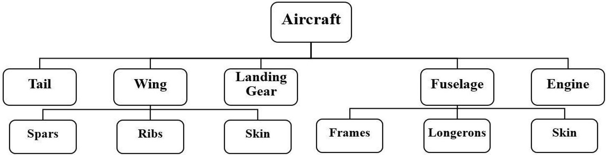
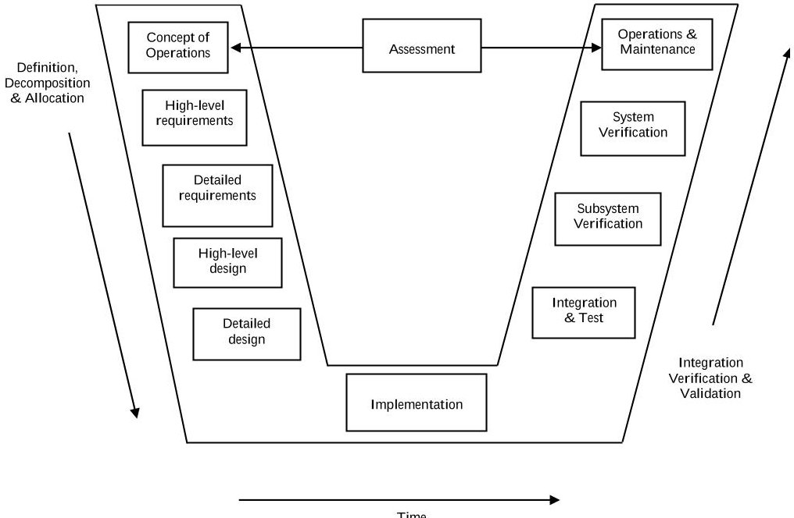
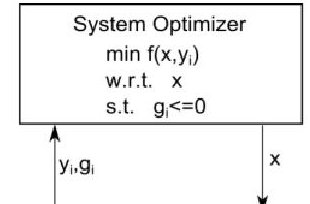
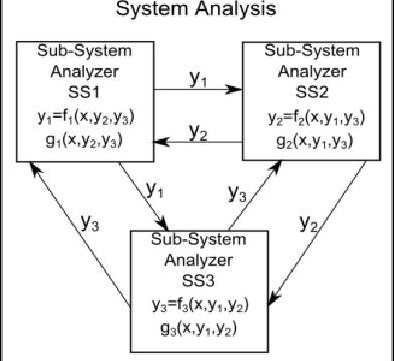
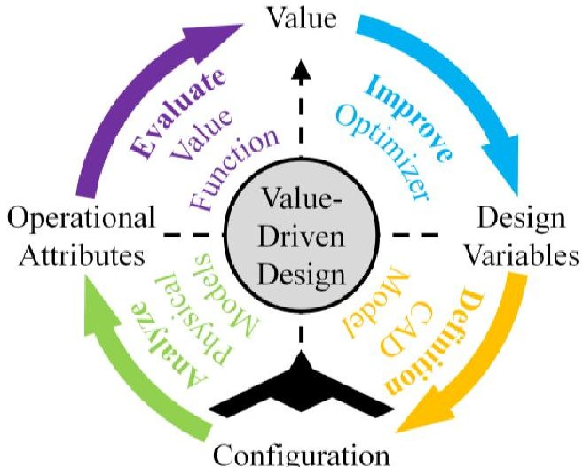
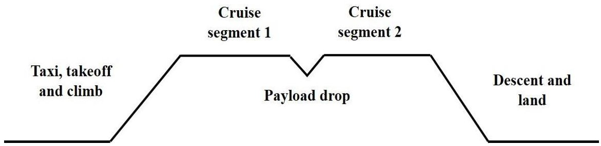
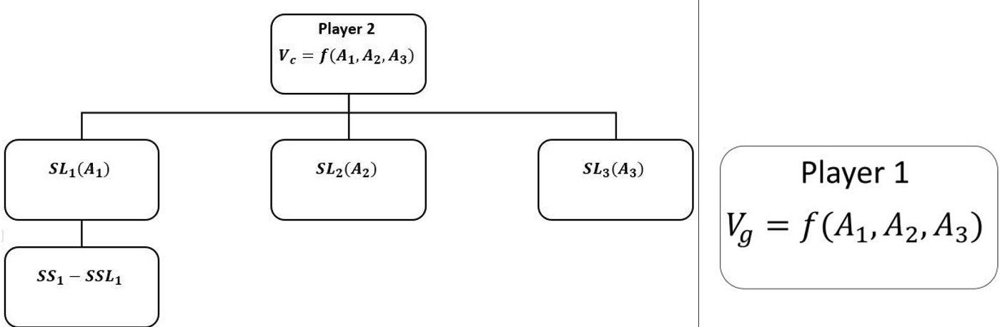
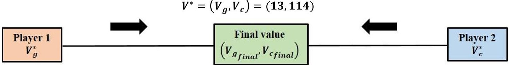

<!-- PDF_PAGE: 1 -->

# A Game Theory approach to Bargaining over Attributes of Complex Systems in the context of Value-Driven Design: An Aircraft system case study

Garima V. Bhatia $ ^{1} $ , Hanumanthrao Kannan $ ^{2} $ and Christina L. Bloebaum $ ^{3} $ Iowa State University, Ames, Iowa, 50010

A large number of individuals and various organizations are involved in the design of Large Scale Complex Engineered Systems (LSCES), the process of which spans several years and involves decision-making at all levels. Most of these decisions are driven by requirements specified by the customer. The system thus obtained by the down flow of these requirements through the hierarchy of the organization might not capture the true preferences of the stakeholder, as requirements essentially state what is not required of the system. Previous work has demonstrated how Value-Driven Design (VDD) can be used to capture the true preferences of the stakeholder. In cases where the preferences of the stakeholder are misaligned, as in the case of Defense Acquisitions, a gap in value may lead to a sub-optimal system design. A previous study suggested bargaining over the attributes of the system to determine if the final system design is more consistent with the preferences of the stakeholders as opposed to the system price bargain done traditionally. This work is a continuation of the previous study and explores the effect of the implication of the bargain model on system design. An aircraft desired by the government that prefers mission success and being designed by a commercial organization, that aims at maximizing its profit has been used as a case study here. A high level bomber aircraft has been designed to use as an example in this study. The paper studies two variations of the new form of bargaining mentioned above to see the effect on the design of the final system and the values to the stakeholders from these designs.

## Nomenclature

$ \mathrm{P(O S_{i})} $ = probability of operational success of a single system

P(S) = probability of survivability

P(E/S) = probability of effectiveness

NPP = net present profit

$ \mathrm{C P O_{i}} $ = cost-per-operation of a single system

$ \mathrm{C P S_{i}} $ = cost-per-success of a single system

$ V_{g} $ = value to government

$ V_{c} $ = value to company

$ A_{g} $ = government's preferred attribute set

$ A_{c} $ = company's preferred attribute set

$ \delta $ = discount factor in bargain games

r = monetary discount factor

q = probability of a player making an offer in a round of bargaining

EA = expected attribute set

$ \mathrm{g}^{*} $ = government's equilibrium strategy

$ \mathrm{c}^{*} $ = company's equilibrium strategy

<!-- PDF_PAGE: 2 -->

m = expected number of operations performed by the aircraft in a campaign

y = expected number of years between campaigns

## I. Introduction

With the increase in the complex nature of systems, the design process has become more tedious than ever. The coordination and involvement of multiple organizations and a workforce of thousands are the crucial components in the design and development of LSCES. Complex interactions or tight couplings between the components of the systems, the long development times and the extremely large costs associated with this development are some of the other characteristics of LSCES[1]. The design process involves decision-making at each level of the organizational hierarchy as well as across organizations. These LSCES often interact with other LSCES in order to fulfill their operational purpose, thus adding to the complexity of these systems. A satellite and its launch vehicle are an example of such interaction. An example of an organization dealing with the design of large scale systems on a global level is The Boeing Company, that employed 162,715 people including both the commercial and defense sectors, as of 29th October 2015[2].

Traditionally, the requirements-driven Systems Engineering (SE) approach is used to design these LSCES. It is structured on the V-model in which the requirements are broken down and passed down the hierarchy of the organization[3]. Each subsystem design team then uses these requirements in their design process and forms its own requirements, which are then further passed down to the lower levels. This trend is followed till the lowest level design team, each designing according to the requirements imposed by the higher levels. The subsystems designed by the teams are then integrated together to form the final system. If a misalignment exists in the design with respect to the requirements, the requirements are altered to obtain the desired design. These requirements however serve as proxies for the true preferences of the stakeholders. They do not specify what the stakeholders' actually desire from the system, only stating what is not required of the system. The Systems Engineering design process does not distinguish between competing design alternatives to decide the best system design. Any design that satisfies the requirements is considered acceptable. Value-Driven Design is a new design philosophy that intends to capture these true preferences by means of a meaning mathematical function called value function. This is a single unit function (usually monetary) which is decomposed down to the lowest level, enabling consistency in preferences and design decision-making so as to enable an optimal system design[4].

The development of LSCES usually involves a contractor, who designs the system and a buyer, for whom the system is designed. If both the dealing parties belong to the commercial sector, the preference of each would be to maximize their respective profits. The value functions of both would be similar, those involving maximization of the total profit or the Net Present Profit (NPP), and economic bargain models are used to in such cases to arrive upon a system design that aligns with the preferences of both the stakeholder[5]. In the case of Defense Acquisitions, the prime stakeholders are the commercial company designing the system whose preference is maximum profit and the government (buyer) that is not primarily concerned with the costs involved, but desires a system with a high probability of operational success[6]. This results in a misalignment in the preferences of both the entities, which causes a gap to exist in the values of the system for both the parties. In circumstances like these, it becomes imperative that a means be devised such that the final system design is consistent with the preferences of both the primary stakeholders, with compromises made at both ends for the settlement point to be arrived upon. Bargain modeling, which forms a part of Game Theory is again one of the methods to arrive upon such a system, and this paper proposes bargaining over system attributes to assess if it leads to a better design as compared to that obtained using traditional economic bargaining[7]. The paper combines the use of Value-Driven Design (to develop system models that capture the true preferences of the stakeholders), Multidisciplinary Design Optimization (MDO) (to ascertain the optimal designs that maximize the value of each stakeholder individually) and Game Theory (to arrive upon the final system design) to develop an aircraft system that is better aligned with the preferences of both the stakeholders as compared to the systems designed using traditional methods.

## II. Background

## A. Systems Engineering

The design of LSCES is traditionally done using the conventional Systems Engineering approach, that evolved as a discipline during the later half of the 20th century in order to tackle the problems associated with the design of

<!-- PDF_PAGE: 3 -->

large scale systems with ever-increasing complexity[1]. This approach is based on requirements that are formed at the highest level in the organization, and the organizations are generally decomposed in to hierarchies, which may either be component-based or discipline-based. An example of such a component-based hierarchical decomposition is the aircraft system that has been designed as a test case for this paper, depicted in Fig. 1. Systems Engineering design practices are based on the V-model shown in Fig. 2. This model shows the steps associated with the development lifecycle of systems. The left arm of the V-model represents the 'Definition, Decomposition and Allocation' phase where the requirements are first identified at the top level based on customer needs. These requirements are then broken down and communicated to the subsystem level design teams, which further break down the requirements for the component level design teams.

Figure 1. Hierarchical decomposition of an aircraft system

Once each design team has designed their respective subsystems occurs the 'Integration, Verification and Validation' phase represented by the right arm of the V-model. In this, the system is integrated and iterations are performed in case the final system is not consistent with stakeholder requirements. This approach however does not distinguish between designs, and does not consider if a potential design may be better than other designs. In short, any design that satisfies the stakeholder requirements is accepted as the final design.

Figure 2. Systems Engineering V-model

The SE approach limits exploration of the design space due to the imposition of requirements, which serve as true proxies for the true preferences of the stakeholders. This approach does not consider the possibility that the best design may lie outside the design space bounded by requirements. For example, when a requirement of minimizing the total cost of a system is put forth, the SE methodology leaves no possibility for a design to be selected that may cost more but also yield a much greater profit, which is what is actually desired by the stakeholders. It also doesn't consider

<!-- PDF_PAGE: 4 -->

optimization of the design within the feasible design space. Also, the physical interactions that exist in such large scale systems cannot be correctly captured using Interface Control Documents that are used in the SE process. The lack of a rigorous mathematical model to represent the couplings results in a system that is inconsistent in physics.

## B. Multidisciplinary Design Optimization

MDO emerged as a field of optimization from structural optimization in the early 1980's[8]. It addresses the couplings inherently present within the system such that the tradeoffs in the objective function are correctly captured when the optimization is performed. The capturing of the interactions within the subsystems through couplings results in a system that is consistent in physics, an issue not addressed in the SE approach[9].Traditional MDO involves a design space representing the objective function that is to be optimized, and this design space is bound by the constraints that are levied on the objective function. Constraints essentially represent the requirements observed in traditional SE practices. However, it should be noted that MDO does not provide a means for creating an objective function but merely assumes that one already exists.

MDO provides for the capturing of couplings or behavior variables during both the analysis and optimization phases through frameworks such as the Multidisciplinary Design Feasible (MDF) shown in Fig. 3[10].The framework depicts how design variables denoted by X are initialized by the optimizer and fed into the system analysis block that performs iterations till convergence is obtained to determine a set of outputs. These outputs are then fed into the optimizer that performs optimization on the objective function using these

Figure 3. Multidisciplinary

Figure 3. Multidisciplinary Design Feasible (MDF) Framework

outputs to determine a new set of design variables, which are again fed in to the analysis block. This process continues till convergence is obtained and the system is consistent at all levels for the final set of design variables. In the figure shown, three coupled subsystems(SS1, SS2 and SS3) have been considered. The variable 'y' represents the behavior variables that act as inputs and outputs between the subsystems. MDO is used to distinguish the best design from a wide range of design alternatives within the feasible design space. However, as the constraint-bound objective function merely serves as a surrogate for the true preferences of the stakeholder, MDO is used with a value function in this paper to evaluate the optimal aircraft designs for both the government and the commercial organization.

## C. Value-Driven Design

A new SE approach called VDD has been proposed recently that captures the true preferences of the stakeholders by means of a single function called Value Function. VDD minimizes the number of requirements placed on the system thereby offering better exploration of the design space so as to achieve an optimal design. Design optimization in the context of VDD is represented by Fig. (4) that shows the life cycle development of systems[11].

Value functions are functions of attributes which represent the characteristics of the system. These attributes in turn are function of design variables, or inputs given to the system that are altered to change the design of the system. The value function has a singular unit (usually monetary) that reflects the true preference of the stakeholder and allows for direct comparison between competing designs that have the same set of design attributes. The value function is formed such that it is consistent at all levels, with higher level attributes being functions of lower level attributes and design variables, and such that it captures tradeoffs with the help of a mathematical relationship. The decomposition of the value

Figure 4. Value-Driven Design process

function to the lowest levels enables more consistency in decision-making as decision-makers at all levels are designing for a single objective that is desired by the stakeholder at the topmost level.

<!-- PDF_PAGE: 5 -->

## D. Theory of Bargaining

Bargaining forms an extensive part of game theory and also incorporates principles of cooperative decision making[12]. In the economic model of bargaining, players try to divide a resource between each other by taking turns at making offers. Each player tries to have the largest share of the resource for himself. An offer made by the first player can either be accepted or rejected by the other player. If the offer is accepted, the game ends and the players divide the resource as per the offer made by player 1. If player 2 rejects the offer, he gets to make a counter offer, which in turn, can be either accepted or rejected by player 1. This process continues till one of the parties accepts an offer. A game of bargaining can theoretically have an infinite number of rounds; in practice however, it cannot be played indefinitely. Each player has a time discount factor $ \delta $ that represents his impatience towards the game, where $ \delta $ lies between 0 and 1, 0 representing a completely impatient and 1 a very patient player respectively. After each round, the value of the system is reduced by a factor of $ \delta $ . The greater the player patience, the better is the payoff received by the player. The subgame perfect equilibria for such a two-player bargaining game are shown, where $ x^{*} $ and $ y^{*} $ are the outcomes proposed by players 1 and 2 respectively, when each of them leads. The equilibria strategies and equilibria conditions are shown in equations (1) and (2) respectively.

$$
\begin{array}{l} x ^ {*} = \left(x _ {1} ^ {*}, x _ {2} ^ {*}\right) = \left(\frac {1 - \delta_ {2}}{1 - \delta_ {1} \delta_ {2}}, \delta_ {2} \frac {1 - \delta_ {1}}{1 - \delta_ {1} \delta_ {2}}\right) \\ y ^ {*} = \left(y _ {1} ^ {*}, y _ {2} ^ {*}\right) = \left(\delta_ {1} \frac {1 - \delta_ {2}}{1 - \delta_ {1} \delta_ {2}}, \frac {1 - \delta_ {1}}{1 - \delta_ {1} \delta_ {2}}\right) \\ x _ {2} ^ {*} = \delta_ {2} y _ {2} ^ {*} \\ \delta_ {1} x _ {1} ^ {*} = y _ {1} ^ {*} \\ \end{array}
$$

## 1. Bargaining over Attributes

Where the conventional method is to bargain over the price of a system, this paper uses a new approach to the method of bargaining, that over the attributes of the system. This approach has been proposed in a previous study but according to the author's knowledge, no detailed work has been carried on on the topic so far[13]. It focuses to investigate if the direct bargaining over the system attributes would bridge the gap between the stakeholder preferences better than economic bargaining, and thereby lead to a better design of the final system. The common attributes that affect the values of both the government and the company were identified for the bomber aircraft example and a bargain model was set up which is described in detail late in the paper.

## III. Methodology

A high level bomber aircraft model has been developed to use as a case study for this paper[14-16]. The purpose of this aircraft is assumed to be the transportation of ammunition and personnel from one location to another. The

## E. Aircraft model

Figure 5. Mission profile for Aircraft

mission profile selected to fulfill this purpose has been shown in Fig. 5. It is comprised of 4 mission segments, namely taxi, takeoff and climb, cruise before payload drop, cruise after payload drop (return segment) and the descent and land. It has been assumed that this is stage in the Defense Acquisition process where the contract has already been awarded to a commercial organization.

<!-- PDF_PAGE: 6 -->

The organization has been broken down according to hierarchy as shown previously in Fig.1. It consists of teams that have been divided according to the main components of the aircraft, namely the wing, fuselage, tail, engine and landing gear. The wing and fuselage teams have been divided into further subsystems spanning one level down the hierarchy. For simplicity, it was assumed that the performance of the aircraft was affected by only the aerodynamic and structural interactions captured in this model[17]. The overall system is comprised of 18 design variables out of which 14 are discrete and the remaining 4 are continuous. The systems and the attributes and design variables associated with each of these systems and subsystems are shown in the table in the appendix.

## F. Value function for Company

It has been considered that the contract for designing the bomber aircraft desired for defense purposes by the government has been awarded to one of the commercial companies bidding for the contract. The main aim of this company is to maximize the profit they can obtain by designing an aircraft that is consistent with the preferences of the government, at the same time ensuring that they themselves aren't losing any money. In this case, the value function used by the company should be one that correctly captures their true preference of maximization of profit for the organization. This value function yields a single dollar value that reflects the profit made by the company. Thus, the value function that can be used for such profit-seeking organizations is usually profit, which is the difference between the revenue generated by the company and the cost incurred by them in developing the system, as shown in Eq. (3). Here, $ \pi_{i,j} $ represents the profit for a single company where $ R_{i,j} $ is the company's revenue and $ C_{i,j} $ is their cost. The indices "i" and "j" represent the company and the time period (e.g. a fiscal year) respectively.

$$
\pi_ {i, j} = R _ {i, j} - C _ {i, j}
$$

A more practical modification of the profit value function is the Net Present Profit (NPP) metric, that accounts for the passage of time with respect to accumulation of profits as well as the discount associated with the net worth of future money. The NPP is given by Eq. (4). In this case, "r" represents the discount rate. A variation of the NPP represented in Eq. (4) is given by Eq. (5) [18]. This equation more specifically applies to LSCES and accounts for the profit obtained in the initial period (e.g. during the acquisition period) which is represented by $ \pi_{i,0} $ . This is simply the initial profit, the profit during the later periods is represented by $ \pi_{i,j} $ . The variable "t" represents the number of future periods that are to be accounted for.

$$
N P P _ {i} = \sum_ {j = 0} ^ {t} \frac {\pi_ {i , j}}{(1 + r) ^ {j}}
$$

$$
N P P _ {i} = \pi_ {i, 0} + \frac {1}{r} \left(1 - (1 + r) ^ {- t}\right) \pi_ {i, j}
$$

In this paper, for simplicity of demonstration and understanding, the simple profit value function given by Eq. (3) has been used. The other value functions will be considered in future work.

## G. Value function for Government

The prime priority of the government that awards the contract to a commercial company is to have a system that offers the maximum probability of operational success. The government is not primarily concerned with the economic aspect of the design mainly because there exists no defined market to generate revenue for the government due to the desired system. These systems are mainly used for defense and research for technology improvement, among others. Thus, the value functions associated with such systems reflect the operational characteristics of the system rather than their monetary value. An example of such an operational value function is the probability of operational success, p(OS) given by Eq. (6), that represents that each system will be successful when n number of systems are used in an operation[19]. This probability of success is represented in terms of probability of operational failure, p(OF), which represents the failure of the operation only if each individual system's operation $ p \left( O F_{i} \right) $ fails, when n systems are considered. Thus,

$$
\begin{array}{l} p (O F) = \left(p \left(O F _ {i}\right)\right) ^ {n} \\ 1 - p (O S) = \left(1 - p \left(O S _ {i}\right)\right) ^ {n} \\ p (O S) = 1 - \left(1 - p \left(O S _ {i}\right)\right) ^ {n} \\ \end{array}
$$

The probability of operational success of an individual system is a function of the survivability and the effectiveness of the system, as has been established in past work. The probability of survivability $ p (S) $ is a measure of how survivable the aircraft is so that it can operate or perform its intended operations in hazardous environments. It is the probability that the aircraft will not be shot down during operation. Measures such as stealth technologies as

<!-- PDF_PAGE: 7 -->

well as control system redundancies are used to improve the probability of survivability of the aircraft. The probability of effectiveness $ p(E/F) $ is the chance that the system can successfully completes the operation, given that it already survives it. The effectiveness of the bomber aircraft considered in this case depends on the amount of payload it can deliver and the range over which it can deliver the payload. The probability of operational success of a single aircraft is given by Eq. (7).

$$
p \left(O S _ {i}\right) = p \left(S \cap E\right) = p (S). p (E / S)
$$

## 2. Cost per success

Although the primary desire of the government is to achieve the maximum probability of operational success for their system, there is only some defined amount beyond which the government cannot spend on the system. The costs incurred for performing the desired operations cannot be overlooked. Thus, metrics have been developed to account for these costs along with the operational attributes. One such metric used traditionally is the 'cost-per-operation' (CPO)which is the ratio of the total cost to the buyer which is the price paid to the contractor per aircraft $ P_{aircraft} $ (assuming no other additional cost is incurred) and the number of operations, s, expected to be performed by the system over the course of its lifetime. The number of operations take into account the discount factor r to amount for the reduction in value due to the passage of time, the number of operations, m, performed by the system in a campaign, and y, the mean number of years between campaigns. s is given by Eq. (8) and the CPO is given by Eq. (9).

$$
s = \frac {p (S)}{1 - p (S)} \left(\frac {1 - \left(p (S)\right) ^ {m}}{1 - \left(p (S)\right) ^ {m} (1 - r) ^ {y}}\right)
$$

$$
C P O = \frac {P _ {\text {a i r c r a f t}}}{s}
$$

A modified version of the CPO metric discussed above is the 'cost-per-kill' or the 'cost-per-success'(CPS), as it is generally described. This modified equation accounts for the operational costs along with the operational success of the system, which is the true preference of the stakeholder. It is the ratio of the cost-per-operation of a single system and the negative natural log of the probability of operational failure of that system. This accounts for the total number of attempts made by the system. The stakeholder using this metric aims to obtain a final system design that minimizes the cost-per-success. In short, the stakeholder aims to pay minimal price per aircraft and at the same time have the maximum operational success. The CPS is described by Eq. (10).

$$
C P S = \frac {C P O}{- \ln \left(1 - p \left(O S _ {i}\right)\right)}
$$

In this paper, we assume that the government is only concerned with the operational success of the system and not the operational cost, thus, the p(OS) metric described in Eq. (7) is used as the government's value function.

## H. Bargain model

As proposed earlier, this paper explores a new form of bargaining over the traditional bargaining over the price in case of government contracts or over the surplus value $ ( S V ) $ in cases where both the stakeholders belong to the commercial sector and have monetary preferences. The new method of bargaining has been introduced in a bid to achieve a better system design by capturing the attributes that reflect the true preferences of the stakeholders. In order to enable this, the common attributes that affect the values of both the government and the company were identified. In the case of the aircraft example discussed in this paper, there were 5 common attributes that impacted the profit as well as the cost-per-success, namely Range, Mass of payload, Cruise Velocity, Stealth and Price per Aircraft. In order to test the effectiveness of the bargain model, it was first applied to an example problem before proceeding to apply it to the aircraft model. A simple system was designed that was hierarchically decomposed into two tiers for one party (assuming the company in this case), whereas for the other party it was just one level (assuming the government) which are shown in Fig. (6). It was assumed that the value functions of both the stakeholders were functions of three common attributes, $ A_{1}, A_{2} $ and $ A_{3} $ . The value functions for the government and the contractor, denoted by $ V_{g} $ and $ V_{c} $ are represented by Eq. (11) and Eq. (12), where $ A_{g} $ represents the attribute set desired by the government and $ A_{c} $ represents the attribute set desired by the company. $ A_{g1}, A_{c1}, A_{g2}, A_{c2} $ , etc. correspond to the values of the attributes $ A_{1}, A_{2} $ and $ A_{3} $ desired by the government and the company respectively. It was also assumed that the values of all three attributes lie between 0 and 10.

$$
V _ {g} = f \left(A _ {1}, A _ {2}, A _ {3}\right) = A _ {g 1} A _ {g 2} - 2 A _ {g 3} - A _ {g 2} ^ {2}
$$

$$
V _ {c} = f \left(A _ {1}, A _ {2}, A _ {3}\right) = A _ {c 1} ^ {2} - A _ {c 2} ^ {2} + 3 A _ {c 3}
$$

<!-- PDF_PAGE: 8 -->

In this case, a sequential bargain game of infinite horizon was considered. It was assumed that the government initiates the bargaining, hence they are player 1 and the company is player 2. From intuition, it is clear that both the respective players' preferred attribute set for the design would be one that maximizes their individual values, i.e. their optimal set of attributes $ A_{g}^{*} $ and $ A_{c}^{*} $ ). Thus, in the first round, player 1 always proposes $ A_{g}^{*} $ . Like player 1, player 2 also desires her optimal set $ A_{c}^{*} $ to be the final attribute set. Thus, when $ A_{g}^{*} $ is proposed, player 2 accepts the offer only if she believes that her value from $ A_{g}^{*} $ is greater than the value she would obtain by rejecting the offer and proposing her own attribute set $ A_{c}^{*} $ in the next period, discounted by a factor $ \delta_{2} $ . If this equilibrium condition is met, player 2 accepts the offer, the game ends and $ A_{g}^{*} $ is the final attribute set to be used for design. However, if this is found to be not true, player 2 will reject the offer and the game will move to round 2. In this round, player 2 will propose $ A_{c}^{*} $ and player 1 will check for her equilibrium, i.e. she will accept $ A_{c}^{*} $ is greater than the value she would receive by waiting for the next round and proposing a new attribute set $ A_{g_{new}} $ , discounted by $ \delta_{1} $ . If the condition is satisfied, it puts an end to the game and $ A_{c}^{*} $ is the final attribute set, if not, the game continues in a similar fashion till one player accepts the offer.

Figure 6. Hierarchy for example problem

The equilibrium conditions for players 1 and 2, assuming that player 1 makes the first offer, are given by Eq. (13) and Eq. (14). Here, $ V_{1_{g}} $ and $ V_{1_{c}} $ represent player 1's values due to her own attribute set and player 2's attribute set, whereas $ V_{2_{c}} $ and $ V_{2_{g}} $ represent player 2's values due to attribute sets $ A_{c} $ and $ A_{g} $ . The deltas represent the discount factors, which in case of the company may represent the reduction in value to account for the money to be paid the employees, the inflation in the future periods or the time lost while the negotiation is taking place. Thus, the longer the game lasts, the greater is the reduction in value. For the government, the delta may represent the losses in research or losses during the time of war associated with the delay in the design and manufacture of the aircraft system.

$$
V _ {1 _ {c}} \geq \delta_ {1} * V _ {1 _ {g}}
$$

$$
V _ {2 g} \geq \delta_ {2} * V _ {2 c}
$$

## IV. Results

## I. Optimal values for Company

As mentioned earlier, the organization of the company in this paper is designed according to the 5 major components of the aircraft, and the hierarchy spans two levels. The profit obtained by the company is the difference between the revenue generated by selling these aircraft and the cost to the company for manufacturing the aircraft. The total cost is assumed to be the sum of the costs of the individual systems and is given by Eq. (15). The revenue generated by the company is the product of the number of aircraft sold and the price of each aircraft, given by Eq. (16). The number of aircraft sold, in turn, is a function of the range, cruise velocity, stealth, and also the price per aircraft. The problem created follows the traditional design cycle shown in Fig.1.

$$
C o s t _ {t o t a l} = C o s t _ {w i n g} + C o s t _ {f u s e l a g e} + C o s t _ {t a i l} + C o s t _ {l a n d i n g g e a r} + C o s t _ {e n g i n e}
$$

$$
R e v e n u e = P r i c e p e r a i r c r a f t * N o. o f a i r c r a f t s o l d
$$

<!-- PDF_PAGE: 9 -->

A set of design variables is initiated that feeds into the subsystems to define the physics. An analysis is then carried out to achieve system consistency and the output of this analysis are the attributes that feed into the value function to give the value associated with that set of attributes. An optimization is then carried out to determine a new set of design variables that again feed into the subsystems, and the process repeats. This cycle goes on till a final optimum value is found, that corresponds to the maximum profit in the aircraft example considered in this paper. This paper uses the Genetic Algorithm method for optimization to account for the presence of discrete design variable choices[20]. The values of the 5 attributes common to the government and the company mentioned earlier at the optimal design point are given in Table 1. Table 2 shows the total cost to the company, the optimal number of aircraft sold and the maximum profit that can be generated by the company by selling these many number of aircraft.

Table 1: Optimal attribute values for Company

<table border="1"><tr><td>Attribute</td><td>Value</td></tr><tr><td>Range(inkm)</td><td>140545.690</td></tr><tr><td>Mass of payload(inkg)</td><td>79996.617</td></tr><tr><td>Cruise velocity(inm/s)</td><td>454.89</td></tr><tr><td>Stealth</td><td>0.4</td></tr><tr><td>Price per aircraft(in$M)</td><td>587.81</td></tr></table>

Table 2: Total value to Company

<table border="1"><tr><td>Description of quantity</td><td>Value</td></tr><tr><td>Number of aircraft sold</td><td>82</td></tr><tr><td>Total cost(in $B)</td><td>43.818</td></tr><tr><td>Total revenue(in $B)</td><td>48.200</td></tr><tr><td>Value/Profit(in $B)</td><td>4.381</td></tr></table>

The above values of the attributes will be used at the beginning of the negotiation game between the government and the company as the first proposal made by the company. If given their way, the company would always want to have this attribute set to use for the design as it gives them the maximum payoff.

## J. Optimal values for Government

Since the government buys the system from the contractor and is not involved in the design process, no breakdown of the government body is required as in the case of the company, shown above. However, the government does have its own optimal set of attributes that ensure minimum cost-per-success to the government or the maximum value. On performing an optimization on the value function of the government $ ( p ( O S_{i} ) ) $ , the following values of the attributes were obtained which are given in Table 3. The value of the probability of operational success corresponding to this attribute set is given in the same table.

Table 3: Optimal attribute values for the Government

<table border="1"><tr><td>Attribute</td><td>Value</td></tr><tr><td>Range(inkm)</td><td>18000</td></tr><tr><td>Mass of payload(inkg)</td><td>99687</td></tr><tr><td>Cruise velocity(inm/s)</td><td>677.47</td></tr><tr><td>Stealth</td><td>0.9</td></tr><tr><td>Value/p(OSi)</td><td>0.721</td></tr></table>

The government begins the bargain game by using this attribute set to make the first offer as given their way, the government would like to use this attribute set for the final design to maximize their probability of operational success.

<!-- PDF_PAGE: 10 -->

## K. Bargaining over attributes

## 3. Example problem

For the example problem, bargaining was done only over attribute $ A_{3} $ for simplicity. To begin with, the optimal attribute set for each player 1 and player 2 were found, and the game began by player 1 proposing his optimal. Player 2 checked for his equilibrium condition using this attribute set as well as his own attribute set, and discovered that the equilibrium condition was not satisfied. The offer was rejected and the game continued to further rounds, till player 2 finally accepted the offer after 11 rounds of bargaining. After each round, the players modified their values of the attribute $ A_{3} $ such that it lowered their own value obtained from this new attribute set and increased the other player's value. The game moves in such a way that it tries to achieve middle ground, i.e. the players reduce their respective values till an agreement point has been reached, which is described in Fig. 7. The initial values of both players, the reduced values after each round, as well as the final set of values after the players reached a common ground are shown in table 4. The shaded blocks represent the proposing player for that round.

Table 4: Example problem Bargain Results

<table border="1"><tr><td>Round</td><td>Ag</td><td>Ac</td><td>δ1</td><td>δ2</td><td>V1g</td><td>V1c</td><td>V2g</td><td>V2c</td><td>Status</td></tr><tr><td>1</td><td>[1051]</td><td>[10110]</td><td>0.9</td><td>0.8</td><td>23.0000</td><td>-11.0000</td><td>78.0000</td><td>129.0000</td><td>Rejected by player 2</td></tr><tr><td>2</td><td>[1052]</td><td>[10110]</td><td>0.9</td><td>0.8</td><td>21.0000</td><td>-11.0000</td><td>81.0000</td><td>129.0000</td><td>Rejected by player 1</td></tr><tr><td>3</td><td>[1052]</td><td>[1019]</td><td>0.9</td><td>0.8</td><td>21.0000</td><td>-9.0000</td><td>81.0000</td><td>126.0000</td><td>Rejected by player 2</td></tr><tr><td></td><td></td><td></td><td></td><td></td><td></td><td></td><td></td><td></td><td></td></tr><tr><td></td><td></td><td></td><td></td><td></td><td></td><td></td><td></td><td></td><td></td></tr><tr><td></td><td></td><td></td><td></td><td></td><td></td><td></td><td></td><td></td><td></td></tr><tr><td>10</td><td>[1056]</td><td>[1016]</td><td>0.9</td><td>0.8</td><td>13.0000</td><td>-3.0000</td><td>93.0000</td><td>117.0000</td><td>Rejected by player 1</td></tr><tr><td>11</td><td>[1056]</td><td>[1015]</td><td>0.9</td><td>0.8</td><td>13.0000</td><td>-0.9999</td><td>93.0000</td><td>114.0000</td><td>Accepted by player 2</td></tr></table>

Thus, the game ended with the final attribute set $ A=(A_{1},A_{2},A_{3})=(10,5,6). $ The final equilibrium value of player 1 dropped from 23 to 13 whereas the value of player 2 dropped from 129 to 114. Thus, the final solution after the bargaining game is as follows:

Figure 7. Game of Bargaining

## 4. Aircraft model

## Sequential Bargaining

The bargain model that was successfully created for the example problem was then applied to the entire aircraft. Again, it was assumed that the government begins the negotiation by making the first offer. This initial offer made by the government is their optimal attribute set $ V_{g}^{*} $ that fetches them the maximum probability of operational success of 0.721. However, the company refuses this offer in round 1 because it yields them a value of $ 681.81M $ which does not meet their equilibrium condition as they believe that they can obtain a better value ($ 4.31B $ ) by waiting out till the next round and proposing their own attribute set. Thus, the game moves to round 2 where the company is the proposing player. The company proposes $ V_{c}^{*} $ as this attribute set fetches the company a maximum profit of $ 4.318B $ . However, on plugging in the value of this proposed attribute set into their own value function, the government infers that they

<!-- PDF_PAGE: 11 -->

could do much better by waiting for the next round (Eq. (13)). Thus, the offer made by the company is rejected and the game proceeds.

In round 3, the government becomes the proposing player again. However, this time, the government proposes a new attribute set $ A_{g_{new}} $ as their previous attribute set was rejected by the company. This new attribute set as attained by changing the value of range by 2% and then running an analysis using this new range to calculate the values of the other attributes. The new attribute set reduces the government's value by 0.007%, i.e. the probability of operational success drops from 0.721 to 0.716. However, for this new set of attributes, the company's value sees a tremendous rise to $ 2.28B $ , from the initial $ 681.81M $ . The company compares this value to the value it could potentially obtain in the next round by proposing a modified attribute set. On checking for these values, it infers that the value on the table is greater than that they would make by waiting out till the next round, implying that their equilibrium condition given by Eq. (14) is satisfied. Thus, the company accepts the offer and $ V_{g_{new}} $ is the final attribute set to be designed for.

The sequential game described above is shown in Table 5. The highlighted blocks represent the proposing player in each round.

Table 5: Aircraft problem Bargain Results (Sequential)

<table border="1"><tr><td>Round</td><td colspan="2">$A_{g}$</td><td colspan="2">$A_{c}$</td><td>$\delta_{1}$</td><td>$\delta_{2}$</td><td>$V_{1g}$ (%)</td><td>$V_{1c}$ (%)</td><td>$V_{2g}$ (in $)</td><td>$V_{2c}$ (in $)</td><td>Status</td></tr><tr><td>1</td><td>Range (in km)</td><td>18000</td><td>Range (in km)</td><td>140545</td><td rowspan="5">0.97</td><td rowspan="5">0.9</td><td rowspan="5">0.721</td><td rowspan="5">0.392</td><td rowspan="5">681.8M</td><td rowspan="5">4.38B</td><td rowspan="5">×</td></tr><tr><td></td><td>$M_{payload}$ (in kg)</td><td>99687</td><td>$M_{payload}$ (in kg)</td><td>80000</td></tr><tr><td></td><td>Velocity (in m/s)</td><td>677.47</td><td>Velocity (in m/s)</td><td>454.89</td></tr><tr><td></td><td>Stealth (%)</td><td>0.9</td><td>Stealth (%)</td><td>0.4</td></tr><tr><td></td><td>Price (in $M)</td><td>50</td><td>Price (in $M)</td><td>587.81</td></tr><tr><td>2</td><td>Range (in km)</td><td>17640</td><td>Range (in km)</td><td>140545</td><td rowspan="5">0.97</td><td rowspan="5">0.9</td><td rowspan="5">0.716</td><td rowspan="5">0.392</td><td rowspan="5">2.28B</td><td rowspan="5">4.38B</td><td rowspan="5">×</td></tr><tr><td></td><td>$M_{payload}$ (in kg)</td><td>99687</td><td>$M_{payload}$ (in kg)</td><td>80000</td></tr><tr><td></td><td>Velocity (in m/s)</td><td>565.82</td><td>Velocity (in m/s)</td><td>454.89</td></tr><tr><td></td><td>Stealth (%)</td><td>0.9</td><td>Stealth (%)</td><td>0.4</td></tr><tr><td></td><td>Price (in $M)</td><td>184.71</td><td>Price (in $M)</td><td>587.81</td></tr><tr><td>3</td><td>Range (in km)</td><td>17640</td><td>Range (in km)</td><td>14335</td><td rowspan="5">0.97</td><td rowspan="5">0.9</td><td rowspan="5">0.716</td><td rowspan="5">0.394</td><td rowspan="5">2.28B</td><td rowspan="5">1.34B</td><td rowspan="5">√</td></tr><tr><td></td><td>$M_{payload}$ (in kg)</td><td>99687</td><td>$M_{payload}$ (in kg)</td><td>80000</td></tr><tr><td></td><td>Velocity (in m/s)</td><td>565.82</td><td>Velocity (in m/s)</td><td>517.89</td></tr><tr><td></td><td>Stealth (%)</td><td>0.9</td><td>Stealth (%)</td><td>0.4</td></tr><tr><td></td><td>Price (in $M)</td><td>184.71</td><td>Price (in $M)</td><td>160.42</td></tr></table>

Table 6 shows the final values of the attributes used for design and the corresponding values of the company and the government for this attribute set.

Table 6: Final system design and values (Sequential Bargaining)

<table border="1"><tr><td colspan="2">Values of attributes</td><td>Value to governmentp(OS)(%)</td><td>Value to company(in $B)</td></tr><tr><td>Range(inkm)</td><td>17640</td><td></td><td></td></tr><tr><td>Mpayload(inkg)</td><td>99687</td><td></td><td></td></tr><tr><td>Velocity(inm/s)</td><td>565.82</td><td>0.716</td><td>2.28</td></tr><tr><td>Stealth(%)</td><td>0.9</td><td></td><td></td></tr><tr><td>Price(in$M)</td><td>184.71</td><td></td><td></td></tr></table>

Thus, the final system design will yield a collective profit of $2.28B to the company and will have a 71.6% chance of achieving mission success.

<!-- PDF_PAGE: 12 -->

## Random Bargaining

Another variation of the bargaining game is one in which offers are made randomly by the players rather than following a fixed sequence shown in the above case. In this game, if an offer is rejected, there is no fixed order as to which player will make the offer in the following round. The player whose offer is rejected in the previous round can make a new offer in the following round. These kind of bargaining games have as probability associated with the outcome that corresponds to the uncertainty associated with which player will propose the next offer. The game begins by determining an expected attribute set (EA) that incorporates the probabilities of each player making the offer in the next round. The expected outcome can be calculated using Eq. (17), where "q" is the probability that player 1 (the government in this case) makes the proposing offer. Thus, the probability that player 2 (company) will offer in the following round is (1-q).

$$
E A = q * V _ {g} + (1 - q) * V _ {c}
$$

The proposing player uses the expected attribute set to evaluate her own payoff due to the uncertainty associated with her proposing the offer in the first place, when her first proposing offer is her optimal attribute set, $ A_{g}^{*} $ for the government and $ A_{c}^{*} $ for the company for the example considered here. The equilibrium strategies for the government and the company are given by Eq. (18) and Eq. (19). The notations used in the equations are the same as used previously.

$$
g ^ {*} = \left(V _ {g} (E A), V _ {c} \left(A _ {g}\right)\right)
$$

$$
c ^ {*} = \left(V _ {g} \left(A _ {c}\right), V _ {c} (E A)\right)
$$

The government prefers attribute set $ A_{g}^{*} $ as the set to be used for design as it maximize their value from the system whereas the company prefers $ A_{c}^{*} $ . After an offer has been rejected, the player who made the offer changes his attribute set such that it lowers his value and increases the value of the other player, in a bid to have his offer accepted in a later period. The new expected attribute set is calculated again that depends on the probabilities of the players making the next offer. Once a new offer is made by a player, the other player uses this attribute set to determine if she could gain more by waiting and proposing her own attribute set in the next period, keeping in mind the probability of her making the next offer. If she finds this o be true, she rejects the offer and the game moves to the next period. This continues till one of the players' equilibrium condition is met and the offer is accepted. The equilibrium conditions for the government and the company for a game of random bargaining are shown in Eq. (20) and Eq. (21).

$$
V _ {g} \left(A _ {c}\right) \geq \delta_ {1} * V _ {g} (E A)
$$

$$
V _ {c} \left(A _ {g}\right) \geq \delta_ {2} * V _ {c} (E A)
$$

The results from a game of random offers, when applied to the aircraft model, are shown in Table 7. The game goes on for 31 rounds till player 2 finally accepts the offer because she finds out that did she wait for another round to offer her own attribute set, the value she would receive would be less than the value being offered. The probability q was generated in each round using a random number generator. The table shows the value of the final attribute set and the payoffs of the government and the company from this game.

Table 7: Final system design and values (Random Bargaining)

<table border="1"><tr><td colspan="2">Values of attributes</td><td>Value to governmentp(OS)(%)</td><td>Value to company(in $M)</td></tr><tr><td>Range(inkm)</td><td>17892.30</td><td></td><td></td></tr><tr><td>Mpayload(inkg)</td><td>99687</td><td></td><td></td></tr><tr><td>Velocity(inm/s)</td><td>566.64</td><td>0.620</td><td>930.59</td></tr><tr><td>Stealth(%)</td><td>0.9</td><td></td><td></td></tr><tr><td>Price(in$M)</td><td>185.44</td><td></td><td></td></tr></table>

## V. Summary and Conclusion

The paper described in brief the different areas of engineering used in this research and then explained the motivation behind the research. It explained why using the new approach to the game of bargaining was thought to

<!-- PDF_PAGE: 13 -->

be a good idea, and explained the mathematical foundation and logic behind this new form of bargaining. A simple example problem was used to demonstrate this new form of bargaining between two players. The model was then applied to the aircraft example created for the paper that was described in previous sections. Two variations of the game were demonstrated successfully, namely sequential bargaining and random bargaining. It was observed that the payoffs for both the players were better in the sequential bargaining game, i.e. both the government and the company received higher values from the system when this form of attribute bargaining was used. The deviation from the optimal values for both the players was greater in the game of random bargaining. One of the reasons for this could be the uncertainty associated with the proposing player in the game. It can also observed that the final designs from both the variations of the game are very similar to each other. However, due to the probabilities involved, the second game went on for a much longer period as compared to the first, which led to a reduction in the values to the players due to the passage of time. Also, it was noticed that the attribute set obtained for the final design had some of the best values, and it would lead to the design of a quite state-of-the-art system with a good probability of operational success as well as a decent profit to the company designing it. That a design better than what would have been achieved using traditional economic bargaining has been achieved using the new approach remains to be determined in the future work.

## VI. Future work

The paper demonstrated bargaining over attributes when the values of a single attribute were altered and an analysis was carried out to determine the values of the other attributes. One of the things that will be looked into in the future will be to check the effect of varying the values of a different attribute on the final system design. Another important piece will be to model a game of traditional economic bargaining and compare the results with the work done in this paper to see if the above approach indeed gives better results. Another aspect will be to see the effect of the bargaining game using the more realistic NPP value function for the company as well as the CPS value function for the government to observe if and how the final results change for the games.

<!-- PDF_PAGE: 14 -->

<table border="1"><tr><td colspan="3">Tiers for Company(Value function: Profit)</td><td>Attributes</td><td>Design variables</td></tr><tr><td colspan="3">SYSTEM(Bomber Aircraft)</td><td>Cost, Revenue</td><td>Number of Aircraft(n)</td></tr><tr><td rowspan="6">Subsystem level1</td><td colspan="2">(SS1)Wing</td><td>CwingMwing</td><td>Type of wing, Mass of payload</td></tr><tr><td colspan="2">(SS2)Fuselage</td><td>CfuselageMfuselage</td><td>Length of fuselage</td></tr><tr><td colspan="2">(SS3)Tail</td><td>CtailMtail</td><td>Material of tail, Type of tail</td></tr><tr><td colspan="2">(SS4)Landing gear</td><td>ClndgearMlndgear</td><td>Type of landing gear(tail dragger, tricycle,etc)</td></tr><tr><td colspan="2">(SS2)Engine</td><td>Cengine,MengineMfuel,Range,Vcruise</td><td>nEng,Type of engine</td></tr><tr><td rowspan="6">Subsystem level2</td><td rowspan="3">Wings</td><td>(SS1)Spar</td><td>CsparMspar</td><td>Material of spar,Length of wing,Length of chord</td></tr><tr><td>(SS2)Ribs</td><td>CribsMribs</td><td>Material of rib,Length of wingLength of chord</td></tr><tr><td>(SS3)Skin</td><td>Cskin</td><td>Material of skin,Length of wing,Length of chord</td></tr><tr><td rowspan="3">Fuselage</td><td>(SS1)Frames</td><td>CframesMframes</td><td>nframes,Material of frame</td></tr><tr><td>(SS2)Longerons</td><td>ClongeronMlongerons</td><td>nlongerons,Material of longerons,Length of fuselage</td></tr><tr><td>(SS3)Skin</td><td>CskinMskin</td><td>Material of skin</td></tr></table>

## References

1. Bloebaum, C.L. and A.-M.R. McGowan. The Design of Large-Scale Complex Engineered Systems: Present Challenges and Future Promise. in 12th AIAA ATIO Conference and 14th AIAA/ISSMO MA&O Conference, AIAA Paper. 2012.

2. 11/26/2015; Boeing Employment Data. Available from: http://www.boeing.com/company/general-info/.

3. NASA NASA Systems Engineering Handbook Vol. NASA/SP-2007-6105 Rev1 2007 Washington D.C

3. NASA, NASA Systems Engineering Handbook. Vol. NASA/SP-2007-6105 Rev1. 2007, Washington, D.C.

4. Collopy, P.D. and P.M. Hollingsworth, Value-driven design. Journal of Aircraft, 2011. 48(3): p. 749-759.

5. Rubinstein, A., Perfect equilibrium in a bargaining model. Econometrica: Journal of the Econometric Society, 1982: p. 97-109.

6. Carter, A.B. and J.P. White, Keeping the edge: Managing defense for the future. 2001: MIT Press.

7. Osborne, M.J., An introduction to game theory. Vol. 3. 2004: Oxford University Press New York.

8. Sobieszczanski-Sobieski, J. and R.T. Haftka, Multidisciplinary aerospace design optimization: survey of recent developments. Structural and Multidisciplinary Optimization, 1997. 14(1): p. 1-23.

<!-- PDF_PAGE: 15 -->

9. Mesmer, B., C.L. Bloebaum, and H. Kannan, Incorporation of Value-Driven Design in Multidisciplinary Design Optimization for a Satellite System Application. submitted to Structural and Multidisciplinary Optimization, 2014.

10. Martins, J.R.R.A. and A.B. Lambe, Multidisciplinary Design Optimization: Survey of Architectures. AIAA Journal, 2012.

11. Goetzke, E.D., Value-Driven Design of non-commercial systems through bargain modeling. 2015, IOWA STATE UNIVERSITY.

12. Harsanyi, J.C. and R. Selten, A general theory of equilibrium selection in games. MIT Press Books, 1988. 1.

13. Goetzke, E.D., C.L. Bloebaum, and B.L. Mesmer, Value-Driven Design of Non-Commercial Systems using Bargain Modeling.

14. Raymer, D.P., Aircraft Design: A Conceptual Approach, American Institute of Aeronautics and Astronautics Inc., Reston, VA, 1999.

15. Roskam, J., Airplane Design: Part I-VIII. DARcorporation, Lawrence, KS, 2006.

16. ZAHM, A., AIRPLANE STRESS. 1918.

17. Anderson, J.D., Aircraft performance and design. Vol. 1. 1999: McGraw-Hill New York.

18. Collopy, P. Economic-Based Distributed Optimal Design. in AIAA Space 2001- Conference and Exposition. 2001. Albuquerque, NM.

19. Collopy, P., Value of the Probability of Success. 2008.

20. Arora, J., Introduction to optimum design. 2004: Academic Press.