<!-- PDF_PAGE: 1 -->

# A Generic Method for Remote Sensing Satellites Conceptual Design and Rapid Sizing Based on "Design for Performance" Strategy

Alireza Ahmadi, Amirreza Kosari, University of Tehran, Iran S. M. B. Malaek, Sharif University of Technology, Iran

## INTRODUCTION

Some fundamental and unique characteristics of space are (1) global perspective, (2) above the atmosphere, (3) gravity-free environment, (4) abundant resources, and (5) exploration of space itself. If the mission doesn't rely on some fundamental and unique characteristics of space, it will likely cost more to do in space than in air or on Earth [1]. On the other hand, design of complex systems like satellites involves selecting design parameters (DPs) to satisfy the required constraints while meeting desired performance objectives. These parameters are often coupled, and their relationships not easily understood, and it makes the design an iterative process with high complexity [2]. But in spite of high costs and complexities, demands for space missions are increasing, so space missions inevitably must be engineered in such a way that the users' needs be met better, cheaper, faster, and with less risk than before. That is the reason why more research is required to improve the space missions engineering process.

The potential influence of early phases of a space mission engineering process on the total cost of the system lifecycle, as illustrated in Figure 1, is very high so that by the end of the feasibility study phase [3], 80% of that cost has been determined [4].

The 80/20 rule states that for a given set of mission objectives, 80% of the required performance can be achieved for 20% of the mission cost. Therefore, if there is some flexibility in a customer's aims there is ample opportunity to vastly reduce the mission cost. To fully apply the rule, two important steps need to be taken: (1) identifying the type of customer and mission objectives and (2) challenging the requirements [5].

These challenging negotiations with customer's representatives often lead to change in design. To be effective, these changes must

be made at early phases of the mission engineering process. According to Figure 2, making changes in design are more difficult and more expensive at final phases of the mission engineering process than the early phases.

The trend of advances in design science is also to reduce the time and cost of the design process; thus, simplifying of the design process on one side and quick achievement to the correct results from the other side is a problem that must be considered in this process, so in this paper a method is proposed which using it, acceptable results can be achieved rapidly and simply in conceptual phase of a remote sensing satellite.

In this approach, a designer can quickly decide upon technological barriers that might influence the Research, Development, Test, and Evaluation (RDT&E) phases of the design and/or decide to change the satellite mission. As total life-cycle cost is normally influenced by decisions made during RDT&E phase, it is expected that this method play an essential role to keep the overall cost down; as such, rapid-sizing techniques allow designers to do more trade-studies as well as sensitivity analysis. This work concentrates on three main issues: (1) Existence of a design space for remote sensing-satellites; (2) The parametric characteristics and influential parameters that form such space; (3) Its potential effects on the

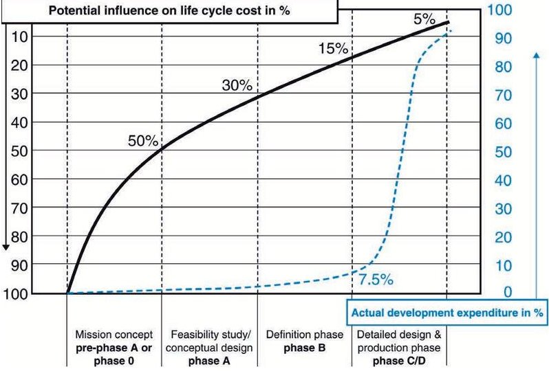

Project lifecycle costs during phases [4].

<!-- PDF_PAGE: 2 -->

lifecycle cost and its duration. One suitable case-study have been discussed to support the proposed methodology.

## DESIGN STRATEGY: DESIGN FOR PERFORMANCE

Design strategy is a general framework that identifies the design pivot feature in all phases of system design. This pivot feature as the main aim will be the key driver of system design and all the designer's decisions and selections will be made based on it [6].

The purpose of "Design for Performance" or performancebased design [7] is to predict the performance of the system. The designer is however confronted with the reverse problem: knowing the performance objectives, he/she must find combinations of design characteristics which will result in a design that satisfies or exceeds all requirements including mission and performance. Design for performance is a process in which the system Performance Requirements (PRs) must lead to determination of boundary values for Main Design Parameters (MDPs). These parameters will have the greatest impact on system performance [8]. In "design for performance" strategy, the cost is not constrained.

## OVERVIEW OF SIZING IN THE AIRPLANE DESIGN PROCESS

In Torenbeek's approach, the airplane sizing process, which means translation of airplane PRs into DPs boundary values, are executed in the conceptual design phase. He states that in this phase, mission specifications and PRs play the most important role in driving the

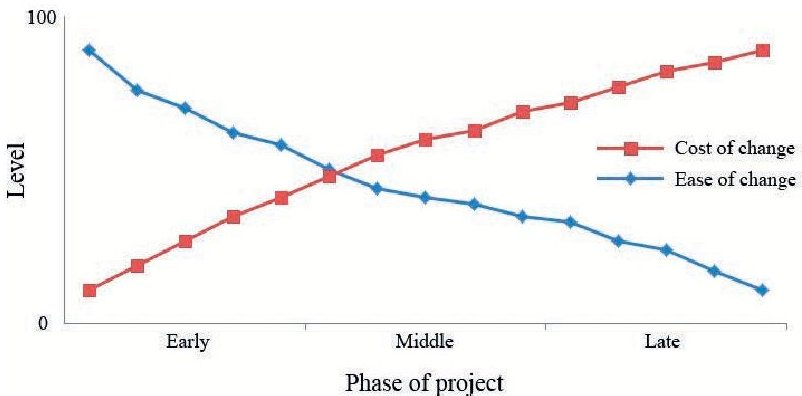

design procedure. Torenbeek states that sizing is an activity that is performed after laying down the broad outlines of the general arrangement and finalizing the design of the fuselage, to decide on the type of engine to be installed and the size of the wing; both have a direct effect on performance and operating costs. The roadmap of sizing process in preliminary design is to convert the PRs in to combinations of design variables. During this process the baseline design (BLD) is further developed to a depth of detail which can be regarded as meaningful [8].

In Roskam's approach, sizing has an independent identity along with the other phases of airplane design and a step ahead of the preliminary design phase [9]. In this approach, conceptual design has not been considered among the other phases of airplane design. In Raymer's approach, sizing has been placed among the activities of conceptual design phase [10].

Sadraey has allocated the preliminary design phase to the sizing process and has divided this phase to two steps. He states that during the sizing process the boundary values of the three MDPs of an airplane will be determined considering the airplane performance criteria. These parameters will govern the aircraft size, the manufacturing cost, and the complexity of calculations [11].

Loftin states that sizing is a rapid method for estimating the size, weight, and thrust of jet-powered aircraft intended to meet specified performance objectives [12].

Along with aircraft designers, Wertz defines the spacecraft sizing estimate as follows: "The purpose of the sizing estimate is to provide an estimate of basic mission parameters such as size, weight, power, or cost" [1].

It seems that a combination of the above definitions can explain the purpose of this article: "Performance sizing is a rapid method during which the mission and PRs are translated to the best combination of DPs considering the performance criteria. This combination creates a BLD upon which the weight, size, power consumption and cost of designing, manufacturing and mission operations of the spacecraft could be estimated."

## INTRODUCTION TO DESIGN PLANE

Design plane is the most useful technique that is used in airplane performance sizing. This technique enables the designer to visu-

<!-- PDF_PAGE: 3 -->

ally choose the BLD point in a (two-dimensional) 2D space while considering the design constraints and requirements. The BLD point is the best combination of the DPs. The best combination of the DPs identifies the equilibrium point which the balance between desirability affordability and availability will occur there. The importance of this point is that the design procedure will continues based on its coordinate in the design plane.

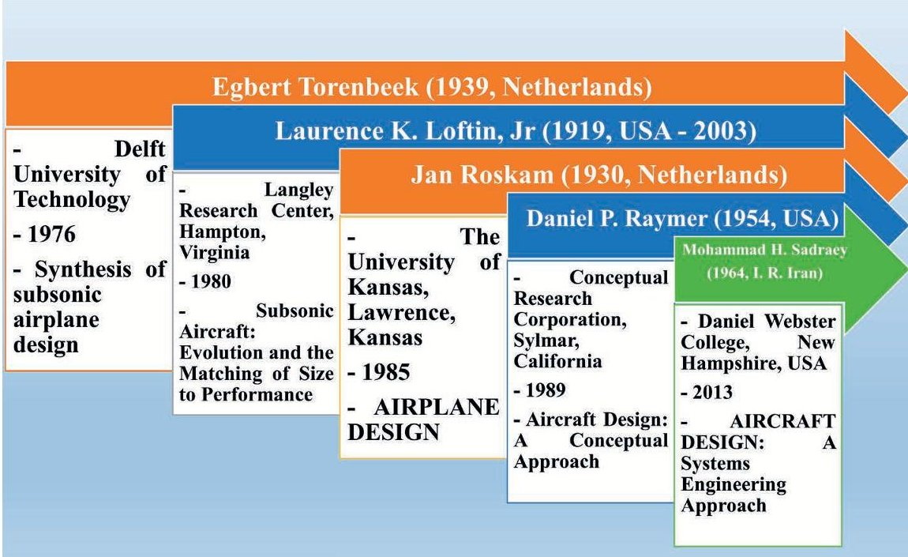

Although Sadraey states that the principles of the technique were originally introduced in a National Aeronautics and Space Administration (NASA) technical report and later developed by Roskam [11] but according to the studied sources, this idea has been raised before Loftin by Torenbeek and after him used with some modifications by other designers.

Figure 3. The airplane designers and their publications by year.

Given the similarities between design features of aerial systems and space ones, the design plane technique in airplane sizing can be generalized to satellite sizing.

The fundamental elements of the airplane design plane can be overall divided into three categories:

- Mission requirements and mission specifications: Derived from investors' objectives and end users' needs;

PRs and performance criteria: derived from the standards, rules and regulations, as well as scientific theories in technical fields related to airplane such as flight mechanics, aerodynamics, and structures;

Direct and great impact on airplane performance;

MDPs with three key features:

> Output of the sizing phase: weight, size, thrust of jet engines (output power of propeller engines), and designing, manufacturing, and operations cost of the airplane must be calculable using these parameters;

Input of the next phase: the airplane design procedure must be continued based on the values of these parameters.

## PAST APPLICATIONS OF THE DESIGN PLANE

The results of a literature survey indicate that no attempt has been made to use the design plane other than airplane design. The airplane designers and their publications in which the design plane technique has been used in airplane sizing are illustrated in Figure 3.

The purpose of this section is to extract the general pattern of "airplane sizing using design plane technique". The method implementation flow graph is depicted in Figure 4. Generally, wings and engines are the two segments that have the strongest impact on the

airplane performance, so the MDPs of airplane are wing reference area (S) and thrust of jet engines (T) or output power of propeller engine (P). The third parameter is the airplane maximum take-off weight (WTO). These parameters have direct effect on airplane performance and also these are the output of sizing phase and input of the next phase of airplane design.

In order to simultaneously solve the equations in the framework of the design plane and enable the designer to observe the equation solving process, determination of allowable design area and specifying the design points, these three parameters must convert into two parameters. Therefore, the three DPs WTO, S, and T, or P has been merged to form the two parameters W/S and T/W or W/P. These two parameters are called the airplane design drivers (DDs) and the axes of the design plane are labeled with their symbols.

## THE AIRPLANE MDPS AND DDS

Torenbeek has selected WTO, S, and T or P as the airplane MDPs. Therefore, two fundamental questions are addressed in this section:

1. Why only three parameters (and not more or less) are selected as the MDPs?

2. Why these parameters (and not another) are selected as the MDPs?

The literature has been reviewed to answer the questions above. The physical structure of an engineering system, in order to fulfil the desired functions designed for that, should be constituent of three major categories of elements [13], [14]:

- Elements that process on Information;

- Elements that process on Energy;

- Elements that process on Matter;

<!-- PDF_PAGE: 4 -->

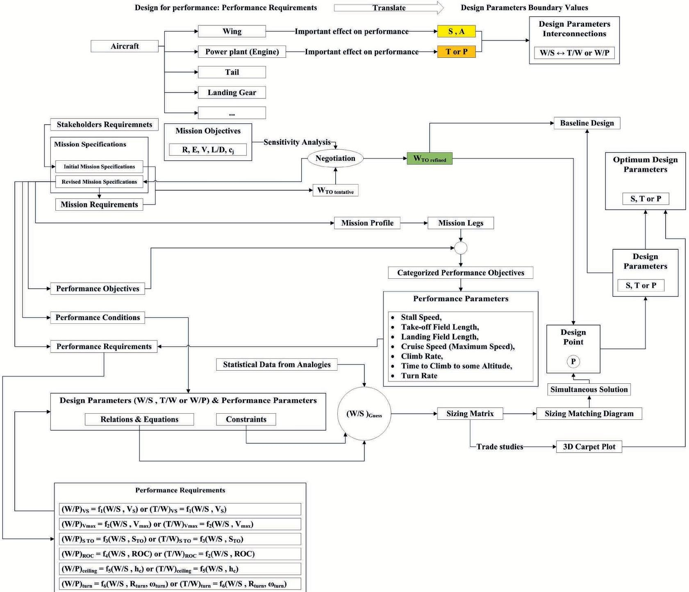

Figure 4.

Aircraft sizing using design plane technique flow graph.

Due to the necessity of compliance between physical structure and grouping of the system DPs [15], the DPs should be categorized in to three groups:

The DPs of Information;

The DPs of Energy;

The DPs of Matter.

So, it can be concluded that the airplane DPs in compliance with the grouping of its constituent elements are set in to three groups of Information, Energy, and Matter. Then the MDPs must be one parameter of Information, one parameter of Energy, and one parameter of Matter. These three parameters should have the following features:

They should have the strongest effect on performance;

They should be independent of each other;

The other DPs should depend on these parameters;

They should be the output of sizing and input to the next phase.

So, the inventor of "airplane sizing method using the design plane technique" has selected the following MDPs among the others:

S from the DPs of Information category;

T or P from the DPs of Energy category;

WTO from the DPs of Matter category.

Although none of the airplane designers did not mention in their publications but it seems that the principle of "Grouping the DPs based on the physical structure" has been observed in their work.

<!-- PDF_PAGE: 5 -->

## SATELLITE SIZING USING THE DESIGN PLANE TECHNIQUE

The purpose of performance sizing in this article is to identify the best combination of DDs in allowable design area in the design plane. Each combination of the DDs in the allowable design area represents a point that is named point design (PD). The PDs are the solutions which meet all the constraints and requirements of the mission but may not be the best possible solution. In each stage of the mission engineering process, the PDs could be considered a temporal criteria of progress. The PDs are expected to meet the following purposes:

To prove the feasibility of mission objectives;

To prove that the mission and performance constraints and requirements are satisfiable;

To create a basis for negotiations with customers to modify the requirements and constraints (according to 20/80 rule).

The PD is valuable because it can be presented quickly and simply. It is important to take the PD not more serious than it is. The best PD is named BLD. By progressing the mission engineering process, the BLD will be compared with the other solutions in terms of performance. If there is a better point, then the old BLD will be replaced with the new one. By completing the system design, the BLD will be confirmed and finally it will be accepted as the system design.

After confirming the BLD, mass, size, power, and the total lifecycle cost including design, manufacture, test, launch, and satellite mission operations will be calculated. The performance sizing process will be considered as a part of conceptual design phase, so the accuracy and volume of calculations will be in compliance with this phase of design.

After verification and validation, this method will enable the designer to respond a proposal to a customer's request in the shortest possible time.

## THE PROPOSED METHOD TO ACHIEVE THE OBJECTIVES OF THE STUDY

The proposed method to achieve the objectives of the study is a step-by-step approach as follows:

Step 1. Determination of statistical society based on classification of satellites and then collecting statistical samples;

Step 2. Determination of phases and the associated modes of the satellites performance;

Step 3. Determination of PRs and quantitative criteria (performance parameter);

Step 4. Determination of performance constraints and quantitative criteria (performance parameter);

Step 5. Determination of system DPs;

Step 6. Identification of system MDPs;

Step 7. Redefining the performance parameters based on the MDPs; determination of DDs and design space dimensionality reduction;

## Step 8. Creating a variety of design planes and selecting the best;

## Step 9. Rechecking the statistical society of other classes of satellites with the resulting design plane.

According to the research team, the rapid sizing method using the design plane technique, can be applied to all kinds of engineering systems, so the payload subsystem of a remote sensing cubesat has been selected as the case study of the article. To clarify the formation process of the design plane with the aim of satellite sizing and conceptual design, this case has been sized based on the stepwise method and the results are given at the end of each step.

## Step 1. Determination of statistical society based on classification of satellites and then collecting statistical samples.

The airplane design plane is applicable for all types of airplanes including twenty mission classes, two weight classes (light and heavy), and two application classes (military and civil), and is the same for jet and propeller engines in its totality [9]. The satellites can be divided into six broad categories based on their mission or payloads: (1) observation or sensing, (2) communications, (3) navigation, (4) in situ sampling and observations, (5) sample return, and (6) crew life support and transportation [1]. Based on weight they can be divided to large and small satellites. Given the importance of orbit in satellite design, the variety of orbits is considered in their division as well.

Therefore, the design plane which will be created for satellite sizing is better to be honest for all classes of satellites including mission, weight and position.

After collecting, the statistical samples should be divided into two groups. The first, which has more members, will be used for creating the design plane and the other will be used for rechecking the results.

The specifications of remote sensing cubesat, for which the payload subsystem has been sized using the design plane technique, are as follows:

Three-unit (3U) cubesat

Mission class: remote sensing

Weight class: small satellite—nanosatellite (1-10 Kg)

Position class: LEO (Circular, Sun synchronous)

## Step 2. Determination of phases and the associated modes of the satellites performance.

The requirements which dominate the system design are divided in to four categories based on their effect on performance, cost, risk, or schedule [1]. Some of them may have an affect on more than one feature. Since the overall strategy is "Design for Performance", this study is focused on requirements in the field of performance. According to Figure 4, PRs are entirely dependent on phases and the associated modes of the satellite performance. So, for the statistical population collected in the previous step, the performance phases and associated modes should be fully determined.

The performance phases and associated modes of the sample remote sensing cubesat is depicted in the Table 1 [4], [16], [17].

<!-- PDF_PAGE: 6 -->

Table 1.

<table border="1"><tr><td colspan="6">Mission Phases and Associated Performance Modes</td></tr><tr><td rowspan="2">Modes</td><td colspan="5">Phase</td></tr><tr><td>Prelaunch</td><td>Launch</td><td>Separation</td><td>Normal</td><td>Disposal</td></tr><tr><td>Normal</td><td>-</td><td>-</td><td>-</td><td>-</td><td>-</td></tr><tr><td>Off</td><td>×</td><td>-</td><td>-</td><td>-</td><td>-</td></tr><tr><td>Test</td><td>×</td><td>-</td><td>-</td><td>-</td><td>-</td></tr><tr><td>Transportation</td><td>×</td><td>-</td><td>-</td><td>-</td><td>-</td></tr><tr><td>Commissioning</td><td>-</td><td>-</td><td>-</td><td>×</td><td>-</td></tr><tr><td>Beacon signal transmission</td><td>-</td><td>-</td><td>-</td><td>×</td><td>-</td></tr><tr><td>Commanding</td><td>-</td><td>-</td><td>-</td><td>×</td><td>-</td></tr><tr><td>Telemetry signal transmission</td><td>-</td><td>-</td><td>-</td><td>×</td><td>-</td></tr><tr><td>Imaging</td><td>-</td><td>-</td><td>-</td><td>×</td><td>-</td></tr><tr><td>Working in eclipse</td><td>-</td><td>-</td><td>-</td><td>×</td><td>-</td></tr><tr><td>Working out of eclipse</td><td>-</td><td>-</td><td>-</td><td>×</td><td>-</td></tr><tr><td>Abnormal</td><td>-</td><td>-</td><td>-</td><td>-</td><td>-</td></tr><tr><td>Commissioning</td><td>-</td><td>-</td><td>-</td><td>×</td><td>-</td></tr></table>

The optical payload will be active in the Imaging mode, thus the PRs and constraints are related to this mode.

## Step 3. Determination of critical requirements and quantitative criteria.

In the third step, the PRs are identified. PRs are the mission requirements that dominate the space mission's overall design and therefore, most strongly affect the space system performance. The most common PRs and some DPs which have mutual effects with them are listed in Table 2.

The PRs are largely dependent on satellite performance modes in each of its mission phases. Thus, after determining certain phases and associated modes of satellite operation, the PRs of each mode can be defined. This method minimizes the risk of omission of PRs.

Each PR is firstly expressed in the form of a qualitative phrase and then will be summarized by a quantitative criterion. The quantitative criterion is a parameter which will be considered as a measure of how that requirement has been met in the domain of performance. The important point in defining the performance criterion is that parameter should really measure the objective and not chosen for simplicity of computations.

In the following, the performance quantitative criteria will be called performance parameters (PPs) and will be displayed as $ \mathrm{P_{n}} $ In addition to PRs and PPs, also the DPs which have interactions with them should be identified.

The PPs of the cubesat optical payload and the effective and affected DPs have been listed in [17].

Table 2.

Most Common Performance Requirements [1]

<table border="1"><tr><td>Requirement</td><td>What It Affects</td></tr><tr><td>Coverage or response time</td><td>Number of satellites, altitude, inclination, communications architecture, payload field of view, scheduling, staffing requirements</td></tr><tr><td>Resolution</td><td>Instrument size, altitude, attitude control</td></tr><tr><td>Sensitivity</td><td>Payload size and complexity, processing, thermal control, altitude</td></tr><tr><td>Mapping accuracy</td><td>Attitude control, orbit and attitude knowledge, mechanical alignments, payload precision, processing</td></tr><tr><td>Signal strength</td><td>Payload size and power, altitude, transmit power</td></tr><tr><td>On-orbit lifetime</td><td>Redundancy, weight, power and propulsion budgets, component selection</td></tr><tr><td>Survivability</td><td>Altitude, weight, power, component selection, design of space and ground system, number of satellites, number of ground stations, communications architecture, system redundancy</td></tr></table>

<!-- PDF_PAGE: 7 -->

In general, the PRs of cubesat optical payload can be divided into four categories:

Spatial resolution

Temporal resolution

Spectral resolution

Radiometric resolution

Spatial resolution is equivalent to the smallest unit in each image (pixel) and the interpreter cannot identify point targets smaller than a pixel. Ground Sampling Distance (GSD) can be used as the quantitative measure of this PR [18].

The applications of images which could be obtained from the cubesat have been listed as follows [17]:

To study the rapid climate changes;

Meteorological (wind speed and type of clouds);

Vegetation indices and growth and health of plants;

To determine the land and water boundaries, coastal erosion maps and tidal effects;

To monitor the changes in the territorial and agricultural lands.

According to Table 3, for the above-mentioned applications, GSD must have a value between 9 m and 30 m. The allowable range of GSD could be written as follows:

$$
\mathrm {G S D} \leq 3 0 \mathrm {m}
$$

Temporal resolution is defined as the amount of time needed to revisit and image the exact same area at the same viewing angle a second time $ (\Delta t) $ . The actual temporal resolution of a sensor or this amount of time depends on the orbital characteristics of the sensor

platform as well as sensor characteristics. The temporal resolution is high when the revisiting delay is low and vice-versa. Temporal resolution is usually expressed in days [19], [20].

The effective DPs on temporal resolution are number of satellites, their arrangement in the form of a constellation and the orbit attitude. In the case under consideration, the number of satellites has been constrained to one from the beginning. There are no special requirements about the temporal resolution and the maximum time interval between reimaging of a specified point as well. Therefore, it could be considered that the time interval between reimaging of a specific point $ (\Delta t) $ is preferred to be the least. Anyway, in the sizing phase which is a part of the conceptual design process, if there are some requirements related to temporal resolution, the point of their effect is the orbit altitude as a DP.

Spectral resolution describes the ability of a sensor to define fine wavelength intervals. The finer the spectral resolution, the narrower the wavelength range for a particular channel or band. Spectral resolution is often defined as the dimensionless parameter $ \lambda /\delta \lambda $

Depending on the intended applications of the images which could be obtained from the cubesat and according to Table 4, the detectable spectral band for the sensor will be 400 nm-1,000 nm and its subbands are the following:

Blue (0.44-0.51)—operating wavelength: 0.457 $ \mu m $

Green (0.52-0.6)—operating wavelength: 0.56 $ \mu $m

Red (0.63-0.69)—operating wavelength: 0.66 $ \mu $m

Near Infra-Red (NIR) (0.77-0.90)—operating wavelength: 0.835 $ \mu $m

As a result, $ \lambda /\delta \lambda=4. $

Radiometric resolution of an imaging system describes its ability to discriminate very slight differences in energy. The finer the radiometric resolution of a sensor, the more sensitive it is to

Table 3.

GSD for Different Detection Applications of Remote Sensing Images in a Variety of Sensors [19]

<table border="1"><tr><td rowspan="2">GSD↓</td><td colspan="4">Sensor→</td></tr><tr><td>Panchromatic</td><td>Multispectral</td><td>Thermal Infrared</td><td>RADAR</td></tr><tr><td>≥9m</td><td>D-Port</td><td>D-Coastline</td><td>D-Deforested area</td><td>D-Railroad track</td></tr><tr><td>4.5m-9m</td><td>D-Factory</td><td>D-Road</td><td>D-Airliner</td><td>D-Tanker</td></tr><tr><td>2.5m-4.5m</td><td>D-Train</td><td>I-Main streets</td><td>I-Active chimneys</td><td>I-Railway station</td></tr><tr><td>1.2m-2.5m</td><td>I-Highway</td><td>D-Small boat</td><td>D-Switched-on cars</td><td>D-Road bridges</td></tr><tr><td>0.75m-1.2m</td><td>I-Trucks</td><td>D-Cars</td><td>I-Tall masts</td><td>D-Train wagon</td></tr><tr><td>0.4m-0.75</td><td>I-Kind of car</td><td>D-Domestic animals</td><td>D-Switched-on engines</td><td>S-Kind of radar antenna</td></tr></table>

D Detection

Identification

$ ^{s} $ Specification

<!-- PDF_PAGE: 8 -->

Table 4.

The Main Applications of a Multispectral Sensor Bands [19]

<table border="1"><tr><td>Band</td><td>Spectral Range μm</td><td>Examples of Applications</td></tr><tr><td>Blue</td><td>0.44-0.51</td><td>Identification of soil and plant
Detection of coastlines
Specification of plants</td></tr><tr><td>Green</td><td>0.52-0.60</td><td>Identification of healthy plants and infested plants
The depth of coastal waters estimation
Detection of cultural artifacts</td></tr><tr><td>Red</td><td>0.63-0.69</td><td>Identification of plant species
Identification of soils based on geological boundaries</td></tr><tr><td>NIR</td><td>0.77-0.9</td><td>Biomass estimation
Moisture of soil estimation
Identification of land and water</td></tr><tr><td>Shortwave Infra-Red-1(SWIR-1)</td><td>1.55-1.75</td><td>Determination of plants moisture
Identification of cloud and snow
Identification of snow and ice</td></tr><tr><td>Shortwave Infra-Red-2(SWIR-2)</td><td>2.07-2.35</td><td>Identification of stones and minerals
Determination of plants moisture</td></tr><tr><td>Thermal Infra-Red</td><td>10.3-12.4</td><td>Earth surface temperature estimation
Moisture of soil estimation
Specification of clouds
Fire detection</td></tr></table>

detecting small differences in reflected or emitted energy. Imagery data are represented by positive digital numbers which vary from 0 to one less than a selected power of 2 as follows:

$$
R a d i o m e t r i c R e s o l u t i o n = 2 ^ {B} - 1
$$

Where B corresponds to the number of bits used for coding the output of each detector element in each of the spectral bands. B could be considered as the performance quantitative criteria for radiometric resolution requirement [19].

In the case of the cubesat payload, there is no constraint for the number of quantization bits of the detector element. In general, higher value of B results in better performance of the cubesat optical payload.

## Step 4. Determination of constraints and quantitative criteria.

The performance constraints usually limit the implementation techniques available to the system designer. Some of the most common performance constraints and factors which normally impact them could be found in [1].

The performance constraints are also expressed in terms of a qualitative phrase at first and then by quantitative criteria to finally

how that constraint has been satisfied could be evaluated. The performance constraints are another restrictive factor of the allowable design area in the design plane.

In addition to the performance constraints and quantitative criteria, the DPs which have interactions with them should also be identified.

Some of the constraints by which the design of cubesats payloads are dominated are listed in Table 5.

Constraint of payload mass is not a performance constraint but since the performance constraints are collected to carry out the performance sizing of the cubesat payload, this constraint could be used for the results of the performance sizing to be verified at the end of this phase.

Payload mass $ \leq1.5 $ Kg

Constraint of payload power is also not a performance constraint as the constraint of payload mass; since the performance constraints are collected to carry out the performance sizing of the cubesat payload, this constraint could be used for the results of the performance sizing to be verified at the end of this phase.

Payload orbit Power $ \leq1.8 $ W

<!-- PDF_PAGE: 9 -->

Table 5.

<table class="table table-bordered"><thead><tr><th>Cubesat Type</th><th>3U</th><th>2U</th><th>1U</th></tr></thead><tbody><tr><td>Payload Mass</td><td>1.5 Kg</td><td>0.8 Kg</td><td>0.3 Kg</td></tr><tr><td>Payload Orbit Power</td><td>1.8 W</td><td>1.1 W</td><td>1 W</td></tr><tr><td>Max. Data Downlink/Pass</td><td>7,500 KB</td><td>2,000 KB</td><td>700 KB</td></tr><tr><td>Attitude Determination Accuracy</td><td>&lt; 0.5°</td><td>&lt; 0.5°</td><td>&lt; 1.0°</td></tr><tr><td>Attitude Control Accuracy</td><td>&lt; 5.0°</td><td>&lt; 5.0°</td><td>&lt; 10.0°</td></tr></tbody></table>

Constraint of Image Quality is a performance constraint that should be considered in the design of cubesat passive optical payload. This constraint is related to the quality of images which could be acquired from the operating satellite and its quantitative criterion could be Q by the below definition [1]:

$$
Q = \frac {d}{x}
$$

where x is the pixel size and d is the airy disk diameter. The airy disk diameter could be calculated by (3) [21].

$$
d = 2. 4 4 \times \lambda \left(\frac {f}{D}\right)
$$

The allowable range of Q is as follows:

$$
0. 4 \leq Q \leq 2
$$

When x < d and in results Q > 1 then it gives the best possible image spatial resolution with the given aperture.

Technological constraints—lens manufacturing: the optical payload size depends significantly on the f (focal length) and D (aperture diameter). In order to improve the cubesat passive optical payload performance, these two parameters both have a tendency to increase. The commercial off the shelf (COTS) lenses which could be installed in the sensors of the remote sensing cubesats have been listed in [22] and the following constraints could be extracted from that database:

1. 68 mm $ \leq $ f $ \leq $ 50.0 mm

$$
\mathrm {F} \#_ {\max } = 2. 8 \mathrm {a n d} \mathrm {F} \#_ {\min } = 1. 7 \left(\mathrm {F} \# = \mathrm {f} / \mathrm {D}\right)
$$

A database containing of optical payloads which have been installed on latest successfully launched cubesats was created in order to provide the need for statistical data. Based on this database the value of $ \mathrm{F} \#_{\mathrm{m i n}} $ could be reduced to 1.2.

Technological constraints—sensor manufacturing: Since the size of available detector elements in the COTS market are limited thus it should be considered as a technological constraint.

Table 6.

Identification of Performance DPs of a Remote Sensing Satellite in Low Orbit [1]

<table border="1"><tr><td>Performance Criterion</td><td>Formula</td><td>Performance DP</td></tr><tr><td>Observation Frequency</td><td>(No. of spacecraft)/12 hr</td><td>No. of spacecraft</td></tr><tr><td>Time Late</td><td>Onboard storage delay + Processing time</td><td>Storage delay</td></tr><tr><td>Resolution</td><td>Distance × [(wavelength/aperture) + control error]</td><td>Altitude, aperture, control accuracy</td></tr></table>

Some sensors that could be implemented in the optical payload of remote sensing cubesats have been listed in [22]. The following technological constraint could be extracted from that database:

## 2 $ \mu \mathrm{m} \leq \mathrm{x}_{\mathrm{pix}} \leq 1 4 \ \mu \mathrm{m} $

In addition, the number of elements that can be arranged in horizontal and vertical rows and eventually form an array of elements is considered mostly as a technological constraint.

## Step 5. Determination of system DPs.

The system DPs are identified based on the physical and technical nature of the issue, constraints that are imposed on mission design, and the solutions selected for the problem [23]. The system DPs or the principal mission characteristics are those parameters which have both of the following properties:

The DPs should influence the system performance (they should have interaction with the PPs);

The designer should be able to control and change the DPs.

So, if there is a parameter which has effect on performance, but is beyond the designers control, therefore, is not a system DP. The most common system DPs for space missions along with what limits them, and what they limit have been listed in [1]. Using the list helps to ensure that no system DP is overlooked.

To identify the DPs, at first a table like Table 6 should be drawn. The quantitative performance criteria which identified in step 3 must be written in the first column. Then a formula or algorithm should be developed to express the estimate for the value of each PP. This could include either system algorithms or unique algorithms, which are developed by means of statistical data. These algorithms make a relation between the PPs and the effected or effective DPs. The statistical population collected in the first step will be used here.

In order to use the statistical data, at first the correlation between each of the PPs and the corresponding DPs should be specified. Principal Component Analysis (PCA) is a useful method for quantifying the correlation (or lack thereof) amongst the perfor-

<!-- PDF_PAGE: 10 -->

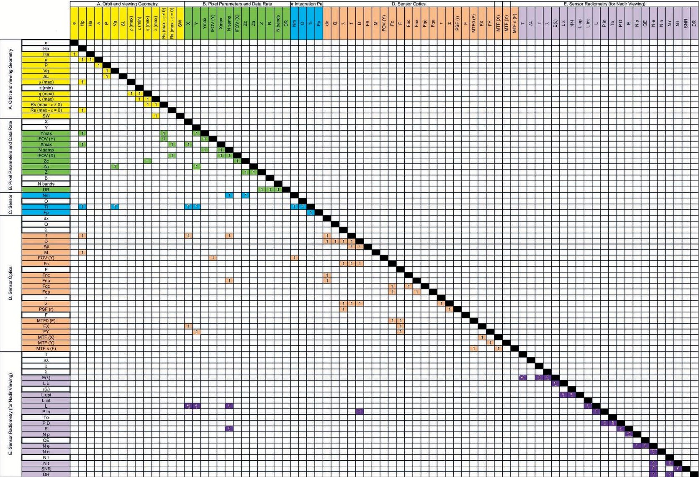

Figure 5. The cubesat passive optical payload design structure matrix.

mance and DPs. Complementary parameters are aligned such that increasing the value of one increases the value of the other whereas competing parameters demonstrate the converse of this situation. Neutral parameters are uncorrelated [24].

Here the uncorrelated DPs are removed and the resulting correlation between PP and the corresponding DPs should be formulated. In order to formulate the relationship between a PP and the corresponding DPs, fuzzy logic and the Sugeno inference approach can be applied [25].

Each of the developed formulas should be examined looking for possible hidden parameters. Hidden parameters are factors affecting more than one PP or may appear in more than one formula.

## Step 6. Identification of system MDPs.

After extracting a formula which could define a PP based on the corresponding DPs, the MDPs should be identified. Other than the two principal properties of the DPs, the main ones have four additional properties that make them distinguishable from the others. The MDPs have the strongest effect on system performance; they are independent of each other. Other DPs are dependent on them, and they are the output of sizing and the input of the next phase. Based on this definition, each of the DPs in the extracted formula should be examined. The final goal is to select the three MDPs

among the DPs identified in the previous step. These parameters can be named as follows:

One DP of Information (I);

One DP of Energy (E);

One DP of Matter (M).

To do this, at first, all the PPs and DPs should be arranged in the form of a parameter-based design structure matrix according to Figure 5 [26]. The arrangement of the parameters in this form requires determining their category that must be done in this step. The relations between PPs and DPs have been identified based on an Excel code that has been developed and published in [1].

Removal of the dependent parameters must be based on one of the following criteria:

The number of times that the parameter appears in different formulas;

Sensitivity analysis;

The physical nature of the problem;

The underlying logic of the process

The simplicity of calculations.

<!-- PDF_PAGE: 11 -->

To identify the relevant parameters, PCA method can also be used here. At this stage, also the curve fitting methods will be used to determine the relation between the correlated parameters. Then, the independent parameters will be maintained and the dependent ones will be deleted. This process of pairwise comparison, maintaining and removal of DPs, should continue until to remain one DP in each category. These three parameters which have the greatest impact on satellite performance are called the main parameters of satellite design.

By implementing this step, the performance MDPs of the cubesat passive optical payload will be as follows:

Orbit altitude (H)

Focal length (f)

Effective entrance aperture (D)

According to the definition of each of these parameters [27], they could be categorized as depicted in the Table 7.

## Step 7. Redefining the PPs based on the MDPs, determination of DDs, and design space dimensionality reduction.

In this step, the formulas which define the quantitative criteria of PRs (PPs) must be rewritten in terms of DPs. During rewriting the formulas, the dependent DPs are replaced with the MDPs including E, M, and I. There are PPs and MDPs in the resulting formulas.

To create the design plane, the three MDPs including a parameter of Information, a parameter of Energy, and a parameter of Matter must be combined in such a way that their number reduces to two parameters. These binary combinations for example could be displayed as (E/M, I/E) or (E/M, I/M) and they will be called design drivers (DDs). The DDs are better to provide physical insight rather than to be just a parametric combination of MDPs. In order to identify the best binary combinations of the MDPs, it is better to focus on formulas which two of three MDPs are appeared in them.

The reference equations must be rewritten in terms of the DDs. One of the DDs should be considered as function or dependent variable and the other should be considered as independent variable. The reference equations should be rearranged in such a way that the dependent variable is moved to the left and the independent variables are moved to the right side of the equation:

$$
\begin{array}{l} \left(\frac {E}{M}\right) _ {P _ {1}} = f _ {1} \left(\frac {M}{I}, P _ {1}\right) \\ \cdot \quad \left(\frac {E}{M}\right) _ {P _ {2}} = f _ {2} \left(\frac {M}{I}, P _ {2}\right) \\ \end{array}
$$

$$
\cdot \quad \dots
$$

$$
\left(\frac {E}{M}\right) _ {P _ {n}} = f _ {n} \left(\frac {M}{I}, P _ {n}\right)
$$

Based on the airplane sizing method, the following binary combinations could be written:

$$
\frac {W}{S} \equiv \frac {M}{I}, \frac {T}{W} \equiv \frac {E}{M} \Rightarrow \left(\frac {M}{I}, \frac {E}{M}\right)
$$

or

$$
\frac {W}{S} \equiv \frac {M}{I}, \frac {W}{P} \equiv \frac {M}{E} \Rightarrow \left(\frac {M}{I}, \frac {M}{E}\right)
$$

According to the Table 7, the following binary combinations of the performance MDPs of the cubesat optical payload could be created:

$$
\left(\frac {M}{I}, \frac {E}{M}\right) \Rightarrow f i r s t: \left(\frac {f}{D}, \frac {H}{f}\right)
$$

or

$$
\left(\frac {M}{I}, \frac {M}{E}\right) \Rightarrow s e c o n d: \left(\frac {f}{D}, \frac {f}{H}\right)
$$

An optical system can be described by its so-called infinity F-number or F-stop, often written as f/, F, F No., or F#. It is defined as f/D, where D is the effective entrance aperture, which is the effective diameter of the lens or primary telescope mirror. The magnification (M) or scale, f/H, is the ratio of the image size to the object size [1]. Since the f/H and f/D are two physical concepts, these two ratios will be selected as initial DDs.

## Step 8. Creating a variety of plane designs and selecting the best.

In this step, a variety of design planes must be drawn using DDs, which were obtained in the previous step. Those samples, which were excluded in the first step for rechecking the results, should be used in this step. In this step, using the new statistical samples, the design plane which mostly matches the reality will be selected.

The performance sizing of the cubesat passive optical payload has been fulfilled based on the requirements and constraints which govern its performance using the stepwise method presented in the following:

## 1. Sizing to the Spatial Resolution Requirements.

The spatial resolution requirements can be summarized in the following inequality:

$$
\mathrm {G S D} \leq 3 0 \mathrm {m}
$$

Equation (6) shows a relation between DD, f/H, and the PP, GSD where x is the detector element size or the sensor pixel size.

$$
\frac {f}{H} = \frac {x}{G S D}
$$

Table 7.

Categorization of the Performance MDPs of the Cubesat Optical Payload

<table border="1"><tr><td>Parameter</td><td>Description</td><td>Category</td></tr><tr><td>f</td><td>Orbit altitude</td><td>Matter</td></tr><tr><td>D</td><td>Focal length</td><td>Information</td></tr><tr><td>H</td><td>Effective entrance aperture</td><td>Energy</td></tr></table>

<!-- PDF_PAGE: 12 -->

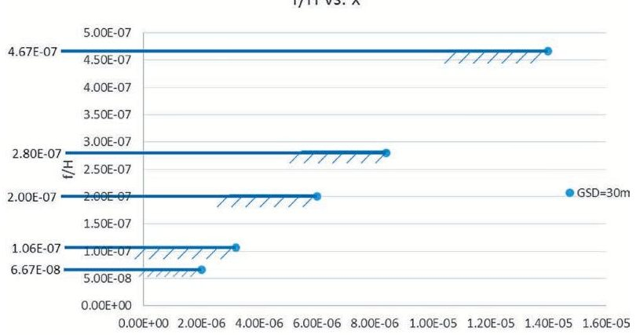

Figure 6. f/H vs. x, GSD = 30 m.

The objective of this sizing process part is to show the effect of PP, GSD, and the imposed constraints on it, on the DD, and f/H.

$$
G S D \leq 3 0 m \Rightarrow \frac {f}{H} \geq \frac {x}{G S D = 3 0 m}
$$

The size of the detectors elements which can be used in cubesats passive optical sensors has been given in Table 8.

Based on inequality (7), for each size of the available detector elements, the values of f/H higher than the corresponding value of x will be acceptable, and the graph shown in Figure 6 could be drawn.

From the graph of Figure 6, the PRs and constraints could be matched in the design plane only for the largest size of the detector elements and the results are acceptable for the other sizes of the detector elements.

As a result: f/H $ \geq $ 4.67E-7

In the case of contradiction between the above constraint and the other requirements and constraints, it leads to impossibility of allowable design area formation; the large sensor elements must be ignored and the largest allowable size of the detector elements must be chosen among the smaller ones.

## Constraint of DP, H

According to the mission specifications and the general rule about the operating orbit of the remote sensing satellites with passive optical payloads, the intended cubesat will be injected to a Sun synchronous orbit. The altitude of this kind of orbits is in the range of 600 Km to 800 Km. The reason of this limitations is explained in [28].

Table 8.

<table border="1"><tr><td colspan="3">f/H vs. x, GSD=30m</td></tr><tr><td>x(μm)</td><td>GSD(m)</td><td>f/H</td></tr><tr><td>1.40E-05</td><td>30</td><td>4.67E-07</td></tr><tr><td>8.40E-06</td><td>30</td><td>2.80E-07</td></tr><tr><td>6.00E-06</td><td>30</td><td>2.00E-07</td></tr><tr><td>3.18E-06</td><td>30</td><td>1.06E-07</td></tr><tr><td>2.00E-06</td><td>30</td><td>6.67E-08</td></tr></table>

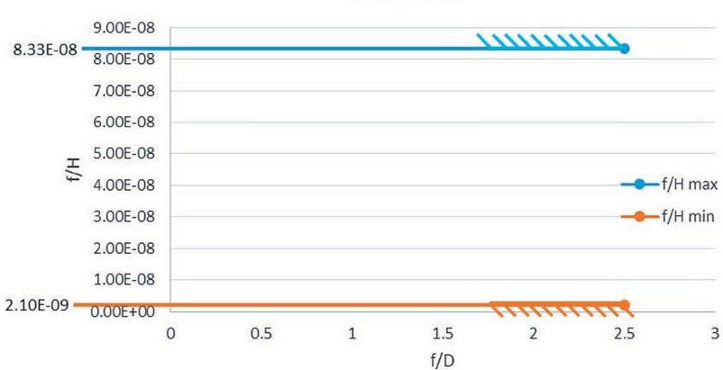

Figure 7.

The minimum and maximum value of DD f/H based on the constraint of altitude in sun-synchronous orbits.

The upper limit of this range is determined due to the inner Van Allen radiation belt which begins from a/R = 1.1 and is equivalent to H = 637.8 Km [29]. According to the statistical data, heights less than 800 Km is acceptable.

The lower limit of this range is determined according to the requirements of the remote sensing cubesat ballistic life in the sun synchronous orbits.

Temporal resolution requirements, if any, also could be influential in determining the orbit altitude and change the intervals outlined above. Although these changes affect the results of cubesat passive optical payload sizing calculations, they will not change the method of calculation.

The driver f/H was calculated for all the available lenses in two altitude limits and the results have been written in the Table 9.

The minimum and maximum values of f/H which are marked with blue and red in Table 9 are shown in Figure 7 as a graph with two boundary value which should be considered in final matching diagram.

Table 9.

The F/H DD for All the Available Lenses in Two Altitude Limits

<table border="1"><tr><td>f(mm)</td><td>f/D</td><td>Hmin(Km)</td><td>Hmax(Km)</td><td>f/(Hmin)</td><td>f/(Hmax)</td></tr><tr><td>1.68</td><td>2.5</td><td>600</td><td>800</td><td>2.80E-09</td><td>2.10E-09</td></tr><tr><td>2.2</td><td>2.5</td><td>600</td><td>800</td><td>3.67E-09</td><td>2.75E-09</td></tr><tr><td>3.6</td><td>2</td><td>600</td><td>800</td><td>6.00E-09</td><td>4.50E-09</td></tr><tr><td>4.3</td><td>1.8</td><td>600</td><td>800</td><td>7.17E-09</td><td>5.38E-09</td></tr><tr><td>6.4</td><td>2.4</td><td>600</td><td>800</td><td>1.07E-08</td><td>8.00E-09</td></tr><tr><td>8</td><td>2.5</td><td>600</td><td>800</td><td>1.33E-08</td><td>1.00E-08</td></tr><tr><td>10.06</td><td>2.8</td><td>600</td><td>800</td><td>1.68E-08</td><td>1.26E-08</td></tr><tr><td>16</td><td>2</td><td>600</td><td>800</td><td>2.67E-08</td><td>2.00E-08</td></tr><tr><td>25</td><td>2.5</td><td>600</td><td>800</td><td>4.17E-08</td><td>3.13E-08</td></tr><tr><td>35</td><td>2</td><td>600</td><td>800</td><td>5.83E-08</td><td>4.38E-08</td></tr><tr><td>50</td><td>2.5</td><td>600</td><td>800</td><td>8.33E-08</td><td>6.25E-08</td></tr></table>

<!-- PDF_PAGE: 13 -->

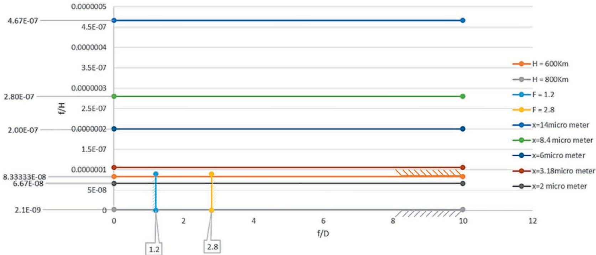

Figure 8. f/H for available sizes of detector elements and the boundary values of f/H based on the constraint of the orbit altitude.

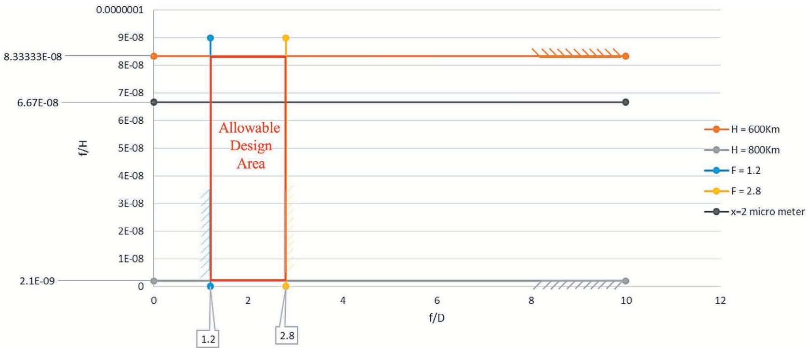

Figure 9.

The allowable design area after sizing to the spatial resolution.

According to Figure 8, the value of f/H for the detector elements larger than 2 $ \mu\mathrm{m} $ are greater than the boundary values specified in Figure 8 and they are outside of the allowable area, so only the sensor with size 2 $ \mu\mathrm{m} $ remains in the allowable area and the four other sensors with size larger than 2 $ \mu\mathrm{m} $ will be unusable.

Due to the lenses manufacturing technological constraint, the value of the DD, f/D is enclosed between two boundary values of 1.2 and 2.8 then allowable area in this stage is as indicated in Figure 9.

## 2. Sizing to the Spectral Resolution Requirements.

The following equation, which relates the physical properties of an optical satellite image payload, can be considered:

$$
D = \frac {\lambda f}{Q x}
$$

Equation (8) could be rewritten as follows:

$$
\frac {f}{D} = \frac {Q . x}{\lambda}
$$

When the smallest pixel size is taken into account, then:

$$
x \geq x _ {\min } = 2 \mu m \Rightarrow \frac {f}{D} \frac {\lambda}{Q} \geq x _ {\min } \Rightarrow \frac {f}{D} \geq \frac {x _ {\min } . Q}{\lambda}
$$

When the largest pixel size is taken into account, then:

$$
x \leq x _ {\max } = 1 4 \mu m \Rightarrow \frac {f}{D} \frac {\lambda}{Q} \leq x _ {\max } \Rightarrow \frac {f}{D} \leq \frac {x _ {\max } . Q}{\lambda}
$$

<!-- PDF_PAGE: 14 -->

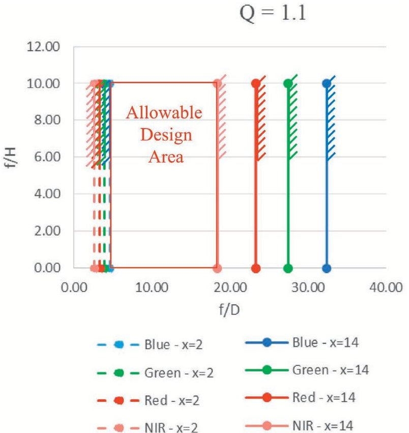

Figure 10.

Sizing to spectral resolution.

As depicted in Figure 10, the allowable design area will be between the shortest wavelength with the smallest pixel size (Blue $ - x=2 \mu \mathrm{m} $ ) and the longest wavelength with the largest pixel size $ \mathrm{(N I R}-x=1 4 \mu\mathrm{m}). $

If Q>1, then an image with good quality could be provided so Q could be considered constant and equal to 1.1.

According to the results of sizing to spatial resolution requirements, it is allowed to use only detector elements with size $ x=2\mu \mathrm{m} $ in the sensor. Since the shortest wavelength (Blue $ -\lambda=0.475\mu \mathrm{m} $ ) also covers the requirements of other wavelengths, then the next calculations could be performed only for this wavelength and the results could be generalized to the other wavelengths.

## 3. Sizing to Image Quality Requirements.

By eliminating x (detector element size) from (6) and (9), (10) could be reached.

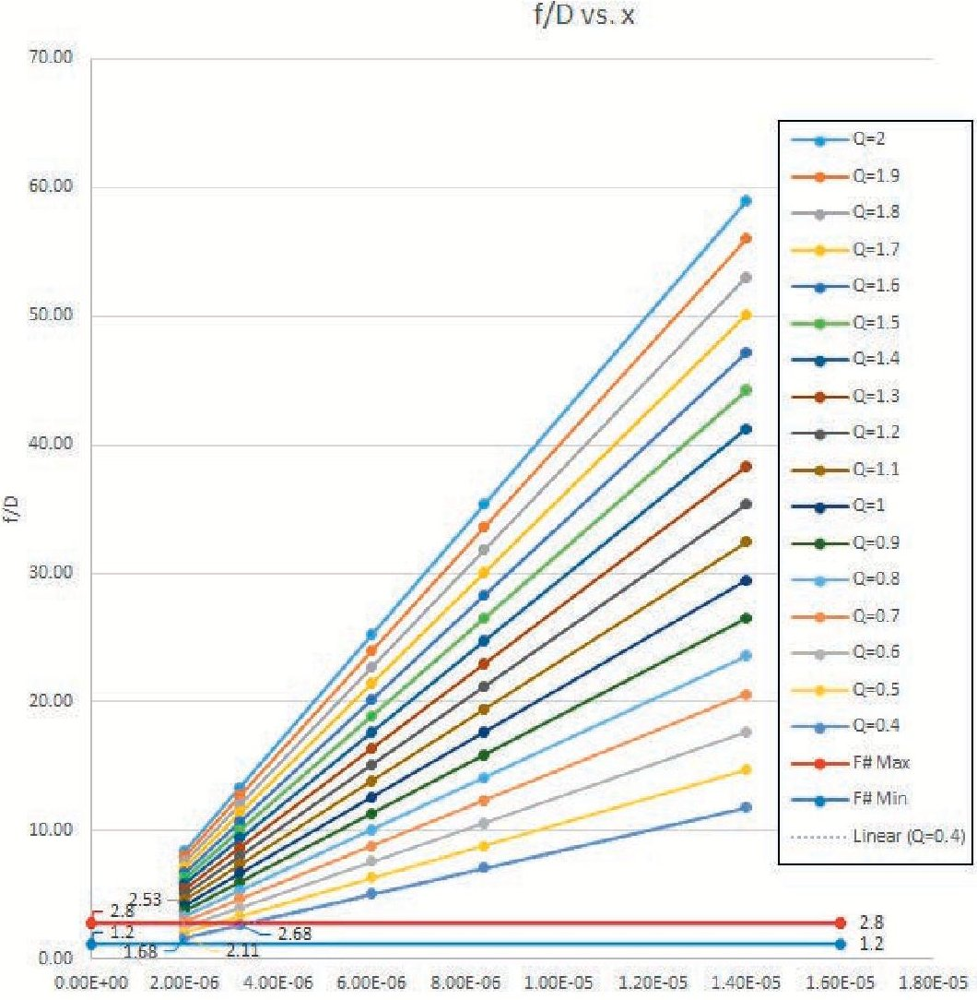

$$
\frac {f}{H} = \frac {1}{Q} \frac {\lambda}{G S D} \frac {f}{D}
$$

Figure 11. F# vs. x for different values of Q.

In Figure 12, the graphs of F# vs. x have been drawn for different values of Q. The boundary values of F# (DD, f/D) has been specified in this graph. Based on the lens manufacturing technological constraints the allowable F# must be in the below interval:

1. 2 $ \leq $ F# $ \leq $ 2.8

As could be seen in Figure 12, there are four points in the allowable area where the boundary values of F# define its borders. For better display, the allowable area in Figure 11 has been shown from a closer view in Figure 12.

The PDs which based on their F# value and their detector element size are placed in the allowable area, have been listed in Table 10 and they are shown in the design plane in Figure 13.

The following points could be inferred using Figure 13:

Among the PDs, the point which has the higher value of f/D, also has the higher value of Q.

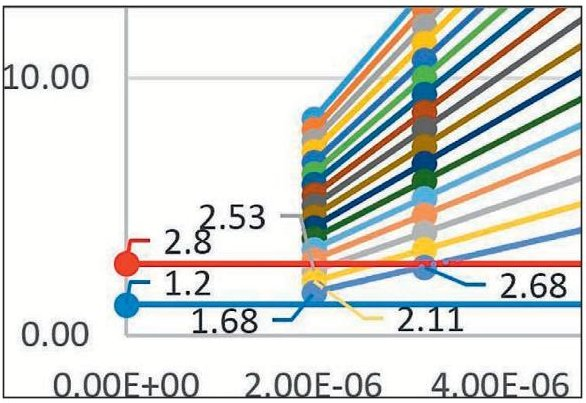

Figure 12.

F# vs. x for different values of Q and the allowable area from the close view.

<!-- PDF_PAGE: 15 -->

Matching Diagram

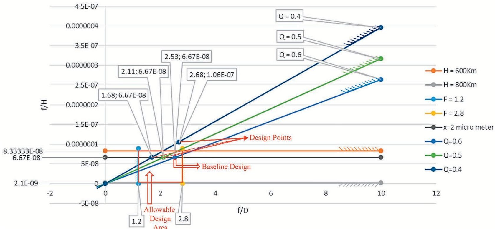

Figure 13. The matching diagram, design points, and the BLD.

So, if there were more PDs in the allowable design area the best point is which has the higher value of f/D.

Among the PDs with the same f/H values, the best point is which has the higher value of f/D.

Among the design points with the same Q, the best point is which has the higher values of f/H and f/D.

In the allowable design area, the focus is on the corner which has the highest values of f/D and f/H.

Since the best orbit altitude in this case is the least and $ \mathrm{H}_{\mathrm{m i n}}= $ 600Km, so according to Table 10, the BLD specifications are as written in the Table 11.

## Sizing of Cubesat Optical Payload

According to Table 5, the constraints of the maximum mass and the maximum power consumption of the cubesat optical payload are as follows:

$$
\mathrm {M} \leq 1. 5 \mathrm {K g}
$$

$$
\mathrm {P} \leq 1. 8 \mathrm {W}
$$

In order to size the intended cubesat optical payload, the scaling method could be used. In this method, one of the MDPs should be selected as the scaling criterion and then the cubesat optical payload could be sized using the scaling statistical relations and based on an existing instrument. Due to the lack of enough statisti-

Table 10.

<table border="1"><tr><td colspan="6">Design Points</td></tr><tr><td>λ</td><td>GSD</td><td>Q</td><td>x</td><td>f/D</td><td>f/H</td></tr><tr><td>4.75E-07</td><td>30</td><td>0.6</td><td>2.00E-06</td><td>2.53</td><td>6.67E-08</td></tr><tr><td>4.75E-07</td><td>30</td><td>0.5</td><td>2.00E-06</td><td>2.11</td><td>6.67E-08</td></tr><tr><td>4.75E-07</td><td>30</td><td>0.4</td><td>3.18E-06</td><td>2.68</td><td>1.06E-07</td></tr><tr><td>4.75E-07</td><td>30</td><td>0.4</td><td>2.00E-06</td><td>1.68</td><td>6.67E-08</td></tr></table>

Table 11.

<table border="1"><tr><td colspan="3">The BLD Specifications</td></tr><tr><td>λ</td><td>4.75E-07</td><td>μm</td></tr><tr><td>GSD</td><td>30</td><td>m</td></tr><tr><td>Q</td><td>0.6</td><td>-</td></tr><tr><td>x</td><td>2.00E-06</td><td>μm</td></tr><tr><td>f/D</td><td>2.53</td><td>-</td></tr><tr><td>f/H</td><td>6.67E-08</td><td>-</td></tr><tr><td>H</td><td>600</td><td>Km</td></tr><tr><td>f</td><td>40</td><td>mm</td></tr><tr><td>D</td><td>15.82</td><td>mm</td></tr></table>

<!-- PDF_PAGE: 16 -->

cal data to create the required relations, the relations could be used which developed by Wertz [1]:

$$
R = \frac {A _ {i}}{A _ {o}}
$$

$ L_{i} \sim R L_{o} $ that L: Linear Dimensions

$ S_{i}\sim L_{i}^{2} $ that S: Surface Area

$$
V _ {i} \sim L _ {i} ^ {3} \text {t h a t} V: V o l u m e
$$

$$
M _ {i} \sim K R ^ {3} M _ {o} \text {t h a t} M: P a y l o a d M a s s
$$

$$
P _ {i} \sim K R ^ {3} P _ {o} \mathrm {t h a t} P: P \mathrm {a y l o a d C o n s u m i n g P o w e r}
$$

$$
\text {I f} \mathrm {R} < 0. 5 \text {t h e n} \mathrm {K} = 2, \text {o t h e r w i s e} \mathrm {K} = 1.
$$

In (11) $ A_{i} $ is the scaling criterion in the intended cubesat optical payload and $ A_{o} $ is the scaling criterion in the selected existing instrument. Wertz has selected the MDP, D as the scaling criterion.

Generally, one of the MDPs, f, D, or H should be selected as the criterion of scaling. The DDs could not be used as the scaling criterion because they are dimensionless ratios and may remain constant even if the MDPs (the numerator and denominator) change.

Since sizing is the process of estimating mass, volume, power consumption, and the cost of design, manufacturing, and operations of the space system and its subsystems, and in addition the volume and mass of an optics depend significantly on the focal length and the aperture [21], so the parameters, f and D are more suitable to be selected as the scaling criterion. D is a parameter of information and f is a parameter of matter as stated in step 6, so it seems that at first the main parameter, f and then the main parameter, D could be used as the scaling criterion and finally the results could be compared with each other.

## Selecting an Existing Instrument

At this stage, a passive optical sensor similar to the intended remote sensing cubesat payload which has been used in the cubesats launched before must be selected. In order to select an appropriate existing instrument, the following criteria should be considered:

Operating wavelength ( $ \lambda $);

GSD (at the same orbit altitude).

In principle, the criteria of similarity should be selected based on the instrument application domain.

NanoCam C1U with the technical specifications listed in [30] is a suitable existing instrument which the size of the intended passive optical payload could be scaled based on its size.

Sizing of the Cubesat Optical Payload using Scaling Method Based on the DP, f

At first, the MDP, f is considered as the scaling criterion:

$$
R = \frac {f _ {i}}{f _ {o}} \Rightarrow R = \frac {4 0}{7 0} \Rightarrow R = 0. 6
$$

$$
R = 0. 6 \Rightarrow \mathrm {K} = 1
$$

Payload Mass:

$$
M _ {i} = K R ^ {3} M _ {o} \Rightarrow M _ {i} = 1 \times 0. 6 ^ {3} \times 2 7 7 \Rightarrow M _ {i} = 6 0 g r a m s
$$

$ M_{i}\leq1. 5 \mathrm{K g} $

Payload Power:

$$
\begin{array}{l} P _ {i} = K R ^ {3} P _ {o} \Rightarrow P _ {i} = 1 \times 0. 6 ^ {3} \times 1, 3 0 0 \Rightarrow P _ {i} = 2 8 1 m W \\ P _ {i} \leq 1, 8 0 0 m W \\ \end{array}
$$

Payload size and volume:

$$
\begin{array}{l} V _ {i} = R ^ {3} V _ {o} \Rightarrow V _ {i} = (0. 6 \times 9 6) \times (0. 6 \times 9 0) \times (0. 6 \times 5 8) \\ V _ {i} = 5 7. 6 \times 5 4 \times 3 4. 8 m m ^ {3} \\ \end{array}
$$

Therefore, none of the constraints including payload mass and power consumption are violated.

Sizing of the Cubesat Optical Payload using Scaling Method Based on the DP, D

In this stage, another MDP, D is considered as the scaling criterion:

$$
R = \frac {D _ {i}}{D _ {o}} \Rightarrow R = \frac {1 6}{3 2} \Rightarrow R = 0. 5
$$

$$
R = 0. 5 \Rightarrow \mathrm {K} = 1
$$

Payload Mass:

$$
M _ {i} = K R ^ {3} M _ {o} \Rightarrow M _ {i} = 1 \times 0. 5 ^ {3} \times 2 7 7 \Rightarrow M _ {i} = 3 5 g r a m s
$$

$$
M _ {i} \leq 1. 5 \mathrm {K g}
$$

Payload Power:

$$
P _ {i} = K R ^ {3} P _ {o} \Rightarrow P _ {i} = 1 \times 0. 5 ^ {3} \times 1, 3 0 0 \Rightarrow P _ {i} = 1 6 2. 5 m W
$$

$$
P _ {i} \leq 1, 8 0 0 m W
$$

Payload size and volume:

$$
V _ {i} = R ^ {3} V _ {o} \Rightarrow V _ {i} = (0. 5 \times 9 6) \times (0. 5 \times 9 0) \times (0. 5 \times 5 8)
$$

$$
V _ {i} = 4 8 \times 4 5 \times 2 9 m m ^ {3}
$$

<!-- PDF_PAGE: 17 -->

Also in this case, none of the constraints including payload mass and power consumption have been violated. Due to the higher amount of payload mass, volume, and power consumption using the MDP, f then it is better to use these values in the rest of the design process.

## Step 9. Rechecking the statistical society of other classes of satellites with the resulting design plane.

The achieved design plane will be the best choice according to the features of the pilot satellite class which introduced in the first step. In this step the created design plane must be verified and validated, applied to the other classes of satellites. If not applicable, the previous steps from the first to the eighth must be repeated again for the desired class of satellites.

## FEATURES AND ADVANTAGES OF SATELLITE SIZING USING THE DESIGN PLANE TECHNIQUE

Wertz generally categorizes space missions into need-based and capability-driven missions [1]. The similarity of these two categories is to meet the mission objectives and user's needs better (performance), faster (schedule), cheaper (cost), and less risk. So in both cases, the starting point of the system design process will be hearing the voice of customers. The customer's request is usually presented in the form of a "Request for Proposal" (RFP). Typically, RFPs should contain mission requirements, constraints, and operating conditions of the system. Then the mission engineering team in response to the request should provide a proposal which is technical, reasonable, clear, and understandable for customers and investors as well. Performance Sizing, or sizing in brief, is a process that can be used to provide a proposal with the above characteristics. Performance sizing is a quick process in which the mission and PRs are translated in to the best combination of the DDs. This combination represents a BLD, based on which the weight, size, power consuming, and the design, manufacturing and operations costs could be estimated. The satellite sizing model that its idea is presented in this paper has the following features:

Minimizes the MDPs required for representing a BLD;

The ability to negotiate about the requirements and constraints through the sensitivity analysis based on the PPs;

Quickness in implementation of the technique;

The ability to observe the allowable design area (each point in the allowable design area represents an allowable combination of the DDs or a PD);

The ability to visually choose the best PD as a BLD;

Tangible and understandable BLD selection process for customers and other stakeholders (as codesign promotes designing with rather than for end-users [31]).

of a satellite using the design plane technique; the design plane technique was used previously only for sizing the aircrafts and in this research. The purpose was to implement the same procedure for sizing the satellites. In the aircraft design process, sizing is often done in the conceptual or preliminary design phase, but using this method, the satellite performance sizing process can be performed even before the start of the design process and it can be used for providing a technical proposal in response to a RFP. Using the design plane technique to create a BLD, the designer will be able to investigate all the PDs, and choosing the BLD visually, it will be tangible and understandable for the customers and as a result they will be able to perform trade studies in the design plane framework.

The purpose of this paper was to represent the idea of establishing a quick model for conceptual design and performance sizing

## CONCLUSION

The generic model extracted for the performance sizing of the airplanes using the design plane technique indicates that the model could be generalized to all of the engineering systems. Since the imaging payload is a subsystem of a cubic satellite system then creating the design plane and its performance sizing indicates the conceivability of such a 2D space for a remote sensing satellite system. The next stage of the research will focus on this purpose.

## REFERENCES

[1] Wertz, J. R., Everett, D. F., and Puschell, J. J. (Eds.). Space Mission Engineering: The New SMAD. Hawthorne, CA, USA: Microcosm Press, 2011.

[2] Yu, B. Y., Honda, T., Sharqawy, M., and Yang, M. Human behavior and domain knowledge in parameter design of complex systems. Design Studies, 2016, 242-267.

[3] ECSS Secretariat. Space project management—Project planning and implementation (ECSS-M-St-10C Rev. 1). ESA-ESTEC Requirements & Standards Division, Noordwijk, The Netherlands, 2009.

[4] Ley, W., Wittmann, K., and Hallmann, W. Handbook of Space Technology. Singapore: John Wiley & Sons, Ltd., 2009.

[5] Macdonald, V. B. M. The International Handbook of Space Technology. Berlin, Germany: Springer, 2014.

[6] Schunn, C. Engineering educational design. Journal of The International Society for Design and Development in Education, Vol. 1, 1 (2008).

[7] Wasson, C. S. System Analysis, Design, and Development Concepts, Principles, and Practices. US A: John Wiley & Sons, Inc., 2006.

[8] Ercan, B., and Elias-Ozkan, S. T. Performance-based parametric design explorations: A method for generating appropriate building components. Design Studies, (2015), 33-53.

[9] Torenbeek, E. Synthesis of Subsonic—An Introduction to The Preliminary Design of Subsonic General Aviation and Transport Aircraft, with Emphasis on Layout, Aerodynamic Design, Propulsion and Performance. Netherlands: Delft University Press, 1976.

[10] Roskam, J. Airplane Design—Part I: Preliminary Sizing of Airplanes Ottawa, Kansas: Roskam Aviation and Engineering Corporation, 1985.

[11] Raymer, D. P. Aircraft Design: A Conceptual Approach. USA: American Institute of Aeronautics and Astronautics, Inc., 1992.

[12] Sadraey, M. H. Aircraft Design—A Systems Engineering Approach. Chennai, India: John Wiley & Sons, Ltd., 2013.

<!-- PDF_PAGE: 18 -->

[13] Laurence, J., and Loftin, K. Subsonic Aircraft: Evolution and The Matching of Size to Performance. Hampton, Virginia: NASA, 1980.

[14] Qalehnou, M. S. An efficient bionic-based strategy for space stations manufacturing & assembly process. In Proceedings of the 64th International Astronautical Congress 2013, Beijing, China, 2013.

[15] Qalehnou, M. H. S. Development of space-based modular structures inspired by the growth patterns of plants. M.S. thesis (in Persian), Sharif University of Technology, Tehran, Iran, 2009.

[16] El-Haik, B. S. Axiomatic Quality: Integrating Axiomatic Design with Six-Sigma, Reliability, and Quality Engineering. USA: John Wiley & Sons, Inc, 2005.

[17] Eickhoff, J. Onboard Computers, Onboard Software and Satellite Operations: An Introduction. Berlin: Springer Science & Business Media, 2011.

[18] Bohlouri, V. Systematic design of a cube satellite with design structure matrix (DSM) method. M.S. thesis, University of Tehran, Faculty of New Sciences and Technologies, Tehran, Iran, 2013.

[19] Sharifi, A. Introduction To Remote Sensing. Tehran, Iran: University of Tehran, 2016.

[20] Shashi Shekhar, H. X. Encyclopedia of GIS. USA: Springer USA, 2008.

[21] Canadian Centre for Remote Sensing. Fundamentals of Remote Sensing. Canada, 2016.

[22] Sandau, R. A metrics to support the design of small satellite based high resolution mapping systems. In Proceedings of the 18th Annual AIAA/USU Conference on Small Satellites, Logan, UT, 2004.

[23] Gulzar, K. Camera design for pico and nano satellite applications. M.S. thesis, Luleå University of Technology, Kiruna, Sweden, 2009.

[24] Avnet, M. S., and Weigel, A. L. An application of the design structure matrix to integrated concurrent engineering. Acta Astronautica, 66 (2010), 937-949.

[25] O'Neill, M. G. An approach to analyze tradeoffs for aerospace system design and operation. Ph.D. dissertation, Massacussetts Institute of Technology, Cambridge, MA, 2013.

[26] Sabour, M. H. Fuzzy Sets and Fuzzy Logic. Canada: Concordia University, 2005.

[27] Amirreza, K., Marzieh, D., and Foad, S. Hierarchy definition of UAV conceptual design parameters based on a diachronic process matrix. IEEE Aerospace & Electronic System Magazine, (2015), 4-11.

[28] Photobit Technology Corporation. PB-MV40—4 Megapixel CMOS Active-Pixel Digital Image Sensor—Product Specification. 2001.

[29] Capderou, M. Satellites Orbits and Missions. France: Springer, 2005.

[30] Vallado, D. A., and Wertz, J. Fundamentals of Astrodynamics and Applications (4th ed.). USA: Microcosm Press, 2013.

[31] GOMSpace. NanoCam C1U Datasheet. GOMSpace A/S, 2015.

[32] Taffe, S. The hybrid designer/end-user: Revealing paradoxes in codesign. Design Studies, (2015), 39-59.